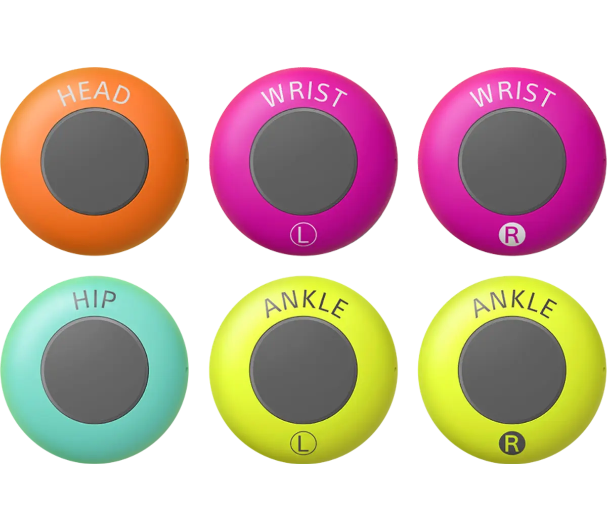
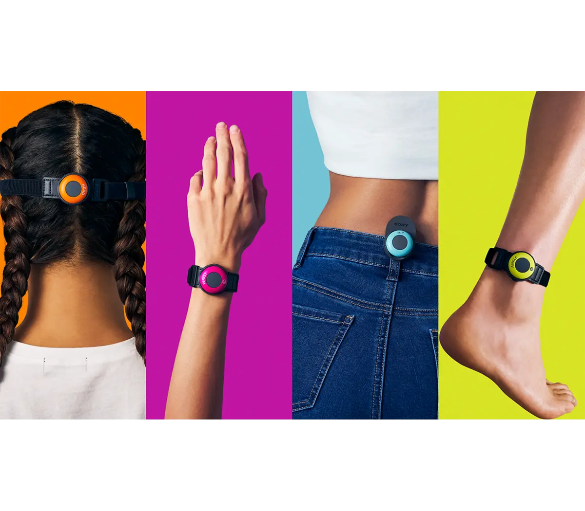
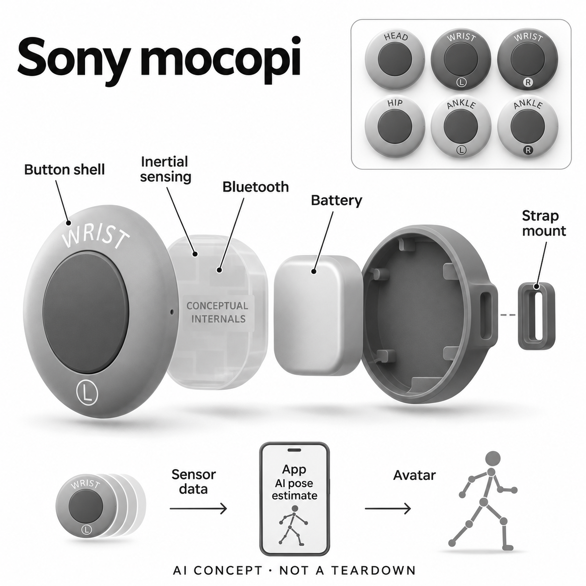

# Sony mocopi（标准六传感器套件）

**Sony** · 专业兴趣工具 · 核查 2026-11-04

从六个惯性传感点估计全身姿态的个人动作捕捉套件

消费渠道：个人零售。

## 产品图片与结构参考

### 产品图

Sony mocopi（标准六传感器套件） 官方产品图 · 来源：[Sony · 官方资料](<https://electronics.sony.com/more/mocopi/all-mocopi/p/qmss1-uscxk>) · [原始图片](<https://d1ncau8tqf99kp.cloudfront.net/converted/114934_original_local_1200x1050_v3_converted.webp>)

### 参考图

Sony mocopi（标准六传感器套件） 官方外观与使用参考图 · 来源：[Sony · 官方资料](<https://electronics.sony.com/more/mocopi/all-mocopi/p/qmss1-uscxk>) · [原始图片](<https://d1ncau8tqf99kp.cloudfront.net/converted/155462_original_local_1200x1050_v3_converted.webp>)

### AI 生成爆炸示意

**AI 生成 · 非实物拆机。** 内部为概念推断，不能作为元件布局、BOM 或维修依据。[生成提示词](../../content/hardware/prompts/sony-mocopi.txt)

> 以已目视核对的官方图片独立生成，未知内部为功能概念，不代表真实PCB、拆机或已采用供应商。

> 保留官方图片原貌；图片中的宣传数字和效果不作为本站实测。

> 分析为基于公开资料的案头研究与 AI 辅助判断，未经用户访谈、销量审计或实物拆机。需求、画像、竞争冷门度、审美及商业机会均为研究假设，不是投资结论。

## 销售与购买

- 状态：在售。核查日Sony美国官方商店及浏览器均显示标准mocopi为US$449.99、Add to Cart和预计11月10–11日配送。选择六传感器标准款，不将十二传感器Pro套装另计。

- 地区：美国（本轮已核官方商店）

- 价格：Sony美国官网US$449.99。标准六传感器和绑带；PC采集软件当前Basic为US$4.49/月，手机工作流和额外接收器条件另核，不默认包含全部PC编辑服务。

- 中国大陆：本轮核实美国官方销售与全球支持，未独立核对中国大陆官方SKU、App分发及售后；跨境购买需按地区与电脑/手机平台确认。

- [官方产品 / 商店](<https://electronics.sony.com/more/mocopi/all-mocopi/p/qmss1-uscxk>)

## AI 的实际作用

六个可穿戴IMU采集加速度和旋转运动，App以AI估计全身姿态；官方手册明确这是估计，不是直接测量每个关节。

服务与联网依赖：依赖校准、佩戴位置、蓝牙及手机或PC软件。惯性误差会累积，极快或极慢动作可能不佳；2026年10月后PC采集已独立至mocopi PC app，XYN Motion Studio侧重编辑。

## 是否冷门

细分专业（研究判断）：个人动捕是具体创作场景，已有软件估计和专业设备替代；后期可用程度与工具链兼容比新奇外形更重要。

## 需求与市场

案头需求是让个人动画、虚拟角色和表演创作者用较少设备记录全身动作。它减少固定相机与场地布置，但输出仍需检查和修正；真正价值在可用动作片段与制作时间，不是传感器数量少本身。

### 事实：任务边界 · 官方资料

Sony把标准mocopi作为个人全身动作捕捉套件销售，六个惯性小传感器配合手机或电脑，把动作转为角色姿态和可保存数据。官方手册明确使用AI估计，因此本条研究的是从真实表演到可编辑动作的转换，不是身体测量或健康监测设备。

依据：[Sony mocopi标准套件美国商店](<https://electronics.sony.com/more/mocopi/all-mocopi/p/qmss1-uscxk>) · [mocopi QM-SS1官方帮助指南](<https://helpguide.sony.net/mobile/qm-ss1/v1/en/print.pdf>)

### 判断：真实需求 · 研究判断

需求判断应围绕创作者已有的制作任务：虚拟角色直播、短动画和动作素材录制对延迟、连续性及后期精修的要求不同。减少传感器和摄影棚布置可能有帮助，但如果输出仍需大量清理，硬件设置省下的时间未必等于项目总成本下降。

依据：[Sony mocopi标准套件美国商店](<https://electronics.sony.com/more/mocopi/all-mocopi/p/qmss1-uscxk>) · [mocopi QM-SS1官方帮助指南](<https://helpguide.sony.net/mobile/qm-ss1/v1/en/print.pdf>)

### 验证：任务完成 · 待验证

调研可让个人创作者用自己的角色完成一段真实表演，分别记录穿戴、校准、重拍、数据清理和导入工具的时间。访谈问哪种动作最常失败、是否愿意为减少重拍付费，并比较使用前后的完整制作流程，不只展示同步舞动的演示片。

依据：[Sony mocopi标准套件美国商店](<https://electronics.sony.com/more/mocopi/all-mocopi/p/qmss1-uscxk>) · [mocopi QM-SS1官方帮助指南](<https://helpguide.sony.net/mobile/qm-ss1/v1/en/print.pdf>)

## 用户画像

适合已有虚拟角色或三维内容目标、愿意学习校准和软件连接的个人创作者。不是健身诊断工具，身高与动作条件会影响估计；只想直播面部的人未必需要整套全身捕捉。

### 事实：使用条件 · 官方资料

标准包包含六个指定佩戴位置的传感器和绑带，官方帮助说明体型、通信与校准条件会影响估计。软件支持手机基础工作流，也存在另需电脑和许可的流程；可以购买消费套件并不代表任何人的所有动作都能不加调整地转换成可用动画。

依据：[Sony mocopi标准套件美国商店](<https://electronics.sony.com/more/mocopi/all-mocopi/p/qmss1-uscxk>) · [mocopi QM-SS1官方帮助指南](<https://helpguide.sony.net/mobile/qm-ss1/v1/en/print.pdf>)

### 判断：人群筛选 · 研究判断

潜在画像是已有角色、动画或虚拟表演目标，并愿意处理校准和导出的人。只需要面部表情直播者可能不需要全身套件，追求精密运动测量者也不能直接套用创作设备；应该按输出用途筛选，而不是把所有游戏玩家当成同一种用户。

依据：[Sony mocopi标准套件美国商店](<https://electronics.sony.com/more/mocopi/all-mocopi/p/qmss1-uscxk>) · [mocopi QM-SS1官方帮助指南](<https://helpguide.sony.net/mobile/qm-ss1/v1/en/print.pdf>)

### 验证：参与者差异 · 待验证

招募时记录参与者常用软件、角色骨架、衣着与可用空间，让他们自行佩戴并完成一次恢复校准。访谈应问更在意实时同步还是离线成片、对动作修正有多少经验，以及传感器滑动后能否判断原因，避免只选择熟悉动捕的专业操作者。

依据：[Sony mocopi标准套件美国商店](<https://electronics.sony.com/more/mocopi/all-mocopi/p/qmss1-uscxk>) · [mocopi QM-SS1官方帮助指南](<https://helpguide.sony.net/mobile/qm-ss1/v1/en/print.pdf>)

## 竞争与替代

替代包括视频姿态估计、完整惯性动捕服和光学棚。标准mocopi降低佩戴点与安装负担，也可能增加未测关节推断和后期修正；不将Pro增加传感器当作另一独立需求凑数。

### 事实：方案范围 · 官方资料

手机视频姿态估计、完整惯性动捕服和光学摄影棚都可提供相关动作数据，标准mocopi是少量惯性点输入的路线。商店另列Pro十二传感器套装，本轮不将它重复收录为新需求；增加测量点会改变表现，却仍服务于相同的动作制作任务。

依据：[Sony mocopi标准套件美国商店](<https://electronics.sony.com/more/mocopi/all-mocopi/p/qmss1-uscxk>) · [Sony mocopi IMU说明](<https://xyn.sony.net/en/learn/mocopi/imu>) · [Sony mocopi使用限制与校准建议](<https://xyn.sony.net/en/learn/mocopi/tips>)

### 判断：替代关系 · 研究判断

视频方案可能不需佩戴设备但受视野和遮挡影响，惯性方案更自由却会出现漂移，完整传感服又可能增加穿戴与预算。mocopi的价值取决于具体动作和制作流程的取舍，不能仅凭不需基站或设备轻巧判断其输出一定优于其它路线。

依据：[Sony mocopi标准套件美国商店](<https://electronics.sony.com/more/mocopi/all-mocopi/p/qmss1-uscxk>) · [Sony mocopi IMU说明](<https://xyn.sony.net/en/learn/mocopi/imu>) · [Sony mocopi使用限制与校准建议](<https://xyn.sony.net/en/learn/mocopi/tips>)

### 验证：比较方法 · 待验证

对照应使用相同表演片段和目标角色，比较手脚接触、转身、快速动作及持续录制后的误差，并记录需要多少人工清理。对于实时直播和离线动画要分别评估，不能用其中一种任务的成功片段概括全部内容创作能力。

依据：[Sony mocopi标准套件美国商店](<https://electronics.sony.com/more/mocopi/all-mocopi/p/qmss1-uscxk>) · [Sony mocopi IMU说明](<https://xyn.sony.net/en/learn/mocopi/imu>) · [Sony mocopi使用限制与校准建议](<https://xyn.sony.net/en/learn/mocopi/tips>)

## 供应链

硬件由六个IMU小件、无线、电池、绑带及充电盒构成，App完成姿态估计。具体惯性芯片、代工与电芯未披露；传感一致性、校准和佩戴稳定需要与算法共同验证。

### 事实：功能组成 · 官方资料

Sony公开说明六个IMU提供加速度和旋转数据，硬件另含蓝牙、电池、按钮、佩戴座及充电盒，AI姿态估计属于软件链。具体惯性芯片、电芯和代工没有在本轮资料中点名，所以不能由小圆形外观或Sony品牌反推出全部上游器件。

依据：[mocopi QM-SS1官方帮助指南](<https://helpguide.sony.net/mobile/qm-ss1/v1/en/print.pdf>) · [Sony mocopi IMU说明](<https://xyn.sony.net/en/learn/mocopi/imu>)

### 判断：交付约束 · 研究判断

工程判断是传感器时间与姿态一致性、佩戴位置及无线稳定共同影响最终角色运动。单个IMU规格并不能代表多传感器系统的效果；批次偏差、绑带松动和充电维护也可能进入体验，供应验证应把校准和长期使用一起放进系统测试。

依据：[mocopi QM-SS1官方帮助指南](<https://helpguide.sony.net/mobile/qm-ss1/v1/en/print.pdf>) · [Sony mocopi IMU说明](<https://xyn.sony.net/en/learn/mocopi/imu>)

### 验证：选型缺口 · 待验证

TDK InvenSense可作为惯性采集能力候选，Grepow可作为受空间约束的小型电池候选。它们不被证实为mocopi供应商，需进一步核对采样、功耗、时序、形状与保护需求；不能把一个厂商具备边缘学习功能解释为本套件就在其芯片上运行姿态AI。

依据：[mocopi QM-SS1官方帮助指南](<https://helpguide.sony.net/mobile/qm-ss1/v1/en/print.pdf>) · [Sony mocopi IMU说明](<https://xyn.sony.net/en/learn/mocopi/imu>)

## 技术路径

官方明确使用AI估计全身姿态，并指出惯性漂移、动作速度与无线环境限制。少点输入并不等于每个关节都被测量；新PC软件与旧XYN采集说明的迁移也必须按当前文档区分。

### 事实：AI机制 · 官方资料

官方手册直接写明AI用于动作估计，技术页说明输入来自六个IMU而非每个关节上的测量装置。姿态是有限数据结合模型得到的结果；厂商也公开指出太快、太慢的运动和惯性误差累积可能影响表现，正确校准与定期重置属于正常工作流。

依据：[mocopi QM-SS1官方帮助指南](<https://helpguide.sony.net/mobile/qm-ss1/v1/en/print.pdf>) · [Sony mocopi IMU说明](<https://xyn.sony.net/en/learn/mocopi/imu>) · [Sony mocopi使用限制与校准建议](<https://xyn.sony.net/en/learn/mocopi/tips>)

### 判断：系统边界 · 研究判断

少点估计能降低穿戴复杂度，但未被直接观测的关节存在歧义，不能把顺滑的虚拟动作都解释成真实测量。输出对体型和动作的适配、蓝牙数据完整性与动画骨架映射相互作用，单独展示传感器输出频率无法证明整段角色动作准确。

依据：[mocopi QM-SS1官方帮助指南](<https://helpguide.sony.net/mobile/qm-ss1/v1/en/print.pdf>) · [Sony mocopi IMU说明](<https://xyn.sony.net/en/learn/mocopi/imu>) · [Sony mocopi使用限制与校准建议](<https://xyn.sony.net/en/learn/mocopi/tips>)

### 验证：算法与体验 · 待验证

验证可以固定同一套角色与参数，录制转身、停顿、手脚相近和重复动作，逐段检查漂移及接触关系，并保留重置前后结果。应同时记录无线环境与佩戴调整，判断失真来自测量、估计还是映射；本轮没有实测，不提供精度等级。

依据：[mocopi QM-SS1官方帮助指南](<https://helpguide.sony.net/mobile/qm-ss1/v1/en/print.pdf>) · [Sony mocopi IMU说明](<https://xyn.sony.net/en/learn/mocopi/imu>) · [Sony mocopi使用限制与校准建议](<https://xyn.sony.net/en/learn/mocopi/tips>)

## 产品审美

圆形小传感器用不同颜色和位置标记帮助佩戴，日常服装即可承载。审美还包含绑带舒适、左右识别和充电收纳；概念图以一个小件分层，避免画成整套机甲或专业动捕服。

### 事实：外观与交互 · 官方资料

真实图中传感器用不同颜色和头、腕、髋、踝标记区分，圆形按键与小型绑带座便于贴近身体佩戴。概念图只拆分一个小件并用六个完整小件作整体参照，没有画成头戴显示器、整套机械外骨骼或更多传感器的专业套装。

依据：[Sony mocopi标准套件美国商店](<https://electronics.sony.com/more/mocopi/all-mocopi/p/qmss1-uscxk>) · [mocopi QM-SS1官方帮助指南](<https://helpguide.sony.net/mobile/qm-ss1/v1/en/print.pdf>)

### 判断：使用中的形态 · 研究判断

小巧与配色可以降低佩戴理解门槛，但真实表演还要考虑绑带位置、衣物摩擦以及跑动时是否移位。对虚拟角色创作者，传感器可能不出现在最终画面，外观吸引力未必是首要价值；能够快速正确戴回去可能比低调颜色更重要。

依据：[Sony mocopi标准套件美国商店](<https://electronics.sony.com/more/mocopi/all-mocopi/p/qmss1-uscxk>) · [mocopi QM-SS1官方帮助指南](<https://helpguide.sony.net/mobile/qm-ss1/v1/en/print.pdf>)

### 验证：日常接受度 · 待验证

可观察用户在看说明一次后重新独立佩戴，记录左右混淆、绑带调节和放回充电盒的错误。访谈问哪个位置最容易被忘记、哪种衣服影响动作，以及连续表演后是否需要反复整理，把动态使用中的舒适与可靠纳入审美评估。

依据：[Sony mocopi标准套件美国商店](<https://electronics.sony.com/more/mocopi/all-mocopi/p/qmss1-uscxk>) · [mocopi QM-SS1官方帮助指南](<https://helpguide.sony.net/mobile/qm-ss1/v1/en/print.pdf>)

## 关键风险

风险是漂移、佩戴滑动或校准错误让虚拟角色姿态失真，以及软件订阅变化改变制作成本。不要把估计姿态用于医疗或精密测量结论；关键动画需要回看原动作与修正后的输出。

### 事实：已知限制 · 官方资料

官方提示惯性漂移、无线干扰和校准质量会影响动作，PC软件分工也在二〇二六年十月发生变化：采集已迁到mocopi PC app，XYN Motion Studio主要处理编辑管理。旧商品脚注仍带计划迁移措辞，因此需依据当前软件页说明而不是只抄历史摘要。

依据：[mocopi QM-SS1官方帮助指南](<https://helpguide.sony.net/mobile/qm-ss1/v1/en/print.pdf>) · [Sony当前PC动作软件分工](<https://xyn.sony.net/en/products/xyn_motion_studio>) · [Sony mocopi使用限制与校准建议](<https://xyn.sony.net/en/learn/mocopi/tips>)

### 判断：失效影响 · 研究判断

风险在于用户把AI估计的姿态当精确身体数据，或忽略软件许可与工具链的持续条件。对制作项目而言，发生在长片段后半段的漂移可能比首次配对失败更难发现；这些限制需要通过回看与工作流安排处理，而不是宣称设备无需维护校准。

依据：[mocopi QM-SS1官方帮助指南](<https://helpguide.sony.net/mobile/qm-ss1/v1/en/print.pdf>) · [Sony当前PC动作软件分工](<https://xyn.sony.net/en/products/xyn_motion_studio>) · [Sony mocopi使用限制与校准建议](<https://xyn.sony.net/en/learn/mocopi/tips>)

### 验证：风险处理 · 待验证

购买前核对目标手机或电脑、输出格式及所需许可，试用中安排连续录制与定期重置的比较。对用于严谨测量的需求应另选经过相应验证的设备，不将角色看起来合理当作物理正确；同时询问软件改变时用户是否仍能访问自己的动作文件。

依据：[mocopi QM-SS1官方帮助指南](<https://helpguide.sony.net/mobile/qm-ss1/v1/en/print.pdf>) · [Sony当前PC动作软件分工](<https://xyn.sony.net/en/products/xyn_motion_studio>) · [Sony mocopi使用限制与校准建议](<https://xyn.sony.net/en/learn/mocopi/tips>)

## 机会与验证

可验证机会是减少独立创作者反复布景与重拍的成本。让用户完成几个真实动画动作，记录校准、重置、清理曲线和导入引擎时间，再判断相较手机视频估计是否带来稳定收益。

### 判断：可尝试切口 · 研究判断

可尝试的切口是帮助个人创作者建立短动作、及时校准和快速清理的可重复流程，把少点动捕真正变成可用素材。若困难主要发生在骨架映射与导出，改善工具连接和错误提示可能比再增加一个佩戴点更重要；这只是待验证的创作机会。

依据：[Sony mocopi标准套件美国商店](<https://electronics.sony.com/more/mocopi/all-mocopi/p/qmss1-uscxk>) · [Sony当前PC动作软件分工](<https://xyn.sony.net/en/products/xyn_motion_studio>) · [Sony mocopi使用限制与校准建议](<https://xyn.sony.net/en/learn/mocopi/tips>)

### 判断：商业边界 · 研究判断

商业边界在于不同人对实时性和后期质量的容忍度不同，虚拟直播、业余短片与商业动画不能混成一个市场。基础硬件价格也不包含所有电脑、订阅和修正时间，本轮没有项目成本或创作者访谈，不能据销量评论预测专业软件替代规模。

依据：[Sony mocopi标准套件美国商店](<https://electronics.sony.com/more/mocopi/all-mocopi/p/qmss1-uscxk>) · [Sony当前PC动作软件分工](<https://xyn.sony.net/en/products/xyn_motion_studio>) · [Sony mocopi使用限制与校准建议](<https://xyn.sony.net/en/learn/mocopi/tips>)

### 验证：下一步调研 · 待验证

下一步可跟踪几个小型真实项目，逐项记录动作可用率、重拍原因、人工修改与最终是否采用，并询问哪些步骤愿意支付服务费。以完整交付和复用行为判断继续研究的方向，不用AI模型对创新程度的评分预测这个工具会成功。

依据：[Sony mocopi标准套件美国商店](<https://electronics.sony.com/more/mocopi/all-mocopi/p/qmss1-uscxk>) · [Sony当前PC动作软件分工](<https://xyn.sony.net/en/products/xyn_motion_studio>) · [Sony mocopi使用限制与校准建议](<https://xyn.sony.net/en/learn/mocopi/tips>)

## 对应供应链公司

能力候选用于选型研究，不代表本产品实际采用；未公开的供货关系不作推断。

- [tdk-invensense](../supply-chain/tdk-invensense.md) — **能力候选 · 非已采用** / 小型惯性运动采集候选：mocopi官方明确六个IMU提供加速度与旋转数据，TDK InvenSense公开惯性运动传感和穿戴方案，可作为对应采集模块候选。具体时序、精度、功耗与软件接口仍须匹配，没有点名供货证据，也不推断本机采用其边缘AI型号。

- [grepow](../supply-chain/grepow.md) — **能力候选 · 非已采用** / 圆形穿戴传感器电池候选：Grepow公开小型扣式、异形与穿戴电池方向，适合研究圆形动捕传感器的供电空间。实际电压、寿命、保护和充电座结构需要Sony规格才能验证，不能把形状接近的电池当作已采用或可自行更换的原配件。

[浏览供应链目录](../supply-chain.md)

## 功能分层示意

这是功能关系，不是实物拆机、真实空间结构或已核实 BOM。

1. **惯性采集**：六个IMU测量身体指定部位的加速度与旋转。（官方披露）

2. **佩戴与电源**：标记传感器、绑带、夹具和充电盒管理定位与补能。（官方披露）

3. **无线连接**：蓝牙将传感数据连接至手机或适配PC工作流。（官方披露）

4. **AI姿态估计**：App利用有限测量点估计全身姿态，未测关节不等同直接测量。（官方披露）

5. **创作输出**：动作数据与视频进入角色、三维和实时内容工具，PC采集与编辑应用分开。（官方披露）

## 来源

1. [Sony mocopi标准套件美国商店](<https://electronics.sony.com/more/mocopi/all-mocopi/p/qmss1-uscxk>) — 实际web与浏览器打开；六传感器标准版449.99美元、购买按钮、预计配送；Pro另列。

2. [mocopi QM-SS1官方帮助指南](<https://helpguide.sony.net/mobile/qm-ss1/v1/en/print.pdf>) — 实际打开50页PDF；AI姿态估计、佩戴、校准和平台依赖，非精确关节直接测量。

3. [Sony当前PC动作软件分工](<https://xyn.sony.net/en/products/xyn_motion_studio>) — 实际打开；2026年10月采集迁至mocopi PC app，当前Basic月费与编辑工具边界。

4. [Sony mocopi IMU说明](<https://xyn.sony.net/en/learn/mocopi/imu>) — 实际打开；六个惯性传感器、加速度和旋转数据，未点名上游传感芯片。

5. [Sony mocopi使用限制与校准建议](<https://xyn.sony.net/en/learn/mocopi/tips>) — 实际打开；漂移、快慢动作、无线干扰和校准要求，不借此声称实测精度。

[返回目录](../hardware-market.md) · [网页分析](https://romanagent.github.io/Roman/#hardware/product/sony-mocopi)
