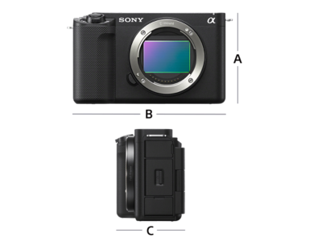
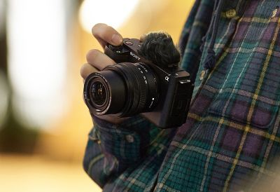
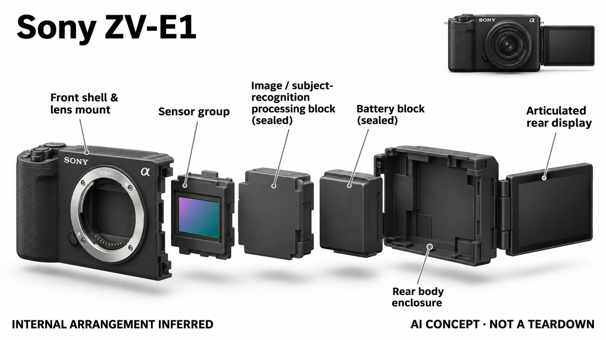

# Sony ZV-E1

**Sony** · 影像与创作 · 核查 2026-11-04

用主体识别帮助单人拍摄自动构图

消费渠道：个人零售。

## 产品图片与结构参考

### 产品图

Sony ZV-E1 · 官方产品图 · 来源：[Sony · 官方图片](<https://www.sony-asia.com/interchangeable-lens-cameras/products/zv-e1>) · [原始图片](<https://sony.scene7.com/is/image/sonyglobalsolutions/01_Dimensions?%24highlightsImages%24=&fmt=png-alpha>)

### 参考图

Sony ZV-E1 · 官方参考图 · 来源：[Sony · 官方图片](<https://www.sony-asia.com/interchangeable-lens-cameras/products/zv-e1>) · [原始图片](<https://sony.scene7.com/is/image/sonyglobalsolutions/02_Feature3_Mobile?%24toutMobile%24=>)

### AI 生成爆炸示意

**AI 生成 · 非实物拆机。** 内部为概念推断，不能作为元件布局、BOM 或维修依据。[生成提示词](../../content/hardware/prompts/sony-zv-e1.txt)

> 主图为官方外观与尺寸参考；场景图中的镜头与收音附件不包含在机身报价中。

> 分析为基于公开资料的案头研究与 AI 辅助判断，未经用户访谈、销量审计或实物拆机。需求、画像、竞争冷门度、审美及商业机会均为研究假设，不是投资结论。

## 销售与购买

- 状态：在售。Sony美国黑色机身官方商品页显示Add to Cart与具体预计配送日期；机身和镜头套装只计同一型号。

- 地区：美国官方商店

- 价格：美国官方机身 US$2,199.99。核查日页面快照；运费、税费、会员和配送区域按官方结算确认，不视为中国到手价。

- 中国大陆：本轮核实所列区域官方商店；未确认中国大陆官方现货、账户及完整服务，不把境外可购等同大陆可用。

- [官方产品 / 商店](<https://electronics.sony.com/imaging/interchangeable-lens-cameras/all-interchangeable-lens-cameras/p/ilczve1-b>)

## AI 的实际作用

专用AI处理支持人物等主体识别，Auto Framing根据识别目标自动裁切和调整构图。它改变画面取景，不会驱动相机机械转动，也不是生成实拍内容。

服务与联网依赖：需要兼容镜头和存储介质；自动构图有模式限制及裁切代价。基础识别在相机内运行，手机远程操作与云服务另行配置。

## 是否冷门

新兴竞争（研究判断）：面向个人视频创作者的全画幅工具形成具体使用场景；本轮没有销量与市场份额证据。

## 需求与市场

需求假设：单人录制访谈、讲解或日常视频时，希望固定机位仍能跟随主要人物构图。应比较自动裁切是否减少重拍和剪辑，而不是只看人物始终居中，画面节奏与信息完整性仍需创作者判断。

### 需求假设：单人固定机位需要构图变化 · 研究判断

ZV-E1的自动构图针对独自拍摄时无法同时出镜和调整画面的矛盾，用户希望固定相机仍能围绕主要人物变化取景。需要验证的是少重拍、少操作和叙事表达是否改善，而不是人物始终居中；某些讲解内容反而需要保留宽阔背景。

依据：[Sony美国ZV-E1官方商店](<https://electronics.sony.com/imaging/interchangeable-lens-cameras/all-interchangeable-lens-cameras/p/ilczve1-b>) · [Sony ZV-E1自动构图官方帮助](<https://helpguide.sony.net/ilc/2310/v1/en/contents/221h_auto_framing.html>)

### 价值判断：拍摄时决定与后期决定不同 · 研究判断

机内自动裁切可以减少部分后期操作，却也把构图选择提前交给算法，用户可能失去想保留的空间。研究应比较现场便利与后期自由，不能只统计省去几个剪辑步骤，也不将自动生成镜头变化视为更好的内容表达。

依据：[Sony ZV-E1自动构图官方帮助](<https://helpguide.sony.net/ilc/2310/v1/en/contents/221h_auto_framing.html>)

### 验证方案：同一讲解采用三条路径 · 待验证

让创作者用固定全景、机内自动构图和后期手动裁切完成同一段讲解，记录准备、重拍和编辑时间。请观众评价关键信息是否完整，再由创作者解释镜头选择，避免只比较脸部大小和中心位置，就判断自动构图有价值。

依据：[Sony美国ZV-E1官方商店](<https://electronics.sony.com/imaging/interchangeable-lens-cameras/all-interchangeable-lens-cameras/p/ilczve1-b>) · [Sony ZV-E1自动构图官方帮助](<https://helpguide.sony.net/ilc/2310/v1/en/contents/221h_auto_framing.html>)

## 用户画像

画像推断：已有镜头或愿意投入镜头系统、经常独自拍摄的个人视频创作者较匹配。只做轻量记录的人可能更需要手机和简易支架，不能把专业传感器和AI追踪当成所有人都需要的组合。

### 画像假设：已有镜头投入的独立创作者 · 研究判断

较匹配者可能已经使用可换镜头视频系统，或愿意为高频独自拍摄建立完整设备组合。仅希望随手记录的人未必需要这一投入，画像要包含拍摄频率、镜头管理和后期能力，不能把所有想做视频的人都归为全画幅AI相机用户。

依据：[Sony美国ZV-E1官方商店](<https://electronics.sony.com/imaging/interchangeable-lens-cameras/all-interchangeable-lens-cameras/p/ilczve1-b>) · [Sony亚太ZV-E1官方介绍](<https://www.sony-asia.com/interchangeable-lens-cameras/products/zv-e1>)

### 使用约束：镜头决定可裁切的现场空间 · 研究判断

机身可自动调整画面，但实际可见范围仍受所装镜头与机位限制，自动构图不能看到画面之外。用户需要愿意布置合适视角并检查裁切条件，拥有多个镜头也不代表能立即获得理想效果，首次录制前的设置能力仍很重要。

依据：[Sony ZV-E1自动构图官方帮助](<https://helpguide.sony.net/ilc/2310/v1/en/contents/221h_auto_framing.html>) · [Sony亚太ZV-E1官方介绍](<https://www.sony-asia.com/interchangeable-lens-cameras/products/zv-e1>)

### 访谈重点：最希望免去哪一种操作 · 待验证

请用户回放最近独自拍摄片段，标出何时需要走回相机、重拍或在后期重新构图，再询问哪些决定愿意交给算法。按具体操作负担而非内容平台划分人群，能够区分需要自动跟人、需要固定全景和已经习惯后期处理的创作者。

依据：[Sony ZV-E1自动构图官方帮助](<https://helpguide.sony.net/ilc/2310/v1/en/contents/221h_auto_framing.html>)

## 竞争与替代

竞争判断：手机人像追踪、软件后期重构图和其他相机都能替代部分自动构图，ZV-E1的区别是机内识别与全画幅视频链路。价格门槛较高，不能仅以AI处理器名称判断竞争强弱。

### 替代方案：后期重构图与手机跟随 · 研究判断

ZV-E1的自动构图与软件后期裁切、手机主体跟随和人工调整机位存在替代，但光学系统和工作流并不完全相同。比较应在同一内容目标下完成，不能以AI处理器名称或全画幅标签直接判断优势，也不把便宜替代等同所有任务效果相同。

依据：[Sony美国ZV-E1官方商店](<https://electronics.sony.com/imaging/interchangeable-lens-cameras/all-interchangeable-lens-cameras/p/ilczve1-b>) · [Sony ZV-E1自动构图官方帮助](<https://helpguide.sony.net/ilc/2310/v1/en/contents/221h_auto_framing.html>)

### 差异判断：机内处理减少外部依赖 · 研究判断

将识别与构图置于拍摄链路，可以让创作者在现场查看结果，但也受到录制模式和裁切规则约束。其差异在工作发生的位置与控制方式，未必是自动化程度越高越好；需要观察用户是否愿意提前确定构图策略，而不是保留到剪辑阶段。

依据：[Sony ZV-E1自动构图官方帮助](<https://helpguide.sony.net/ilc/2310/v1/en/contents/221h_auto_framing.html>)

### 比较方法：把画质代价与时间分开 · 待验证

在相同镜头视角和发布目标下，分别记录自动构图带来的时间变化、信息丢失和最终满意度。对裁切后的细节与视角应单独检查，不把它们合成无法解释的总分，避免一个便捷功能掩盖某些创作者不能接受的画面损失。

依据：[Sony美国ZV-E1官方商店](<https://electronics.sony.com/imaging/interchangeable-lens-cameras/all-interchangeable-lens-cameras/p/ilczve1-b>) · [Sony ZV-E1自动构图官方帮助](<https://helpguide.sony.net/ilc/2310/v1/en/contents/221h_auto_framing.html>)

## 供应链

供应链推断：传感器、镜头卡口、图像处理和散热结构需要保持长期稳定，镜头生态扩大了整套成本。官方未披露本轮型号具体代工厂和完整物料表，不由外壳或处理器宣传猜测内部布局。

### 功能拆分：数字裁切没有云台执行层 · 研究判断

原目录确认镜头与全画幅采集、AI主体识别和算法裁切，自动构图不会驱动机身机械转动。显示、音频与存储构成录制交互，因此供应图中不能为自动构图添加云台电机；未披露处理器布局、工厂和完整物料表也不能凭宣传推断。

依据：[Sony ZV-E1自动构图官方帮助](<https://helpguide.sony.net/ilc/2310/v1/en/contents/221h_auto_framing.html>) · [Sony亚太ZV-E1官方介绍](<https://www.sony-asia.com/interchangeable-lens-cameras/products/zv-e1>)

### 制造判断：紧凑机身要协调热与结构 · 研究判断

可换镜头机身需要同时支持卡口、翻转显示、持续处理和外部连接，外壳尺寸与散热、接口位置存在协同关系。供应评估应关注完整录制状态，而不是只估算处理器或传感器成本；本轮没有得到原机热设计、公差或供应商清单。

依据：[Sony美国ZV-E1官方商店](<https://electronics.sony.com/imaging/interchangeable-lens-cameras/all-interchangeable-lens-cameras/p/ilczve1-b>) · [Sony亚太ZV-E1官方介绍](<https://www.sony-asia.com/interchangeable-lens-cameras/products/zv-e1>)

### 候选选型：结构和电源与拍摄负载匹配 · 研究判断

瑞声可作为精密外壳与翻转结构的工程候选，欣旺达可讨论便携供电方案；两者均需依据镜头载荷、空间及录制功耗进行验证。这里不为数字裁切匹配机械驱动，也不因相关消费电子经验推断已经进入ZV-E1实际供应链。

依据：[Sony美国ZV-E1官方商店](<https://electronics.sony.com/imaging/interchangeable-lens-cameras/all-interchangeable-lens-cameras/p/ilczve1-b>) · [Sony亚太ZV-E1官方介绍](<https://www.sony-asia.com/interchangeable-lens-cameras/products/zv-e1>)

## 技术路径

官方帮助说明自动构图通过裁切跟随目标，并存在模式和画质取舍。技术判断应测试多人优先级、遮挡与边缘主体，不能把自动裁切画成云台电机，也不保证所有场景都能识别正确。

### 已披露能力：识别后改变画面窗口 · 官方资料

Sony帮助说明自动构图依据识别目标进行裁切，并具有模式与画质取舍。它调整输出窗口而非物理镜头方向，不能补拍原始视野之外的内容，也不是生成新的真实场景；这种机制边界应在产品介绍和结构示意中保持一致。

依据：[Sony ZV-E1自动构图官方帮助](<https://helpguide.sony.net/ilc/2310/v1/en/contents/221h_auto_framing.html>)

### 技术判断：正确识别人仍可能构图不合意 · 研究判断

讲解者可能需要让观众看背景物件、手部动作或多人关系，即使算法识别了正确人物，也可能裁掉重要信息。评价应将主体识别和构图意图分开，研究何时需要暂停或改变自动策略，而不是只用跟踪是否丢失作为全部质量标准。

依据：[Sony ZV-E1自动构图官方帮助](<https://helpguide.sony.net/ilc/2310/v1/en/contents/221h_auto_framing.html>)

### 验证方案：检查边缘与多人场景 · 待验证

测试人物走向画面边缘、短暂被遮挡、另一人加入以及举起物件时的构图变化，记录用户希望保留的内容是否完整。按官方模式条件保存设置，区分识别、裁切与录制限制，不将某次成功样片概括为所有镜头和场景均适用。

依据：[Sony ZV-E1自动构图官方帮助](<https://helpguide.sony.net/ilc/2310/v1/en/contents/221h_auto_framing.html>)

## 产品审美

审美判断：小型机身与可换镜头形成专业创作工具形象，翻转屏和防风附件服务自拍操作。镜头尺寸往往决定最终体积，机身轻巧的照片不能代表整套携带重量与握持感。

### 外形判断：小机身与镜头共同形成工具 · 研究判断

ZV-E1机身紧凑，翻转屏与音频附件服务自拍，但最终体积由镜头、固定支架和收音配置共同决定。裸机照片容易低估整套工作空间，审美评价应将线缆、屏幕方向和出镜者操作一并考虑，而不是只赞美机身的小巧或专业感。

依据：[Sony美国ZV-E1官方商店](<https://electronics.sony.com/imaging/interchangeable-lens-cameras/all-interchangeable-lens-cameras/p/ilczve1-b>) · [Sony亚太ZV-E1官方介绍](<https://www.sony-asia.com/interchangeable-lens-cameras/products/zv-e1>)

### 交互判断：自动构图状态需要可理解 · 研究判断

创作者出镜时不能持续操作机身，因此需要在开拍前清楚理解构图范围和运行条件。若用户无法判断是识别没有启动还是裁切达到边界，会增加无效重拍；交互的重点是状态和接管，不是把所有高级设置隐藏后称为简洁。

依据：[Sony ZV-E1自动构图官方帮助](<https://helpguide.sony.net/ilc/2310/v1/en/contents/221h_auto_framing.html>)

### 体验验证：独自完成整段录制流程 · 待验证

让创作者从安装镜头、摆机位和设置自动构图开始，独立完成一次讲解并检查成片。记录需要往返相机的原因、屏幕可见性和设置犹豫，结束后讨论哪一步希望改进，比在他人协助设置好的样机前短时出镜更有解释力。

依据：[Sony美国ZV-E1官方商店](<https://electronics.sony.com/imaging/interchangeable-lens-cameras/all-interchangeable-lens-cameras/p/ilczve1-b>) · [Sony ZV-E1自动构图官方帮助](<https://helpguide.sony.net/ilc/2310/v1/en/contents/221h_auto_framing.html>)

## 关键风险

风险判断：裁切会减少可用视角和画面细节，多人场景也可能选择错误主体。重要录制应保留合适的原始视角并事先测试，镜头、存储、长时散热和地区保修都需要计入实际使用条件。

### 画面风险：裁切造成不可忽视的取舍 · 研究判断

自动裁切会改变视角与可用细节，多人或物件展示时也可能删除用户需要的信息，不能将平滑取景等同内容完整。重要录制应先检查模式和框定范围，并按实际工作流安排备份或安全视角，本轮不承诺任何自动模式能够避免重拍。

依据：[Sony ZV-E1自动构图官方帮助](<https://helpguide.sony.net/ilc/2310/v1/en/contents/221h_auto_framing.html>)

### 系统风险：购买成本超出机身标价 · 研究判断

机身报价不包括全部镜头、存储和收音配置，长时录制与地区维修也需要在真实条件下确认。美国官方可购不等于大陆同版本服务已核实，不能将品牌全球知名度替代具体渠道条款，更不应从产品定位推断用户无需学习。

依据：[Sony美国ZV-E1官方商店](<https://electronics.sony.com/imaging/interchangeable-lens-cameras/all-interchangeable-lens-cameras/p/ilczve1-b>) · [Sony亚太ZV-E1官方介绍](<https://www.sony-asia.com/interchangeable-lens-cameras/products/zv-e1>)

### 验证安排：保留失败与人工接管记录 · 待验证

试用应保留裁掉重要内容、选择错误目标或模式不可用的片段，记录当时镜头、机位与设置，再检查用户如何恢复。不要只收集发布成功的视频，也不把所有问题都归为AI能力不足，明确限制来源才能判断是否适合该创作者。

依据：[Sony ZV-E1自动构图官方帮助](<https://helpguide.sony.net/ilc/2310/v1/en/contents/221h_auto_framing.html>)

## 机会与验证

市场观察：可让个人创作者完成同一段录制，比较固定全景、机内自动构图和后期裁切的时间与满意度。将少重拍、少操作和画质代价分别记录，不用传感器规格预测内容产出或商业成功。

### 研究方向：让自动构图表达用户意图 · 研究判断

潜在改进方向是帮助创作者明确希望保留人物、手部还是背景，并在必要时容易改变策略。机会可能位于拍摄预设、反馈或后期衔接，而不是再增加一种识别对象；应围绕具体内容任务研究，避免把全自动构图当作所有人共同目标。

依据：[Sony ZV-E1自动构图官方帮助](<https://helpguide.sony.net/ilc/2310/v1/en/contents/221h_auto_framing.html>)

### 执行计划：连续观察发布任务 · 待验证

跟踪数次实际视频制作，记录自动构图被开启、关闭和放弃的原因，以及最终采用多少自动画面。访谈时回放用户改动的片段，理解时间收益是否伴随表达损失，用连续作品而非一次测试确定价值，也不把观众播放量归因给相机。

依据：[Sony美国ZV-E1官方商店](<https://electronics.sony.com/imaging/interchangeable-lens-cameras/all-interchangeable-lens-cameras/p/ilczve1-b>) · [Sony ZV-E1自动构图官方帮助](<https://helpguide.sony.net/ilc/2310/v1/en/contents/221h_auto_framing.html>)

### 决策边界：专业规格不能替代需求证据 · 研究判断

全画幅采集与AI识别说明技术组合，并不能证明创作者愿意持续购买或更换系统。只有在重复任务中观察到可接受的时间与画面取舍，才值得进一步验证相关方案；本轮没有访谈与销量数据，不以规格排名或模型评分预测商业结果。

依据：[Sony美国ZV-E1官方商店](<https://electronics.sony.com/imaging/interchangeable-lens-cameras/all-interchangeable-lens-cameras/p/ilczve1-b>) · [Sony ZV-E1自动构图官方帮助](<https://helpguide.sony.net/ilc/2310/v1/en/contents/221h_auto_framing.html>)

## 对应供应链公司

能力候选用于选型研究，不代表本产品实际采用；未公开的供货关系不作推断。

- [aac-technologies](../supply-chain/aac-technologies.md) — **能力候选 · 非已采用** / 紧凑机身及翻转显示结构候选：瑞声公开精密结构和转轴协同能力，可作为ZV-E1机身与翻转屏周边的工程候选，但镜头载荷、热管理和相机接口需专项确认。自动构图属于数字裁切，本条不匹配云台驱动，也没有证据证明瑞声已为该型号提供任何结构件。

- [sunwoda](../supply-chain/sunwoda.md) — **能力候选 · 非已采用** / 可换镜头视频机身供电候选：欣旺达消费电池业务可用于讨论ZV-E1持续视频录制的便携电源，但必须核对实际负载、保护、通信与安装空间，不能只按容量判断可用。此关联不构成原机电池供货披露或替换建议，完整方案还需结合相机热与充电条件验证。

[浏览供应链目录](../supply-chain.md)

## 功能分层示意

这是功能关系，不是实物拆机、真实空间结构或已核实 BOM。

1. **光学采集**：可换镜头与全画幅传感器记录画面。（官方披露）

2. **主体识别**：AI处理识别主要拍摄目标。（官方披露）

3. **构图控制**：算法裁切并调整画面构图。（官方披露）

4. **录制交互**：翻转屏、音频与存储组成拍摄流程。（官方披露）

## 来源

1. [Sony美国ZV-E1官方商店](<https://electronics.sony.com/imaging/interchangeable-lens-cameras/all-interchangeable-lens-cameras/p/ilczve1-b>) — 已实际打开官方页面；功能说明不等于独立性能测量。

2. [Sony ZV-E1自动构图官方帮助](<https://helpguide.sony.net/ilc/2310/v1/en/contents/221h_auto_framing.html>) — 已实际打开官方页面；功能说明不等于独立性能测量。

3. [Sony亚太ZV-E1官方介绍](<https://www.sony-asia.com/interchangeable-lens-cameras/products/zv-e1>) — 已实际打开官方页面；功能说明不等于独立性能测量。

[返回目录](../hardware-market.md) · [网页分析](https://romanagent.github.io/Roman/#hardware/product/sony-zv-e1)
