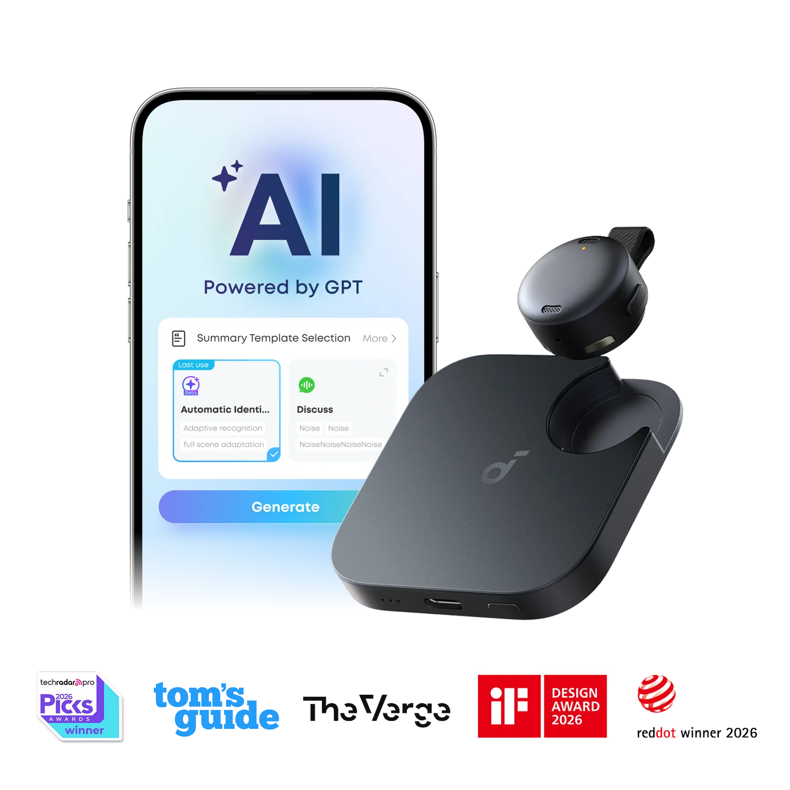
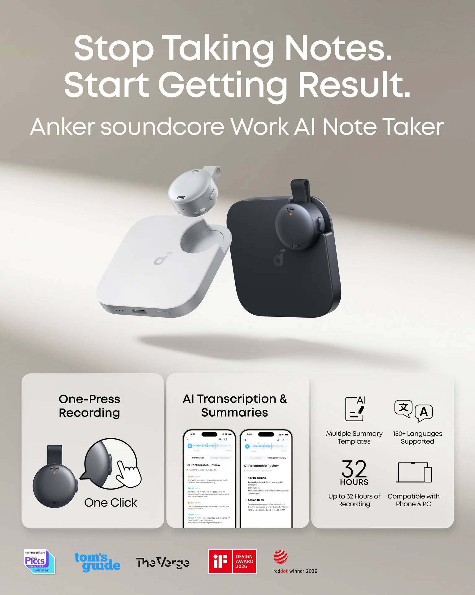
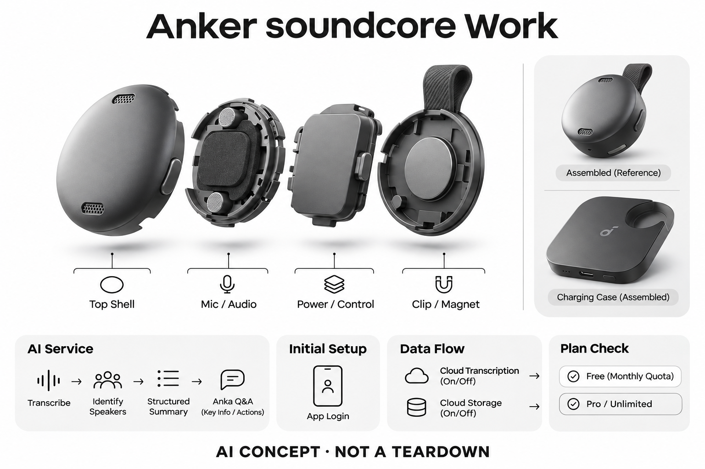

# Anker soundcore Work

**Anker soundcore** · 录音与记忆 · 核查 2026-11-04

硬币式佩戴录音与可追问的AI笔记

消费渠道：个人零售。

## 产品图片与结构参考

### 产品图

Anker soundcore Work官方产品外形图 · 来源：[Anker soundcore · 官方产品图片](<https://www.soundcore.com/products/d3200-soundcore-work-ai-voice-recorder>) · [原始图片](<https://cdn.shopify.com/s/files/1/0516/3761/6830/files/Group_2147226972_1534x.png?v=1776683440>)

### 参考图

Anker soundcore Work官方另一角度或使用场景参考 · 来源：[Anker soundcore · 官方产品图片](<https://www.soundcore.com/products/d3200-soundcore-work-ai-voice-recorder>) · [原始图片](<https://cdn.shopify.com/s/files/1/0516/3761/6830/files/D3200Z11_Rich_image_TD02_US_V1_1534x.jpg?v=1777281655>)

### AI 生成爆炸示意

**AI 生成 · 非实物拆机。** 内部为概念推断，不能作为元件布局、BOM 或维修依据。[生成提示词](../../content/hardware/prompts/soundcore-work.txt)

> 外形依据核验参考图；内部位置、模块形状与装配关系仅作AI概念展示。

> 已逐张查看并核对型号。源图未改色/裁切；场景、界面、附件、优惠及效果文案仅为厂商示意，不作为本目录性能或现价依据。

> 分析为基于公开资料的案头研究与 AI 辅助判断，未经用户访谈、销量审计或实物拆机。需求、画像、竞争冷门度、审美及商业机会均为研究假设，不是投资结论。

## 销售与购买

- 状态：在售。官方具体Work商品页显示容量选项、价格、预计配送以及Add to Cart/Buy Now；不同容量和配色只计同一型号。

- 地区：所列官方区域或授权零售渠道；配送地址与服务支持需结算确认

- 价格：所见配置US$159.99；容量和优惠需结算确认。核查日所见单机或基本配置价；币种、促销、税费、镜片、附件及服务依地区结算，不把颜色或套装重复计数。

- 中国大陆：本次未核实该具体型号在中国大陆的官方销售和完整服务支持；海外在售不等于国内可直接启用全部功能。

- [官方产品 / 商店](<https://www.soundcore.com/products/d3200-soundcore-work-ai-voice-recorder>)

## AI 的实际作用

配套服务对音频转录、识别说话人、生成结构化摘要，Anka问答可从记录中提取关键信息和行动项

服务与联网依赖：初次设置需App登录；云端转录和存储开关具有不同数据流程，免费月额度及Pro/Unlimited权益分别核对

## 是否冷门

新兴竞争（研究判断）：按任务与形态作案头分类，无访谈、销量或市场份额证据。

## 需求与市场

需求假设：希望随时按一下开始记录，并在之后查找重点，而不是保持全天自动录音。价值应由实际使用频率、任务完成与操作负担验证，不能把AI功能存在或演示流畅当作需求已得到满足。

## 用户画像

画像推断：做个人访谈、学习或会议复盘，愿意主动选择录音时机并复核摘要的用户。个人的语言、操作习惯、环境和预算会改变适配结果，本次只有案头研究，没有用户访谈或长期使用观察。

## 竞争与替代

案头判断：与Plaud、Bee、手机录音和其他佩戴式记录器竞争，按钮交互与充电便利比单纯小型化更值得比较。这只是用途与替代品比较，不是市场份额或销量结论；专业细分和较少曝光也不代表没有成熟竞争者。

## 供应链

公开资料可核对硬币形双麦克风录音器、实体按键、夹持/磁吸附件和充电收纳部件，具体整机工厂、关键模块供应商与BOM本次未确认。制造重点可从形态推断，但不能把品牌所在地、外观相似或营销合作等同代工关系。

## 技术路径

配套服务对音频转录、识别说话人、生成结构化摘要，Anka问答可从记录中提取关键信息和行动项。这是厂商披露的功能机制；模型版本、准确率及内部结构未完整公开。架构只表示输入、处理和输出关系，不作为真实拆机或性能实测。

## 产品审美

图示观察：小圆片能夹在衣领或作为项链佩戴，桌面、身体与手机之间具有不同使用姿态。宣传图片只能帮助理解外观和摆放方式，不能证明每个人的舒适度、长时使用体验或实际材料触感。

## 关键风险

厂商安全声明不代表所有数据默认永不离开设备；生成摘要可能遗漏否定或条件，重要决定需要回听原音确认。还需核对地区功能、软件更新与售后边界；本目录未进行实机、医学或可靠性测试，不把厂商演示当作结果保证。

## 机会与验证

市场差异主要在于硬币式佩戴录音与可追问的AI笔记。值得进一步验证的购买理由是它能否减少既有任务中的具体步骤，以及硬件、服务与维护的总成本是否符合个人使用频率。

## 功能分层示意

这是功能关系，不是实物拆机、真实空间结构或已核实 BOM。

1. **实体输入**：硬币形双麦克风录音器、实体按键、夹持/磁吸附件和充电收纳部件；仅功能层示意，非拆机。（官方披露）

2. **采集与控制**：设备把输入转为可处理的信息并接收用户操作；具体内部布局未知。（分析推断）

3. **AI功能**：配套服务对音频转录、识别说话人、生成结构化摘要，Anka问答可从记录中提取关键信息和行动项（官方披露）

4. **服务依赖**：初次设置需App登录；云端转录和存储开关具有不同数据流程，免费月额度及Pro/Unlimited权益分别核对（官方披露）

5. **用户反馈**：用户通过声音、屏幕或配套应用接收结果，并对重要信息复核。（分析推断）

## 来源

1. [soundcore Work官方购买页](<https://www.soundcore.com/products/d3200-soundcore-work-ai-voice-recorder>) — 已打开一手页面；产品能力为厂商披露，未进行实机或效果验证。

2. [soundcore Work官方功能说明](<https://www.soundcore.com/soundcore-work-ai-voice-recorder>) — 已打开一手页面；产品能力为厂商披露，未进行实机或效果验证。

[返回目录](../hardware-market.md) · [网页分析](https://romanagent.github.io/Roman/#hardware/product/soundcore-work)
