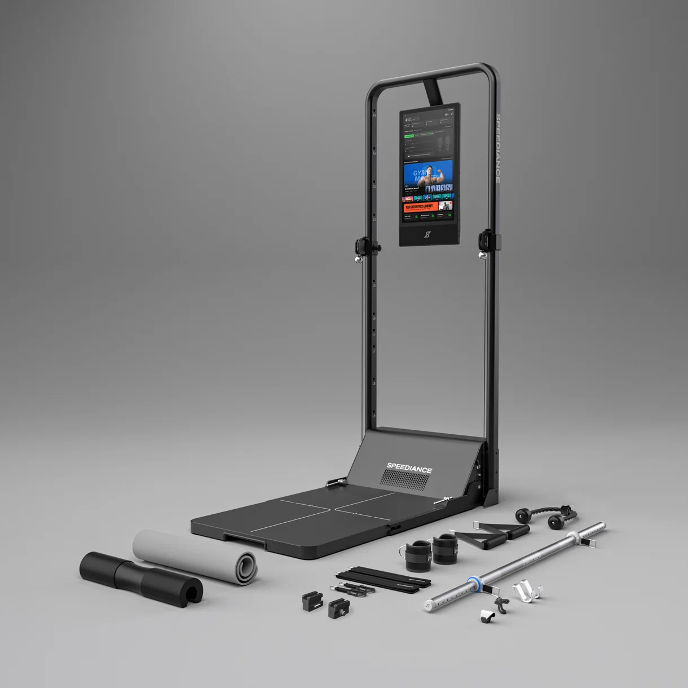
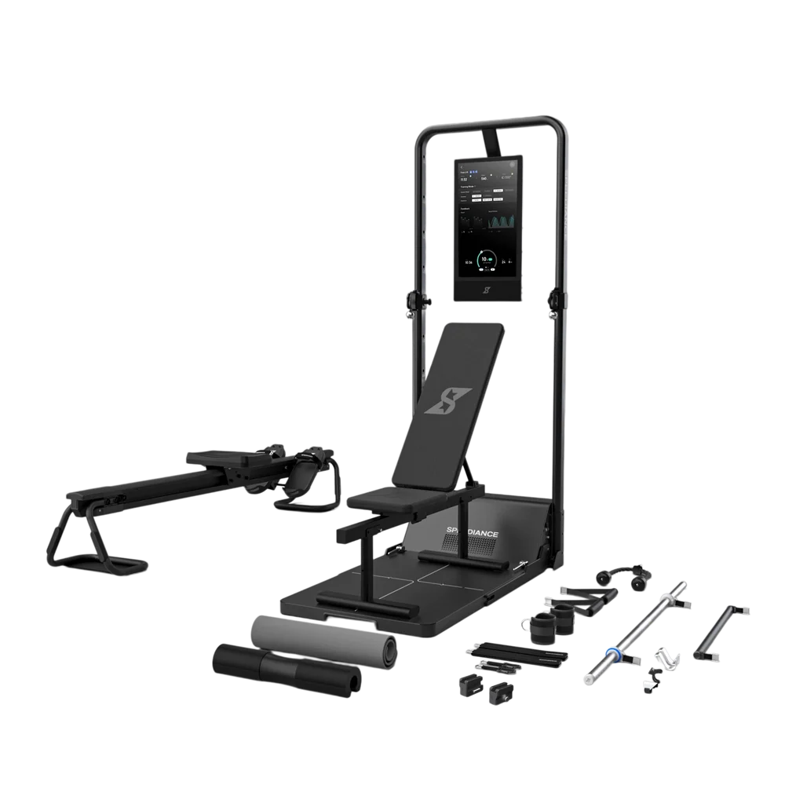
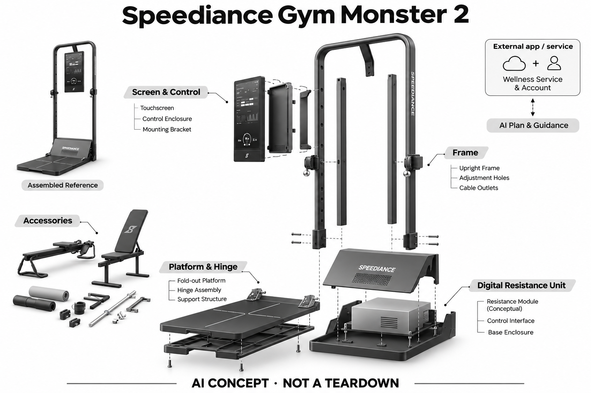

# Speediance Gym Monster 2

**Speediance** · 运动与训练 · 核查 2026-11-04

可移动力量平台与订阅式AI训练规划

消费渠道：个人零售。

## 产品图片与结构参考

### 产品图

Speediance Gym Monster 2官方产品外形图 · 来源：[Speediance · 官方产品图片](<https://www.speediance.com/products/speediance-gym-monster-2>) · [原始图片](<https://www.speediance.com/cdn/shop/files/gm2_9240b7f7-b9c3-4a1c-b80e-c777e7b7e407.png?v=1775548952&width=1220>)

### 参考图

Speediance Gym Monster 2官方另一角度或使用场景参考 · 来源：[Speediance · 官方产品图片](<https://www.speediance.com/products/speediance-gym-monster-2>) · [原始图片](<https://www.speediance.com/cdn/shop/files/gm2_4_1.png?v=1788524401&width=1000>)

### AI 生成爆炸示意

**AI 生成 · 非实物拆机。** 内部为概念推断，不能作为元件布局、BOM 或维修依据。[生成提示词](../../content/hardware/prompts/speediance-gym-monster-2.txt)

> 外形依据核验参考图；内部位置、模块形状与装配关系仅作AI概念展示。

> 已逐张查看并核对型号。源图未改色/裁切；场景、界面、附件、优惠及效果文案仅为厂商示意，不作为本目录性能或现价依据。

> 分析为基于公开资料的案头研究与 AI 辅助判断，未经用户访谈、销量审计或实物拆机。需求、画像、竞争冷门度、审美及商业机会均为研究假设，不是投资结论。

## 销售与购买

- 状态：在售。官方当前商品页显示Gym Monster 2、US$2,771与Add to Cart；另有官方在售集合页和退换/保修信息。

- 地区：美国官方销售地区（具体配送地址结算确认）

- 价格：所见美国站促销 US$2,771。报价随附件包、促销和地区变化；Wellness AI训练计划另计，不把Basic/Works等附件包重复计数。

- 中国大陆：本次核实海外官方渠道，未确认同型号中国大陆官方销售、安装和完整软件服务。支持中文或品牌来自中国均不等同大陆可购买。

- [官方产品 / 商店](<https://www.speediance.com/products/speediance-gym-monster-2>)

## AI 的实际作用

Wellness Plus结合训练记录、目标与恢复信息生成和调整个性化计划，设备执行数字阻力训练。

服务与联网依赖：AI计划与指导需要对应Wellness服务及账户；官方说明不订阅仍能使用多数基础训练功能。本款不据AI名称推断内置视觉摄像头。

## 是否冷门

竞争密集（研究判断）：依据用途与替代品的案头分类；不是销量、市场份额或用户访谈结论。

## 需求与市场

需求假设：用户希望把多种拉索动作集中在家中，并减少每次选课和配重的准备。AI计划有价值的前提是训练记录足够准确、建议能执行；智能阻力本身不能证明计划更适合所有人。

## 用户画像

画像推断：没有健身房通勤条件、但有固定室内训练空间的人更匹配。愿意使用训练App的人可能较快上手；只想偶尔做几组运动的人，未必需要整机与持续的个性化服务。

## 竞争与替代

案头判断：与Tonal、传统拉索机和自由重量竞争，属于拥挤的家用力量方向。其免墙装与平台结构是可比较差异；没有用户访谈、销量审计或长期留存资料支持优劣排序。

## 供应链

官网可确认数字阻力、平台与附件组合，电机、编码器、处理芯片和整机工厂本次不明。推断可靠性重点在拉索传动、折叠结构和负载反馈，不能由国产品牌身份推定具体供应商。

## 技术路径

真实AI证据来自官方Wellness计划说明：用目标和训练数据形成自适应建议。机械阻力调节与AI服务是不同层；模型部署、训练数据和建议质量未完整披露，不假造机身摄像头。

## 产品审美

图示观察：竖屏、折叠底板和收纳附件比墙装系统更像可移动器材，家庭空间适配是设计重点。移动和收纳便捷度仍受重量、地面与房间布局影响，不能据折叠照片判定轻松搬运。

## 关键风险

风险包括附件与会员总成本、数据缺失导致计划不匹配，以及数字阻力控制的使用边界。需要依照设备说明训练；健康数据关联和生成建议也不等同诊断、康复处方或伤害预防保证。

## 机会与验证

市场差异是家用力量硬件与独立付费AI服务的组合。尚待验证的购买理由是用户是否真正需要持续计划调整，以及基础训练已足够时，AI订阅能否带来可感知且可复查的帮助。

## 功能分层示意

这是功能关系，不是实物拆机、真实空间结构或已核实 BOM。

1. **力量输入**：拉索动作与训练记录为反馈来源，非实物拆机。（官方披露）

2. **数字阻力**：平台和电机控制承接可调负载训练。（官方披露）

3. **设备账户**：屏幕及App同步训练历史和用户目标。（官方披露）

4. **AI规划**：Wellness Plus提供个性化计划、指导与调整。（官方披露）

5. **反馈执行**：用户查看建议后选择训练；具体控制拓扑未披露。（分析推断）

## 来源

1. [Gym Monster 2官方商品页](<https://www.speediance.com/products/speediance-gym-monster-2>) — 已打开，Add to Cart可见；附件包不作为独立型号。

2. [Speediance Wellness官方说明](<https://www.speediance.com/pages/wellness-ai-personal-trainer>) — 已打开，明确多数基础功能可脱离AI计划，AI服务依会员。

[返回目录](../hardware-market.md) · [网页分析](https://romanagent.github.io/Roman/#hardware/product/speediance-gym-monster-2)
