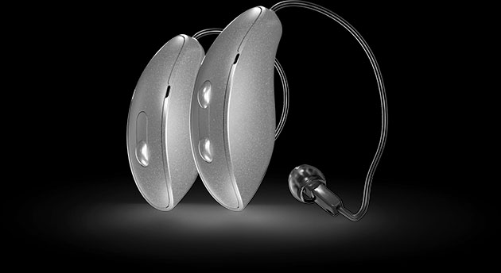
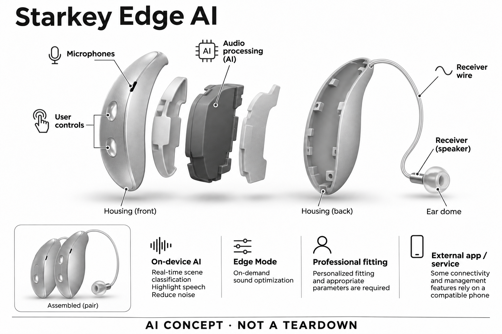

# Starkey Edge AI

**Starkey** · 助听与听力 · 核查 2026-11-04

端侧场景分类与用户触发优化同时存在

消费渠道：个人适配 / 验配。

## 产品图片与结构参考

### 产品图

Starkey Edge AI官方产品外形图 · 来源：[Starkey · 官方产品图片](<https://www.starkey.com/hearing-aids/edge-artificial-intelligence-hearing-aids>) · [原始图片](<https://www.starkey.com/-/media/ConsumerSites/Images/Renderings/ItemSource/RichTextBlocks/Starkey/afton_product_renders_shadow_dark_bg>)

### 参考图

Starkey Edge AI官方另一角度或使用场景参考 · 来源：[Starkey · 官方产品图片](<https://www.starkey.com/hearing-aids/edge-artificial-intelligence-hearing-aids>) · [原始图片](<https://www.starkey.com/-/media/ConsumerSites/Images/Renderings/ItemSource/RichTextBlocks/Starkey/kevin_fishing_on_a_boat_mobile_wbst2809>)

### AI 生成爆炸示意

**AI 生成 · 非实物拆机。** 内部为概念推断，不能作为元件布局、BOM 或维修依据。[生成提示词](../../content/hardware/prompts/starkey-edge-ai.txt)

> 外形依据核验参考图；内部位置、模块形状与装配关系仅作AI概念展示。

> 已逐张查看并核对型号。源图未改色/裁切；场景、界面、附件、优惠及效果文案仅为厂商示意，不作为本目录性能或现价依据。

> 分析为基于公开资料的案头研究与 AI 辅助判断，未经用户访谈、销量审计或实物拆机。需求、画像、竞争冷门度、审美及商业机会均为研究假设，不是投资结论。

## 销售与购买

- 状态：在售。官方当前消费者产品页持续展示该型号，并提供试用/验配或官方门店渠道。属于个人经专业验配获得的消费设备，saleMode为consumer-fitting；不声明具体门店库存。

- 地区：美国及所列官方区域验配网络（具体型号当地确认）

- 价格：未公布统一零售价；按个人验配方案报价。报价通常受单/双耳、技术档位、定制、服务和地区影响；不以历史媒体价格或其他型号拼凑。

- 中国大陆：品牌可能具有中国渠道，但本次未核实该具体型号、技术档位与AI软件在大陆的上市和支持范围；需由国内授权验配渠道确认。

- [官方产品 / 商店](<https://www.starkey.com/hearing-aids/edge-artificial-intelligence-hearing-aids>)

## AI 的实际作用

官方描述端侧AI实时分类复杂声音场景、突出语音并抑制噪声，Edge Mode提供按需声音优化。

服务与联网依赖：个人专业验配与合适参数是前提；部分连接和管理功能依赖兼容手机，核心声音处理不等于云端聊天。

## 是否冷门

细分专业（研究判断）：听觉辅助属于专业消费用途，已有成熟供应商；此分类不表示蓝海或疗效优越。

## 需求与市场

需求假设：不想在不同生活场景里反复选择预设，却希望保留按需调整入口。真正的使用价值需要在个人真实交流场景中验证，不能从AI名称或厂商演示推定每个人都获得同样改善。

### 官方｜自动处理与按需优化并存 · 官方资料

Edge AI官方描述在设备侧实时分类复杂声音场景、突出语音并降低噪声，同时提供按需声音优化入口。它并非通过云端聊天回答听觉问题，而是在声音链路中应用感知算法；自动与用户主动参与两种方式需要分别评价，不能仅由AI名称或宣传中的类脑比喻推定实际交流效果。

依据：[Starkey Starkey Edge AI官方产品页](<https://www.starkey.com/hearing-aids/edge-artificial-intelligence-hearing-aids>) · [Starkey官方技术或应用说明](<https://www.starkey.com/hearing-aids>)

### 判断｜不合适时保留主动入口 · 研究判断

需求假设是用户不希望频繁切换预设，但在当前听音支持不合适时又能表达需要调整。主动触发可以提供一个清楚的控制动作，却也可能打断交谈；其价值取决于用户是否知道何时使用、能否理解变化，以及自动处理本身是否已经覆盖多数日常情况。

依据：[Starkey Starkey Edge AI官方产品页](<https://www.starkey.com/hearing-aids/edge-artificial-intelligence-hearing-aids>)

### 验证｜记录触发前后具体任务 · 待验证

经专业适配后，可记录本人在何种谈话中主动请求优化，触发前后是否更容易理解说话内容，以及是否需要重复操作。把环境和交流目标一并记下，不只写变安静或变清楚；本目录没有实机对照，不能根据一次成功演示推断所有声场和用户均会获益。

依据：[Starkey Starkey Edge AI官方产品页](<https://www.starkey.com/hearing-aids/edge-artificial-intelligence-hearing-aids>) · [Starkey官方消费者验配渠道](<https://locations.starkey.com/>)

## 用户画像

画像推断：经专业评估需要助听支持、并愿意使用配套App管理设备的个人更值得评估。具体是否适配应由听力需求、耳形和操作能力共同决定，本目录不根据年龄、职业或自述症状替人选择医疗产品。

### 官方｜专业验配决定实际配置 · 官方资料

Edge AI作为个人助听系列通过专业渠道提供，多种佩戴形态及技术配置需要在验配时确定。核心声音处理与部分手机管理、连接功能不同，实际应用支持应按交付型号核对；官方门店查询说明可寻找服务，不意味着每家门店都有同样配置、价格或库存。

依据：[Starkey Starkey Edge AI官方产品页](<https://www.starkey.com/hearing-aids/edge-artificial-intelligence-hearing-aids>) · [Starkey官方消费者验配渠道](<https://locations.starkey.com/>) · [Starkey官方技术或应用说明](<https://www.starkey.com/hearing-aids>)

### 判断｜能描述困难时刻更利于反馈 · 研究判断

经常遇到自动处理不能完全匹配个人偏好的用户，可能更看重按需优化；但首次使用者未必能立即区分环境变化、佩戴问题和设置差异。画像应围绕具体听音困难和控制偏好建立，支持人员需要帮助其用日常语言反馈，而不要求本人理解神经网络或专业声学指标。

依据：[Starkey Starkey Edge AI官方产品页](<https://www.starkey.com/hearing-aids/edge-artificial-intelligence-hearing-aids>) · [Starkey官方消费者验配渠道](<https://locations.starkey.com/>)

### 验证｜把触发操作纳入试戴 · 待验证

试用时应确认本人能找到适用的优化入口、知道当前是否发生改变，并在不满意时寻求调整。分别观察无手机或手机不便操作时能做什么，避免把熟练的应用演示当作所有人的日常条件；家庭协助、操作能力和当地随访也应纳入实际交付计划。

依据：[Starkey Starkey Edge AI官方产品页](<https://www.starkey.com/hearing-aids/edge-artificial-intelligence-hearing-aids>) · [Starkey官方消费者验配渠道](<https://locations.starkey.com/>)

## 竞争与替代

案头判断：端侧场景分类与用户触发优化同时存在形成可比较特征，但消费助听已有多个成熟品牌和验配渠道。没有销量审计、用户访谈或疗效对照，专业细分不意味着竞争稀少。

### 官方｜系列之外还有音频附件 · 官方资料

官方页面列有配套远程麦克风、桌面麦克风和电视等音频附件入口，说明听音方案可以包含外部采集或传输设备。附件并非所有购买配置都默认包含，兼容条件也需要核对；其存在不能证明仅靠助听器算法便能解决每一种距离、回声或多人交流问题。

依据：[Starkey Starkey Edge AI官方产品页](<https://www.starkey.com/hearing-aids/edge-artificial-intelligence-hearing-aids>)

### 判断｜与更简单的控制方式比较 · 研究判断

同类产品有自动处理、用户手调或其他按需模式，Edge AI的比较重点是控制成本与任务结果。若外部麦克风显著改善远距离输入，比较时应承认硬件输入变化的贡献；不能把整套附件方案的收益全部归于AI，也不能用配件更多或功能更复杂推导普遍优越。

依据：[Starkey Starkey Edge AI官方产品页](<https://www.starkey.com/hearing-aids/edge-artificial-intelligence-hearing-aids>) · [Starkey官方技术或应用说明](<https://www.starkey.com/hearing-aids>)

### 验证｜同一输入条件下比较 · 待验证

可以先在相同佩戴与无附件条件下比较自动和按需处理，再单独评估外部音频输入，记录实际交流、操作和设备携带负担。报价需注明单耳双耳、技术档位、附件与随访内容；本研究没有市场份额和销量数据，不能据品牌成熟度或AI版本给出商业竞争排名。

依据：[Starkey Starkey Edge AI官方产品页](<https://www.starkey.com/hearing-aids/edge-artificial-intelligence-hearing-aids>) · [Starkey官方消费者验配渠道](<https://locations.starkey.com/>)

## 供应链

官方可核对系列内提供多种个人验配形态，图片以RIC款为代表及相应声音功能；具体麦克风、受话器、电池供应商与整机工厂本次未确认。品牌或法定制造商名称不等于实际装配工厂，也不据此估计BOM与良率。

### 官方｜功能公开而器件来源未全披露 · 官方资料

官方确认边缘声音处理与多种消费验配款式，图示以常见耳背和耳道输出结构展示产品。现有资料没有为本目录点名麦克风、受话器、芯片制造商及装配工厂，营销中的处理器图形也不是可核对的电路资料；品牌自有算法不等于所有器件均由品牌自行制造。

依据：[Starkey Starkey Edge AI官方产品页](<https://www.starkey.com/hearing-aids/edge-artificial-intelligence-hearing-aids>) · [Starkey官方技术或应用说明](<https://www.starkey.com/hearing-aids>)

### 判断｜按需模式改变的是处理流程 · 研究判断

同类方案需要在采集、低延迟声音处理、用户触发和输出之间保持稳定时序，不能因一次优化请求而产生难以理解的中断。硬件评估应同时考虑持续处理和状态切换，封闭品牌平台还包含调试与验配工具；单独购买通用DSP无法复现完整个人听音体验。

依据：[Starkey Starkey Edge AI官方产品页](<https://www.starkey.com/hearing-aids/edge-artificial-intelligence-hearing-aids>)

### 验证｜重新设计要验证整条链路 · 待验证

供应候选可以用听觉处理平台评估模型和实时音频，用MEMS麦克风评估耳背输入，但应重新建立声学校准和操作逻辑。候选不代表现用，更不是维修替换建议；整机测试需要覆盖不同模式、输入水平与实际佩戴，工厂、物料和长期可靠性仍需独立证据。

依据：[Starkey Starkey Edge AI官方产品页](<https://www.starkey.com/hearing-aids/edge-artificial-intelligence-hearing-aids>) · [Starkey官方技术或应用说明](<https://www.starkey.com/hearing-aids>)

## 技术路径

官方描述端侧AI实时分类复杂声音场景、突出语音并抑制噪声，Edge Mode提供按需声音优化。这是已披露机制；精确模型、内部电路与个体表现未完全公开。普通放大、蓝牙和自动模式本身不单独作为AI收录理由。

### 官方｜边缘AI与个性化入口 · 官方资料

公开机制包括实时声场分类、语音与噪声相关处理和Edge Mode按需优化，核心任务在设备侧声音链路中完成。部分外部音频与管理依赖兼容配件或手机，这与核心感知处理不同；本目录不套用后来Omega AI+的四网络架构，也不将厂商代际百分比当成个人效果预测。

依据：[Starkey Starkey Edge AI官方产品页](<https://www.starkey.com/hearing-aids/edge-artificial-intelligence-hearing-aids>) · [Starkey官方技术或应用说明](<https://www.starkey.com/hearing-aids>)

### 判断｜主动操作是偏好线索 · 研究判断

用户在某个时刻请求优化，能够表达当前结果不够合适，但这个动作本身没有说明究竟想听谁、哪里不清楚或希望保留多少背景。技术分析应关注系统是否在有限输入下作出可接受改变，并保留用户反馈路径；不能把一键触发描述为准确理解所有个人意图。

依据：[Starkey Starkey Edge AI官方产品页](<https://www.starkey.com/hearing-aids/edge-artificial-intelligence-hearing-aids>)

### 验证｜重复触发与无变化都要记录 · 待验证

试用记录可包含有效、无明显变化和不喜欢变化三种情况，并说明触发时的环境、关注对象与操作次数。通过专业随访核对是否需要调整个人参数，避免用户不断反复触发而无法解释问题；验证应同时关注理解、舒适与操作负担，不能只记录演示中最成功的一次。

依据：[Starkey Starkey Edge AI官方产品页](<https://www.starkey.com/hearing-aids/edge-artificial-intelligence-hearing-aids>) · [Starkey官方消费者验配渠道](<https://locations.starkey.com/>)

## 产品审美

图示观察：RIC款外观接近日常耳背助听器，充电盒与配套App决定了整体使用体验而不只是机身。实际耳内尺寸、舒适感和维护便利仍需验配或试戴确认；宣传图不能证明隐形、无负担或适合所有耳形。

### 官方｜款式决定外部使用方式 · 官方资料

Edge AI系列的佩戴形态、外部控制和充电配置需要按具体款式确认，目录图像不代表全系相同结构。耳背RIC示意中主机与耳道受话器分开，定制款则有不同外部形态；宣传页的防护脚注也可能只适用于特定配置，因此不能以一张产品照推断所有型号体验。

依据：[Starkey Starkey Edge AI官方产品页](<https://www.starkey.com/hearing-aids/edge-artificial-intelligence-hearing-aids>) · [Starkey官方技术或应用说明](<https://www.starkey.com/hearing-aids>)

### 判断｜清楚的控制反馈有价值 · 研究判断

按需优化要求用户在交流中知道操作是否被接收，因此可理解的反馈与容易找到的控制同样重要。隐藏按键或极简界面可能减少外观负担，也可能增加记忆要求；审美评价应结合本人在公共场合是否愿意操作、是否会误触以及如何向他人解释短暂调整。

依据：[Starkey Starkey Edge AI官方产品页](<https://www.starkey.com/hearing-aids/edge-artificial-intelligence-hearing-aids>)

### 验证｜穿戴与操作一起观察 · 待验证

可在本人常用眼镜、口罩和服饰条件下试戴，记录调整、取放及使用优化入口时是否碰触其他物品。再观察充电或维护是否能独立完成，确认系列对应的实际交付方式；这些操作与舒适记录应由本人提供，不能由宣传图或产品尺寸替代真实反馈。

依据：[Starkey Starkey Edge AI官方产品页](<https://www.starkey.com/hearing-aids/edge-artificial-intelligence-hearing-aids>) · [Starkey官方消费者验配渠道](<https://locations.starkey.com/>)

## 关键风险

系列不同佩戴形态的防护、连接和功能不完全相同，不能将一个款式的规格推广到全系。AI设置辅助与噪声处理不能替代专业适配、随访或对异常听力变化的评估，本研究没有诊断、独立实测或疗效结论。

### 官方｜系列宣称存在款式限定 · 官方资料

官方页面以系列介绍功能，同时对部分防护和连接能力给出限定，实际配置需要在验配时确认。当前证据支持消费者通过专业网络获取产品，不代表中国大陆相同技术档位与软件都已开放；渠道、兼容手机、附件和后续服务应逐项列明，不能默认全球一致。

依据：[Starkey Starkey Edge AI官方产品页](<https://www.starkey.com/hearing-aids/edge-artificial-intelligence-hearing-aids>) · [Starkey官方消费者验配渠道](<https://locations.starkey.com/>) · [Starkey官方技术或应用说明](<https://www.starkey.com/hearing-aids>)

### 判断｜更安静不必然更好理解 · 研究判断

用户可能喜欢背景变轻，却仍漏掉关键内容，因此不能把主观安静感当作全部听音效果。按需操作若过于频繁，也可能影响交谈参与；本目录没有独立临床或个体测试，AI处理不能替代专业适配和随访，更不应把厂商模拟听觉系统的比喻写成恢复正常听觉的承诺。

依据：[Starkey Starkey Edge AI官方产品页](<https://www.starkey.com/hearing-aids/edge-artificial-intelligence-hearing-aids>)

### 验证｜建立可以求助的错误记录 · 待验证

试用应记录持续听不清、声音不适和频繁请求优化的情境，保留给专业人员讨论，而不是仅依赖调整次数自行判断原因。交付前还需明确退换、维护、附件兼容与服务费用；这些流程用于发现实际使用边界，不构成诊断或针对某个人的助听方案推荐。

依据：[Starkey Starkey Edge AI官方产品页](<https://www.starkey.com/hearing-aids/edge-artificial-intelligence-hearing-aids>) · [Starkey官方消费者验配渠道](<https://locations.starkey.com/>)

## 机会与验证

市场差异在于端侧场景分类与用户触发优化同时存在。尚待验证的购买理由是其在个人场景中的可感知帮助、操作便利和售后支持，而不是追求更多AI术语或用统一分数替代实际试戴。

### 官方｜控制方式形成可比较差异 · 官方资料

Edge AI将持续的设备端处理与按需声音优化放在一起，使其与只强调自动处理的产品形成可讨论差异。两种控制仍共同服务复杂声场中的交流任务，不能按一个模式增加一个独立需求；官方功能存在只说明可以研究这种取舍，不证明所有用户都需要主动入口。

依据：[Starkey Starkey Edge AI官方产品页](<https://www.starkey.com/hearing-aids/edge-artificial-intelligence-hearing-aids>) · [Starkey官方技术或应用说明](<https://www.starkey.com/hearing-aids>)

### 判断｜理解何时干预比增加选项更重要 · 研究判断

值得继续观察的是用户是否能够在少量必要时刻有效干预，而不是被更多设置迫使持续管理设备。如果主动入口帮助恢复参与感，它的价值可能在可控性；如果用户经常无效触发，就需要更好的适配与说明。研究应容许不同用户偏好全自动或更直接的人工调整。

依据：[Starkey Starkey Edge AI官方产品页](<https://www.starkey.com/hearing-aids/edge-artificial-intelligence-hearing-aids>)

### 验证｜观察长期操作负担变化 · 待验证

后续可跟踪实际交流中使用优化的频率、成功感受、停止使用原因和随访问题，比较熟悉前后是否减少干预。把声音表现、佩戴和服务成本分开分析，避免新奇感覆盖长期负担；本目录仅提供案头研究与验证路径，没有证据据此推定销量、用户留存或个人疗效。

依据：[Starkey Starkey Edge AI官方产品页](<https://www.starkey.com/hearing-aids/edge-artificial-intelligence-hearing-aids>) · [Starkey官方消费者验配渠道](<https://locations.starkey.com/>)

## 对应供应链公司

能力候选用于选型研究，不代表本产品实际采用；未公开的供货关系不作推断。

- [onsemi](../supply-chain/onsemi.md) — **能力候选 · 非已采用** / 相近按需优化助听架构的DSP重设计候选：onsemi听觉DSP与神经网络平台可用于研究持续声音处理和用户触发优化的时序，但不包含Starkey的Edge Mode算法或验配工具。需要重新实现状态切换、声学校准与个人配置；未发现Edge AI采用证据，也不能将该平台视为品牌专有主控的直接替代品。

- [syntiant](../supply-chain/syntiant.md) — **能力候选 · 非已采用** / 相近耳部声音处理的MEMS采集候选：Syntiant当前MEMS麦克风产品可对应相近耳部设备的声音输入研究，需要结合具体款式、声孔与输出反馈路径验证噪声和稳定性。麦克风能力不能代表Edge Mode效果，也不能确定品牌现用器件；目录没有点名采购关系，此链接只用于新设计的前端选型比较。

[浏览供应链目录](../supply-chain.md)

## 功能分层示意

这是功能关系，不是实物拆机、真实空间结构或已核实 BOM。

1. **声音输入**：麦克风采集外界声音；为功能架构，非实际拆机。（分析推断）

2. **个体配置**：专业验配确定与个人听音需求相适应的参数。（官方披露）

3. **AI声音处理**：官方描述端侧AI实时分类复杂声音场景、突出语音并抑制噪声，Edge Mode提供按需声音优化。（官方披露）

4. **声音输出**：受话器向耳道输出经处理声音；具体物理布局不公开。（分析推断）

5. **管理与随访**：按具体型号使用兼容应用或专业渠道调整和维护。（官方披露）

## 来源

1. [Starkey Starkey Edge AI官方产品页](<https://www.starkey.com/hearing-aids/edge-artificial-intelligence-hearing-aids>) — 已打开当前面向消费者的产品介绍及验配/试用入口；没有把医院诊断仪器或B2B订货设备计入。

2. [Starkey官方消费者验配渠道](<https://locations.starkey.com/>) — 已打开官方验配/门店定位渠道，消费者经专业验配购买；不代表每家门店现货或统一价格。

3. [Starkey官方技术或应用说明](<https://www.starkey.com/hearing-aids>) — 已打开，用于确认AI机制和兼容边界；厂商性能宣传不作为独立疗效证据。

[返回目录](../hardware-market.md) · [网页分析](https://romanagent.github.io/Roman/#hardware/product/starkey-edge-ai)
