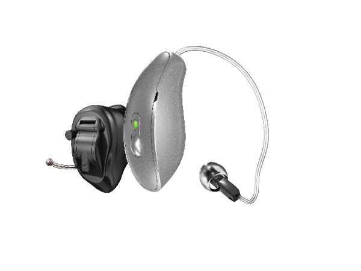
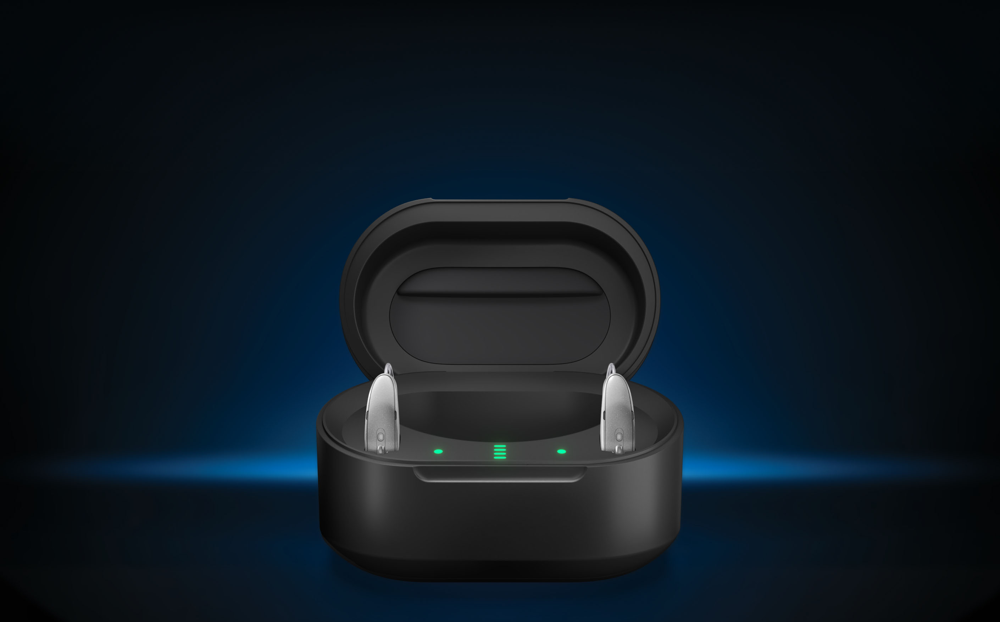
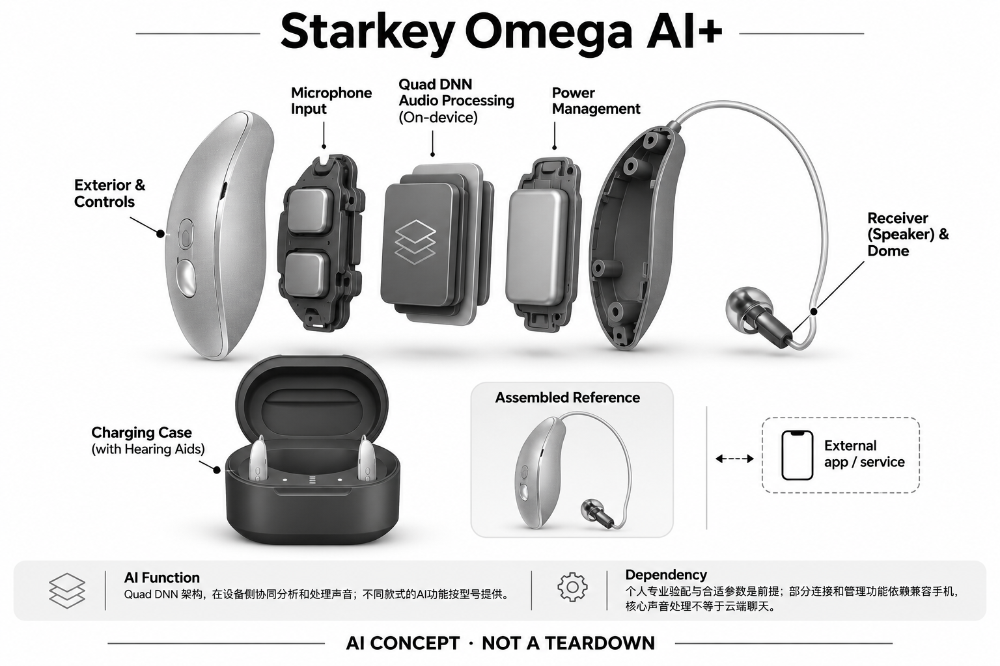

# Starkey Omega AI+

**Starkey** · 助听与听力 · 核查 2026-11-04

官方披露的多DNN声音处理架构及跨款式扩展

消费渠道：个人适配 / 验配。

## 产品图片与结构参考

### 产品图

Starkey Omega AI+官方产品外形图 · 来源：[Starkey · 官方产品图片](<https://www.starkey.com/hearing-aids/omega-artificial-intelligence-plus-hearing-aids>) · [原始图片](<https://www.starkey.com/-/media/ConsumerSites/Images/Renderings/ItemSource/RichTextBlocks/Starkey/omega-ai-plus-plp/omega-plus-plp-hearing-aid-ribbon-WBST2915>)

### 参考图

Starkey Omega AI+官方另一角度或使用场景参考 · 来源：[Starkey · 官方产品图片](<https://www.starkey.com/hearing-aids/omega-artificial-intelligence-plus-hearing-aids>) · [原始图片](<https://www.starkey.com/-/media/ConsumerSites/Images/Renderings/ItemSource/CTABanners/Starkey/text-hero-charger-mobile-WBST2917.jpg?h=1756&w=2820&la=en&hash=FF2FF87047C6718F8EEE4F7A3771B775944FF201>)

### AI 生成爆炸示意

**AI 生成 · 非实物拆机。** 内部为概念推断，不能作为元件布局、BOM 或维修依据。[生成提示词](../../content/hardware/prompts/starkey-omega-ai-plus.txt)

> 外形依据核验参考图；内部位置、模块形状与装配关系仅作AI概念展示。

> 已逐张查看并核对型号。源图未改色/裁切；场景、界面、附件、优惠及效果文案仅为厂商示意，不作为本目录性能或现价依据。

> 分析为基于公开资料的案头研究与 AI 辅助判断，未经用户访谈、销量审计或实物拆机。需求、画像、竞争冷门度、审美及商业机会均为研究假设，不是投资结论。

## 销售与购买

- 状态：在售。官方当前消费者产品页持续展示该型号，并提供试用/验配或官方门店渠道。属于个人经专业验配获得的消费设备，saleMode为consumer-fitting；不声明具体门店库存。

- 地区：美国及所列官方区域验配网络（具体型号当地确认）

- 价格：未公布统一零售价；按个人验配方案报价。报价通常受单/双耳、技术档位、定制、服务和地区影响；不以历史媒体价格或其他型号拼凑。

- 中国大陆：品牌可能具有中国渠道，但本次未核实该具体型号、技术档位与AI软件在大陆的上市和支持范围；需由国内授权验配渠道确认。

- [官方产品 / 商店](<https://www.starkey.com/hearing-aids/omega-artificial-intelligence-plus-hearing-aids>)

## AI 的实际作用

官方2026年发布说明披露Quad DNN架构，在设备侧协同分析和处理声音；不同款式的AI功能按型号提供。

服务与联网依赖：个人专业验配与合适参数是前提；部分连接和管理功能依赖兼容手机，核心声音处理不等于云端聊天。

## 是否冷门

细分专业（研究判断）：听觉辅助属于专业消费用途，已有成熟供应商；此分类不表示蓝海或疗效优越。

## 需求与市场

需求假设：希望声音处理能随着场景持续调整，并在日常维护中减少操作负担。真正的使用价值需要在个人真实交流场景中验证，不能从AI名称或厂商演示推定每个人都获得同样改善。

### 官方｜多网络协同处理声音 · 官方资料

Starkey在二〇二六年十月发布Omega AI+，公开G4处理平台与Quad DNN架构，描述多个专门网络共同分析和优化声音，并扩展不同佩戴款式。这里确认的是设备端声音处理机制和系列发布，不将厂商关于自然听觉、速度或效果的营销表述直接作为独立验证结论。

依据：[Starkey Starkey Omega AI+官方产品页](<https://www.starkey.com/hearing-aids/omega-artificial-intelligence-plus-hearing-aids>) · [Starkey官方技术或应用说明](<https://www.starkey.com/press/press-releases/2026/10/starkey-takes-intelligent-hearing-to-the-next-level-with-Introduction-of-omega-ai-plus>)

### 判断｜减少持续手动干预的需求 · 研究判断

需求假设是用户希望声音支持随着生活环境变化而调整，不必在每次困难时主动重新选择模式。更连续的处理可能降低操作负担，也可能让声音变化不易解释；价值应由本人是否更容易参与谈话、是否减少不必要调整来判断，而不由同时运行的网络数量决定。

依据：[Starkey Starkey Omega AI+官方产品页](<https://www.starkey.com/hearing-aids/omega-artificial-intelligence-plus-hearing-aids>) · [Starkey官方技术或应用说明](<https://www.starkey.com/press/press-releases/2026/10/starkey-takes-intelligent-hearing-to-the-next-level-with-Introduction-of-omega-ai-plus>)

### 验证｜连续活动比单点演示更重要 · 待验证

专业适配后可观察从安静聊天到多人交流再回到安静环境的日常过程，记录声音变化、手动干预和理解困难。每个阶段保留具体任务和本人感受，避免只挑某段噪声中的最佳演示；本目录没有独立实机或疗效研究，不能据架构升级预判所有个人收益。

依据：[Starkey Starkey Omega AI+官方产品页](<https://www.starkey.com/hearing-aids/omega-artificial-intelligence-plus-hearing-aids>) · [Starkey官方消费者验配渠道](<https://locations.starkey.com/>) · [Starkey官方技术或应用说明](<https://www.starkey.com/press/press-releases/2026/10/starkey-takes-intelligent-hearing-to-the-next-level-with-Introduction-of-omega-ai-plus>)

## 用户画像

画像推断：经专业评估、在意长期佩戴与声音个性化的新购或升级用户更值得评估。具体是否适配应由听力需求、耳形和操作能力共同决定，本目录不根据年龄、职业或自述症状替人选择医疗产品。

### 官方｜不同佩戴款式分项交付 · 官方资料

发布资料说明新能力覆盖不同产品形态，并分别描述定制可充电和定制非无线设备的功能。由此不能把整个系列当作完全相同的硬件，个人需要通过专业渠道确认耳形、技术档位与交付配置；门店查询支持消费验配路径，不代表每种新款都在每家门店即时有货。

依据：[Starkey Starkey Omega AI+官方产品页](<https://www.starkey.com/hearing-aids/omega-artificial-intelligence-plus-hearing-aids>) · [Starkey官方消费者验配渠道](<https://locations.starkey.com/>) · [Starkey官方技术或应用说明](<https://www.starkey.com/press/press-releases/2026/10/starkey-takes-intelligent-hearing-to-the-next-level-with-Introduction-of-omega-ai-plus>)

### 判断｜升级用户也需重新比较 · 研究判断

已有助听器的人可能关注新平台是否改善自己仍然困难的场景，新购用户则更需要建立佩戴与声音反馈习惯。两者都不应仅因最新型号而升级，尤其原有配置已能完成任务时，维护、兼容附件和熟悉成本可能更重要；画像应建立在未满足的具体需求而非技术偏好。

依据：[Starkey Starkey Omega AI+官方产品页](<https://www.starkey.com/hearing-aids/omega-artificial-intelligence-plus-hearing-aids>) · [Starkey官方技术或应用说明](<https://www.starkey.com/press/press-releases/2026/10/starkey-takes-intelligent-hearing-to-the-next-level-with-Introduction-of-omega-ai-plus>)

### 验证｜先列出仍然困难的任务 · 待验证

试用前可让本人列出原方案尚未解决的交流问题，再在适当专业支持下比较新款是否改变这些情境。同步记录取放、维护和学习新的控制方式是否增加负担；如果主要差异只是产品名称与界面更新，研究应如实保留没有明显任务改善的结果，不预设升级一定值得。

依据：[Starkey Starkey Omega AI+官方产品页](<https://www.starkey.com/hearing-aids/omega-artificial-intelligence-plus-hearing-aids>) · [Starkey官方消费者验配渠道](<https://locations.starkey.com/>)

## 竞争与替代

案头判断：官方披露的多DNN声音处理架构及跨款式扩展形成可比较特征，但消费助听已有多个成熟品牌和验配渠道。没有销量审计、用户访谈或疗效对照，专业细分不意味着竞争稀少。

### 官方｜新功能不可套回旧平台 · 官方资料

Omega AI+发布说明明确区分新的多DNN处理与扩展的系列能力，包含持续优化以及按不同款式提供的连接和附加功能。它不能与较早的Edge AI或名称相近的Omega产品混为一谈，比较时需要确认完整型号和配置；同样，系列新发布也不意味着所有地区同时交付。

依据：[Starkey Starkey Omega AI+官方产品页](<https://www.starkey.com/hearing-aids/omega-artificial-intelligence-plus-hearing-aids>) · [Starkey官方技术或应用说明](<https://www.starkey.com/press/press-releases/2026/10/starkey-takes-intelligent-hearing-to-the-next-level-with-Introduction-of-omega-ai-plus>)

### 判断｜按任务比较而非网络数量 · 研究判断

其他品牌可能采用不同数量和分工的模型来处理相同交流困难，公开术语并不能直接映射成个人体验排名。多网络协同需要解决处理取舍，较少网络也可能满足某些任务；竞争研究应同时比较听音、可控性、维护和专业服务，不能仅凭架构复杂度判断领先或形成新需求。

依据：[Starkey Starkey Omega AI+官方产品页](<https://www.starkey.com/hearing-aids/omega-artificial-intelligence-plus-hearing-aids>) · [Starkey官方技术或应用说明](<https://www.starkey.com/press/press-releases/2026/10/starkey-takes-intelligent-hearing-to-the-next-level-with-Introduction-of-omega-ai-plus>)

### 验证｜代际比较保持条件一致 · 待验证

比较应确认相同耳数、佩戴形态、技术级别和服务内容，再在本人常见活动中记录理解与操作差异。旧设备状态和参数也需合理，不能以未维护旧机对照新机演示；当前没有独立销量或采用数据，目录不根据发布会声量和厂商比较百分比推定商业成功。

依据：[Starkey Starkey Omega AI+官方产品页](<https://www.starkey.com/hearing-aids/omega-artificial-intelligence-plus-hearing-aids>) · [Starkey官方消费者验配渠道](<https://locations.starkey.com/>) · [Starkey官方技术或应用说明](<https://www.starkey.com/press/press-releases/2026/10/starkey-takes-intelligent-hearing-to-the-next-level-with-Introduction-of-omega-ai-plus>)

## 供应链

官方可核对个人验配助听器系列，主图采用官方展示形态及相应声音功能；具体麦克风、受话器、电池供应商与整机工厂本次未确认。品牌或法定制造商名称不等于实际装配工厂，也不据此估计BOM与良率。

### 官方｜专有处理平台已被命名 · 官方资料

官方发布资料点名G4平台和Quad DNN为本代声音处理基础，能够支持品牌自有处理架构的描述。公开名称并未告诉本目录晶圆制造商、封装厂、麦克风或受话器供应商，也没有提供完整电路；不能因拥有专有处理器名称就推断所有芯片环节均由品牌内部制造。

依据：[Starkey官方技术或应用说明](<https://www.starkey.com/press/press-releases/2026/10/starkey-takes-intelligent-hearing-to-the-next-level-with-Introduction-of-omega-ai-plus>)

### 判断｜跨形态扩展不是简单缩放 · 研究判断

相同系列进入耳背、定制可充电和非无线小型设备时，空间、供电与接口条件可能不同，算法功能也要按实际款式实现。供应研究需要逐一建立功能矩阵，而不能将旗舰板卡缩小后视为全部型号；这些是工程约束分析，不代表掌握该系列真实内部布局或生产良率。

依据：[Starkey Starkey Omega AI+官方产品页](<https://www.starkey.com/hearing-aids/omega-artificial-intelligence-plus-hearing-aids>) · [Starkey官方技术或应用说明](<https://www.starkey.com/press/press-releases/2026/10/starkey-takes-intelligent-hearing-to-the-next-level-with-Introduction-of-omega-ai-plus>)

### 验证｜候选只用于相近新架构 · 待验证

通用听觉DSP可用于比较实时音频与神经网络执行路径，麦克风候选可用于评估输入端，但都不包含Starkey的专有网络和验配体系。验证必须重新建立模型分工、功耗与声学校准，不能将公开候选写成G4替代件；实际工厂、料号和供应条件仍需要点名证据。

依据：[Starkey Starkey Omega AI+官方产品页](<https://www.starkey.com/hearing-aids/omega-artificial-intelligence-plus-hearing-aids>) · [Starkey官方技术或应用说明](<https://www.starkey.com/press/press-releases/2026/10/starkey-takes-intelligent-hearing-to-the-next-level-with-Introduction-of-omega-ai-plus>)

## 技术路径

官方2026年发布说明披露Quad DNN架构，在设备侧协同分析和处理声音；不同款式的AI功能按型号提供。这是已披露机制；精确模型、内部电路与个体表现未完全公开。普通放大、蓝牙和自动模式本身不单独作为AI收录理由。

### 官方｜四网络与连续优化的范围 · 官方资料

官方描述四个专门DNN协同处理声音，并介绍DNN Dual Compressor及可持续工作的增强Edge Mode，部分定制款还列出各自技术能力。目录只按这些已披露机制讨论，不把处理器名称中的Gen AI理解为通用生成式聊天，也不假设所有款式拥有完全一样的网络、传感和连接配置。

依据：[Starkey官方技术或应用说明](<https://www.starkey.com/press/press-releases/2026/10/starkey-takes-intelligent-hearing-to-the-next-level-with-Introduction-of-omega-ai-plus>)

### 判断｜协同需要处理不同目标 · 研究判断

语音突出、环境信息、声音质量与舒适可能在具体时刻提出不同要求，多模块系统需要作出取舍。网络数量本身无法说明这些取舍是否符合本人偏好，尤其更强的抑制并不总是更好的交流体验；技术分析应把输入、处理和最终听音分开，避免将复杂架构等同全面理解人的需求。

依据：[Starkey官方技术或应用说明](<https://www.starkey.com/press/press-releases/2026/10/starkey-takes-intelligent-hearing-to-the-next-level-with-Introduction-of-omega-ai-plus>)

### 验证｜记录稳定与变化的体验 · 待验证

可观察关注对象改变、噪声突然出现和谈话结束后的声音过渡，记录是否需要手动介入及原因。重要的是本人能否持续理解内容和接受变化，而不是证明网络正在运行；现有公开资料缺少完整模型和独立个体数据，因此测试计划不能用厂商速度比较代替实际任务结果。

依据：[Starkey Starkey Omega AI+官方产品页](<https://www.starkey.com/hearing-aids/omega-artificial-intelligence-plus-hearing-aids>) · [Starkey官方消费者验配渠道](<https://locations.starkey.com/>) · [Starkey官方技术或应用说明](<https://www.starkey.com/press/press-releases/2026/10/starkey-takes-intelligent-hearing-to-the-next-level-with-Introduction-of-omega-ai-plus>)

## 产品审美

图示观察：外形延续小型耳背或定制助听器思路，产品代际差异主要不体现在夸张外观上。实际耳内尺寸、舒适感和维护便利仍需验配或试戴确认；宣传图不能证明隐形、无负担或适合所有耳形。

### 官方｜外形不等于统一功能 · 官方资料

官方将新技术扩展到多种耳背和定制款式，外观延续小型助听器与相应收纳维护方式。系列图片只能说明展示款的形态，不能证明定制非无线款具有同样的连接、充电或控制入口；最终可见度、耳内体积和操作方式需要按个人交付配置确认。

依据：[Starkey Starkey Omega AI+官方产品页](<https://www.starkey.com/hearing-aids/omega-artificial-intelligence-plus-hearing-aids>) · [Starkey官方技术或应用说明](<https://www.starkey.com/press/press-releases/2026/10/starkey-takes-intelligent-hearing-to-the-next-level-with-Introduction-of-omega-ai-plus>)

### 判断｜连续自动化也要便于解释 · 研究判断

即使系统希望减少手动触发，用户仍需要知道如何表达不满意、如何得到帮助以及哪些变化可以调整。外部控制越少，说明与服务沟通越应清楚；设计评价不应只追求机身隐蔽和界面简洁，还应考虑本人在真实交流中是否保有可理解的控制感。

依据：[Starkey Starkey Omega AI+官方产品页](<https://www.starkey.com/hearing-aids/omega-artificial-intelligence-plus-hearing-aids>) · [Starkey官方技术或应用说明](<https://www.starkey.com/press/press-releases/2026/10/starkey-takes-intelligent-hearing-to-the-next-level-with-Introduction-of-omega-ai-plus>)

### 验证｜佩戴与状态反馈一起检查 · 待验证

试用可覆盖常用眼镜、帽子以及日常取放，记录佩戴稳定、维护动作和用户如何感知声音状态变化。对定制款和耳背款应使用各自的操作清单，不能互借结论；宣传图无法证明长期舒适，也无法展示软件变化是否容易理解，需要本人在活动中反馈。

依据：[Starkey Starkey Omega AI+官方产品页](<https://www.starkey.com/hearing-aids/omega-artificial-intelligence-plus-hearing-aids>) · [Starkey官方消费者验配渠道](<https://locations.starkey.com/>)

## 关键风险

不把厂商比较百分比、健康监测或睡眠功能写成医疗效果，具体款式和地区开放范围需确认。AI设置辅助与噪声处理不能替代专业适配、随访或对异常听力变化的评估，本研究没有诊断、独立实测或疗效结论。

### 官方｜健康与连接能力有配置边界 · 官方资料

发布资料还提及部分连接及健康相关扩展，但这些不应自动套到全部款式或全部地区。尤其睡眠等附加信息的存在不能作为医疗效果证据，目录也不据此指导用户夜间佩戴；本条收录核心仍是个人助听声音处理，具体附加功能应依当地交付说明和专业指导确认。

依据：[Starkey Starkey Omega AI+官方产品页](<https://www.starkey.com/hearing-aids/omega-artificial-intelligence-plus-hearing-aids>) · [Starkey官方技术或应用说明](<https://www.starkey.com/press/press-releases/2026/10/starkey-takes-intelligent-hearing-to-the-next-level-with-Introduction-of-omega-ai-plus>)

### 判断｜新平台可能放大预期落差 · 研究判断

多DNN和类脑措辞可能让用户期待任何环境都能轻松理解，实际效果仍受个人适配、输入条件与场景限制。持续处理也不能替代异常变化的专业评估；本目录不进行诊断或个体推荐，应把营销比较与独立证据分开，避免将发布说明写成确定疗效或恢复听觉承诺。

依据：[Starkey Starkey Omega AI+官方产品页](<https://www.starkey.com/hearing-aids/omega-artificial-intelligence-plus-hearing-aids>) · [Starkey官方技术或应用说明](<https://www.starkey.com/press/press-releases/2026/10/starkey-takes-intelligent-hearing-to-the-next-level-with-Introduction-of-omega-ai-plus>)

### 验证｜核对新型号交付与支持 · 待验证

购买前应确认完整型号、技术级别、当地供货、软件功能和服务安排，并记录已有附件是否兼容。试用中保留不满意和需要调整的情境，核对专业支持是否能够处理；新发布系列尤其需要避免名称近似造成配置误解，本目录不以官网存在产品页替代具体交付确认。

依据：[Starkey Starkey Omega AI+官方产品页](<https://www.starkey.com/hearing-aids/omega-artificial-intelligence-plus-hearing-aids>) · [Starkey官方消费者验配渠道](<https://locations.starkey.com/>) · [Starkey官方技术或应用说明](<https://www.starkey.com/press/press-releases/2026/10/starkey-takes-intelligent-hearing-to-the-next-level-with-Introduction-of-omega-ai-plus>)

## 机会与验证

市场差异在于官方披露的多DNN声音处理架构及跨款式扩展。尚待验证的购买理由是其在个人场景中的可感知帮助、操作便利和售后支持，而不是追求更多AI术语或用统一分数替代实际试戴。

### 官方｜系列扩展仍围绕听音任务 · 官方资料

Omega AI+将多网络声音处理和不同佩戴形式组织成一代产品，部分功能随款式扩展。它仍与其他助听器共享在复杂声音中参与交流的核心任务，不能按网络数量、连接功能或外形数量重复计算独立创新场景；公开升级点只构成需要进一步比较的具体差异。

依据：[Starkey Starkey Omega AI+官方产品页](<https://www.starkey.com/hearing-aids/omega-artificial-intelligence-plus-hearing-aids>) · [Starkey官方技术或应用说明](<https://www.starkey.com/press/press-releases/2026/10/starkey-takes-intelligent-hearing-to-the-next-level-with-Introduction-of-omega-ai-plus>)

### 判断｜减少调整要体现为参与改善 · 研究判断

值得研究的是持续优化是否让本人更少停下来管理设备，同时维持满意的声音和环境信息。如果操作次数下降却增加不理解的变化，自动化就未必形成净收益；机会可能在更稳定的交流与更清楚的服务反馈，而不一定来自继续增加网络、传感或附加健康指标。

依据：[Starkey Starkey Omega AI+官方产品页](<https://www.starkey.com/hearing-aids/omega-artificial-intelligence-plus-hearing-aids>) · [Starkey官方技术或应用说明](<https://www.starkey.com/press/press-releases/2026/10/starkey-takes-intelligent-hearing-to-the-next-level-with-Introduction-of-omega-ai-plus>)

### 验证｜跨越新品阶段评估保留 · 待验证

后续可按个人场景记录交流参与、手动干预、佩戴、维护和随访原因，并在熟悉后与原方案比较。把核心听音收益与新附加功能分开，核算完整服务投入；当前案头资料没有独立长期研究，不能从发布架构推定用户留存、商业回报或个人效果已经验证。

依据：[Starkey Starkey Omega AI+官方产品页](<https://www.starkey.com/hearing-aids/omega-artificial-intelligence-plus-hearing-aids>) · [Starkey官方消费者验配渠道](<https://locations.starkey.com/>) · [Starkey官方技术或应用说明](<https://www.starkey.com/press/press-releases/2026/10/starkey-takes-intelligent-hearing-to-the-next-level-with-Introduction-of-omega-ai-plus>)

## 对应供应链公司

能力候选用于选型研究，不代表本产品实际采用；未公开的供货关系不作推断。

- [onsemi](../supply-chain/onsemi.md) — **能力候选 · 非已采用** / 相近多模块听觉处理架构的DSP研究候选：Ezairo听觉平台具有音频和神经网络处理能力，可用于研究多个处理任务协同的相近新架构。它不提供Starkey G4、Quad DNN和验配软件，不能作为现有主控的直接替换；必须重新验证内存、时序、功耗及模型取舍，本目录没有Omega AI+采用onsemi的点名证据。

- [infineon](../supply-chain/infineon.md) — **能力候选 · 非已采用** / 相近多形态助听设备的声音采集候选：英飞凌MEMS麦克风可用于比较耳背或定制新设计的采集前端，但不同外壳、声孔与供电限制必须分别验证。输入器件不能代表Quad DNN处理效果，系列扩展也不证明所有款式采用相同麦克风；未发现Omega AI+点名供货资料，因此仅记录功能候选而不猜原机数量和料号。

[浏览供应链目录](../supply-chain.md)

## 功能分层示意

这是功能关系，不是实物拆机、真实空间结构或已核实 BOM。

1. **声音输入**：麦克风采集外界声音；为功能架构，非实际拆机。（分析推断）

2. **个体配置**：专业验配确定与个人听音需求相适应的参数。（官方披露）

3. **AI声音处理**：官方2026年发布说明披露Quad DNN架构，在设备侧协同分析和处理声音；不同款式的AI功能按型号提供。（官方披露）

4. **声音输出**：受话器向耳道输出经处理声音；具体物理布局不公开。（分析推断）

5. **管理与随访**：按具体型号使用兼容应用或专业渠道调整和维护。（官方披露）

## 来源

1. [Starkey Starkey Omega AI+官方产品页](<https://www.starkey.com/hearing-aids/omega-artificial-intelligence-plus-hearing-aids>) — 已打开当前面向消费者的产品介绍及验配/试用入口；没有把医院诊断仪器或B2B订货设备计入。

2. [Starkey官方消费者验配渠道](<https://locations.starkey.com/>) — 已打开官方验配/门店定位渠道，消费者经专业验配购买；不代表每家门店现货或统一价格。

3. [Starkey官方技术或应用说明](<https://www.starkey.com/press/press-releases/2026/10/starkey-takes-intelligent-hearing-to-the-next-level-with-Introduction-of-omega-ai-plus>) — 已打开，用于确认AI机制和兼容边界；厂商性能宣传不作为独立疗效证据。

[返回目录](../hardware-market.md) · [网页分析](https://romanagent.github.io/Roman/#hardware/product/starkey-omega-ai-plus)
