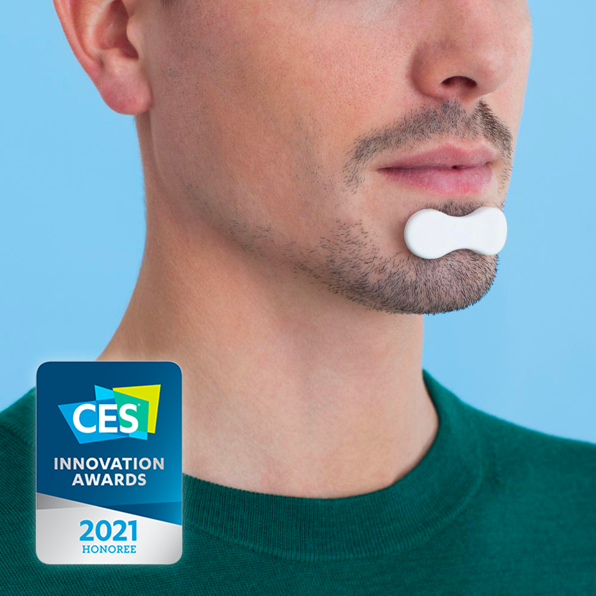
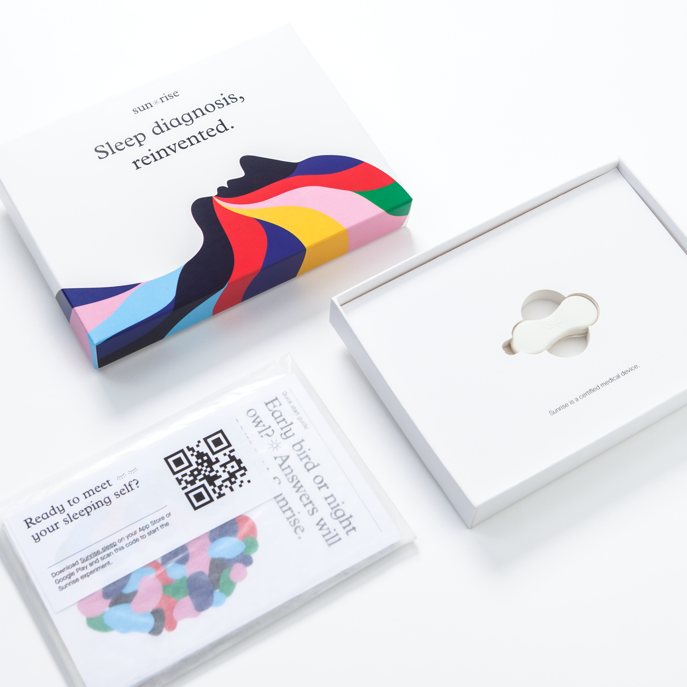
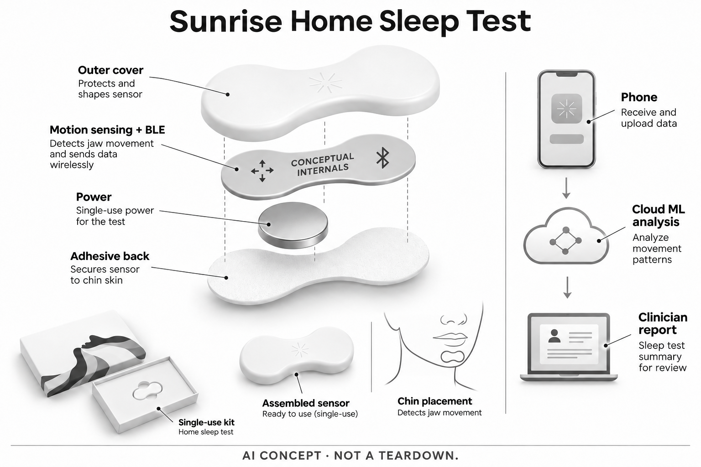

# Sunrise 家用下颌运动睡眠测试

**Sunrise** · 居家健康 · 核查 2026-11-05

在家记录一夜下颌运动，生成供医生解释的睡眠信息

消费渠道：个人零售。

## 产品图片与结构参考

### 产品图

Sunrise欧版白色下颌传感器官方佩戴图；旧奖项标识非当前销售日期 · 来源：[Sunrise · 官方产品图片](<https://www.hellosunrise.com/products/test-apnee-sommeil-sunrise>) · [原始图片](<https://www.hellosunrise.com/cdn/shop/products/Product_Visuals_1_fb94b5ef-1729-4c30-9fdf-e1eb1bcc781c_720x%402x.png?v=1608051869>)

### 参考图

Sunrise当前欧版一次性套装官方包装与传感器参考 · 来源：[Sunrise · 官方产品图片](<https://www.hellosunrise.com/products/test-apnee-sommeil-sunrise>) · [原始图片](<https://www.hellosunrise.com/cdn/shop/products/Product_visuals-9_041d7c87-03d2-4c59-855b-d6da5d080e24_720x%402x.png?v=1608051869>)

### AI 生成爆炸示意

**AI 生成 · 非实物拆机。** 内部为概念推断，不能作为元件布局、BOM 或维修依据。[生成提示词](../../content/hardware/prompts/sunrise-home-sleep-test.txt)

> 已视觉检查外形、灰阶、文本和数据路径；未知内部为概念模块，不代表实际拆机、完整BOM或医疗效果。

> 独立复查后使用ImageGen修订，局部标明概念内部；初稿与完整两阶段提示词保留。

> 内部电子层改为明确概念板，并将无线图标修正为Bluetooth；无针、无充电底座，保留一次性测试属性。

> 实际逐张查看并核对具体型号，保留厂家原图；参考场景和人物不能证明效果，历史图像与当前购买条件分别核查。

> 分析为基于公开资料的案头研究与 AI 辅助判断，未经用户访谈、销量审计或实物拆机。需求、画像、竞争冷门度、审美及商业机会均为研究假设，不是投资结论。

## 销售与购买

- 状态：在售。实际浏览器当前一夜套装显示En stock、€249，Commander进入相同实物套装完整结算；未填信息或付款。具体设备为欧版白色下颌传感器，不是纯App或医院现场操作服务。

- 地区：比利时、法国、卢森堡、结算另列美国；当地医疗服务与版本仍需确认

- 价格：€249／一夜套装（所见含税价格）。包含一次性电子传感器与分析流程，非可无限复用的租赁设备；后续医生咨询及其他方案条件另核，返还信封用于回收。

- 中国大陆：实际结算国家菜单未列中国大陆，条款也不保证欧盟以外使用；不借美国官网另一系统的渠道或功能推定本套装国内可用。

- [官方产品 / 商店](<https://www.hellosunrise.com/products/test-apnee-sommeil-sunrise>)

## AI 的实际作用

通过下颌运动模式进行睡眠与呼吸相关分类；厂家关联研究公开惯性信号经手机上传后使用机器学习分析，不能视为直接测脑电或实时气流。

服务与联网依赖：需要兼容手机、Bluetooth、网络与厂家分析平台，结果应由医生解释；2022研究算法只说明已研究机制，不保证当前全部后台版本相同。

## 是否冷门

细分专业（研究判断）：关注居家获取可供睡眠评估的信息，区别于播放声音或振动改善休息的设备；本研究不复核诊断表现，没有用户访谈或销量证据。

## 需求与市场

需求假设是个人希望在自己的睡眠环境中完成一次记录，减少到专门场所过夜的流程负担。设备小并不意味着结果必然完整，连接、贴附和用户准备都可能影响数据；研究价值在能否获得可解释的信息，而不是把居家便利自动转化为更准确或更好的医疗结论。

### 官方｜下颌运动记录用于后续睡眠评估 · 官方资料

Sunrise所核套装让用户在家佩戴小型下颌电子传感器，记录一夜运动信息并通过手机与平台生成报告。它提供的是供专业解释的数据链，不是睡前音频或主动刺激；下颌运动与呼吸相关模式之间的分析，也不能被描述为传感器直接测得脑电或全部呼吸气流。

依据：[Sunrise当前一夜实物测试套装](<https://www.hellosunrise.com/products/test-apnee-sommeil-sunrise>) · [Sunrise官方下颌运动与研究机制](<https://www.hellosunrise.com/pages/science-du-sommeil>) · [Sunrise官方销售与数据流程条款](<https://www.hellosunrise.com/pages/mentions-legales>)

### 判断｜减少采集地点限制仍需可靠记录 · 研究判断

需求假设是个人希望在自己的睡眠环境中完成一次记录，减少到专门场所过夜的流程负担。设备小并不意味着结果必然完整，连接、贴附和用户准备都可能影响数据；研究价值在能否获得可解释的信息，而不是把居家便利自动转化为更准确或更好的医疗结论。

依据：[Sunrise当前一夜实物测试套装](<https://www.hellosunrise.com/products/test-apnee-sommeil-sunrise>) · [Sunrise官方个人测试FAQ](<https://www.hellosunrise.com/pages/questions-frequentes>)

### 验证｜先确认能否完成有效采集流程 · 待验证

可以根据正式产品说明核对配对、开始、结束、上传和查看状态的步骤，记录用户需要帮助的环节。应把操作完成和数据质量合格分开，不只看App是否生成页面；本目录没有运行个人睡眠数据，也不为用户判断是否患有疾病或需要何种治疗。

依据：[Sunrise当前一夜实物测试套装](<https://www.hellosunrise.com/products/test-apnee-sommeil-sunrise>) · [Sunrise官方个人测试FAQ](<https://www.hellosunrise.com/pages/questions-frequentes>) · [Sunrise官方销售与数据流程条款](<https://www.hellosunrise.com/pages/mentions-legales>)

## 用户画像

这类产品需要用户能够管理手机、贴附和一夜采集，也需要理解报告不是最终自我判断。是否有合适支持、是否愿意与专业人员讨论，以及实际要解决什么问题，都比单纯对睡眠分数感兴趣更重要；不能依据打鼾或疲倦等一般描述替某个人作适用性结论。

### 官方｜个人实物订单和专业解释分开 · 官方资料

当前个人商店提供一夜套装，实际浏览器可进入明确商品及金额的结算，说明并非只面向医院采购。条款同时要求联系医生解释结果，后续咨询不应被想当然写成全部包含；目录将个人购买、家庭采集、平台分析和医疗解释分别记录，不把这些环节合成自动诊疗。

依据：[Sunrise当前一夜实物测试套装](<https://www.hellosunrise.com/products/test-apnee-sommeil-sunrise>) · [Sunrise官方销售与数据流程条款](<https://www.hellosunrise.com/pages/mentions-legales>)

### 判断｜愿意按流程记录并寻求解释的人更适配 · 研究判断

这类产品需要用户能够管理手机、贴附和一夜采集，也需要理解报告不是最终自我判断。是否有合适支持、是否愿意与专业人员讨论，以及实际要解决什么问题，都比单纯对睡眠分数感兴趣更重要；不能依据打鼾或疲倦等一般描述替某个人作适用性结论。

依据：[Sunrise官方个人测试FAQ](<https://www.hellosunrise.com/pages/questions-frequentes>) · [Sunrise官方销售与数据流程条款](<https://www.hellosunrise.com/pages/mentions-legales>)

### 验证｜核对手机、支持和报告接收方 · 待验证

购买前可以确认兼容手机、网络、有效期、异常数据和重新测试的处理方式，并明确由谁解释报告及咨询费用。若本人需要协助，应在使用前安排合适支持；本研究未建立医疗账户或收集资料，也不把官网展示的家庭场景推定为所有人都可独立完成。

依据：[Sunrise当前一夜实物测试套装](<https://www.hellosunrise.com/products/test-apnee-sommeil-sunrise>) · [Sunrise官方个人测试FAQ](<https://www.hellosunrise.com/pages/questions-frequentes>) · [Sunrise官方销售与数据流程条款](<https://www.hellosunrise.com/pages/mentions-legales>)

## 竞争与替代

声音或触觉头带主要提供休息过程中的反馈，Sunrise则收集特定一夜数据供评估，时间尺度和后续责任不同。两者都与睡眠有关，却不能用共同主题认为可以相互替代；比较应围绕要获取的信息、采集流程和专业解释，而不是把设备体积或佩戴部位当作主要价值。

### 官方｜一次性套装不是长期复用穿戴 · 官方资料

当前所核价格对应一夜测试和一次性传感器，回收信封用于将设备交回处理，不是无限次重复佩戴的租赁服务。页面提到其他夜数计划，也不能按每个套装增加独立硬件数量；本条只记录实际可选的一夜商品，不把旧包装、其他地区系统或临床设备规格拼在一起。

依据：[Sunrise当前一夜实物测试套装](<https://www.hellosunrise.com/products/test-apnee-sommeil-sunrise>)

### 判断｜与消费睡眠反馈设备任务不同 · 研究判断

声音或触觉头带主要提供休息过程中的反馈，Sunrise则收集特定一夜数据供评估，时间尺度和后续责任不同。两者都与睡眠有关，却不能用共同主题认为可以相互替代；比较应围绕要获取的信息、采集流程和专业解释，而不是把设备体积或佩戴部位当作主要价值。

依据：[Sunrise当前一夜实物测试套装](<https://www.hellosunrise.com/products/test-apnee-sommeil-sunrise>) · [Sunrise官方下颌运动与研究机制](<https://www.hellosunrise.com/pages/science-du-sommeil>)

### 验证｜比较完整获取报告的流程 · 待验证

可以把订单、到货、采集、上传、质量确认和解释的步骤列出，了解每个环节何时需要额外支持或费用。不能只用一夜标价与长期健康订阅直接比较，也不采用厂家速度或精度宣传为本研究结论；当前没有用户访谈、销量或独立诊断性能测试。

依据：[Sunrise当前一夜实物测试套装](<https://www.hellosunrise.com/products/test-apnee-sommeil-sunrise>) · [Sunrise官方个人测试FAQ](<https://www.hellosunrise.com/pages/questions-frequentes>) · [Sunrise官方销售与数据流程条款](<https://www.hellosunrise.com/pages/mentions-legales>)

## 供应链

同类新设计需要在轻量封装、粘附、运动噪声和无线记录之间协同，单独换用高性能惯性芯片不会自动得到可靠下颌信号。对一次性电子设备，还要考虑有效期与回收流程；供应候选只能说明局部能力，不能包含厂家分类模型、医疗解释和全部使用验证。

### 官方｜电子运动传感与分析平台各有边界 · 官方资料

厂家条款确认小型外壳内有电子板并记录下颌运动，关联研究说明使用惯性输入、Bluetooth和云端分析。具体当前批次的传感器、无线、电池和工厂未完整点名，不能据研究架构补成真实BOM；生成图只画通用功能块，没有添加针、植入物或其他系统的血氧附件。

依据：[Sunrise官方下颌运动与研究机制](<https://www.hellosunrise.com/pages/science-du-sommeil>) · [Sunrise官方销售与数据流程条款](<https://www.hellosunrise.com/pages/mentions-legales>) · [Sunrise下颌运动与机器学习对照研究，2022](<https://www.frontiersin.org/journals/neuroscience/articles/10.3389/fnins.2022.726880/full>)

### 判断｜稳定贴附和微小运动采集必须协同 · 研究判断

同类新设计需要在轻量封装、粘附、运动噪声和无线记录之间协同，单独换用高性能惯性芯片不会自动得到可靠下颌信号。对一次性电子设备，还要考虑有效期与回收流程；供应候选只能说明局部能力，不能包含厂家分类模型、医疗解释和全部使用验证。

依据：[Sunrise官方下颌运动与研究机制](<https://www.hellosunrise.com/pages/science-du-sommeil>) · [Sunrise官方个人测试FAQ](<https://www.hellosunrise.com/pages/questions-frequentes>) · [Sunrise下颌运动与机器学习对照研究，2022](<https://www.frontiersin.org/journals/neuroscience/articles/10.3389/fnins.2022.726880/full>)

### 验证｜候选需覆盖贴附状态和数据完整性 · 待验证

惯性候选可研究运动范围、噪声与安装，无线候选则需核对时序、缓存和断连恢复，但均须结合真实外壳与使用条件评估。没有Sunrise点名采用来源，不能把常见低功耗芯片写成现机零件；这些是新设计研究方向，不提供消费者改装或自制检测设备的方案。

依据：[Sunrise官方个人测试FAQ](<https://www.hellosunrise.com/pages/questions-frequentes>) · [Sunrise下颌运动与机器学习对照研究，2022](<https://www.frontiersin.org/journals/neuroscience/articles/10.3389/fnins.2022.726880/full>)

## 技术路径

下颌运动是一种可观察信号，对它分类仍需要解释背景和质量限制。算法输出看起来详细，并不意味着所有状况都能由这一种输入覆盖；技术评价应保留原记录、分析状态与专业解释之间的关系，避免把一个报告标签当作未经进一步判断的确定结论。

### 官方｜研究公开机器学习分类过程 · 官方资料

厂家所列二零二二年研究描述惯性运动经手机传到云端，并用机器学习分类睡眠与相关呼吸努力模式，附录说明了随机森林方法。这个来源支持产品具有具体分析机制，但只覆盖研究时系统；目录不声称当前全部后台版本仍完全相同，也不将某次对照结果推广为任意个人的准确率。

依据：[Sunrise官方下颌运动与研究机制](<https://www.hellosunrise.com/pages/science-du-sommeil>) · [Sunrise下颌运动与机器学习对照研究，2022](<https://www.frontiersin.org/journals/neuroscience/articles/10.3389/fnins.2022.726880/full>)

### 判断｜代理信号与临床结论不能合并 · 研究判断

下颌运动是一种可观察信号，对它分类仍需要解释背景和质量限制。算法输出看起来详细，并不意味着所有状况都能由这一种输入覆盖；技术评价应保留原记录、分析状态与专业解释之间的关系，避免把一个报告标签当作未经进一步判断的确定结论。

依据：[Sunrise官方下颌运动与研究机制](<https://www.hellosunrise.com/pages/science-du-sommeil>) · [Sunrise官方销售与数据流程条款](<https://www.hellosunrise.com/pages/mentions-legales>) · [Sunrise下颌运动与机器学习对照研究，2022](<https://www.frontiersin.org/journals/neuroscience/articles/10.3389/fnins.2022.726880/full>)

### 验证｜检查失败与重新获取数据的路径 · 待验证

可以核对连接丢失、传感器脱落、上传延迟和质量不足时，App与支持方如何通知用户以及是否需要重测。公开研究中也存在技术失败，不能只看最终纳入样本的结果；本目录没有复制研究或运行真机，不提供诊断阈值和对个人报告的医学解读。

依据：[Sunrise官方个人测试FAQ](<https://www.hellosunrise.com/pages/questions-frequentes>) · [Sunrise官方销售与数据流程条款](<https://www.hellosunrise.com/pages/mentions-legales>) · [Sunrise下颌运动与机器学习对照研究，2022](<https://www.frontiersin.org/journals/neuroscience/articles/10.3389/fnins.2022.726880/full>)

## 产品审美

小体积可能降低视觉存在感，但面部触感、胡须、睡姿和对贴附物的接受度仍很个人化。官方照片无法说明一整夜是否舒适，也不能代表所有人都不会碰触或移位；审美评价应与使用过程分开，不把看起来简单等同无学习、无维护或无数据失败。

### 官方｜白色蝴蝶结状外壳贴在下颌 · 官方资料

当前欧版套装官方照片显示小型白色双端圆润的传感器贴在下颌，包装中有设备与说明，未见显示屏或充电底座。它不同于美国其他组合的外观及附件，图片上的旧奖项年份也不是当前供货日期；概念图保留外形，只展示电子、供电和粘附功能层，不画针或身体内部结构。

依据：[Sunrise当前一夜实物测试套装](<https://www.hellosunrise.com/products/test-apnee-sommeil-sunrise>)

### 判断｜夜间存在感需要真实佩戴观察 · 研究判断

小体积可能降低视觉存在感，但面部触感、胡须、睡姿和对贴附物的接受度仍很个人化。官方照片无法说明一整夜是否舒适，也不能代表所有人都不会碰触或移位；审美评价应与使用过程分开，不把看起来简单等同无学习、无维护或无数据失败。

依据：[Sunrise当前一夜实物测试套装](<https://www.hellosunrise.com/products/test-apnee-sommeil-sunrise>) · [Sunrise官方个人测试FAQ](<https://www.hellosunrise.com/pages/questions-frequentes>)

### 验证｜按个人条件确认贴附与收纳 · 待验证

正式使用前应依厂家说明了解粘附、有效期和一次性使用要求，并知道包装与回收材料如何保留。需要把外观偏好、皮肤体验和数据质量分别观察，避免一个方面合适就忽略其他条件；本研究只有官方图和资料，没有真实佩戴、材料或整夜稳定性测试。

依据：[Sunrise当前一夜实物测试套装](<https://www.hellosunrise.com/products/test-apnee-sommeil-sunrise>) · [Sunrise官方个人测试FAQ](<https://www.hellosunrise.com/pages/questions-frequentes>)

## 关键风险

自动报告可能让用户忽视数据失败或单夜差异，也可能让尚未解释的标签造成额外担忧。便利采集并不会取消专业判断和其他信息的价值；产品研究应清楚说明何处是记录、何处是模型推断、何处需要医生解释，而不是承诺用一枚传感器解决所有睡眠问题。

### 官方｜结算地区和医疗服务范围不同 · 官方资料

本轮实际结算可选比利时、法国、卢森堡及美国，但条款不保证欧盟以外使用，因此菜单存在不等于所有地区医疗功能和支持已确认。中国大陆不在所见结算范围内；目录按欧版一夜套装记录，不借美国另一个系统的宣传或采购渠道扩展本条能力。

依据：[Sunrise当前一夜实物测试套装](<https://www.hellosunrise.com/products/test-apnee-sommeil-sunrise>) · [Sunrise官方销售与数据流程条款](<https://www.hellosunrise.com/pages/mentions-legales>)

### 判断｜结果过度确信或过度担忧都需避免 · 研究判断

自动报告可能让用户忽视数据失败或单夜差异，也可能让尚未解释的标签造成额外担忧。便利采集并不会取消专业判断和其他信息的价值；产品研究应清楚说明何处是记录、何处是模型推断、何处需要医生解释，而不是承诺用一枚传感器解决所有睡眠问题。

依据：[Sunrise官方下颌运动与研究机制](<https://www.hellosunrise.com/pages/science-du-sommeil>) · [Sunrise官方销售与数据流程条款](<https://www.hellosunrise.com/pages/mentions-legales>)

### 验证｜明确分享、保存和解释责任 · 待验证

可以在购买前核对数据上传、报告分享、账户保留和删除条件，并确认需要解释时的联系路径与费用。设备或App无法完成记录时，应按正式支持流程处理，不凭不完整结果自行作医疗决定；本目录没有收集个人健康信息，也不代替医生评估或提供治疗安排。

依据：[Sunrise当前一夜实物测试套装](<https://www.hellosunrise.com/products/test-apnee-sommeil-sunrise>) · [Sunrise官方个人测试FAQ](<https://www.hellosunrise.com/pages/questions-frequentes>) · [Sunrise官方销售与数据流程条款](<https://www.hellosunrise.com/pages/mentions-legales>)

## 机会与验证

后续研究可以观察用户是否顺利获得可用数据、理解质量提示并完成后续讨论，而不是只计算订单或App打开次数。如果记录简单但解释和支持难以获得，便利可能有限；真实需求应围绕完整信息流程验证，不能由小型化外观或医学名词推断普遍采用。

### 官方｜居家睡眠信息采集保留一个核心场景 · 官方资料

本条代表以个人可订购电子传感器在家采集睡眠相关运动信息，并进入专业解释流程的任务，不按夜数或包装拆成多个创新硬件。它与主动声音、触觉反馈的执行任务不同；目录同时保留单夜、一次性和云分析条件，避免只留下“在家测睡眠”的宽泛标签。

依据：[Sunrise当前一夜实物测试套装](<https://www.hellosunrise.com/products/test-apnee-sommeil-sunrise>) · [Sunrise官方下颌运动与研究机制](<https://www.hellosunrise.com/pages/science-du-sommeil>) · [Sunrise官方销售与数据流程条款](<https://www.hellosunrise.com/pages/mentions-legales>)

### 判断｜关注有效记录到解释之间的衔接 · 研究判断

后续研究可以观察用户是否顺利获得可用数据、理解质量提示并完成后续讨论，而不是只计算订单或App打开次数。如果记录简单但解释和支持难以获得，便利可能有限；真实需求应围绕完整信息流程验证，不能由小型化外观或医学名词推断普遍采用。

依据：[Sunrise当前一夜实物测试套装](<https://www.hellosunrise.com/products/test-apnee-sommeil-sunrise>) · [Sunrise官方个人测试FAQ](<https://www.hellosunrise.com/pages/questions-frequentes>) · [Sunrise官方销售与数据流程条款](<https://www.hellosunrise.com/pages/mentions-legales>)

### 验证｜记录重测、支持和停止原因 · 待验证

可在合适同意和专业边界内记录数据失败、重测、联系支持与报告解释的步骤，并保留未达到预期的情况。当前没有本研究临床复核、长期用户访谈或销量证据，不推定诊断表现和商业规模；结论应允许某些个人仍需其他检测或不选择这一套装。

依据：[Sunrise当前一夜实物测试套装](<https://www.hellosunrise.com/products/test-apnee-sommeil-sunrise>) · [Sunrise官方个人测试FAQ](<https://www.hellosunrise.com/pages/questions-frequentes>) · [Sunrise下颌运动与机器学习对照研究，2022](<https://www.frontiersin.org/journals/neuroscience/articles/10.3389/fnins.2022.726880/full>)

## 对应供应链公司

能力候选用于选型研究，不代表本产品实际采用；未公开的供货关系不作推断。

- [bosch-sensortec](../supply-chain/bosch-sensortec.md) — **能力候选 · 非已采用** / 同类下颌运动记录器的惯性输入研究：Bosch Sensortec公开智能惯性传感平台，可研究相近小型贴附设备的运动、方向和低功耗输入，但实际下颌微动作、安装与噪声条件需专项验证。未发现Sunrise点名采用证据，通用动作感知不包含其睡眠分类模型，也不能由芯片能力推定检测有效或可直接替换原设备。

- [nordic-semiconductor](../supply-chain/nordic-semiconductor.md) — **能力候选 · 非已采用** / 同类单夜贴附记录器的BLE数据链候选：Nordic低功耗无线平台可研究单夜运动数据的Bluetooth传输、缓冲与断连恢复，需结合封装、电源和手机兼容验证。没有本产品采用来源，也不提供Sunrise的云分析与医疗解释；候选只对应相近新设计通信层，不意味着普通开发板即可成为个人睡眠检测设备。

[浏览供应链目录](../supply-chain.md)

## 功能分层示意

这是功能关系，不是实物拆机、真实空间结构或已核实 BOM。

1. **下颌运动采集**：贴附式电子传感器记录下颌运动，公开研究采用惯性信号。（官方披露）

2. **手机连接**：Bluetooth把记录送到兼容手机，App管理测试与暂存。（官方披露）

3. **云端分析**：数据上传厂家平台，由机器学习分析相关模式。（官方披露）

4. **结果与专业解释**：报告可以分享给医生，系统不替代完整医疗判断。（官方披露）

5. **一次性使用与回收**：套装提供一次性传感器及回收信封，不是可充电长期穿戴。（官方披露）

## 来源

1. [Sunrise当前一夜实物测试套装](<https://www.hellosunrise.com/products/test-apnee-sommeil-sunrise>) — 已实际浏览器核到€249、En stock并进入完整结算；一次性传感器及回收信封，未提交信息或支付。结算地区另有具体范围。

2. [Sunrise官方下颌运动与研究机制](<https://www.hellosunrise.com/pages/science-du-sommeil>) — 已打开下颌运动说明与机器学习研究链接；不把“脑的反应”宣传写成直接读取脑信号，也不采用精度或医疗效果排名。

3. [Sunrise官方个人测试FAQ](<https://www.hellosunrise.com/pages/questions-frequentes>) — 已打开个人订购、兼容手机与网络、传感器有效期和支持条件；不推定任意地址均可交付。

4. [Sunrise官方销售与数据流程条款](<https://www.hellosunrise.com/pages/mentions-legales>) — 已打开电子传感器、手机暂存/加密上传、专业平台及需医生解释；欧盟以外不保证可用，具体个人使用仍依产品说明。

5. [Sunrise下颌运动与机器学习对照研究，2022](<https://www.frontiersin.org/journals/neuroscience/articles/10.3389/fnins.2022.726880/full>) — 已打开研究全文：惯性输入、BLE手机、云端分析与随机森林分类；只用于说明研究过的机制和限制，不推定2026后台完全不变或复现实验效果。

[返回目录](../hardware-market.md) · [网页分析](https://romanagent.github.io/Roman/#hardware/product/sunrise-home-sleep-test)
