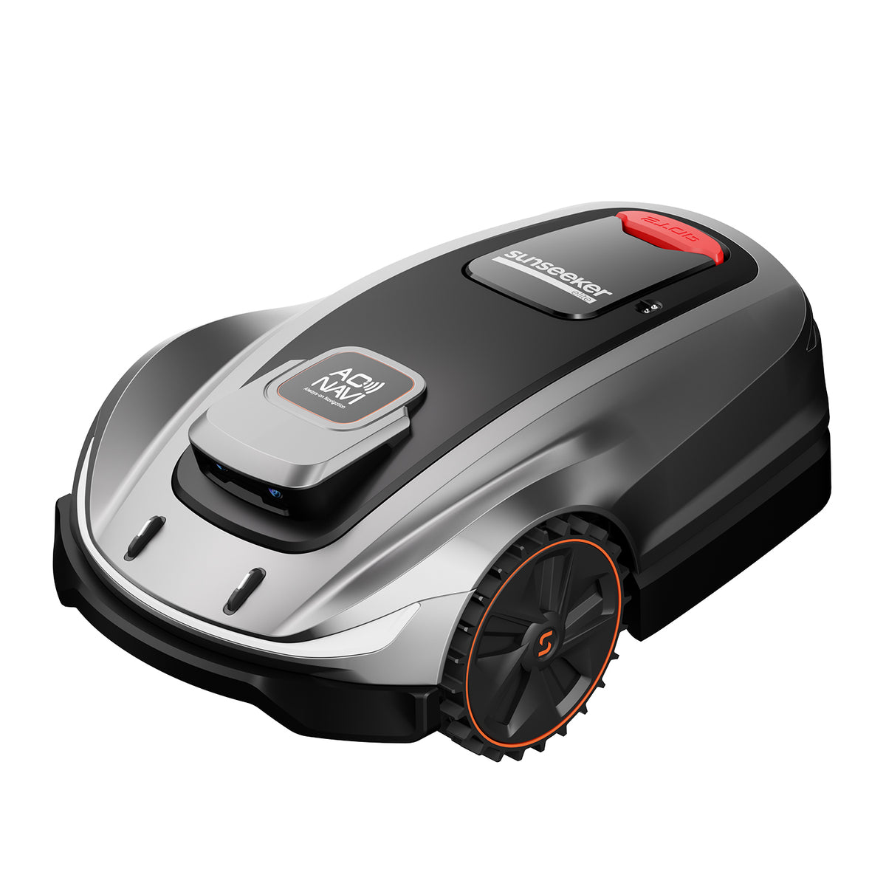
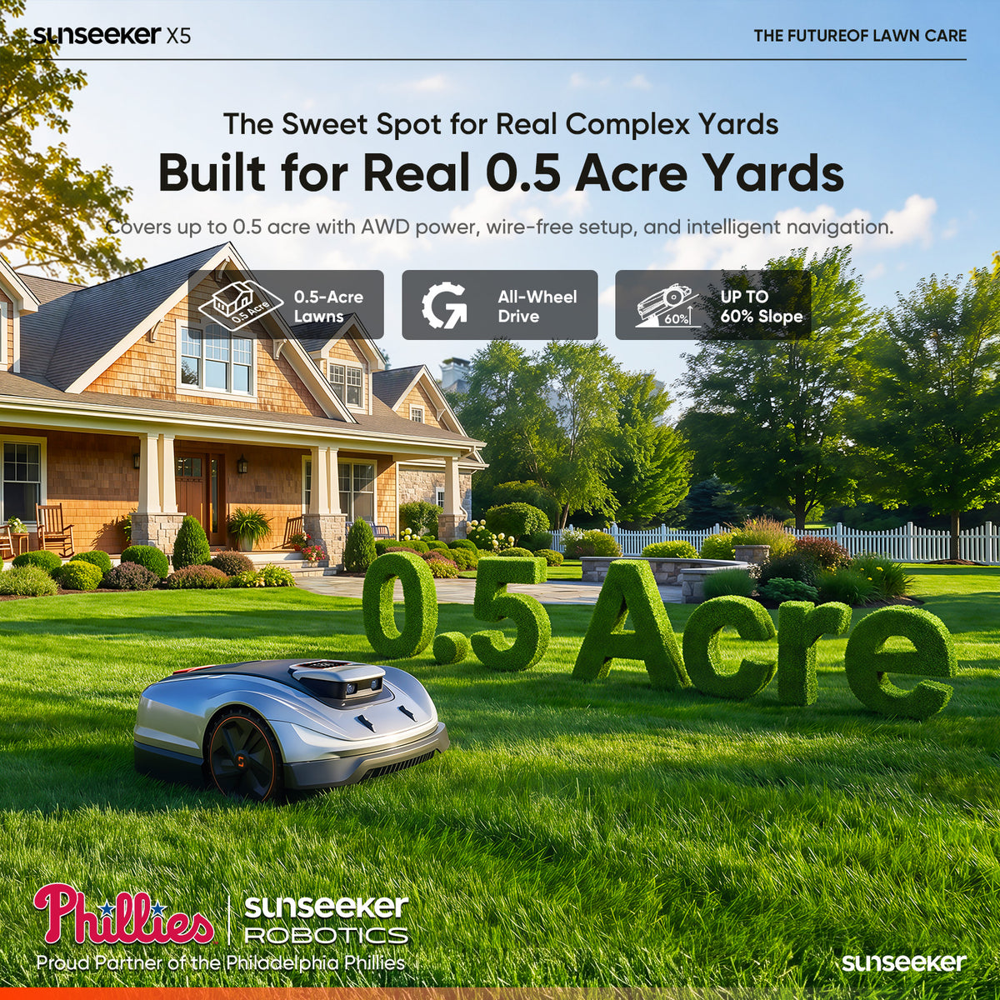
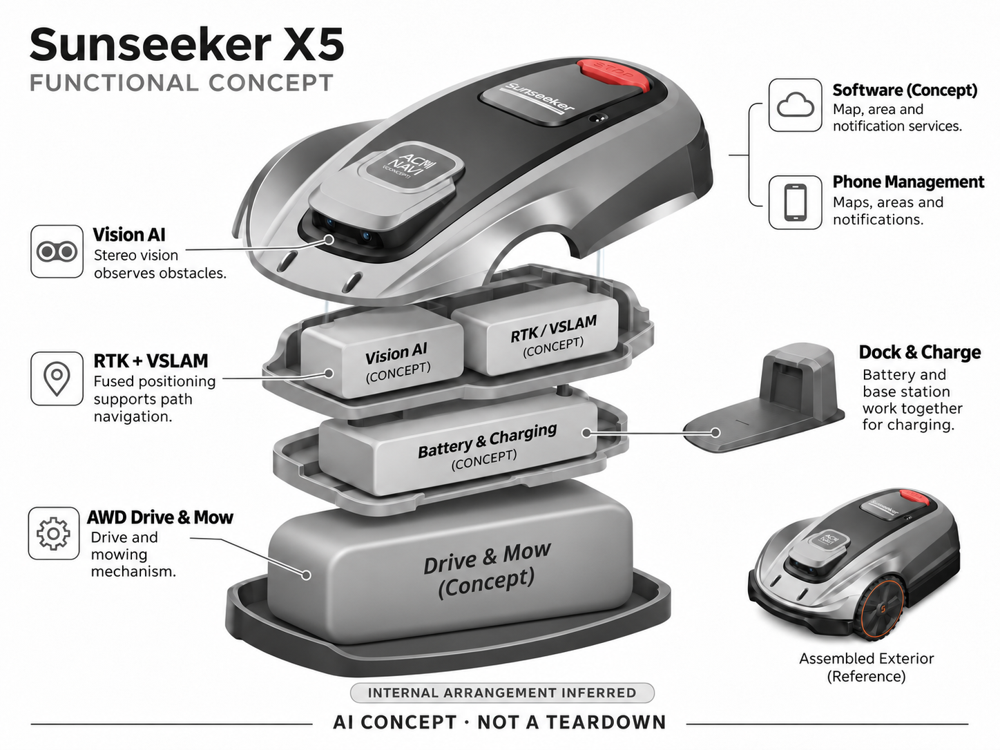

# Sunseeker X5

**Sunseeker** · 庭院与自然 · 核查 2026-11-04

面向家庭多区草坪的全轮驱动（AWD）视觉割草机

消费渠道：个人零售。

## 产品图片与结构参考

### 产品图

Sunseeker X5 官方产品图 · 来源：[Sunseeker · 官方图片](<https://shopsunseekertech.com/products/x5-wireless-robot-lawn-mower-0-5-acres>) · [原始图片](<https://cdn.shopify.com/s/files/1/0772/3951/7501/files/1500X1500_a2fd9aa2-6239-40f3-b423-6b15ce202e7e.jpg?v=1747964939&width=1200>)

### 参考图

Sunseeker X5 官方外观、使用场景或功能参考图 · 来源：[Sunseeker · 官方图片](<https://shopsunseekertech.com/products/x5-wireless-robot-lawn-mower-0-5-acres>) · [原始图片](<https://cdn.shopify.com/s/files/1/0772/3951/7501/files/x5-pp-1_196103c4-c6e8-4606-8acc-9b87bda3c3dd.jpg?v=1781151939&width=1200>)

### AI 生成爆炸示意

**AI 生成 · 非实物拆机。** 内部为概念推断，不能作为元件布局、BOM 或维修依据。[生成提示词](../../content/hardware/prompts/sunseeker-x5.txt)

> 保留官方图原始内容与出处；画面中的宣传参数不视为本轮独立实测。

> 分析为基于公开资料的案头研究与 AI 辅助判断，未经用户访谈、销量审计或实物拆机。需求、画像、竞争冷门度、审美及商业机会均为研究假设，不是投资结论。

## 销售与购买

- 状态：在售。当前官方X5商品页显示价格与Add to cart；旧X7链接重定向到X5，故按实际页面型号收录，未把X7名称或参数搬过来。

- 地区：美国官方商店

- 价格：US$1,499.99。核查时官方页面参考，价格保留原币种；套装、配件、订阅、税运及地区条件分别确认，不把容量版本重复计数。

- 中国大陆：本轮核实海外官方销售；中国大陆同型号现货、售后与云服务未确认。庭院条件、物种范围或定位服务也需按地区验证。

- [官方产品 / 商店](<https://shopsunseekertech.com/products/x5-wireless-robot-lawn-mower-0-5-acres>)

## AI 的实际作用

双目Vision AI与RTK/VSLAM参与障碍感知和导航，配合全轮驱动（AWD）底盘；定时排程本身不是AI。

服务与联网依赖：地图和远程管理通过App，定位及地区服务需确认；真实草种、坡度和遮挡条件仍决定表现。

## 是否冷门

细分专业（研究判断）：家庭割草属于细分消费场景，但RTK与视觉全轮驱动（AWD）产品已有强竞争，不属于无人覆盖赛道。

## 需求与市场

需求假设：中型私家庭院需要规律割草，但用户不想埋边界线或手推设备。应测量实际漏割、边缘补修和卡住后的恢复时间；设备面积参数只是选型线索，不能等同每日完整覆盖。

## 用户画像

画像推断：有前后院、愿安装基站并使用手机管理的房主，对稳定维护的需求高于尝鲜。小而规则的草坪可能不需要全轮驱动（AWD），高坡复杂地块又可能超出条件，应按真实任务细分。

## 竞争与替代

竞争判断：与Mammotion、Navimow、ANTHBOT及普通园艺工具直接竞争，品牌之间在传感路线和售后上存在取舍。X5的AI不能孤立评价，安装、维修、配件与整季切割结果共同决定价值。

## 供应链

供应链分析：全轮驱动（AWD）轮组、双目摄像、RTK组件、电池与刀盘要求可靠集成。具体芯片、代工厂及BOM未披露；泥沙、水汽、坡地负载和长期镜头清洁是重要测试，不能仅按室内电子产品估风险。

## 技术路径

官方说明Vision AI双目避障及融合导航。技术判断：阴影、反光水面和临时杂物会影响感知，低置信时应保持安全行为；定位精度、识别效果与最终切割质量是不同指标。

## 产品审美

审美判断：外壳与大轮体现庭院工具属性，清晰的停止键比复杂屏幕更适合户外。安装后天线与基站的体量、洗护时的手部空间，以及冬季收纳方式都应纳入工业设计评估。

## 关键风险

风险判断：不能依赖视觉AI保证避开所有儿童、宠物和野生动物；刀盘安全、边界与用户监督仍然必要。旧链接会跳转新型号，采购时必须核对实际SKU、地区配置和配件兼容性。

## 机会与验证

机会假设：围绕中型家庭庭院提供可靠选型和安装复核，比单纯增加算法标签更贴近需求。可用边缘补割时间、接管频率与售后解决时长来验证产品和服务的真实竞争力。

## 功能分层示意

这是功能关系，不是实物拆机、真实空间结构或已核实 BOM。

1. **双目视觉**：Vision AI观察障碍。（官方披露）

2. **融合定位**：RTK与VSLAM支持路径。（官方披露）

3. **全轮驱动（AWD）执行**：驱动轮和割草机构。（官方披露）

4. **停靠充电**：电池与基站构成功能模块。（官方披露）

5. **手机管理**：地图、区域和通知。（官方披露）

## 来源

1. [Sunseeker X5 官方商品页](<https://shopsunseekertech.com/products/x5-wireless-robot-lawn-mower-0-5-acres>) — 已实际打开并核查购买与交付入口；未实际下单。

2. [Sunseeker 官方选型与技术比较](<https://shopsunseekertech.com/pages/find-your-mower>) — 已实际打开的官方能力、服务或维护说明；不代表独立实测。

[返回目录](../hardware-market.md) · [网页分析](https://romanagent.github.io/Roman/#hardware/product/sunseeker-x5)
