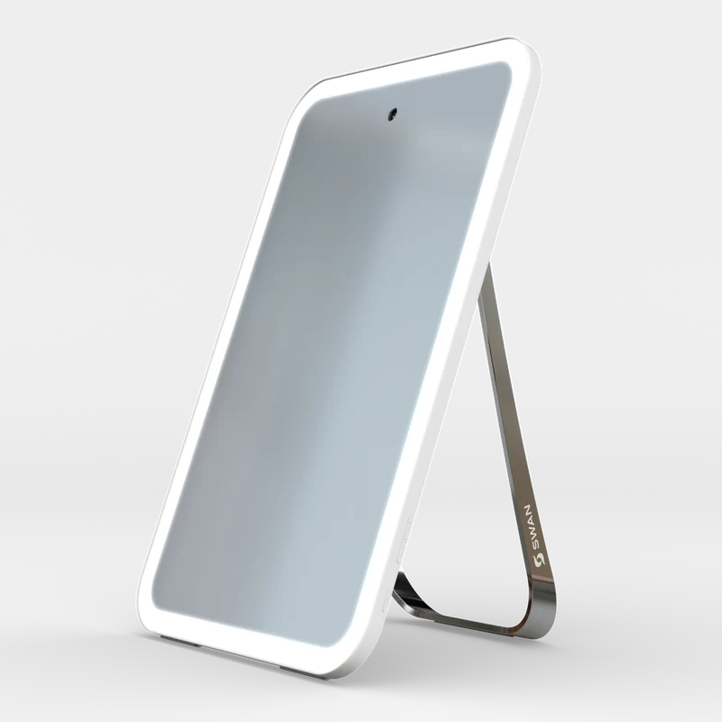
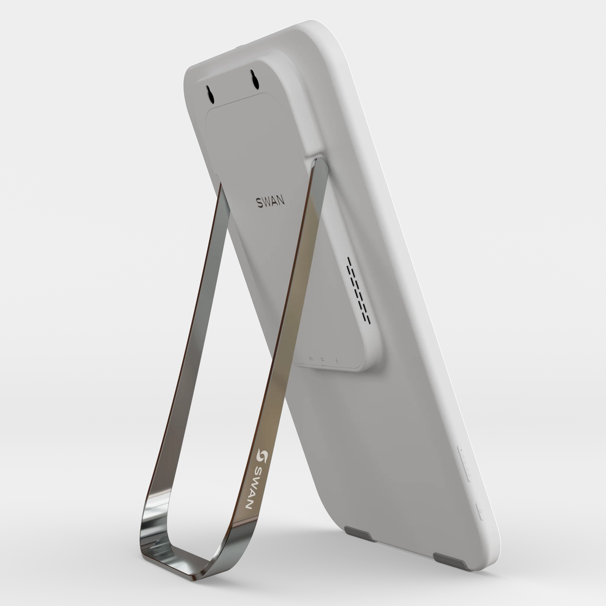
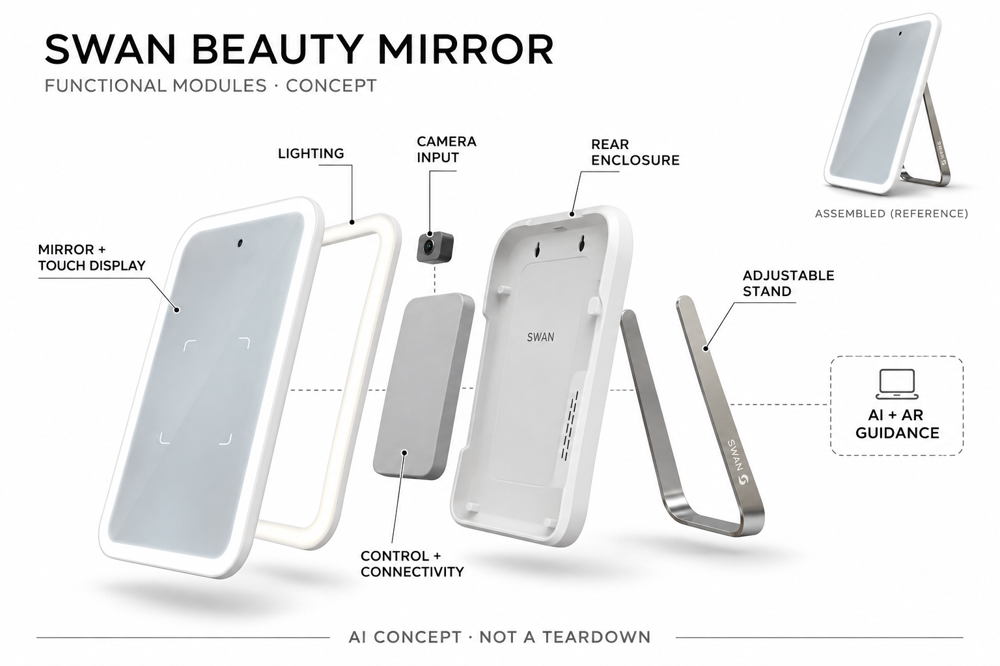

# SWAN Beauty Smart Mirror

**SWAN Beauty** · 护理与美容 · 核查 2026-11-04

把面部特征映射与AR化妆指引叠加到家中镜面

消费渠道：个人零售。

## 产品图片与结构参考

### 产品图

官方白色美妆镜前侧视角 · 来源：[SWAN Beauty · 官方图片](<https://www.swanbeauty.com/products/swan-mirror>) · [原始图片](<https://www.swanbeauty.com/cdn/shop/files/SWAN_Beauty_Smart_Mirror_Still_White_Front_Side_1.png?v=1785857719&width=800>)

### 参考图

官方同型号背面支撑参考 · 来源：[SWAN Beauty · 官方图片](<https://www.swanbeauty.com/products/swan-mirror>) · [原始图片](<https://www.swanbeauty.com/cdn/shop/files/SWAN_Beauty_Smart_Mirror_Still_White_Back_Side_2.png?v=1785857718&width=2048>)

### AI 生成爆炸示意

**AI 生成 · 非实物拆机。** 内部为概念推断，不能作为元件布局、BOM 或维修依据。[生成提示词](../../content/hardware/prompts/swan-beauty-smart-mirror.txt)

> 依据已核验官方外形与公开功能生成；未知内部仅为概念功能块，不代表原机电路板、芯片或实际布局。

> 已目视核对当前商品页面对应外形，原图未改色或语义编辑；图片中的营销和适用年龄不替代具体说明。

> 分析为基于公开资料的案头研究与 AI 辅助判断，未经用户访谈、销量审计或实物拆机。需求、画像、竞争冷门度、审美及商业机会均为研究假设，不是投资结论。

## 销售与购买

- 状态：在售。2026-11-04实际浏览白色型号页面US$795且ADD TO CART可用；抓取模板同时带Sold out字样，已以实时选中白色控件状态核实。未购买或提交资料。

- 地区：美国

- 价格：US$795。含12个月SWAN会员，此后页面列US$9.95/月或US$94/年；不同外壳色不另算产品，税费与运费按结算。

- 中国大陆：官方Shipping Policy明确目前仅美国配送，国际运输尚未开放；未确认中国大陆官方销售和服务。

- [官方产品 / 商店](<https://www.swanbeauty.com/products/swan-mirror>)

## AI 的实际作用

官方描述AI皮肤外观分析和面部映射，结合AR把化妆步骤指引叠加到镜面；这些是消费美妆参考，不是皮肤病诊断。

服务与联网依赖：需供电、联网及相应应用会员功能；模型位置、不同功能离线边界未完整披露，厂商合作背书不等于独立验证。

## 是否冷门

细分专业（研究判断）：面向家庭镜前学习与个性化美妆的专用终端，任务比普通镜子明确；高价、会员和图像隐私限制普遍采用。

## 需求与市场

需求假设：美妆学习者希望把教程中的位置对应到自己脸部，镜面AR可减少在手机和镜子间来回切换。价值应看能否理解步骤和减少操作困惑，不能把更多皮肤评分或推荐产品等同更好看，也不能把消费扫描写成专业诊断。

### 产品任务与边界 · 研究判断

需求假设：美妆学习者希望把教程中的位置对应到自己脸部，镜面AR可减少在手机和镜子间来回切换。价值应看能否理解步骤和减少操作困惑，不能把更多皮肤评分或推荐产品等同更好看，也不能把消费扫描写成专业诊断。

依据：[SWAN官方现售商品页](<https://www.swanbeauty.com/products/swan-mirror>) · [SWAN官方AI与AR体验说明](<https://www.swanbeauty.com/pages/experience>)

### 需求判断 · 研究判断

教程里抽象的位置描述需要使用者自行映射到脸上，AR镜面把说明放在实际反射位置，是比普通放大镜更具体的交互。皮肤外观记录则是另一条功能路径，不应与化妆学习混为一谈；需求要看是否减少理解困惑，而不是产生了多少分数或推荐。

依据：[SWAN官方现售商品页](<https://www.swanbeauty.com/products/swan-mirror>) · [SWAN官方AI与AR体验说明](<https://www.swanbeauty.com/pages/experience>)

### 需求验证 · 待验证

验证可让自愿用户完成相同的简单化妆步骤，对比普通镜加教程与AR指引，记录理解、回看与自主调整。外观结果由本人评价，不设置客观美丑排名；不把消费者的皮肤图像擅自上传，也不通过扫描结果形成诊断或治疗建议。

依据：[SWAN官方现售商品页](<https://www.swanbeauty.com/products/swan-mirror>) · [SWAN官方AI与AR体验说明](<https://www.swanbeauty.com/pages/experience>)

## 用户画像

画像推断：愿意在固定梳妆位置使用联网设备、学习技巧并管理照片与会员的人更匹配。只需普通照明镜、偏好快速简单流程或不愿上传图像的人需求不同，不应依据性别、年龄或外貌评价给用户分配美妆需求。

### 适用行为与条件 · 研究判断

画像推断：愿意在固定梳妆位置使用联网设备、学习技巧并管理照片与会员的人更匹配。只需普通照明镜、偏好快速简单流程或不愿上传图像的人需求不同，不应依据性别、年龄或外貌评价给用户分配美妆需求。

依据：[SWAN官方现售商品页](<https://www.swanbeauty.com/products/swan-mirror>) · [SWAN官方AI与AR体验说明](<https://www.swanbeauty.com/pages/experience>)

### 人群取舍 · 研究判断

固定梳妆位置、愿意使用连接设备和接受会员功能的人，比只需要照明反射的人更匹配。日常时间、图像权限和学习意愿都会影响价值，画像应关注实际行为，不能由性别、职业或个人照片推定美妆需求，也不把赠礼购买等同本人采用。

依据：[SWAN官方现售商品页](<https://www.swanbeauty.com/products/swan-mirror>) · [SWAN官方AI与AR体验说明](<https://www.swanbeauty.com/pages/experience>)

### 画像验证 · 待验证

画像验证应观察用户在真实台面上照镜、选择步骤和退出分析的操作，询问哪些图像愿意保存。对不愿订阅、只用单一妆容或已有满意手机流程的人如实记录不匹配，不以外貌担忧或专家宣传作为需要更多扫描的理由。

依据：[SWAN官方现售商品页](<https://www.swanbeauty.com/products/swan-mirror>) · [SWAN官方AI与AR体验说明](<https://www.swanbeauty.com/pages/experience>)

## 竞争与替代

竞争判断：与普通灯镜、手机AR试妆和视频教程竞争，差异是面部位置映射在真实镜面上的指导。外壳颜色不另计创新，皮肤趋势与化妆指引也需分别评估；不能只凭高价、OLED或品牌专家宣传就认定更有效。

### 比较对象与差异 · 研究判断

竞争判断：与普通灯镜、手机AR试妆和视频教程竞争，差异是面部位置映射在真实镜面上的指导。外壳颜色不另计创新，皮肤趋势与化妆指引也需分别评估；不能只凭高价、OLED或品牌专家宣传就认定更有效。

依据：[SWAN官方现售商品页](<https://www.swanbeauty.com/products/swan-mirror>) · [SWAN官方AI与AR体验说明](<https://www.swanbeauty.com/pages/experience>)

### 竞争判断 · 研究判断

手机AR便于携带，普通灯镜使用直接，专用镜把显示、光照与映射放在固定位置但增加价格和服务依赖。竞争应分开比较步骤定位与外观趋势，不用屏幕规格代替内容价值，也不能把皮肤评分变化直接解释为某个产品或教程真实有效。

依据：[SWAN官方现售商品页](<https://www.swanbeauty.com/products/swan-mirror>) · [SWAN官方AI与AR体验说明](<https://www.swanbeauty.com/pages/experience>)

### 竞争验证 · 待验证

竞争验证可在相同任务和照明下比较普通镜、手机及专用终端，记录视线切换、误解、清洁和再次使用。将会员到期的功能变化纳入成本，不以不同外壳色、新页面名称或同款套装扩张品类，也不把品牌高端定位等同独立需求。

依据：[SWAN官方现售商品页](<https://www.swanbeauty.com/products/swan-mirror>) · [SWAN官方AI与AR体验说明](<https://www.swanbeauty.com/pages/experience>)

## 供应链

供应链分析：显示、摄像、照明、音频、支架、外壳与会员软件共同构成终端，实际整机代工和BOM未披露。官网披露部分面板与传感品牌仍需型号范围核查，不从品牌名称推导所有部件或精确成本，色彩一致与隐私同样重要。

### 功能模块拆分 · 研究判断

功能层由镜面显示、可调照明、摄像输入、音频、支架外壳与联网服务组成。官网当前硬件页点名Samsung OLED和Sony图像传感器，但未给具体部件型号；这些是品牌公开声明，不能据此补写主板、生产工厂或完整BOM，更不能混入其他镜款。

依据：[SWAN官方现售商品页](<https://www.swanbeauty.com/products/swan-mirror>) · [SWAN官方镜体与交互结构](<https://www.swanbeauty.com/pages/mirror>) · [SWAN当前硬件与会员技术页](<https://www.swanbeauty.com/pages/experience-1>)

### 制造与供应约束 · 研究判断

供应链分析：显示、摄像、照明、音频、支架、外壳与会员软件共同构成终端，实际整机代工和BOM未披露。官网披露部分面板与传感品牌仍需型号范围核查，不从品牌名称推导所有部件或精确成本，色彩一致与隐私同样重要。

依据：[SWAN官方现售商品页](<https://www.swanbeauty.com/products/swan-mirror>) · [SWAN官方镜体与交互结构](<https://www.swanbeauty.com/pages/mirror>) · [SWAN当前硬件与会员技术页](<https://www.swanbeauty.com/pages/experience-1>)

### 候选与证据缺口 · 研究判断

华勤可作为整机终端工程候选，歌尔可评估声学与影像输入整合，两者没有SWAN点名供货证据。公开Samsung及Sony品牌点名并不证明这两家候选已参与，也不说明具体型号；色彩一致、照明和会员软件仍需独立工程验证。

依据：[SWAN官方现售商品页](<https://www.swanbeauty.com/products/swan-mirror>) · [SWAN官方镜体与交互结构](<https://www.swanbeauty.com/pages/mirror>) · [SWAN当前硬件与会员技术页](<https://www.swanbeauty.com/pages/experience-1>)

## 技术路径

技术判断：AI分析面部外观并结合AR定位指导，照明、姿态和相机输入会影响结果。不同页面列出的皮肤指标不完全一致，本条不把某个数量当稳定规格；模型细节与独立精度未公开，外观评分不能代表医学健康状态。

### 已披露技术边界 · 研究判断

技术判断：AI分析面部外观并结合AR定位指导，照明、姿态和相机输入会影响结果。不同页面列出的皮肤指标不完全一致，本条不把某个数量当稳定规格；模型细节与独立精度未公开，外观评分不能代表医学健康状态。

依据：[SWAN官方现售商品页](<https://www.swanbeauty.com/products/swan-mirror>) · [SWAN官方AI与AR体验说明](<https://www.swanbeauty.com/pages/experience>)

### 系统难点判断 · 研究判断

面部映射、AR位置叠加和皮肤外观分析分别依赖输入质量及模型判断，姿态与照明变化可能让结果不稳定。官方页面关于指标数存在差异，应保留版本范围而非选择更大数字；消费扫描不能被当成皮肤病诊断，更不能以算法分数定义个人价值。

依据：[SWAN官方现售商品页](<https://www.swanbeauty.com/products/swan-mirror>) · [SWAN官方AI与AR体验说明](<https://www.swanbeauty.com/pages/experience>)

### 技术验证 · 待验证

技术验证应使用自愿和受控的图像采集条件，比较重复扫描与姿态变化后的稳定性，再观察步骤叠加是否让人看懂。将原图、模型结果和用户判断分开，不把面部映射成功推定所有外观分析准确，也不据此给出医疗或敏感身份判断。

依据：[SWAN官方现售商品页](<https://www.swanbeauty.com/products/swan-mirror>) · [SWAN官方AI与AR体验说明](<https://www.swanbeauty.com/pages/experience>)

## 产品审美

审美判断：白色圆角镜体与金属后支架保持台面用品的熟悉形态，边缘照明较克制。实际体验还包括反光、指纹、镜头可见性和供电线，不能仅看渲染正面，也不应为了漂亮界面让用户难以理解图像正在被分析。

### 外观与交互语言 · 研究判断

审美判断：白色圆角镜体与金属后支架保持台面用品的熟悉形态，边缘照明较克制。实际体验还包括反光、指纹、镜头可见性和供电线，不能仅看渲染正面，也不应为了漂亮界面让用户难以理解图像正在被分析。

依据：[SWAN官方现售商品页](<https://www.swanbeauty.com/products/swan-mirror>) · [SWAN官方镜体与交互结构](<https://www.swanbeauty.com/pages/mirror>) · [SWAN当前硬件与会员技术页](<https://www.swanbeauty.com/pages/experience-1>)

### 使用中审美判断 · 研究判断

圆角镜体、边缘灯光和金属后支架保留日常镜具形态，镜头和状态指示也应让用户知道何时在采集。真实体验包含反光、指纹、线缆与台面空间，不能只用白底渲染图评价高级感；保持简洁不应牺牲隐私控制和当前功能的可见性。

依据：[SWAN官方现售商品页](<https://www.swanbeauty.com/products/swan-mirror>) · [SWAN官方镜体与交互结构](<https://www.swanbeauty.com/pages/mirror>) · [SWAN当前硬件与会员技术页](<https://www.swanbeauty.com/pages/experience-1>)

### 设计验证 · 待验证

设计验证可观察不同坐姿和台面高度下的阅读、触控及支架调整，并检查用户是否理解摄像与麦克风开关。让参与者自主表达审美偏好，不用宣传人物作为外貌标准，也不把更明亮的灯光、更大镜面或更多动画推定为适合所有人。

依据：[SWAN官方现售商品页](<https://www.swanbeauty.com/products/swan-mirror>) · [SWAN官方镜体与交互结构](<https://www.swanbeauty.com/pages/mirror>) · [SWAN当前硬件与会员技术页](<https://www.swanbeauty.com/pages/experience-1>)

## 关键风险

风险判断：光线与姿态误差可能改变分数，推荐内容也可能与商品销售相互影响，用户不应据此形成外貌压力或医疗结论。会员、服务更新及图像权限需要清楚，当前仅美国配送不能借国际品牌传播推成国内官方可购。

### 主要失效与依赖 · 研究判断

风险判断：光线与姿态误差可能改变分数，推荐内容也可能与商品销售相互影响，用户不应据此形成外貌压力或医疗结论。会员、服务更新及图像权限需要清楚，当前仅美国配送不能借国际品牌传播推成国内官方可购。

依据：[SWAN官方现售商品页](<https://www.swanbeauty.com/products/swan-mirror>) · [SWAN官方AI与AR体验说明](<https://www.swanbeauty.com/pages/experience>)

### 风险传播判断 · 研究判断

外观分析可能随光线波动，用户若把评分当健康判断或美丑标准，会产生不必要压力。推荐又与内容和购物入口相连，应关注商业影响，会员及图像权限必须清楚；厂商专家背书和高规格传感器不能替代实际独立效果与隐私验证。

依据：[SWAN官方现售商品页](<https://www.swanbeauty.com/products/swan-mirror>) · [SWAN官方AI与AR体验说明](<https://www.swanbeauty.com/pages/experience>)

### 风险验证 · 待验证

风险验证应核查图像保存、退出、删除及会员结束后的功能，并确认权限状态与真实采集一致。测试不涉及未经同意的人像，也不把异常皮肤表现交给消费镜判断；美国之外尚未开放配送，不能以国际媒体报道推定国内官方渠道。

依据：[SWAN官方现售商品页](<https://www.swanbeauty.com/products/swan-mirror>) · [SWAN官方AI与AR体验说明](<https://www.swanbeauty.com/pages/experience>)

## 机会与验证

机会假设：可靠的步骤定位和用户自主选择可能比更多皮肤分数更有持续价值，先比较普通镜加教程的真实效果。记录是否再次使用指导、维护和订阅原因，不以美妆总人口、焦虑或一次扫描的新鲜感预测市场规模。

### 可能的机会入口 · 研究判断

机会假设：可靠的步骤定位和用户自主选择可能比更多皮肤分数更有持续价值，先比较普通镜加教程的真实效果。记录是否再次使用指导、维护和订阅原因，不以美妆总人口、焦虑或一次扫描的新鲜感预测市场规模。

依据：[SWAN官方现售商品页](<https://www.swanbeauty.com/products/swan-mirror>) · [SWAN官方AI与AR体验说明](<https://www.swanbeauty.com/pages/experience>)

### 机会成立条件 · 研究判断

机会可能集中在可靠的步骤定位和低负担学习，让用户更容易尝试自己选择的妆容，而不是不断增加皮肤健康分。若AR指导很少再用，终端价值应重新评估；创业项目可先测可用性和隐私控制，再讨论内容会员和商品推荐的商业路径。

依据：[SWAN官方现售商品页](<https://www.swanbeauty.com/products/swan-mirror>) · [SWAN官方AI与AR体验说明](<https://www.swanbeauty.com/pages/experience>)

### 下一步验证 · 待验证

下一步可跟踪教程复用、手动修正和会员保留原因，比较普通镜与手机已经能解决的部分。尊重用户自主偏好并记录不采用的人群，不用美妆人口、外貌焦虑或单次扫描的新鲜感推算需求，也不把尚未完成的体验研究写成验证效果。

依据：[SWAN官方现售商品页](<https://www.swanbeauty.com/products/swan-mirror>) · [SWAN官方AI与AR体验说明](<https://www.swanbeauty.com/pages/experience>)

## 对应供应链公司

能力候选用于选型研究，不代表本产品实际采用；未公开的供货关系不作推断。

- [huaqin](../supply-chain/huaqin.md) — **能力候选 · 非已采用** / 联网美妆镜整机工程候选：华勤公开带屏终端研发制造能力可对应显示、触控、摄像和连接整合，但镜面光学与照明一致、面部模型及隐私需专项验证；没有SWAN点名合作资料，不与官网Samsung和Sony部件品牌声明混同。

- [goertek](../supply-chain/goertek.md) — **能力候选 · 非已采用** / 音视频输入与交互模组整合候选：歌尔公开声学、光学及智能硬件能力可用于音视频输入和整机交互评估，但不等于已获SWAN采用，也不替代官网点名部件；型号适配、色彩和会员软件需另核，保持候选关系。

[浏览供应链目录](../supply-chain.md)

## 功能分层示意

这是功能关系，不是实物拆机、真实空间结构或已核实 BOM。

1. **镜面与触控显示**：实体镜面屏提供查看与交互。（官方披露）

2. **照明与图像输入**：可调照明和镜头提供面部图像。（官方披露）

3. **控制与音频**：计算连接及音频交互功能层，内部布置不推定。（官方披露）

4. **支撑与外壳**：铝制外壳和可调后支架形成桌面使用结构。（官方披露）

5. **AI与AR应用**：外观分析、面部映射和步骤指引服务。（官方披露）

## 来源

1. [SWAN官方现售商品页](<https://www.swanbeauty.com/products/swan-mirror>) — 实际浏览选中Matte White的有效加购控件，读取会员费用；不以抓取模板Sold out文字直接判断全型号缺货。

2. [SWAN官方AI与AR体验说明](<https://www.swanbeauty.com/pages/experience>) — 实际打开AI外观分析和面部相关指导；营销指标数量不一致，未作为医疗或准确度声明。

3. [SWAN官方配送政策](<https://www.swanbeauty.com/policies/shipping-policy>) — 实际浏览仅美国配送和常规处理时间，国际地区尚未开放。

4. [SWAN官方镜体与交互结构](<https://www.swanbeauty.com/pages/mirror>) — 实际打开铝制外壳、可调后支架、无线连接；具体电子部件不从外形推定。

5. [SWAN当前硬件与会员技术页](<https://www.swanbeauty.com/pages/experience-1>) — 实际打开厂商点名Samsung OLED与Sony图像传感器，未披露具体部件型号；后续候选链接不得冒充实际整机供应商。

[返回目录](../hardware-market.md) · [网页分析](https://romanagent.github.io/Roman/#hardware/product/swan-beauty-smart-mirror)
