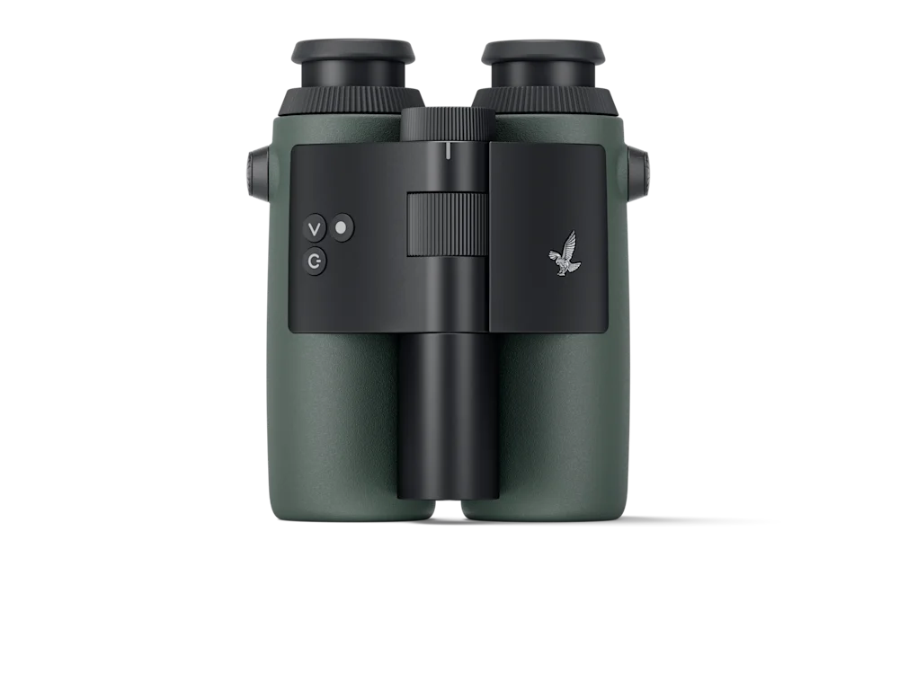
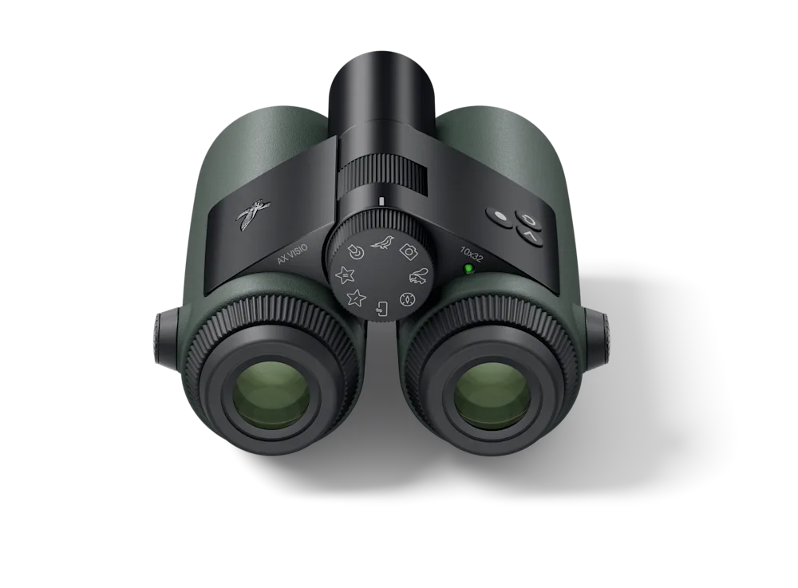
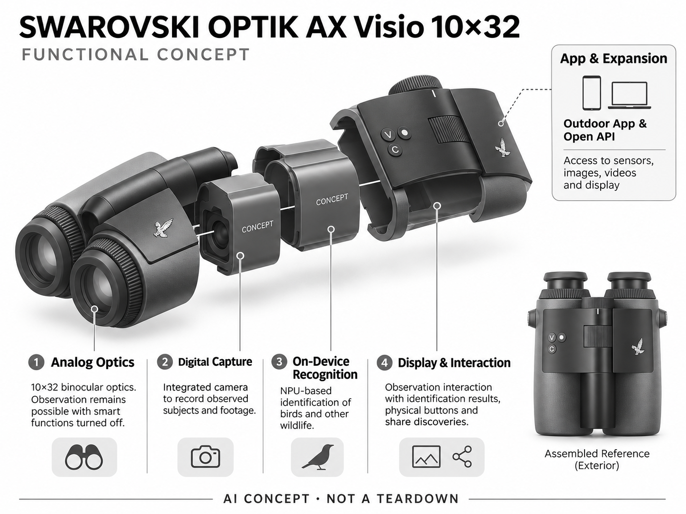

# SWAROVSKI OPTIK AX Visio 10×32

**SWAROVSKI OPTIK** · 影像与创作 · 核查 2026-11-04

将机内物种识别融入传统光学观察的 AI 双筒望远镜

消费渠道：个人零售。

## 产品图片与结构参考

### 产品图

官方商品图：AX Visio 10×32 正面外形 · 来源：[SWAROVSKI OPTIK · 官方图片](<https://www.swarovskioptik.com/at/en/hunting/products/binoculars/ax-visio/ax-visio-binoculars/ax-visio>) · [原始图片](<https://images.ctfassets.net/pvkenuwtinkd/2YYaGRLtftfDbYKZeaJVaK/8ba524433607c2db08f73af3b0028a65/K22_AX_Visio_04_Top_Frontal_13_RGB.png?fm=webp&q=80&w=1000>)

### 参考图

官方参考图：AX Visio 目镜侧与控制区 · 来源：[SWAROVSKI OPTIK · 官方图片](<https://www.swarovskioptik.com/at/en/hunting/products/binoculars/ax-visio/ax-visio-binoculars/ax-visio>) · [原始图片](<https://images.ctfassets.net/pvkenuwtinkd/17DDDxBk6P47krxqayy77D/7249349b19f22cd366bbef33469ee15c/K22_AX_Visio_10_Backside_Top_13_RGB.png?fm=webp&q=80&w=1000>)

### AI 生成爆炸示意

**AI 生成 · 非实物拆机。** 内部为概念推断，不能作为元件布局、BOM 或维修依据。[生成提示词](../../content/hardware/prompts/swarovski-ax-visio.txt)

> 依据官方外观参考与公开功能生成；未披露的内部布局只作概念模块，不构成BOM或真实结构证据。

> 图片版权归原权利人；用于产品研究并保留出处。未改变图片色彩或内容。

> 分析为基于公开资料的案头研究与 AI 辅助判断，未经用户访谈、销量审计或实物拆机。需求、画像、竞争冷门度、审美及商业机会均为研究假设，不是投资结论。

## 销售与购买

- 状态：在售。奥地利官方商店显示 €4,690、Add to Cart 与 2—3 个工作日配送说明；本条不是以2024年发布新闻推断现货。

- 地区：奥地利

- 价格：€4,690。奥地利官方页价格快照；跨境税费、保修范围和运输不由本条推定。

- 中国大陆：本轮未核实中国大陆授权经销商现货、官方报价与本地服务；官网有中文内容不等于支持中国大陆在线购买。

- [官方产品 / 商店](<https://www.swarovskioptik.com/at/en/hunting/products/binoculars/ax-visio/ax-visio-binoculars/ax-visio>)

## AI 的实际作用

设备集成 NPU，帮助识别鸟类和其他野生动物，并结合摄像记录观察；传统光学观察不依赖启用智能功能。

服务与联网依赖：识别使用机内智能组件，App用于个性化及内容共享；具体离线物种包、更新和地区覆盖需按当前官方服务确认。

## 是否冷门

细分专业（研究判断）：高价光学观鸟属于专业爱好者场景，AI集成较少见，但有传统光学和手机识别替代，不等于商业竞争弱。

## 需求与市场

需求假设：观察者在看到鸟之后，希望及时知道是什么而不反复拿手机或翻图鉴。应比较一次观察中断次数、识别正确率与学习效果，不能把按键识别等同培养了长期自然观察兴趣。

### 需求假设：观察时不想反复离开目镜 · 研究判断

AX Visio将传统双筒观察和物种识别放在同一设备，针对的是看到鸟之后需要放下望远镜、拿手机或翻图鉴的中断。真正价值应是保留观察过程与及时理解对象，而不只是获得一个名称；应先询问用户哪些中断曾导致目标飞走或失去兴趣。

依据：[AX Visio 奥地利官方商店](<https://www.swarovskioptik.com/at/en/hunting/products/binoculars/ax-visio/ax-visio-binoculars/ax-visio>) · [SWAROVSKI OPTIK 官方制造与技术介绍](<https://www.swarovskioptik.com/int/en/hunting/stories/ax-visio-a-story-of-innovations>)

### 价值判断：知道名称与学习观察不同 · 研究判断

按键获得名称可以帮助继续观察，也可能让使用者停止辨认羽色、行为和环境特征。研究应分别记录识别便利与学习过程，不能把一次回答正确等同自然知识增长，更不能从智能功能的存在推断用户会形成长期观鸟习惯。

依据：[SWAROVSKI OPTIK 官方制造与技术介绍](<https://www.swarovskioptik.com/int/en/hunting/stories/ax-visio-a-story-of-innovations>)

### 验证方案：比较一段真实自然观察 · 待验证

让观察者用普通双筒加图鉴或手机、以及AX Visio完成同一条自然路线，记录查找、等待和继续观察的时刻。回访时讨论记住了哪些特征与名称，并保留不确定识别记录，避免只在目标清晰且已知物种的演示环境中判断需求。

依据：[AX Visio 奥地利官方商店](<https://www.swarovskioptik.com/at/en/hunting/products/binoculars/ax-visio/ax-visio-binoculars/ax-visio>) · [SWAROVSKI OPTIK 官方制造与技术介绍](<https://www.swarovskioptik.com/int/en/hunting/stories/ax-visio-a-story-of-innovations>)

## 用户画像

画像假设：愿意为光学质量和观察体验支付高价的观鸟爱好者、自然教育者与专业导览人员。入门亲子家庭可能更适合普通双筒加手机；高客单价会限制大众覆盖面。

### 画像假设：珍视光学观察体验的人 · 研究判断

较匹配者可能是高频观鸟爱好者、自然导览者或教育活动组织者，愿意为光学观察和减少中断投入较高预算。只是偶尔想知道鸟名的家庭可能更适合手机与普通双筒，画像需要包含观察频率、携带习惯和对传统光学的偏好。

依据：[AX Visio 奥地利官方商店](<https://www.swarovskioptik.com/at/en/hunting/products/binoculars/ax-visio/ax-visio-binoculars/ax-visio>)

### 使用约束：智能与非智能模式共同存在 · 研究判断

官方明确关闭智能功能后仍可使用传统光学，这使产品价值不能只按AI使用次数衡量。有人主要观察、偶尔识别，有人依赖识别开展导览，两类使用者对续航、记录和更新要求不同，应分别了解，而不是把所有拥有者视为持续使用算法。

依据：[SWAROVSKI OPTIK 官方制造与技术介绍](<https://www.swarovskioptik.com/int/en/hunting/stories/ax-visio-a-story-of-innovations>)

### 访谈重点：谁在解释识别结果 · 待验证

自然教育中操作者可能是老师或导览员，最终受益者却是同行儿童或游客。应询问谁判断结果是否可信、如何向他人解释以及何时求助专家，并观察设备是否帮助共享发现，避免只采访购买者对高级光学的偏好而忽略集体活动体验。

依据：[AX Visio 奥地利官方商店](<https://www.swarovskioptik.com/at/en/hunting/products/binoculars/ax-visio/ax-visio-binoculars/ax-visio>) · [SWAROVSKI OPTIK 官方开发者站](<https://developers.swarovskioptik.com/>)

## 竞争与替代

竞争判断：高端光学具有品牌和制造门槛，但用户可用普通双筒、长焦相机与物种识别App组合替代。AI双筒属于专业细分，需求窄并不自动意味着低获客成本或高利润。

### 替代方案：传统双筒与识别应用组合 · 研究判断

AX Visio同时面对普通双筒加手机识别、图鉴、长焦相机和熟练观察者经验的替代。传统组合可能更便宜且便于更新应用，但需要切换设备；比较应保留光学观察和信息查询两项任务，不能只把所有方案按识别功能数排列。

依据：[AX Visio 奥地利官方商店](<https://www.swarovskioptik.com/at/en/hunting/products/binoculars/ax-visio/ax-visio-binoculars/ax-visio>) · [SWAROVSKI OPTIK 官方制造与技术介绍](<https://www.swarovskioptik.com/int/en/hunting/stories/ax-visio-a-story-of-innovations>)

### 差异判断：保留直接光学而叠加信息 · 研究判断

它的区别在于模拟光学并未被电子画面完全替代，智能功能作为观察过程的补充。对重视直接观察的人，这可能有意义，但对以拍照分享为主的人未必优于相机；应验证用户珍视的到底是看见、知道还是记录，避免混用价值主张。

依据：[SWAROVSKI OPTIK 官方制造与技术介绍](<https://www.swarovskioptik.com/int/en/hunting/stories/ax-visio-a-story-of-innovations>)

### 比较方法：以完整发现过程为单位 · 待验证

记录从发现远处目标、对准观察、尝试识别到分享或保存的全流程，对比各方案的中断与可理解性。不要只测试一张图片的分类准确度，也不将高端光学品牌偏好当作AI价值，应该让用户解释每次切换设备为什么值得或不值得。

依据：[AX Visio 奥地利官方商店](<https://www.swarovskioptik.com/at/en/hunting/products/binoculars/ax-visio/ax-visio-binoculars/ax-visio>) · [SWAROVSKI OPTIK 官方制造与技术介绍](<https://www.swarovskioptik.com/int/en/hunting/stories/ax-visio-a-story-of-innovations>)

## 供应链

官方介绍展示金属加工、表面处理、装配与校验过程，并披露机内NPU。具体芯片供应商和BOM未披露；分析认为光路精度、防水、重量平衡及光学与显示标定是主要制造门槛。

### 功能拆分：模拟光路与数字系统并行 · 研究判断

公开资料包含双筒光学、集成相机、机内识别、显示按键与应用接口，数字组件服务观察而不替代全部光路。供应拆分要区分双筒光学和数字采集镜头，不能将通用摄像模组直接当作主观察光学，也不能猜测NPU供应商与内部布局。

依据：[SWAROVSKI OPTIK 官方制造与技术介绍](<https://www.swarovskioptik.com/int/en/hunting/stories/ax-visio-a-story-of-innovations>) · [SWAROVSKI OPTIK 官方开发者站](<https://developers.swarovskioptik.com/>)

### 制造判断：光学标定与外壳共同约束 · 研究判断

官方制造故事展示加工、表面处理、装配与校验，说明它不是简单把相机绑在普通双筒上。分析认为光路精度、重心、防护和显示位置需要协同，但本轮没有获得公差、密封测试或完整物料表，不能据展示工序反推出成本和实际分包工厂。

依据：[SWAROVSKI OPTIK 官方制造与技术介绍](<https://www.swarovskioptik.com/int/en/hunting/stories/ax-visio-a-story-of-innovations>)

### 候选选型：数字光学与近眼显示分层 · 研究判断

玉晶光的光学设计能力可讨论数字采集部分，Kopin的近眼显示与光学集成可作为信息叠加候选，欣旺达可讨论供电。三者都需要针对双筒观察约束验证，不能视为原机采用披露，也不能假定某种微显示技术已经存在于AX Visio内部。

依据：[AX Visio 奥地利官方商店](<https://www.swarovskioptik.com/at/en/hunting/products/binoculars/ax-visio/ax-visio-binoculars/ax-visio>) · [SWAROVSKI OPTIK 官方制造与技术介绍](<https://www.swarovskioptik.com/int/en/hunting/stories/ax-visio-a-story-of-innovations>)

## 技术路径

官方确认机内NPU用于物种识别，传统光学在不启用智能功能时仍可用。技术判断：遮挡、远距离、幼鸟羽色与地区相似物种容易造成不确定，应向用户展示置信与候选，而非只给唯一答案。

### 已披露能力：机内识别与开放接口 · 官方资料

官方确认机内NPU支持鸟类及其他野生动物识别，开发者站提供相机、传感器和显示等访问能力。这里应区分识别推理、传统光学观察与应用扩展，接口开放并不代表所有能力无需限制或维护，也不证明识别范围在所有地区完全相同。

依据：[SWAROVSKI OPTIK 官方制造与技术介绍](<https://www.swarovskioptik.com/int/en/hunting/stories/ax-visio-a-story-of-innovations>) · [SWAROVSKI OPTIK 官方开发者站](<https://developers.swarovskioptik.com/>)

### 技术判断：不确定性比唯一答案重要 · 研究判断

远处目标、枝叶遮挡、幼鸟羽色和相似物种可能让输入信息不足，设备给出名称时仍需要用户判断。研究应观察是否能表达候选和不确定，而不是只追求快速唯一结果；此处是待验证的边界，不声称已测得该产品在这些条件下的错误率。

依据：[SWAROVSKI OPTIK 官方制造与技术介绍](<https://www.swarovskioptik.com/int/en/hunting/stories/ax-visio-a-story-of-innovations>)

### 验证方案：由可核记录检查识别过程 · 待验证

在不干扰动物的观察任务中保存图像与环境记录，再请具备相关知识的人核对，区分目标定位、图像采集和物种判断的问题。测试需包括未知与难辨对象，不只挑常见清晰鸟类，也不把识别结果用于决定是否可以接近或接触野生动物。

依据：[SWAROVSKI OPTIK 官方制造与技术介绍](<https://www.swarovskioptik.com/int/en/hunting/stories/ax-visio-a-story-of-innovations>) · [SWAROVSKI OPTIK 官方开发者站](<https://developers.swarovskioptik.com/>)

## 产品审美

审美判断：保留传统双筒握持语言，同时把数字模块整合进整体外壳；厂商注明设计由Marc Newson参与。观察设备需要兼顾戴手套操作、眼镜用户、长时悬挂与重心，外观独特不是全部价值。

### 外形判断：数字模块融入双筒语言 · 研究判断

AX Visio保留双筒握持与目镜的熟悉形态，同时通过整体外壳容纳数字功能，官方说明有工业设计参与。审美评价应看数字部分是否妨碍观察动作，而不是只看外形独特；长时间悬挂、重心和手部位置都影响用户是否愿意带出门。

依据：[AX Visio 奥地利官方商店](<https://www.swarovskioptik.com/at/en/hunting/products/binoculars/ax-visio/ax-visio-binoculars/ax-visio>) · [SWAROVSKI OPTIK 官方制造与技术介绍](<https://www.swarovskioptik.com/int/en/hunting/stories/ax-visio-a-story-of-innovations>)

### 交互判断：眼睛在目镜时如何操作 · 研究判断

观察者通常不愿为寻找按钮而移开视线，因此按键区分、戴手套操作和结果出现方式值得重点测试。视觉信息应帮助理解目标而非遮住目标，不能把显示内容越多当作越有用，实际观察时的注意力分配比桌面界面截图更重要。

依据：[AX Visio 奥地利官方商店](<https://www.swarovskioptik.com/at/en/hunting/products/binoculars/ax-visio/ax-visio-binoculars/ax-visio>) · [SWAROVSKI OPTIK 官方制造与技术介绍](<https://www.swarovskioptik.com/int/en/hunting/stories/ax-visio-a-story-of-innovations>)

### 体验验证：在步行与停留之间切换 · 待验证

让用户戴着原有眼镜或手套，完成行走、抬起、对焦、识别和收纳，记录哪些动作需要改变习惯。再观察同行者如何轮流使用与理解结果，比在展台看一次清楚目标更能反映设计，尤其能发现共享设备与个人长期使用的差异。

依据：[AX Visio 奥地利官方商店](<https://www.swarovskioptik.com/at/en/hunting/products/binoculars/ax-visio/ax-visio-binoculars/ax-visio>) · [SWAROVSKI OPTIK 官方制造与技术介绍](<https://www.swarovskioptik.com/int/en/hunting/stories/ax-visio-a-story-of-innovations>)

## 关键风险

风险判断：识别错误可能误导自然记录，电池与软件更新也引入传统光学没有的维护环节。影像和定位记录涉及使用者隐私；不能用于替代专家物种确认或作为野生动物安全接近的依据。

### 知识风险：错误名称可能进入自然记录 · 研究判断

识别结果若未经核对就进入观察笔记或教学材料，可能让错误被重复传播，因此重要记录应保留原图与不确定信息。设备能够给出名称并不等同专家确认，也不能用于判断动物是否安全或适合接近；研究需要明确观察辅助与事实核验之间的界线。

依据：[SWAROVSKI OPTIK 官方制造与技术介绍](<https://www.swarovskioptik.com/int/en/hunting/stories/ax-visio-a-story-of-innovations>) · [SWAROVSKI OPTIK 官方开发者站](<https://developers.swarovskioptik.com/>)

### 维护风险：光学耐用与数字服务周期不同 · 研究判断

传统光学可以独立工作，但智能部分增加电源、更新、应用和地区物种覆盖的管理任务，购买者需要接受不同维护周期。具体离线包和当前服务条件仍需按版本确认，不能因为光学部分可长期使用，就推断数字功能也没有更新或支持风险。

依据：[AX Visio 奥地利官方商店](<https://www.swarovskioptik.com/at/en/hunting/products/binoculars/ax-visio/ax-visio-binoculars/ax-visio>) · [SWAROVSKI OPTIK 官方制造与技术介绍](<https://www.swarovskioptik.com/int/en/hunting/stories/ax-visio-a-story-of-innovations>)

### 验证安排：记录停用智能功能的原因 · 待验证

试用中观察用户何时关闭智能部分、放弃识别或改用其他工具，区分节省电量、信息不可信与不需要提示。保留这些选择有助于理解产品真正的价值比例，避免只统计成功识别次数，也不预设每次不使用AI都意味着整台望远镜没有价值。

依据：[SWAROVSKI OPTIK 官方制造与技术介绍](<https://www.swarovskioptik.com/int/en/hunting/stories/ax-visio-a-story-of-innovations>)

## 机会与验证

可验证机会：为自然教育与导览补充多语言解释、观察记录和课程内容，先利用开放接口试验。若要做更低价硬件，应验证能否保留光学体验，避免以廉价屏幕取代用户真正珍视的观察感受。

### 研究方向：辅助解释和观察记录 · 研究判断

开放接口提供了探索观察记录、自然教育内容或多语言说明的入口，潜在价值可能在发现之后的理解和交流。应先研究现有设备能否支持课程与导览，而不是立即制造更便宜的智能双筒；低价如果牺牲用户珍视的光学体验，未必形成有效替代。

依据：[SWAROVSKI OPTIK 官方开发者站](<https://developers.swarovskioptik.com/>)

### 执行计划：跟踪导览与个人观察两类任务 · 待验证

分别观察自然教育活动和个人观鸟路线，记录查阅中断、结果核对、分享发现和后续笔记。访谈时追问哪些名称真正帮助理解、哪些提示被忽略，以及用户是否愿意再次携带，用具体记录评价机会，不将新奇演示后的称赞当作购买意愿。

依据：[AX Visio 奥地利官方商店](<https://www.swarovskioptik.com/at/en/hunting/products/binoculars/ax-visio/ax-visio-binoculars/ax-visio>) · [SWAROVSKI OPTIK 官方开发者站](<https://developers.swarovskioptik.com/>)

### 决策边界：专业细分不等于天然蓝海 · 研究判断

高客单价、精密光学与狭窄任务使这一方向具有专业性，但不能由样本少就推断竞争弱或利润高。需要同时验证愿意支付的体验收益、服务成本和触达人群方式，本轮没有开展访谈或取得销售数据，也不使用模型评分预测创业成功。

依据：[AX Visio 奥地利官方商店](<https://www.swarovskioptik.com/at/en/hunting/products/binoculars/ax-visio/ax-visio-binoculars/ax-visio>) · [SWAROVSKI OPTIK 官方制造与技术介绍](<https://www.swarovskioptik.com/int/en/hunting/stories/ax-visio-a-story-of-innovations>)

## 对应供应链公司

能力候选用于选型研究，不代表本产品实际采用；未公开的供货关系不作推断。

- [genius-electronic-optical](../supply-chain/genius-electronic-optical.md) — **能力候选 · 非已采用** / 数字采集支路的镜头设计候选：玉晶光公开光学设计、制造与机器人视觉镜头方向，可作为AX Visio数字采集支路的光学候选；这不覆盖传统双筒主光路的全部棱镜与目镜要求，视场、标定和防护仍需专门验证，也没有公开点名其为原机提供镜头或其他部件。

- [kopin](../supply-chain/kopin.md) — **能力候选 · 非已采用** / 近眼信息显示与光学集成候选：Kopin公开微显示、定制光学及消费近眼应用能力，与AX Visio在观察时呈现识别信息的任务具有对应，但具体显示技术、合光路径和眼位要求未披露。此关联仅提供工程候选，不证明原机采用Kopin，也不能据候选路线推断内部屏幕类型。

- [sunwoda](../supply-chain/sunwoda.md) — **能力候选 · 非已采用** / 户外观察数字组件供电候选：欣旺达消费电池业务可作为AX Visio智能识别与记录部分的电源工程候选，需按户外温度、空间和保护接口验证。传统光学独立可用不意味着数字部分无需供电，本条没有原机电池采用证据，也不构成兼容替换电池或续航承诺。

[浏览供应链目录](../supply-chain.md)

## 功能分层示意

这是功能关系，不是实物拆机、真实空间结构或已核实 BOM。

1. **模拟光学**：10×32双筒光学，智能功能关闭时仍可观察。（官方披露）

2. **数字采集**：集成相机记录观察对象与影像。（官方披露）

3. **机内识别**：NPU支持鸟类及野生动物识别。（官方披露）

4. **显示与交互**：识别结果、按键与分享发现功能形成观察交互。（官方披露）

5. **App与扩展**：Outdoor App及开放API提供传感器、图像、视频和显示访问。（官方披露）

## 来源

1. [AX Visio 奥地利官方商店](<https://www.swarovskioptik.com/at/en/hunting/products/binoculars/ax-visio/ax-visio-binoculars/ax-visio>) — 已打开；列€4,690、购物及配送信息，产品说明注明工业设计参与者。

2. [SWAROVSKI OPTIK 官方制造与技术介绍](<https://www.swarovskioptik.com/int/en/hunting/stories/ax-visio-a-story-of-innovations>) — 已打开；说明NPU、机内相机、光学独立使用，以及加工装配过程；不能据此推算成本。

3. [SWAROVSKI OPTIK 官方开发者站](<https://developers.swarovskioptik.com/>) — 已打开；说明API可访问显示、传感器、相机图像与视频流。

[返回目录](../hardware-market.md) · [网页分析](https://romanagent.github.io/Roman/#hardware/product/swarovski-ax-visio)
