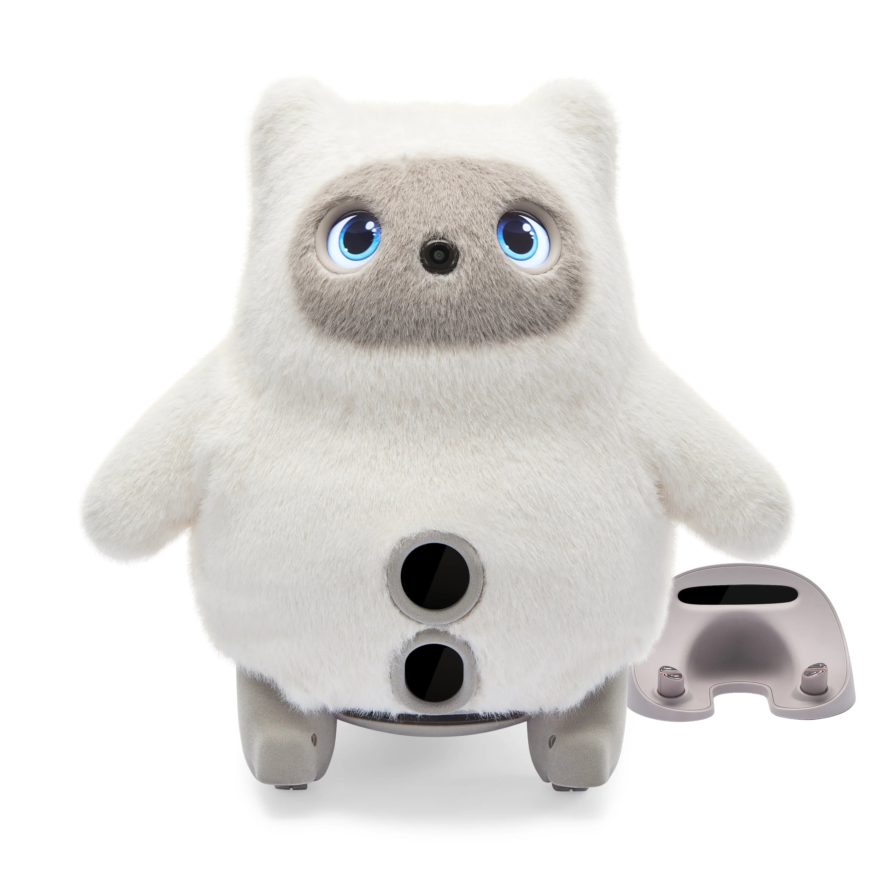
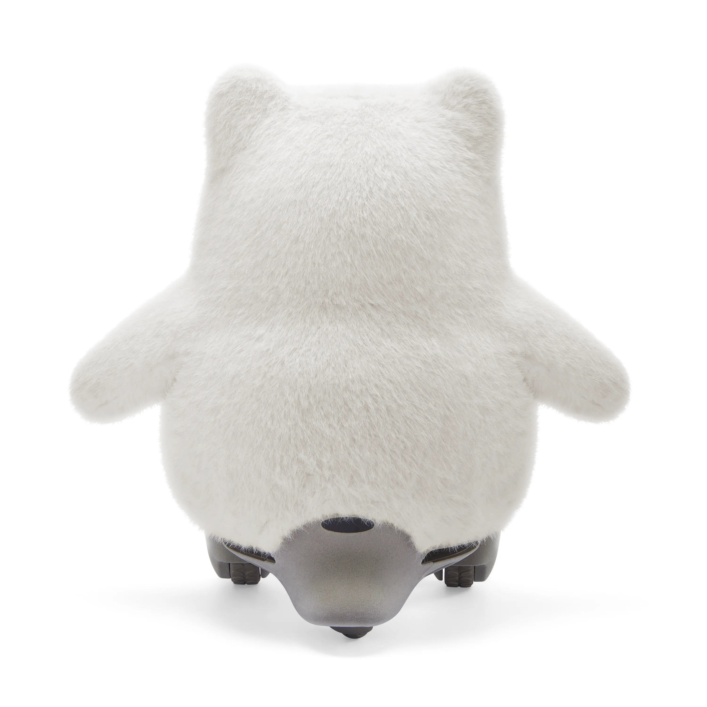
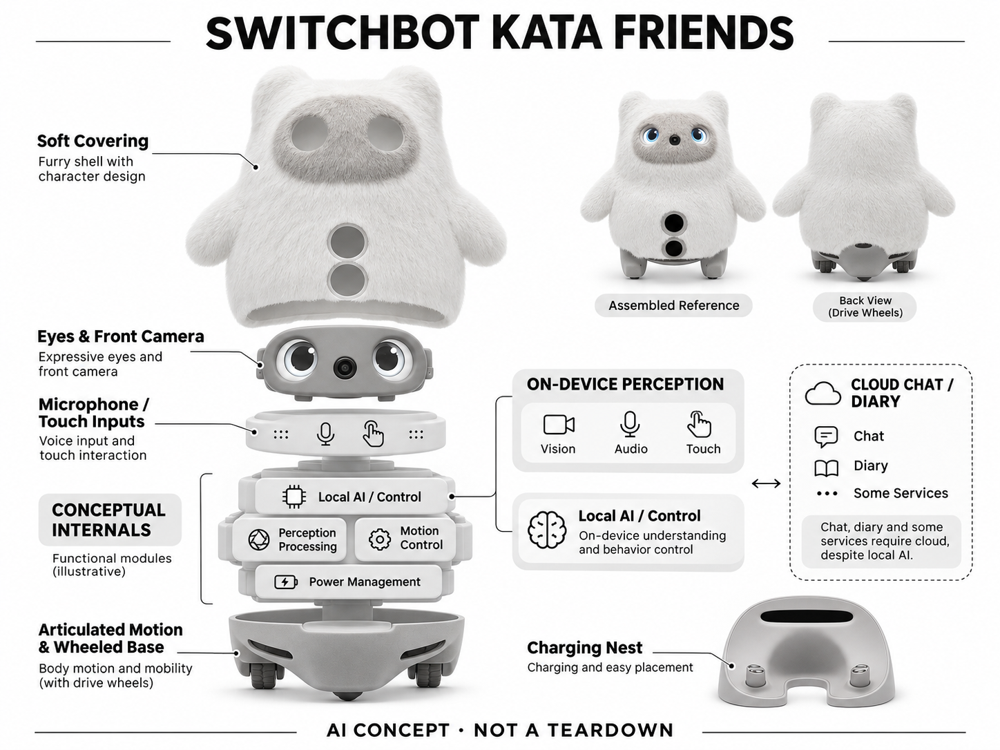

# KATA Friends

**SwitchBot** · AI玩具 · 核查 2026-11-06

可在家中移动的毛绒伙伴，本地感知与云服务边界需分清

消费渠道：个人零售。

## 产品图片与结构参考

### 产品图

KATA Friends 官方产品图（厂商资料） · 来源：[SwitchBot 官方资料](<https://us.switch-bot.com/products/katafriends>) · [原始图片](<https://cdn.shopify.com/s/files/1/0648/1569/4057/files/Noa-1_3x_f38f33c5-62fe-4252-be07-7a5914a13e0c.webp?v=1778150711>)

### 参考图

KATA Friends 官方外形或使用参考（厂商资料） · 来源：[SwitchBot 官方资料](<https://us.switch-bot.com/products/katafriends>) · [原始图片](<https://cdn.shopify.com/s/files/1/0648/1569/4057/files/Noa-2_3x_389ade94-9a0c-4f24-8044-2dc0b40d7faa.webp?v=1778150711>)

### AI 生成爆炸示意

**AI 生成 · 非实物拆机。** 内部为概念推断，不能作为元件布局、BOM 或维修依据。[生成提示词](../../content/hardware/prompts/switchbot-kata-friends.txt)

> 分析为基于公开资料的案头研究与 AI 辅助判断，未经用户访谈、销量审计或实物拆机。需求、画像、竞争冷门度、审美及商业机会均为研究假设，不是投资结论。

## 销售与购买

- 状态：在售。当前商品页US$699、Add To Cart；公开Noa/Niko变体available=true；单买硬件试用后仍需服务计划。

- 地区：美国、日本、其他地区以官方地区店为准

- 价格：US$699硬件；服务计划另计。商品页基础计划US$14.99/月；一次性访问方案及其他方案另有条款。促销、税费和地区规则以结算为准。

- 中国大陆：本轮核到美国商品与服务计划；未确认中国大陆官方配送、云功能及维修条件，不能由品牌在华有业务推断本款可完整使用。

- [官方产品 / 商店](<https://us.switch-bot.com/products/katafriends>)

## AI 的实际作用

官方披露人脸识别、声源方向、触摸与本地LLM互动，结合自主移动和回充；部分聊天与日记服务依赖云。

服务与联网依赖：本地感知及部分行为可离线；Chat Mode、日记、更新及部分服务需云连接，硬件之外有Companion Care计划，具体功能随地区与固件。

## 是否冷门

新兴竞争（研究判断）：竞争判断应同时比较桌面伙伴、真实宠物以及没有联网功能的毛绒玩具。轮式宠物能够跨位置出现，却受到地面条件限制；真实宠物有独立生命与照料责任，不能当成同等替代。服务计划则使用户更容易把它与持续付费的软件娱乐作比较。

## 需求与市场

需求判断中，地面可移动使它有机会在用户离开书桌后继续参与生活，但也要求家庭留出通路和充电位置。愿意长期让设备自由活动的人，未必与喜欢看短视频里可爱动作的人相同；需要验证的是相处价值是否超过维护、占地和订阅负担。

### 事实与范围 · 官方资料

KATA Friends的官方技术页描述人脸识别、声源方向、全身触摸以及室内自主移动和回充，当前美国商店有可购Noa与Niko两种外观。它希望在家庭共享空间持续回应日常接触，核心任务是实体陪伴，不能把自动移动改写为帮助用户完成家务。

依据：[KATA Friends美国官方商店](<https://us.switch-bot.com/products/katafriends>) · [KATA Friends官方技术说明](<https://us.switch-bot.com/pages/katafriends-technology>)

### 判断与差异 · 研究判断

需求判断中，地面可移动使它有机会在用户离开书桌后继续参与生活，但也要求家庭留出通路和充电位置。愿意长期让设备自由活动的人，未必与喜欢看短视频里可爱动作的人相同；需要验证的是相处价值是否超过维护、占地和订阅负担。

依据：[KATA Friends美国官方商店](<https://us.switch-bot.com/products/katafriends>) · [KATA Friends官方技术说明](<https://us.switch-bot.com/pages/katafriends-technology>)

### 验证与限制 · 待验证

验证可在家庭常用房间安排短期试用，记录用户主动呼唤、宠物主动接近和被临时关机的具体场景。分别询问独处与多人同时在场的体验，观察是否有人因声音或镜头不愿共处，不把一个成员喜欢它外推为全家认可或长期续费意愿。

依据：[KATA Friends美国官方商店](<https://us.switch-bot.com/products/katafriends>) · [KATA Friends官方技术说明](<https://us.switch-bot.com/pages/katafriends-technology>)

## 用户画像

画像可按居住空间、家庭成员态度和维护习惯分层，而不是按年龄简单划分。独居者可能在意安静陪伴，多人家庭可能在意它是否分清各人，已有真实宠物的家庭还需观察彼此反应；这些是假设性的需求差异，不是本轮已获得的访谈结果。

### 事实与范围 · 官方资料

商品页提供单独硬件与多种Companion Care计划，技术页又列出需云连接的聊天、日记和部分服务。因此使用者不仅要接受移动宠物本体，还要设置应用和服务账户；本条以成人及共同居住家庭为研究对象，不把家庭营销自动解读为儿童安全认证。

依据：[KATA Friends美国官方商店](<https://us.switch-bot.com/products/katafriends>) · [KATA Friends官方技术说明](<https://us.switch-bot.com/pages/katafriends-technology>)

### 判断与差异 · 研究判断

画像可按居住空间、家庭成员态度和维护习惯分层，而不是按年龄简单划分。独居者可能在意安静陪伴，多人家庭可能在意它是否分清各人，已有真实宠物的家庭还需观察彼此反应；这些是假设性的需求差异，不是本轮已获得的访谈结果。

依据：[KATA Friends美国官方商店](<https://us.switch-bot.com/products/katafriends>) · [KATA Friends官方技术说明](<https://us.switch-bot.com/pages/katafriends-technology>)

### 验证与限制 · 待验证

招募应要求主要使用者说明平时清洁地面、管理充电设备和购买订阅的习惯，并让同住者独立表达意见。体验前后询问谁负责更新、付款和联系售后，避免付款人、陪伴对象与维护者不同导致最终无人使用，也不以职业或收入推断偏好。

依据：[KATA Friends美国官方商店](<https://us.switch-bot.com/products/katafriends>) · [KATA Friends官方技术说明](<https://us.switch-bot.com/pages/katafriends-technology>)

## 竞争与替代

竞争判断应同时比较桌面伙伴、真实宠物以及没有联网功能的毛绒玩具。轮式宠物能够跨位置出现，却受到地面条件限制；真实宠物有独立生命与照料责任，不能当成同等替代。服务计划则使用户更容易把它与持续付费的软件娱乐作比较。

### 事实与范围 · 官方资料

Noa与Niko在当前商品页作为同一产品的两种外观销售，本目录只收一个档案。公开能力把毛绒触感、轮式移动、相机识别和本地模型合在一起，与固定桌面电子宠物存在交互范围差异，但不因颜色、眼睛皮肤和围巾配件分别计算新需求。

依据：[KATA Friends美国官方商店](<https://us.switch-bot.com/products/katafriends>) · [KATA Friends官方技术说明](<https://us.switch-bot.com/pages/katafriends-technology>)

### 判断与差异 · 研究判断

竞争判断应同时比较桌面伙伴、真实宠物以及没有联网功能的毛绒玩具。轮式宠物能够跨位置出现，却受到地面条件限制；真实宠物有独立生命与照料责任，不能当成同等替代。服务计划则使用户更容易把它与持续付费的软件娱乐作比较。

依据：[KATA Friends美国官方商店](<https://us.switch-bot.com/products/katafriends>) · [KATA Friends官方技术说明](<https://us.switch-bot.com/pages/katafriends-technology>)

### 验证与限制 · 待验证

可在相同家庭中比较固定桌面与可移动伙伴的使用日志，记录互动发生地点和持续时间，单独列出清洁、回充失败与软件设置的负担。不要只看机器人主动发起次数，因为多次打扰也可能降低满意度；现有样本不足以判断任何品牌的市场份额。

依据：[KATA Friends美国官方商店](<https://us.switch-bot.com/products/katafriends>) · [KATA Friends官方技术说明](<https://us.switch-bot.com/pages/katafriends-technology>)

## 供应链

供应链判断是软毛覆盖与自主运动之间需要精细协调：毛套应让触摸和视觉窗口保持一致，轮组应在常见地面上控制噪声，充电座又要支持反复对接。某一个模组能采购不代表整机已稳定，装配公差、清洁方式和返修可达性同样影响交付。

### 事实与范围 · 官方资料

官方技术页公开相机、麦克风、触摸感知、避障及充电座等功能，但未公布完整物料清单和本型号上游供应关系。真实图片可看到腹部感知窗口与底部轮组，结构概念图只连接这些功能，不把猜测的电路、齿轮或电池位置描述为实物内部。

依据：[KATA Friends美国官方商店](<https://us.switch-bot.com/products/katafriends>) · [KATA Friends官方技术说明](<https://us.switch-bot.com/pages/katafriends-technology>)

### 判断与差异 · 研究判断

供应链判断是软毛覆盖与自主运动之间需要精细协调：毛套应让触摸和视觉窗口保持一致，轮组应在常见地面上控制噪声，充电座又要支持反复对接。某一个模组能采购不代表整机已稳定，装配公差、清洁方式和返修可达性同样影响交付。

依据：[KATA Friends美国官方商店](<https://us.switch-bot.com/products/katafriends>) · [KATA Friends官方技术说明](<https://us.switch-bot.com/pages/katafriends-technology>)

### 验证与限制 · 待验证

可以向小型驱动与视觉模组公司询问能力，但需先给出整机重量、运动频次、地面材料和镜头位置。试产应覆盖毛套穿脱、窗口积灰、轮组卡入细线与充电座被挪动后的恢复；本轮没有实际测试记录，不编造故障率、制造成本或工厂名单。

依据：[KATA Friends美国官方商店](<https://us.switch-bot.com/products/katafriends>) · [KATA Friends官方技术说明](<https://us.switch-bot.com/pages/katafriends-technology>)

## 技术路径

技术判断要防止把宣传中的离线能力扩大到所有功能。即使表情和移动可在本地工作，也不能据此认定对话内容、相册同步或账户管理均不联网；同页还保留逐步更新对话功能的措辞，当前可用范围应以具体地区固件与应用版本为准。

### 事实与范围 · 官方资料

官方说明将本地大模型及视觉、语音和手势理解作为主要技术，同时明确聊天模式、日记、固件更新及部分服务仍需云连接。收录依据是公开的多模态识别和模型机制；激光避障、轮子驱动与自动充电本身不被单独拿来证明生成式智能。

依据：[KATA Friends美国官方商店](<https://us.switch-bot.com/products/katafriends>) · [KATA Friends官方技术说明](<https://us.switch-bot.com/pages/katafriends-technology>)

### 判断与差异 · 研究判断

技术判断要防止把宣传中的离线能力扩大到所有功能。即使表情和移动可在本地工作，也不能据此认定对话内容、相册同步或账户管理均不联网；同页还保留逐步更新对话功能的措辞，当前可用范围应以具体地区固件与应用版本为准。

依据：[KATA Friends美国官方商店](<https://us.switch-bot.com/products/katafriends>) · [KATA Friends官方技术说明](<https://us.switch-bot.com/pages/katafriends-technology>)

### 验证与限制 · 待验证

验证应列出断网前后的功能矩阵，分别执行认人、呼唤、触摸、日记和聊天，并记录需要账户或计划的步骤。多人成员识别要在允许条件下反复测试，不能用一段演示推断普遍准确率；还应确认误认后是否可纠正、删除以及重新建立记忆。

依据：[KATA Friends美国官方商店](<https://us.switch-bot.com/products/katafriends>) · [KATA Friends官方技术说明](<https://us.switch-bot.com/pages/katafriends-technology>)

## 产品审美

审美判断中，毛绒弱化了移动机械感，但腹部窗口与底部硬质结构仍会提醒用户这是一台有感知能力的设备。藏起机械不一定更好：如果用户不易看懂它正在充电、拍照还是等待回应，可爱外形反而会增加操作猜测和对隐私状态的误解。

### 事实与范围 · 官方资料

Noa官方照片展示白色毛绒外壳、灰色面部、圆眼与鼻部摄像头，短耳和侧臂形成动物化形象，腹部可见两个深色感知窗口。后视图能够辨认轮式底部，独立充电座外观与产品相呼应，因此不应把它画成四足行走机器人或普通静态玩偶。

依据：[KATA Friends美国官方商店](<https://us.switch-bot.com/products/katafriends>) · [KATA Friends官方技术说明](<https://us.switch-bot.com/pages/katafriends-technology>)

### 判断与差异 · 研究判断

审美判断中，毛绒弱化了移动机械感，但腹部窗口与底部硬质结构仍会提醒用户这是一台有感知能力的设备。藏起机械不一定更好：如果用户不易看懂它正在充电、拍照还是等待回应，可爱外形反而会增加操作猜测和对隐私状态的误解。

依据：[KATA Friends美国官方商店](<https://us.switch-bot.com/products/katafriends>) · [KATA Friends官方技术说明](<https://us.switch-bot.com/pages/katafriends-technology>)

### 验证与限制 · 待验证

外观评估应结合真实房间里的行走、停靠和抱起过程，而不只在白底主图上比较。让参与者指出哪里可以触摸、哪里像按钮、是否能看出摄像头朝向，再观察毛套沾灰后愿不愿意清洁；此类任务比设计师对萌感的主观评分更可执行。

依据：[KATA Friends美国官方商店](<https://us.switch-bot.com/products/katafriends>) · [KATA Friends官方技术说明](<https://us.switch-bot.com/pages/katafriends-technology>)

## 关键风险

风险判断包括续费预期、服务停止后的剩余能力、识别误差和共享家庭隐私。订阅硬件不同于一次买断的普通公仔，如果用户误以为所有记忆永远离线就可能作出错误选择；厂商关于理解情绪的描述也不等于已验证心理状态识别或治疗效果。

### 事实与范围 · 官方资料

当前美国商品页明确硬件单购在免费或赠送期限后需要计划，基础月度方案另计费用；技术页也说明部分服务需云端。美国价格和服务条款不能直接推广到中国大陆，本轮没有核到大陆对应销售与云服务承诺，因此国内购买情况保持未明确。

依据：[KATA Friends美国官方商店](<https://us.switch-bot.com/products/katafriends>) · [KATA Friends官方技术说明](<https://us.switch-bot.com/pages/katafriends-technology>)

### 判断与差异 · 研究判断

风险判断包括续费预期、服务停止后的剩余能力、识别误差和共享家庭隐私。订阅硬件不同于一次买断的普通公仔，如果用户误以为所有记忆永远离线就可能作出错误选择；厂商关于理解情绪的描述也不等于已验证心理状态识别或治疗效果。

依据：[KATA Friends美国官方商店](<https://us.switch-bot.com/products/katafriends>) · [KATA Friends官方技术说明](<https://us.switch-bot.com/pages/katafriends-technology>)

### 验证与限制 · 待验证

购买验证应要求品牌说明计划取消后哪些功能可保留、数据能否导出删除、跨地区返修与账户迁移如何处理。体验研究要收集同住者退出拍摄或互动的需求，测试清楚可见的暂停方式；不能因为页面写隐私保护就声称其经过独立安全审计。

依据：[KATA Friends美国官方商店](<https://us.switch-bot.com/products/katafriends>) · [KATA Friends官方技术说明](<https://us.switch-bot.com/pages/katafriends-technology>)

## 机会与验证

商业判断中，服务计划能支持长期内容和维护，但必须和硬件承诺一致。小团队更适合先验证一个房间内的稳定互动，再扩展复杂导航或更多角色；外观配件可以成为补充收入，却不能掩盖续费后仍无法可靠认人或找回充电座的核心问题。

### 事实与范围 · 官方资料

可研究的机会是把家庭陪伴的持续存在感转化为透明可控的互动节奏，让用户能决定安静时段、接近距离和记录范围。这个方向属于产品判断，源自移动与多模态能力带来的摩擦，不代表已经证明用户愿意为某一种功能支付额外费用。

依据：[KATA Friends美国官方商店](<https://us.switch-bot.com/products/katafriends>) · [KATA Friends官方技术说明](<https://us.switch-bot.com/pages/katafriends-technology>)

### 判断与差异 · 研究判断

商业判断中，服务计划能支持长期内容和维护，但必须和硬件承诺一致。小团队更适合先验证一个房间内的稳定互动，再扩展复杂导航或更多角色；外观配件可以成为补充收入，却不能掩盖续费后仍无法可靠认人或找回充电座的核心问题。

依据：[KATA Friends美国官方商店](<https://us.switch-bot.com/products/katafriends>) · [KATA Friends官方技术说明](<https://us.switch-bot.com/pages/katafriends-technology>)

### 验证与限制 · 待验证

下一步可做连续数周的家庭日志研究，比较新鲜期与后期主动互动、维护次数以及续费理由，询问用户最愿意停掉哪项服务。报告应同时呈现拒绝使用和中途退出的原因，不由正面评价或模型推理分数预测商业成功，也不推算未经验证的市场规模。

依据：[KATA Friends美国官方商店](<https://us.switch-bot.com/products/katafriends>) · [KATA Friends官方技术说明](<https://us.switch-bot.com/pages/katafriends-technology>)

## 对应供应链公司

能力候选用于选型研究，不代表本产品实际采用；未公开的供货关系不作推断。

- [feetech](../supply-chain/feetech.md) — **能力候选 · 非已采用** / 小型姿态驱动能力候选：FEETECH公开提供小型舵机及总线控制，可作为短臂与头部表达机构的能力候选。实际载荷、噪声和毛套干涉仍须整机验证，未找到本产品公开采用该公司部件的证据。

- [chicony](../supply-chain/chicony.md) — **能力候选 · 非已采用** / 人脸识别视觉输入候选：群光具备公开相机模组和影像工程能力，可用于评估宠物脸部镜头方案。实际视场、低照度和毛套窗口都需要重新适配，此关联仅表示能力相关，不确认厂商现有采用关系。

[浏览供应链目录](../supply-chain.md)

## 功能分层示意

这是功能关系，不是实物拆机、真实空间结构或已核实 BOM。

1. **毛绒与表达**：毛绒外形、眼睛显示与身体动作表达角色状态。（官方披露）

2. **多模态感知**：相机、语音方向、触摸和激光避障构成输入。（官方披露）

3. **本地智能**：官网披露本地LLM与互动记忆行为，未公开模型细节。（官方披露）

4. **移动与补能**：轮式底部与充电Nest形成室内移动、停靠回路。（官方披露）

5. **云端与服务**：Chat Mode、日记和部分服务需要网络与适用计划；非全功能离线。（官方披露）

## 来源

1. [KATA Friends美国官方商店](<https://us.switch-bot.com/products/katafriends>) — 当前商品页US$699、Add To Cart；公开Noa/Niko变体available=true；单买硬件试用后仍需服务计划。

2. [KATA Friends官方技术说明](<https://us.switch-bot.com/pages/katafriends-technology>) — 核多模态感知、本地LLM和轮式移动；脚注明确Chat Mode、日记、更新及部分服务需云。对话功能另有逐步更新措辞，不认定全部语言地区已经同等开放。

3. [KATA Friends官方计划说明](<https://us.switch-bot.com/pages/katafriends-pricing>) — 打开计划页面并结合商品页方案，区分硬件售价、持续服务与一次性访问方案。

4. [KATA Friends日本官方商店](<https://www.switchbot.jp/products/katafriends>) — 本轮实际打开日本商店，核Noa/Niko本体129800日元及本地服务计划；不将美国费用直接套用日本或大陆。

[返回目录](../hardware-market.md) · [网页分析](https://romanagent.github.io/Roman/#hardware/product/switchbot-kata-friends)
