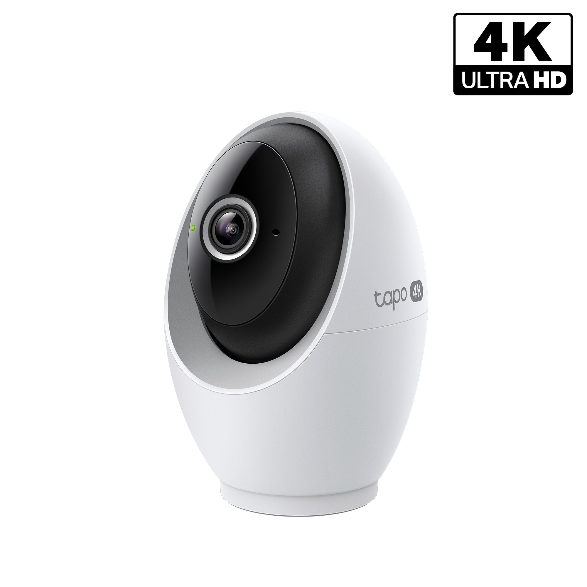
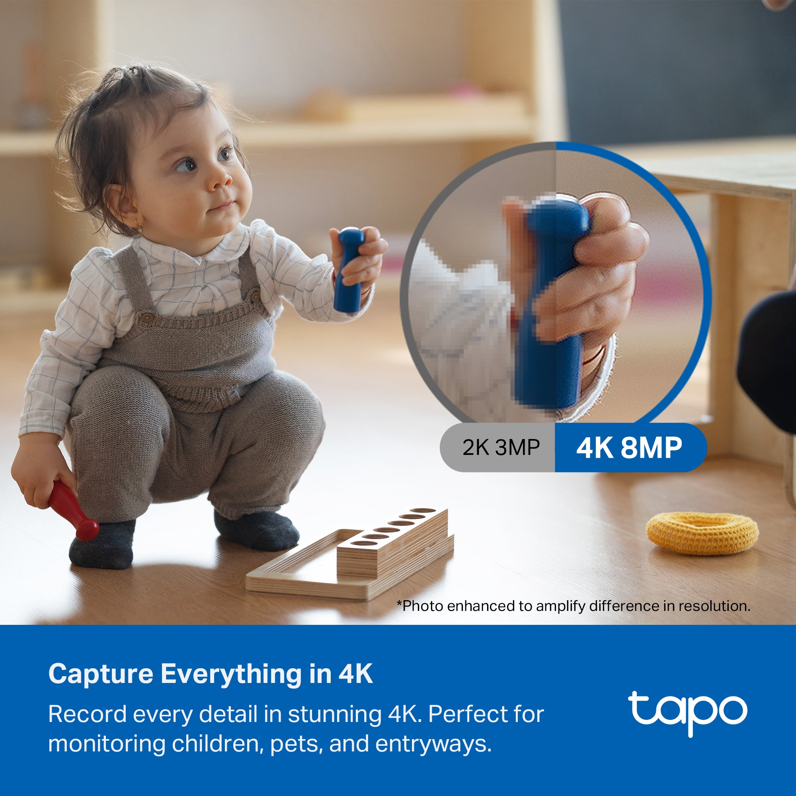
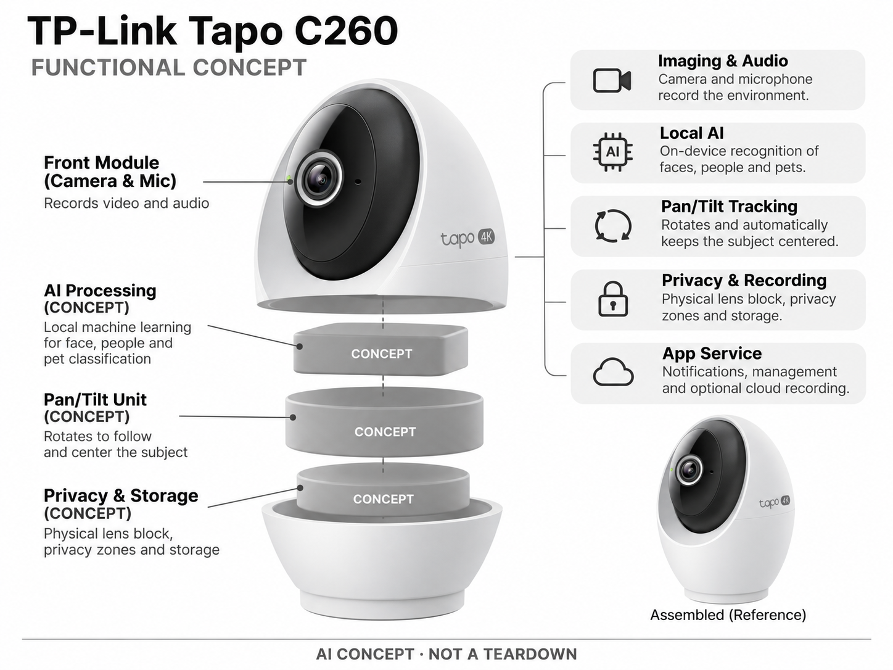

# TP-Link Tapo C260

**TP-Link** · 家庭安防 · 核查 2026-11-04

以本地人脸分类和云台跟随整理家庭事件

消费渠道：个人零售。

## 产品图片与结构参考

### 产品图

TP-Link Tapo C260 官方产品图 · 来源：[TP-Link · 官方图片](<https://us.store.tapo.com/collections/all-products/products/4k-ultra-hd-pan-tilt-indoor-security-camera-tapo-c260>) · [原始图片](<https://us.store.tapo.com/cdn/shop/files/tapo-c260-1pk-main-image.jpg?v=1782947218>)

### 参考图

TP-Link Tapo C260 官方外观、结构或使用参考 · 来源：[TP-Link · 官方图片](<https://us.store.tapo.com/collections/all-products/products/4k-ultra-hd-pan-tilt-indoor-security-camera-tapo-c260>) · [原始图片](<https://us.store.tapo.com/cdn/shop/files/PT01_6bdd6cc4-939c-4233-91b6-aeb048495604.jpg?v=1771403516>)

### AI 生成爆炸示意

**AI 生成 · 非实物拆机。** 内部为概念推断，不能作为元件布局、BOM 或维修依据。[生成提示词](../../content/hardware/prompts/tapo-c260.txt)

> 依据官方外观参考与公开功能生成；未披露的内部布局只作概念模块，不构成BOM或真实结构证据。

> 保留官方图片原始内容和出处；画面宣传参数不是本轮独立实测。

> 分析为基于公开资料的案头研究与 AI 辅助判断，未经用户访谈、销量审计或实物拆机。需求、画像、竞争冷门度、审美及商业机会均为研究假设，不是投资结论。

## 销售与购买

- 状态：在售。美国官方商店显示C260 RoomCam 360、价格及Add to cart；按单机收录，多台套装不重复计数。

- 地区：美国官方商店

- 价格：US$59.99。核查时官方地区参考价，保留原币种；订阅、税运、附件及优惠以结账为准，预订定金不等于整机价格。

- 中国大陆：本轮核实所列海外官方渠道；中国大陆同型号现货、保修及服务可用性未确认。进口前需核对供电、网络、配件和地区条款。

- [官方产品 / 商店](<https://us.store.tapo.com/collections/all-products/products/4k-ultra-hd-pan-tilt-indoor-security-camera-tapo-c260>)

## AI 的实际作用

本地机器学习识别人脸、人物、宠物和部分声音事件，云台跟随主体；转动和录像计时本身不是AI。

服务与联网依赖：本地人脸处理与可选Tapo Care云录像分开；官方提示美国部分州的人脸功能不可用，地区能力需核对。

## 是否冷门

竞争密集（研究判断）：室内AI云台摄像头竞争拥挤，机会在通知质量与隐私体验，而非摄像头加AI的概念本身。

## 需求与市场

需求假设：用户想知道家里发生了什么，又不想收到每一次画面变化的通知。应比较熟人分类、宠物跟随和检索能否减少人工查看，低价摄像头的分辨率提升不等于事件理解可靠。

### 产品任务与边界 · 研究判断

Tapo C260 用本地人脸、人物宠物和声音事件分类配合云台，任务是减少每次画面变化都带来的提醒。用户需要知道家中发生什么，分类数量和分辨率只是手段，需求应由有用通知与快速回看是否改善来判断。

依据：[TP-Link Tapo C260 官方购买页](<https://us.store.tapo.com/collections/all-products/products/4k-ultra-hd-pan-tilt-indoor-security-camera-tapo-c260>) · [Tapo C260 官方本地AI与规格](<https://www.tapo.com/us/product/smart-camera/tapo-c260/v1/>)

### 需求判断 · 研究判断

熟人分类可能让家庭减少无关提示，宠物跟随则帮助看清活动，但两者并不一定同时被需要。若用户最终关闭大部分通知，AI 没有自然形成价值；应观察哪些功能被保留，避免把低价硬件上的丰富选项当作真实需求。

依据：[TP-Link Tapo C260 官方购买页](<https://us.store.tapo.com/collections/all-products/products/4k-ultra-hd-pan-tilt-indoor-security-camera-tapo-c260>) · [Tapo C260 官方本地AI与规格](<https://www.tapo.com/us/product/smart-camera/tapo-c260/v1/>)

### 需求验证 · 待验证

可记录家庭一周内的事件、通知、查看和关闭设置的行为，区分熟人、陌生人、宠物及声音提示。再比较固定视角与跟随模式，确认分类和动作是否减少人工操作，而不是只让设备显得更主动。

依据：[TP-Link Tapo C260 官方购买页](<https://us.store.tapo.com/collections/all-products/products/4k-ultra-hd-pan-tilt-indoor-security-camera-tapo-c260>) · [Tapo C260 官方本地AI与规格](<https://www.tapo.com/us/product/smart-camera/tapo-c260/v1/>)

## 用户画像

画像推断：关注家中宠物、共享空间或短时离家的普通家庭，可能首次购买AI摄像头。室友和其他居住者也受到拍摄影响，购买者的方便不应自动代表所有家庭成员都接受持续录像。

### 适用行为与条件 · 研究判断

较匹配希望查看宠物或共享空间、能提供固定电源和网络的普通家庭，也可能是首次购买智能摄像头的人。室友和其他居住者同样受到拍摄影响，购买者便利不能自动代表所有人接受持续录像和人脸处理。

依据：[TP-Link Tapo C260 官方购买页](<https://us.store.tapo.com/collections/all-products/products/4k-ultra-hd-pan-tilt-indoor-security-camera-tapo-c260>) · [Tapo C260 官方本地AI与规格](<https://www.tapo.com/us/product/smart-camera/tapo-c260/v1/>)

### 人群取舍 · 研究判断

首次用户可能更在意安装和简单通知，熟悉安防的人则重视存储、隐私区域和平台整合。多人家庭与单人养宠的目标选择也不同，画像需要包含共享规则与观察任务，不能只用居家安全或低预算概括。

依据：[TP-Link Tapo C260 官方购买页](<https://us.store.tapo.com/collections/all-products/products/4k-ultra-hd-pan-tilt-indoor-security-camera-tapo-c260>) · [Tapo C260 官方本地AI与规格](<https://www.tapo.com/us/product/smart-camera/tapo-c260/v1/>)

### 画像验证 · 待验证

画像验证应让家庭自行设置通知和隐私状态，记录其他成员是否理解摄像头在做什么。观察几周后哪些提醒被关闭及原因，再区分低干扰需求与细节查看需求，避免把首次加购或开箱喜爱当作长期适配。

依据：[TP-Link Tapo C260 官方购买页](<https://us.store.tapo.com/collections/all-products/products/4k-ultra-hd-pan-tilt-indoor-security-camera-tapo-c260>) · [Tapo C260 官方本地AI与规格](<https://www.tapo.com/us/product/smart-camera/tapo-c260/v1/>)

## 竞争与替代

竞争判断：与小米、eufy和Aqara室内云台机直接竞争，低首付和本地人脸是具体定位。家庭安防已有大量成熟品牌，市场可达不等于低竞争，长期软件支持和通知质量影响留存。

### 比较对象与差异 · 研究判断

C260 与小米、eufy 和 Aqara 室内云台机竞争，本地人脸和较低进入门槛形成定位。成熟品牌已经覆盖许多家庭场景，市场大不代表竞争低，长期软件支持、通知质量和隐私可理解性可能比参数升级更重要。

依据：[TP-Link Tapo C260 官方购买页](<https://us.store.tapo.com/collections/all-products/products/4k-ultra-hd-pan-tilt-indoor-security-camera-tapo-c260>) · [Tapo C260 官方本地AI与规格](<https://www.tapo.com/us/product/smart-camera/tapo-c260/v1/>)

### 竞争判断 · 研究判断

本地识别可以减少部分云依赖，但用户仍需理解可选云录像与地区功能差异。竞争优势不能只用无需订阅口号表达，也要说明基础功能、存储和远程路径；如果分类经常混淆，低价仍可能带来较高的注意力成本。

依据：[TP-Link Tapo C260 官方购买页](<https://us.store.tapo.com/collections/all-products/products/4k-ultra-hd-pan-tilt-indoor-security-camera-tapo-c260>) · [Tapo C260 官方本地AI与规格](<https://www.tapo.com/us/product/smart-camera/tapo-c260/v1/>)

### 竞争验证 · 待验证

可与同位置的普通云台和双镜方案比较有用提醒、回看步骤及隐私操作，明确各自存储条件。人脸功能需要按地区核对，不应把某市场可用的能力作为全球统一竞争优势，也不以厂商实验数字替代家庭测试。

依据：[TP-Link Tapo C260 官方购买页](<https://us.store.tapo.com/collections/all-products/products/4k-ultra-hd-pan-tilt-indoor-security-camera-tapo-c260>) · [Tapo C260 官方本地AI与规格](<https://www.tapo.com/us/product/smart-camera/tapo-c260/v1/>)

## 供应链

供应链分析：云台电机、相机、麦克风、本地处理、存储卡接口和电源构成系统；具体芯片与BOM未披露。电机耐久、低光成像、隐私遮挡机构和固件更新是基础交付工作。

### 功能模块拆分 · 研究判断

功能层包括相机和麦克风、本地识别、云台跟随、存储与隐私遮挡，以及应用和可选云服务。转动和定时录像不是 AI 依据，公开信息也没有完整芯片或工厂清单，不能从产品价格推断具体器件与制造方案。

依据：[TP-Link Tapo C260 官方购买页](<https://us.store.tapo.com/collections/all-products/products/4k-ultra-hd-pan-tilt-indoor-security-camera-tapo-c260>) · [Tapo C260 官方本地AI与规格](<https://www.tapo.com/us/product/smart-camera/tapo-c260/v1/>)

### 制造与供应约束 · 研究判断

制造约束是云台电机、相机、麦克风、存储接口和隐私机构的协调，长期转动与反复遮挡都需要验证。低光和声学受机身结构影响，固件更新则决定购后功能，不能把整机成本简化为一个相机模组和电机。

依据：[TP-Link Tapo C260 官方购买页](<https://us.store.tapo.com/collections/all-products/products/4k-ultra-hd-pan-tilt-indoor-security-camera-tapo-c260>) · [Tapo C260 官方本地AI与规格](<https://www.tapo.com/us/product/smart-camera/tapo-c260/v1/>)

### 候选与证据缺口 · 研究判断

龙旗可作为室内联网终端工程候选，SIIX 可支持控制板与电子装配测试。没有 C260 点名合作证据，本地模型、机械遮挡和云台耐久需项目级验证，通用制造能力也不能证明任何地区人脸功能可合法或完整使用。

依据：[TP-Link Tapo C260 官方购买页](<https://us.store.tapo.com/collections/all-products/products/4k-ultra-hd-pan-tilt-indoor-security-camera-tapo-c260>) · [Tapo C260 官方本地AI与规格](<https://www.tapo.com/us/product/smart-camera/tapo-c260/v1/>)

## 技术路径

官方明确本地人脸AI、物体分类和声音检测。技术判断：背脸、遮挡和多人交叠可能导致错认，自动变焦也可能漏掉画面外事件；厂商实验准确率不能直接等同实际家庭识别效果。

### 已披露技术边界 · 研究判断

官方明确本地人脸 AI、人物宠物分类及声音检测，云台用于保持主体，Tapo Care 是另一个服务层。地区限制需要单独核对，不能把本地处理解释为完全不需要账户网络，或将所有存储和通知视为相同数据路径。

依据：[TP-Link Tapo C260 官方购买页](<https://us.store.tapo.com/collections/all-products/products/4k-ultra-hd-pan-tilt-indoor-security-camera-tapo-c260>) · [Tapo C260 官方本地AI与规格](<https://www.tapo.com/us/product/smart-camera/tapo-c260/v1/>)

### 系统难点判断 · 研究判断

技术难点包括背脸、遮挡和多人交叉造成的身份混淆，以及跟随时离开原始视角。声音类别也可能受电视和环境影响，系统应能表达不确定与允许纠正，不能把熟人标签或哭声提示当作可靠身份和照护判断。

依据：[TP-Link Tapo C260 官方购买页](<https://us.store.tapo.com/collections/all-products/products/4k-ultra-hd-pan-tilt-indoor-security-camera-tapo-c260>) · [Tapo C260 官方本地AI与规格](<https://www.tapo.com/us/product/smart-camera/tapo-c260/v1/>)

### 技术验证 · 待验证

验证应分别记录人脸、对象和声音事件的误报漏报，再测试多人交叉及隐私模式切换。所有结果要对应具体地区、版本和存储设置，不以厂商实验准确率、一次跟随成功或本地 AI 名称推断完整家庭可靠性。

依据：[TP-Link Tapo C260 官方购买页](<https://us.store.tapo.com/collections/all-products/products/4k-ultra-hd-pan-tilt-indoor-security-camera-tapo-c260>) · [Tapo C260 官方本地AI与规格](<https://www.tapo.com/us/product/smart-camera/tapo-c260/v1/>)

## 产品审美

审美判断：小型白色云台机易放在书架，但持续转动可能让人产生被注视感。物理镜头遮挡是可感知的隐私设计，状态灯、供电线和安装高度应能让家庭成员明确判断工作状态。

### 外观与交互语言 · 研究判断

小型白色云台容易放在书架，但持续转动可能让家庭成员感到被注视。物理镜头遮挡提供可感知的隐私表达，状态灯、安装高度和供电线也需要配合，让用户能直接理解设备是否工作，而不是只依赖应用里的开关。

依据：[TP-Link Tapo C260 官方购买页](<https://us.store.tapo.com/collections/all-products/products/4k-ultra-hd-pan-tilt-indoor-security-camera-tapo-c260>) · [Tapo C260 官方本地AI与规格](<https://www.tapo.com/us/product/smart-camera/tapo-c260/v1/>)

### 使用中审美判断 · 研究判断

隐私机构的可见性是设计价值，但动作与真实录像状态必须一致，避免外观让人产生错误安心。机身越融入家居，越应保留清楚的工作提示；简洁不等于隐形拍摄，家庭共享空间需要可理解的控制感。

依据：[TP-Link Tapo C260 官方购买页](<https://us.store.tapo.com/collections/all-products/products/4k-ultra-hd-pan-tilt-indoor-security-camera-tapo-c260>) · [Tapo C260 官方本地AI与规格](<https://www.tapo.com/us/product/smart-camera/tapo-c260/v1/>)

### 设计验证 · 待验证

设计验证应观察不同成员能否不打开手机就判断镜头状态，并测试切换隐私和恢复视角的操作。还需检查清洁、线材和云台声音，避免只由低调商品图推断长期放在客厅不会带来干扰或不适。

依据：[TP-Link Tapo C260 官方购买页](<https://us.store.tapo.com/collections/all-products/products/4k-ultra-hd-pan-tilt-indoor-security-camera-tapo-c260>) · [Tapo C260 官方本地AI与规格](<https://www.tapo.com/us/product/smart-camera/tapo-c260/v1/>)

## 关键风险

风险判断：人脸识别存在地区限制，云录像另有订阅条件。误报和漏报不能完全避免，儿童哭声提示也不是医疗监护；用户需要管理共享账号、隐私区域和软件更新，避免录像扩大到无关空间。

### 主要失效与依赖 · 研究判断

风险包括人脸的地区限制、可选云录像费用、共享账户和误报漏报。声音分类不是医疗监护，自动跟随也不能保证覆盖所有事件；用户需要管理隐私区域和更新，避免录像进入无关空间或误解设备能力。

依据：[TP-Link Tapo C260 官方购买页](<https://us.store.tapo.com/collections/all-products/products/4k-ultra-hd-pan-tilt-indoor-security-camera-tapo-c260>) · [Tapo C260 官方本地AI与规格](<https://www.tapo.com/us/product/smart-camera/tapo-c260/v1/>)

### 风险传播判断 · 研究判断

如果熟人分类错了却没有清楚纠正路径，用户可能关闭全部智能提示；如果隐私状态不直观，则可能影响家庭信任。低价降低购买门槛并不减少这些长期责任，产品应避免将设置复杂度和风险理解全部转给用户。

依据：[TP-Link Tapo C260 官方购买页](<https://us.store.tapo.com/collections/all-products/products/4k-ultra-hd-pan-tilt-indoor-security-camera-tapo-c260>) · [Tapo C260 官方本地AI与规格](<https://www.tapo.com/us/product/smart-camera/tapo-c260/v1/>)

### 风险验证 · 待验证

风险验证应演练地区功能不可用、断网、存储异常和共享权限变化，检查通知是否明确。再核对物理遮挡与录像状态，记录错误分类后能否恢复可信设置，不把一次正常运行外推为持续安全或隐私保障。

依据：[TP-Link Tapo C260 官方购买页](<https://us.store.tapo.com/collections/all-products/products/4k-ultra-hd-pan-tilt-indoor-security-camera-tapo-c260>) · [Tapo C260 官方本地AI与规格](<https://www.tapo.com/us/product/smart-camera/tapo-c260/v1/>)

## 机会与验证

机会假设：以低干扰通知和可解释的熟人分类测试价值，记录用户关闭提醒的原因。若分类带来更多困惑，优先做简洁回看和隐私控制，比在便宜硬件上堆叠复杂自动化更有效。

### 可能的机会入口 · 研究判断

机会在于低干扰通知、可解释熟人分类和直观隐私控制，让首次用户也能理解系统。新项目可先研究提醒被关闭的原因，优先改进回看与状态，而不是在便宜硬件上继续堆叠难以配置的自动化。

依据：[TP-Link Tapo C260 官方购买页](<https://us.store.tapo.com/collections/all-products/products/4k-ultra-hd-pan-tilt-indoor-security-camera-tapo-c260>) · [Tapo C260 官方本地AI与规格](<https://www.tapo.com/us/product/smart-camera/tapo-c260/v1/>)

### 机会成立条件 · 研究判断

机会成立需要用户保留有用功能并减少查看负担，如果分类反而增加困惑，更多模型类别不会自然提高价值。应区分宠物追踪、家庭成员识别和简单录像三个任务，根据真实偏好选择产品重点与服务方式。

依据：[TP-Link Tapo C260 官方购买页](<https://us.store.tapo.com/collections/all-products/products/4k-ultra-hd-pan-tilt-indoor-security-camera-tapo-c260>) · [Tapo C260 官方本地AI与规格](<https://www.tapo.com/us/product/smart-camera/tapo-c260/v1/>)

### 下一步验证 · 待验证

下一步可记录用户设置后的通知调整轨迹，分析关闭、纠错和隐私切换场景，再测试更少选项的方案。用实际有用提醒和家庭接受度评估改进，避免以低价、像素或 AI 类别数量预测持续使用。

依据：[TP-Link Tapo C260 官方购买页](<https://us.store.tapo.com/collections/all-products/products/4k-ultra-hd-pan-tilt-indoor-security-camera-tapo-c260>) · [Tapo C260 官方本地AI与规格](<https://www.tapo.com/us/product/smart-camera/tapo-c260/v1/>)

## 对应供应链公司

能力候选用于选型研究，不代表本产品实际采用；未公开的供货关系不作推断。

- [longcheer](../supply-chain/longcheer.md) — **能力候选 · 非已采用** / 本地视觉室内终端与云台控制工程：龙旗的智能硬件研发制造能力可对应摄像、连接和控制电子系统，但人脸算法、隐私遮挡和云台可靠性需另行验证；未发现 C260 点名合作资料，因此仅作为工程候选。

- [siix](../supply-chain/siix.md) — **能力候选 · 非已采用** / 云台摄像头控制板与功能装配：SIIX 电子制造能力可支持控制板、存储接口和功能测试导入，但机械隐私、低光和本地识别并非普通 PCBA 自带能力；没有 C260 供货证据，候选不等于实际代工关系。

[浏览供应链目录](../supply-chain.md)

## 功能分层示意

这是功能关系，不是实物拆机、真实空间结构或已核实 BOM。

1. **影像音频**：相机与麦克风记录环境。（官方披露）

2. **本地AI**：人脸及人物宠物等分类。（官方披露）

3. **云台跟随**：转动与自动主体居中。（官方披露）

4. **隐私记录**：物理遮挡、隐私区域和存储。（官方披露）

5. **App服务**：通知、管理及可选云录像。（官方披露）

## 来源

1. [TP-Link Tapo C260 官方购买页](<https://us.store.tapo.com/collections/all-products/products/4k-ultra-hd-pan-tilt-indoor-security-camera-tapo-c260>) — 实际打开核查当前购买或预订入口，未实际下单；价格与交付按具体地区。

2. [Tapo C260 官方本地AI与规格](<https://www.tapo.com/us/product/smart-camera/tapo-c260/v1/>) — 实际打开的官方技术与使用资料，宣传效果并非本轮独立实测。

[返回目录](../hardware-market.md) · [网页分析](https://romanagent.github.io/Roman/#hardware/product/tapo-c260)
