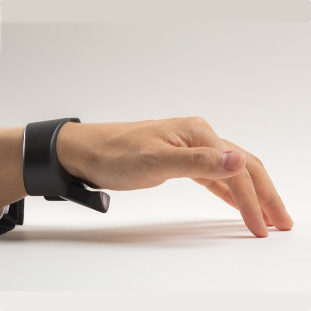
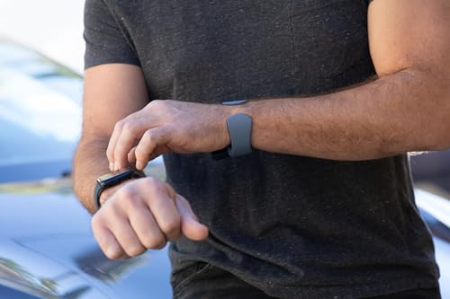
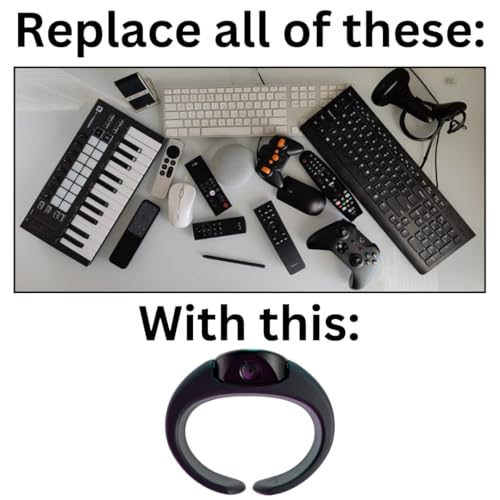
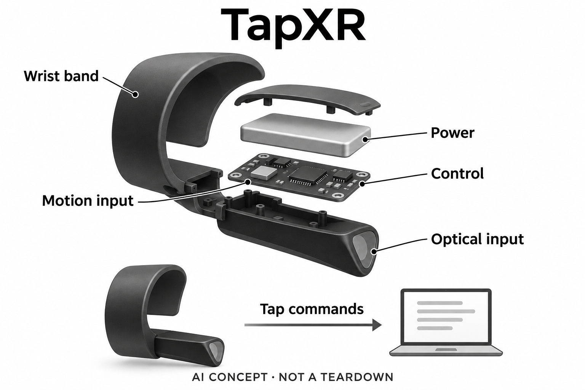

# TapXR

**Tap Systems** · 健康与穿戴 · 核查 2026-11-04

光学与惯性识别手指敲击组合，输入文字和指令

消费渠道：个人零售。

## 产品图片与结构参考

### 产品图

TapXR官方佩戴与手指敲击使用图 · 来源：[Tap Systems · 官方产品图片](<https://shop.tapwithus.com/products/tapxr-wrist-worn-keyboard-airmouse-controller-for-vr-ar-mr-tablets-pc-laptops-smartwatch-smartphones-tvs-projectors>) · [原始图片](<https://cdn.shopify.com/s/files/1/0765/9733/0149/files/Tap_XR_Square_Iimage.jpg?v=1774554681&width=1200>)

### 参考图

TapXR官方另一手臂表面输入场景 · 来源：[Tap Systems · 官方产品图片](<https://shop.tapwithus.com/products/tapxr-wrist-worn-keyboard-airmouse-controller-for-vr-ar-mr-tablets-pc-laptops-smartwatch-smartphones-tvs-projectors>) · [原始图片](<https://cdn.shopify.com/s/files/1/0765/9733/0149/files/1d161dd6.jpg?v=1754933850&width=1200>)

### 参考图

TapXR官方全形态示意；画面替代其他设备的宣传不作验证结论 · 来源：[Tap Systems · 官方产品图片](<https://shop.tapwithus.com/products/tapxr-wrist-worn-keyboard-airmouse-controller-for-vr-ar-mr-tablets-pc-laptops-smartwatch-smartphones-tvs-projectors>) · [原始图片](<https://cdn.shopify.com/s/files/1/0765/9733/0149/files/f5de0ba3.jpg?v=1754933850&width=1200>)

### AI 生成爆炸示意

**AI 生成 · 非实物拆机。** 内部为概念推断，不能作为元件布局、BOM 或维修依据。[生成提示词](../../content/hardware/prompts/tapxr.txt)

> 已视觉检查外形、灰阶、文字及无虚构参数；内部模块形状、板卡和布置仅为概念，不代表完整BOM。

> 源图逐张实际查看，按当前具体型号核对；未改色或裁切，宣传界面与效果文案不作为实测。

> 分析为基于公开资料的案头研究与 AI 辅助判断，未经用户访谈、销量审计或实物拆机。需求、画像、竞争冷门度、审美及商业机会均为研究假设，不是投资结论。

## 销售与购买

- 状态：在售。当前官方商店TapXR具体商品显示US$199与Add to cart，公开product.js available=true；旧技术页Reserve字样不用于判断销售，新TapBand候补不混入。

- 地区：当前官方国际商店；配送地址需结算确认

- 价格：US$199（所见TapXR）。配件与运费另核；不借尚在候补的新TapBand规格或把Tap Strap旧款重复计入。

- 中国大陆：商店国家选择含China/CNY，但未核实具体大陆地址配送、税费和售后；不把默认币种列表当作大陆正式销售证明。

- [官方产品 / 商店](<https://shop.tapwithus.com/products/tapxr-wrist-worn-keyboard-airmouse-controller-for-vr-ar-mr-tablets-pc-laptops-smartwatch-smartphones-tvs-projectors>)

## AI 的实际作用

官方明确运动和光学传感捕获敲击事件，嵌入式神经处理器识别哪些手指接触，再把组合转换为蓝牙HID命令。

服务与联网依赖：需要学习敲击字母与映射、正确佩戴及支持HID的设备；开发者固件与各平台SDK能力不同，不等于所有新手势均在默认模式开放。

## 是否冷门

细分专业（研究判断）：重点是无实体键盘的手指组合输入，区别于少量快捷手势；学习、误触和表面条件需实证，无效率或销量结论。

## 需求与市场

需求假设是用户希望在腿部、扶手或其他合适表面输入短文本与指令，减少随身携带完整键盘。这个入口把物理按键布局换成需要学习的手指组合，因此便利并不是立即获得；真正的价值取决于常用任务是否足够明确，以及学习和纠错成本是否低于原有方法。

### 官方｜把手指组合解码为文字输入 · 官方资料

TapXR把腕部光学和运动感知结合，用嵌入式神经处理器识别哪些手指发生接触，再转换为蓝牙鼠标键盘命令。默认模式提供字母、数字和符号，用户也可自定义映射；它的AI依据是手指事件分类，不能把普通蓝牙、宏或新产品候补宣传单独作为智能能力证据。

依据：[TapXR官方当前商品页](<https://shop.tapwithus.com/products/tapxr-wrist-worn-keyboard-airmouse-controller-for-vr-ar-mr-tablets-pc-laptops-smartwatch-smartphones-tvs-projectors>) · [TapXR官方神经识别原理](<https://www.tapwithus.com/how-the-tapxr-works/>)

### 判断｜没有键盘表面时保留输入方式 · 研究判断

需求假设是用户希望在腿部、扶手或其他合适表面输入短文本与指令，减少随身携带完整键盘。这个入口把物理按键布局换成需要学习的手指组合，因此便利并不是立即获得；真正的价值取决于常用任务是否足够明确，以及学习和纠错成本是否低于原有方法。

依据：[TapXR官方神经识别原理](<https://www.tapwithus.com/how-the-tapxr-works/>)

### 验证｜从常用文字与纠错开始 · 待验证

可选择本人经常输入的短句、数字和修改操作，记录正确输入、错字、删除与重新输入的步骤。不要只测试一个熟悉手势或用熟练演示者的速度代表初学者，材料和姿态也应保持记录；本目录没有输入效率实测，不能据神经处理器名称承诺更快或更轻松。

依据：[TapXR官方神经识别原理](<https://www.tapwithus.com/how-the-tapxr-works/>) · [Tap官方开发者文档](<https://dev.tapwithus.com/>)

## 用户画像

用户需要记住组合与输出之间的关系，并能稳定完成相关手指动作，这比是否熟悉手机更关键。想偶尔控制几个快捷动作的人未必愿意学习整套文字输入，而长期没有便利键盘表面的使用者可能更在意；这些是任务假设，不能以无障碍宣传推定所有运动能力均适用。

### 官方｜兼容终端与不同运行模式 · 官方资料

设备以HID键盘鼠标方式连接兼容终端，开发者还可通过相应接口接收输入事件或原始数据。不同平台和固件提供的能力并不完全相同，新开发固件的全部手势不能默认归给普通用户模式；目录因此将直接文字输入、映射配置与开发用途分开理解。

依据：[TapXR官方当前商品页](<https://shop.tapwithus.com/products/tapxr-wrist-worn-keyboard-airmouse-controller-for-vr-ar-mr-tablets-pc-laptops-smartwatch-smartphones-tvs-projectors>) · [TapXR官方神经识别原理](<https://www.tapwithus.com/how-the-tapxr-works/>) · [Tap官方开发者文档](<https://dev.tapwithus.com/>)

### 判断｜愿意学习组合的人更可能适配 · 研究判断

用户需要记住组合与输出之间的关系，并能稳定完成相关手指动作，这比是否熟悉手机更关键。想偶尔控制几个快捷动作的人未必愿意学习整套文字输入，而长期没有便利键盘表面的使用者可能更在意；这些是任务假设，不能以无障碍宣传推定所有运动能力均适用。

依据：[TapXR官方神经识别原理](<https://www.tapwithus.com/how-the-tapxr-works/>)

### 验证｜观察学习后仍保留哪些任务 · 待验证

试用可分别记录首次学习、熟悉后与间隔数日再次使用时的错误，检查是否能找到修改和退出方式。本人是否仍愿意为某些短任务戴上设备，比一次完成演示更有意义；如果需要持续协助配置，也应把支持投入计入，不将映射成功等同长期独立使用。

依据：[TapXR官方神经识别原理](<https://www.tapwithus.com/how-the-tapxr-works/>) · [Tap官方开发者文档](<https://dev.tapwithus.com/>)

## 竞争与替代

与Mudra等少量动作映射相比，TapXR默认字母表更关注组合到字符的连续输入；与物理键盘相比，缺少固定按键反馈又增加记忆要求。两者都可能使用HID协议，但不能由共同协议推定体验相同；比较应围绕文本长度、纠错、可用表面和个人学习意愿展开。

### 官方｜现售TapXR与候补TapBand分开 · 官方资料

当前官方商店的TapXR显示具体价格和购买按钮，公开商品数据标为可售；技术说明页仍有旧Reserve文案，而主页重点推广的新TapBand则处于候补。目录以具体型号当前商店为准，不把两个产品的状态、外形和新功能混在一起，也不将旧款或配件重复计数。

依据：[TapXR官方当前商品页](<https://shop.tapwithus.com/products/tapxr-wrist-worn-keyboard-airmouse-controller-for-vr-ar-mr-tablets-pc-laptops-smartwatch-smartphones-tvs-projectors>) · [TapXR官方神经识别原理](<https://www.tapwithus.com/how-the-tapxr-works/>)

### 判断｜文字组合与快捷手势的取舍不同 · 研究判断

与Mudra等少量动作映射相比，TapXR默认字母表更关注组合到字符的连续输入；与物理键盘相比，缺少固定按键反馈又增加记忆要求。两者都可能使用HID协议，但不能由共同协议推定体验相同；比较应围绕文本长度、纠错、可用表面和个人学习意愿展开。

依据：[TapXR官方神经识别原理](<https://www.tapwithus.com/how-the-tapxr-works/>)

### 验证｜在相同输入任务上比较 · 待验证

可以让用户用原有方式与TapXR完成同样短文、数字和菜单操作，记录总步骤而不仅是单次敲击延迟。设备、配件、训练时间及兼容限制均应计入成本；本研究没有用户访谈和市场份额，不从可穿戴形态或较低标价推断它能够普遍替代键鼠。

依据：[TapXR官方当前商品页](<https://shop.tapwithus.com/products/tapxr-wrist-worn-keyboard-airmouse-controller-for-vr-ar-mr-tablets-pc-laptops-smartwatch-smartphones-tvs-projectors>) · [TapXR官方神经识别原理](<https://www.tapwithus.com/how-the-tapxr-works/>)

## 供应链

同类新设计必须区分手指有意接触与手腕移动、柔软表面形变或衣物碰触，光学和惯性信息的时间对齐也很重要。仅提高某一传感器采样能力无法保证手指组合准确，结构朝向、算法和用户训练需要协同；供应研究应保留这些系统条件，而不是只列芯片算力。

### 官方｜光学和运动输入未公开全部料号 · 官方资料

厂家公开光学与运动感知、嵌入式分类及无线传输关系，外部可见腕带和朝向手指的感知区域。具体光学传感器、惯性器件、处理芯片与工厂没有在所引资料中点名，不能从外形相似或“神经”名称猜测供应商；概念图只显示功能结构，不代表实际电路布局。

依据：[TapXR官方神经识别原理](<https://www.tapwithus.com/how-the-tapxr-works/>)

### 判断｜佩戴位置和表面共同改变信号 · 研究判断

同类新设计必须区分手指有意接触与手腕移动、柔软表面形变或衣物碰触，光学和惯性信息的时间对齐也很重要。仅提高某一传感器采样能力无法保证手指组合准确，结构朝向、算法和用户训练需要协同；供应研究应保留这些系统条件，而不是只列芯片算力。

依据：[TapXR官方神经识别原理](<https://www.tapwithus.com/how-the-tapxr-works/>)

### 验证｜先验证传感再评价映射 · 待验证

可在已支持的表面和姿态范围内记录原始事件、分类和目标命令，找到误差发生在哪一层。惯性与连接平台只能作为相近新设计候选，不提供Tap字母模型或完整软件生态；没有品牌点名采用就不标现用，也不能把开发板演示当作腕部结构已经可量产的证明。

依据：[TapXR官方神经识别原理](<https://www.tapwithus.com/how-the-tapxr-works/>) · [Tap官方开发者文档](<https://dev.tapwithus.com/>)

## 技术路径

同一个组合在不同映射和应用中可以代表不同字符或命令，窗口焦点和输入法状态也会影响最终结果。因此技术评价需要区分手指识别正确与用户任务完成，尤其连续输入时的纠错可能比单次成功更重要；系统不能仅凭动作知道用户当前真正想输入什么内容。

### 官方｜分类结果再进入HID或开发接口 · 官方资料

官方说明敲击事件先由传感器捕获，再由嵌入式神经处理器判断手指组合，随后格式化为无线输入。开发者文档另有Controller与原始数据接口，但其可用手势随平台和固件变化；目录不将开放SDK理解为完整模型开源，也不假定所有用户可以任意训练新动作。

依据：[TapXR官方神经识别原理](<https://www.tapwithus.com/how-the-tapxr-works/>) · [Tap官方开发者文档](<https://dev.tapwithus.com/>)

### 判断｜正确分类仍需正确上下文 · 研究判断

同一个组合在不同映射和应用中可以代表不同字符或命令，窗口焦点和输入法状态也会影响最终结果。因此技术评价需要区分手指识别正确与用户任务完成，尤其连续输入时的纠错可能比单次成功更重要；系统不能仅凭动作知道用户当前真正想输入什么内容。

依据：[TapXR官方神经识别原理](<https://www.tapwithus.com/how-the-tapxr-works/>) · [Tap官方开发者文档](<https://dev.tapwithus.com/>)

### 验证｜检查重连与模式切换 · 待验证

测试可覆盖切换应用、改变映射和断开后重连，记录是否出现重复字符、遗漏或进入错误控制模式。保留易恢复的任务与原有键盘作为比较路径，避免初期绑定不可撤销动作；厂家低延迟或无疲劳措辞未经本研究验证，不用于推断个人长期输入体验。

依据：[TapXR官方神经识别原理](<https://www.tapwithus.com/how-the-tapxr-works/>) · [Tap官方开发者文档](<https://dev.tapwithus.com/>)

## 产品审美

感知模块靠近手部活动区域，可能在某些姿态下带来空间占用，用户也要在取下和重新戴上时保持正确方向。造型的轻巧感不能代替这些实际反馈；审美评价应包含是否愿意在日常工作中佩戴、是否容易碰触物体，以及能否自然切回其他输入方式。

### 官方｜腕带与前伸感知结构 · 官方资料

官方图片显示开放弧形腕带及朝手指方向延伸的光学感知部件，没有手表屏幕或肌电接触阵列。佩戴场景包括不同颜色腕带，但颜色照片不证明当前每一配色可买；外形能说明输入方向，不能据此判断所有腕围、桌面姿势和衣袖都不会产生干扰。

依据：[TapXR官方当前商品页](<https://shop.tapwithus.com/products/tapxr-wrist-worn-keyboard-airmouse-controller-for-vr-ar-mr-tablets-pc-laptops-smartwatch-smartphones-tvs-projectors>) · [TapXR官方神经识别原理](<https://www.tapwithus.com/how-the-tapxr-works/>)

### 判断｜突出部件可能影响日常动作 · 研究判断

感知模块靠近手部活动区域，可能在某些姿态下带来空间占用，用户也要在取下和重新戴上时保持正确方向。造型的轻巧感不能代替这些实际反馈；审美评价应包含是否愿意在日常工作中佩戴、是否容易碰触物体，以及能否自然切回其他输入方式。

依据：[TapXR官方当前商品页](<https://shop.tapwithus.com/products/tapxr-wrist-worn-keyboard-airmouse-controller-for-vr-ar-mr-tablets-pc-laptops-smartwatch-smartphones-tvs-projectors>) · [TapXR官方神经识别原理](<https://www.tapwithus.com/how-the-tapxr-works/>)

### 验证｜覆盖表面和服饰变化 · 待验证

可在本人常用的扶手、桌面和衣物条件下观察佩戴、敲击、移动与收纳，记录哪些组合需要特别调整。把手感、输入错误和视觉接受度分开，不因喜欢外观就默认识别可靠；本轮只有官方图与公开资料，没有真实触感、疲劳或耐久测试结果。

依据：[TapXR官方当前商品页](<https://shop.tapwithus.com/products/tapxr-wrist-worn-keyboard-airmouse-controller-for-vr-ar-mr-tablets-pc-laptops-smartwatch-smartphones-tvs-projectors>) · [TapXR官方神经识别原理](<https://www.tapwithus.com/how-the-tapxr-works/>)

## 关键风险

一个组合偶尔识别错误可能只影响一个字符，但连续输入时，发现、定位和纠正错误会迅速增加负担。若动作绑定了提交或删除，后果也可能超出普通错字；用户需要清楚的暂停与恢复路径，研究不应只展示成功命令，而忽略日常非目标动作和学习遗忘。

### 官方｜功能和购买范围不可泛化 · 官方资料

官网商店的国家币种列表很广，但并不证明每个地址均可交付或具备本地售后，本次没有确认中国大陆具体购买服务。输入兼容也需按终端、应用与固件核实，不能以支持蓝牙概括所有设备；新TapBand的候补功能不构成TapXR目前已经拥有的能力。

依据：[TapXR官方当前商品页](<https://shop.tapwithus.com/products/tapxr-wrist-worn-keyboard-airmouse-controller-for-vr-ar-mr-tablets-pc-laptops-smartwatch-smartphones-tvs-projectors>) · [Tap官方开发者文档](<https://dev.tapwithus.com/>)

### 判断｜误输入会积累为操作负担 · 研究判断

一个组合偶尔识别错误可能只影响一个字符，但连续输入时，发现、定位和纠正错误会迅速增加负担。若动作绑定了提交或删除，后果也可能超出普通错字；用户需要清楚的暂停与恢复路径，研究不应只展示成功命令，而忽略日常非目标动作和学习遗忘。

依据：[TapXR官方神经识别原理](<https://www.tapwithus.com/how-the-tapxr-works/>)

### 验证｜确认可撤销和原输入保留 · 待验证

初次配置可先用低后果任务检查识别与纠错，确认用户知道如何退出当前模式并使用原有输入工具。还应核对软件更新、配置备份与支持渠道，记录哪些终端无法完成目标操作；这些验证针对工具流程，不为特定身体能力或医学辅助用途提供适配保证。

依据：[TapXR官方神经识别原理](<https://www.tapwithus.com/how-the-tapxr-works/>) · [Tap官方开发者文档](<https://dev.tapwithus.com/>)

## 机会与验证

值得研究的是用户在哪些没有方便键盘的场景仍需要短文本或固定指令，组合输入能否降低携带和拿取成本。对长篇写作、复杂输入法或频繁精细编辑，原有方式可能更合适；明确局部适用范围有助于判断价值，而不必依赖替代所有控制器的宣传。

### 官方｜手指组合输入是主要实现差异 · 官方资料

TapXR将光学和惯性识别接到字母、数字及自定义指令，主要研究价值是没有实体键盘时的手指组合输入。它不是普通腕表加一个快捷键，也不能因同品牌腕带、颜色或开发模式分别增加硬件需求；本条只保留当前可购型号，并明确它需要学习新的输入习惯。

依据：[TapXR官方神经识别原理](<https://www.tapwithus.com/how-the-tapxr-works/>)

### 判断｜先找高频短任务而非全部替代 · 研究判断

值得研究的是用户在哪些没有方便键盘的场景仍需要短文本或固定指令，组合输入能否降低携带和拿取成本。对长篇写作、复杂输入法或频繁精细编辑，原有方式可能更合适；明确局部适用范围有助于判断价值，而不必依赖替代所有控制器的宣传。

依据：[TapXR官方神经识别原理](<https://www.tapwithus.com/how-the-tapxr-works/>) · [Tap官方开发者文档](<https://dev.tapwithus.com/>)

### 验证｜跟踪熟悉后的实际使用 · 待验证

后续可记录数周后仍使用的字符与映射、经常出错的组合、放弃的任务和回到原键盘的原因，再计算学习与维护投入。比较时保留完整任务和环境记录，允许出现不适用结论；当前缺少独立效率、用户访谈与商业数据，本目录不预判市场接受度和个人收益。

依据：[TapXR官方当前商品页](<https://shop.tapwithus.com/products/tapxr-wrist-worn-keyboard-airmouse-controller-for-vr-ar-mr-tablets-pc-laptops-smartwatch-smartphones-tvs-projectors>) · [TapXR官方神经识别原理](<https://www.tapwithus.com/how-the-tapxr-works/>) · [Tap官方开发者文档](<https://dev.tapwithus.com/>)

## 对应供应链公司

能力候选用于选型研究，不代表本产品实际采用；未公开的供货关系不作推断。

- [stmicroelectronics](../supply-chain/stmicroelectronics.md) — **能力候选 · 非已采用** / 同类敲击识别腕带的惯性输入候选：ST的LSM6DSOX惯性感知与嵌入式分类能力可作为敲击事件和腕部运动输入的候选，但它不自动完成TapXR的光学融合与全部手指组合识别。需要验证安装、时序、表面差异和功耗；未发现品牌点名采用证据，此链接只对应相近新设计的惯性输入层。

- [nordic-semiconductor](../supply-chain/nordic-semiconductor.md) — **能力候选 · 非已采用** / 同类组合输入设备的BLE/HID连接候选：Nordic低功耗无线平台可用于研究TapXR公开的BLE/HID传输和状态控制，需核对目标系统、缓存、重连与输入延迟。它不包含Tap字母表识别模型或所有平台SDK，也没有本款采用证据；候选用于重新设计的连接比较，不可视作现有设备直接换件方案。

[浏览供应链目录](../supply-chain.md)

## 功能分层示意

这是功能关系，不是实物拆机、真实空间结构或已核实 BOM。

1. **手指动作输入**：手指触碰表面形成事件，佩戴位置影响信号。（官方披露）

2. **光学与运动感知**：腕部器件组合光学和运动输入，具体传感器料号未公开。（官方披露）

3. **嵌入式分类**：神经处理器识别参与接触的手指，具体模型与数据集未知。（官方披露）

4. **映射与传输**：默认字母表或用户映射转成BLE/HID输入，SDK另有平台与固件条件。（官方披露）

5. **结果与纠正**：目标设备显示文字或动作，错误恢复与上下文需要用户确认。（分析推断）

## 来源

1. [TapXR官方当前商品页](<https://shop.tapwithus.com/products/tapxr-wrist-worn-keyboard-airmouse-controller-for-vr-ar-mr-tablets-pc-laptops-smartwatch-smartphones-tvs-projectors>) — 本轮已打开US$199和Add to cart；公开商品JSON available=true。没有以官网新TapBand候补或旧Reserve按钮冒充当前型号状态。

2. [TapXR官方神经识别原理](<https://www.tapwithus.com/how-the-tapxr-works/>) — 本轮已打开光学/运动融合、嵌入式神经处理器识别手指接触与HID；默认字母和映射模式，营销低延迟不作实测。

3. [Tap官方开发者文档](<https://dev.tapwithus.com/>) — 本轮已打开BLE、HID、Controller及不同平台接口；新开发固件手势能力与默认用户模式分开，不泛化SDK开放范围。

[返回目录](../hardware-market.md) · [网页分析](https://romanagent.github.io/Roman/#hardware/product/tapxr)
