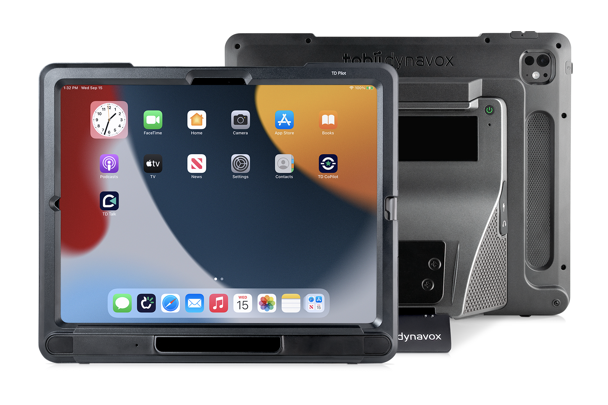
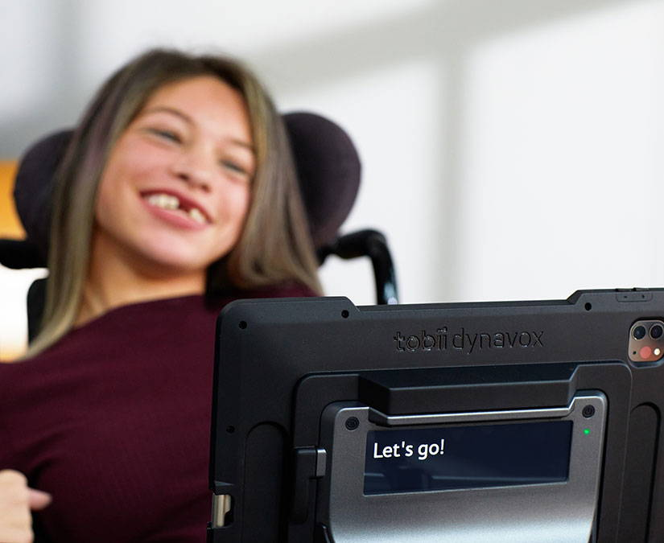
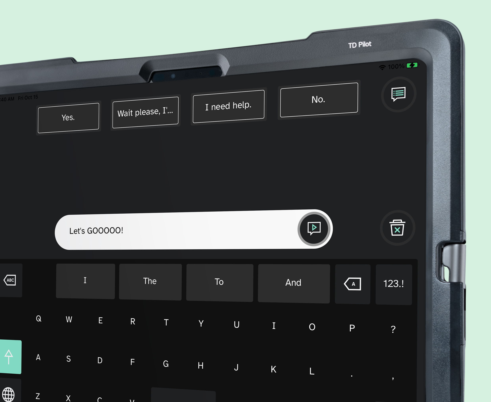
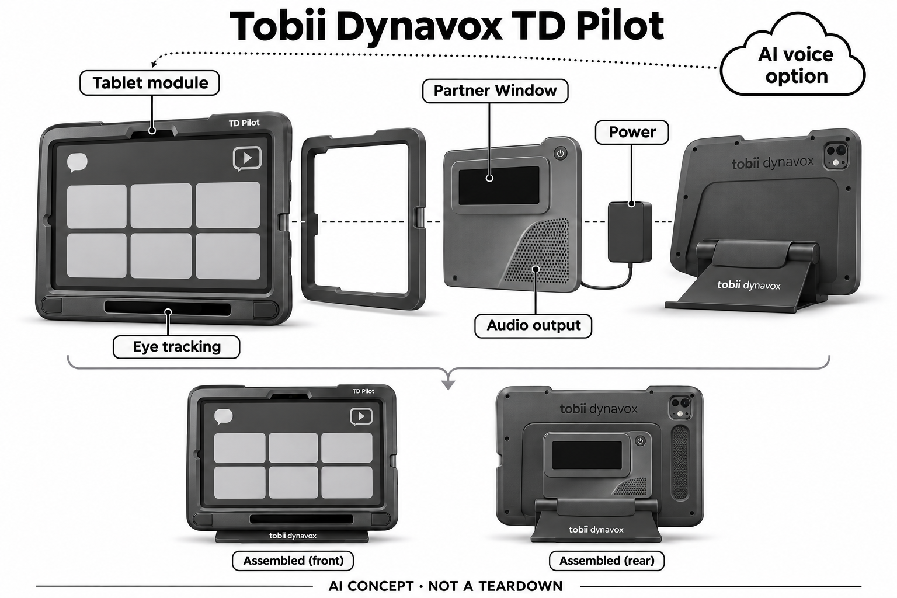

# Tobii Dynavox TD Pilot派乐（TD Talk AI音色方案）

**Tobii Dynavox** · 无障碍与辅助沟通 · 核查 2026-11-05

用眼控选择自己要说的话，再通过个性化声音表达

消费渠道：个人适配 / 验配。

## 产品图片与结构参考

### 产品图

TD Pilot官方前后外形：眼控、背部交流窗口与支撑结构 · 来源：[Tobii Dynavox · 官方产品图片](<https://us.tobiidynavox.com/pages/td-pilot>) · [原始图片](<https://i.shgcdn.com/37fb4ea3-c1ee-4277-847e-8fcc6ad9a2f2/-/format/auto/-/quality/normal/>)

### 参考图

TD Pilot官方背部Partner Window交流使用参考 · 来源：[Tobii Dynavox · 官方产品图片](<https://us.tobiidynavox.com/pages/td-pilot>) · [原始图片](<https://i.shgcdn.com/e4c854b9-b3b6-40d2-b855-7c496f39c79e/-/format/auto/-/preview/3000x3000/-/quality/lighter/>)

### 参考图

TD Pilot官方TD Talk界面参考；界面不代表所有音色权益 · 来源：[Tobii Dynavox · 官方产品图片](<https://us.tobiidynavox.com/pages/td-pilot>) · [原始图片](<https://i.shgcdn.com/196d17a9-1755-49b6-8557-8cddf100e35b/-/format/auto/-/quality/normal/>)

### AI 生成爆炸示意

**AI 生成 · 非实物拆机。** 内部为概念推断，不能作为元件布局、BOM 或维修依据。[生成提示词](../../content/hardware/prompts/td-pilot.txt)

> 已视觉检查准确外形、灰阶、标题与概念声明；未知内部模块仅为功能示意，不代表拆机、完整BOM或参数。

> 初稿误将AI服务连到供电，已用内置ImageGen定向修正为平板软件，并恢复参考图的背部相机开口；初稿与完整修订提示词保留。

> 来源图片已逐张实际查看，确认具体型号；保留原图，不改色裁切。图片不能证明内部BOM、疗效或所有配置可售。

> 分析为基于公开资料的案头研究与 AI 辅助判断，未经用户访谈、销量审计或实物拆机。需求、画像、竞争冷门度、审美及商业机会均为研究假设，不是投资结论。

## 销售与购买

- 状态：在售。中国官网列出TD Pilot派乐具体硬件，购买页明确准备订购可联系本地代表取得价格和个人方案；TD Talk当前预装及2026年5月ElevenLabs AI音色设置支持均有官方说明。

- 地区：中国大陆：官方本地联系购买、美国等官方个人沟通辅助渠道；方案因地区不同

- 价格：个人沟通辅助方案报价。平板基座、配套软件、安装适配与第三方音色权益须核对完整订单；未核到统一零售价，不保证支付或资助资格。

- 中国大陆：硬件具有中国官网型号和本地购买联系渠道；ElevenLabs等第三方AI音色的账户、网络、许可和语言条件另行确认，不能视为大陆自动包含。

- [官方产品 / 商店](<https://www.tobiidynavox.cn/pages/td-pilot>)

## AI 的实际作用

预装TD Talk支持个性化AI语音，2026年官方文档给出ElevenLabs音色接入；用户自己选择表达内容，AI负责声音生成，不推定眼动追踪算法为AI。

服务与联网依赖：需要眼控适配、TD Talk和有效音色方案；第三方AI语音账户、许可与网络另有条件，未确认所有地区或订单均包含。

## 是否冷门

细分专业（研究判断）：为自主表达提供眼控与声音输出，区别于通用平板或自动回答助手；采用取决于个人接入条件、支持和语言服务，无疗效结论。

## 需求与市场

需求假设是使用者希望在不便使用常规口语或手部输入时，主动选择自己的表达并让对方及时理解。个性化音色可能与身份和交流偏好有关，但只有输入、编辑和发声流程可掌控才有价值；听起来自然并不等于表达更自主，也不能替代本人对声音的选择。

### 官方｜用户选择内容再发声 · 官方资料

TD Pilot将眼控模块、专用沟通基座和iPad结合，预装TD Talk等沟通软件。官方当前支持文档明确TD Talk可接入ElevenLabs个性化AI音色，因此本条按具体语音方案说明AI依据；用户选择要表达的内容，系统负责输出声音，不能把它描述为读取想法或替用户决定意图。

依据：[TD Pilot派乐中国官方产品页](<https://www.tobiidynavox.cn/pages/td-pilot>) · [TD Talk当前官方介绍](<https://us.tobiidynavox.com/products/td-talk>) · [TD Talk设置ElevenLabs AI音色，2026-05-04](<https://www.tobiidynavox.com/blogs/support-articles/how-do-i-set-up-my-elevenlabs-voice-in-td-talk>)

### 判断｜表达自主性比声音新奇更关键 · 研究判断

需求假设是使用者希望在不便使用常规口语或手部输入时，主动选择自己的表达并让对方及时理解。个性化音色可能与身份和交流偏好有关，但只有输入、编辑和发声流程可掌控才有价值；听起来自然并不等于表达更自主，也不能替代本人对声音的选择。

依据：[TD Pilot派乐中国官方产品页](<https://www.tobiidynavox.cn/pages/td-pilot>) · [TD Talk当前官方介绍](<https://us.tobiidynavox.com/products/td-talk>)

### 验证｜从真实交流任务检查完整过程 · 待验证

可在适配支持下选择本人常见的简短交流，观察选字、修改、发声、停止和对方理解的过程。需把输入困难、词语组织和音色生成分别记录，避免只播放预先写好的句子；本研究没有交流效果试验，不承诺语言、运动或医疗状况改善。

依据：[TD Pilot派乐中国官方产品页](<https://www.tobiidynavox.cn/pages/td-pilot>) · [TD Talk当前官方介绍](<https://us.tobiidynavox.com/products/td-talk>) · [TD Talk设置ElevenLabs AI音色，2026-05-04](<https://www.tobiidynavox.com/blogs/support-articles/how-do-i-set-up-my-elevenlabs-voice-in-td-talk>)

## 用户画像

眼控只是可能的输入方式之一，使用者的视线控制、姿势、疲劳和既有沟通习惯都会影响实际流程。家人或支持人员是否能帮助安装和维护也很重要，但应保留本人表达的主导权；不能用某个诊断名称概括所有需求，更不能把照护者觉得方便等同用户本人满意。

### 官方｜个人适配与本地购买渠道明确 · 官方资料

中国官网列出TD Pilot派乐具体型号，购买页说明准备订购者可联系本地代表获取价格与方案，并区分使用者及相关服务信息。目录据此确认硬件官方个人渠道，但没有提交表单或获得个体报价；是否需要安装、训练和配套访问方式仍须按本人条件评估。

依据：[TD Pilot派乐中国官方产品页](<https://www.tobiidynavox.cn/pages/td-pilot>) · [Tobii Dynavox中国官方如何购买](<https://www.tobiidynavox.cn/pages/how-to-buy>)

### 判断｜接入方式与支持条件决定使用体验 · 研究判断

眼控只是可能的输入方式之一，使用者的视线控制、姿势、疲劳和既有沟通习惯都会影响实际流程。家人或支持人员是否能帮助安装和维护也很重要，但应保留本人表达的主导权；不能用某个诊断名称概括所有需求，更不能把照护者觉得方便等同用户本人满意。

依据：[TD Pilot派乐中国官方产品页](<https://www.tobiidynavox.cn/pages/td-pilot>) · [TD Talk当前官方介绍](<https://us.tobiidynavox.com/products/td-talk>)

### 验证｜确认本人可控制的每个环节 · 待验证

适配可核对设备位置、眼控校准、选择反馈、修改和停止发声的方式，并明确哪些步骤需他人协助。报价还应说明软件、安装、培训及后续支持范围；目录没有个体评估结果，不推定所有用户都能直接操作，也不将官方联系渠道视为已完成适配。

依据：[TD Pilot派乐中国官方产品页](<https://www.tobiidynavox.cn/pages/td-pilot>) · [Tobii Dynavox中国官方如何购买](<https://www.tobiidynavox.cn/pages/how-to-buy>) · [TD Talk当前官方介绍](<https://us.tobiidynavox.com/products/td-talk>)

## 竞争与替代

通用平板也能输入并播放文字，但专用眼控、背部交流窗口、声音输出和安装结构形成不同的个人使用流程。个性化音色增加表达选择，却可能带来服务依赖；同核心辅助沟通任务下，不应再以屏幕尺寸或小幅型号更新堆数，而应比较接入和交流方式的真实差异。

### 官方｜AI语音是可核实的具体配套 · 官方资料

当前TD Talk介绍说明它预装于TD Pilot，五月官方支持文档具体描述ElevenLabs音色接入。这里不是因为平板能装任意应用就泛称AI硬件，也不自行断言眼动模块采用某种机器学习；生成式能力限定在明确配套的软件语音工作流，并保留账户、许可和区域限制。

依据：[TD Talk当前官方介绍](<https://us.tobiidynavox.com/products/td-talk>) · [TD Talk设置ElevenLabs AI音色，2026-05-04](<https://www.tobiidynavox.com/blogs/support-articles/how-do-i-set-up-my-elevenlabs-voice-in-td-talk>)

### 判断｜与普通平板及固定音色沟通器区别 · 研究判断

通用平板也能输入并播放文字，但专用眼控、背部交流窗口、声音输出和安装结构形成不同的个人使用流程。个性化音色增加表达选择，却可能带来服务依赖；同核心辅助沟通任务下，不应再以屏幕尺寸或小幅型号更新堆数，而应比较接入和交流方式的真实差异。

依据：[TD Pilot派乐中国官方产品页](<https://www.tobiidynavox.cn/pages/td-pilot>) · [TD Talk当前官方介绍](<https://us.tobiidynavox.com/products/td-talk>) · [TD Pilot美国官方产品与图片](<https://us.tobiidynavox.com/pages/td-pilot>)

### 验证｜按交流任务而非配置数量比较 · 待验证

可把原有沟通方式与TD Pilot用于相同任务，记录准备、选择、纠错和对方确认的完整步骤，同时询问本人对声音的偏好。比较费用需要包括适配、支架、软件和音色服务；本研究没有用户访谈、交流速度或长期采用证据，不能仅据产品定位认定更适合个人。

依据：[TD Pilot派乐中国官方产品页](<https://www.tobiidynavox.cn/pages/td-pilot>) · [TD Talk当前官方介绍](<https://us.tobiidynavox.com/products/td-talk>) · [TD Talk设置ElevenLabs AI音色，2026-05-04](<https://www.tobiidynavox.com/blogs/support-articles/how-do-i-set-up-my-elevenlabs-voice-in-td-talk>)

## 供应链

同类沟通基座需要在可懂度、声音反馈、续航、安装和重量之间协调，还要与封闭平板的软件接口合作。一般扬声器或电池能力不能自动解决眼控适配和沟通应用许可；供应候选应说明只覆盖哪个功能层，而不是暗示已有完整个人辅助设备的可复制方案。

### 官方｜基座和平板内部的证据边界不同 · 官方资料

官方展示了眼控区域、扬声器、背部Partner Window与专用外壳，iPad作为配套计算模块存在。没有公开点名所有追踪、音频、电池和制造供应商，不能从平板品牌推定整个基座BOM；概念图保留完整平板模块，未知内部仅以功能表示，不绘制虚构芯片或电路布局。

依据：[TD Pilot派乐中国官方产品页](<https://www.tobiidynavox.cn/pages/td-pilot>) · [TD Pilot美国官方产品与图片](<https://us.tobiidynavox.com/pages/td-pilot>)

### 判断｜声音输出和供电是系统工程问题 · 研究判断

同类沟通基座需要在可懂度、声音反馈、续航、安装和重量之间协调，还要与封闭平板的软件接口合作。一般扬声器或电池能力不能自动解决眼控适配和沟通应用许可；供应候选应说明只覆盖哪个功能层，而不是暗示已有完整个人辅助设备的可复制方案。

依据：[TD Pilot派乐中国官方产品页](<https://www.tobiidynavox.cn/pages/td-pilot>) · [TD Pilot美国官方产品与图片](<https://us.tobiidynavox.com/pages/td-pilot>)

### 验证｜候选需确认场景与结构约束 · 待验证

声学候选可研究外壳、扬声器和放大配置，消费电池候选则需核对供电接口、保护和机械空间，但均须经过实际设计与验证。这里没有TD Pilot点名采用证据，也不涉及替换iPad内部器件；不得把一般供应商能力写成现机维修建议或通过适配的完整组件。

依据：[TD Pilot派乐中国官方产品页](<https://www.tobiidynavox.cn/pages/td-pilot>) · [TD Pilot美国官方产品与图片](<https://us.tobiidynavox.com/pages/td-pilot>)

## 技术路径

一句话从选择到发声的等待可能影响交流时机，用户发现内容不对时也需要及时修改或停止。生成音色再逼真，如果无法知道是否正在处理、是否重复发送，仍可能带来困扰；因此技术评价应围绕用户可见的状态与控制，不只比较音色自然程度。

### 官方｜AI音色接入与眼控识别要分开 · 官方资料

眼控用于选择，TD Talk组织待表达内容，选配AI语音把文本变成个性化声音，背部显示和扬声器再向交流对象呈现。支持文档明确第三方账户设置条件，但没有证明所有配置都预含相同许可；目录不把这一流程扩写为AI自动生成用户意图或所有语音均完全离线。

依据：[TD Pilot派乐中国官方产品页](<https://www.tobiidynavox.cn/pages/td-pilot>) · [TD Talk当前官方介绍](<https://us.tobiidynavox.com/products/td-talk>) · [TD Talk设置ElevenLabs AI音色，2026-05-04](<https://www.tobiidynavox.com/blogs/support-articles/how-do-i-set-up-my-elevenlabs-voice-in-td-talk>)

### 判断｜延迟和可停止性影响对话节奏 · 研究判断

一句话从选择到发声的等待可能影响交流时机，用户发现内容不对时也需要及时修改或停止。生成音色再逼真，如果无法知道是否正在处理、是否重复发送，仍可能带来困扰；因此技术评价应围绕用户可见的状态与控制，不只比较音色自然程度。

依据：[TD Talk当前官方介绍](<https://us.tobiidynavox.com/products/td-talk>) · [TD Talk设置ElevenLabs AI音色，2026-05-04](<https://www.tobiidynavox.com/blogs/support-articles/how-do-i-set-up-my-elevenlabs-voice-in-td-talk>)

### 验证｜分开测试输入、生成和播放 · 待验证

试用可记录选定文本后到声音输出的过程，以及网络异常、账户失效或修改内容时的提示。重要的是确认用户能判断是否发出正确句子，并有合适的替代输出方式；本研究没有延迟或语音质量测量，不承诺特定语言和网络条件下的稳定表现。

依据：[TD Pilot派乐中国官方产品页](<https://www.tobiidynavox.cn/pages/td-pilot>) · [TD Talk当前官方介绍](<https://us.tobiidynavox.com/products/td-talk>) · [TD Talk设置ElevenLabs AI音色，2026-05-04](<https://www.tobiidynavox.com/blogs/support-articles/how-do-i-set-up-my-elevenlabs-voice-in-td-talk>)

## 产品审美

使用者需要看清并控制正面，对话对象则可能从背部窗口获得反馈，这让安装高度和摆放方向影响交流体验。外观稳固感不等于任何桌面或轮椅位置都适用，重量和拿取也需要本人及支持者共同评估；审美应包含交流中的可见性和个人偏好，而非只看屏幕边框。

### 官方｜前后都有交流相关结构 · 官方资料

官方前后照片显示正面平板、下沿眼控区域，以及背部Partner Window和扬声器结构，机壳还保留平板相机开口。它的外形不是普通平板套加一个装饰支架；参考图用于识别这些可见部件，不能由外壳推定内部电池尺寸、追踪镜头数量或全部机械连接方式。

依据：[TD Pilot派乐中国官方产品页](<https://www.tobiidynavox.cn/pages/td-pilot>) · [TD Pilot美国官方产品与图片](<https://us.tobiidynavox.com/pages/td-pilot>)

### 判断｜设备朝向同时服务两个人 · 研究判断

使用者需要看清并控制正面，对话对象则可能从背部窗口获得反馈，这让安装高度和摆放方向影响交流体验。外观稳固感不等于任何桌面或轮椅位置都适用，重量和拿取也需要本人及支持者共同评估；审美应包含交流中的可见性和个人偏好，而非只看屏幕边框。

依据：[TD Pilot派乐中国官方产品页](<https://www.tobiidynavox.cn/pages/td-pilot>) · [TD Pilot美国官方产品与图片](<https://us.tobiidynavox.com/pages/td-pilot>)

### 验证｜在真实交流位置观察摆放 · 待验证

适配时可以检查使用者坐姿、设备位置、对方视线、线缆和充电安排，记录哪些调整需要协助。把外观喜欢程度、安装稳定和操作便利分别评估，避免照片替代实地判断；本轮只核官方图，没有实际支架、震动、散热或长期清洁测试结果。

依据：[TD Pilot派乐中国官方产品页](<https://www.tobiidynavox.cn/pages/td-pilot>) · [TD Pilot美国官方产品与图片](<https://us.tobiidynavox.com/pages/td-pilot>)

## 关键风险

个性化声音可能与本人身份紧密相关，获取、保存和调用相关素材应尊重本人意愿及服务许可。替用户配置的人也不能把技术上可生成等同本人希望表达；本条研究的是自主沟通工具，不能将生成音色用于冒充他人或把系统输出视作未经本人确认的真实意思。

### 官方｜大陆硬件渠道与AI服务不等同 · 官方资料

中国官网和本地购买流程支持硬件正式渠道，但第三方个性化音色仍涉及账户、网络、许可和地区服务。美国TD Talk支持说明不能自动证明大陆订单包含全部AI权益；目录因此明确分层，不承诺统一价格、服务可达性、资助资格或所有语言都有相同体验。

依据：[TD Pilot派乐中国官方产品页](<https://www.tobiidynavox.cn/pages/td-pilot>) · [Tobii Dynavox中国官方如何购买](<https://www.tobiidynavox.cn/pages/how-to-buy>) · [TD Talk设置ElevenLabs AI音色，2026-05-04](<https://www.tobiidynavox.com/blogs/support-articles/how-do-i-set-up-my-elevenlabs-voice-in-td-talk>)

### 判断｜声音身份需要本人同意与控制 · 研究判断

个性化声音可能与本人身份紧密相关，获取、保存和调用相关素材应尊重本人意愿及服务许可。替用户配置的人也不能把技术上可生成等同本人希望表达；本条研究的是自主沟通工具，不能将生成音色用于冒充他人或把系统输出视作未经本人确认的真实意思。

依据：[TD Talk当前官方介绍](<https://us.tobiidynavox.com/products/td-talk>) · [TD Talk设置ElevenLabs AI音色，2026-05-04](<https://www.tobiidynavox.com/blogs/support-articles/how-do-i-set-up-my-elevenlabs-voice-in-td-talk>)

### 验证｜确认授权、隐私和故障替代 · 待验证

在实际选配前应核对声音素材的授权、服务端处理、账户管理和删除方式，并确定无法使用该音色时有哪些沟通替代。还需让本人理解停止和更换声音的路径；目录没有进行账户接入或收集声音，不提供医疗效果承诺，也不代替专业沟通辅助适配。

依据：[Tobii Dynavox中国官方如何购买](<https://www.tobiidynavox.cn/pages/how-to-buy>) · [TD Talk当前官方介绍](<https://us.tobiidynavox.com/products/td-talk>) · [TD Talk设置ElevenLabs AI音色，2026-05-04](<https://www.tobiidynavox.com/blogs/support-articles/how-do-i-set-up-my-elevenlabs-voice-in-td-talk>)

## 机会与验证

后续更有价值的问题是本人是否更容易发起、修改和结束交流，以及哪些环境仍需要其他沟通方式。声音个性化可以作为其中一个偏好，但不应掩盖输入和支持负担；一个可靠的局部任务也可能有意义，无须用替代所有沟通方式的承诺证明产品价值。

### 官方｜眼控自主表达保留为一个核心任务 · 官方资料

本条收录的是专用眼控沟通硬件与明确AI音色工作流的结合，不把TD Talk软件、第三方订阅或不同平板配置另算硬件需求。核心任务是让使用者主动表达，并选择合适的声音呈现；这与一般AI聊天终端或自动摘要设备不同，也不意味着系统可以代替本人作出决定。

依据：[TD Pilot派乐中国官方产品页](<https://www.tobiidynavox.cn/pages/td-pilot>) · [TD Talk当前官方介绍](<https://us.tobiidynavox.com/products/td-talk>) · [TD Talk设置ElevenLabs AI音色，2026-05-04](<https://www.tobiidynavox.com/blogs/support-articles/how-do-i-set-up-my-elevenlabs-voice-in-td-talk>)

### 判断｜优先研究表达被本人掌控的程度 · 研究判断

后续更有价值的问题是本人是否更容易发起、修改和结束交流，以及哪些环境仍需要其他沟通方式。声音个性化可以作为其中一个偏好，但不应掩盖输入和支持负担；一个可靠的局部任务也可能有意义，无须用替代所有沟通方式的承诺证明产品价值。

依据：[TD Pilot派乐中国官方产品页](<https://www.tobiidynavox.cn/pages/td-pilot>) · [TD Talk当前官方介绍](<https://us.tobiidynavox.com/products/td-talk>)

### 验证｜把选择权与持续支持一起跟踪 · 待验证

可在合适同意和适配支持下记录本人持续选择的任务、音色偏好、故障恢复及需要帮助的步骤，同时观察软件和服务变化。当前只有公开产品证据，没有长期用户或商业数据；研究应允许使用者不选择某种AI音色或回到原工具，而不是把使用次数当作唯一成功标准。

依据：[TD Pilot派乐中国官方产品页](<https://www.tobiidynavox.cn/pages/td-pilot>) · [Tobii Dynavox中国官方如何购买](<https://www.tobiidynavox.cn/pages/how-to-buy>) · [TD Talk当前官方介绍](<https://us.tobiidynavox.com/products/td-talk>) · [TD Talk设置ElevenLabs AI音色，2026-05-04](<https://www.tobiidynavox.com/blogs/support-articles/how-do-i-set-up-my-elevenlabs-voice-in-td-talk>)

## 对应供应链公司

能力候选用于选型研究，不代表本产品实际采用；未公开的供货关系不作推断。

- [aac-technologies](../supply-chain/aac-technologies.md) — **能力候选 · 非已采用** / 同类个人沟通基座的扬声器与声学集成候选：瑞声公开声学器件与系统集成能力，可研究同类沟通基座在不同朝向和环境中的声音输出，但需结合外壳、功耗、放大接口和可懂度测试。未发现TD Pilot点名采用证据，此链接不涉及其眼控算法、AI音色许可或平板内部，也不能由器件能力承诺交流效果。

- [sunwoda](../supply-chain/sunwoda.md) — **能力候选 · 非已采用** / 同类辅助沟通基座的消费电池与供电研究：欣旺达公开消费电池业务可作为同类基座供电开发的候选入口，需要核对电压、接口、保护、充电和机械安装条件。没有本型号采用来源，也不意味着可替换iPad或现有基座电池；此处只对应重新设计的电源研究，适配、运输和整机安全仍需单独验证。

[浏览供应链目录](../supply-chain.md)

## 功能分层示意

这是功能关系，不是实物拆机、真实空间结构或已核实 BOM。

1. **选择输入**：眼动模块及支持的触摸或开关输入帮助用户选择内容。（官方披露）

2. **平板与沟通软件**：iPad与TD Talk等软件组织表达，用户保有选择权。（官方披露）

3. **选配AI音色**：TD Talk可接入个性化AI语音，具体账户和许可条件另核。（官方披露）

4. **交流输出**：扬声器和背部Partner Window向对方呈现已选择内容。（官方披露）

5. **安装供电**：专用外壳、支撑和供电满足整体使用；不拆解未知平板内部。（官方披露）

## 来源

1. [TD Pilot派乐中国官方产品页](<https://www.tobiidynavox.cn/pages/td-pilot>) — 已打开具体个人眼控沟通设备及软件、背部显示与声音结构；不以支持页序列号表推定为另一代型号。

2. [Tobii Dynavox中国官方如何购买](<https://www.tobiidynavox.cn/pages/how-to-buy>) — 已打开准备订购、当地代表和个人需求联系流程；未提交个人信息、报价或购买。

3. [TD Talk当前官方介绍](<https://us.tobiidynavox.com/products/td-talk>) — 已打开TD Talk预装TD Pilot、个性化声音和沟通功能；具体地区权益需核对。

4. [TD Talk设置ElevenLabs AI音色，2026-05-04](<https://www.tobiidynavox.com/blogs/support-articles/how-do-i-set-up-my-elevenlabs-voice-in-td-talk>) — 已打开具体个性化AI语音集成说明；需要个人服务账户设置，不推定所有地区可用或包含许可。

5. [TD Pilot美国官方产品与图片](<https://us.tobiidynavox.com/pages/td-pilot>) — 已打开当前TD Pilot前后外形、眼控区、Partner Window和沟通使用场景；不是普通平板照片。

[返回目录](../hardware-market.md) · [网页分析](https://romanagent.github.io/Roman/#hardware/product/td-pilot)
