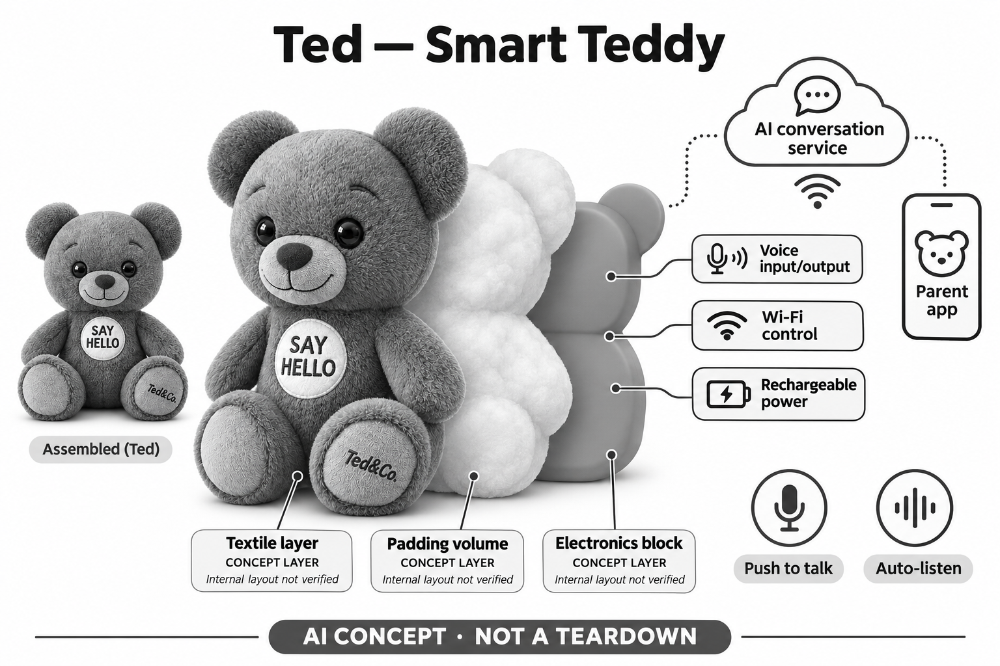

# Ted — Smart Teddy

**Ted&Co** · AI玩具 · 核查 2026-11-06

可在按键和自动聆听间切换的联网对话泰迪

消费渠道：个人零售。

## 产品图片与结构参考

### 产品图

官方Ted正面外观 · 来源：[产品品牌官网](<https://tedco.ai/products/ted-smart-teddy>) · [原始图片](<https://tedco.ai/cdn/shop/t/8/assets/plush1.png?v=21630934881267745571787907788>)

### 参考图

官方Ted斜侧外观 · 来源：[产品品牌官网](<https://tedco.ai/products/ted-smart-teddy>) · [原始图片](<https://tedco.ai/cdn/shop/t/8/assets/plush2.png?v=37156498802656051561787907787>)

### AI 生成爆炸示意

**AI 生成 · 非实物拆机。** 内部为概念推断，不能作为元件布局、BOM 或维修依据。[生成提示词](../../content/hardware/prompts/tedco-ted.txt)

> 内置ImageGen按本产品官方参考独立生成；未知内部为概念层，不是BOM或维修依据。

> 图片保留官方原貌；效果、安全与性能宣传不代表本目录独立验证。

> 分析为基于公开资料的案头研究与 AI 辅助判断，未经用户访谈、销量审计或实物拆机。需求、画像、竞争冷门度、审美及商业机会均为研究假设，不是投资结论。

## 销售与购买

- 状态：在售。官方商品页显示€129、In stock与Order now，称订单可发货；本轮核公开销售入口，未下单验证库存或具体送达。

- 地区：法国及欧洲官网市场、其他目的地以结算确认为准

- 价格：€129（法国/欧元页面）。厂商称正常对话无月订阅；不同地区、税运和长期服务条款需按结算确认，终身宣传不当作本研究的持续服务保证。

- 中国大陆：官网国家选择列中国且称支持中文，但这不等于已核实大陆配送、应用及售后；本轮没有确认大陆正式渠道或使用条件。

- [官方产品 / 商店](<https://tedco.ai/products/ted-smart-teddy>)

## AI 的实际作用

以语音进行非预录的即时生成回答，按年龄与语言调整对话；支持按键发起和家长选择的自动聆听模式，未披露具体模型或厂商。

服务与联网依赖：家长使用Ted&Co应用配网与设置，正常对话需要Wi-Fi；完成设置后孩子不必操作手机，不能误写成无网络或全部本地AI。

## 是否冷门

新兴竞争（研究判断）：普通泰迪外观与联网生成对话的组合已有多家方案，模式选择是实现差异；未取得销量或模型性能证据，不能推断蓝海或领先。

## 需求与市场

家庭可能希望把提问和故事放在熟悉的泰迪身上，让孩子不必一直操作手机。价值取决于对话是否帮助孩子发展自己的想法，而不是玩具不断说更多话；如果成人仍需频繁修正、重连或解释错误，原有普通玩偶和亲子讲故事可能更符合家庭习惯。

### 事实｜泰迪承担即时语音回应 · 官方资料

Ted的官方商品将实时、非脚本对话作为功能，孩子可以提问、讲故事和聊天，回答通过内置扬声器播放。它与固定录音泰迪的机制不同，但具体语言模型与版本没有公开；目录只确认厂商披露的生成式玩法，不由自然语气推导真实理解或教育效果。

依据：[Ted官方商品与购买信息](<https://tedco.ai/products/ted-smart-teddy>) · [Ted官方FAQ：联网与模式](<https://tedco.ai/pages/faq>)

### 判断｜需求可能是轻量的语音共玩 · 研究判断

家庭可能希望把提问和故事放在熟悉的泰迪身上，让孩子不必一直操作手机。价值取决于对话是否帮助孩子发展自己的想法，而不是玩具不断说更多话；如果成人仍需频繁修正、重连或解释错误，原有普通玩偶和亲子讲故事可能更符合家庭习惯。

依据：[Ted官方商品与购买信息](<https://tedco.ai/products/ted-smart-teddy>)

### 验证｜观察输入与回复是否能继续游戏 · 待验证

后续可以记录孩子主动发起的主题、被误解后的修正和停止互动的原因，再看家长需要投入多少帮助。不要只用一段流畅演示或长时间参与来证明需求；本目录没有儿童访谈、销量和学习对照试验，所有市场空间判断均为案头研究假设。

依据：[Ted官方商品与购买信息](<https://tedco.ai/products/ted-smart-teddy>) · [Ted官方FAQ：联网与模式](<https://tedco.ai/pages/faq>)

## 用户画像

有的家庭可能更喜欢每次按键再说话，有的希望连续聊天减少操作，但两种方式带来不同的状态理解要求。用户画像应考虑孩子是否能区分玩具正在听还是已经停止，以及家长是否愿意管理设置；偏好不同并不意味着某一种模式普遍更好。

### 事实｜成人承担设置与充电 · 官方资料

官网FAQ将年龄起点写为三岁，并要求成人完成初始设置与充电；家长应用选择语言、音量和聆听模式。商品页更宽泛的年龄宣传不能覆盖每个人的操作能力，目录也不会因此把它描述为所有儿童或老年人均适合的沟通辅助设备。

依据：[Ted官方商品与购买信息](<https://tedco.ai/products/ted-smart-teddy>) · [Ted官方FAQ：联网与模式](<https://tedco.ai/pages/faq>)

### 判断｜模式偏好会影响家庭适配 · 研究判断

有的家庭可能更喜欢每次按键再说话，有的希望连续聊天减少操作，但两种方式带来不同的状态理解要求。用户画像应考虑孩子是否能区分玩具正在听还是已经停止，以及家长是否愿意管理设置；偏好不同并不意味着某一种模式普遍更好。

依据：[Ted官方FAQ：联网与模式](<https://tedco.ai/pages/faq>)

### 验证｜比较孩子与家长的实际理解 · 待验证

可以让成人设置后解释当前模式，再观察孩子能否正确开始、暂停和结束一轮交流。测试宜使用公开主题，避免通过私人经历获取所谓个性化效果；如果对收音状态的理解不一致，应先解决交互问题，而不是把更长的对话当成产品成功。

依据：[Ted官方商品与购买信息](<https://tedco.ai/products/ted-smart-teddy>) · [Ted官方FAQ：联网与模式](<https://tedco.ai/pages/faq>)

## 竞争与替代

在多家提供类似对话的泰迪或毛绒市场中，无月费、语气和模式设置可能影响选择，但其他产品也能调整这些要素。更有意义的比较是联网和出错时是否容易理解、是否便于成人介入，以及游戏质量能否持续，而不是简单把模型接入当作难复制的壁垒。

### 事实｜当前销售强调无月费正常使用 · 官方资料

商品和FAQ都称正常对话随购买提供，不需要月订阅，当前欧元页面显示在库和下单入口。这种收费形式可以与有订阅的毛绒比较，但不是模型完全离线的证据；页面对于长期服务的强承诺也不能替代实际经营持续性和未来条款核查。

依据：[Ted官方商品与购买信息](<https://tedco.ai/products/ted-smart-teddy>) · [Ted官方FAQ：联网与模式](<https://tedco.ai/pages/faq>)

### 判断｜竞争差异应落在使用流程 · 研究判断

在多家提供类似对话的泰迪或毛绒市场中，无月费、语气和模式设置可能影响选择，但其他产品也能调整这些要素。更有意义的比较是联网和出错时是否容易理解、是否便于成人介入，以及游戏质量能否持续，而不是简单把模型接入当作难复制的壁垒。

依据：[Ted官方商品与购买信息](<https://tedco.ai/products/ted-smart-teddy>) · [Ted官方FAQ：联网与模式](<https://tedco.ai/pages/faq>)

### 验证｜统一任务和使用周期比较成本 · 待验证

可在相同故事和提问任务中比较等待、误解、操作次数以及长期维护，费用则包含购置、配送和可能的服务变化。官网划定的功能范围应保存为当期证据；本研究没有实物账单或支持工时，不能由无订阅推导其整体成本一定低于其他产品。

依据：[Ted官方商品与购买信息](<https://tedco.ai/products/ted-smart-teddy>) · [Ted官方FAQ：联网与模式](<https://tedco.ai/pages/faq>)

## 供应链

持续等待语音可能涉及待机电源、环境噪声和状态提示，而按键模式更依赖触发位置与手感。类似产品应在毛绒包覆和实际抱持中设计采音与连接，不能把通用模块参数直接当作成品体验；功能越少并不代表供应与可靠性问题自然消失。

### 事实｜材料和电子模块有有限披露 · 官方资料

官方说明外皮及填充为聚酯材料，玩具内部有带电池的电子模块，并附USB-C线。资料没有披露主控、无线模块、声学器件和装配厂商，不能从外形或销售地区推断供应链；概念爆炸图只表达这些功能层，不能作为真实拆装结构或维修图。

依据：[Ted官方商品与购买信息](<https://tedco.ai/products/ted-smart-teddy>)

### 判断｜自动聆听对整机设计有额外要求 · 研究判断

持续等待语音可能涉及待机电源、环境噪声和状态提示，而按键模式更依赖触发位置与手感。类似产品应在毛绒包覆和实际抱持中设计采音与连接，不能把通用模块参数直接当作成品体验；功能越少并不代表供应与可靠性问题自然消失。

依据：[Ted官方商品与购买信息](<https://tedco.ai/products/ted-smart-teddy>) · [Ted官方FAQ：联网与模式](<https://tedco.ai/pages/faq>)

### 验证｜按目标互动模式筛选供应能力 · 待验证

无线与麦克风候选需要共同验证首次设置、充电、收音和播放过程，尤其注意误触和恢复默认状态。现有供应商链接只是同类设计的能力入口，并未发现Ted点名采用；它们也不提供家长应用、模型内容或服务责任，不能作为完整方案已经成熟的结论。

依据：[Ted官方商品与购买信息](<https://tedco.ai/products/ted-smart-teddy>) · [Ted官方FAQ：联网与模式](<https://tedco.ai/pages/faq>)

## 技术路径

支持多种语言可能方便双语家庭，但不同口音、混合语言和儿童发音的表现需要分别检查。年龄适配也可能是回答风格配置，不能据此证明内容难度始终恰当；技术研究应关注实际问题有没有被正确理解，而不只重复厂商语言数量。

### 事实｜无需孩子操作手机不等于离线 · 官方资料

FAQ明确对话需要Wi-Fi，成人通过应用完成连接后，孩子可以直接和泰迪交流。手机从日常操作中退到后台，不代表模型运行在玩具内部；当前资料未公开具体模型和端云分工，目录因此不声称它具有完全本地推理或无需持续外部服务。

依据：[Ted官方FAQ：联网与模式](<https://tedco.ai/pages/faq>)

### 判断｜语言数量不能替代逐场景质量 · 研究判断

支持多种语言可能方便双语家庭，但不同口音、混合语言和儿童发音的表现需要分别检查。年龄适配也可能是回答风格配置，不能据此证明内容难度始终恰当；技术研究应关注实际问题有没有被正确理解，而不只重复厂商语言数量。

依据：[Ted官方商品与购买信息](<https://tedco.ai/products/ted-smart-teddy>) · [Ted官方FAQ：联网与模式](<https://tedco.ai/pages/faq>)

### 验证｜测试网络变化与模式切换 · 待验证

可以在不涉及个人资料的任务中观察按键和自动模式如何切换、断网时是否停止等待，以及恢复后有没有重复回答。记录错误与等待应与正常表现同样重要；本轮没有激活设备，也没有测试响应时延或验证厂商关于持续续航的宣传。

依据：[Ted官方FAQ：联网与模式](<https://tedco.ai/pages/faq>)

## 产品审美

普通泰迪的熟悉感可能减少学习操作的负担，也可能让孩子忽略它正在联网和处理语音。审美设计需要让电子状态可以被察觉，尤其自动聆听时不能仅靠一个始终微笑的表情；外观友好与技术行为透明应在同一体验中考虑。

### 事实｜外形采用熟悉的坐姿泰迪 · 官方资料

官方图片展示圆耳、传统熊脸、腹部SAY HELLO标识和脚底品牌字样，主要交互通过声音。商品明确没有摄像头，眼睛应被理解为造型而非视觉输入；图像只提供外观证据，无法证明触感、材料耐用或每个儿童都愿意拥抱它。

依据：[Ted官方商品与购买信息](<https://tedco.ai/products/ted-smart-teddy>)

### 判断｜亲切外形应配明确功能边界 · 研究判断

普通泰迪的熟悉感可能减少学习操作的负担，也可能让孩子忽略它正在联网和处理语音。审美设计需要让电子状态可以被察觉，尤其自动聆听时不能仅靠一个始终微笑的表情；外观友好与技术行为透明应在同一体验中考虑。

依据：[Ted官方商品与购买信息](<https://tedco.ai/products/ted-smart-teddy>) · [Ted官方FAQ：联网与模式](<https://tedco.ai/pages/faq>)

### 验证｜将清洁与收纳纳入使用观察 · 待验证

商品说明要求湿布擦拭，不能水洗或浸泡，因为包含电子与电池。家庭试用应检查成人是否容易找到这些要求、孩子是否会把它当普通可洗毛绒，以及充电和收纳是否方便；本研究没有材料测试，不把照片的柔软观感视为安全或耐用证明。

依据：[Ted官方商品与购买信息](<https://tedco.ai/products/ted-smart-teddy>)

## 关键风险

自动聆听可能让家庭对何时收音产生不同理解，生成回复又可能包含错误和过度确定的说法。需要成人持续参与、帮助孩子分清玩具与真人；硬件可以被长期保存，而联网服务条件可能变化，这种时间差应该进入产品寿命和购买研究。

### 事实｜厂商没有提供完整模型细节 · 官方资料

当前商品和FAQ说明联网、模式与家长设置，但没有完整披露模型版本、每次对话的处理路径及长期服务安排。目录不会用无月费或无摄像头推导没有资料处理风险，也不会把页面安全测试数量直接转写为对所有AI回答的保证。

依据：[Ted官方商品与购买信息](<https://tedco.ai/products/ted-smart-teddy>) · [Ted官方FAQ：联网与模式](<https://tedco.ai/pages/faq>)

### 判断｜主要风险在状态误解和服务依赖 · 研究判断

自动聆听可能让家庭对何时收音产生不同理解，生成回复又可能包含错误和过度确定的说法。需要成人持续参与、帮助孩子分清玩具与真人；硬件可以被长期保存，而联网服务条件可能变化，这种时间差应该进入产品寿命和购买研究。

依据：[Ted官方FAQ：联网与模式](<https://tedco.ai/pages/faq>)

### 验证｜检查资料控制与停用说明 · 待验证

在正式采用前应核对当前应用关于记录、删除、账号退出和服务变化的说明，并验证停止互动是否清晰。不能用玩具外观替代信息处理检查，也不应假定未来永远没有额外费用；本目录不实施隐私审计或法律判断，仅标出尚未充分披露的边界。

依据：[Ted官方商品与购买信息](<https://tedco.ai/products/ted-smart-teddy>) · [Ted官方FAQ：联网与模式](<https://tedco.ai/pages/faq>)

## 机会与验证

值得研究的不是让泰迪具备最多功能，而是家庭能否用少量设置获得稳定、可停止和可纠正的语音游戏。若无月费能配合清楚服务边界，可能降低理解成本，但持续性仍要验证；创业方向需要用户重复任务和付费证据，而不是单纯依赖外壳与模型组合。

### 事实｜常规购买入口与服务声明并列 · 官方资料

本轮官方商品显示欧元价格、在库及下单按钮，并承诺当前正常对话无月费。页面列出的多国货币选择不构成所有目的地已可配送的证据，尤其大陆应用和售后未核实；目录把可见销售与具体地区支持分开记录，避免把全球访问当成全球交付。

依据：[Ted官方商品与购买信息](<https://tedco.ai/products/ted-smart-teddy>)

### 判断｜机会取决于稳定而可控的简单交互 · 研究判断

值得研究的不是让泰迪具备最多功能，而是家庭能否用少量设置获得稳定、可停止和可纠正的语音游戏。若无月费能配合清楚服务边界，可能降低理解成本，但持续性仍要验证；创业方向需要用户重复任务和付费证据，而不是单纯依赖外壳与模型组合。

依据：[Ted官方商品与购买信息](<https://tedco.ai/products/ted-smart-teddy>) · [Ted官方FAQ：联网与模式](<https://tedco.ai/pages/faq>)

### 验证｜同时记录留下和放弃的原因 · 待验证

可以持续观察孩子是否主动回来共创、家长是否仍愿意维护网络和模式，以及错误回复是否带来更多解释工作。比较应允许普通玩偶或固定故事机更合适的结果；本轮没有独立留存、效果或市场调查，产品前景属于研究判断，不作普遍推荐。

依据：[Ted官方商品与购买信息](<https://tedco.ai/products/ted-smart-teddy>) · [Ted官方FAQ：联网与模式](<https://tedco.ai/pages/faq>)

## 对应供应链公司

能力候选用于选型研究，不代表本产品实际采用；未公开的供货关系不作推断。

- [espressif](../supply-chain/espressif.md) — **能力候选 · 非已采用** / 同类Wi-Fi泰迪的连接控制候选：Espressif无线控制平台可为类似泰迪的首次配网、模式状态和断网恢复提供研发入口，但不意味着Ted实际采用，也不提供其未披露的云模型。需要验证毛绒内部天线、充电干扰及家庭网络，尤其应确保自动聆听状态不会因网络重连而产生难以察觉的变化。

- [infineon](../supply-chain/infineon.md) — **能力候选 · 非已采用** / 自动聆听与按键模式的采音器件候选：Infineon MEMS麦克风可用于研究同类玩具两种聆听模式下的输入质量，但具体触发、静音与回复逻辑需要整机软件实现。需测试衣物摩擦、抱持遮挡和自身扬声器回声；没有Ted点名器件或工厂的公开资料，关联只表示能力候选，不代表已确认供货。

[浏览供应链目录](../supply-chain.md)

## 功能分层示意

这是功能关系，不是实物拆机、真实空间结构或已核实 BOM。

1. **毛绒载体**：坐姿泰迪与腹部SAY HELLO标识，内置电子模块，外皮和填充为聚酯材料。（官方披露）

2. **语音入口**：麦克风接收按键触发或自动聆听输入，无摄像头。（官方披露）

3. **连接与供电**：家长应用设置Wi-Fi，电子模块含充电电池并使用USB-C线。（官方披露）

4. **外部对话处理**：联网AI按语言和年龄生成回答，具体模型与端云部署细节未公开。（分析推断）

5. **播报与家长控制**：扬声器回复，应用选择语言、音量与互动模式。（官方披露）

## 来源

1. [Ted官方商品与购买信息](<https://tedco.ai/products/ted-smart-teddy>) — 已打开129欧元、在库、下单、电子模块及清洁说明；不采纳唯一需要玩具、终身和全部安全宣称。

2. [Ted官方FAQ：联网与模式](<https://tedco.ai/pages/faq>) — 已打开Wi-Fi必需、成人设置、按键/自动聆听、年龄及无月费口径；未实际测试。

[返回目录](../hardware-market.md) · [网页分析](https://romanagent.github.io/Roman/#hardware/product/tedco-ted)
