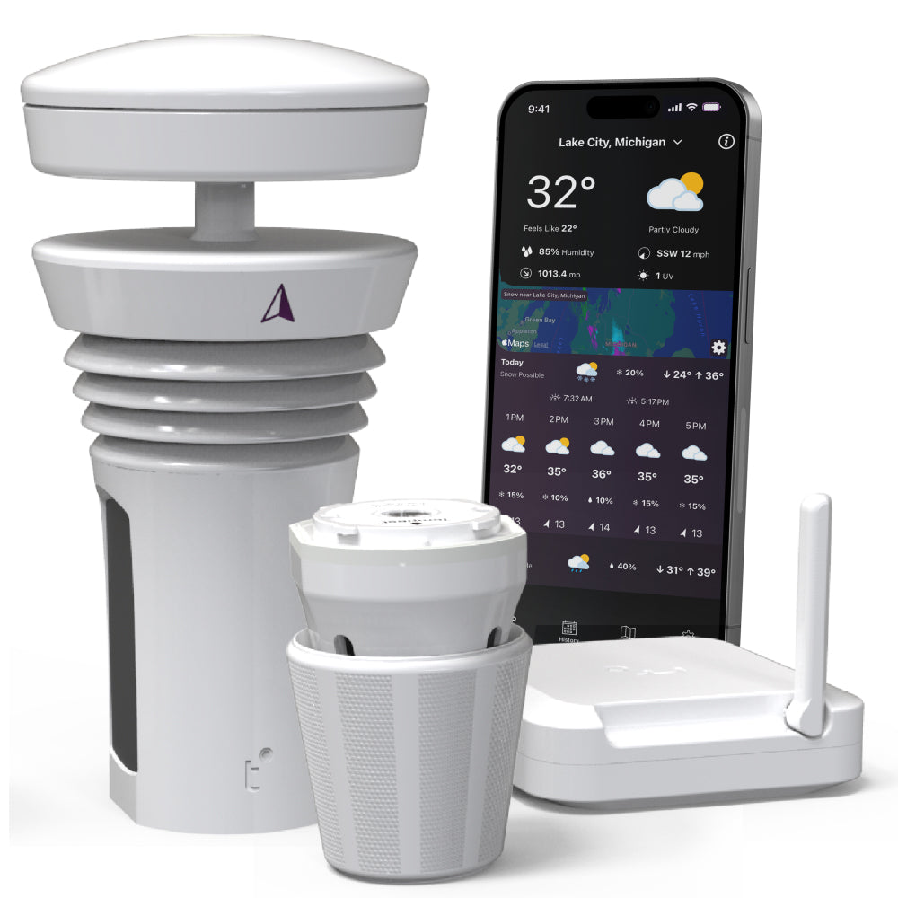
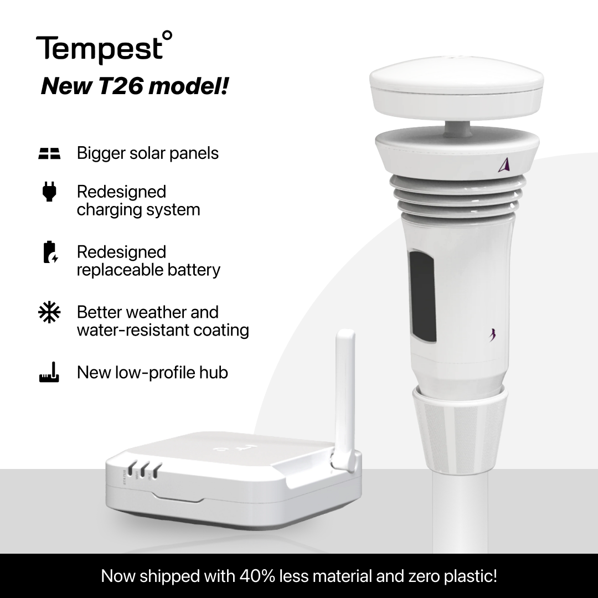
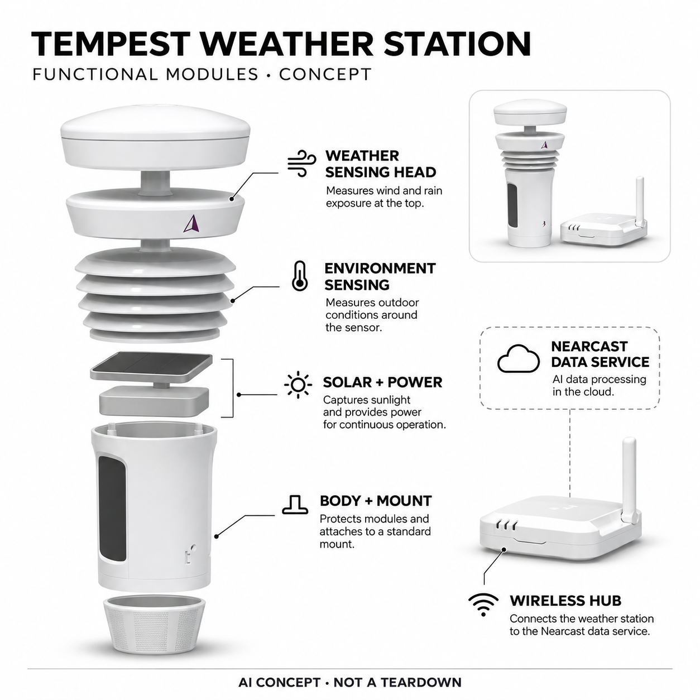

# Tempest Weather Station

**WeatherFlow-Tempest** · 庭院与自然 · 核查 2026-11-04

把自家庭院观测接入机器学习校准和微尺度天气预测

消费渠道：个人零售。

## 产品图片与结构参考

### 产品图

官方家庭气象站与Hub展示 · 来源：[WeatherFlow-Tempest · 官方图片](<https://shop.tempest.earth/products/tempest>) · [原始图片](<https://cdn.shopify.com/s/files/1/0012/8512/8294/files/tempest_featured-iphone_c44b7742-e713-4e22-83e7-61c8c536423c.jpg?v=1764036862>)

### 参考图

当前商品页T26配置说明（含厂商标注） · 来源：[WeatherFlow-Tempest · 官方图片](<https://shop.tempest.earth/products/tempest>) · [原始图片](<https://cdn.shopify.com/s/files/1/0012/8512/8294/files/t26_1.png?v=1786417138>)

### AI 生成爆炸示意

**AI 生成 · 非实物拆机。** 内部为概念推断，不能作为元件布局、BOM 或维修依据。[生成提示词](../../content/hardware/prompts/tempest-home-weather-station.txt)

> 依据已核验官方外形与公开功能生成；未知内部仅为概念功能块，不代表原机电路板、芯片或实际布局。

> 已目视核对当前商品页面对应外形，原图未改色或语义编辑；图片中的营销和适用年龄不替代具体说明。

> 分析为基于公开资料的案头研究与 AI 辅助判断，未经用户访谈、销量审计或实物拆机。需求、画像、竞争冷门度、审美及商业机会均为研究假设，不是投资结论。

## 销售与购买

- 状态：在售。官方商店显示US$349、In stock与Add to cart；公开商品数据available=true，页面明确该系统供个人家庭使用，商用需另选TempestOne。

- 地区：美国、加拿大、英国

- 价格：US$349。当前个人家庭系统价格，官方称个人数据和预测无订阅费；不混入US$649的商用TempestOne，额外安装件与运费按地区。

- 中国大陆：当前官方商店页明确配送美国、加拿大和英国，未列中国大陆；不能将可分享全球天气页面等同大陆官方销售。

- [官方产品 / 商店](<https://shop.tempest.earth/products/tempest>)

## AI 的实际作用

Nearcast AI融合本地观测和周边气象数据，进行数据质量校验、仪器校准及数值预测偏差修正；传感器测量本身不等于AI。

服务与联网依赖：户外站通过所含Hub连接家庭Wi-Fi，预测依赖品牌数据平台与网络；不能视作完全离线预测或官方灾害预警替代。

## 是否冷门

细分专业（研究判断）：家庭微气候观察是明确兴趣与园艺场景，AI服务与物理站组合有差异；安装和解释要求限制泛用户采用。

## 需求与市场

需求假设：庭院用户希望知道自家而非远处机场的风雨和微气候，用于户外计划及园艺管理。价值应由可用观测和实际决策验证，不能把更多天气指标或厂商更准承诺当作独立结果，也不能以预测代替当地权威灾害警报。

### 产品任务与边界 · 研究判断

需求假设：庭院用户希望知道自家而非远处机场的风雨和微气候，用于户外计划及园艺管理。价值应由可用观测和实际决策验证，不能把更多天气指标或厂商更准承诺当作独立结果，也不能以预测代替当地权威灾害警报。

依据：[Tempest家庭气象站官方商店](<https://shop.tempest.earth/products/tempest>) · [Nearcast AI官方技术介绍](<https://business.tempest.earth/nearcast-technology>)

### 需求判断 · 研究判断

一处院落可能与城市天气预报存在明显差异，用户想知道的是自家当前与短时变化，而不仅是获得更多数字。硬件提供本地输入，学习服务再改进预测，但需求仍需对应园艺或户外安排等具体决定，不能把拥有私人气象页当作自动成立的价值。

依据：[Tempest家庭气象站官方商店](<https://shop.tempest.earth/products/tempest>) · [Nearcast AI官方技术介绍](<https://business.tempest.earth/nearcast-technology>)

### 需求验证 · 待验证

验证可记录家庭原有天气来源和实际决策，再比较本地观测与品牌预测是否改变浇水或活动安排。保留公开气象信息作参考，不把个人站当作唯一灾害预警来源；本目录提出的是案头研究方法，不能声称已经完成跨地点精度或用户效果试验。

依据：[Tempest家庭气象站官方商店](<https://shop.tempest.earth/products/tempest>) · [Nearcast AI官方技术介绍](<https://business.tempest.earth/nearcast-technology>)

## 用户画像

画像推断：有合适户外安装位置、家庭网络并愿意理解气象条件的个人爱好者更匹配。阳台遮挡、邻屋和灌溉喷溅会影响观测，租房或只想查明日天气的人需求不同，不能只按有庭院或喜爱户外推定价值。

### 适用行为与条件 · 研究判断

画像推断：有合适户外安装位置、家庭网络并愿意理解气象条件的个人爱好者更匹配。阳台遮挡、邻屋和灌溉喷溅会影响观测，租房或只想查明日天气的人需求不同，不能只按有庭院或喜爱户外推定价值。

依据：[Tempest家庭气象站官方商店](<https://shop.tempest.earth/products/tempest>) · [Nearcast AI官方技术介绍](<https://business.tempest.earth/nearcast-technology>)

### 人群取舍 · 研究判断

对气象有兴趣并能找到合适安装位置的人，比只想查天气的普通手机用户更匹配。院墙、屋檐、树木和灌溉会影响输入，家庭网络与维护也要有人负责；画像应包括可部署条件和理解需求，不能由庭院面积或户外爱好直接推定支付意愿。

依据：[Tempest家庭气象站官方商店](<https://shop.tempest.earth/products/tempest>) · [Nearcast AI官方技术介绍](<https://business.tempest.earth/nearcast-technology>)

### 画像验证 · 待验证

画像验证应先看用户能否在真实住处遵循安装条件，再观察是否理解观测、推导指标和预测的区别。记录无法安装或数据并未改变行动的人，不把技术兴趣等同长期需求；租住用户与拥有固定院落的人也不应被合并成同一种使用场景。

依据：[Tempest家庭气象站官方商店](<https://shop.tempest.earth/products/tempest>) · [Nearcast AI官方技术介绍](<https://business.tempest.earth/nearcast-technology>)

## 竞争与替代

竞争判断：与普通气象站、免费天气应用和附近公共观测竞争，差异是自有数据进入学习校准与局地预测。家庭版和商用TempestOne不混同，安装附件不另算新品；应比较真实安装下的增量，而非简单罗列指标。

### 比较对象与差异 · 研究判断

竞争判断：与普通气象站、免费天气应用和附近公共观测竞争，差异是自有数据进入学习校准与局地预测。家庭版和商用TempestOne不混同，安装附件不另算新品；应比较真实安装下的增量，而非简单罗列指标。

依据：[Tempest家庭气象站官方商店](<https://shop.tempest.earth/products/tempest>) · [Nearcast AI官方技术介绍](<https://business.tempest.earth/nearcast-technology>)

### 竞争判断 · 研究判断

免费天气应用不需要安装，传统气象站也能显示本地数据，Tempest的增量是把私人观测接入校准与预测服务。与商用TempestOne比较不应混用授权和权益，个人系统没有独立屏幕也需要明确，不能把指标数量或营销准确度当成唯一优劣标准。

依据：[Tempest家庭气象站官方商店](<https://shop.tempest.earth/products/tempest>) · [Nearcast AI官方技术介绍](<https://business.tempest.earth/nearcast-technology>)

### 竞争验证 · 待验证

竞争验证可在同地点对照已有天气来源，分别比较当前观测质量、短时预测和维护劳动，保留安装与天气条件。不要把不同地区用户评论直接横向排名，也不按支架、Hub、能源更新或包装组合重复增加产品数；真正差异应体现在使用任务。

依据：[Tempest家庭气象站官方商店](<https://shop.tempest.earth/products/tempest>) · [Nearcast AI官方技术介绍](<https://business.tempest.earth/nearcast-technology>)

## 供应链

供应链分析：多种气象感知、太阳能能源、户外密封、安装结构、无线Hub和数据平台共同工作，整机工厂和完整BOM未披露。污物、遮挡和长期漂移影响质量，不能把一个温湿度芯片的能力当成整套气象系统可靠性。

### 功能模块拆分 · 研究判断

户外感知、供电、无线传输、室内Hub、安装结构及Nearcast服务共同构成系统，多种物理量的质量也相互制约。太阳照射和安放环境会影响信号与能源，公开资料未提供完整部件清单，因此供应分析不能由外观推定内部芯片和精确成本。

依据：[Tempest家庭气象站官方商店](<https://shop.tempest.earth/products/tempest>) · [Nearcast AI官方技术介绍](<https://business.tempest.earth/nearcast-technology>)

### 制造与供应约束 · 研究判断

供应链分析：多种气象感知、太阳能能源、户外密封、安装结构、无线Hub和数据平台共同工作，整机工厂和完整BOM未披露。污物、遮挡和长期漂移影响质量，不能把一个温湿度芯片的能力当成整套气象系统可靠性。

依据：[Tempest家庭气象站官方商店](<https://shop.tempest.earth/products/tempest>) · [Nearcast AI官方技术介绍](<https://business.tempest.earth/nearcast-technology>)

### 候选与证据缺口 · 研究判断

Sensirion可作为温湿度环境输入候选，USI可支持无线终端与Hub电子整合，两者没有本型号实际采用证据。风雨感知、户外校准与气象建模仍需专门团队，单个传感器或无线模组能力不能等同完整天气站准确度与全部数据服务。

依据：[Tempest家庭气象站官方商店](<https://shop.tempest.earth/products/tempest>) · [Nearcast AI官方技术介绍](<https://business.tempest.earth/nearcast-technology>)

## 技术路径

技术判断：官网Nearcast明确AI与机器学习处理观测校验、校准和模型偏差，不只是联网显示数字。具体模型未公开，周边站密度与安装质量会改变结果；测量、推导指标和预测应分开，不把宣传保证变成全地点精度承诺。

### 已披露技术边界 · 研究判断

技术判断：官网Nearcast明确AI与机器学习处理观测校验、校准和模型偏差，不只是联网显示数字。具体模型未公开，周边站密度与安装质量会改变结果；测量、推导指标和预测应分开，不把宣传保证变成全地点精度承诺。

依据：[Tempest家庭气象站官方商店](<https://shop.tempest.earth/products/tempest>) · [Nearcast AI官方技术介绍](<https://business.tempest.earth/nearcast-technology>)

### 系统难点判断 · 研究判断

Nearcast官方描述多种AI与机器学习用于验证输入、校准、补缺和修正数值模型偏差，说明AI主要位于数据处理链。不同周边站密度和观测质量会改变结果，平台经验不能代替每个站的正确安装，也不能把云端预测画成设备里一个通用AI芯片。

依据：[Tempest家庭气象站官方商店](<https://shop.tempest.earth/products/tempest>) · [Nearcast AI官方技术介绍](<https://business.tempest.earth/nearcast-technology>)

### 技术验证 · 待验证

技术验证应标记安装、网络中断和环境变化，比较原始观测与修正结果能否追溯，再分析预测误差随条件的变化。不要根据短期拟合就宣称全季节可靠，也不人为制造危险天气或把厂家建议学习期当作到期必然更准的保证。

依据：[Tempest家庭气象站官方商店](<https://shop.tempest.earth/products/tempest>) · [Nearcast AI官方技术介绍](<https://business.tempest.earth/nearcast-technology>)

## 产品审美

审美判断：小型柱状传感头和无运动部件的造型适合庭院工具，真正体验包括安装杆、电源条件与室内Hub。应保留真实放置要求而非只看白底产品照，不能为了藏在屋檐下而牺牲观测条件，也不把应用复杂图表当成易用。

### 外观与交互语言 · 研究判断

审美判断：小型柱状传感头和无运动部件的造型适合庭院工具，真正体验包括安装杆、电源条件与室内Hub。应保留真实放置要求而非只看白底产品照，不能为了藏在屋檐下而牺牲观测条件，也不把应用复杂图表当成易用。

依据：[Tempest家庭气象站官方商店](<https://shop.tempest.earth/products/tempest>) · [Nearcast AI官方技术介绍](<https://business.tempest.earth/nearcast-technology>)

### 使用中审美判断 · 研究判断

无传统风杯的柱状感知头更简洁，太阳能和无线连接减少走线，但安装杆与户外可见性仍影响家庭布置。室内Hub及手机视图也是整体体验，展示应保留真实设备比例与必要暴露条件，不能为了隐藏在屋檐下好看而暗示同样测量效果。

依据：[Tempest家庭气象站官方商店](<https://shop.tempest.earth/products/tempest>) · [Nearcast AI官方技术介绍](<https://business.tempest.earth/nearcast-technology>)

### 设计验证 · 待验证

设计验证可观察安装、清洁和设备状态辨认，检查用户是否知道数据是当前实测还是预测。评价应包括昼夜和不同天气下的应用可读性，不把更多曲线等同专业易用，也不因没有运动部件就宣称完全无需维护或永久不会漂移。

依据：[Tempest家庭气象站官方商店](<https://shop.tempest.earth/products/tempest>) · [Nearcast AI官方技术介绍](<https://business.tempest.earth/nearcast-technology>)

## 关键风险

风险判断：遮挡、污染、网络和区域数据条件会影响观测与预测，用户应能辨认缺失与异常。不能将个人气象站当作唯一灾害安全依据；地区无线与销售支持需核对，官网说全球平台可访问并不保证大陆渠道和服务可用。

### 主要失效与依赖 · 研究判断

风险判断：遮挡、污染、网络和区域数据条件会影响观测与预测，用户应能辨认缺失与异常。不能将个人气象站当作唯一灾害安全依据；地区无线与销售支持需核对，官网说全球平台可访问并不保证大陆渠道和服务可用。

依据：[Tempest家庭气象站官方商店](<https://shop.tempest.earth/products/tempest>) · [Nearcast AI官方技术介绍](<https://business.tempest.earth/nearcast-technology>)

### 风险传播判断 · 研究判断

错误安装可能形成持续偏差，网络和平台不可用则影响报告与预测，用户需要认识这些缺失而非误以为天气稳定。个人气象站不能替代权威极端天气指引，公开分享页面也要理解可能暴露站点位置；设备在海外可售不代表所有国家无线与服务都支持。

依据：[Tempest家庭气象站官方商店](<https://shop.tempest.earth/products/tempest>) · [Nearcast AI官方技术介绍](<https://business.tempest.earth/nearcast-technology>)

### 风险验证 · 待验证

风险验证应核查安装说明、共享权限、缺失提示和服务恢复，把安全相关决定留给可靠多源信息。当前官方直邮只列美加英，不能以全球可访问页面推出中国大陆售后；对新旧能源硬件批次需确认交付配置，不凭照片猜可更换电池结构。

依据：[Tempest家庭气象站官方商店](<https://shop.tempest.earth/products/tempest>) · [Nearcast AI官方技术介绍](<https://business.tempest.earth/nearcast-technology>)

## 机会与验证

机会假设：可以从园艺用水、户外活动或特定院落微气候的明确问题验证，而不追求所有家庭都建气象站。比较已有天气服务是否足够，记录数据改变了哪些决定；不以传感变量数量或气象市场总体规模推定消费需求。

### 可能的机会入口 · 研究判断

机会假设：可以从园艺用水、户外活动或特定院落微气候的明确问题验证，而不追求所有家庭都建气象站。比较已有天气服务是否足够，记录数据改变了哪些决定；不以传感变量数量或气象市场总体规模推定消费需求。

依据：[Tempest家庭气象站官方商店](<https://shop.tempest.earth/products/tempest>) · [Nearcast AI官方技术介绍](<https://business.tempest.earth/nearcast-technology>)

### 机会成立条件 · 研究判断

机会在于使微气候数据对应实际家庭行动，例如特定园艺区与局地风雨安排，而非再造一个数据更多的天气应用。若免费预报已足够，专用站可能只是兴趣消费；创业项目应先验证行动增量，再决定传感范围与长期云服务成本。

依据：[Tempest家庭气象站官方商店](<https://shop.tempest.earth/products/tempest>) · [Nearcast AI官方技术介绍](<https://business.tempest.earth/nearcast-technology>)

### 下一步验证 · 待验证

下一步可记录多周气象输入和家庭决定，分析哪些观测真正改变行为以及维护为何中断。区分兴趣价值、费用变化和预测质量，不用气象行业总体规模、变量数量或厂商更准承诺推算销量，也不将未完成实地对照的分析写成市场调研结论。

依据：[Tempest家庭气象站官方商店](<https://shop.tempest.earth/products/tempest>) · [Nearcast AI官方技术介绍](<https://business.tempest.earth/nearcast-technology>)

## 对应供应链公司

能力候选用于选型研究，不代表本产品实际采用；未公开的供货关系不作推断。

- [sensirion](../supply-chain/sensirion.md) — **能力候选 · 非已采用** / 家庭气象环境温湿度输入候选：Sensirion公开温湿度产品可对应本地环境输入，但不涵盖超声风、降雨和全部校准需求，需确认户外封装、辐射与漂移；未见Tempest点名采用，不能解释为实际传感器来源或整站精度证明。

- [usi](../supply-chain/usi.md) — **能力候选 · 非已采用** / 户外站与家庭Hub无线电子整合：USI的无线及系统级电子能力可用于户外站和Hub的连接控制评估，但户外感知、低功耗能源与Nearcast气象模型需独立负责；没有Tempest具体采用披露，保持候选关系。

[浏览供应链目录](../supply-chain.md)

## 功能分层示意

这是功能关系，不是实物拆机、真实空间结构或已核实 BOM。

1. **环境感知头**：测量温湿、气压、风雨与光照等气象信号。（官方披露）

2. **太阳能与能源**：户外太阳能供电，当前页面另说明T26能源改进，具体交付批次需确认。（官方披露）

3. **安装结构**：底座或杆装将设备置于合适观测位置。（官方披露）

4. **家庭Hub**：将设备数据连接Wi-Fi与应用。（官方披露）

5. **Nearcast数据服务**：机器学习校准、数据融合及局地预测服务。（官方披露）

## 来源

1. [Tempest家庭气象站官方商店](<https://shop.tempest.earth/products/tempest>) — 实际打开现货和家庭使用限定，公开商品可售；当前配送美加英，未混入商用品。

2. [Nearcast AI官方技术介绍](<https://business.tempest.earth/nearcast-technology>) — 实际打开AI观测校验、校准和数值模型偏差修正；虽位于业务站，页面明确全部Tempest应用使用该技术，不复制商用权益。

[返回目录](../hardware-market.md) · [网页分析](https://romanagent.github.io/Roman/#hardware/product/tempest-home-weather-station)
