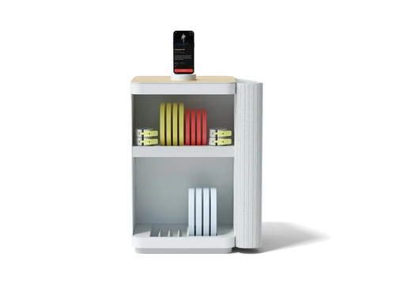
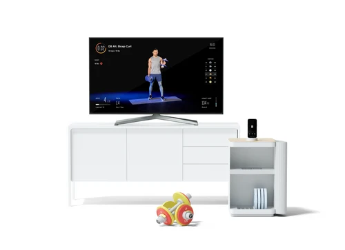
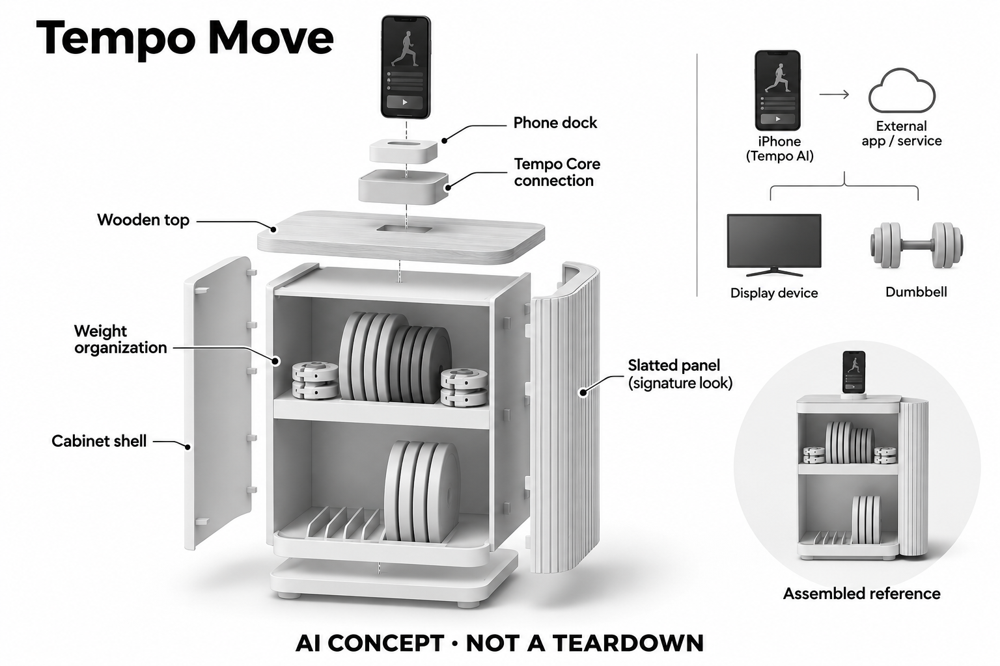

# Tempo Move

**Tempo** · 运动与训练 · 核查 2026-11-04

借助手机视觉的紧凑家庭力量套件

消费渠道：个人零售。

## 产品图片与结构参考

### 产品图

Tempo Move官方产品外形图 · 来源：[Tempo · 官方产品图片](<https://shop.tempo.fit/collections/move>) · [原始图片](<https://shop.tempo.fit/cdn/shop/products/New-Carousel-Light_500x500.jpg?v=1652359728>)

### 参考图

Tempo Move官方另一角度或使用场景参考 · 来源：[Tempo · 官方产品图片](<https://shop.tempo.fit/collections/move>) · [原始图片](<https://shop.tempo.fit/cdn/shop/products/1.PDPCarouselMoveLightTVcabinet_500x500.png?v=1638109643>)

### AI 生成爆炸示意

**AI 生成 · 非实物拆机。** 内部为概念推断，不能作为元件布局、BOM 或维修依据。[生成提示词](../../content/hardware/prompts/tempo-move.txt)

> 外形依据核验参考图；内部位置、模块形状与装配关系仅作AI概念展示。

> 已逐张查看并核对型号。源图未改色/裁切；场景、界面、附件、优惠及效果文案仅为厂商示意，不作为本目录性能或现价依据。

> 分析为基于公开资料的案头研究与 AI 辅助判断，未经用户访谈、销量审计或实物拆机。需求、画像、竞争冷门度、审美及商业机会均为研究假设，不是投资结论。

## 销售与购买

- 状态：在售。官方Move集合页中Light/MagSafe配置显示US$985与Add to Cart，部分其他配置仅Waitlist。仅计同一Move硬件系统一次，不计配色与器械套装。

- 地区：美国官方销售地区（具体配送地址结算确认）

- 价格：可购MagSafe配置所见 US$985。同页部分较便宜Lightning配置仅Waitlist，不用于本条在售结论；实际套装与会员时长以结算确认。

- 中国大陆：本次核实海外官方渠道，未确认同型号中国大陆官方销售、安装和完整软件服务。支持中文或品牌来自中国均不等同大陆可购买。

- [官方产品 / 商店](<https://shop.tempo.fit/collections/move>)

## AI 的实际作用

手机摄像头与Tempo AI识别动作、重量和次数，形成实时指导及个性化训练建议。

服务与联网依赖：需要兼容iPhone、Tempo Core连接配件、显示设备与有效会员；柜体与哑铃没有被声称内置大模型，是硬件套件加手机计算。

## 是否冷门

竞争密集（研究判断）：依据用途与替代品的案头分类；不是销量、市场份额或用户访谈结论。

## 需求与市场

需求假设：已有兼容手机和电视的人，希望以较小体积获得视觉训练反馈。需要比较整套准备时间、镜头摆放与自由重量练习便利度，不能把使用手机算力简单视作完整系统成本很低。

### 需求假设：复用已有手机与电视获得反馈 · 研究判断

Tempo Move针对已经有兼容手机和显示设备的人，希望保留自由重量训练，同时减少为专用大屏和感知主机投入空间。需求需要验证整套连接是否比普通手机跟练更顺畅，而不是只看柜体更小；复用设备也会引入占用、兼容和摆放步骤。

依据：[Tempo Move官方销售集合](<https://shop.tempo.fit/collections/move>) · [Tempo Move官方FAQ](<https://support.tempo.fit/support/solutions/articles/151000154612-tempo-move-faqs>)

### 价值判断：套件价值不能只归于手机算力 · 研究判断

手机承担视觉输入与计算，Core和器械套件组织连接、摆放与可识别训练，价值可能来自完整流程而非单一AI功能。应比较普通哑铃加手机已经能完成什么，不能把调用手机相机等同没有硬件价值，也不能反过来把所有手机能力归给柜体。

依据：[Tempo Move官方FAQ](<https://support.tempo.fit/support/solutions/articles/151000154612-tempo-move-faqs>)

### 验证方案：从普通家庭跟练路径开始 · 待验证

让已有手机和电视的用户用原有器材、再用Move完成同一课程，记录取手机、连接、摆放、训练与恢复客厅的步骤。观察反馈是否值得新增准备，不为演示预先配置好全部设备，也不以一次训练顺利或短期成绩证明系统效果。

依据：[Tempo Move官方销售集合](<https://shop.tempo.fit/collections/move>) · [Tempo Move官方FAQ](<https://support.tempo.fit/support/solutions/articles/151000154612-tempo-move-faqs>)

## 用户画像

画像推断：空间有限、已有兼容iPhone、喜欢跟练的家庭用户更匹配。安卓用户或没有合适显示设备的人会遇到不同门槛；软件会员与设备兼容条件应先于柜体外观进入选择。

### 画像假设：兼容设备与固定训练习惯交集 · 研究判断

较匹配者拥有兼容iPhone与可用显示设备，愿意在训练时占用手机，并需要视觉反馈。安卓用户或不愿连接电视的人面对不同门槛，画像不能只按空间有限划分，手机版本、家庭共享与实际课程频率都影响这套组合是否方便。

依据：[Tempo Move官方FAQ](<https://support.tempo.fit/support/solutions/articles/151000154612-tempo-move-faqs>)

### 使用约束：手机同时承担其他生活任务 · 研究判断

训练期间手机可能仍被用于联系、记录或其他应用，用户是否愿意固定在底座上需要观察。家庭电视也可能由他人使用，整套系统的准备取决于多个设备可用，不能把柜体收纳体积小解释为随时可以在任何地方开始训练。

依据：[Tempo Move官方FAQ](<https://support.tempo.fit/support/solutions/articles/151000154612-tempo-move-faqs>)

### 访谈重点：原有手机跟练卡在哪里 · 待验证

请用户展示最近一次用手机训练的流程，说明镜头摆放、看屏、器械管理或反馈理解哪一步最麻烦，再观察Move是否真正改善。若原有方案已经足够，也应记录，不能把拥有兼容设备自动视为愿意购买专用套件的用户。

依据：[Tempo Move官方销售集合](<https://shop.tempo.fit/collections/move>) · [Tempo Move官方FAQ](<https://support.tempo.fit/support/solutions/articles/151000154612-tempo-move-faqs>)

## 竞争与替代

案头判断：与普通哑铃加手机课程及其他视觉训练App高度重叠，属于成熟需求上的组合方案。没有销量或访谈证据支持套件更容易坚持；颜色、连接接口和配重包不重复算产品。

### 替代方案：普通哑铃与视觉训练应用 · 研究判断

Move与手机课程、视觉训练应用及简单器械收纳高度重叠，同时也是专用健身屏的较分散方案。比较应围绕准备与反馈任务，不能只以硬件体积或起价判断便宜，也不把手机算法服务的存在当作这套实物组合具有独占能力。

依据：[Tempo Move官方销售集合](<https://shop.tempo.fit/collections/move>) · [Tempo Move官方FAQ](<https://support.tempo.fit/support/solutions/articles/151000154612-tempo-move-faqs>)

### 差异判断：复用与专用之间的具体取舍 · 研究判断

与Studio相比，Move依赖用户手机和外部显示，减少专用主机同时增加兼容与连接要求；两者不是同一硬件换外壳。研究应观察用户是否更愿意管理已有设备，而不是预先认定复用更好，也不能移植Studio的三维传感器参数。

依据：[Tempo Move官方FAQ](<https://support.tempo.fit/support/solutions/articles/151000154612-tempo-move-faqs>)

### 比较方法：以完整拥有流程衡量 · 待验证

在相同课程和器械任务下比较普通手机、Move与专用站点，记录每次准备、账户、连接和收纳，核对需要额外购买什么。不要只比较训练开始之后的画面，也不将不同套餐的配件数量当作AI差异，真实成本包括兼容设备和服务。

依据：[Tempo Move官方销售集合](<https://shop.tempo.fit/collections/move>) · [Tempo Move官方FAQ](<https://support.tempo.fit/support/solutions/articles/151000154612-tempo-move-faqs>)

## 供应链

官方确认器械柜、自由重量和手机连接底座，AI感知使用外部手机。柜体工厂、配件制造与软件基础设施供应商未披露，不能把手机相机性能当作套件自己的芯片或传感器规格。

### 功能拆分：感知与计算位于外部手机 · 研究判断

官方FAQ明确兼容手机摄像头负责观察，Core连接配件、自由重量和柜体组织训练，电视或显示屏呈现内容。柜体没有被披露内置大模型或专用相机，不能把手机的传感器和处理器写入套件BOM，软件服务仍是完整体验的一部分。

依据：[Tempo Move官方FAQ](<https://support.tempo.fit/support/solutions/articles/151000154612-tempo-move-faqs>)

### 制造判断：套件重点在连接和物理一致性 · 研究判断

相较专用感知主机，Move需要关注底座固定、连接兼容、器械识别与收纳，手机升级又可能改变使用条件。供应评估不应只估算柜体材料，本轮未取得配件工厂、接口电路或软件基础设施清单，也不由外观相似推断代工关系。

依据：[Tempo Move官方销售集合](<https://shop.tempo.fit/collections/move>) · [Tempo Move官方FAQ](<https://support.tempo.fit/support/solutions/articles/151000154612-tempo-move-faqs>)

### 候选选型：限定到连接与结构模块 · 研究判断

群光公开输入外设和电子整合方向，可作为Core相关接口工程候选，瑞声可讨论底座与收纳周边精密结构。两者均需确认具体接口与机械范围，不能把手机相机当作套件供应需求，也没有点名的Move采用证据或现成兼容承诺。

依据：[Tempo Move官方FAQ](<https://support.tempo.fit/support/solutions/articles/151000154612-tempo-move-faqs>)

## 技术路径

AI来自手机视觉追踪、动作识别及反馈服务，硬件套件提供可识别器械和稳定连接场景。需明确算力依赖，不能把Tempo Studio的专用3D传感器或主机参数移植到Move。

### 已披露能力：手机视觉追踪与反馈服务 · 官方资料

Move的动作、次数和重量识别依靠兼容手机与Tempo软件，硬件套件提供连接和训练场景，不能将课程视频本身当作AI。设备、应用与会员共同工作，具体识别模型和误差未完整披露，也不能从手机能力推断所有功能可完全离线使用。

依据：[Tempo Move官方FAQ](<https://support.tempo.fit/support/solutions/articles/151000154612-tempo-move-faqs>)

### 技术判断：手机摆放决定可观察范围 · 研究判断

用户拥有相同型号手机，摆放角度、距离与遮挡不同仍可能改变输入，电视位置也会影响动作区域。研究应先确认摄像头看到什么，再评价提示是否合理，不能把每次识别差异都归为模型好坏，也不假设专用底座自动解决所有环境问题。

依据：[Tempo Move官方FAQ](<https://support.tempo.fit/support/solutions/articles/151000154612-tempo-move-faqs>)

### 验证方案：保持手机与场景条件可追溯 · 待验证

记录兼容型号、系统与应用版本、摆放和课程，再观察动作反馈、次数与重量建议，保留用户理解和实际操作。比较时一次只改变一个条件，避免同时换手机与器械后得出笼统结论，本轮没有识别准确率或训练效果实测。

依据：[Tempo Move官方FAQ](<https://support.tempo.fit/support/solutions/articles/151000154612-tempo-move-faqs>)

## 产品审美

图示观察：小型器械柜适合收纳哑铃，外观可接近普通边几。真正训练时仍需要手机、屏幕和无遮挡动作区；收纳后的体积不能用来代表展开训练所需空间或使用便利度。

### 外形判断：收纳柜接近家具但训练仍需展开 · 研究判断

Move的小型器械柜可以减少哑铃散放，外观接近边几，却不能代表实际训练只占柜体空间。手机、电视、连接与无遮挡动作区仍是完整形态，审美评价应包含这些展开状态，不能只以收纳后的整洁判断日常便利。

依据：[Tempo Move官方销售集合](<https://shop.tempo.fit/collections/move>) · [Tempo Move官方FAQ](<https://support.tempo.fit/support/solutions/articles/151000154612-tempo-move-faqs>)

### 交互判断：多设备状态需要清楚衔接 · 研究判断

用户需要知道手机是否正确连接、显示是否就绪和视觉反馈是否启用，如果每一层都要分别排查，简洁柜体也无法降低复杂度。设计应围绕准备与恢复提供清楚状态，而不是把外部手机依赖隐藏起来，避免购买后才发现额外条件。

依据：[Tempo Move官方FAQ](<https://support.tempo.fit/support/solutions/articles/151000154612-tempo-move-faqs>)

### 体验验证：从日常电视状态进入训练 · 待验证

让用户在真实客厅从正在使用的手机和电视开始配置，完成课程后恢复原有用途，记录线缆、底座和器械整理。再询问是否愿意每次重复这条路径，比从已连接好的演示样机开始更能反映复用方案的优势与负担。

依据：[Tempo Move官方销售集合](<https://shop.tempo.fit/collections/move>) · [Tempo Move官方FAQ](<https://support.tempo.fit/support/solutions/articles/151000154612-tempo-move-faqs>)

## 关键风险

风险包括手机版本兼容、连接准备、动作被遮挡与会员费用。同页有候补配置，不能用最低展示价推断全部可买；AI建议没有独立实测保证，也不能代替对疼痛或身体异常的专业判断。

### 兼容风险：手机更新可能改变完整体验 · 研究判断

Move依赖兼容手机、连接配件、显示与会员，任何一层变化都需要重新确认，不能把套件可长期保存视为软件永远兼容。用户升级手机或共享电视的情况应纳入研究，具体版本按官方资料核对，本轮不提供跨设备无条件支持保证。

依据：[Tempo Move官方FAQ](<https://support.tempo.fit/support/solutions/articles/151000154612-tempo-move-faqs>)

### 购买与训练风险：配置和建议需分别确认 · 研究判断

销售集合同时有可购与候补配置，不能用最低展示价推断所有组合能立即买到，附件与会员也要核对。动作和重量建议仍需结合个人状态，不作为医学或康复判断，本轮没有实机测试，也不将视觉反馈描述为避免受伤的保证。

依据：[Tempo Move官方销售集合](<https://shop.tempo.fit/collections/move>) · [Tempo Move官方FAQ](<https://support.tempo.fit/support/solutions/articles/151000154612-tempo-move-faqs>)

### 验证安排：记录准备失败与主动放弃 · 待验证

试用应保留无法连接、画面遮挡、电视被占用或用户不愿拿手机出来的情况，区分技术与家庭流程问题。不要只分析成功启动的课程，也不把未持续使用全部归因于训练意愿，复用设备带来的协调成本本身就是价值边界。

依据：[Tempo Move官方FAQ](<https://support.tempo.fit/support/solutions/articles/151000154612-tempo-move-faqs>)

## 机会与验证

市场差异在于复用个人手机计算与家居化器械收纳。尚待验证的购买理由是专用套件能否减少普通手机跟练的准备摩擦，以及用户升级手机后能否保持兼容和历史训练连续性。

### 研究方向：减少手机跟练的具体摩擦 · 研究判断

Move代表的机会是围绕已有手机与器械组织更稳定流程，可能位于连接、收纳、摆放和反馈解释。应先证明这些实物模块比普通支架与哑铃多解决了什么，而不是因为用了手机算力就假定低成本或轻量硬件天然有市场。

依据：[Tempo Move官方FAQ](<https://support.tempo.fit/support/solutions/articles/151000154612-tempo-move-faqs>)

### 执行计划：观察多次准备与设备变化 · 待验证

连续记录用户启动训练、连接成功、采用反馈及恢复客厅的步骤，访谈一次放弃训练或改用普通课程的事件。将兼容设备、会员和器械价值分别分析，也要了解换手机后的预期，不用首次开箱满意度代替长期使用与维护证据。

依据：[Tempo Move官方销售集合](<https://shop.tempo.fit/collections/move>) · [Tempo Move官方FAQ](<https://support.tempo.fit/support/solutions/articles/151000154612-tempo-move-faqs>)

### 决策边界：组合创新需要可见的流程收益 · 研究判断

复用外部设备可以形成不同交付方式，但是否值得专用套件与持续会员取决于重复任务中的收益。候选供应商只说明接口和结构可能如何实现，本轮没有访谈、销量或留存资料，不以柜体体积、套餐价格或模型评分预测商业成功。

依据：[Tempo Move官方销售集合](<https://shop.tempo.fit/collections/move>) · [Tempo Move官方FAQ](<https://support.tempo.fit/support/solutions/articles/151000154612-tempo-move-faqs>)

## 对应供应链公司

能力候选用于选型研究，不代表本产品实际采用；未公开的供货关系不作推断。

- [chicony](../supply-chain/chicony.md) — **能力候选 · 非已采用** / 手机连接底座的电子接口工程候选：群光公开输入外设与电子产品整合业务，可作为Tempo Core连接周边的工程候选，但本轮未取得Core具体接口、电路及授权要求，必须进一步核验。该关联不包含手机相机供应，也不证明群光实际制造Move或具有现成兼容底座。

- [aac-technologies](../supply-chain/aac-technologies.md) — **能力候选 · 非已采用** / 手机固定底座与套件结构候选：瑞声公开精密结构能力，可用于讨论Move手机固定与连接周边的机械实现，但大型器械柜和承重收纳不能据此默认由其承接，实际装配与耐久需确认。当前没有点名供货证据，也不能将手机自身的结构件供应关系移植到该套件。

[浏览供应链目录](../supply-chain.md)

## 功能分层示意

这是功能关系，不是实物拆机、真实空间结构或已核实 BOM。

1. **外部视觉输入**：兼容iPhone摄像头负责观察，不是柜体自带摄像头。（官方披露）

2. **物理训练套件**：自由重量、收纳柜与Core底座组织家庭训练。（官方披露）

3. **AI分析**：Tempo软件识别动作、次数和重量并给出反馈。（官方披露）

4. **显示与会员**：电视/显示屏和有效会员提供完整体验。（官方披露）

5. **训练复盘**：App承接历史与计划，用户判断是否采纳建议。（官方披露）

## 来源

1. [Tempo Move官方销售集合](<https://shop.tempo.fit/collections/move>) — 已打开，区分Add to Cart与Waitlist配置，选择实际可购的MagSafe配置。

2. [Tempo Move官方FAQ](<https://support.tempo.fit/support/solutions/articles/151000154612-tempo-move-faqs>) — 已打开，明确Core、手机相机与电视的依赖。

[返回目录](../hardware-market.md) · [网页分析](https://romanagent.github.io/Roman/#hardware/product/tempo-move)
