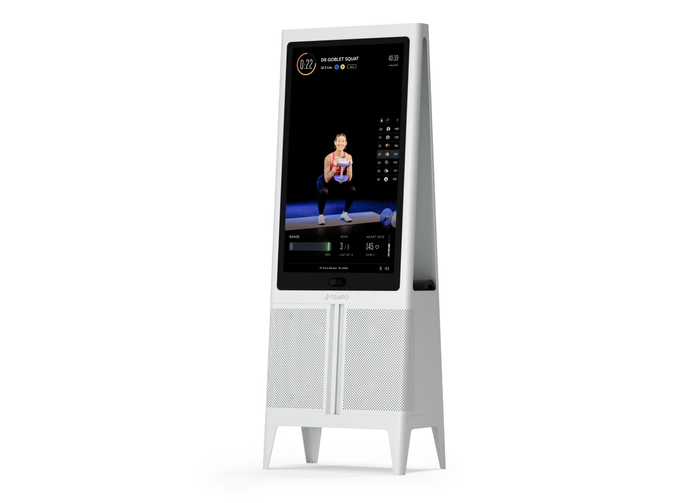
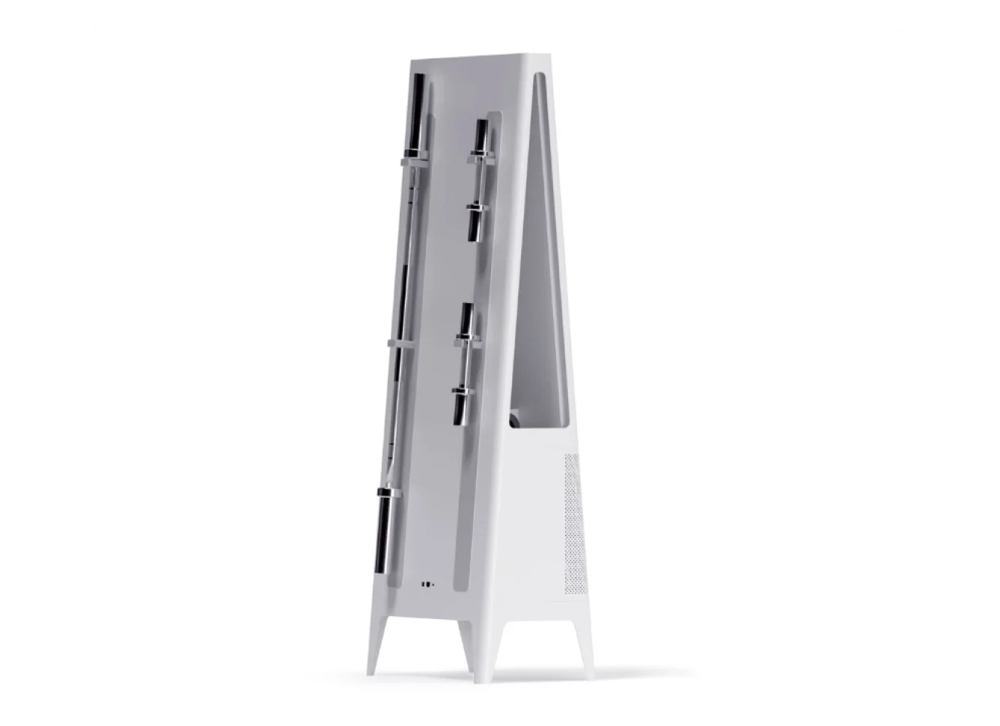
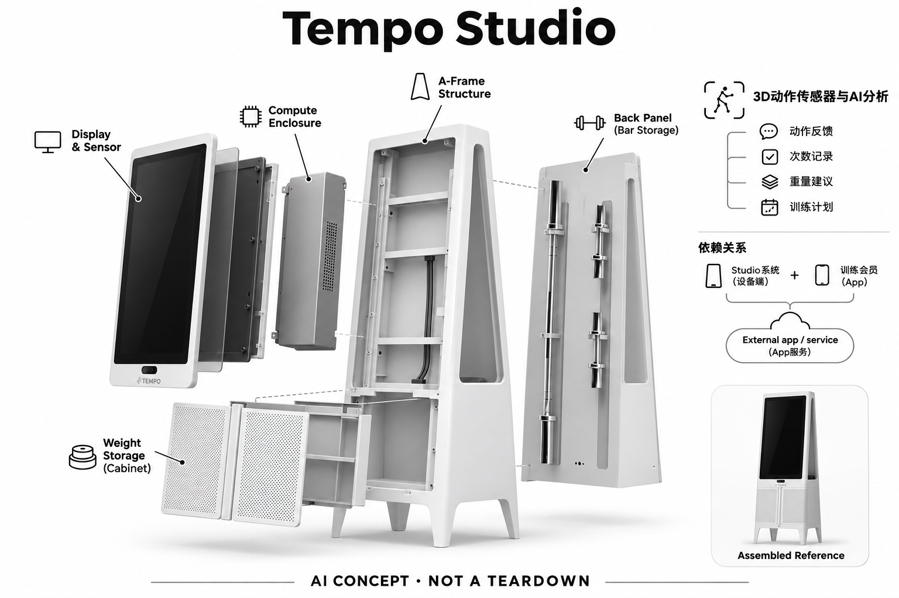

# Tempo Studio

**Tempo** · 运动与训练 · 核查 2026-11-04

用三维动作感知辅助自由重量训练

消费渠道：个人零售。

## 产品图片与结构参考

### 产品图

Tempo Studio官方产品外形图 · 来源：[Tempo · 官方产品图片](<https://shop.tempo.fit/>) · [原始图片](<https://shop.tempo.fit/cdn/shop/products/3_Frame-Light_6cd47186-3903-4672-9a7b-41242dfe1bf2_1700x1700.jpg?v=1653066256>)

### 参考图

Tempo Studio官方另一角度或使用场景参考 · 来源：[Tempo · 官方产品图片](<https://shop.tempo.fit/>) · [原始图片](<https://shop.tempo.fit/cdn/shop/products/4_Back-Storage-Light_e91f1f74-b03d-4c92-a35b-45ba5409ec6e_1700x1700.jpg?v=1653066256>)

### AI 生成爆炸示意

**AI 生成 · 非实物拆机。** 内部为概念推断，不能作为元件布局、BOM 或维修依据。[生成提示词](../../content/hardware/prompts/tempo-studio.txt)

> 外形依据核验参考图；内部位置、模块形状与装配关系仅作AI概念展示。

> 已逐张查看并核对型号。源图未改色/裁切；场景、界面、附件、优惠及效果文案仅为厂商示意，不作为本目录性能或现价依据。

> 分析为基于公开资料的案头研究与 AI 辅助判断，未经用户访谈、销量审计或实物拆机。需求、画像、竞争冷门度、审美及商业机会均为研究假设，不是投资结论。

## 销售与购买

- 状态：在售。官方商城仍列Studio Starter及其他套餐，显示Add to cart和通常2–4周配送说明；可购买主体为家庭Studio系统。

- 地区：美国官方销售地区（具体配送地址结算确认）

- 价格：US$2,495 起。基础Studio硬件套装所见价；送装、税费和训练会员另计，附加器械套餐不重复计数。

- 中国大陆：本次核实海外官方渠道，未确认同型号中国大陆官方销售、安装和完整软件服务。支持中文或品牌来自中国均不等同大陆可购买。

- [官方产品 / 商店](<https://shop.tempo.fit/>)

## AI 的实际作用

3D动作传感器与AI分析用于动作反馈、次数记录、重量建议及训练计划。

服务与联网依赖：需Studio系统和训练会员；设备的三维感知与App服务共同工作，不能把屏幕里的教练视频本身当作AI。

## 是否冷门

竞争密集（研究判断）：依据用途与替代品的案头分类；不是销量、市场份额或用户访谈结论。

## 需求与市场

需求假设：用户保留自由重量训练方式，但希望在没有现场教练时获得动作反馈。价值在于能否识别常见动作与错误、帮助复盘；跟着视频练和收到准确个体反馈是两种不同需求。

## 用户画像

画像推断：偏好哑铃杠铃且愿意清出完整拍摄空间的家庭用户更匹配。多人同时进入画面、空间遮挡或偏离课程动作可能改变体验，不能仅凭家用定位推断所有居住环境都适合。

## 竞争与替代

案头判断：与健身镜、手机视觉训练软件和自由重量课程竞争，内容与感知质量共同重要。没有销量或访谈证据证明大屏优于手机；相似套餐的配件数量不应被算成多个AI产品。

## 供应链

官方披露三维动作感知、屏幕和器械收纳，传感器供应商、整机工厂及算法标定细节本次不明。推断制造之外还需内容动作库和环境适配，不应单凭主机外形估计物料成本。

## 技术路径

可确认AI是依据3D动作数据形成的实时反馈与建议，并非显示课程视频的普通屏幕。具体识别模型和训练覆盖范围未完整公开；重量建议及动作提示应作为可复查辅助信息。

## 产品审美

图示观察：落地屏与下方器械柜形成家居化训练站，器械收纳降低散乱感。大屏尺寸与整体重量也意味着固定空间投入；照片不能代替真实动作区、光线和家庭通行路线评估。

## 关键风险

风险集中在动作遮挡、识别边界、会员持续服务和大件搬运安装。反馈可能遗漏动作问题，重量建议也未必适合当日状态；本研究没有实测识别准确率或任何体能改善效果。

## 机会与验证

市场差异是自由重量与视觉感知结合，而不是用电机替代配重。尚待验证的购买理由是动作反馈能否持续指导练习，以及用户是否愿意为专用传感器和大屏承担高于手机方案的成本。

## 功能分层示意

这是功能关系，不是实物拆机、真实空间结构或已核实 BOM。

1. **动作输入**：3D传感器观察用户动作，功能图非拆机。（官方披露）

2. **器械交互**：自由重量由用户操控，系统识别训练表现。（官方披露）

3. **AI反馈**：动作、次数与重量建议由感知软件产生。（官方披露）

4. **内容与账户**：会员课程和家庭账户组织训练。（官方披露）

5. **查看复盘**：屏幕及App展示反馈和历史表现。（官方披露）

## 来源

1. [Tempo官方商城Studio](<https://shop.tempo.fit/>) — 已打开，Studio套餐、Add to cart和配送可见。

2. [Tempo官方Studio介绍](<https://buy.tempo.fit/cost-compare/>) — 已打开，3D传感器与AI动作/重量/计划指导说明；不以营销保证作效果证据。

[返回目录](../hardware-market.md) · [网页分析](https://romanagent.github.io/Roman/#hardware/product/tempo-studio)
