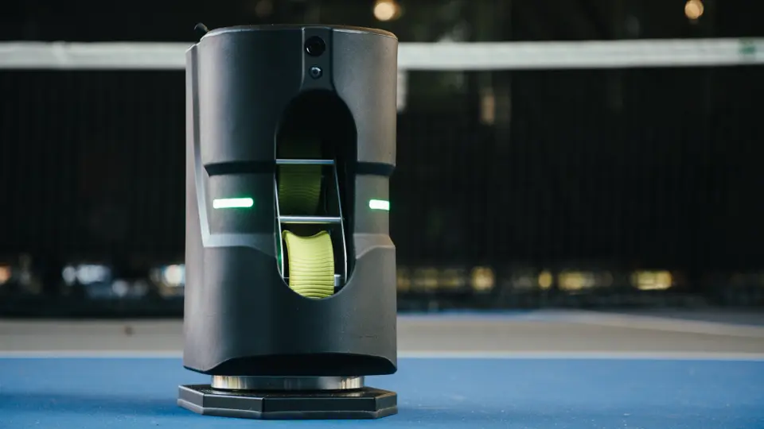
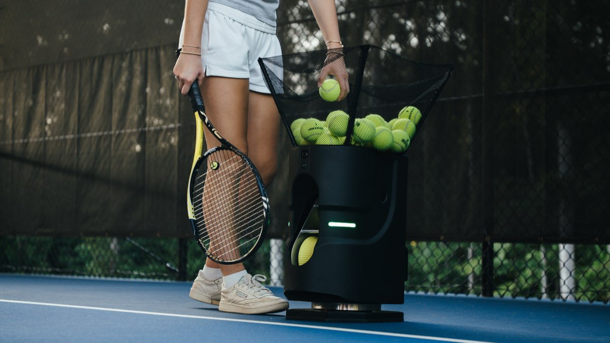
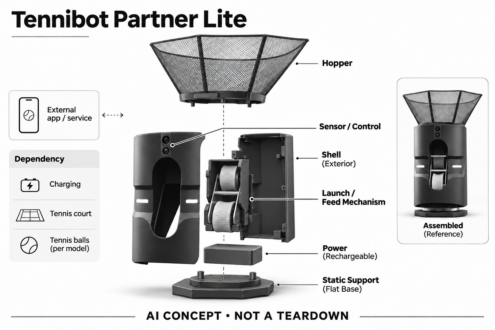

# Tennibot Partner Lite

**Tennibot** · 运动与训练 · 核查 2026-11-04

个人球场训练中的AI出球与视觉跟踪

消费渠道：个人零售。

## 产品图片与结构参考

### 产品图

Tennibot Partner Lite官方产品外形图 · 来源：[Tennibot · 官方产品图片](<https://www.tennibot.com/>) · [原始图片](<https://www.tennibot.com/.netlify/images?url=_astro%2Ftennibot-partner-lite.B4r_jHma.jpg&w=960>)

### 参考图

Tennibot Partner Lite官方另一角度或使用场景参考 · 来源：[Tennibot · 官方产品图片](<https://www.tennibot.com/tennis/ball-machine/lite/>) · [原始图片](<https://www.tennibot.com/images/lite/tennis-court.jpg>)

### AI 生成爆炸示意

**AI 生成 · 非实物拆机。** 内部为概念推断，不能作为元件布局、BOM 或维修依据。[生成提示词](../../content/hardware/prompts/tennibot-partner-lite.txt)

> 外形依据核验参考图；内部位置、模块形状与装配关系仅作AI概念展示。

> 已逐张查看并核对型号。源图未改色/裁切；场景、界面、附件、优惠及效果文案仅为厂商示意，不作为本目录性能或现价依据。

> 分析为基于公开资料的案头研究与 AI 辅助判断，未经用户访谈、销量审计或实物拆机。需求、画像、竞争冷门度、审美及商业机会均为研究假设，不是投资结论。

## 销售与购买

- 状态：在售。当前官网具体型号页列美元价格、面向个人球员的用途和Buy now；已打开对应Stripe嵌入式Checkout入口，未填资料或支付。

- 地区：所列官方区域或授权零售渠道；配送地址与服务支持需结算确认

- 价格：US$1,525。核查日所见单机或基本配置价；币种、促销、税费、镜片、附件及服务依地区结算，不把颜色或套装重复计数。

- 中国大陆：本次未核实该具体型号在中国大陆的官方销售和完整服务支持；海外在售不等于国内可直接启用全部功能。

- [官方产品 / 商店](<https://www.tennibot.com/tennis/ball-machine/lite/>)

## AI 的实际作用

厂家说明保留Partner的AI相机、定制训练和出球策略，但没有V2自动移动底座

服务与联网依赖：需要充电、配套App与适合的球场；按官网型号选择网球配置。AI训练和OTA在当前说明中包含，未来变更及地区支持仍需核对

## 是否冷门

新兴竞争（研究判断）：按任务与形态作案头分类，无访谈、销量或市场份额证据。

## 需求与市场

需求假设：希望保留位置识别和自定义训练，同时减少自行移动底盘的价格和搬运负担。价值应由实际使用频率、任务完成与操作负担验证，不能把AI功能存在或演示流畅当作需求已得到满足。

## 用户画像

画像推断：可经常使用网球场、愿意自行运输和维护设备的个人爱好者或个人教练。个人的语言、操作习惯、环境和预算会改变适配结果，本次只有案头研究，没有用户访谈或长期使用观察。

## 竞争与替代

案头判断：与传统发球机、手动拾球篮和真人陪练竞争，移动发球、固定发球与拾球是不同机械用途；没有按球色或附件凑数。这只是用途与替代品比较，不是市场份额或销量结论；专业细分和较少曝光也不代表没有成熟竞争者。

## 供应链

厂家当前官网明确设计、制造及支持位于美国阿拉巴马州Auburn；这能支持生产地区描述，但未披露具体装配工序或模块供应商。视觉标定、运动控制与球场适应性可作为制造关注点，不据此推定BOM或良率。

## 技术路径

厂家说明保留Partner的AI相机、定制训练和出球策略，但没有V2自动移动底座。这是厂商披露的功能机制；模型版本、准确率及内部结构未完整公开。架构只表示输入、处理和输出关系，不作为真实拆机或性能实测。

## 产品审美

图示观察：固定底部比V2少移动结构，视觉上仍是带球斗的专用训练器。宣传图片只能帮助理解外观和摆放方式，不能证明每个人的舒适度、长时使用体验或实际材料触感。

## 关键风险

自动移动或出球可能与场地使用者相互干扰，需按说明设定边界并监督；AI轨迹识别不能保证所有球面和遮挡环境可靠。还需核对地区功能、软件更新与售后边界；本目录未进行实机、医学或可靠性测试，不把厂商演示当作结果保证。

## 机会与验证

市场差异主要在于个人球场训练中的AI出球与视觉跟踪。值得进一步验证的购买理由是它能否减少既有任务中的具体步骤，以及硬件、服务与维护的总成本是否符合个人使用频率。

## 功能分层示意

这是功能关系，不是实物拆机、真实空间结构或已核实 BOM。

1. **实体输入**：上置球斗、发球机构、AI相机与固定支撑底部；仅功能层示意，非拆机。（官方披露）

2. **采集与控制**：设备把输入转为可处理的信息并接收用户操作；具体内部布局未知。（分析推断）

3. **AI功能**：厂家说明保留Partner的AI相机、定制训练和出球策略，但没有V2自动移动底座（官方披露）

4. **服务依赖**：需要充电、配套App与适合的球场；按官网型号选择网球配置。AI训练和OTA在当前说明中包含，未来变更及地区支持仍需核对（官方披露）

5. **用户反馈**：用户通过声音、屏幕或配套应用接收结果，并对重要信息复核。（分析推断）

## 来源

1. [Tennibot Partner Lite官方型号与购买入口](<https://www.tennibot.com/tennis/ball-machine/lite/>) — 已打开一手页面；产品能力为厂商披露，未进行实机或效果验证。

2. [Tennibot官方系列比较](<https://www.tennibot.com/>) — 已打开一手页面；产品能力为厂商披露，未进行实机或效果验证。

3. [Tennibot官方Rally功能](<https://www.tennibot.com/rally/>) — 已打开一手页面；产品能力为厂商披露，未进行实机或效果验证。

[返回目录](../hardware-market.md) · [网页分析](https://romanagent.github.io/Roman/#hardware/product/tennibot-partner-lite)
