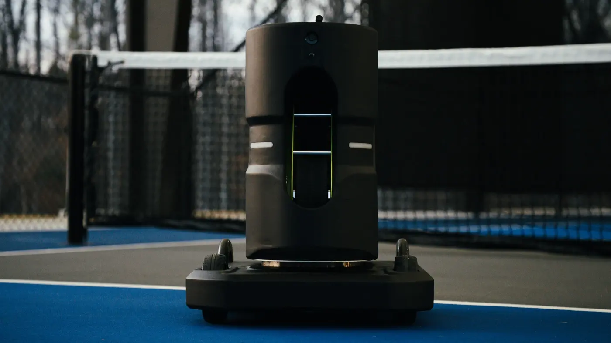
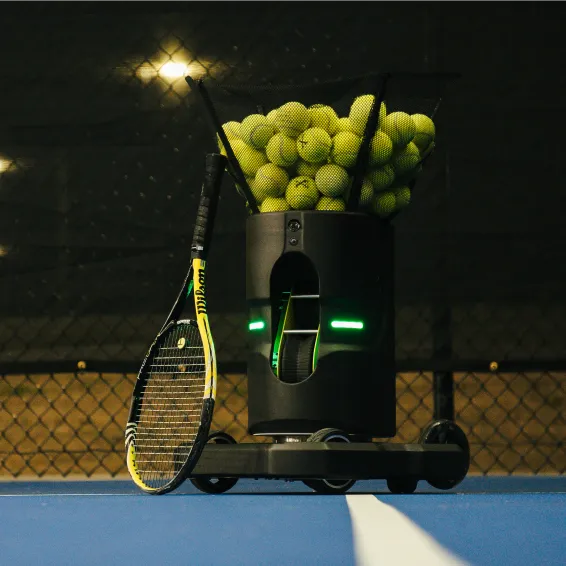
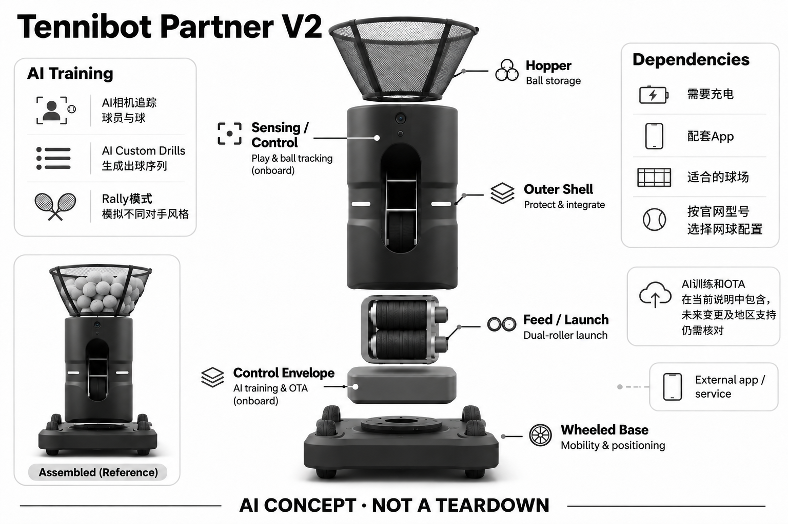

# Tennibot Partner V2

**Tennibot** · 运动与训练 · 核查 2026-11-04

个人球场训练中的AI出球与视觉跟踪

消费渠道：个人零售。

## 产品图片与结构参考

### 产品图

Tennibot Partner V2官方产品外形图 · 来源：[Tennibot · 官方产品图片](<https://www.tennibot.com/>) · [原始图片](<https://www.tennibot.com/.netlify/images?url=_astro%2Ftennibot-partner-product.fIN7H3FP.jpeg&w=1400>)

### 参考图

Tennibot Partner V2官方另一角度或使用场景参考 · 来源：[Tennibot · 官方产品图片](<https://www.tennibot.com/tennis/ball-machine/>) · [原始图片](<https://www.tennibot.com/images/v2/tennistennibotpartnerplaying.webp>)

### AI 生成爆炸示意

**AI 生成 · 非实物拆机。** 内部为概念推断，不能作为元件布局、BOM 或维修依据。[生成提示词](../../content/hardware/prompts/tennibot-partner-v2.txt)

> 外形依据核验参考图；内部位置、模块形状与装配关系仅作AI概念展示。

> 已逐张查看并核对型号。源图未改色/裁切；场景、界面、附件、优惠及效果文案仅为厂商示意，不作为本目录性能或现价依据。

> 分析为基于公开资料的案头研究与 AI 辅助判断，未经用户访谈、销量审计或实物拆机。需求、画像、竞争冷门度、审美及商业机会均为研究假设，不是投资结论。

## 销售与购买

- 状态：在售。当前官网具体型号页列美元价格、面向个人球员的用途和Buy now；已打开对应Stripe嵌入式Checkout入口，未填资料或支付。

- 地区：所列官方区域或授权零售渠道；配送地址与服务支持需结算确认

- 价格：US$2,275。核查日所见单机或基本配置价；币种、促销、税费、镜片、附件及服务依地区结算，不把颜色或套装重复计数。

- 中国大陆：本次未核实该具体型号在中国大陆的官方销售和完整服务支持；海外在售不等于国内可直接启用全部功能。

- [官方产品 / 商店](<https://www.tennibot.com/tennis/ball-machine/>)

## AI 的实际作用

AI相机追踪球员与球，AI Custom Drills生成出球序列，Rally模式模拟不同对手风格

服务与联网依赖：需要充电、配套App与适合的球场；按官网型号选择网球配置。AI训练和OTA在当前说明中包含，未来变更及地区支持仍需核对

## 是否冷门

新兴竞争（研究判断）：按任务与形态作案头分类，无访谈、销量或市场份额证据。

## 需求与市场

需求假设：独自练球时希望来球来自不同场地位置，使脚步和判断不局限于固定机位。价值应由实际使用频率、任务完成与操作负担验证，不能把AI功能存在或演示流畅当作需求已得到满足。

### 需求假设：来球方向不只来自固定一点 · 研究判断

Partner V2的移动底座让发球位置可以改变，针对独自练球时希望面对更多空间变化的人。需求应区别于固定球机仅调整落点，用户是否需要机器在场地移动、是否愿意管理这些变化，都必须验证，不能把移动能力本身视为更像真人陪练。

依据：[Tennibot Partner V2官方型号与购买入口](<https://www.tennibot.com/tennis/ball-machine/>) · [Tennibot官方系列比较](<https://www.tennibot.com/>)

### 价值判断：变化要服务练习而非制造新奇 · 研究判断

出球位置、序列和对手风格模拟可能增加练习选择，也可能让用户难以控制目标。研究应观察变化是否符合当前练习任务，不能把更不可预测当作更有效，也不将Rally名称理解为机器已经完整感知并回应真实网球对抗。

依据：[Tennibot Partner V2官方型号与购买入口](<https://www.tennibot.com/tennis/ball-machine/>) · [Tennibot官方Rally功能](<https://www.tennibot.com/rally/>)

### 验证方案：比较固定和移动来源的同一练习 · 待验证

让规律球员为一次训练设定明确目标，再比较固定机位与V2移动发球，记录判断、移动、等待和人工调整。保持任务一致并遵守场地与使用要求，不只展示机器沿路线移动，也不以短期击球成绩证明训练提升。

依据：[Tennibot Partner V2官方型号与购买入口](<https://www.tennibot.com/tennis/ball-machine/>) · [Tennibot官方Rally功能](<https://www.tennibot.com/rally/>)

## 用户画像

画像推断：可经常使用网球场、愿意自行运输和维护设备的个人爱好者或个人教练。个人的语言、操作习惯、环境和预算会改变适配结果，本次只有案头研究，没有用户访谈或长期使用观察。

### 画像假设：愿意管理复杂球场设备的个人 · 研究判断

较匹配者经常单独练球或从事个人教学，有稳定场地和搬运条件，并愿意学习移动机器的配置。偶尔练习或只需重复喂球的人可能更重视固定方案，画像应包含使用频率与设备管理，而不是仅用进阶球员或科技爱好者概括。

依据：[Tennibot Partner V2官方型号与购买入口](<https://www.tennibot.com/tennis/ball-machine/>) · [Tennibot官方系列比较](<https://www.tennibot.com/>)

### 使用约束：场地共享影响移动价值 · 研究判断

即使个人拥有设备，也未必能自由安排整个球场，其他使用者、器材和练习路线会限制移动。研究需要了解场地规则、准备时间和监督责任，不能从空场宣传视频推断所有公共或共享场地适用，也不假设机器会自动处理全部干扰。

依据：[Tennibot Partner V2官方型号与购买入口](<https://www.tennibot.com/tennis/ball-machine/>)

### 访谈重点：哪种来源变化值得付费 · 待验证

请球员指出当前固定球机无法满足的具体练习，说明需要改变出球地点还是只需调整落点和节奏。若只是希望训练有趣，也应如实记录，不能将娱乐吸引力包装成竞技效果，只有明确任务才能判断移动底座的实际价值。

依据：[Tennibot Partner V2官方型号与购买入口](<https://www.tennibot.com/tennis/ball-machine/>) · [Tennibot官方Rally功能](<https://www.tennibot.com/rally/>)

## 竞争与替代

案头判断：与传统发球机、手动拾球篮和真人陪练竞争，移动发球、固定发球与拾球是不同机械用途；没有按球色或附件凑数。这只是用途与替代品比较，不是市场份额或销量结论；专业细分和较少曝光也不代表没有成熟竞争者。

### 替代方案：固定发球、手动移机与真人 · 研究判断

Partner V2与固定球机、人工移动球机和真人陪练竞争，移动来源是其中可讨论的差异。真人还能提供观察、交流和现场判断，设备不能自动替代这些部分；比较应按一段练习的任务与总工作量，而不是以机械自由度给所有方案排名。

依据：[Tennibot Partner V2官方型号与购买入口](<https://www.tennibot.com/tennis/ball-machine/>) · [Tennibot官方Rally功能](<https://www.tennibot.com/rally/>)

### 差异判断：移动与视觉是两条独立收益 · 研究判断

AI相机和训练序列即使在固定机位也可能有用，移动底座增加的是场地位置变化，二者不能混作一个优势。应分别观察视觉策略与移动被采用的频率，不能因为用户喜欢出球算法就推断愿意承担自动底座的价格、运输和维护。

依据：[Tennibot Partner V2官方型号与购买入口](<https://www.tennibot.com/tennis/ball-machine/>) · [Tennibot官方系列比较](<https://www.tennibot.com/>)

### 比较方法：按整个练习周期计算代价 · 待验证

记录到场布置、视觉准备、机器移动、发球、捡球和收纳，比较V2与固定方案完成相同目标的负担。将人工接管和无用变化也纳入，不把持续自动运行时间当作全部价值，更不将Rally模拟风格与真实对手水平直接等同。

依据：[Tennibot Partner V2官方型号与购买入口](<https://www.tennibot.com/tennis/ball-machine/>) · [Tennibot官方Rally功能](<https://www.tennibot.com/rally/>)

## 供应链

厂家当前官网明确设计、制造及支持位于美国阿拉巴马州Auburn；这能支持生产地区描述，但未披露具体装配工序或模块供应商。视觉标定、运动控制与球场适应性可作为制造关注点，不据此推定BOM或良率。

### 已披露范围：生产地区与模块来源分开 · 研究判断

原目录已核查厂家说明设计、制造和支持位于美国Auburn，这支持地区描述，却不能推断所有零件都在当地生产。视觉、发球机构和移动底盘的具体供应商、装配工序与物料未披露，不能从地区标签计算成本或自动认定供应链完整本地化。

依据：[Tennibot Partner V2官方型号与购买入口](<https://www.tennibot.com/tennis/ball-machine/>) · [Tennibot官方系列比较](<https://www.tennibot.com/>)

### 制造判断：移动底盘与出球标定相互影响 · 研究判断

发球来源改变后，视觉定位、机构姿态和实际球路需要协调，轮式移动也带来地面适应和长期维护。供应评估应关注运动与出球之间的一致性，而不只是相机或电机单项规格，本轮没有移动误差、球路或量产可靠性测试。

依据：[Tennibot Partner V2官方型号与购买入口](<https://www.tennibot.com/tennis/ball-machine/>)

### 候选选型：视觉、执行与供电分层 · 研究判断

Luxonis可作为空间视觉工程候选，Nidec可讨论发球与移动驱动，Grepow可研究便携电源，但都需确认场地、负载与系统接口。公开相关能力不表示已经为Tennibot供货，也不能将标准相机或电池组合写成V2真实内部结构。

依据：[Tennibot Partner V2官方型号与购买入口](<https://www.tennibot.com/tennis/ball-machine/>) · [Tennibot官方系列比较](<https://www.tennibot.com/>)

## 技术路径

AI相机追踪球员与球，AI Custom Drills生成出球序列，Rally模式模拟不同对手风格。这是厂商披露的功能机制；模型版本、准确率及内部结构未完整公开。架构只表示输入、处理和输出关系，不作为真实拆机或性能实测。

### 已披露能力：视觉追踪与训练序列 · 官方资料

官方说明AI相机追踪球员与球，定制训练生成出球序列，Rally模拟不同对手风格，V2另有自行移动底座。应把视觉输入、策略和机械运动分开理解，不能把风格模拟当作真人级战术判断，也不补写未公开模型、定位或识别误差。

依据：[Tennibot Partner V2官方型号与购买入口](<https://www.tennibot.com/tennis/ball-machine/>) · [Tennibot官方Rally功能](<https://www.tennibot.com/rally/>)

### 技术判断：看到运动不等于理解练习意图 · 研究判断

相机追踪球员和球可以提供状态线索，但用户可能在回位、捡球或暂停，机器的策略仍需可解释与可接管。研究应观察如何表达准备、结束和变化意图，而不是仅看连续跟踪画面；这属于待验证条件，不是已测得的故障结论。

依据：[Tennibot Partner V2官方型号与购买入口](<https://www.tennibot.com/tennis/ball-machine/>) · [Tennibot官方Rally功能](<https://www.tennibot.com/rally/>)

### 验证方案：同时记录视觉与实际球路 · 待验证

在厂商支持场景中保存机器位置、追踪状态、所选序列和实际出球，再让球员解释是否符合练习目标。一次只改变一种条件，区分视觉、策略、底盘和发球机构的问题，不用一个完整演示片段推断所有场地与光线下可靠。

依据：[Tennibot Partner V2官方型号与购买入口](<https://www.tennibot.com/tennis/ball-machine/>) · [Tennibot官方Rally功能](<https://www.tennibot.com/rally/>)

## 产品审美

图示观察：球斗与移动底盘的比例突出，摄像机与出球口有清楚工作方向。宣传图片只能帮助理解外观和摆放方式，不能证明每个人的舒适度、长时使用体验或实际材料触感。

### 外形判断：球斗与移动底座共同表达用途 · 研究判断

V2的球斗、出球方向和驱动底座使它明显属于场地工具，用户还需同时管理球与配件。外形评价应考虑运输、转弯和存放，而不只看机器运动时有趣；照片中的比例不能证明适合任何车辆、台阶或个人搬运能力。

依据：[Tennibot Partner V2官方型号与购买入口](<https://www.tennibot.com/tennis/ball-machine/>)

### 交互判断：移动意图应对球员可见 · 研究判断

球员需要知道机器准备移动还是出球，当前关注谁以及何时需要暂停，设备动作本身也会成为沟通信号。研究应观察这些状态是否可预测，不能只把移动快与响应多视为智能，也不让用户为了确认模式频繁走近机器。

依据：[Tennibot Partner V2官方型号与购买入口](<https://www.tennibot.com/tennis/ball-machine/>) · [Tennibot官方Rally功能](<https://www.tennibot.com/rally/>)

### 体验验证：从运输到返家完整使用 · 待验证

让用户独立完成装车、到场、设置、练习、收球和收纳，记录需要帮助与出现犹豫的位置。训练中也观察旁人如何理解移动路线，比在已经布置好的空场体验更能揭示设计是否适合真实个人使用，而不只是专业演示。

依据：[Tennibot Partner V2官方型号与购买入口](<https://www.tennibot.com/tennis/ball-machine/>)

## 关键风险

自动移动或出球可能与场地使用者相互干扰，需按说明设定边界并监督；AI轨迹识别不能保证所有球面和遮挡环境可靠。还需核对地区功能、软件更新与售后边界；本目录未进行实机、医学或可靠性测试，不把厂商演示当作结果保证。

### 场地风险：移动与出球叠加需要管理 · 研究判断

机器同时移动和发球可能与球员、器材或其他场地使用者相互影响，应按说明设置和监督，不能假定视觉能消除所有干扰。不同球面、遮挡和光线需要测试，本轮没有实机安全与可靠性验证，也不把AI策略作为防伤害保证。

依据：[Tennibot Partner V2官方型号与购买入口](<https://www.tennibot.com/tennis/ball-machine/>) · [Tennibot官方Rally功能](<https://www.tennibot.com/rally/>)

### 拥有风险：运输维护与软件条件共同存在 · 研究判断

移动底盘增加机械维护，视觉和应用又需要相应服务支持，当前包含训练与更新的说明不代表未来条件永不改变。购买地区、版本和售后应核对，官网生产地区也不等于用户所在地有快速维修，不能只比较球机首价。

依据：[Tennibot Partner V2官方型号与购买入口](<https://www.tennibot.com/tennis/ball-machine/>) · [Tennibot官方系列比较](<https://www.tennibot.com/>)

### 验证安排：保留接管与放弃移动的记录 · 待验证

试用应记录用户关闭移动、改用固定发球或暂停训练的原因，区分场地限制、策略偏好和机械问题。不要只统计顺畅自动练习，也不把用户偏好固定机位当作水平不足，这些选择可以揭示移动底座在哪些任务中真正必要。

依据：[Tennibot Partner V2官方型号与购买入口](<https://www.tennibot.com/tennis/ball-machine/>) · [Tennibot官方Rally功能](<https://www.tennibot.com/rally/>)

## 机会与验证

市场差异主要在于个人球场训练中的AI出球与视觉跟踪。值得进一步验证的购买理由是它能否减少既有任务中的具体步骤，以及硬件、服务与维护的总成本是否符合个人使用频率。

### 研究方向：证明移动来源的独立任务价值 · 研究判断

V2可以用于研究出球位置变化是否解决固定球机的具体限制，而不是泛称打造机器人对手。机会可能在训练流程、可控移动和策略解释，先证明这些收益，再讨论更多自由度或算法，避免让复杂机构承担尚未被验证的想象需求。

依据：[Tennibot Partner V2官方型号与购买入口](<https://www.tennibot.com/tennis/ball-machine/>) · [Tennibot官方Rally功能](<https://www.tennibot.com/rally/>)

### 执行计划：跟踪固定与移动模式选择 · 待验证

观察多个真实训练周期，记录用户采用哪些移动路线、何时回到固定模式以及为什么改变，访谈回放一段具体不合意的序列。把算法、移动、运输和维护分别评价，不用一次新奇体验或短期成绩证明留存与训练效果。

依据：[Tennibot Partner V2官方型号与购买入口](<https://www.tennibot.com/tennis/ball-machine/>) · [Tennibot官方系列比较](<https://www.tennibot.com/>) · [Tennibot官方Rally功能](<https://www.tennibot.com/rally/>)

### 决策边界：少见移动球机不等于蓝海 · 研究判断

移动机构与视觉整合形成技术差异，但场地、价格、维修和替代陪练都会影响需求，不能由竞品样本少推断利润。当前只有公开资料与案头假设，没有用户访谈、销量和成本报价，不以模型评分或动作复杂度预测创业成功。

依据：[Tennibot Partner V2官方型号与购买入口](<https://www.tennibot.com/tennis/ball-machine/>) · [Tennibot官方系列比较](<https://www.tennibot.com/>)

## 对应供应链公司

能力候选用于选型研究，不代表本产品实际采用；未公开的供货关系不作推断。

- [luxonis](../supply-chain/luxonis.md) — **能力候选 · 非已采用** / 移动发球机空间视觉工程候选：Luxonis公开空间视觉与相机集成能力，可作为Partner V2追踪球员和场地输入的候选路线，但球速、光照、移动底座及训练策略需要专项验证。通用空间相机不等于Tennibot算法，也没有原机点名采用证据，不能作为直接替换模组。

- [nidec](../supply-chain/nidec.md) — **能力候选 · 非已采用** / 发球滚轮及底盘执行工程候选：Nidec公开多类电机和相关工程能力，可用于讨论Partner V2发球与移动执行，但两个任务的速度、负载和控制不同，需要分别确认具体系列。当前不表示原机使用Nidec，候选还需按料号审核质量、变更与系统集成条件。

- [grepow](../supply-chain/grepow.md) — **能力候选 · 非已采用** / 移动与发球组合负载电源候选：Grepow公开高倍率与机器人电源路线，可作为Partner V2同时驱动底盘和发球机构的供电候选，但真实电流、保护、温度及结构未披露，必须专项验证。此关联不说明原机电池品牌，也不构成已有电芯的兼容或续航承诺。

[浏览供应链目录](../supply-chain.md)

## 功能分层示意

这是功能关系，不是实物拆机、真实空间结构或已核实 BOM。

1. **实体输入**：上置球斗、发球机构、AI相机及可自行移动的驱动底座；仅功能层示意，非拆机。（官方披露）

2. **采集与控制**：设备把输入转为可处理的信息并接收用户操作；具体内部布局未知。（分析推断）

3. **AI功能**：AI相机追踪球员与球，AI Custom Drills生成出球序列，Rally模式模拟不同对手风格（官方披露）

4. **服务依赖**：需要充电、配套App与适合的球场；按官网型号选择网球配置。AI训练和OTA在当前说明中包含，未来变更及地区支持仍需核对（官方披露）

5. **用户反馈**：用户通过声音、屏幕或配套应用接收结果，并对重要信息复核。（分析推断）

## 来源

1. [Tennibot Partner V2官方型号与购买入口](<https://www.tennibot.com/tennis/ball-machine/>) — 已打开一手页面；产品能力为厂商披露，未进行实机或效果验证。

2. [Tennibot官方系列比较](<https://www.tennibot.com/>) — 已打开一手页面；产品能力为厂商披露，未进行实机或效果验证。

3. [Tennibot官方Rally功能](<https://www.tennibot.com/rally/>) — 已打开一手页面；产品能力为厂商披露，未进行实机或效果验证。

[返回目录](../hardware-market.md) · [网页分析](https://romanagent.github.io/Roman/#hardware/product/tennibot-partner-v2)
