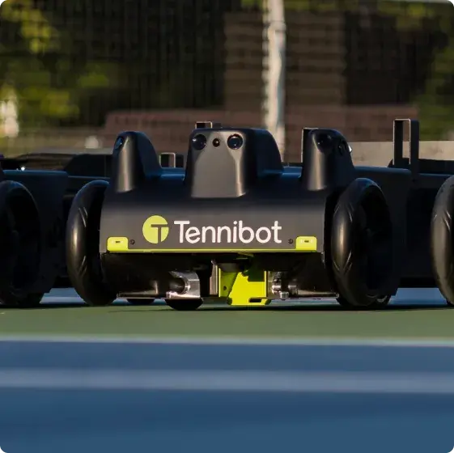
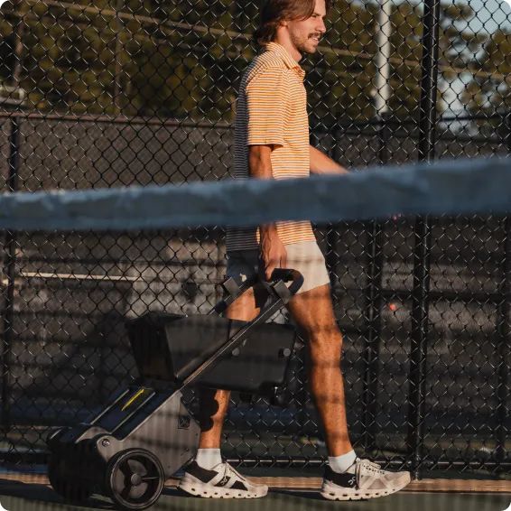
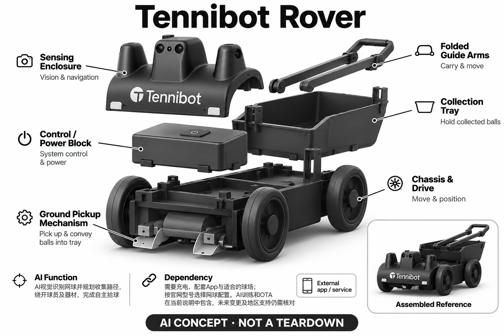

# Tennibot Rover

**Tennibot** · 运动与训练 · 核查 2026-11-04

个人球场训练中的自主视觉拾球

消费渠道：个人零售。

## 产品图片与结构参考

### 产品图

Tennibot Rover官方产品外形图 · 来源：[Tennibot · 官方产品图片](<https://www.tennibot.com/>) · [原始图片](<https://www.tennibot.com/.netlify/images?url=_astro%2Ftennibot-rover-on-court.DuUjZrls.webp>)

### 参考图

Tennibot Rover官方另一角度或使用场景参考 · 来源：[Tennibot · 官方产品图片](<https://www.tennibot.com/tennis/ball-collector/>) · [原始图片](<https://www.tennibot.com/_astro/tennibot-rover-carried.CwG5IKPj.webp>)

### AI 生成爆炸示意

**AI 生成 · 非实物拆机。** 内部为概念推断，不能作为元件布局、BOM 或维修依据。[生成提示词](../../content/hardware/prompts/tennibot-rover.txt)

> 外形依据核验参考图；内部位置、模块形状与装配关系仅作AI概念展示。

> 已逐张查看并核对型号。源图未改色/裁切；场景、界面、附件、优惠及效果文案仅为厂商示意，不作为本目录性能或现价依据。

> 分析为基于公开资料的案头研究与 AI 辅助判断，未经用户访谈、销量审计或实物拆机。需求、画像、竞争冷门度、审美及商业机会均为研究假设，不是投资结论。

## 销售与购买

- 状态：在售。当前官网具体型号页列美元价格、面向个人球员的用途和Buy now；已打开对应Stripe嵌入式Checkout入口，未填资料或支付。

- 地区：所列官方区域或授权零售渠道；配送地址与服务支持需结算确认

- 价格：US$2,275。核查日所见单机或基本配置价；币种、促销、税费、镜片、附件及服务依地区结算，不把颜色或套装重复计数。

- 中国大陆：本次未核实该具体型号在中国大陆的官方销售和完整服务支持；海外在售不等于国内可直接启用全部功能。

- [官方产品 / 商店](<https://www.tennibot.com/tennis/ball-collector/>)

## AI 的实际作用

AI视觉识别网球并规划收集路径，绕开球员及器材，完成自主拾球

服务与联网依赖：需要充电、配套App与适合的球场；按官网型号选择网球配置。AI训练和OTA在当前说明中包含，未来变更及地区支持仍需核对

## 是否冷门

新兴竞争（研究判断）：按任务与形态作案头分类，无访谈、销量或市场份额证据。

## 需求与市场

需求假设：密集练习后不希望反复弯腰和走动拾球，尽量保持训练节奏。价值应由实际使用频率、任务完成与操作负担验证，不能把AI功能存在或演示流畅当作需求已得到满足。

### 需求假设：练习后减少反复走动拾球 · 研究判断

Rover的核心任务是识别并收集散落网球，针对密集练习后需要花时间走动和弯腰的过程。它与发球机解决不同问题，需求应验证收球是否真正减少总负担，而不是只看机器人能找到一个球，也不能把拾球自动化直接等同训练效果。

依据：[Tennibot Rover官方型号与购买入口](<https://www.tennibot.com/tennis/ball-collector/>)

### 价值判断：节省拾球要扣除设备管理 · 研究判断

自动收集可能让用户休息或继续其他任务，但也需要布置、监督、清空篮筐和维护，新增步骤会抵消部分收益。研究应把整个循环计算进去，不只统计机器移动期间捡了多少球，也不预设用户一定讨厌所有手动拾球过程。

依据：[Tennibot Rover官方型号与购买入口](<https://www.tennibot.com/tennis/ball-collector/>) · [Tennibot官方系列比较](<https://www.tennibot.com/>)

### 验证方案：比较真实练习后的收场 · 待验证

让用户在同样练习量后分别用手动拾球篮和Rover整理球场，记录布置、监督、剩余球和倒球时间。保持场地与球状态可比，观察用户是否能做其他事情，不用为演示摆好的少量球验证需求，也不将结果扩展到所有场地。

依据：[Tennibot Rover官方型号与购买入口](<https://www.tennibot.com/tennis/ball-collector/>)

## 用户画像

画像推断：可经常使用网球场、愿意自行运输和维护设备的个人爱好者或个人教练。个人的语言、操作习惯、环境和预算会改变适配结果，本次只有案头研究，没有用户访谈或长期使用观察。

### 画像假设：反复产生大量散球的个人与教练 · 研究判断

较匹配者经常进行喂球或密集练习，结束后有明确收球负担，并能运输和存放机器。只打一小段双人对练的人可能收益有限，画像应按散球数量和任务频率区分，而不是简单按爱好者、专业教练或喜欢机器人的标签划分。

依据：[Tennibot Rover官方型号与购买入口](<https://www.tennibot.com/tennis/ball-collector/>) · [Tennibot官方系列比较](<https://www.tennibot.com/>)

### 使用约束：场地可用与允许移动同样重要 · 研究判断

Rover需要在适合的球场移动，其他人、器材和场地规则会影响部署，个人购买并不代表拥有整个场地控制权。研究应了解可监督时间和共享方式，不能从空场宣传画面推断公共场地都适用，也不假定自主拾球意味着可以完全离开。

依据：[Tennibot Rover官方型号与购买入口](<https://www.tennibot.com/tennis/ball-collector/>)

### 访谈重点：节省的时间被怎样使用 · 待验证

请用户说明拾球期间原本最想做什么，是休息、指导学生、整理其他器材还是尽快离场，再观察设备是否真的支持。不同目标会影响对速度、监督和篮筐操作的要求，不能把理论省时直接换算成工作收入或训练收益。

依据：[Tennibot Rover官方型号与购买入口](<https://www.tennibot.com/tennis/ball-collector/>)

## 竞争与替代

案头判断：与传统发球机、手动拾球篮和真人陪练竞争，移动发球、固定发球与拾球是不同机械用途；没有按球色或附件凑数。这只是用途与替代品比较，不是市场份额或销量结论；专业细分和较少曝光也不代表没有成熟竞争者。

### 替代方案：手动拾球篮和共同收场 · 研究判断

Rover主要与手动拾球篮、滚动收球工具和多人一起整理竞争，发球机本身不是相同任务的替代。比较应围绕收集和搬运总流程，不能把自主移动直接视为比简单工具更好，也不将机器能规划路线当作用户一定愿意承担维护的理由。

依据：[Tennibot Rover官方型号与购买入口](<https://www.tennibot.com/tennis/ball-collector/>) · [Tennibot官方系列比较](<https://www.tennibot.com/>)

### 差异判断：视觉收集减少主动找球但增加监督 · 研究判断

视觉识别与路径规划让机器承担寻找和接近散球的工作，用户仍可能需要处理边角、被遮挡球或清空容器。研究应检查哪些环节能放心交给机器，不能仅凭找到球就宣称整个收场自动完成，更不把同品牌训练算法套到拾球任务。

依据：[Tennibot Rover官方型号与购买入口](<https://www.tennibot.com/tennis/ball-collector/>)

### 比较方法：从最后一球到离场为止 · 待验证

以训练结束开始计时，记录所有球归位、篮筐搬运、机器收纳和离场所需步骤，比较手动与自动方案。若用户在等待时无法做其他事情，也应记录，不用机器人运行时间替代人的有效时间，更不能由一场测试推断长期成本优势。

依据：[Tennibot Rover官方型号与购买入口](<https://www.tennibot.com/tennis/ball-collector/>) · [Tennibot官方系列比较](<https://www.tennibot.com/>)

## 供应链

厂家当前官网明确设计、制造及支持位于美国阿拉巴马州Auburn；这能支持生产地区描述，但未披露具体装配工序或模块供应商。视觉标定、运动控制与球场适应性可作为制造关注点，不据此推定BOM或良率。

### 已披露范围：生产地区明确但零件未知 · 研究判断

原目录已核实厂家设计制造支持位于美国Auburn，这可描述品牌生产地区，却不证明视觉、电机或电池全部来自当地。Rover具体装配工序与模块供应商未公开，功能拆分不能成为原机BOM，也不根据地区信息估算人工成本和良率。

依据：[Tennibot Rover官方型号与购买入口](<https://www.tennibot.com/tennis/ball-collector/>) · [Tennibot官方系列比较](<https://www.tennibot.com/>)

### 制造判断：识别后还需要稳定拾入与存放 · 研究判断

轮式底盘、地面入口与集球容器需要和视觉路径配合，球面状态、地面与容器装载会影响完整流程。供应评估应检查机械收集与维护，而非只看算法识别率，本轮没有拾球效率、磨损或可靠性实测，也不推断具体滚轮或夹持结构。

依据：[Tennibot Rover官方型号与购买入口](<https://www.tennibot.com/tennis/ball-collector/>)

### 候选选型：空间视觉与移动电源分开 · 研究判断

Luxonis可作为识别和空间输入工程候选，Nidec可讨论底盘执行，Grepow可研究便携电源。它们的公开能力不构成Tennibot采用证据，也不说明现成模块能直接装入Rover，球场、负载、接口和机械拾取都需专项验证。

依据：[Tennibot Rover官方型号与购买入口](<https://www.tennibot.com/tennis/ball-collector/>) · [Tennibot官方系列比较](<https://www.tennibot.com/>)

## 技术路径

AI视觉识别网球并规划收集路径，绕开球员及器材，完成自主拾球。这是厂商披露的功能机制；模型版本、准确率及内部结构未完整公开。架构只表示输入、处理和输出关系，不作为真实拆机或性能实测。

### 已披露能力：识球、路径与避让服务拾取 · 官方资料

官方说明Rover通过AI视觉识别网球并规划收集路径，绕开球员及器材，完成自主拾球。这是对地面对象与运动的感知任务，不是发球策略或教练模型；具体识别准确率、内部传感布局和规划实现未公开，不能自行补写。

依据：[Tennibot Rover官方型号与购买入口](<https://www.tennibot.com/tennis/ball-collector/>)

### 技术判断：能识别目标不等于完成收集 · 研究判断

一个球即使被正确检测，也可能处于边界、遮挡或难接近位置，完整成功还取决于路线和拾取机构。研究应把检测、到达和收进篮筐分开统计，而不是只看识别框或行走轨迹，也不假定避让宣传覆盖所有动态场景。

依据：[Tennibot Rover官方型号与购买入口](<https://www.tennibot.com/tennis/ball-collector/>)

### 验证方案：逐环节记录未收集的球 · 待验证

在支持场地中记录球的可见性、机器路线、接近和拾取结果，检查剩余球为什么没有被收走，再观察用户怎样介入。只改变可控条件并遵循说明，不主动安排危险相遇，本轮没有准确率、路线效率或避让可靠性的实测结论。

依据：[Tennibot Rover官方型号与购买入口](<https://www.tennibot.com/tennis/ball-collector/>)

## 产品审美

图示观察：低位拾取机构与高位集球容器呈现明确工具属性，与发球机外形不同。宣传图片只能帮助理解外观和摆放方式，不能证明每个人的舒适度、长时使用体验或实际材料触感。

### 外形判断：低位入口与高位容器突出工具用途 · 研究判断

Rover的地面收集与集球篮形成不同于发球机的轮廓，用户更在意能否搬运、倒球和清洁，而不只是机器人造型。照片只能说明形状，不能证明篮筐装满后仍方便操作，也不应以外形笨重或可爱代替真实使用评价。

依据：[Tennibot Rover官方型号与购买入口](<https://www.tennibot.com/tennis/ball-collector/>)

### 交互判断：收集状态要让旁人理解 · 研究判断

场地使用者需要知道机器在寻找、接近还是停止，操作者也要清楚何时清空和接管。研究应观察运行意图是否可预测，不把自主移动本身当作良好交互；机器如果需要频繁解释或监督，可能影响原本想节省的注意与时间。

依据：[Tennibot Rover官方型号与购买入口](<https://www.tennibot.com/tennis/ball-collector/>)

### 体验验证：清空与运输同样重要 · 待验证

让用户完成布置、启动、监督、倒球、清洁和装回车辆，记录需要弯腰、提起或寻求帮助的环节。比较机器减少的拾球动作与新增管理动作，避免只拍摄它在球场顺畅行走，就判断适合所有教练或家庭爱好者。

依据：[Tennibot Rover官方型号与购买入口](<https://www.tennibot.com/tennis/ball-collector/>)

## 关键风险

自动移动或出球可能与场地使用者相互干扰，需按说明设定边界并监督；AI轨迹识别不能保证所有球面和遮挡环境可靠。还需核对地区功能、软件更新与售后边界；本目录未进行实机、医学或可靠性测试，不把厂商演示当作结果保证。

### 场地风险：自主移动仍需按说明监督 · 研究判断

Rover在球员和器材附近移动，避让功能不能被视为消除所有碰撞或干扰，场地边界与允许条件需明确。它不承担发球任务，因此风险分析不套用出球速度或滚轮喂球，本轮没有实机安全验证，也不宣称可以无监督运行。

依据：[Tennibot Rover官方型号与购买入口](<https://www.tennibot.com/tennis/ball-collector/>)

### 维护与服务风险：拾球流程依赖完整系统 · 研究判断

电源、入口清洁、轮式移动和应用支持都可能影响收集，地区维修与软件更新条件也需确认。当前公开生产地区不代表本地快速服务，用户应考虑运输和备件，而不能只按机器省下的弯腰次数忽略拥有成本与长期维护。

依据：[Tennibot Rover官方型号与购买入口](<https://www.tennibot.com/tennis/ball-collector/>) · [Tennibot官方系列比较](<https://www.tennibot.com/>)

### 验证安排：保留人工完成的剩余工作 · 待验证

试用应记录用户手动捡起的球、重新摆放机器或清理入口的原因，区分视觉、路径与机械问题。不要只统计已成功收集的数量，也不将所有需要介入都叫失败，关键是完整任务中人的负担是否减少，以及这些介入是否可接受。

依据：[Tennibot Rover官方型号与购买入口](<https://www.tennibot.com/tennis/ball-collector/>)

## 机会与验证

市场差异主要在于个人球场训练中的自主视觉拾球。值得进一步验证的购买理由是它能否减少既有任务中的具体步骤，以及硬件、服务与维护的总成本是否符合个人使用频率。

### 研究方向：独立的训练后收集任务 · 研究判断

Rover提示一种与AI教练不同的消费需求：让机械设备处理重复收场，而不是向用户提供更多训练数据。机会应从散球与整理频率出发，先验证手动工具哪里不足，再讨论自主程度，避免把机器人形态本身当作必须存在的产品。

依据：[Tennibot Rover官方型号与购买入口](<https://www.tennibot.com/tennis/ball-collector/>)

### 执行计划：跟踪多次收场与机器闲置 · 待验证

观察个人训练和个人教练在数周内使用收球设备的次数，记录有效节省时间、监督、运输与没有带机器的原因。访谈追问省下时间是否用于预期任务，不用一次理想演示推断长期收益，也不将少量样本外推整体市场规模。

依据：[Tennibot Rover官方型号与购买入口](<https://www.tennibot.com/tennis/ball-collector/>) · [Tennibot官方系列比较](<https://www.tennibot.com/>)

### 决策边界：拾球与喂球应分别统计需求 · 研究判断

Rover与Partner系列共享球场环境，却服务不同核心任务，目录应把自主收集作为独立场景而非同一发球配置。是否能形成可持续市场仍需真实购买和维护研究，本轮没有访谈、销量或报价，不以冷门程度与模型评分预测商业结果。

依据：[Tennibot Rover官方型号与购买入口](<https://www.tennibot.com/tennis/ball-collector/>) · [Tennibot官方系列比较](<https://www.tennibot.com/>)

## 对应供应链公司

能力候选用于选型研究，不代表本产品实际采用；未公开的供货关系不作推断。

- [luxonis](../supply-chain/luxonis.md) — **能力候选 · 非已采用** / 地面网球识别与空间输入工程候选：Luxonis公开空间视觉与嵌入式相机能力，可作为Rover识别球和规划输入的候选，但目标小球、球场光照、地面和移动遮挡需专项验证。候选不提供Tennibot完整拾球算法，也无原机点名供货证据，不能作为直接替换模块。

- [nidec](../supply-chain/nidec.md) — **能力候选 · 非已采用** / 自主拾球底盘运动工程候选：Nidec的电机与相关工程能力可用于讨论Rover底盘执行，但轮式负载、速度、地面和控制接口需要明确，不能根据相机齿轮电机目录推定适配。当前没有实际采用证据，具体料号还需审核变更与质量，不覆盖未披露拾取机构细节。

- [grepow](../supply-chain/grepow.md) — **能力候选 · 非已采用** / 视觉与移动拾球组合供电候选：Grepow公开机器人与定制电池方向，可作为Rover采集和移动负载的电源候选，但需要实际电流、温度、保护及外壳要求。公开能力不代表已向Tennibot供货，也不保证现成电池兼容，完整拾球续航必须在任务中测试。

[浏览供应链目录](../supply-chain.md)

## 功能分层示意

这是功能关系，不是实物拆机、真实空间结构或已核实 BOM。

1. **实体输入**：轮式底盘、视觉模块、地面拾球入口与集球篮；仅功能层示意，非拆机。（官方披露）

2. **采集与控制**：设备把输入转为可处理的信息并接收用户操作；具体内部布局未知。（分析推断）

3. **AI功能**：AI视觉识别网球并规划收集路径，绕开球员及器材，完成自主拾球（官方披露）

4. **服务依赖**：需要充电、配套App与适合的球场；按官网型号选择网球配置。AI训练和OTA在当前说明中包含，未来变更及地区支持仍需核对（官方披露）

5. **用户反馈**：用户通过声音、屏幕或配套应用接收结果，并对重要信息复核。（分析推断）

## 来源

1. [Tennibot Rover官方型号与购买入口](<https://www.tennibot.com/tennis/ball-collector/>) — 已打开一手页面；产品能力为厂商披露，未进行实机或效果验证。

2. [Tennibot官方系列比较](<https://www.tennibot.com/>) — 已打开一手页面；产品能力为厂商披露，未进行实机或效果验证。

3. [Tennibot官方Rally功能](<https://www.tennibot.com/tennis/ball-collector/>) — 已打开一手页面；产品能力为厂商披露，未进行实机或效果验证。

[返回目录](../hardware-market.md) · [网页分析](https://romanagent.github.io/Roman/#hardware/product/tennibot-rover)
