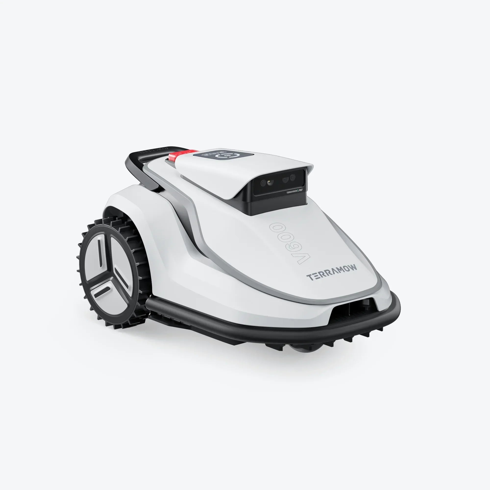
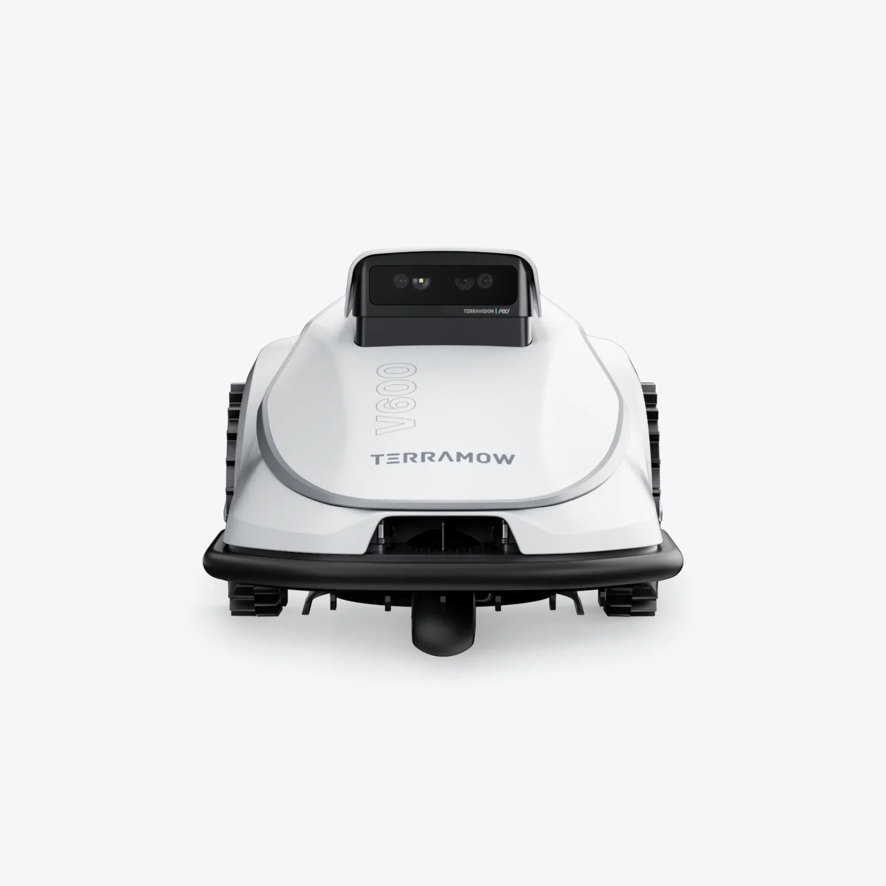
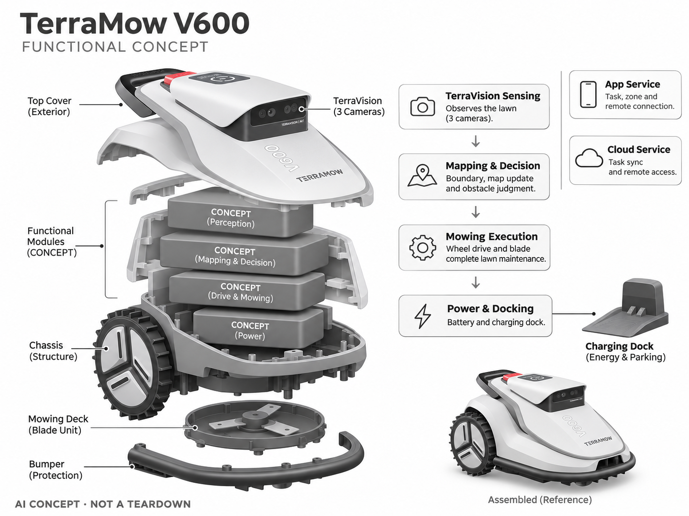

# TerraMow V600

**TerraMow** · 庭院与自然 · 核查 2026-11-04

用纯视觉降低家庭草坪首次安装门槛

消费渠道：个人零售。

## 产品图片与结构参考

### 产品图

TerraMow V600 官方产品图 · 来源：[TerraMow · 官方图片](<https://www.terramow.com/products/v600>) · [原始图片](<https://www.terramow.com/cdn/shop/files/V600_Right45_W.webp?v=1773395602>)

### 参考图

TerraMow V600 官方外观、使用场景或功能参考图 · 来源：[TerraMow · 官方图片](<https://www.terramow.com/products/v600>) · [原始图片](<https://www.terramow.com/cdn/shop/files/V600_Front_W.webp?v=1773395608>)

### AI 生成爆炸示意

**AI 生成 · 非实物拆机。** 内部为概念推断，不能作为元件布局、BOM 或维修依据。[生成提示词](../../content/hardware/prompts/terramow-v600.txt)

> 保留官方图原始内容与出处；画面中的宣传参数不视为本轮独立实测。

> 分析为基于公开资料的案头研究与 AI 辅助判断，未经用户访谈、销量审计或实物拆机。需求、画像、竞争冷门度、审美及商业机会均为研究假设，不是投资结论。

## 销售与购买

- 状态：在售。官方V600商品页显示欧元价格、EU/UK/US规格选择和Add to Cart；S800已售罄未纳入，V1000容量版本不另计。

- 地区：欧盟官方商店；英美配置需结账确认

- 价格：€849（所查EU配置）。核查时官方页面参考，价格保留原币种；套装、配件、订阅、税运及地区条件分别确认，不把容量版本重复计数。

- 中国大陆：本轮核实海外官方销售；中国大陆同型号现货、售后与云服务未确认。庭院条件、物种范围或定位服务也需按地区验证。

- [官方产品 / 商店](<https://www.terramow.com/products/v600>)

## AI 的实际作用

三摄TerraVision视觉进行自动建图、边界理解和避障，无需传统边界线或RTK天线。

服务与联网依赖：核心任务依赖机上视觉和控制，App、4G及远程功能受服务地区与套餐约束；雨雪、光照和地形仍影响可用性。

## 是否冷门

细分专业（研究判断）：家庭草坪是地域性专业消费场景；纯视觉是技术路线差异，已有直接替代，不应称无人赛道。

## 需求与市场

需求假设：小中庭院房主希望避免埋线或安装RTK基站，快速获得可用割草路线。应测量首次设置、边界错误与每周救援时间；省安装步骤只有在长期边界稳定时才成为真实优势。

## 用户画像

画像推断：有相对清晰草坪边界、愿使用手机设置但不想施工的家庭。树荫、碎石过渡和复杂台阶会改变适用性，面积并非唯一选型条件，不能把所有小庭院都归为容易场景。

## 竞争与替代

竞争判断：与RTK割草机、其它纯视觉机和人工割草竞争。视觉路线降低配套设备，却可能把难度转给环境识别；新团队应比较整季维护成本，而不是仅宣传无需天线这一单点特征。

## 供应链

供应链分析：三摄标定、镜头清洁、算力板、电池、轮驱和刀盘需要协同，供应商及BOM未公开。户外温漂、振动、镜头水滴和维修校准是量产门槛，不能按室内移动机器人经验直接推算。

## 技术路径

官方披露TerraVision 2.0三摄视觉和自动地图更新。技术判断：草色季节变化、阴影和临时物体会影响语义边界，应设计低置信停止与人工修正，纯视觉不等同任何天气都能运行。

## 产品审美

审美判断：紧凑机身和清晰控制区适合家庭庭院工具，少一套外部定位设施能减少安装杂乱。提手、刀盘清洁、充电站屋顶与冬季收纳也需要评价，不能只看草坪上的英雄图。

## 关键风险

风险判断：刀盘、台阶和动物活动需要物理安全边界；视觉失效不能靠AI名词消除。订阅或4G赠送期限、App地区以及备件会影响长期成本，购买前应确认实际庭院条件与售后覆盖。

## 机会与验证

机会假设：针对明确边界的小院验证低安装成本，再逐步扩展复杂地面。可以先提供场景筛查和地图复核服务，通过真实边界错误率决定是否需要更多传感器，而不是一开始追求全场景。

## 功能分层示意

这是功能关系，不是实物拆机、真实空间结构或已核实 BOM。

1. **三摄感知**：TerraVision视觉观察草坪。（官方披露）

2. **建图决策**：边界、地图更新与障碍判断。（官方披露）

3. **割草执行**：轮驱和刀盘完成维护。（官方披露）

4. **能源停靠**：电池及充电基站。（官方披露）

5. **App服务**：任务、区域及远程连接。（官方披露）

## 来源

1. [TerraMow V600 官方商品页](<https://www.terramow.com/products/v600>) — 已实际打开并核查购买与交付入口；未实际下单。

2. [TerraMow V系列官方视觉技术](<https://www.terramow.com/pages/v-series>) — 已实际打开的官方能力、服务或维护说明；不代表独立实测。

[返回目录](../hardware-market.md) · [网页分析](https://romanagent.github.io/Roman/#hardware/product/terramow-v600)
