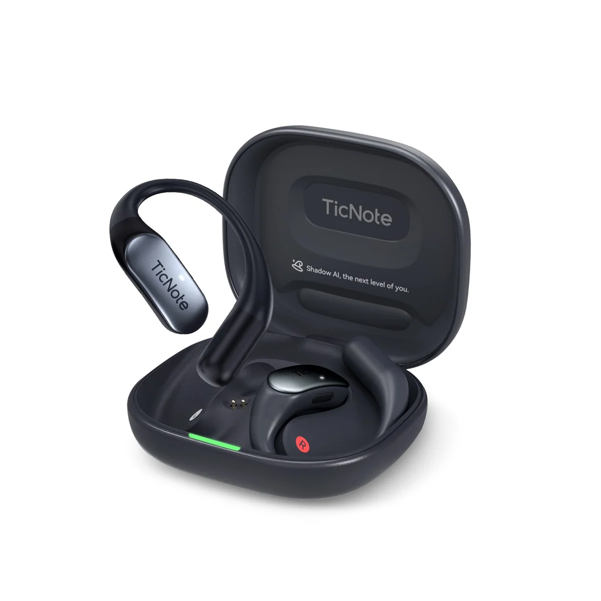
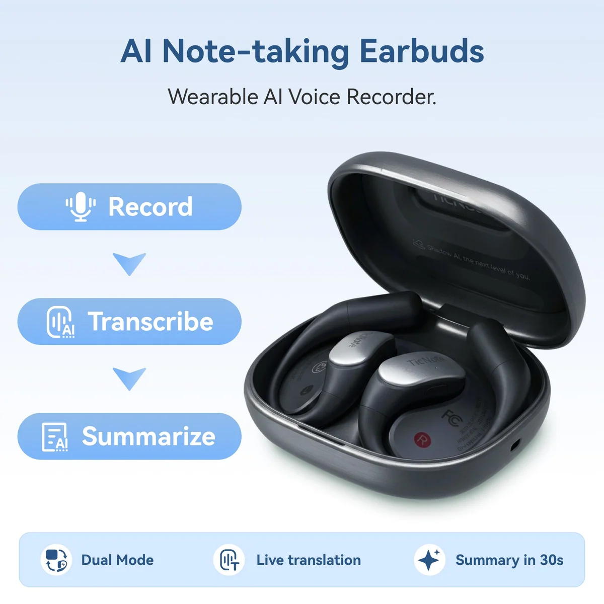
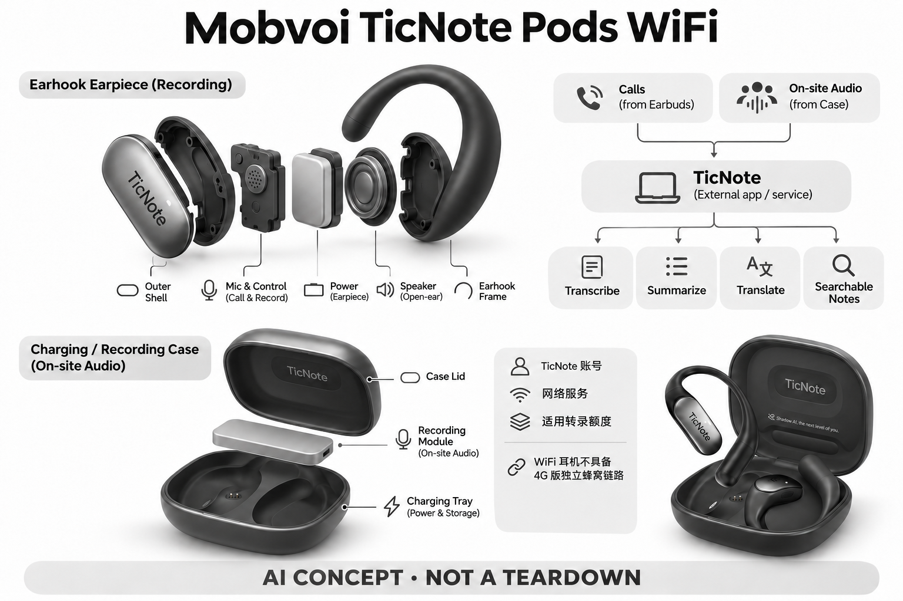

# Mobvoi TicNote Pods WiFi

**Mobvoi / TicNote** · 翻译与音频 · 核查 2026-11-04

个人随身记录入口与TicNote Agent

消费渠道：个人零售。

## 产品图片与结构参考

### 产品图

Mobvoi TicNote Pods WiFi官方产品外形图 · 来源：[Mobvoi / TicNote · 官方产品图片](<https://ticnote.ai/products/ticnote-pods-wifi-ai-transcription-earbuds>) · [原始图片](<https://cdn.shopify.com/s/files/1/0723/7972/8010/files/ticnote-pods-ai-voice-recorder-earbuds-enterprise-1990853.jpg?v=1782700694&width=1200>)

### 参考图

Mobvoi TicNote Pods WiFi官方另一角度或使用场景参考 · 来源：[Mobvoi / TicNote · 官方产品图片](<https://ticnote.ai/products/ticnote-pods-wifi-ai-transcription-earbuds>) · [原始图片](<https://cdn.shopify.com/s/files/1/0723/7972/8010/files/ticnote-pods-ai-voice-recorder-earbuds-enterprise-4183767.jpg?v=1782700694&width=1200>)

### AI 生成爆炸示意

**AI 生成 · 非实物拆机。** 内部为概念推断，不能作为元件布局、BOM 或维修依据。[生成提示词](../../content/hardware/prompts/ticnote-pods-wifi.txt)

> 外形依据核验参考图；内部位置、模块形状与装配关系仅作AI概念展示。

> 已逐张查看并核对型号。源图未改色/裁切；场景、界面、附件、优惠及效果文案仅为厂商示意，不作为本目录性能或现价依据。

> 分析为基于公开资料的案头研究与 AI 辅助判断，未经用户访谈、销量审计或实物拆机。需求、画像、竞争冷门度、审美及商业机会均为研究假设，不是投资结论。

## 销售与购买

- 状态：在售。官方单机商品页显示美元价格和Add to cart；公开商品JSON available=true，可个人购买一件，无企业采购门槛。未把WiFi/4G容量或Enterprise软件包分拆计数。

- 地区：所列官方区域或授权零售渠道；配送地址与服务支持需结算确认

- 价格：US$219.99。核查日所见单机或基本配置价；币种、促销、税费、镜片、附件及服务依地区结算，不把颜色或套装重复计数。

- 中国大陆：本次未核实该具体型号在中国大陆的官方销售和完整服务支持；海外在售不等于国内可直接启用全部功能。

- [官方产品 / 商店](<https://ticnote.ai/products/ticnote-pods-wifi-ai-transcription-earbuds>)

## AI 的实际作用

耳机采集通话、盒子采集现场，TicNote服务转录并整理摘要、翻译及可检索笔记

服务与联网依赖：需要TicNote账号、网络服务及适用转录额度；本条WiFi耳机不具备4G版独立蜂窝链路，离线采集与在线AI整理分开。

## 是否冷门

新兴竞争（研究判断）：按任务与形态作案头分类，无访谈、销量或市场份额证据。

## 需求与市场

需求假设：把电话与现场对话交给不同拾音部件，仍在同一个个人笔记库里回看。价值应由实际使用频率、任务完成与操作负担验证，不能把AI功能存在或演示流畅当作需求已得到满足。

### 官方｜耳机与盒子分担采集 · 官方资料

本型号由耳机采集通话、带录音控制与麦克风的充电盒采集现场声音，再进入同一个笔记服务。需求是跨电话和面对面交流保持统一回顾，而不是只购买一副普通听音耳机；本条为 WiFi 版本，不能把其他版本的独立蜂窝能力或企业软件权益算入当前硬件。

依据：[Mobvoi TicNote Pods WiFi官方单机购买页](<https://ticnote.ai/products/ticnote-pods-wifi-ai-transcription-earbuds>) · [TicNote官方常见问题](<https://ticnote.ai/pages/faq>)

### 判断｜已有随身物品是否能复用 · 研究判断

耳机与充电盒本来可能每天携带，把记录入口放在其中有机会减少额外设备。但用户仍需记得哪一部分负责当前场景，并确认盒子摆放和耳机连接，功能合并也可能增加状态复杂度；价值应以完整任务与操作次数判断，不能只因为少带一件物品就认定更方便。

依据：[Mobvoi TicNote Pods WiFi官方单机购买页](<https://ticnote.ai/products/ticnote-pods-wifi-ai-transcription-earbuds>)

### 验证｜跨场景切换对照 · 待验证

可安排一次耳机通话后紧接现场讨论，比较本型号与普通耳机加录音器的采集、切换和会后查找。记录双向内容是否完整、盒子是否被正确放置以及用户是否漏启动，当前目录没有实机测试；统一笔记库有潜在价值，但不能代替对两条声音链路的分别验证。

依据：[Mobvoi TicNote Pods WiFi官方单机购买页](<https://ticnote.ai/products/ticnote-pods-wifi-ai-transcription-earbuds>) · [TicNote官方常见问题](<https://ticnote.ai/pages/faq>)

## 用户画像

画像推断：频繁在通勤、课程或个人工作中记录，愿意管理云端笔记权限并逐条确认输出的人。个人的语言、操作习惯、环境和预算会改变适配结果，本次只有案头研究，没有用户访谈或长期使用观察。

### 判断｜电话与现场都高频的人 · 研究判断

频繁在通勤、个人工作或学习中切换通话与面对面交流的人可能更容易利用两种采集方式。只听音乐或只记录固定会议的人，可能不会使用盒子录音或通话整理；画像应按实际联用频率建立，不能因为产品兼具多个功能就推定所有耳机用户都有需求。

依据：[Mobvoi TicNote Pods WiFi官方单机购买页](<https://ticnote.ai/products/ticnote-pods-wifi-ai-transcription-earbuds>)

### 判断｜愿意管理记录服务的用户 · 研究判断

用户需要理解账号、转录额度和网络处理，并愿意复核翻译与摘要，不只是把耳机戴上。对希望完全离线或不想增加数据管理的人，这种服务组合可能不合适；技术爱好者的接受度也不能代表普通消费者，应分别观察首次设置、后续维护和记录边界的学习成本。

依据：[TicNote官方常见问题](<https://ticnote.ai/pages/faq>)

### 验证｜耳机与盒子的携带习惯 · 待验证

研究应观察用户是否总带充电盒、何时把它留在包里，以及通话结束后是否愿意拿出来记录现场内容。还要测试不同耳型和长时间佩戴的接受度，不能把盒子存在等同随时可用；整套携带习惯会决定功能是否真正联用，而不仅是设备参数和应用界面。

依据：[Mobvoi TicNote Pods WiFi官方单机购买页](<https://ticnote.ai/products/ticnote-pods-wifi-ai-transcription-earbuds>)

## 竞争与替代

案头判断：与普通耳机/手表加录音App及专用录音器竞争，入口便利度和后续检索才是购买取舍，不能只看AI标签。这只是用途与替代品比较，不是市场份额或销量结论；专业细分和较少曝光也不代表没有成熟竞争者。

### 判断｜与录音耳机及卡片比较 · 研究判断

录音耳机、卡片双模式设备和普通耳机加软件都可能覆盖部分任务，比较重点是实际输入路径与切换负担。盒子加入现场采集不应自动被视为全新需求，电话与面谈回顾仍是共同核心；差异需要通过用户是否少漏记、少整理来说明，而不是只列更多硬件部件。

依据：[Mobvoi TicNote Pods WiFi官方单机购买页](<https://ticnote.ai/products/ticnote-pods-wifi-ai-transcription-earbuds>)

### 判断｜WiFi 与其他版本的边界 · 研究判断

同品牌其他版本可能具有不同网络与软件条件，不能把其图片命名、价格或功能迁移到本条。官方单机可个人购买是当前收录依据，企业软件包并不改变所核查个人配置；竞争比较应保持网络和服务口径一致，不用更高版本能力增强基础款的表面价值。

依据：[Mobvoi TicNote Pods WiFi官方单机购买页](<https://ticnote.ai/products/ticnote-pods-wifi-ai-transcription-earbuds>) · [TicNote官方常见问题](<https://ticnote.ai/pages/faq>)

### 验证｜真实额度与总成本 · 待验证

应按通话和现场录音总量核对转写、翻译与问答权益，并加入所需服务和维护成本。硬件标价不能代表全部功能永久可用，海外入口也不证明大陆服务完整开放；当前没有销量或留存研究，目录不从生态功能多或可单件购买推断市场规模与长期需求。

依据：[Mobvoi TicNote Pods WiFi官方单机购买页](<https://ticnote.ai/products/ticnote-pods-wifi-ai-transcription-earbuds>) · [TicNote官方常见问题](<https://ticnote.ai/pages/faq>)

## 供应链

公开资料可核对无线耳机、带录音按键和麦克风的充电盒、Wi-Fi传输，具体整机工厂、关键模块供应商与BOM本次未确认。制造重点可从形态推断，但不能把品牌所在地、外观相似或营销合作等同代工关系。

### 官方｜多部件采集系统 · 官方资料

公开资料支持无线耳机、具备录音控制和麦克风的盒子以及无线局域网传输，具体芯片、工厂和内部存储分工仍未完整披露。不能把盒子只视作普通充电附件，也不能从其他 TicNote 产品猜测主控；目录保持功能架构与真实物料清单的区别，不以概念图证明装配关系。

依据：[Mobvoi TicNote Pods WiFi官方单机购买页](<https://ticnote.ai/products/ticnote-pods-wifi-ai-transcription-earbuds>)

### 判断｜耳机和盒子分别验收 · 研究判断

耳机要面对佩戴、通话与同步，盒子要面对摆放、现场声音和控制，两部分的质量问题不同。供应链研究应询问充电、数据交接和固件兼容，不能只测试其中一端；由形态提出的工程约束不等于已知制造工艺，当前无法估算良率、物料成本或具体代工位置。

依据：[Mobvoi TicNote Pods WiFi官方单机购买页](<https://ticnote.ai/products/ticnote-pods-wifi-ai-transcription-earbuds>)

### 判断｜音频与无线候选 · 研究判断

恒玄可作为耳机音频与控制平台候选，乐鑫可作为盒子或设备无线传输控制候选，均未被本型号点名采用。选择需确认各部件分工、接口、同步与功耗，不能直接替换；同品牌其他记录产品的公开芯片合作也不能迁移到 Pods，服务端仍需独立验证。

依据：[Mobvoi TicNote Pods WiFi官方单机购买页](<https://ticnote.ai/products/ticnote-pods-wifi-ai-transcription-earbuds>)

## 技术路径

耳机采集通话、盒子采集现场，TicNote服务转录并整理摘要、翻译及可检索笔记。这是厂商披露的功能机制；模型版本、准确率及内部结构未完整公开。架构只表示输入、处理和输出关系，不作为真实拆机或性能实测。

### 官方｜离线采集与在线整理 · 官方资料

耳机和盒子提供不同声音入口，TicNote 服务再完成转写、摘要、翻译及检索，账号与额度参与使用。WiFi 版本不具备另一版本的独立蜂窝链路，离线采集也不代表全部智能整理离线；具体哪部分负责传输与推理未全部公开，目录不反推出精确芯片和模型拓扑。

依据：[Mobvoi TicNote Pods WiFi官方单机购买页](<https://ticnote.ai/products/ticnote-pods-wifi-ai-transcription-earbuds>) · [TicNote官方常见问题](<https://ticnote.ai/pages/faq>)

### 判断｜双入口需要统一来源 · 研究判断

同一笔记库可能包含通话和房间记录，用户需要知道每段内容来自哪里、何时开始以及是否完整。若切换时出现重复或缺口，模型可能把不同对话混合总结，统一界面反而掩盖问题；技术评价应保留来源和时间线，不能只看生成文档是否连贯或格式整齐。

依据：[TicNote官方常见问题](<https://ticnote.ai/pages/faq>)

### 验证｜同步与切换链路 · 待验证

测试应在耳机断连、盒子录音、网络变化和服务额度不足时检查内容是否完整交接，并验证恢复后是否重复上传。再用包含更正和插话的音频比较转写、翻译与摘要，区分错误层次；当前没有独立性能结果，不能保证所有手机、通话平台和房间声场同样有效。

依据：[Mobvoi TicNote Pods WiFi官方单机购买页](<https://ticnote.ai/products/ticnote-pods-wifi-ai-transcription-earbuds>) · [TicNote官方常见问题](<https://ticnote.ai/pages/faq>)

## 产品审美

图示观察：耳机与盒子保留常见消费耳机形态，盒子的录音控制让它成为独立工作入口。宣传图片只能帮助理解外观和摆放方式，不能证明每个人的舒适度、长时使用体验或实际材料触感。

### 判断｜耳机日用品与记录工具 · 研究判断

耳机外观可能帮助用户把记录功能放进已有听音习惯，盒子又需要承担现场工具的角色，二者应共同评价。产品图只能说明形态与部件，不能证明佩戴舒适、声音外溢或桌面摆放合适；审美价值取决于真实使用，而不是把充电盒增加按键就认定交互自然。

依据：[Mobvoi TicNote Pods WiFi官方单机购买页](<https://ticnote.ai/products/ticnote-pods-wifi-ai-transcription-earbuds>)

### 判断｜哪一端在记录要清楚 · 研究判断

用户可能在耳机和盒子之间切换，状态反馈需要明确当前采集来源，避免以为一端正在工作而实际没有记录。设计研究应观察指示、按键与应用状态是否一致，不能只确认存在录音按钮；多部件系统的简洁外观可能隐藏较复杂的状态，必须通过操作验证。

依据：[Mobvoi TicNote Pods WiFi官方单机购买页](<https://ticnote.ai/products/ticnote-pods-wifi-ai-transcription-earbuds>)

### 验证｜从佩戴到桌面放置 · 待验证

试用应包含通话、摘下耳机、拿出盒子、现场记录和收纳充电，记录遗忘、误操作和摆放距离。不同桌面、衣物和移动条件要分别观察，不能只测试一段安静对话；整套流程的稳定比单个部件看起来便携更能支持日常价值，长期体验仍需实机反馈。

依据：[Mobvoi TicNote Pods WiFi官方单机购买页](<https://ticnote.ai/products/ticnote-pods-wifi-ai-transcription-earbuds>)

## 关键风险

耳机与充电盒分别采集通话和现场声音，需明确录音状态、参与者知情及保存权限；翻译和摘要可能误解原话。WiFi版不能沿用4G版的独立蜂窝能力，转录额度、地区服务、数据导出和长期支持应按当前计划确认。

### 判断｜参与者知情与声音范围 · 研究判断

耳机通话和盒子现场采集涉及不同参与者，用户需要明确告知并理解实际记录范围。耳机外形可能让对方不知道正在记录，盒子放在桌面也不自动说明用途；翻译和摘要还可能扩大或改变原意，目录不把采集便利视为所有谈话都适合进入个人记忆库的理由。

依据：[Mobvoi TicNote Pods WiFi官方单机购买页](<https://ticnote.ai/products/ticnote-pods-wifi-ai-transcription-earbuds>) · [TicNote官方常见问题](<https://ticnote.ai/pages/faq>)

### 判断｜版本与网络预期 · 研究判断

最容易误解的是把 WiFi 版当作具有独立蜂窝服务，或把企业图片与高级权益视为单机默认包含。用户应按当前配置核对网络、账户和转录额度，硬件仍可采集也不代表在线整理始终可用；海外在售和品牌来源同样不能替代大陆渠道、服务与保修确认。

依据：[Mobvoi TicNote Pods WiFi官方单机购买页](<https://ticnote.ai/products/ticnote-pods-wifi-ai-transcription-earbuds>) · [TicNote官方常见问题](<https://ticnote.ai/pages/faq>)

### 验证｜重要内容人工复核 · 待验证

应检查电话与现场记录中的姓名、金额、否定和责任人在翻译与摘要后是否保留，并能回到原音确认。生成行动项不能自动视为对方承诺，跨入口内容也需避免误合并；验证目标是让记录可追溯、错误可更正，而不是假设统一笔记服务能够理解所有语境。

依据：[TicNote官方常见问题](<https://ticnote.ai/pages/faq>)

## 机会与验证

市场差异主要在于个人随身记录入口与TicNote Agent。值得进一步验证的购买理由是它能否减少既有任务中的具体步骤，以及硬件、服务与维护的总成本是否符合个人使用频率。

### 判断｜双入口是否真正联用 · 研究判断

本型号的购买理由应来自用户反复在通话和现场记录之间切换，并确实使用同一笔记库回顾。若只使用耳机或盒子中的一端，额外部件和服务可能没有足够价值；场景分组应保留共同的谈话回顾任务，在差异说明中解释采集分工，而不按部件数量重复计算创新。

依据：[Mobvoi TicNote Pods WiFi官方单机购买页](<https://ticnote.ai/products/ticnote-pods-wifi-ai-transcription-earbuds>)

### 判断｜减少携带之外的价值 · 研究判断

少带设备可能是起点，但真正收益还包括少漏记、少找文件和更快确认后续事项。研究应记录被实际使用的摘要与检索，以及用户仍需手动处理的内容，不能用自动生成数量衡量价值；如果数据管理和切换更复杂，硬件合并也可能没有降低整体负担。

依据：[TicNote官方常见问题](<https://ticnote.ai/pages/faq>)

### 验证｜持续使用与成本记录 · 待验证

后续可跟踪两类入口各自的使用、切换失败、有效内容和更正量，并核算转录与维护费用。还需观察用户何时回到普通耳机或独立录音器，理解替代范围；当前目录是案头研究，不以单机可购、生态功能或形态新颖宣称市场需求和效率已经得到验证。

依据：[Mobvoi TicNote Pods WiFi官方单机购买页](<https://ticnote.ai/products/ticnote-pods-wifi-ai-transcription-earbuds>) · [TicNote官方常见问题](<https://ticnote.ai/pages/faq>)

## 对应供应链公司

能力候选用于选型研究，不代表本产品实际采用；未公开的供货关系不作推断。

- [bestechnic](../supply-chain/bestechnic.md) — **能力候选 · 非已采用** / 耳机声音与无线控制平台候选：TicNote Pods 的耳机承担通话采集与听音，恒玄的音频和穿戴平台可作为新设计候选。需核对双耳同步、协议、缓存、功耗和盒子数据交接，当前未点名采用；候选不能复制 TicNote 服务，也不能从其他同品牌设备的芯片关系推断本 WiFi 版本来源。

- [espressif](../supply-chain/espressif.md) — **能力候选 · 非已采用** / 盒子或设备的 WiFi 传输与控制候选：本型号明确包含无线局域网传输，乐鑫可作为相关控制链路的新设计候选，但实际分工和接口未完整披露。需验证音频缓存、峰值电流、同步与固件恢复，当前没有供货点名；该候选不增加独立蜂窝能力，也不意味着所有转写摘要在本机完成。

[浏览供应链目录](../supply-chain.md)

## 功能分层示意

这是功能关系，不是实物拆机、真实空间结构或已核实 BOM。

1. **实体输入**：无线耳机、带录音按键和麦克风的充电盒、Wi-Fi传输；仅功能层示意，非拆机。（官方披露）

2. **采集与控制**：设备把输入转为可处理的信息并接收用户操作；具体内部布局未知。（分析推断）

3. **AI功能**：耳机采集通话、盒子采集现场，TicNote服务转录并整理摘要、翻译及可检索笔记（官方披露）

4. **服务依赖**：需要TicNote账号、网络服务及适用转录额度；本条WiFi耳机不具备4G版独立蜂窝链路，离线采集与在线AI整理分开。（官方披露）

5. **用户反馈**：用户通过声音、屏幕或配套应用接收结果，并对重要信息复核。（分析推断）

## 来源

1. [Mobvoi TicNote Pods WiFi官方单机购买页](<https://ticnote.ai/products/ticnote-pods-wifi-ai-transcription-earbuds>) — 已打开并核实公开商品JSON可售；Pods产品图片沿用Enterprise命名，但所购为普通WiFi单机，个人零售可用。

2. [TicNote官方常见问题](<https://ticnote.ai/pages/faq>) — 已打开一手页面；产品能力为厂商披露，未进行实机或效果验证。

3. [TicNote官方产品生态](<https://ticnote.ai/>) — 已打开一手页面；产品能力为厂商披露，未进行实机或效果验证。

[返回目录](../hardware-market.md) · [网页分析](https://romanagent.github.io/Roman/#hardware/product/ticnote-pods-wifi)
