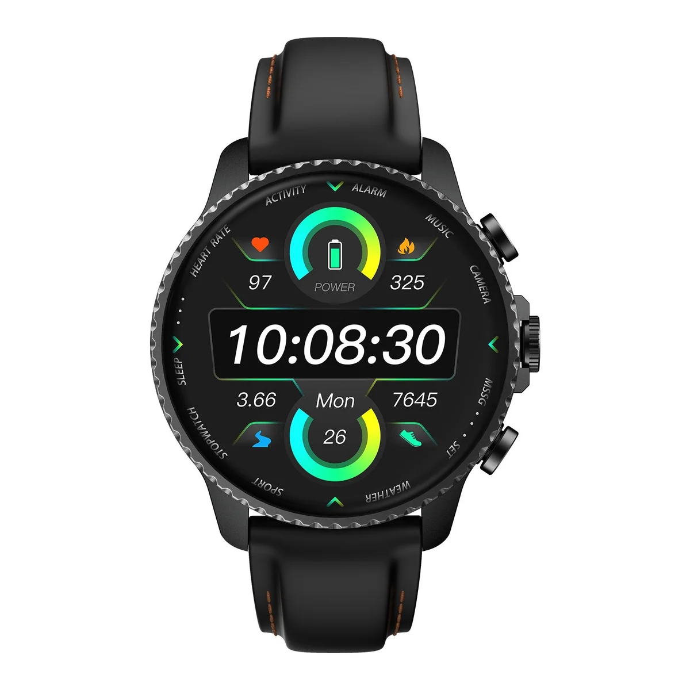
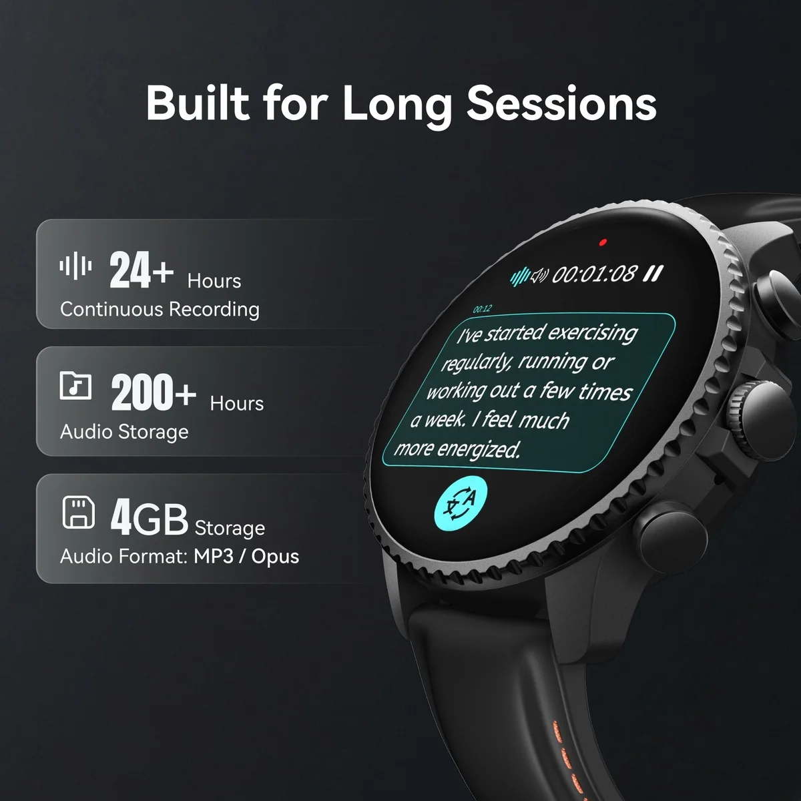
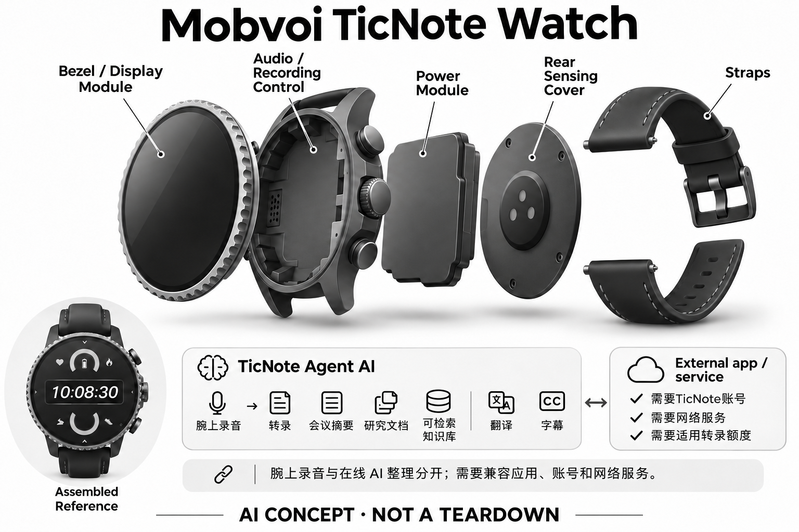

# Mobvoi TicNote Watch

**Mobvoi / TicNote** · 健康与穿戴 · 核查 2026-11-04

个人随身记录入口与TicNote Agent

消费渠道：个人零售。

## 产品图片与结构参考

### 产品图

Mobvoi TicNote Watch官方产品外形图 · 来源：[Mobvoi / TicNote · 官方产品图片](<https://ticnote.ai/products/ticnote-watch>) · [原始图片](<https://cdn.shopify.com/s/files/1/0723/7972/8010/files/ticnote-watch-3052729.jpg?v=1789590915&width=1200>)

### 参考图

Mobvoi TicNote Watch官方另一角度或使用场景参考 · 来源：[Mobvoi / TicNote · 官方产品图片](<https://ticnote.ai/products/ticnote-watch>) · [原始图片](<https://cdn.shopify.com/s/files/1/0723/7972/8010/files/ticnote-watch-smartwatch-with-real-time-ai-transcription-summaries-ai-meeting-assistant-health-tracking-4925030.jpg?v=1789673768&width=1200>)

### AI 生成爆炸示意

**AI 生成 · 非实物拆机。** 内部为概念推断，不能作为元件布局、BOM 或维修依据。[生成提示词](../../content/hardware/prompts/ticnote-watch.txt)

> 外形依据核验参考图；内部位置、模块形状与装配关系仅作AI概念展示。

> 已逐张查看并核对型号。源图未改色/裁切；场景、界面、附件、优惠及效果文案仅为厂商示意，不作为本目录性能或现价依据。

> 分析为基于公开资料的案头研究与 AI 辅助判断，未经用户访谈、销量审计或实物拆机。需求、画像、竞争冷门度、审美及商业机会均为研究假设，不是投资结论。

## 销售与购买

- 状态：在售。官方单机商品页显示美元价格和Add to cart；公开商品JSON available=true，可个人购买一件，无企业采购门槛。未把WiFi/4G容量或Enterprise软件包分拆计数。

- 地区：所列官方区域或授权零售渠道；配送地址与服务支持需结算确认

- 价格：US$199。核查日所见单机或基本配置价；币种、促销、税费、镜片、附件及服务依地区结算，不把颜色或套装重复计数。

- 中国大陆：本次未核实该具体型号在中国大陆的官方销售和完整服务支持；海外在售不等于国内可直接启用全部功能。

- [官方产品 / 商店](<https://ticnote.ai/products/ticnote-watch>)

## AI 的实际作用

TicNote Agent将腕上录音转为转录、会议摘要、研究文档或可检索知识库，另有翻译和字幕功能

服务与联网依赖：需要TicNote账号、网络服务及适用转录额度；腕上录音与在线转录、摘要分开，不默认可脱离所有手机或云端依赖。

## 是否冷门

新兴竞争（研究判断）：按任务与形态作案头分类，无访谈、销量或市场份额证据。

## 需求与市场

需求假设：有想法或需要临时记录时不想翻找手机，希望直接从手腕启动记录。价值应由实际使用频率、任务完成与操作负担验证，不能把AI功能存在或演示流畅当作需求已得到满足。

### 官方｜从手腕启动个人记录 · 官方资料

本型号把录音入口放在腕表屏幕与实体控制附近，TicNote 服务再形成转写、摘要、文档和可检索内容，并提供翻译与字幕。需求是临时想法或交流发生时少一次寻找手机，人工智能收录依据是记录理解服务，不能把普通运动传感或腕表菜单本身当作生成式能力。

依据：[Mobvoi TicNote Watch官方单机购买页](<https://ticnote.ai/products/ticnote-watch>) · [TicNote官方常见问题](<https://ticnote.ai/pages/faq>)

### 判断｜随时可达不等于总能录清 · 研究判断

手腕通常就在身上，可能减少遗忘设备和取手机的步骤，但手部动作、方向和说话距离会改变声音输入。用户还要确认是否启动、何时停止和内容是否保存，不能把腕上入口直接等同持续自动记录；价值应看关键时刻是否留下可用内容，而不是佩戴了多久。

依据：[Mobvoi TicNote Watch官方单机购买页](<https://ticnote.ai/products/ticnote-watch>)

### 验证｜抬腕与手机记录对照 · 待验证

可在临时口述、课程回顾和短谈中比较腕表、手机与佩戴录音器，记录触发、收音、遗漏和事后查找。加入放下手臂、打字和转身，观察哪些内容变差以及用户是否知情；当前目录没有实机实验，不能由设备位置更近就推断所有任务更方便或更准确。

依据：[Mobvoi TicNote Watch官方单机购买页](<https://ticnote.ai/products/ticnote-watch>)

## 用户画像

画像推断：频繁在通勤、课程或个人工作中记录，愿意管理云端笔记权限并逐条确认输出的人。个人的语言、操作习惯、环境和预算会改变适配结果，本次只有案头研究，没有用户访谈或长期使用观察。

### 判断｜愿意把手表作为记录工具的人 · 研究判断

经常有临时想法、习惯戴表并愿意在应用中整理的人可能更容易利用该入口。主要为了运动或健康数据买表的人未必需要同样服务，不能把所有智能手表用户视为笔记需求；画像应按记录频率、佩戴习惯与后续回查任务建立，而不是仅看设备功能数量。

依据：[Mobvoi TicNote Watch官方单机购买页](<https://ticnote.ai/products/ticnote-watch>)

### 判断｜语音表达与社交场合 · 研究判断

腕上口述需要用户愿意出声，会议或共享空间中的操作也可能被他人注意。有人可能喜欢记录自己的想法，却不愿保存旁人谈话，应区分两种动机；用户是否能管理告知、暂停和数据权限，会影响长期适配，不能以个人购买入口推定所有场景都适合使用。

依据：[TicNote官方常见问题](<https://ticnote.ai/pages/faq>)

### 验证｜首次使用和记录管理 · 待验证

测试应覆盖从腕上开始、查看状态、结束到手机回查的完整过程，记录设置、权限和求助步骤。还要观察用户是否理解本地采集与在线生成的区别，避免只看一次成功摘要；不同手机、语言与网络习惯应分别核对，当前资料不保证所有组合具有相同体验。

依据：[Mobvoi TicNote Watch官方单机购买页](<https://ticnote.ai/products/ticnote-watch>) · [TicNote官方常见问题](<https://ticnote.ai/pages/faq>)

## 竞争与替代

案头判断：与普通耳机/手表加录音App及专用录音器竞争，入口便利度和后续检索才是购买取舍，不能只看AI标签。这只是用途与替代品比较，不是市场份额或销量结论；专业细分和较少曝光也不代表没有成熟竞争者。

### 判断｜与佩戴录音器的重叠 · 研究判断

腕表与吊坠、夹式录音器都可能解决临时现场记录，位置和控制不同不应自动增加独立需求数量。比较应看用户原本戴什么、是否需要屏幕确认，以及手部运动是否影响声音；核心价值仍是获得可回查内容，不能只因录音放到手腕就认定形成新的市场场景。

依据：[Mobvoi TicNote Watch官方单机购买页](<https://ticnote.ai/products/ticnote-watch>)

### 判断｜与普通智能手表及手机比较 · 研究判断

其他手表或手机也可能提供录音和语音输入，专门记录服务需要证明回查与整理减少了实际工作。若用户只保存短备忘，复杂文档生成可能很少使用；竞争分析应按任务而不是助手名称、表盘或运动功能排列，不能把共享云服务在不同硬件上重复算作独立创新。

依据：[Mobvoi TicNote Watch官方单机购买页](<https://ticnote.ai/products/ticnote-watch>) · [TicNote官方常见问题](<https://ticnote.ai/pages/faq>)

### 验证｜硬件与服务同口径 · 待验证

比较应使用当前腕表单机与实际转录计划，不把同品牌 Pods 的无线或企业软件配置移入。海外标价也不等于大陆同款服务和到手成本，配套账户与网络需要核对；当前没有销量、留存或用户访谈，目录不由个人可购、价格或生态功能数量推断商业接受度。

依据：[Mobvoi TicNote Watch官方单机购买页](<https://ticnote.ai/products/ticnote-watch>) · [TicNote官方常见问题](<https://ticnote.ai/pages/faq>)

## 供应链

公开资料可核对腕表屏幕、实体按钮、麦克风与日常运动传感器，具体整机工厂、关键模块供应商与BOM本次未确认。制造重点可从形态推断，但不能把品牌所在地、外观相似或营销合作等同代工关系。

### 官方｜腕表输入与服务层 · 官方资料

公开资料支持屏幕、实体按钮、麦克风和日常运动输入，但主控、声学器件、工厂与物料成本未完整披露。不能从普通表盘图标或候选芯片接口推断未披露摄像头，也不能从其他 TicNote 产品补齐内部配置；目录的概念架构只说明功能，不作为真实拆机信息。

依据：[Mobvoi TicNote Watch官方单机购买页](<https://ticnote.ai/products/ticnote-watch>)

### 判断｜手腕位置的声学约束 · 研究判断

表壳与佩戴需要兼顾声音开孔、按键、显示和日常接触，录音还会受到手臂移动与桌面动作影响。供应链研究应验证这些状态，而不是只用静止近讲录音判断；当前没有密封、装配公差和维修资料，不能从外观估算耐久、良率或把品牌所在地当作工厂。

依据：[Mobvoi TicNote Watch官方单机购买页](<https://ticnote.ai/products/ticnote-watch>)

### 判断｜计算与麦克风候选 · 研究判断

恒玄穿戴平台可作为腕上控制、显示和音频路线候选，英飞凌可作为声音输入候选，均未被本型号点名采用。需要核对存储、连接、声孔与功耗，不能直接替换；这些器件不提供 TicNote 的账号、文档生成与知识检索，也不能据平台扩展能力添加未披露硬件。

依据：[Mobvoi TicNote Watch官方单机购买页](<https://ticnote.ai/products/ticnote-watch>)

## 技术路径

TicNote Agent将腕上录音转为转录、会议摘要、研究文档或可检索知识库，另有翻译和字幕功能。这是厂商披露的功能机制；模型版本、准确率及内部结构未完整公开。架构只表示输入、处理和输出关系，不作为真实拆机或性能实测。

### 官方｜录音与在线整理分层 · 官方资料

TicNote Agent 将腕上内容转成转写、摘要或进一步文档，应用、账号、网络与适用额度参与流程。设备可采集不意味着所有生成在腕表本机完成，也不能默认脱离手机或云端依赖；具体模型和数据路由未全部公开，目录保持本地记录与服务处理的边界。

依据：[Mobvoi TicNote Watch官方单机购买页](<https://ticnote.ai/products/ticnote-watch>) · [TicNote官方常见问题](<https://ticnote.ai/pages/faq>)

### 判断｜从谈话到文档会增加推断 · 研究判断

把零散声音扩展为研究或结构化文档时，模型可能补出连接、遗漏前提或改变原意。系统需要让用户知道哪些来自原话、哪些属于生成组织，并能回查证据；文档看起来完整不等于事实已经完整，技术评价应关注可追溯性，而不只看输出篇幅和格式。

依据：[TicNote官方常见问题](<https://ticnote.ai/pages/faq>)

### 验证｜采集、转写和生成逐层检查 · 待验证

测试应先核对原音是否完整，再检查转写与翻译，最后评估文档和问答有没有新增不支持的内容。加入网络中断、腕表离开手机和额度不足，记录保存与处理状态；当前没有独立准确率或续航证据，不能用一次顺利生成代表所有语言、场景和负载。

依据：[Mobvoi TicNote Watch官方单机购买页](<https://ticnote.ai/products/ticnote-watch>) · [TicNote官方常见问题](<https://ticnote.ai/pages/faq>)

## 产品审美

图示观察：圆形腕表屏幕和表带是熟悉的穿戴语言，AI记录入口比健康评分更能体现本款定位。宣传图片只能帮助理解外观和摆放方式，不能证明每个人的舒适度、长时使用体验或实际材料触感。

### 判断｜手表外观与记录意图 · 研究判断

腕表形态容易融入已有佩戴，但旁人可能只把它当作计时或运动工具，不一定理解正在记录。审美研究应同时观察日常搭配、状态可见和用户解释成本，不能把设备感弱直接视为优势；官方图片能确认外形，不能证明材质触感、腕围适配和长期舒适。

依据：[Mobvoi TicNote Watch官方单机购买页](<https://ticnote.ai/products/ticnote-watch>)

### 判断｜小屏确认与复杂内容 · 研究判断

腕上屏幕可以帮助确认录音或查看短内容，较长转写和文档仍可能需要手机，界面需要明确分工。设计评价应观察用户是否频繁切到手机才能知道任务完成，以及翻译字幕是否适合实际阅读；屏幕存在不等于所有工作都能在手腕独立完成，不能以表盘演示替代流程。

依据：[Mobvoi TicNote Watch官方单机购买页](<https://ticnote.ai/products/ticnote-watch>)

### 验证｜全天佩戴与触发动作 · 待验证

试用应覆盖办公、走动、临时口述和充电，记录按键可达、误触、声音质量与主动摘下的原因。不同手臂姿态和衣袖需要分别观察，不能只在抬腕近讲时评价；长期便利取决于用户是否愿意反复执行完整动作，而不是仅有一个随身的录音入口。

依据：[Mobvoi TicNote Watch官方单机购买页](<https://ticnote.ai/products/ticnote-watch>)

## 关键风险

持续戴在身体上的设备容易采集旁人声音；生成文档和翻译可能扩大原话含义，健康功能不作为医疗效果证据。还需核对地区功能、软件更新与售后边界；本目录未进行实机、医学或可靠性测试，不把厂商演示当作结果保证。

### 判断｜旁人内容与持续携带 · 研究判断

设备一直在身上不意味着应该一直记录，用户需要明确开始、暂停和保存边界，尤其旁人可能不理解手表正在采集。记录进入云端笔记后还涉及访问、分享与删除，厂商承诺不等于独立审计；目录不把随手启动便利当作所有谈话都适合长期保存的理由。

依据：[Mobvoi TicNote Watch官方单机购买页](<https://ticnote.ai/products/ticnote-watch>) · [TicNote官方常见问题](<https://ticnote.ai/pages/faq>)

### 判断｜文档和翻译的扩张错误 · 研究判断

翻译与文档生成可能扩大原话含义，把暂定想法写成确定结论或把任务错归给他人。重要内容需要回听和人工确认，普通运动信息也不能被当作医学效果；网络、计划和地区服务会影响实际体验，硬件可购并不保证所有高级能力永久可用。

依据：[TicNote官方常见问题](<https://ticnote.ai/pages/faq>)

### 验证｜更正与退出流程 · 待验证

应检查用户修改或删除原始内容后，摘要、问答与后续文档是否仍保留旧错误，并确认可导出哪些信息。服务失效时还要明确腕表保留的基础功能，不能以设备通电判断整个流程正常；验证重点是数据可控与结果可复核，而不是依赖生成服务自动理解所有意图。

依据：[TicNote官方常见问题](<https://ticnote.ai/pages/faq>)

## 机会与验证

市场差异主要在于个人随身记录入口与TicNote Agent。值得进一步验证的购买理由是它能否减少既有任务中的具体步骤，以及硬件、服务与维护的总成本是否符合个人使用频率。

### 判断｜腕上入口的条件性价值 · 研究判断

本型号值得研究的是用户是否经常在来不及找手机时需要短时记录，以及手腕位置是否确实减少遗漏。若大多数内容都在固定电脑前产生，其他入口可能更合适；场景分组应与主动现场记录复用核心需求，在差异中说明小屏和手部动作，而不按手表外形增加新场景。

依据：[Mobvoi TicNote Watch官方单机购买页](<https://ticnote.ai/products/ticnote-watch>)

### 判断｜从记录到成果的实际联用 · 研究判断

自动文档和知识检索只有被实际回查或用于后续工作才有价值，研究应记录哪些输出被使用、哪些需要重写和哪些被忽略。听起来强大的 Agent 名称不能代替任务证据，也不能把更多生成内容当成效率；硬件入口和软件整理必须共同降低总负担，才可能形成长期理由。

依据：[TicNote官方常见问题](<https://ticnote.ai/pages/faq>)

### 验证｜长期记录与拥有成本 · 待验证

后续可跟踪启动失败、有效音频、生成更正、回查和服务费用，并比较手机或佩戴录音器的替代情况。还需观察普通手表功能与记录功能各自的使用，避免混合评价；当前目录是案头研究，不以个人可购、腕上形态或文档生成宣传认定需求和效果已经验证。

依据：[Mobvoi TicNote Watch官方单机购买页](<https://ticnote.ai/products/ticnote-watch>) · [TicNote官方常见问题](<https://ticnote.ai/pages/faq>)

## 对应供应链公司

能力候选用于选型研究，不代表本产品实际采用；未公开的供货关系不作推断。

- [bestechnic](../supply-chain/bestechnic.md) — **能力候选 · 非已采用** / 腕表显示、控制与音频平台候选：TicNote Watch 披露屏幕、按键和录音，恒玄穿戴平台可作为新设计候选。需核对音频缓存、显示、连接、功耗和固件，当前没有采用点名；候选平台的其他接口不能用来添加未披露硬件，也不提供 TicNote 的文档生成、账号或知识检索服务。

- [infineon](../supply-chain/infineon.md) — **能力候选 · 非已采用** / 腕上临时记录的麦克风候选：本型号以腕上声音采集为入口，英飞凌麦克风可比较自噪与接口，但需要验证手臂移动、衣袖和桌面动作带来的噪声。当前没有供货点名，声孔与具体配置仍未知；器件质量不能保证转写、翻译或扩展文档准确，也不能替代服务端的数据管理。

[浏览供应链目录](../supply-chain.md)

## 功能分层示意

这是功能关系，不是实物拆机、真实空间结构或已核实 BOM。

1. **实体输入**：腕表屏幕、实体按钮、麦克风与日常运动传感器；仅功能层示意，非拆机。（官方披露）

2. **采集与控制**：设备把输入转为可处理的信息并接收用户操作；具体内部布局未知。（分析推断）

3. **AI功能**：TicNote Agent将腕上录音转为转录、会议摘要、研究文档或可检索知识库，另有翻译和字幕功能（官方披露）

4. **服务依赖**：需要TicNote账号、网络服务及适用转录额度；腕上录音与在线转录、摘要分开，不默认可脱离所有手机或云端依赖。（官方披露）

5. **用户反馈**：用户通过声音、屏幕或配套应用接收结果，并对重要信息复核。（分析推断）

## 来源

1. [Mobvoi TicNote Watch官方单机购买页](<https://ticnote.ai/products/ticnote-watch>) — 已打开官方腕表单机购买页并核实公开商品JSON可售，个人消费者可单件下单。

2. [TicNote官方常见问题](<https://ticnote.ai/pages/faq>) — 已打开一手页面；产品能力为厂商披露，未进行实机或效果验证。

3. [TicNote官方产品生态](<https://ticnote.ai/>) — 已打开一手页面；产品能力为厂商披露，未进行实机或效果验证。

[返回目录](../hardware-market.md) · [网页分析](https://romanagent.github.io/Roman/#hardware/product/ticnote-watch)
