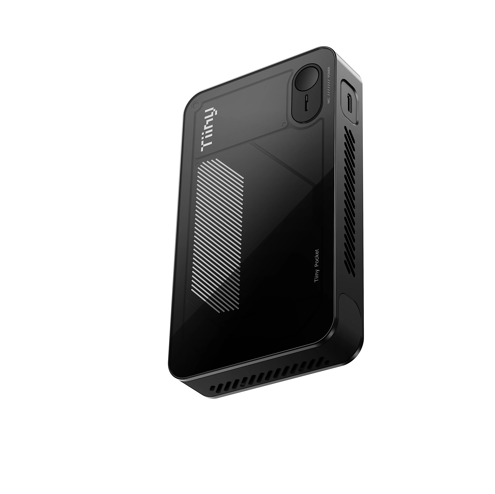
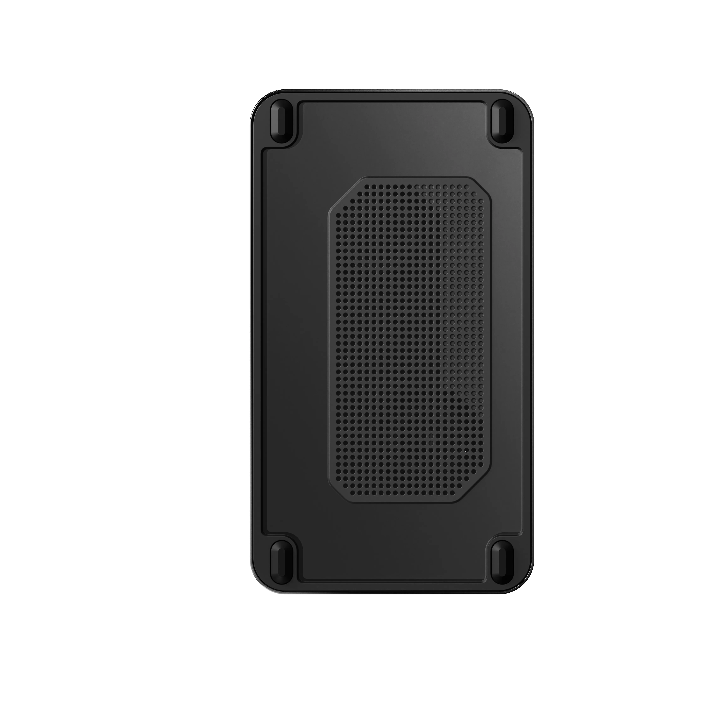
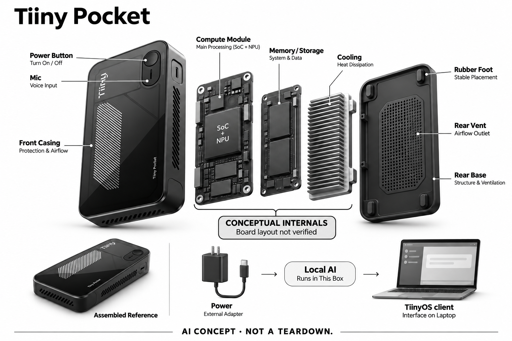

# Tiiny Pocket

**Tiiny** · 手机与 AI PC · 核查 2026-11-05

把支持的模型和Agent运行在随电脑携带的本地终端

消费渠道：个人零售。

## 产品图片与结构参考

### 产品图

Tiiny Pocket官方正面斜向外形，圆形部件为电源键 · 来源：[Tiiny · 官方产品图片](<https://www.tiiny.ai/products/tiiny-pocket>) · [原始图片](<https://img-va.myshopline.com/image/store/1784520124508/tiiny-bip-114.webp?h=1200&q=80&w=1200>)

### 参考图

Tiiny Pocket官方背部通风与脚垫参考 · 来源：[Tiiny · 官方产品图片](<https://www.tiiny.ai/products/tiiny-pocket>) · [原始图片](<https://img-va.myshopline.com/image/store/1784520124508/tiiny-black-back.webp?h=1200&q=80&w=1200>)

### AI 生成爆炸示意

**AI 生成 · 非实物拆机。** 内部为概念推断，不能作为元件布局、BOM 或维修依据。[生成提示词](../../content/hardware/prompts/tiiny-pocket.txt)

> 已检查外形、标签与灰阶；分离模块是概念功能架构，非真实内部布局、完整BOM或性能证明。

> 独立复查后以ImageGen强化局部概念标识，未知控制板或执行层明确为示意；复查前图保留在referencePaths，实际追加提示词记录于主prompt。

> 逐张实际查看确认型号与代次，保留官方源图；图片与界面中的营销内容不作为独立实测或效果保证。

> 源站图片URL请求合理宽度但实际仍返回高分辨率WebP；保留源图，没有自行重采样或修改。

> 分析为基于公开资料的案头研究与 AI 辅助判断，未经用户访谈、销量审计或实物拆机。需求、画像、竞争冷门度、审美及商业机会均为研究假设，不是投资结论。

## 销售与购买

- 状态：在售。本轮实际浏览器将具体Black整机加入购物车并进入US$2,099完整结算，未填信息或支付；商品页明确美国仓及订单处理后预计交付。首页残留上市通知文案，不以该通知替代实际订单证据。

- 地区：美国本土连续地区首批零售，部分地址除外

- 价格：US$2,099（所见Black整机）。税费按结算，具体配送及处理时间需订单确认；本地支持模型不按token收费不等于所有在线连接或第三方工具永久免费。

- 中国大陆：当前零售首批仅美国本土，境外页面要求订阅后续通知；历史欧洲众筹发货不证明大陆当前可订购。

- [官方产品 / 商店](<https://www.tiiny.ai/products/tiiny-pocket>)

## AI 的实际作用

TiinyOS提供支持模型和Agent入口，设备承担本地语言、视觉或语音推理；用户仍通过兼容电脑等客户端交互。

服务与联网依赖：需要外部供电和兼容主机；先下载支持模型，网页搜索与外部连接仍需联网，离线更新包和额外模型导入部分仍在发展。

## 是否冷门

新兴竞争（研究判断）：面向愿意管理本地模型的个人进阶用户，区别于云端聊天附件和文件存储NAS；任务效率、兼容与持续性能未经本研究实测。

## 需求与市场

需求假设是个人希望保留本地处理控制，同时让自己的电脑继续承担其他任务。专用终端可能减少频繁启动和配置不同模型的负担，但也新增一台要维护的设备；是否有价值取决于实际任务、兼容和持续运行需求，而不只是对离线或大模型参数规模的兴趣。

### 官方｜本地执行与主机交互分工 · 官方资料

Tiiny Pocket是一台配套TiinyOS、模型和Agent入口的个人计算终端，本机承担支持模型的推理，用户通过兼容电脑等客户端操作。它不是只提供空壳或开发板的项目，也不是独立屏幕手机；外部主机、供电和所选软件仍是工作流的一部分，不能把便携外形理解为随时脱离其他设备使用。

依据：[Tiiny Pocket当前官方商品与结算](<https://www.tiiny.ai/products/tiiny-pocket>) · [Tiiny当前本地模型工作流与FAQ](<https://www.tiiny.ai/>)

### 判断｜把长期模型任务从日常电脑中分离 · 研究判断

需求假设是个人希望保留本地处理控制，同时让自己的电脑继续承担其他任务。专用终端可能减少频繁启动和配置不同模型的负担，但也新增一台要维护的设备；是否有价值取决于实际任务、兼容和持续运行需求，而不只是对离线或大模型参数规模的兴趣。

依据：[Tiiny Pocket当前官方商品与结算](<https://www.tiiny.ai/products/tiiny-pocket>) · [Tiiny当前本地模型工作流与FAQ](<https://www.tiiny.ai/>)

### 验证｜先选可重复且有答案边界的任务 · 待验证

可用公开或合成资料定义一个文档问答、转写或简单Agent流程，记录首次配置、输出核对和重复运行的步骤。模型选择和上下文应保持可追溯，不能只比较一次回答速度；本目录未运行设备，没有复现厂家基准，也不承诺任何模型达到云端服务相同质量。

依据：[Tiiny Pocket当前官方商品与结算](<https://www.tiiny.ai/products/tiiny-pocket>) · [Tiiny官方模型基准报告入口](<https://www.tiiny.ai/pages/benchmark-report/?from=footer>)

## 用户画像

即便界面减少命令行配置，用户仍要选择模型、知道任务会读取哪些文件，并理解外部工具和账户的权限。希望获得完全托管助手的人未必愿意承担这些责任；用户画像应围绕可管理的工作流和支持条件，而非将“无需复杂设置”的宣传解释成人人都能零成本上手。

### 官方｜面向个人进阶用户的实际整机订单 · 官方资料

当前商品展示具体整机价格与购买入口，本轮浏览器成功进入包含商品、配送和付款字段的结算页，没有填入任何个人信息或完成付款。官方同时面向开发者、专业人士及本地AI爱好者介绍用途，因此目录采用个人进阶用户定位，不把企业项目询价或演示资格当作购买证据。

依据：[Tiiny Pocket当前官方商品与结算](<https://www.tiiny.ai/products/tiiny-pocket>) · [Tiiny当前本地模型工作流与FAQ](<https://www.tiiny.ai/>)

### 判断｜能管理任务权限的人更可能适配 · 研究判断

即便界面减少命令行配置，用户仍要选择模型、知道任务会读取哪些文件，并理解外部工具和账户的权限。希望获得完全托管助手的人未必愿意承担这些责任；用户画像应围绕可管理的工作流和支持条件，而非将“无需复杂设置”的宣传解释成人人都能零成本上手。

依据：[Tiiny当前本地模型工作流与FAQ](<https://www.tiiny.ai/>)

### 验证｜核对主机、网络和恢复条件 · 待验证

购买前应确认现有主机系统、客户端、供电位置和模型下载条件，并了解断连或更新失败时如何恢复。若任务依赖其他服务，也要核对其账户和费用；本研究没有真实用户试用，不因设备可加入购物车就承诺个人全部软件环境和常用Agent都能兼容。

依据：[Tiiny Pocket当前官方商品与结算](<https://www.tiiny.ai/products/tiiny-pocket>) · [Tiiny当前本地模型工作流与FAQ](<https://www.tiiny.ai/>)

## 竞争与替代

AI NAS侧重持续文件库、索引和共享，本条侧重为个人运行和编排支持的模型与Agent；两者可能有重叠任务，但系统维护重点不同。与云端助手相比，本地终端减少部分外部推理依赖，也受本机资源和模型选择限制，不能把离线处理等同更强能力或更低总成本。

### 官方｜新零售与旧众筹地区要分开 · 官方资料

当前具体商品说明首批零售仅美国本土连续地区，境外用户可订阅后续通知；运输政策仍主要描述早期众筹在美国和欧洲分批履约。两类订单时间与地区不能合并，首页上市通知也有残留；本条采用实际整机结算证明可订购，仍不保证某个地址或具体到货日期。

依据：[Tiiny Pocket当前官方商品与结算](<https://www.tiiny.ai/products/tiiny-pocket>) · [Tiiny历史众筹发运政策](<https://www.tiiny.ai/policies/shipping-policy>)

### 判断｜与NAS和云端助手关注点不同 · 研究判断

AI NAS侧重持续文件库、索引和共享，本条侧重为个人运行和编排支持的模型与Agent；两者可能有重叠任务，但系统维护重点不同。与云端助手相比，本地终端减少部分外部推理依赖，也受本机资源和模型选择限制，不能把离线处理等同更强能力或更低总成本。

依据：[Tiiny Pocket当前官方商品与结算](<https://www.tiiny.ai/products/tiiny-pocket>) · [Tiiny当前本地模型工作流与FAQ](<https://www.tiiny.ai/>)

### 验证｜用实际工作流比较总投入 · 待验证

可以比较已有电脑、本地终端和云服务完成同一受控任务的配置、结果复核及维护步骤，单独记录需要联网的工具。硬件价格、供电、存储和第三方服务都应计入，而不是只看token费用；没有长期使用数据时，不宣称购买设备必然比订阅更划算。

依据：[Tiiny Pocket当前官方商品与结算](<https://www.tiiny.ai/products/tiiny-pocket>) · [Tiiny当前本地模型工作流与FAQ](<https://www.tiiny.ai/>) · [Tiiny官方模型基准报告入口](<https://www.tiiny.ai/pages/benchmark-report/?from=footer>)

## 供应链

同类小型终端要在模型运行、内存访问、外部连接和散热空间之间协调，短时启动成功不说明长时间任务稳定。接口供电协商与整机机械设计也会影响可用性；供应商候选只能提供局部或工程能力，不能从通用计算经验推定已有该产品的软件和模型适配。

### 官方｜功能模块已披露，芯片供应商未完整披露 · 官方资料

商品资料列出SoC、独立加速器、内存、存储及连接等功能结构，但没有完整点名主控与加速器的供应商或工厂。外壳正面圆形部件是电源控制，不能误画成相机；设备使用外部电源，不应凭口袋大小添加电池。概念图只分离功能层，不复刻未知PCB布局。

依据：[Tiiny Pocket当前官方商品与结算](<https://www.tiiny.ai/products/tiiny-pocket>)

### 判断｜持续推理需要共同考虑供电和热设计 · 研究判断

同类小型终端要在模型运行、内存访问、外部连接和散热空间之间协调，短时启动成功不说明长时间任务稳定。接口供电协商与整机机械设计也会影响可用性；供应商候选只能提供局部或工程能力，不能从通用计算经验推定已有该产品的软件和模型适配。

依据：[Tiiny Pocket当前官方商品与结算](<https://www.tiiny.ai/products/tiiny-pocket>) · [Tiiny当前本地模型工作流与FAQ](<https://www.tiiny.ai/>)

### 验证｜候选需与实际电源及主机接口匹配 · 待验证

USB供电控制候选应核对协商、功率路径和异常处理，计算终端工程候选则需确认板级开发、热设计和生命周期责任。这里没有Tiiny点名采用证据，不提供现机换件BOM；任何相近新设计仍须验证模型负载和系统稳定，不能只依据一块评估板或器件额定值。

依据：[Tiiny Pocket当前官方商品与结算](<https://www.tiiny.ai/products/tiiny-pocket>)

## 技术路径

本地模型回答问题与调用外部工具是不同风险层次，后一种可能修改文件或使用账户服务。运行位置在本机并不能替用户判断每一步是否应该执行，也不能保证输入文件中的内容可信；技术评价应包含权限、确认和可恢复性，而不只是模型生成速度或参数数量。

### 官方｜离线推理有下载与连接前提 · 官方资料

官方FAQ说明支持模型下载后可本地运行，网页搜索和外部连接仍需要互联网；离线系统更新包和更多模型导入能力还有发展中的部分。目录因此区分模型推理、软件下载和工具访问，不把所有Agent动作概括为完全离线，也不把未来扩展功能写成已经交付的保证。

依据：[Tiiny当前本地模型工作流与FAQ](<https://www.tiiny.ai/>)

### 判断｜Agent能执行动作时需要更清楚的边界 · 研究判断

本地模型回答问题与调用外部工具是不同风险层次，后一种可能修改文件或使用账户服务。运行位置在本机并不能替用户判断每一步是否应该执行，也不能保证输入文件中的内容可信；技术评价应包含权限、确认和可恢复性，而不只是模型生成速度或参数数量。

依据：[Tiiny Pocket当前官方商品与结算](<https://www.tiiny.ai/products/tiiny-pocket>) · [Tiiny当前本地模型工作流与FAQ](<https://www.tiiny.ai/>)

### 验证｜先限定读取范围和可撤销动作 · 待验证

研究测试可从只读样本和可恢复任务开始，观察模型选择、来源回查、工具调用记录与停止方式。联网连接需单独检查外发信息和授权，不以“本地”一词代替实际设置核查；本目录没有运行用户Agent或访问私人文件，也没有完成安全审计和准确率测试。

依据：[Tiiny Pocket当前官方商品与结算](<https://www.tiiny.ai/products/tiiny-pocket>) · [Tiiny当前本地模型工作流与FAQ](<https://www.tiiny.ai/>)

## 产品审美

机身小并不意味着出门只带这一件物品，用户还需要电源、数据连接和交互终端。桌面摆放与收纳是否方便，可能比宣传中的口袋类比更影响真实使用；审美可以评价外壳和接口布局，但不能从照片推定安静、低温或长期握持的舒适程度。

### 官方｜便携盒体没有内置屏幕或摄像头 · 官方资料

官方照片显示黑色圆角矩形机身、正面斜向通风纹理、圆形电源键、麦克风开口以及背部散热孔和脚垫。与带屏AI手机外观不同，交互界面在配套主机；生成图保留这些可见特征，未知散热、板卡和存储形状仅作概念，不增加外露天线、镜头或未经披露的电池。

依据：[Tiiny Pocket当前官方商品与结算](<https://www.tiiny.ai/products/tiiny-pocket>)

### 判断｜随身携带仍要考虑线缆与电源 · 研究判断

机身小并不意味着出门只带这一件物品，用户还需要电源、数据连接和交互终端。桌面摆放与收纳是否方便，可能比宣传中的口袋类比更影响真实使用；审美可以评价外壳和接口布局，但不能从照片推定安静、低温或长期握持的舒适程度。

依据：[Tiiny Pocket当前官方商品与结算](<https://www.tiiny.ai/products/tiiny-pocket>) · [Tiiny当前本地模型工作流与FAQ](<https://www.tiiny.ai/>)

### 验证｜以完整携带套件观察便利性 · 待验证

可以按实际使用环境检查主机、电源和线缆的摆放、连接和收纳步骤，记录是否需要额外转接或固定空间。运行时的热与声感受应单独测试，不以通风孔或厂商噪声数字代替实测；本轮仅核官方资料和图片，未进行携带、散热或耐久验证。

依据：[Tiiny Pocket当前官方商品与结算](<https://www.tiiny.ai/products/tiiny-pocket>)

## 关键风险

数据留在个人设备上可以改变处理路径，但设备遗失、账户配置、外部连接和模型输出仍可能产生问题。加密或本地架构不是零风险证明，生成内容也可能出错；目录不采用绝对隐私或智能水平营销承诺，尤其不能把用于专业敏感资料的用户设想当成合规结论。

### 官方｜当地零售和第三方费用有边界 · 官方资料

当前零售首批范围限定美国本土，历史众筹发货地区不构成大陆正式可购证据。支持模型本地推理不按token计费，也不代表所有在线服务、工具和外部账户永久免费；所见整机价格需与税费和实际配送条件一起理解，厂家社区的计划性用途不当成已经验证的案例。

依据：[Tiiny Pocket当前官方商品与结算](<https://www.tiiny.ai/products/tiiny-pocket>) · [Tiiny当前本地模型工作流与FAQ](<https://www.tiiny.ai/>) · [Tiiny历史众筹发运政策](<https://www.tiiny.ai/policies/shipping-policy>)

### 判断｜本地数据仍需要权限和备份管理 · 研究判断

数据留在个人设备上可以改变处理路径，但设备遗失、账户配置、外部连接和模型输出仍可能产生问题。加密或本地架构不是零风险证明，生成内容也可能出错；目录不采用绝对隐私或智能水平营销承诺，尤其不能把用于专业敏感资料的用户设想当成合规结论。

依据：[Tiiny Pocket当前官方商品与结算](<https://www.tiiny.ai/products/tiiny-pocket>) · [Tiiny当前本地模型工作流与FAQ](<https://www.tiiny.ai/>)

### 验证｜检查更新、恢复和退出方案 · 待验证

可以核对系统更新来源、模型许可、备份导出、服务停用后的本地可用范围及故障支持路径，确认用户能保留重要原始资料。涉及外部工具时，还需知道如何撤回授权和停止任务；本研究没有安全认证或长期运行证据，不把本地终端当作无需维护的保险箱。

依据：[Tiiny Pocket当前官方商品与结算](<https://www.tiiny.ai/products/tiiny-pocket>) · [Tiiny当前本地模型工作流与FAQ](<https://www.tiiny.ai/>)

## 机会与验证

后续研究可先看哪些任务确实需要本地处理、反复运行或稳定环境，再观察专用终端是否减少配置和等待。若只是偶尔聊天，已有设备可能足够；如果任务依赖大量外部服务，离线优势也会缩小，这些限制需要与实际使用记录一起评估，而非靠宣传规模判断。

### 官方｜本地模型执行保留一个核心工作流 · 官方资料

本条代表有配套模型和Agent环境的个人本地执行终端，不把颜色、内存或同类小型计算机逐一算作新场景。它与已有rabbit等云端助手入口的差异在处理部署和任务控制，也与NAS资料库有所区别；收录依据是完整硬件软件工作流，而非泛泛的AI电脑标签。

依据：[Tiiny Pocket当前官方商品与结算](<https://www.tiiny.ai/products/tiiny-pocket>) · [Tiiny当前本地模型工作流与FAQ](<https://www.tiiny.ai/>)

### 判断｜找出值得长期保留的局部任务 · 研究判断

后续研究可先看哪些任务确实需要本地处理、反复运行或稳定环境，再观察专用终端是否减少配置和等待。若只是偶尔聊天，已有设备可能足够；如果任务依赖大量外部服务，离线优势也会缩小，这些限制需要与实际使用记录一起评估，而非靠宣传规模判断。

依据：[Tiiny当前本地模型工作流与FAQ](<https://www.tiiny.ai/>) · [Tiiny官方模型基准报告入口](<https://www.tiiny.ai/pages/benchmark-report/?from=footer>)

### 验证｜跟踪模型和工具更新后的可用性 · 待验证

可以记录数周内任务成功、错误恢复、模型变更和软件维护所需时间，核对原先可运行流程在更新后是否保持可复现。当前只有官方资料及实际结算入口，没有独立性能、用户访谈或销量证据；不能据一次演示或厂家基准预判个人长期收益和市场接受度。

依据：[Tiiny Pocket当前官方商品与结算](<https://www.tiiny.ai/products/tiiny-pocket>) · [Tiiny当前本地模型工作流与FAQ](<https://www.tiiny.ai/>) · [Tiiny官方模型基准报告入口](<https://www.tiiny.ai/pages/benchmark-report/?from=footer>)

## 对应供应链公司

能力候选用于选型研究，不代表本产品实际采用；未公开的供货关系不作推断。

- [texas-instruments](../supply-chain/texas-instruments.md) — **能力候选 · 非已采用** / 同类外接供电AI终端的USB-C电源控制候选：TI TPS25751公开USB-C受电与功率路径控制，可研究同类小型AI终端的外部供电协商、保护及负载变化，但它不是处理模型的芯片或完整适配器。未发现Tiiny采用证据，接口和整机功耗仍须核对；候选不意味着本机有电池，也不构成现有设备直接替换方案。

- [inventec](../supply-chain/inventec.md) — **能力候选 · 非已采用** / 同类个人AI计算终端的系统工程候选：英业达公开个人计算系统和电子工程能力，可作为同类小型终端的板级、机构、热管理与制造项目询证入口，但专用加速器适配、模型环境和目标项目规模需另确认。没有Tiiny点名合作来源，不能由计算产品经验推定现用代工关系或掌握其完整软硬件方案。

[浏览供应链目录](../supply-chain.md)

## 功能分层示意

这是功能关系，不是实物拆机、真实空间结构或已核实 BOM。

1. **用户客户端**：兼容电脑或支持终端打开TiinyOS及相关接口。（官方披露）

2. **模型与任务配置**：从支持列表选择模型及Agent，许可与工具权限需核对。（官方披露）

3. **本地计算**：SoC和独立加速器等平台承担推理，实际芯片品牌未完整披露。（官方披露）

4. **内存与存储**：本机保存支持模型和任务数据，具体布局不公开。（官方披露）

5. **供电、冷却和连接**：外部电源配合机身散热，联网功能与离线推理分开。（官方披露）

## 来源

1. [Tiiny Pocket当前官方商品与结算](<https://www.tiiny.ai/products/tiiny-pocket>) — 已打开并以实际浏览器进入完整硬件结算：US$2099。未填个人信息或支付；当前商品首批美国仓，首页通知文案保留为证据差异。

2. [Tiiny当前本地模型工作流与FAQ](<https://www.tiiny.ai/>) — 已打开：需要主机，模型下载后可本地运行，网页搜索/外部连接需网络；不采零风险、零学习等营销保证。

3. [Tiiny历史众筹发运政策](<https://www.tiiny.ai/policies/shipping-policy>) — 已打开：主要针对Kickstarter自2026年8月分批发运，欧洲清单不扩大当前商品美国零售范围。

4. [Tiiny官方模型基准报告入口](<https://www.tiiny.ai/pages/benchmark-report/?from=footer>) — 已打开厂家模型评估资料，属于厂商自身口径；没有进行复现实验，不将模型参数或成绩推广为任意任务效果。

[返回目录](../hardware-market.md) · [网页分析](https://romanagent.github.io/Roman/#hardware/product/tiiny-pocket)
