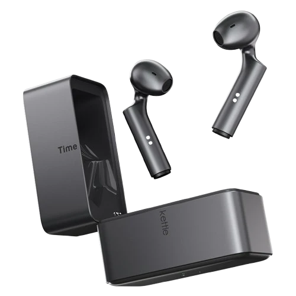
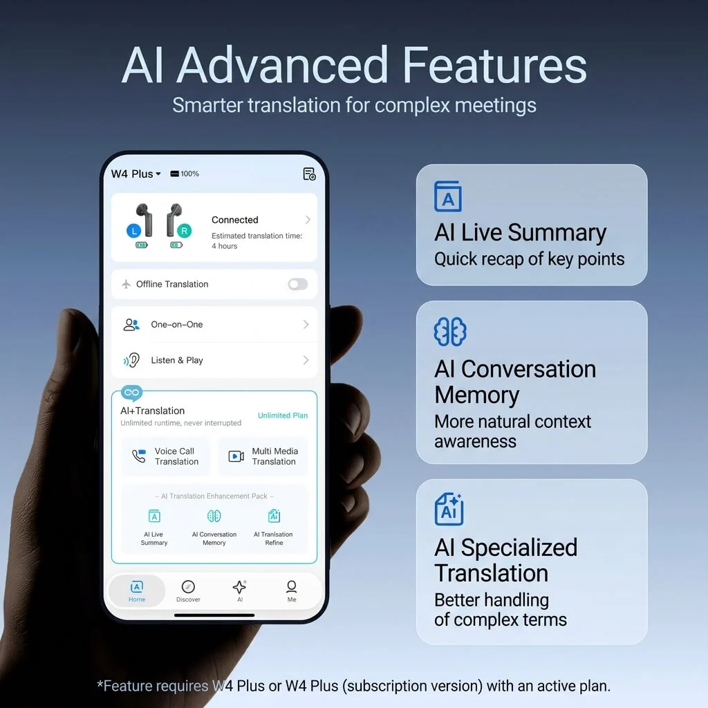
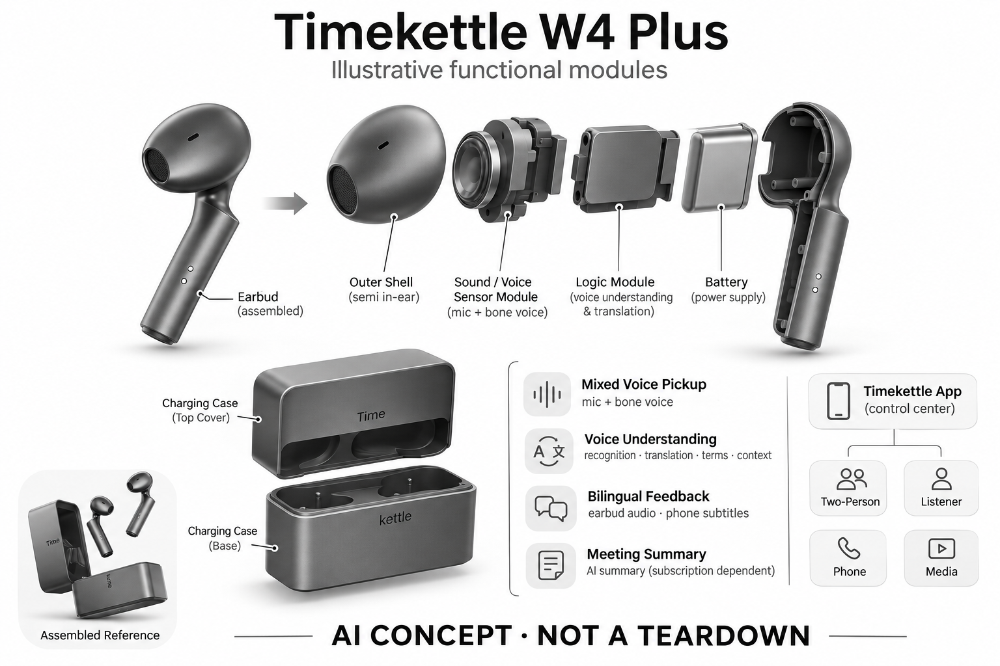

# Timekettle W4 Plus

**Timekettle / 时空壶** · 翻译与音频 · 核查 2026-11-04

把拾音与灵活收费方案放进日常翻译耳机

## 产品图片与结构参考

### 产品图

官方 W4 Plus 耳机与充电盒 · 来源：[Timekettle / 时空壶 · 官方产品图片](<https://www.timekettle.co/products/w4-plus-ai-interpreter-earbuds>) · [原始图片](<https://cdn.shopify.com/s/files/1/0090/3797/1519/files/W4_plus_58cc39aa-3ecb-4f7d-9d34-48a92124767a.png?v=1790566818>)

### 参考图

官方 W4 Plus 配套软件功能示意，权益以实际版本为准 · 来源：[Timekettle / 时空壶 · 官方产品图片](<https://www.timekettle.co/products/w4-plus-ai-interpreter-earbuds>) · [原始图片](<https://cdn.shopify.com/s/files/1/0090/3797/1519/files/W4_P.jpg?v=1787208421&width=1200>)

### AI 生成爆炸示意

**AI 生成 · 非实物拆机。** 内部为概念推断，不能作为元件布局、BOM 或维修依据。[生成提示词](../../content/hardware/prompts/timekettle-w4-plus.txt)

> 外形依据核验参考图；内部位置、模块形状与装配关系仅作AI概念展示。

> 图片按源站提供格式保存，未裁切或改色；厂商渲染/场景示意不代表实机测试。

> 分析为基于公开资料的案头研究与 AI 辅助判断，未经用户访谈、销量审计或实物拆机。需求、画像、竞争冷门度、审美及商业机会均为研究假设，不是投资结论。

## 销售与购买

- 状态：在售。官方国际商品页提供一次购买和订阅版本的价格与选择；中文官网W4 Plus页面有立即购买并链接京东。不是把旧W4的商品页视为Plus已开售。

- 地区：中国大陆、美国、日本、英国、欧洲及其他官网支持配送地区

- 价格：国际站 US$299 起；一次购买版 US$348.68。核查时促销价格：US$299为订阅版硬件，US$348.68为一次购买版。两者功能付费条件不同，不将较低价视为全部功能永久价格。

- 中国大陆：中文官网存在W4 Plus正式购买入口，指向京东；国际站两个收费版本是否均在大陆提供，需按国内SKU核实。

- [官方产品 / 商店](<https://www.timekettle.co/products/w4-plus-ai-interpreter-earbuds>)

## AI 的实际作用

骨声纹相关拾音与语音翻译，支持术语、上下文和会议摘要等AI工具。

服务与联网依赖：需Timekettle App；在线和离线语对范围不同。订阅版的电话、媒体与高级AI试用后需付费，一次购买版按官网另有授权条件。

## 是否冷门

细分专业（研究判断）：跨语言高频沟通是专业用途，竞争含手机与耳机生态；此分类不表示市场规模或低竞争。

## 需求与市场

需求假设：日常跨语言交流的障碍既有听不懂，也有嘈杂时采集不到自己的声音。产品要同时解决输入和理解，价值需用用户常遇到的环境测试，而不是只比较模型功能清单。

## 用户画像

画像推断：跨境生活、学习或商务接待频率较高的人更可能形成使用习惯。轻度用户与长期用户对硬件首付、订阅和永久版本的接受方式不同，不能将两个价位混为同一人群。

## 竞争与替代

案头判断：同品牌W4 Pro、手机翻译和系统级耳机功能都是替代。骨声纹宣传是技术差异线索，不是独立效果证明；未做销量、访谈或价格实验，因此不判定哪个版本更受欢迎。

## 供应链

中文官网披露骨声纹传感器与双麦混合拾音；实际器件厂商、整机工厂与校准流程未公开。推断接触位置、耳廓差异和噪声算法配合影响效果，不能只按传感器数量估算竞争壁垒。

## 技术路径

语音输入先被识别，再翻译并以声音或文字输出，会议摘要另属生成式处理。具体算法和芯片未完整披露；骨声纹拾音不是骨传导扬声器，也不意味着所有环境中的对方声音都能隔离。

## 产品审美

图示观察：小型耳塞与硅胶耳翼更接近日常耳机，弱化独立翻译器的器材感。戴得像普通耳机不代表对话双方理解其用途；共享耳机、卫生和耳廓贴合都影响真实接受度。

## 关键风险

两种收费版本容易造成总成本误解，试用结束后的可用功能需核对。翻译中的专有名词与上下文可能失真，媒体和电话支持还受App及平台影响；重要信息应通过原文和复述交叉确认。

## 机会与验证

市场差异是拾音方式与收费版本共同决定使用门槛。尚待验证的购买理由包括实际嘈杂环境成功率、软件准备成本，以及用户是否愿意为电话和高级AI功能持续付费，而不是只看起价。

## 功能分层示意

这是功能关系，不是实物拆机、真实空间结构或已核实 BOM。

1. **混合拾音**：骨声纹传感器结合麦克风；概念功能架构，非拆机清单。（官方披露）

2. **App控制**：Timekettle App组织双人、旁听、电话和媒体模式。（官方披露）

3. **语音理解**：识别、翻译、术语和上下文功能，具体端云路由未完整公开。（官方披露）

4. **双语反馈**：耳机播放与手机字幕，部分离线语对需预先下载。（官方披露）

5. **纪要与授权**：AI摘要等能力受所购版本和订阅授权影响。（官方披露）

## 来源

1. [Timekettle · W4 Plus国际商店](<https://www.timekettle.co/products/w4-plus-ai-interpreter-earbuds>) — 已打开，明确一次购买与订阅版本的价格和功能条件；促销非永久报价。

2. [时空壶中国官网 · W4 Plus](<https://cn.timekettle.co/pages/w4-plus-al-interpreter-earbuds>) — 已打开，京东购买入口及骨声纹/双麦混合拾音描述可见。

[返回目录](../hardware-market.md) · [网页分析](https://romanagent.github.io/Roman/#hardware/product/timekettle-w4-plus)
