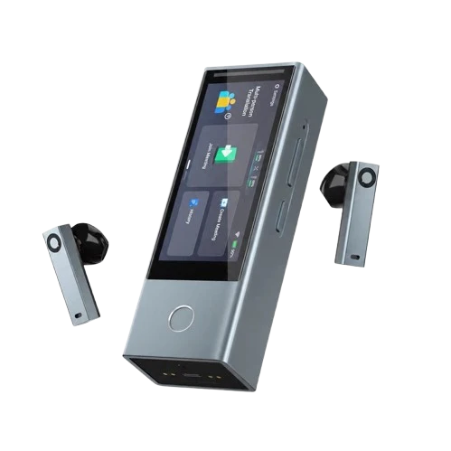
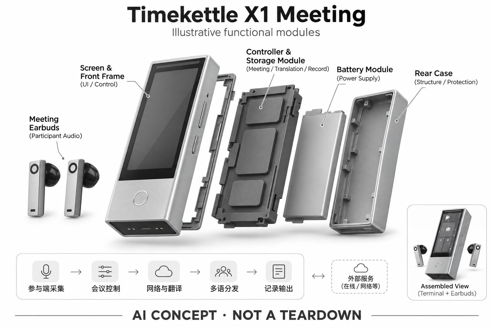

# Timekettle X1 Meeting

**Timekettle / 时空壶** · 翻译与音频 · 核查 2026-11-04

从个人耳机扩展到多人多语会议终端

消费渠道：个人零售。

## 产品图片与结构参考

### 产品图

官方 X1 Meeting 主机与耳机产品图 · 来源：[Timekettle / 时空壶 · 官方产品图片](<https://www.timekettle.co/products/x1-meeting-interpreter-hub>) · [原始图片](<https://www.timekettle.co/cdn/shop/files/X1_M_e2234a49-0dd3-4419-87ed-3230724b0be0.png?v=1786948521&width=499>)

### 参考图

官方多人会议场景示意；图中人数宣传不用于本目录性能确认 · 来源：[Timekettle / 时空壶 · 官方产品图片](<https://www.timekettle.co/products/x1-meeting-interpreter-hub>) · [原始图片](<https://www.timekettle.co/cdn/shop/files/X1_M..jpg?v=1787197411&width=1254>)

### AI 生成爆炸示意

**AI 生成 · 非实物拆机。** 内部为概念推断，不能作为元件布局、BOM 或维修依据。[生成提示词](../../content/hardware/prompts/timekettle-x1-meeting.txt)

> 外形依据核验参考图；内部位置、模块形状与装配关系仅作AI概念展示。

> 图片按源站提供格式保存，未裁切或改色；厂商渲染/场景示意不代表实机测试。

> 分析为基于公开资料的案头研究与 AI 辅助判断，未经用户访谈、销量审计或实物拆机。需求、画像、竞争冷门度、审美及商业机会均为研究假设，不是投资结论。

## 销售与购买

- 状态：在售。国际官网X1 Meeting独立商品页有US$806.55促销价与配送说明；中文官网同名页面提供京东立即购买入口。与早期X1版本分开，不沿用旧版价格和人数上限。

- 地区：中国大陆、美国、日本、英国、欧洲及其他官网支持配送地区

- 价格：国际站 US$806.55（核查时促销）。划线价US$849，非中国售价。多终端部署、配件和会场规模会改变采购总成本，不能将单台价格视为整场会议费用。

- 中国大陆：已打开中国官网X1 Meeting页面并确认京东购买入口；具体会议模式、终端数量和语言上限应按国内最终规格确认。

- [官方产品 / 商店](<https://www.timekettle.co/products/x1-meeting-interpreter-hub>)

## AI 的实际作用

语音识别、多人多语翻译与智能会议纪要，集成在专用终端及耳机工作流中。

服务与联网依赖：官方描述为独立终端、无需手机App启动核心终端功能；在线服务、网络、多个终端或参与端仍影响会议模式，并非所有模式完全离线。

## 是否冷门

细分专业（研究判断）：多人会议终端面向更明确的组织任务，但仍与软件字幕及人工服务竞争；为案头定位。

## 需求与市场

需求假设：跨国小组讨论需要让多名参与者持续听懂，而不是轮流传手机。组织方真正购买的是会议顺畅程度，终端部署、加入方式和会后记录的便利度可能与翻译质量同样重要。

## 用户画像

画像推断：有重复跨语言会议、培训或接待需求的组织，比偶发旅行者更适合评估独立终端。会议主持人、设备管理员与参与者是不同角色，不能仅凭个人耳机体验推断团体使用体验。

## 竞争与替代

案头判断：与人工同传、会议平台字幕、便携翻译器和多人耳机方案竞争，属于专业场景。没有采购访谈、部署数量或服务成本数据，无法认定硬件方案普遍比软件或人工更经济。

## 供应链

官方披露独立终端和配套耳机，但工厂、主芯片、屏幕供应商与多机质检流程未公开。推断除了声学硬件，还需考虑终端充电、网络连接和批量维护；不能由品牌所在地推断生产位置。

## 技术路径

官方页面支持独立终端与多参与端，但不同段落出现不同人数口径，可能对应不同模式或版本。本目录保留多语会议能力而不拼接上限，要求采购前按具体模式核实网络和设备条件。

## 产品审美

图示观察：带屏幕的口袋主机与耳机盒式组织更像会议工具，状态可见性强于纯耳机。它更适合桌面或组织管理，但多设备摆放、携带和消毒流程的便利度需要在真实会场检验。

## 关键风险

多人重叠发言、网络波动和专业术语可能共同降低可理解性；人数上限与实际体验也不是一回事。公开页面口径差异应在采购前确认，重要合同和政策内容不能只凭机器翻译定稿。

## 机会与验证

市场差异在于会议组织和多参与端管理，而不只是个人翻译。尚待验证的购买理由是重复部署是否方便、参与者是否无需培训便能加入，以及组织方是否能稳定取得可复核的双语记录。

## 功能分层示意

这是功能关系，不是实物拆机、真实空间结构或已核实 BOM。

1. **参与端采集**：终端及配套耳机接收发言；此为概念功能图，不代表内部硬件布局。（官方披露）

2. **会议控制**：独立主机组织会议与参与端，核心终端可不依赖手机App。（官方披露）

3. **网络与翻译**：在线识别翻译与部分离线语对；不同模式条件需逐一核实。（官方披露）

4. **多语分发**：按参与语言分发语音或文本，是依据功能抽象的逻辑层。（分析推断）

5. **记录输出**：生成会议转写、译文与AI纪要供组织方复核。（官方披露）

## 来源

1. [Timekettle · X1 Meeting国际商品页](<https://www.timekettle.co/products/x1-meeting-interpreter-hub>) — 已打开，价格和配送可见；不同人数表述未合成为单一上限，厂商准确率未经独立验证。

2. [时空壶中国官网 · X1 Meeting](<https://cn.timekettle.co/pages/x1-meeting-interpreter-hub>) — 已打开，明确同名产品和京东购买入口，未把旧X1规格代入。

[返回目录](../hardware-market.md) · [网页分析](https://romanagent.github.io/Roman/#hardware/product/timekettle-x1-meeting)
