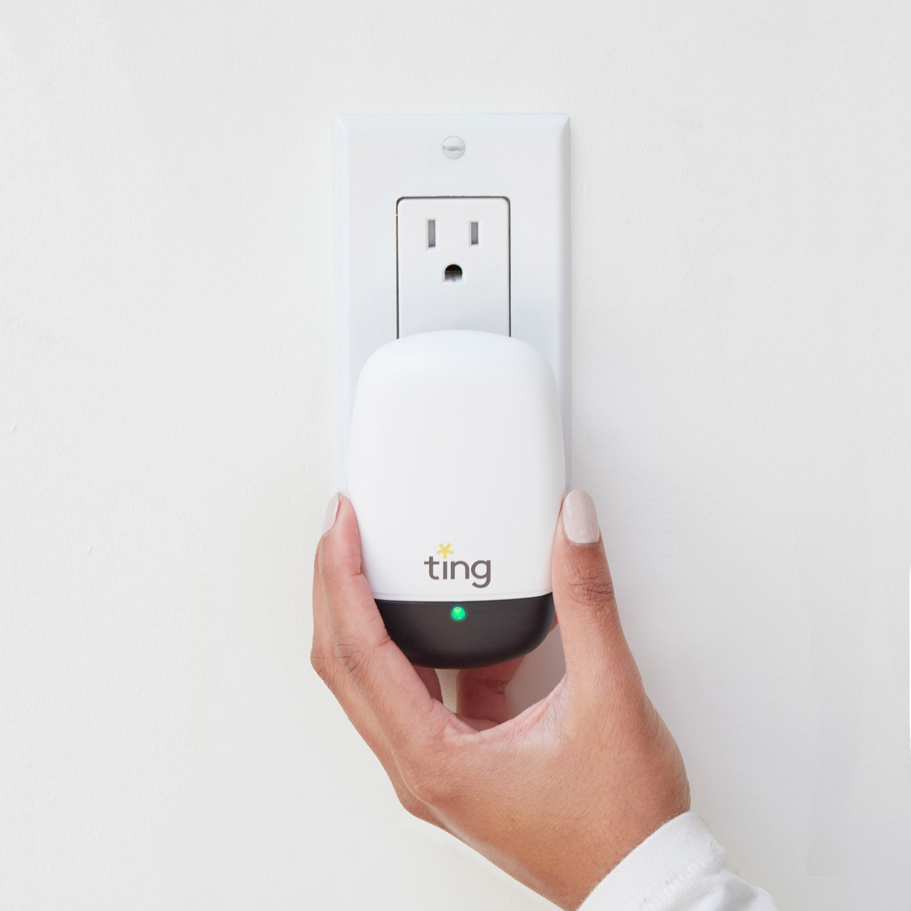
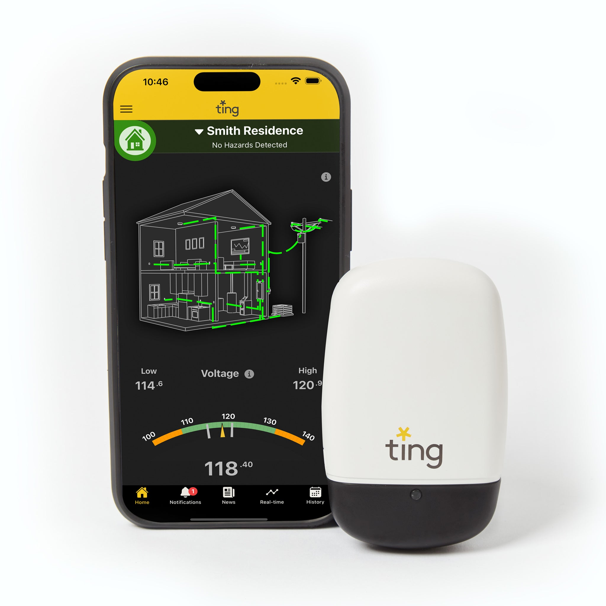
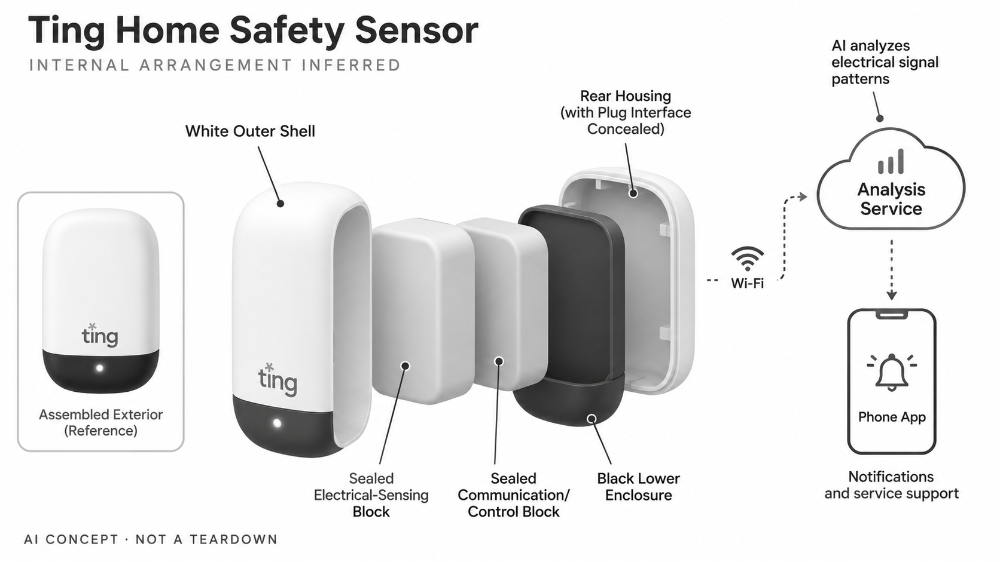

# Ting Sensor with Fire Prevention Service

**Ting / Ting Labs** · 家居安全 · 核查 2026-11-04

以插座式传感器分析家庭电力信号，并连接风险提醒服务。

消费渠道：个人零售。

## 产品图片与结构参考

### 产品图

Ting Sensor with Fire Prevention Service官方产品图 · 来源：[Ting / Ting Labs](<https://shop.tingfire.com/products/ting-sensor-and-1-year-service>) · [原始图片](<https://cdn.shopify.com/s/files/1/0700/7220/5539/files/TingSensor-Fixed.jpg?v=1731775049>)

### 参考图

官方App状态界面与传感器参考，界面数值为演示 · 来源：[Ting / Ting Labs](<https://shop.tingfire.com/products/ting-sensor-and-1-year-service>) · [原始图片](<https://cdn.shopify.com/s/files/1/0700/7220/5539/files/sensorandphone-3.jpg?v=1731775049>)

### AI 生成爆炸示意

**AI 生成 · 非实物拆机。** 内部为概念推断，不能作为元件布局、BOM 或维修依据。[生成提示词](../../content/hardware/prompts/ting-home-safety-sensor.txt)

> 分析为基于公开资料的案头研究与 AI 辅助判断，未经用户访谈、销量审计或实物拆机。需求、画像、竞争冷门度、审美及商业机会均为研究假设，不是投资结论。

## 销售与购买

- 状态：在售。官方Get Ting页面列出零售购买入口，官方商店Frontpage显示1项在库。按个人住宅产品收录，不将面向电网企业的Ting Insights另算消费硬件。

- 地区：美国零售渠道

- 价格：US$99 含首年服务；其后标准零售续期US$49/年。为所标地区和配置的核查参考；活动、税费、物流及可选服务以实际结算为准，不进行汇率换算或保证最低价。

- 中国大陆：本轮是美国120V/60Hz住宅版本与服务。不能直接视为中国大陆220V配置或当地可用服务；国内购买、供电适配和支持没有得到确认。

- [官方产品 / 商店](<https://www.tingfire.com/get-ting/>)

## AI 的实际作用

厂商说明AI结合专用传感器分析家庭电力信号以发现潜在异常，并由服务团队协助后续处理。检测不等于自动修复或保证覆盖所有风险。

服务与联网依赖：需要适配的供电环境、Wi-Fi、手机App及有效服务方案。保险合作计划与直接零售的费用、资格和支持可能不同。

## 是否冷门

细分专业（研究判断）：家庭电气信号监测与后续服务是较窄消费场景，但需要长期信任和服务交付，不能因少见就判断容易进入。

## 需求与市场

需求假设：家庭希望更早获得隐藏电气异常的提示，并知道收到提示后由谁协助处理。购买理由由检测和服务共同构成，不能只看一个传感插头的硬件成本，也不能把提醒等同于消除风险。

## 用户画像

画像推断：重视住宅维护、愿意使用联网安全服务的住户或业主，也包括通过保险合作获得设备的家庭。租住者能否采取后续修复行动会影响价值，消费者和保险渠道的需求并不完全相同。

## 竞争与替代

竞争判断：它与传统烟感、专业电气检查、家庭监测系统和保险服务存在互补及替代。覆盖隐藏电气信号是较窄切入点，但没有本轮独立测试就不能声称比所有替代方案更可靠。

## 供应链

公开资料披露插座传感、联网和服务架构，内部器件与完整供应链未公开。分析重点是长期测量稳定性、供电保护、无线连接、售后及人工服务资源，不能凭小体积推定整套服务成本很低。

## 技术路径

技术链路包括电力信号采集、算法识别、异常通知与服务响应。官方研究是厂商证据而非本目录独立验证，检测覆盖和误报率需要清楚的实测条件，不把宣传比例当成普通家庭保证。

## 产品审美

设计观察：小型插座式外壳便于融入家居，减少安装时的视觉负担。长期使用体验还包括提示是否清晰、App是否令人理解和收到告警后的响应，外观克制不能代替可解释的服务流程。

## 关键风险

风险在于供电规格、服务地区、续费与对安全能力的过度依赖。设备本身不修复隐患，也不替代必要的专业处理；本条只作市场研究，不给电气安装或故障处理操作建议。

## 机会与验证

值得验证的是用户对早期提醒和后续服务是否持续付费。应分析真实使用后的误报负担、服务响应和续期原因，本轮未开展住户访谈或独立事故统计，也不复述厂商效果为确定结论。

## 功能分层示意

这是功能关系，不是实物拆机、真实空间结构或已核实 BOM。

1. **插座感知**：专用传感器读取家庭电力相关信号。（官方披露）

2. **AI异常分析**：厂商描述AI技术用于分析信号模式。（官方披露）

3. **联网与App**：Wi-Fi和手机界面传达提醒与状态。（官方披露）

4. **服务协作**：有效服务方案支持后续风险沟通。（官方披露）

5. **外壳与供电**：内部电气结构为概念推断，不提供接线依据。（分析推断）

## 来源

1. [Ting 家庭零售产品页](<https://www.tingfire.com/get-ting/>) — 99美元包含首年；展示美版供电及续期条件。

2. [Ting 官方商店库存目录](<https://shop.tingfire.com/collections/frontpage>) — 当前显示一项在库个人住宅传感器。

3. [Ting 厂商技术与案例分析](<https://www.tingfire.com/blog/ting-performance-update-2023/>) — 明确AI和专用传感器；效果比例仅属厂商材料，不作为本目录验证结论。

[返回目录](../hardware-market.md) · [网页分析](https://romanagent.github.io/Roman/#hardware/product/ting-home-safety-sensor)
