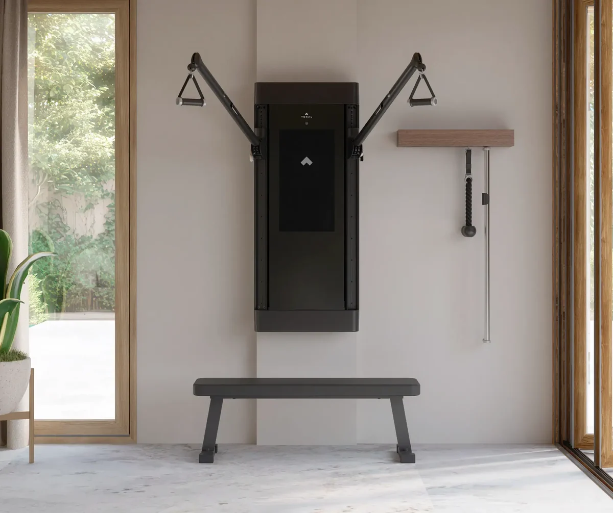
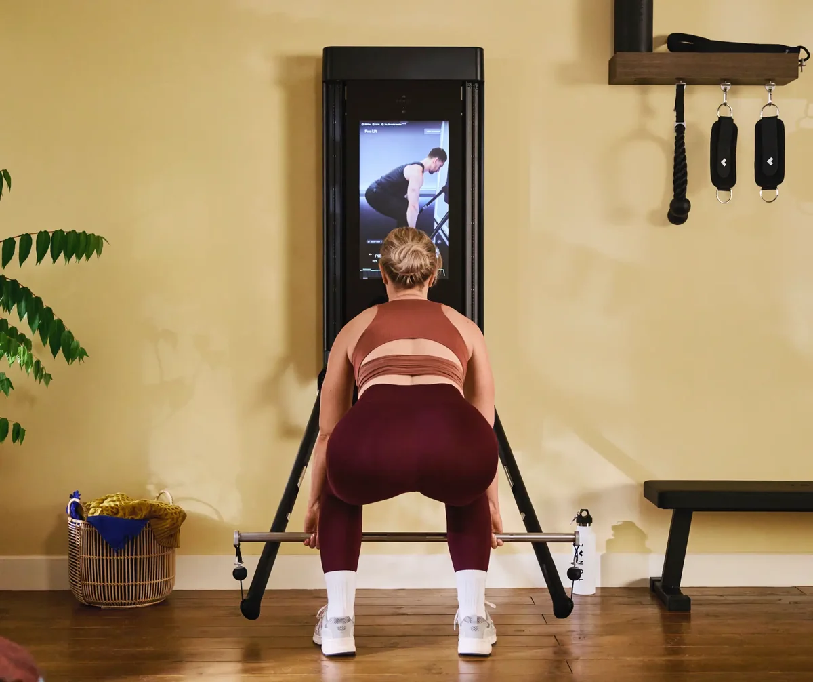
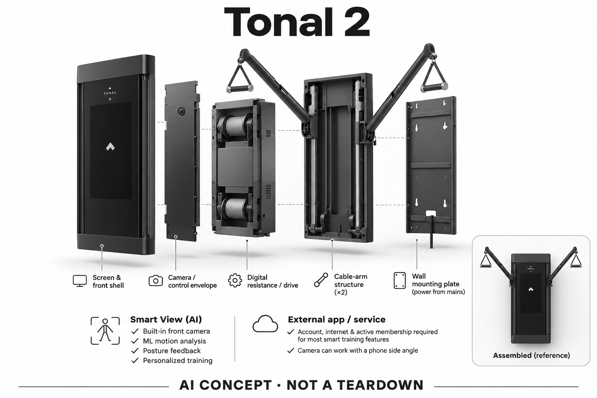

# Tonal 2

**Tonal** · 运动与训练 · 核查 2026-11-04

墙面力量训练与机器视觉动作反馈

消费渠道：个人零售。

## 产品图片与结构参考

### 产品图

Tonal 2官方产品外形图 · 来源：[Tonal · 官方产品图片](<https://tonal.com/products/tonal-2>) · [原始图片](<https://cdn.shopify.com/s/files/1/0879/3767/9642/files/PDP-Tonal2-1.webp?v=1793627816&width=1200>)

### 参考图

Tonal 2官方另一角度或使用场景参考 · 来源：[Tonal · 官方产品图片](<https://tonal.com/products/tonal-2>) · [原始图片](<https://cdn.shopify.com/s/files/1/0879/3767/9642/files/PDP-Tonal2-2_2x_f134e707-e256-4856-94dd-41cb92a4f7c3.webp?v=1793627818&width=1200>)

### AI 生成爆炸示意

**AI 生成 · 非实物拆机。** 内部为概念推断，不能作为元件布局、BOM 或维修依据。[生成提示词](../../content/hardware/prompts/tonal-2.txt)

> 外形依据核验参考图；内部位置、模块形状与装配关系仅作AI概念展示。

> 已逐张查看并核对型号。源图未改色/裁切；场景、界面、附件、优惠及效果文案仅为厂商示意，不作为本目录性能或现价依据。

> 分析为基于公开资料的案头研究与 AI 辅助判断，未经用户访谈、销量审计或实物拆机。需求、画像、竞争冷门度、审美及商业机会均为研究假设，不是投资结论。

## 销售与购买

- 状态：在售。官方Tonal 2商品页显示Add to cart、主机与附件价格、安装通常2–4周，属于面向家庭的零售/安装交付；未把Glacier外观款另计型号。

- 地区：美国官方销售地区（具体配送地址结算确认）

- 价格：US$4,295 主机；所见含基础附件选择 US$4,790。安装与会员另计；官网所见会员US$59.95/月且有初始承诺期，价格按地区与结算变化。

- 中国大陆：本次核实海外官方渠道，未确认同型号中国大陆官方销售、安装和完整软件服务。支持中文或品牌来自中国均不等同大陆可购买。

- [官方产品 / 商店](<https://tonal.com/products/tonal-2>)

## AI 的实际作用

Smart View用内置前置摄像头与机器学习分析动作，并结合拉索数据提供姿态反馈和训练个性化。

服务与联网依赖：多数智能训练功能需账户、联网和有效会员；摄像头可与手机侧面视角协作，不能把安装后的主机等同完全离线教练。

## 是否冷门

竞争密集（研究判断）：依据用途与替代品的案头分类；不是销量、市场份额或用户访谈结论。

## 需求与市场

需求假设：希望在家完成力量训练的人，既需要可调阻力，也希望知道动作是否偏离目标。设备价值应以训练执行与错误反馈的可用性验证，不能把自动加重直接等同训练效果更好。

## 用户画像

画像推断：有稳定训练习惯、愿意为家庭空间安装设备的人更匹配；短期尝鲜者可能难以摊薄安装与订阅成本。初学者仍需要理解动作要求，不能将画面提示视为现场专业指导的完整替代。

## 竞争与替代

案头判断：与自由重量、传统综合训练器和其他数字力量系统竞争，家庭力量方向并不冷清。其墙面形态与视觉反馈有差异，但没有销量或访谈证据支持其比健身房更容易长期坚持。

## 供应链

官方披露数字阻力、拉索位置和内置视觉反馈，具体电机、相机及整机代工厂未公开。制造与服务重点可推断为负载控制、墙体安装和拉索耐久，但不据外观估计物料成本或良率。

## 技术路径

可核实AI是摄像头与机器学习支持的Smart View，不只是电机自动调阻力。运动数据和图像共同支持反馈；具体模型、端云分配与误识别率未完整披露，本目录不填补为确定参数。

## 产品审美

图示观察：纵向大屏与可收合拉臂把训练器融入墙面，视觉比多组配重架简洁。安装后仍是固定家居设施，实际房间留白、镜头视野与动作活动范围不能只看宣传照片判断。

## 关键风险

风险在于安装条件、拉索活动范围、误识别以及会员服务变化。自动保护和提示不能保证每次动作安全，尤其需要区分正常训练辅助和受伤后的康复指导，本研究未进行实机或医疗验证。

## 机会与验证

市场差异是阻力控制与动作理解形成同一闭环。尚待验证的购买理由是这种闭环能否减少设置和复盘负担，并让家庭用户在持有期内频繁使用，而不是设备在墙上看起来更先进。

## 功能分层示意

这是功能关系，不是实物拆机、真实空间结构或已核实 BOM。

1. **人体与拉索输入**：摄像头和拉索数据构成输入；功能示意非实物拆机。（官方披露）

2. **阻力执行**：数字阻力系统与可调整拉臂承接力量训练。（官方披露）

3. **动作理解**：Smart View使用机器学习分析动作并给出提示。（官方披露）

4. **账户与课程**：会员、课程与手机应用组织训练和回看。（官方披露）

5. **用户反馈**：屏幕/声音提供指导，用户决定是否调整动作。（官方披露）

## 来源

1. [Tonal 2官方购买页](<https://tonal.com/products/tonal-2>) — 已打开，Add to cart、安装与会员条件可见；未实际下单。

2. [Tonal官方产品介绍](<https://tonal.com/pages/meet-tonal>) — 已打开，介绍摄像头与拉索追踪、Smart View。

3. [Tonal Smart View官方支持](<https://knowledge.tonal.com/kb/guide/en/tonal-smart-view-vhQ3eTzB5A/Steps/3958423>) — 已打开；官方索引明确前置摄像头与machine learning，动态正文读取有限。

[返回目录](../hardware-market.md) · [网页分析](https://romanagent.github.io/Roman/#hardware/product/tonal-2)
