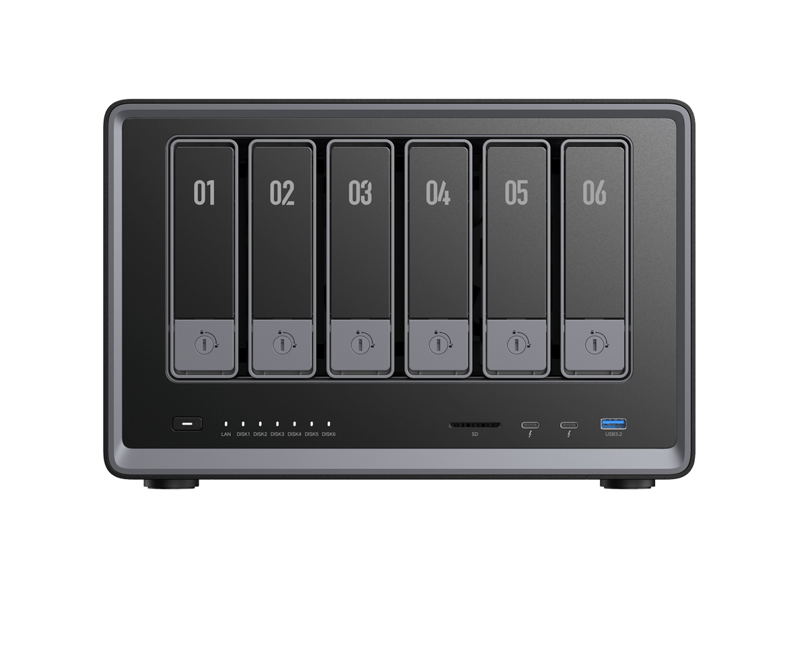
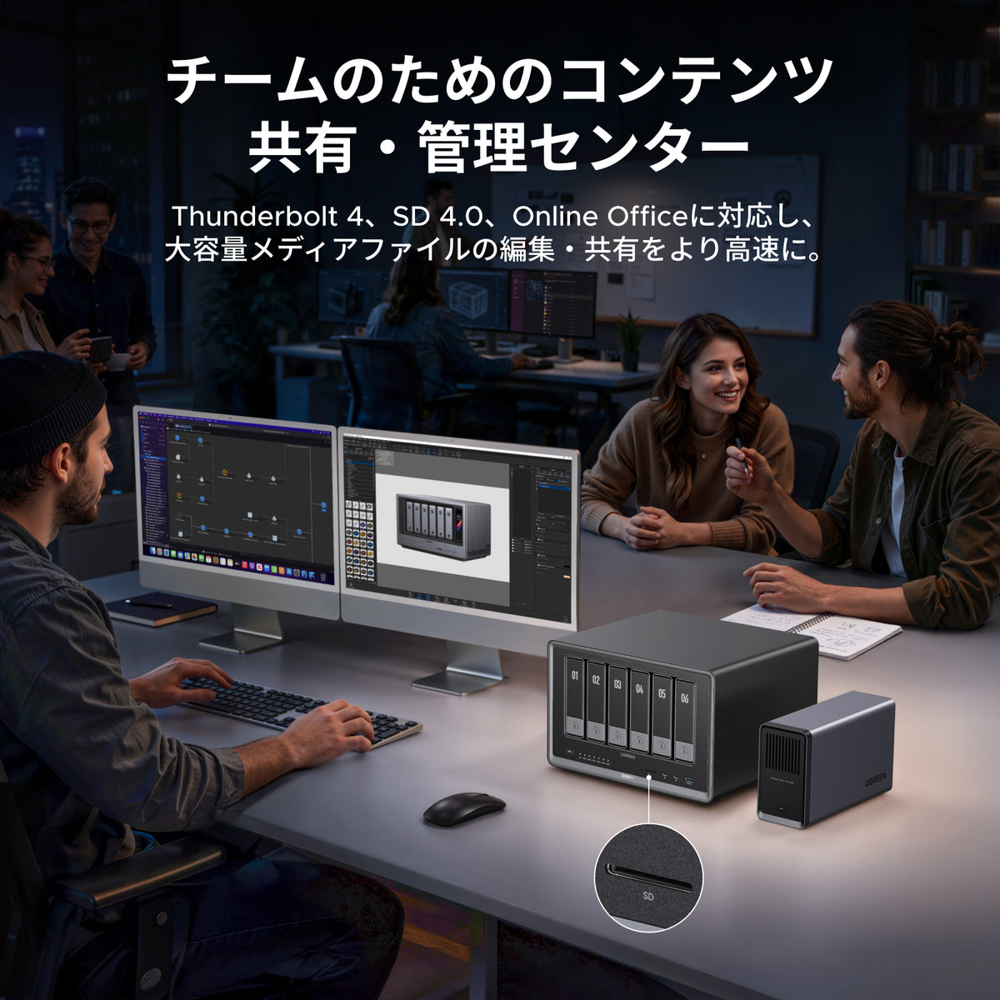
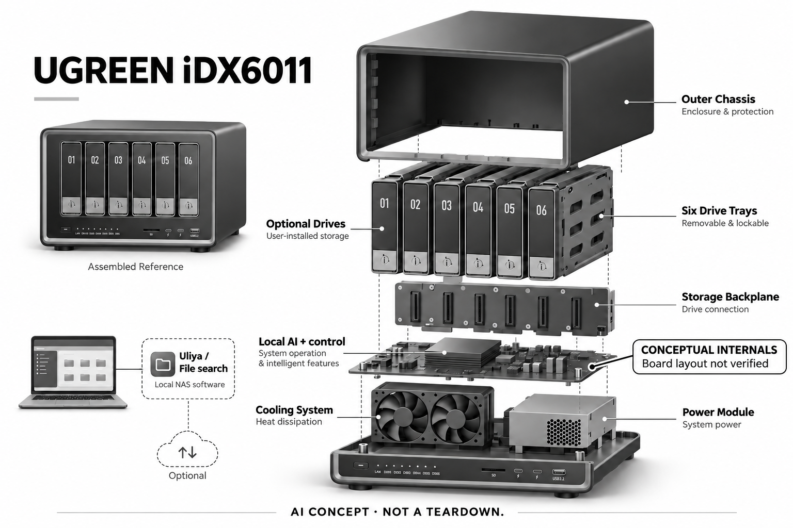

# UGREEN NASync iDX6011

**UGREEN** · 手机与 AI PC · 核查 2026-11-05

在个人文件库旁运行语义搜索与AI整理工具

消费渠道：个人零售。

## 产品图片与结构参考

### 产品图

普通iDX6011官方六盘位正面，非Pro前屏型号 · 来源：[UGREEN · 官方产品图片](<https://store.ugreen.jp/products/ugreen-idx6011-64gb-ai-nas>) · [原始图片](<https://cdn.shopify.com/s/files/1/0638/9245/5505/files/2_0b120411-5983-409e-ae50-83ab611a1ae9.png?v=1786359383&width=1200>)

### 参考图

iDX6011官方应用场景；电脑和外接供电附件不代表包含在订单 · 来源：[UGREEN · 官方产品图片](<https://store.ugreen.jp/products/ugreen-idx6011-64gb-ai-nas>) · [原始图片](<https://cdn.shopify.com/s/files/1/0638/9245/5505/files/B0FND95HPS.pt04.jpg?v=1788838300&width=1200>)

### AI 生成爆炸示意

**AI 生成 · 非实物拆机。** 内部为概念推断，不能作为元件布局、BOM 或维修依据。[生成提示词](../../content/hardware/prompts/ugreen-idx6011.txt)

> 已检查外形、标签与灰阶；分离模块是概念功能架构，非真实内部布局、完整BOM或性能证明。

> 初稿少量蓝色显示/接口已用内置ImageGen改为中性灰阶；初稿与完整修订提示词保留。

> 独立复查后以ImageGen强化局部概念标识，未知控制板或执行层明确为示意；复查前图保留在referencePaths，实际追加提示词记录于主prompt。

> 逐张实际查看确认型号与代次，保留官方源图；图片与界面中的营销内容不作为独立实测或效果保证。

> 选用普通iDX6011外形，64GB为所核购买SKU；没有借用Pro前屏或32GB规格图代表当前配置。

> 分析为基于公开资料的案头研究与 AI 辅助判断，未经用户访谈、销量审计或实物拆机。需求、画像、竞争冷门度、审美及商业机会均为研究假设，不是投资结论。

## 销售与购买

- 状态：在售。日本官方具体iDX6011 64GB商品有加入购物车/立即购买，公开商品JSON available=true，当前含税价JPY494,881；不采用早期众筹押金或历史优惠价判断。

- 地区：日本：已核官方64GB具体商品、其他地区按各自型号及商店确认

- 价格：JPY494,881（日本官网所见64GB配置，含税）。HDD不包含，容量版本不重复计数；当前价格与早期众筹不同，地区、硬盘和网络配套另计。

- 中国大陆：未核到本条普通iDX6011具体配置的大陆官方订单；品牌中国发布资料提及Pro不能代替普通版购买证据。

- [官方产品 / 商店](<https://store.ugreen.jp/products/ugreen-idx6011-64gb-ai-nas>)

## AI 的实际作用

Uliya本地AI聊天、文件语义搜索与整理，配合文档摘要、转写和照片管理；软件运行在NAS的存储与计算环境中。

服务与联网依赖：需安装兼容硬盘、配置UGOS、账户权限与模型；本地和可选云端能力需分别确认，普通Docker支持不等于任意模型可高效运行。

## 是否冷门

新兴竞争（研究判断）：针对个人资料积累后的查找和整理，区别于单纯云端聊天；高配NAS已有竞争，真实价值取决于文件库与维护能力，无销量或用户调研结论。

## 需求与市场

需求假设是个人积累了较多文档、照片和视频，记得内容却记不清文件名或位置。语义检索可能减少手动翻目录，但前提是目标文件已被正确索引且有访问权限；生成答案若无法回到原件，反而可能增加核查负担，因此研究重点是找回资料的完整过程。

### 官方｜把AI放在个人文件库旁 · 官方资料

iDX6011把六盘位存储与本地AI工具整合，官方介绍Uliya问答、跨文件语义搜索和整理等工作流。它收录的理由不是普通NAS可以自行安装任意软件，而是厂家针对存储内容提供明确AI入口；硬盘、索引、模型和用户界面仍是不同层，不能只凭处理器名称推定全部功能已可用。

依据：[UGREEN日本iDX6011 64GB当前官方商品](<https://store.ugreen.jp/products/ugreen-idx6011-64gb-ai-nas>) · [UGREEN日本AI NAS功能与软件工作流](<https://store.ugreen.jp/pages/ugreen-ai-nas-storage>)

### 判断｜忘记文件名时仍需要找到原件 · 研究判断

需求假设是个人积累了较多文档、照片和视频，记得内容却记不清文件名或位置。语义检索可能减少手动翻目录，但前提是目标文件已被正确索引且有访问权限；生成答案若无法回到原件，反而可能增加核查负担，因此研究重点是找回资料的完整过程。

依据：[UGREEN日本AI NAS功能与软件工作流](<https://store.ugreen.jp/pages/ugreen-ai-nas-storage>)

### 验证｜用本人知道答案的文件测试 · 待验证

可先选择一小批可公开或不敏感的样本，分别用文件名、模糊描述和内容问题查找，记录是否返回正确原件及出处。测试需包含重复版本和相似照片，避免只用为演示准备的文件；本目录没有运行真实资料库，不能承诺搜索准确率或整理效率。

依据：[UGREEN日本iDX6011 64GB当前官方商品](<https://store.ugreen.jp/products/ugreen-idx6011-64gb-ai-nas>) · [UGREEN日本AI NAS功能与软件工作流](<https://store.ugreen.jp/pages/ugreen-ai-nas-storage>)

## 用户画像

如果文件很少或已在单一云盘中容易找到，购买多盘位设备未必能减少负担。更值得观察的是既需要本地资料控制、又愿意管理存储和备份的个人；技术熟悉程度不是唯一条件，还应考虑谁处理硬盘故障、账户权限、软件更新和家庭网络问题。

### 官方｜面向个人进阶与创作场景 · 官方资料

日本商品页面将高级用户、创作者及团队列为使用方向，允许个人购买具体整机，不要求企业采购合同。硬盘不随所见配置附送，完整使用仍需安装和设置；目录采用个人进阶用户定位，不把面向团队的宣传自动理解为家庭成员都能无需维护地直接使用。

依据：[UGREEN日本iDX6011 64GB当前官方商品](<https://store.ugreen.jp/products/ugreen-idx6011-64gb-ai-nas>) · [UGREEN日本AI NAS功能与软件工作流](<https://store.ugreen.jp/pages/ugreen-ai-nas-storage>)

### 判断｜资料规模和维护意愿比AI兴趣重要 · 研究判断

如果文件很少或已在单一云盘中容易找到，购买多盘位设备未必能减少负担。更值得观察的是既需要本地资料控制、又愿意管理存储和备份的个人；技术熟悉程度不是唯一条件，还应考虑谁处理硬盘故障、账户权限、软件更新和家庭网络问题。

依据：[UGREEN日本iDX6011 64GB当前官方商品](<https://store.ugreen.jp/products/ugreen-idx6011-64gb-ai-nas>) · [UGREEN日本AI NAS功能与软件工作流](<https://store.ugreen.jp/pages/ugreen-ai-nas-storage>)

### 验证｜先确认已有流程最痛的步骤 · 待验证

可以记录当前找文件、整理照片和备份的具体困难，再核对NAS是否能改善其中某一项，而不是为了AI功能迁移全部资料。需要把硬盘、网络、安装和支持投入列入预算；本轮没有用户访谈或真实迁移案例，不预设每位内容创作者都需要这样的本地系统。

依据：[UGREEN日本iDX6011 64GB当前官方商品](<https://store.ugreen.jp/products/ugreen-idx6011-64gb-ai-nas>) · [UGREEN日本AI NAS功能与软件工作流](<https://store.ugreen.jp/pages/ugreen-ai-nas-storage>)

## 竞争与替代

云盘提供远程访问与搜索，外接硬盘便于本地保存，而AI NAS尝试把持久资料库、索引和内容处理放到同一台设备上。它可能减少部分上传需求，也增加本地维护责任；比较不能只看是否离线，还要看结果出处、共享、备份和长期访问是否符合个人使用方式。

### 官方｜普通版与Pro不能混用外观规格 · 官方资料

本条对应普通iDX6011，官方图显示六个前置盘架与下方接口，没有Pro的前置显示屏。所核日本商品为64GB配置，但通用副标题和部分营销图使用32GB示例，因此价格按具体SKU记录，不据混合文案推定容量可升级，也不把容量版本重复作为独立产品需求。

依据：[UGREEN日本iDX6011 64GB当前官方商品](<https://store.ugreen.jp/products/ugreen-idx6011-64gb-ai-nas>) · [UGREEN日本AI NAS功能与软件工作流](<https://store.ugreen.jp/pages/ugreen-ai-nas-storage>)

### 判断｜与云盘搜索和外接硬盘比较 · 研究判断

云盘提供远程访问与搜索，外接硬盘便于本地保存，而AI NAS尝试把持久资料库、索引和内容处理放到同一台设备上。它可能减少部分上传需求，也增加本地维护责任；比较不能只看是否离线，还要看结果出处、共享、备份和长期访问是否符合个人使用方式。

依据：[UGREEN日本AI NAS功能与软件工作流](<https://store.ugreen.jp/pages/ugreen-ai-nas-storage>)

### 验证｜把硬盘和管理成本放在同一账本 · 待验证

评估时应同时考虑主机、硬盘、必要网络配套及备份空间，并记录建立索引和重新扫描的时间。当前日本价格不能用早期众筹优惠代替，企业优惠也不一定适用于个人；没有长期使用与商业数据时，不应把算力或盘位数量直接转换为投资回报和市场需求。

依据：[UGREEN日本iDX6011 64GB当前官方商品](<https://store.ugreen.jp/products/ugreen-idx6011-64gb-ai-nas>) · [UGREEN日本AI NAS功能与软件工作流](<https://store.ugreen.jp/pages/ugreen-ai-nas-storage>)

## 供应链

同类新设计需要协调磁盘访问、索引、模型运行、散热及网络传输，单独提高某一项性能未必改善整个文件流程。多盘位机械结构还涉及抽换、振动和灰尘管理；供应商候选应针对这些工程约束，而不能把通用计算板与电源控制器简单组合成可靠存储成品。

### 官方｜已披露处理平台但完整BOM未知 · 官方资料

商品资料明确Core Ultra5 125H平台和六盘位结构，但未完整披露主板、网卡、电源、风扇、内存及代工厂的供应关系。处理器被点名只能确认该公开平台，不能据此补全其他零件品牌；官方图片中的外接附件也不自动包含在本条主机订单内，概念图不代表真实拆机。

依据：[UGREEN日本iDX6011 64GB当前官方商品](<https://store.ugreen.jp/products/ugreen-idx6011-64gb-ai-nas>)

### 判断｜存储和AI负载会争用系统资源 · 研究判断

同类新设计需要协调磁盘访问、索引、模型运行、散热及网络传输，单独提高某一项性能未必改善整个文件流程。多盘位机械结构还涉及抽换、振动和灰尘管理；供应商候选应针对这些工程约束，而不能把通用计算板与电源控制器简单组合成可靠存储成品。

依据：[UGREEN日本iDX6011 64GB当前官方商品](<https://store.ugreen.jp/products/ugreen-idx6011-64gb-ai-nas>) · [UGREEN日本AI NAS功能与软件工作流](<https://store.ugreen.jp/pages/ugreen-ai-nas-storage>)

### 验证｜先核系统负载再谈模块候选 · 待验证

可从硬盘启动、持续检索、同时备份和待机等场景定义负载，再比较电源控制和电子系统工程能力。所列候选没有UGREEN点名采用证据，控制IC也不是完整认证电源；模块功能可匹配只意味着值得进一步询证，不是现有设备换件或可以直接量产的BOM。

依据：[UGREEN日本iDX6011 64GB当前官方商品](<https://store.ugreen.jp/products/ugreen-idx6011-64gb-ai-nas>) · [UGREEN日本AI NAS功能与软件工作流](<https://store.ugreen.jp/pages/ugreen-ai-nas-storage>)

## 技术路径

一个文件在目录中被限制访问后，相关索引、摘要或历史回答也可能需要重新处理，否则用户可能从派生内容看到不该访问的信息。技术评价应检查完整信息路径，而不只是原文件权限是否正确；本地部署减少某些外发环节，但不自动消除家庭共享或远程访问中的风险。

### 官方｜语义处理和普通文件服务不同 · 官方资料

Uliya聊天、跨资料检索和内容摘要属于AI工作流，文件共享、Docker和虚拟机支持则是基础系统能力。它们可以配合，但不能因为可安装应用就承诺任何模型都能高效执行；模型、文件格式和版本要求需要按实际软件核对，目录不把营销界面当作完整兼容测试。

依据：[UGREEN日本AI NAS功能与软件工作流](<https://store.ugreen.jp/pages/ugreen-ai-nas-storage>)

### 判断｜权限应随索引和答案一起生效 · 研究判断

一个文件在目录中被限制访问后，相关索引、摘要或历史回答也可能需要重新处理，否则用户可能从派生内容看到不该访问的信息。技术评价应检查完整信息路径，而不只是原文件权限是否正确；本地部署减少某些外发环节，但不自动消除家庭共享或远程访问中的风险。

依据：[UGREEN日本AI NAS功能与软件工作流](<https://store.ugreen.jp/pages/ugreen-ai-nas-storage>)

### 验证｜用不同权限的测试文件核查 · 待验证

可以建立明确可见与不可见的样本目录，检查不同用户搜索、摘要和删除后的行为，并记录索引更新是否及时。可选云服务应单独核对外发范围，不将本地工具与外部模型混为一谈；本研究未做安全审计或性能测试，不承诺数据绝不泄露或答案必然正确。

依据：[UGREEN日本iDX6011 64GB当前官方商品](<https://store.ugreen.jp/products/ugreen-idx6011-64gb-ai-nas>) · [UGREEN日本AI NAS功能与软件工作流](<https://store.ugreen.jp/pages/ugreen-ai-nas-storage>)

## 产品审美

多硬盘设备可能长期摆放在固定位置，拿取盘架、整理线缆、通风和噪声感受会影响生活环境。外观整齐并不能证明安静或适合卧室，图片中的简洁桌面也没有展示全部供电和网络安排；审美评价应结合实际摆放，而不是只看金属机壳与盘架排列。

### 官方｜六个盘架组成主要视觉特征 · 官方资料

普通版外观是深色矩形机身、六个窄长盘架、状态灯和下方接口，官方场景图同时展示电脑及其他配套设备。目录只把主机列为硬件，参考场景不证明附件包含或真实使用效果；内部背板、散热与电源在生成图中是功能示意，没有实际尺寸和装配关系证据。

依据：[UGREEN日本iDX6011 64GB当前官方商品](<https://store.ugreen.jp/products/ugreen-idx6011-64gb-ai-nas>)

### 判断｜放在家中需要考虑声音和空间 · 研究判断

多硬盘设备可能长期摆放在固定位置，拿取盘架、整理线缆、通风和噪声感受会影响生活环境。外观整齐并不能证明安静或适合卧室，图片中的简洁桌面也没有展示全部供电和网络安排；审美评价应结合实际摆放，而不是只看金属机壳与盘架排列。

依据：[UGREEN日本iDX6011 64GB当前官方商品](<https://store.ugreen.jp/products/ugreen-idx6011-64gb-ai-nas>) · [UGREEN日本AI NAS功能与软件工作流](<https://store.ugreen.jp/pages/ugreen-ai-nas-storage>)

### 验证｜按完整接线状态检查布置 · 待验证

安装前可确认摆放尺寸、接口可达性、通风空间和硬盘维护路径，并分别记录外观偏好与运行声音。若需要额外网络设备或备份盘，也应计入桌面和柜体占用；本轮没有真机散热、振动或噪声测量，不能据厂家场景图断言适合任意家庭位置。

依据：[UGREEN日本iDX6011 64GB当前官方商品](<https://store.ugreen.jp/products/ugreen-idx6011-64gb-ai-nas>)

## 关键风险

如果工具只返回答案，错误主要体现在解释；若进一步整理、改名或移动文件，错误就可能影响用户的资料结构。应区分读取与修改权限，并保留可恢复的原件和备份；多盘位冗余不自动等于独立备份，本地模型也不会天然理解哪些文件对本人最重要。

### 官方｜当地商品状态与历史众筹分开 · 官方资料

日本官方当前具体SKU已提供购买入口和可售商品数据，因此本条不依赖旧押金资格或众筹历史判断状态。价格和配置按本次地区页面记录，普通版在中国大陆的正式订单未核到；品牌中国发布资料提及Pro，不能作为普通iDX6011这一SKU已有大陆交付服务的证明。

依据：[UGREEN日本iDX6011 64GB当前官方商品](<https://store.ugreen.jp/products/ugreen-idx6011-64gb-ai-nas>)

### 判断｜AI整理错误可能影响原始资料 · 研究判断

如果工具只返回答案，错误主要体现在解释；若进一步整理、改名或移动文件，错误就可能影响用户的资料结构。应区分读取与修改权限，并保留可恢复的原件和备份；多盘位冗余不自动等于独立备份，本地模型也不会天然理解哪些文件对本人最重要。

依据：[UGREEN日本AI NAS功能与软件工作流](<https://store.ugreen.jp/pages/ugreen-ai-nas-storage>)

### 验证｜先在副本上确认修改行为 · 待验证

初次研究可使用可恢复的样本副本，检查AI整理建议是否清楚、实际修改是否需要确认，以及能否撤回和找到原路径。还应核对更新、故障恢复和远程访问配置，不能仅以网络能连接判断可长期保存资料；本目录没有操作用户文件，也没有验证数据恢复成功率。

依据：[UGREEN日本iDX6011 64GB当前官方商品](<https://store.ugreen.jp/products/ugreen-idx6011-64gb-ai-nas>) · [UGREEN日本AI NAS功能与软件工作流](<https://store.ugreen.jp/pages/ugreen-ai-nas-storage>)

## 机会与验证

值得进一步研究的是用户是否更快定位正确版本、减少重复整理，以及能否理解答案引用了哪些内容。生成更长摘要未必更有用，索引不完整也可能造成看似全面的遗漏；如果原有目录结构已经足够清楚，新增AI层可能只增加维护，这种不适用结果同样值得记录。

### 官方｜文件库语义访问保留一个核心场景 · 官方资料

iDX6011在目录中代表个人本地资料库的语义访问和整理，不按容量、盘位套餐或Pro小升级增加场景数量。它区别于单纯聊天终端的重点是持久文件、索引、权限和原件回查；可运行模型只是实现环节，不能让设备算力取代对真实资料任务的判断。

依据：[UGREEN日本iDX6011 64GB当前官方商品](<https://store.ugreen.jp/products/ugreen-idx6011-64gb-ai-nas>) · [UGREEN日本AI NAS功能与软件工作流](<https://store.ugreen.jp/pages/ugreen-ai-nas-storage>)

### 判断｜关注找回原件而非生成文字数量 · 研究判断

值得进一步研究的是用户是否更快定位正确版本、减少重复整理，以及能否理解答案引用了哪些内容。生成更长摘要未必更有用，索引不完整也可能造成看似全面的遗漏；如果原有目录结构已经足够清楚，新增AI层可能只增加维护，这种不适用结果同样值得记录。

依据：[UGREEN日本AI NAS功能与软件工作流](<https://store.ugreen.jp/pages/ugreen-ai-nas-storage>)

### 验证｜跟踪资料库变化后的稳定性 · 待验证

后续可以观察新增、移动、删除和权限变化后，搜索与答案是否保持可追溯，并记录软件更新和模型调整所需投入。当前是官方资料案头研究，没有真实文件库测试、用户访谈或销量证据；不把家庭私有云概念等同已证明的个人需求规模或商业成功。

依据：[UGREEN日本iDX6011 64GB当前官方商品](<https://store.ugreen.jp/products/ugreen-idx6011-64gb-ai-nas>) · [UGREEN日本AI NAS功能与软件工作流](<https://store.ugreen.jp/pages/ugreen-ai-nas-storage>)

## 对应供应链公司

能力候选用于选型研究，不代表本产品实际采用；未公开的供货关系不作推断。

- [texas-instruments](../supply-chain/texas-instruments.md) — **能力候选 · 非已采用** / 同类多盘位AI存储设备的电源转换控制研究：TI UCC256404提供LLC电源转换控制能力，可研究同类系统在硬盘启动、计算和待机负载之间的电源设计约束。它不是完整电源模块，仍需拓扑、功率器件、散热和整机验证；没有iDX6011采用证据，也不能将参考设计参数套给本款或视作消费者换件方案。

- [jabil](../supply-chain/jabil.md) — **能力候选 · 非已采用** / 同类AI NAS的电子与系统集成候选：捷普公开电子和系统工程制造能力，可作为同类存储主板、机壳、热管理和生命周期支持的项目询证入口，但具体个人设备项目、规模和交付范围需确认。没有UGREEN点名合作证据，候选不意味着本机代工关系，也不提供UGOS或Uliya软件权利及完整BOM。

[浏览供应链目录](../supply-chain.md)

## 功能分层示意

这是功能关系，不是实物拆机、真实空间结构或已核实 BOM。

1. **个人数据输入**：用户将文件、照片等放入授权目录；兼容硬盘需另配。（官方披露）

2. **存储与索引**：六盘位存储系统建立检索和管理所需的数据组织。（官方披露）

3. **本地AI处理**：Uliya与相关工具提供语义检索、摘要及内容处理。（官方披露）

4. **用户访问**：电脑或手机通过支持的客户端访问UGOS与结果。（官方披露）

5. **权限及可选云服务**：是否启用外部模型与连接需单独确认；备份和访问控制由系统方案负责。（分析推断）

## 来源

1. [UGREEN日本iDX6011 64GB当前官方商品](<https://store.ugreen.jp/products/ugreen-idx6011-64gb-ai-nas>) — 已打开并读取公开HTML/商品JSON：available=true、JPY494881，六盘位、Core Ultra5 125H、硬盘另配。通用副标题残留32GB，与64GB SKU区分，不推定内存升级方式。

2. [UGREEN日本AI NAS功能与软件工作流](<https://store.ugreen.jp/pages/ugreen-ai-nas-storage>) — 已打开本地Uliya、语义检索、整理、转写等具体功能；普通版与Pro外观分开，宣传效果不作独立性能结论。

[返回目录](../hardware-market.md) · [网页分析](https://romanagent.github.io/Roman/#hardware/product/ugreen-idx6011)
