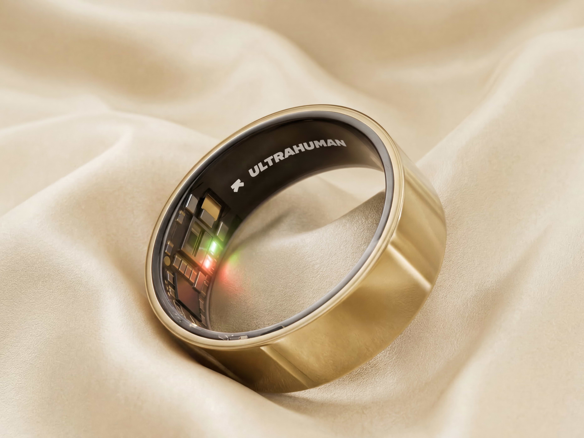
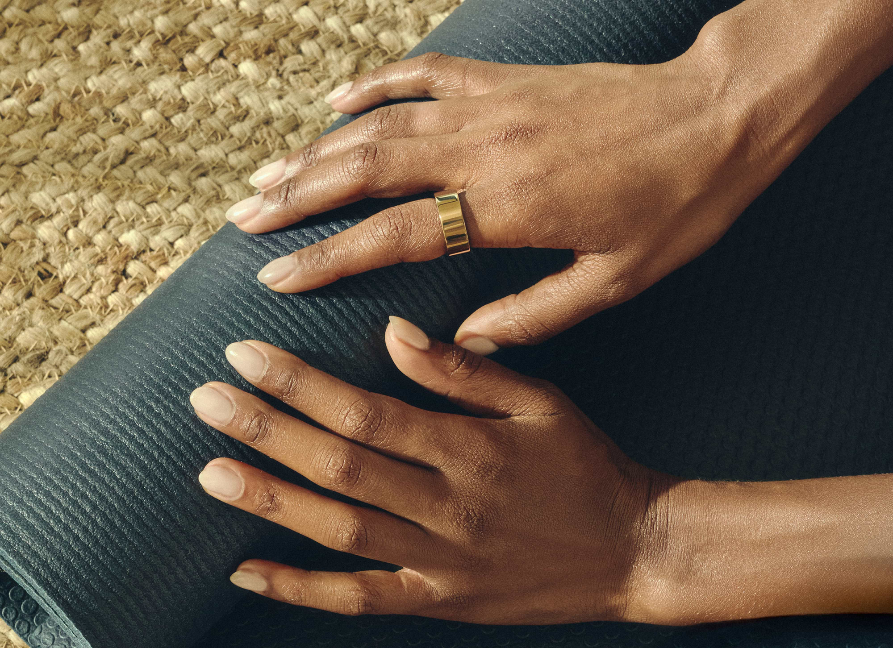
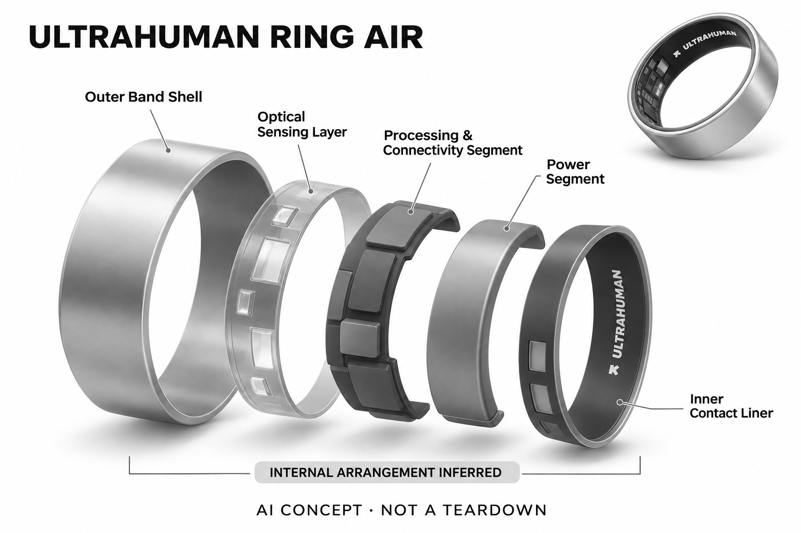

# Ultrahuman Ring AIR

**Ultrahuman** · 健康与穿戴 · 核查 2026-11-04

无屏幕生理记录与应用中的状态解释

## 产品图片与结构参考

### 产品图

Ultrahuman Ring AIR 金色官方产品图 · 来源：[Ultrahuman · 官方图片](<https://www.ultrahuman.com/mc/ring/buy/>) · [原始图片](<https://cdn.speedsize.com/3f711f28-1488-44dc-b013-5e43284ac4b0/https://public-web-assets.uh-static.com/web_v2/ring-buy/carousel-assets-new/full/bionic-gold/1.png>)

### 参考图

Ultrahuman Ring AIR 官方佩戴场景参考 · 来源：[Ultrahuman · 官方图片](<https://www.ultrahuman.com/mc/ring/buy/>) · [原始图片](<https://cdn.speedsize.com/3f711f28-1488-44dc-b013-5e43284ac4b0/https://public-web-assets.uh-static.com/web_v2/ring-buy/carousel-assets-new/full/bionic-gold/3.png/w_2000>)

### AI 生成爆炸示意

**AI 生成 · 非实物拆机。** 内部为概念推断，不能作为元件布局、BOM 或维修依据。[生成提示词](../../content/hardware/prompts/ultrahuman-ring-air.txt)

> 已目视核对产品外形与AI标识；verified不代表内部布局经实物拆机验证。

> 分析为基于公开资料的案头研究与 AI 辅助判断，未经用户访谈、销量审计或实物拆机。需求、画像、竞争冷门度、审美及商业机会均为研究假设，不是投资结论。

## 销售与购买

- 状态：在售。已打开的摩纳哥地区官方商店提供Ring AIR的Buy now及加购流程；美国通用购买入口已转向Ring PRO，因此本条只确认所核地区，不推断AIR在美国同样现售。

- 地区：摩纳哥官网、瑞士官网（产品介绍）

- 价格：以地区官网Ring AIR结算价为准。需注意通用购买入口可能跳转Ring PRO；附加PowerPlugs与保护计划不等于基础记录服务，不能混报两代价格。

- 中国大陆：未核实中国大陆官方渠道、物流和全部服务权限；不同地区官网和不同代际不能互相替代。

- [官方产品 / 商店](<https://www.ultrahuman.com/mc/ring/buy/>)

## AI 的实际作用

官方睡眠说明明确以机器学习推断睡眠阶段；2026官方介绍Jade向Ultrahuman用户推出，用于整合记录、解释趋势与提供交互。

服务与联网依赖：需配套应用同步和查看数据；Jade、PowerPlugs及跨设备功能受地区和版本影响，不能假设所有能力在戒指端离线完成。

## 是否冷门

竞争密集（研究判断）：指环健康记录已有多个对手，地区渠道和代际差异会影响选择。

## 需求与市场

需求假设：用户希望在较少佩戴负担下了解睡眠和生活节律，并把数据用于日常习惯回顾。需要观察连续佩戴和指标理解，而不是把一个分数的提升直接视为身体状态改善。

## 用户画像

用户画像推断：喜欢指环形态、愿意试戴选码并使用手机看趋势的人较匹配。经常抓握器械、手指容易肿胀或需要实时屏幕反馈的用户，可能需要先比较手环和运动手表。

## 竞争与替代

竞争判断：智能指环市场已经有多家品牌，竞争集中在佩戴、续航、算法与订阅结构。AIR与新PRO并存时，还需要说明代际边界；品牌推出新机不意味着旧机在每个国家都可购。

## 供应链

供应链推断：尺码多、微型电池和金属外壳使备货及质量控制复杂，长期密封和皮肤接触也重要。官方本次资料未披露AIR具体制造工厂；跨地区配送和换新是实际交付的一部分。

## 技术路径

官方说明以机器学习估计睡眠阶段，并发布Jade数据解释层。推断应分别评估采集质量、阶段估计和语言回复，且不能把PRO公布的处理器或新传感结构直接写成AIR硬件参数。

## 产品审美

审美判断：接近普通金属戒指的外观能降低运动设备存在感，也更依赖尺寸、表面处理和磨损后的观感。无屏幕提高穿搭兼容，但把所有解释留给手机，形成不同于腕表的使用习惯。

## 关键风险

风险判断：不同地区产品路径及售卖代际不一致，全球可访问网页并非全球可交付。睡眠阶段是消费级估计，不应据此诊断疾病；指环数据、账户和AI互动需要清晰的权限说明。

## 机会与验证

市场观察：比较AIR时应固定国家和代际，再对照基础服务、附加插件与售后。其研究价值在于展示指环如何从数据记录延伸到解释服务，而不是将厂商AI描述直接当作效果验证。

## 功能分层示意

这是功能关系，不是实物拆机、真实空间结构或已核实 BOM。

1. **指端记录**：指环读取生理与运动信号，形成连续记录。（官方披露）

2. **阶段估计**：官方说明机器学习模型推断睡眠阶段。（官方披露）

3. **应用汇总**：在应用中查看状态、趋势和相关上下文。（官方披露）

4. **AI解释**：Jade面向Ultrahuman用户整合生态数据。（官方披露）

5. **附加服务**：插件、版本及地区决定部分拓展功能。（官方披露）

## 来源

1. [Ultrahuman摩纳哥地区Ring AIR商店](<https://www.ultrahuman.com/mc/ring/buy/>) — 明确Ring AIR购买入口；仅确认该地区页面，未下单。

2. [Ultrahuman睡眠阶段算法说明](<https://www.ultrahuman.com/science/explainers/sleep-stages/>) — 说明机器学习估计路径，不将其视为医疗诊断。

3. [Ultrahuman 2026 Jade官方发布](<https://cyborg.ultrahuman.com/press-releases/ultrahuman-unveils-ring-pro-with-category-defining-15-day-battery-and-jade-worlds-first-real-time-biointelligence-ai>) — Jade面向全体用户推出；其中PRO硬件参数不移植到AIR。

[返回目录](../hardware-market.md) · [网页分析](https://romanagent.github.io/Roman/#hardware/product/ultrahuman-ring-air)
