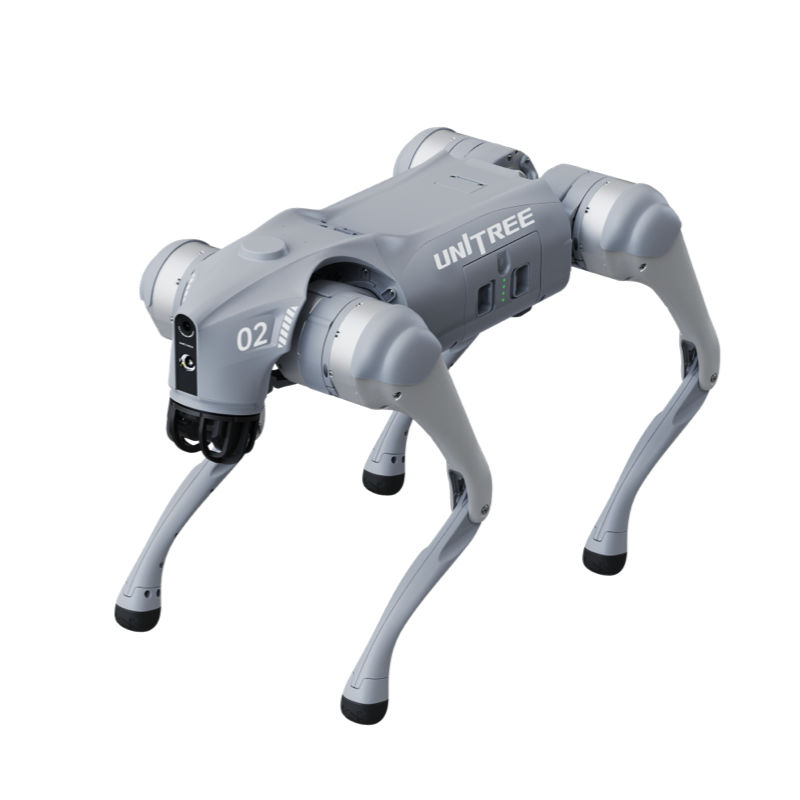
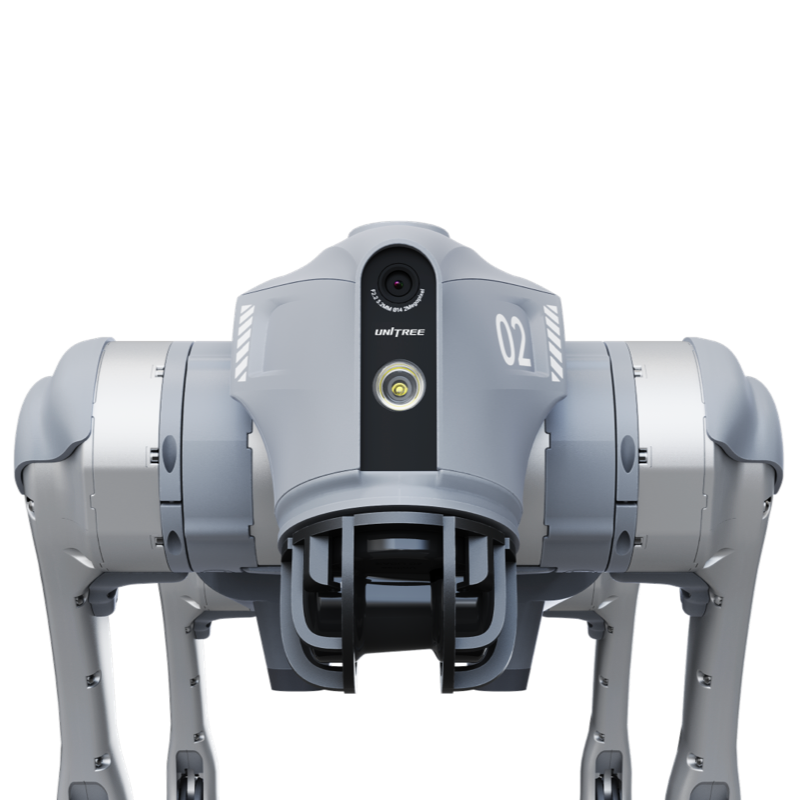
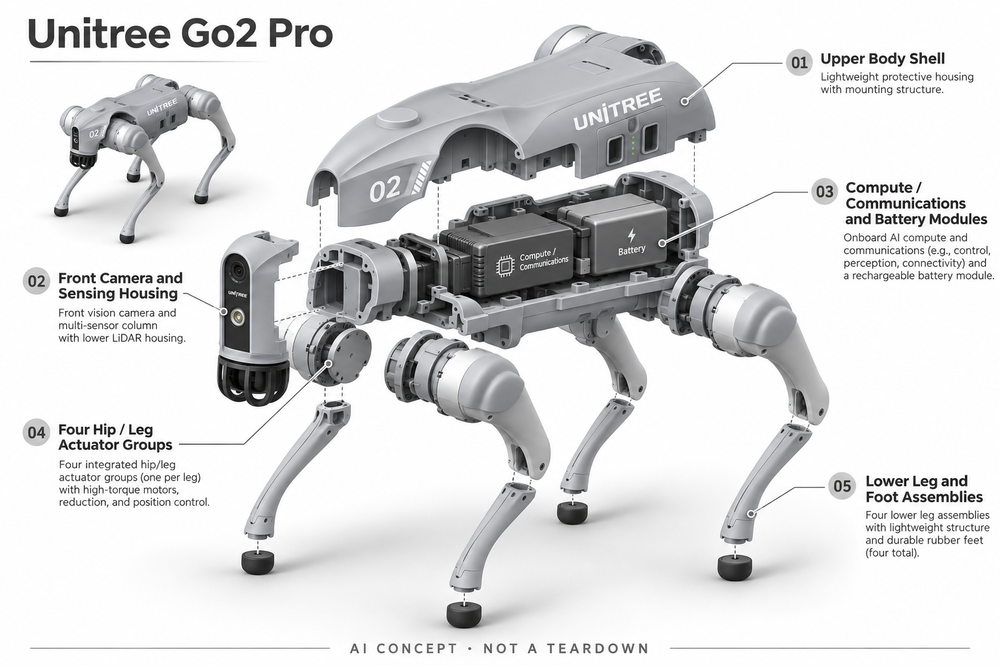

# Unitree Go2 Pro

**Unitree 宇树** · 消费机器人 · 核查 2026-11-04

四足运动、环境感知与交互，先核清 Pro 和 EDU 的能力边界。

消费渠道：消费预订。

## 产品图片与结构参考

### 产品图

官方产品主图 · 来源：[Unitree 宇树](<https://shop.unitree.com/products/unitree-go2>) · [原始图片](<https://cdn.shopify.com/s/files/1/0620/4932/1193/files/df9f333424ff6cc6164ce421b019fb94_a6f832b0-479e-4294-ac75-6516208b91f4.png?v=1718274082>)

### 参考图

官方产品角度 / 规格参考图 · 来源：[Unitree 宇树](<https://shop.unitree.com/products/unitree-go2>) · [原始图片](<https://cdn.shopify.com/s/files/1/0620/4932/1193/files/21.png?v=1718274083>)

### AI 生成爆炸示意

**AI 生成 · 非实物拆机。** 内部为概念推断，不能作为元件布局、BOM 或维修依据。[生成提示词](../../content/hardware/prompts/unitree-go2-pro.txt)

> 分析为基于公开资料的案头研究与 AI 辅助判断，未经用户访谈、销量审计或实物拆机。需求、画像、竞争冷门度、审美及商业机会均为研究假设，不是投资结论。

## 销售与购买

- 状态：预售 / 接受延期订单。官方商店所选 Go2 Pro（without controller）可加购但标记 backordered，具体发货待库存恢复。

- 地区：官方国际商店

- 价格：具体配置以商店结算为准。产品页“US$1,600 起”为系列起价，不等于本条 Pro 配置报价；运费、税费及控制器可能另计。

- 中国大陆：本轮核查国际商店而非国内结算。中国销售配置、控制器套装、保修和开发支持需以国内官方渠道答复为准。

- [官方产品 / 商店](<https://shop.unitree.com/products/unitree-go2>)

## AI 的实际作用

官方介绍 4D LiDAR 感知、学习驱动运动和大模型交互。实际可用功能取决于版本、地区和软件，不能将 EDU 开发能力默认赋给 Pro。

服务与联网依赖：联网交互与本体运动应分别验证；云端服务、App、语言与固件支持可能改变可用体验。

## 是否冷门

细分专业（研究判断）：四足平台的用户较专业，但已有竞争与轮式替代；窄场景不等于容易盈利。

## 需求与市场

需求假设：四足形态用于运动教学、展示及可移动感知，比固定桌面设备更容易展示环境适应性。若只是室内移动拍摄，低成本轮式平台可能已足够，需要验证四足跨障能力是否真的有价值。

### 需求假设：用户要的是可见的四足动作 · 研究判断

Go2 Pro的消费价值首先需要落到个人娱乐、展示或内容拍摄中的具体动作，而不是泛称需要机器人。四足能够形成直观的运动体验，但如果任务只是平地移动摄像，轮式或固定方案可能已足够，应先了解用户为何必须选择四条腿。

依据：[Unitree Go2 官方商店](<https://shop.unitree.com/products/unitree-go2>) · [Unitree Go2 官方介绍](<https://www.unitree.com/go2/>)

### 价值判断：展示新鲜感与持续用途分开 · 研究判断

机器狗的动作容易吸引观看，却不等于拥有者会长期使用，首次表演后的任务可能完全不同。研究应记录用户是否主动安排重复活动、是否愿意维护与携带，不能用围观人数或短视频传播推断留存，也不把娱乐购买解释为工业需求。

依据：[Unitree Go2 官方介绍](<https://www.unitree.com/go2/>)

### 验证方案：比较四足与简单替代 · 待验证

让机器人爱好者或创作者选择一项实际任务，用Go2 Pro与轮式、手持或固定方案分别完成，记录必须四足才能实现的环节。保留人工介入、准备和维护时间，避免只展示越过一次障碍，就认为复杂运动系统的长期价值已经得到证明。

依据：[Unitree Go2 官方商店](<https://shop.unitree.com/products/unitree-go2>) · [Unitree Go2 官方介绍](<https://www.unitree.com/go2/>)

## 用户画像

画像推断：机器人爱好者、高校课程组织者、内容创作者以及购买演示设备的机构。具备工程开发需求的客户应先确认 EDU，而非仅按最低机身价决定购买。

### 画像假设：愿意管理机械设备的爱好者 · 研究判断

较匹配者可能是有固定活动空间、喜欢机器运动并愿意学习操作的个人，而不仅是喜欢宠物外观的人。用户需要接受充电、维护、运输和软件设置，画像应包含这些实际投入，不能把普通家庭养宠需求直接等同四足机器人购买需求。

依据：[Unitree Go2 官方商店](<https://shop.unitree.com/products/unitree-go2>) · [Unitree Go2 官方介绍](<https://www.unitree.com/go2/>)

### 版本边界：Pro与开发用途必须区分 · 研究判断

原目录明确Pro不能默认拥有EDU的开发能力，想编程或改造的用户需要先确认权限与版本。个人使用者也可能因宣传混合而期待不存在的接口，研究应记录购买时的理解，不把系列演示和最低起价作为当前配置全部可用的依据。

依据：[Unitree Go2 官方商店](<https://shop.unitree.com/products/unitree-go2>) · [Unitree Go2 官方介绍](<https://www.unitree.com/go2/>)

### 访谈重点：谁愿意承担日常操作 · 待验证

应询问机器由谁充电、更新和处理异常，家庭成员是否愿意在同一空间活动，以及何时会把它收起来。对内容创作者则追问下一次具体拍摄任务，按持续行为划分娱乐、展示与开发需求，避免只根据对机器狗的好奇描述用户画像。

依据：[Unitree Go2 官方商店](<https://shop.unitree.com/products/unitree-go2>) · [Unitree Go2 官方介绍](<https://www.unitree.com/go2/>)

## 竞争与替代

市场判断：四足机器人已经有多个成熟平台和明显替代方案，专业应用的难点在可靠交付。消费娱乐与工业巡检是不同市场，不能把体验型机器狗的订单理解为工业需求。

### 替代方案：轮式、玩具与拍摄工具 · 研究判断

Go2 Pro面对其他四足设备，也被轮式移动、遥控玩具和手持拍摄替代，比较需要明确到底要移动、互动还是展示。四足形态可能具有不同运动空间，但同时增加关节与维护复杂度，不能把可见动作多直接视为消费者价值更高。

依据：[Unitree Go2 官方介绍](<https://www.unitree.com/go2/>)

### 差异判断：系列成熟度不能替代任务适配 · 研究判断

官方展示感知、学习运动和语言交互的组合，可作为完整体验研究，但各项功能受版本与环境影响。消费娱乐和专业巡检有不同交付要求，不能借专业应用想象为Pro证明价值，也不由品牌知名度推断实际维护和服务成本。

依据：[Unitree Go2 官方商店](<https://shop.unitree.com/products/unitree-go2>) · [Unitree Go2 官方介绍](<https://www.unitree.com/go2/>)

### 比较方法：同一场景记录全部介入 · 待验证

在允许的可控空间中完成实际展示或记录任务，统计部署、操作、接管和收纳，而不只统计自动动作持续多久。与替代设备保持同一任务目标，记录哪些四足能力被真正使用，避免以最炫的动作片段代替整段使用流程。

依据：[Unitree Go2 官方商店](<https://shop.unitree.com/products/unitree-go2>) · [Unitree Go2 官方介绍](<https://www.unitree.com/go2/>)

## 供应链

官方披露 LiDAR 与运动机构，未提供完整供应商表。分析关键点为关节驱动、传感器安装精度、电池、脚端耗材和售后；零件寿命与跨地区维修会显著影响总拥有成本。

### 功能拆分：感知、控制和关节协同 · 研究判断

公开结构包括LiDAR等感知、运动控制、关节执行与语音应用，四足动作需要多层协调，不能由单个传感器解释全部能力。真实关节、电源、控制器与生产工厂的完整清单未披露，功能示意只帮助理解模块，不构成原机拆解或供应商证据。

依据：[Unitree Go2 官方介绍](<https://www.unitree.com/go2/>)

### 制造判断：重复动作与维护决定拥有成本 · 研究判断

多关节系统需要关注安装、线缆、脚端接触和长期重复动作，电源与热也会影响持续使用。分析应将维修和耗材路径纳入，而不是只计算机身价格；本轮没有获得关节寿命、装配公差或售后合同，不能从演示效果推算制造成熟度。

依据：[Unitree Go2 官方商店](<https://shop.unitree.com/products/unitree-go2>) · [Unitree Go2 官方介绍](<https://www.unitree.com/go2/>)

### 候选选型：驱动与电源按实际工况询证 · 研究判断

maxon可作为带反馈的驱动系统工程候选，Grepow可讨论高倍率电源路线，但消费机器狗的负载、冲击和成本须专项确认。两者公开机器人或高倍率能力不等于适配Go2 Pro，更没有点名供货证据，不能把候选组合写成可替换原机关节和电池。

依据：[Unitree Go2 官方商店](<https://shop.unitree.com/products/unitree-go2>) · [Unitree Go2 官方介绍](<https://www.unitree.com/go2/>)

## 技术路径

技术应拆成感知、状态估计、学习控制、路径行为及语音服务。官方展示的动作是特定条件下的能力；地面摩擦、载荷和光照变化后的稳定性需要实际试验，不能直接外推。

### 已披露能力：学习运动与大模型交互分层 · 官方资料

官方介绍空间感知、学习驱动动作和大模型交互，三者分别处理环境、身体运动和语言服务。不能将语音回答流畅视为运动判断可靠，也不能把系列中展示的功能全部赋给Pro，实际软件、地区和版本条件需要在体验时单独记录。

依据：[Unitree Go2 官方介绍](<https://www.unitree.com/go2/>)

### 技术判断：环境变化影响控制任务 · 研究判断

地面摩擦、障碍形状和载荷会改变运动条件，用户需要了解系统何时依赖自己接管。研究应观察感知与动作之间的边界，而不是只看一套预设表演；这里列出待验证条件，不声称已测得机器人在某类地面上的成功率或稳定性。

依据：[Unitree Go2 官方介绍](<https://www.unitree.com/go2/>)

### 验证方案：从可控任务逐步观察 · 待验证

在厂商允许的使用范围内，从简单路线开始记录运动、目标保持与人工操作，再改变一个环境条件进行比较。语音与联网功能另行测试，避免将网络回应和身体控制混成一个AI分数，也不将未经确认的楼梯、载荷或人员密集场景当作测试前提。

依据：[Unitree Go2 官方商店](<https://shop.unitree.com/products/unitree-go2>) · [Unitree Go2 官方介绍](<https://www.unitree.com/go2/>)

## 产品审美

设计观察：低重心四足结构让运动能力可被直观看到，外露关节表达工具属性。相对宠物化的外观虽有趣，但噪声和机械运动可能使儿童、动物或公共空间旁观者不适。

### 外形判断：四足轮廓带来宠物联想 · 研究判断

Go2 Pro的低重心身体与外露关节同时表达机器工具和动物动作，用户可能因此产生亲近或戒备。外形相似不能证明具备宠物式情感关系，实际运动速度、声音和停留方式更影响家庭接受度，不能只凭静态照片判断是否适合放在客厅。

依据：[Unitree Go2 官方介绍](<https://www.unitree.com/go2/>)

### 交互判断：动作意图需要容易理解 · 研究判断

机器人准备移动、停止或转向时，旁观者需要理解下一步会发生什么，尤其是没有操作经验的家庭成员。语言交互不能替代清楚的运动状态，设计评价应关注可预测和可接管，而不是仅把拟人动作多和反应快当作交互优势。

依据：[Unitree Go2 官方介绍](<https://www.unitree.com/go2/>)

### 体验验证：观察旁观者与操作者反应 · 待验证

在允许的家庭或展示空间中，记录操作者和旁观者如何安排距离、通行与收纳，询问哪些动作有趣、哪些令人犹豫。把机械声音和设备管理一并评价，避免只采访购买者或用围观时的兴奋代替共同生活空间中的长期接受程度。

依据：[Unitree Go2 官方商店](<https://shop.unitree.com/products/unitree-go2>) · [Unitree Go2 官方介绍](<https://www.unitree.com/go2/>)

## 关键风险

主要风险是延期交付、配置误购及开放场景可靠性。未经证实的负载任务、楼梯和人员密集环境不应按演示承诺规划；采购需明确维修、运输和软件支持周期。

### 使用风险：演示条件不能外推开放环境 · 研究判断

官方展示的运动能力不代表所有地形、载荷或人群条件都适用，用户应按版本说明和允许范围操作。重要任务不能依赖尚未验证的自动行为，也不应把宠物化外观当作低风险玩具，本轮没有进行实机可靠性与人员环境测试。

依据：[Unitree Go2 官方介绍](<https://www.unitree.com/go2/>)

### 购买风险：延期配置与软件支持 · 研究判断

原目录商店证据注明Pro可加购但等待库存，购买者需要确认当前配置与实际交付安排，而非只看系列起价。联网服务、语言和地区支持也可能影响体验，运输、维修与备件应纳入总成本，不能把有购物入口视为立即交付。

依据：[Unitree Go2 官方商店](<https://shop.unitree.com/products/unitree-go2>) · [Unitree Go2 官方介绍](<https://www.unitree.com/go2/>)

### 验证安排：明确异常后的恢复路径 · 待验证

试用时记录失去预期动作、软件不可用或需要人工干预时怎样回到可用状态，并检查不同操作者是否能理解流程。保留问题发生条件与版本，避免只展示成功动作；这些是待验证事项，不预先假定机器人存在某种普遍故障。

依据：[Unitree Go2 官方商店](<https://shop.unitree.com/products/unitree-go2>) · [Unitree Go2 官方介绍](<https://www.unitree.com/go2/>)

## 机会与验证

待验证差异化购买理由是“必须四足才能完成”的具体任务。后续应比较轮式平台与四足设备的任务成功率、人工介入次数和维护成本，本轮未进行这类现场验证。

### 研究方向：寻找四足不可替代的个人任务 · 研究判断

值得继续研究的是用户反复需要四足运动的具体活动，而非把机器狗作为所有家庭助手的通用入口。可能的价值在运动展示、创作或兴趣体验，但必须与简单替代比较，先证明身体形态的作用，再讨论增加语言模型和应用功能。

依据：[Unitree Go2 官方介绍](<https://www.unitree.com/go2/>)

### 执行计划：跟踪首次兴趣之后的使用 · 待验证

观察数周内用户主动启动、携带和维护设备的次数，记录重复任务、放弃使用及选择其他工具的原因。访谈围绕具体事件追问四足形态做了什么，避免把未来想象当作已存在需求，也不把机构展示采购和个人家庭使用混为同一市场。

依据：[Unitree Go2 官方商店](<https://shop.unitree.com/products/unitree-go2>) · [Unitree Go2 官方介绍](<https://www.unitree.com/go2/>)

### 决策边界：技术演示不是商业预测 · 研究判断

只有当用户持续完成有价值任务，并接受维护、空间和服务成本，才有理由深入验证消费方案。候选供应商能够说明实现路径，却不能证明需求规模，本轮没有访谈、留存或销量资料，也不将动作难度、视频热度或模型评分当作创业成功依据。

依据：[Unitree Go2 官方商店](<https://shop.unitree.com/products/unitree-go2>) · [Unitree Go2 官方介绍](<https://www.unitree.com/go2/>)

## 对应供应链公司

能力候选用于选型研究，不代表本产品实际采用；未公开的供货关系不作推断。

- [maxon](../supply-chain/maxon.md) — **能力候选 · 非已采用** / 四足关节驱动与反馈工程候选：maxon公开机器人驱动、电机减速反馈与控制联合设计能力，可作为Go2 Pro关节执行问题的工程候选；实际冲击负载、动态响应、体积和成本需专项验证，公开其他机器人案例不能证明适配或供货，也不能把候选模块当作原机关节替换件。

- [grepow](../supply-chain/grepow.md) — **能力候选 · 非已采用** / 动态运动负载电源系统候选：Grepow公开高倍率与机器人电池方向，可用于讨论Go2 Pro动态运动供电，但必须依据实际峰值负载、温度、保护通信与机械固定确认。此关联没有原机电芯或电池包采用证据，也不保证现有航模电池能够直接用于消费四足机器人。

[浏览供应链目录](../supply-chain.md)

## 功能分层示意

这是功能关系，不是实物拆机、真实空间结构或已核实 BOM。

1. **语音与 App**：官方介绍大模型交互和 App 控制，功能需按版本确认。（官方披露）

2. **空间感知**：4D LiDAR 与其他传感部件支持环境感知。（官方披露）

3. **运动控制**：官方展示学习驱动的步态和动作能力。（官方披露）

4. **关节与腿部**：关节执行器把控制指令转为四足运动。（官方披露）

5. **能源与运维**：电池、热管理和脚端磨损限制持续任务，需要实测评估。（分析推断）

## 来源

1. [Unitree Go2 官方商店](<https://shop.unitree.com/products/unitree-go2>) — 当前所选 Pro 配置可加购但延期等待库存。

2. [Unitree Go2 官方介绍](<https://www.unitree.com/go2/>) — 系列起价与各版本功能不等同于当前结算配置。

[返回目录](../hardware-market.md) · [网页分析](https://romanagent.github.io/Roman/#hardware/product/unitree-go2-pro)
