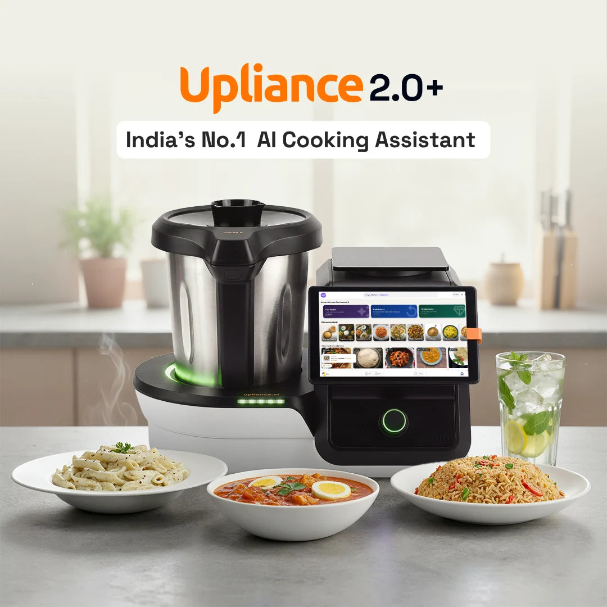
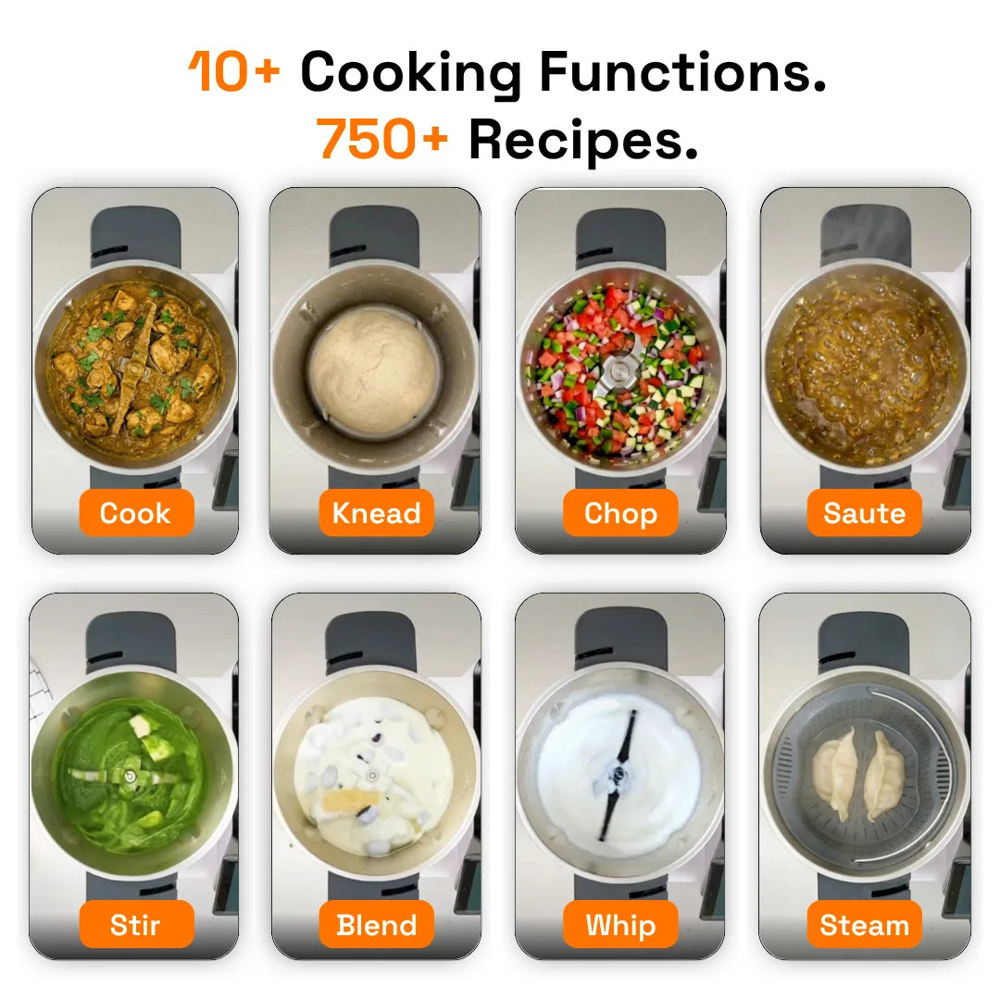
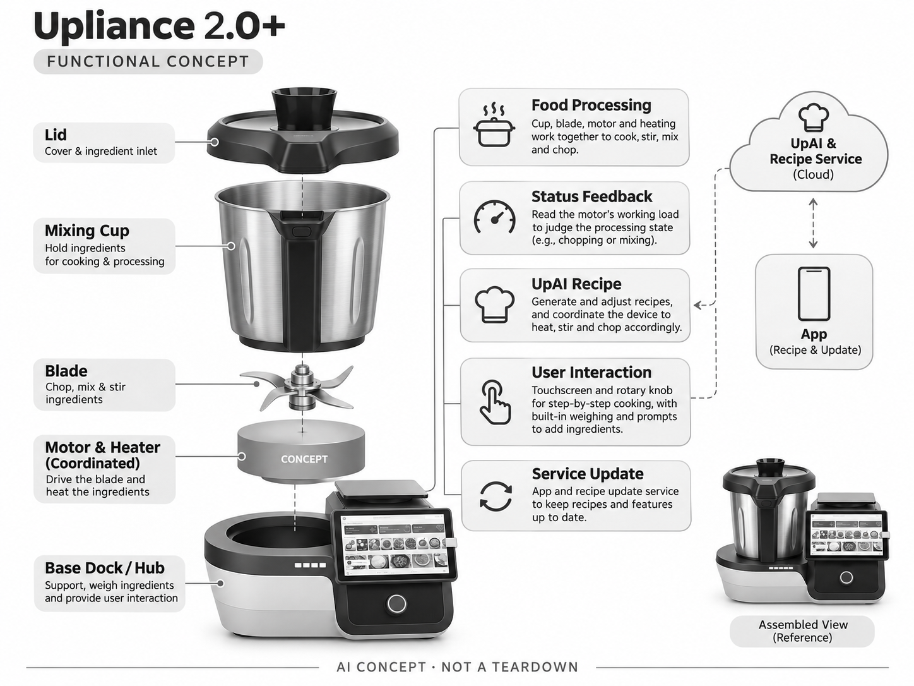

# Upliance 2.O+

**upliance.ai** · 厨房与烹饪 · 核查 2026-11-04

把生成式食谱与引导式料理机结合

消费渠道：个人零售。

## 产品图片与结构参考

### 产品图

Upliance 2.O+ 官方产品图 · 来源：[upliance.ai · 官方图片](<https://upliance.ai/products/upliance2-0>) · [原始图片](<https://cdn.shopify.com/s/files/1/0764/8290/4373/files/Listing_Image_Upliance2.webp?v=1790238872&width=1200>)

### 参考图

Upliance 2.O+ 官方外观、结构或使用参考 · 来源：[upliance.ai · 官方图片](<https://upliance.ai/products/upliance2-0>) · [原始图片](<https://cdn.shopify.com/s/files/1/0764/8290/4373/files/2.O__Listing_3.webp?v=1776941658&width=1200>)

### AI 生成爆炸示意

**AI 生成 · 非实物拆机。** 内部为概念推断，不能作为元件布局、BOM 或维修依据。[生成提示词](../../content/hardware/prompts/upliance-2o-plus.txt)

> 保留官方图片原始内容和出处；画面宣传参数不是本轮独立实测。

> 分析为基于公开资料的案头研究与 AI 辅助判断，未经用户访谈、销量审计或实物拆机。需求、画像、竞争冷门度、审美及商业机会均为研究假设，不是投资结论。

## 销售与购买

- 状态：在售。印度官方页显示Add to cart、On Sale和按邮编查询配送；商品公开数据available=true。

- 地区：印度官方商店

- 价格：₹34,499。核查时官方地区参考价，保留原币种；订阅、税运、附件及优惠以结账为准，预订定金不等于整机价格。

- 中国大陆：本轮核实所列海外官方渠道；中国大陆同型号现货、保修及服务可用性未确认。进口前需核对供电、网络、配件和地区条款。

- [官方产品 / 商店](<https://upliance.ai/products/upliance2-0>)

## AI 的实际作用

UpAI辅助生成和调整食谱，设备协同加热、搅拌及切碎；官方披露利用电机负载反馈判断加工状态，用户按步骤添加原料。

服务与联网依赖：联网获取食谱和更新；进行中的烹饪可离线完成。官方写关键软件更新7年、食谱和AI更新免费至2028年1月，之后权益需确认。

## 是否冷门

细分专业（研究判断）：印度家庭料理机已有替代品，生成式配方与反馈控制的组合较新，但受菜式和人工加料边界制约。

## 需求与市场

需求假设：印度家庭需要降低多步骤菜式的学习负担，同时保留食材和调味选择。要测量用户按提示称量、加料和清洗的完整投入，生成更多菜谱并不自动意味着更容易完成晚餐。

## 用户画像

画像推断：愿意按屏幕指引操作、经常做炖煮或搅拌类菜式的家庭与独居者，尤其在意可复制步骤。喜欢自由大火翻炒或同时做多道菜的用户可能不适合，应避免泛化为所有厨房。

## 竞争与替代

竞争判断：与传统多功能料理机、Thermomix、家用锅具和短视频菜谱竞争。UpAI生成与调整配方是软件差异，单容器的加工边界仍存在；本条只计2.O+，不把额外料理杯套装重复统计。

## 供应链

供应链分析：加热、刀片、电机、称重、屏幕和食品级容器需共同校准，供应商与BOM未公开。电机负载反馈、容器密封、清洁可达性与本地上门服务会影响长期口碑及运营成本。

## 技术路径

官方披露电机反馈、同步热搅拌和AI食谱能力。技术判断：生成配方需要约束份量、温度与加料顺序，文本可读不等于机器可安全执行；专利存在也不代表每种食材都能可靠处理。

## 产品审美

审美判断：锅杯、屏幕和旋钮形成明确操作中心，适合连续跟随步骤。台面占用、杯体提起重量与拆洗刀片的安全感比发光装饰更重要，屏幕语言和提示密度也应适应家庭使用。

## 关键风险

风险判断：用户依然需要加料，不能把引导烹饪描述为完全无人操作。AI与食谱免费期有截止日期，未来费用、离线功能和维修覆盖需确认；生成食谱的食品安全边界不能交由模型自由发挥。

## 机会与验证

机会假设：用一周家庭菜单检验可完成菜式、失败恢复和清洗时间，比较是否真正降低学习成本。若用户主要复做固定菜谱，可靠引导和本地食材适配可能比开放聊天更有商业价值。

## 功能分层示意

这是功能关系，不是实物拆机、真实空间结构或已核实 BOM。

1. **食物加工**：杯体、刀片、电机与加热协同。（官方披露）

2. **状态反馈**：读取电机工作负载。（官方披露）

3. **UpAI食谱**：生成与调整烹饪步骤。（官方披露）

4. **人机交互**：屏幕、旋钮、称重和分步加料。（官方披露）

5. **服务更新**：App与食谱更新服务。（官方披露）

## 来源

1. [Upliance 2.O+ 官方购买页](<https://upliance.ai/products/upliance2-0>) — 实际打开核查当前购买或预订入口，未实际下单；价格与交付按具体地区。

2. [Upliance 官方专利与系统说明](<https://upliance.ai/pages/patents>) — 实际打开的官方技术与使用资料，宣传效果并非本轮独立实测。

[返回目录](../hardware-market.md) · [网页分析](https://romanagent.github.io/Roman/#hardware/product/upliance-2o-plus)
