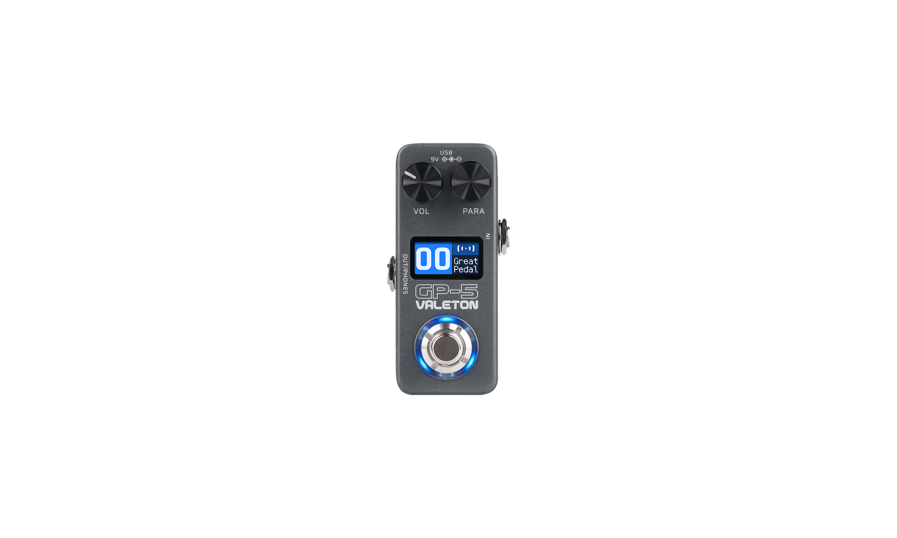
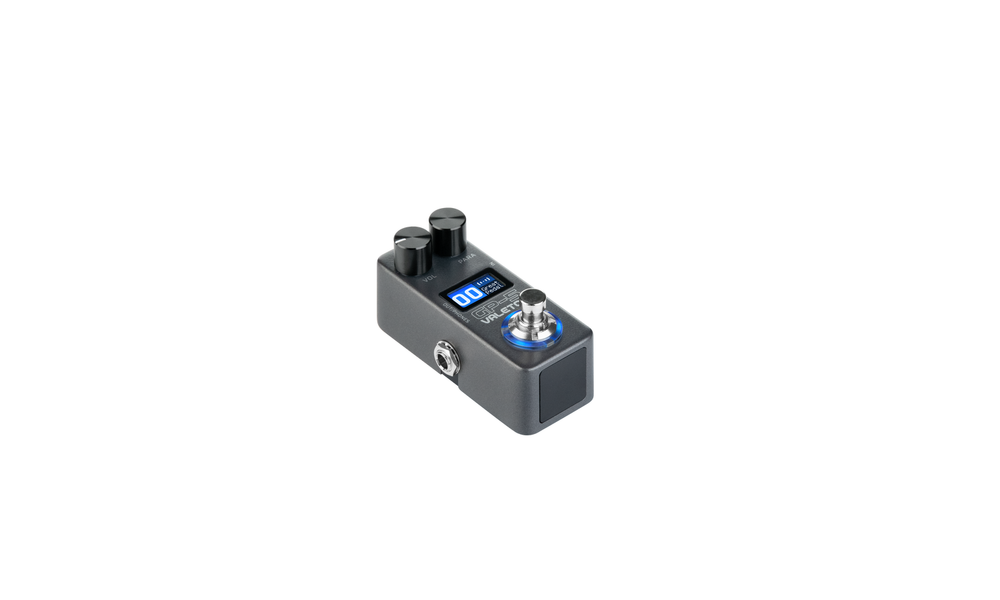
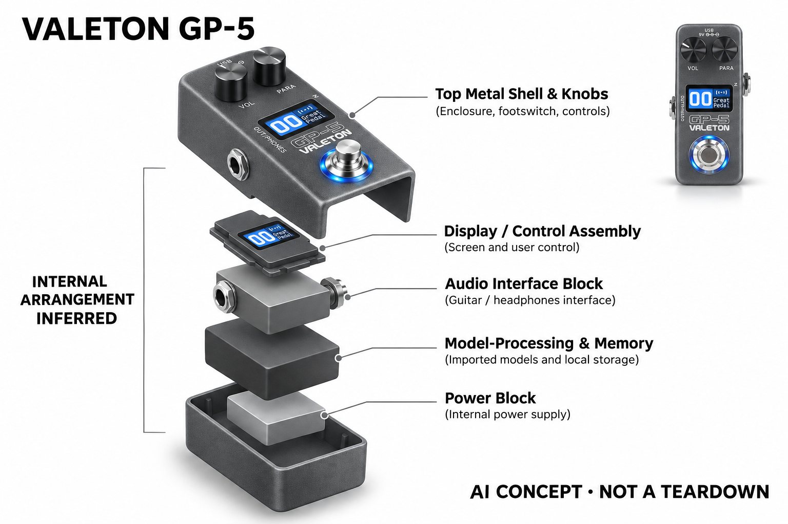

# Valeton GP-5

**Valeton** · 音乐与乐器 · 核查 2026-11-04

用小型踏板承载转换后的神经音箱模型

消费渠道：个人零售。

## 产品图片与结构参考

### 产品图

Valeton GP-5 · 官方产品图 · 来源：[Valeton · 官方图片](<https://shop.valeton.net/products/gp-5>) · [原始图片](<https://shop.valeton.net/cdn/shop/files/GP-5_Front_WithScreen_Hi_V01_250425_1500x.png?v=1747797183>)

### 参考图

Valeton GP-5 · 官方参考图 · 来源：[Valeton · 官方图片](<https://shop.valeton.net/products/gp-5>) · [原始图片](<https://shop.valeton.net/cdn/shop/files/GP-5_Perspective_WithScreen_Hi_V01_250425_1500x.png?v=1747797183>)

### AI 生成爆炸示意

**AI 生成 · 非实物拆机。** 内部为概念推断，不能作为元件布局、BOM 或维修依据。[生成提示词](../../content/hardware/prompts/valeton-gp5.txt)

> 已目视核对外形、标签与非拆机声明；不代表内部结构经实测验证。

> 分析为基于公开资料的案头研究与 AI 辅助判断，未经用户访谈、销量审计或实物拆机。需求、画像、竞争冷门度、审美及商业机会均为研究假设，不是投资结论。

## 销售与购买

- 状态：在售。官方商店显示US$79.99、Add to cart及美国仓发货说明；页面结构化Offer为InStock。通用Sale/Sold out模板不单独作为库存判断。

- 地区：美国官方仓

- 价格：官网 US$79.99。官方美元价格快照，运税与具体配送地址以结算为准。

- 中国大陆：本轮核实所列区域官方商店；未确认中国大陆官方现货、账户及完整服务，不把境外可购等同大陆可用。

- [官方产品 / 商店](<https://shop.valeton.net/products/gp-5>)

## AI 的实际作用

SnapTone将第三方NAM神经音箱模型转换导入硬件，再用于实时演奏。它不是声称每一种内置效果都由AI生成，也不等于本机训练任意NAM模型。

服务与联网依赖：模型转换和文件管理使用电脑或移动应用；支持格式受固件和转换器限制，已加载内容可本地使用。

## 是否冷门

竞争密集（研究判断）：入门小踏板替代多，神经模型兼容与软件流程是主要区别。

## 需求与市场

需求假设：预算有限或踏板空间紧张的个人乐手希望尝试神经采样音色，而不购买大型设备。验证应把模型导入和转换耗时算进去，并比较实际想保留的声音，不能仅凭低标价推断总成本低。

### 需求假设：小预算和小踏板空间也能尝试NAM · 研究判断

GP-5通过SnapTone转换导入神经音色，针对希望使用熟悉模型却不想购买大型设备的乐手。需求应把转换、文件管理与现场调用一起计算，不能只以低展示价推断总成本低，也不把想试试神经模型等同愿意长期维护软件。

依据：[Valeton GP-5官方商店](<https://shop.valeton.net/products/gp-5>) · [Valeton GP-5官方功能](<https://www.valeton.net/product/gp-5/>)

### 价值判断：便宜入口也需要稳定常用声音 · 研究判断

用户可能下载很多模型尝鲜，最终只保留少量，踏板价值在这些声音是否容易准备和反复调用。研究应记录导入失败、修改与实际演奏，不把支持NAM字样当作兼容所有文件，也不将内置效果数量视为使用价值的直接替代。

依据：[Valeton GP-5官方功能](<https://www.valeton.net/product/gp-5/>)

### 验证方案：用用户已有文件完成小型系统 · 待验证

让乐手选择正在使用的NAM文件，通过当前工具转换导入并完成排练，记录准备、增益和脚控，再与原方案比较。保持输入与监听一致，不只展示一个成功模型，也不依据厂商真实性形容推断全部内容都同样适合。

依据：[Valeton GP-5官方商店](<https://shop.valeton.net/products/gp-5>) · [Valeton GP-5官方功能](<https://www.valeton.net/product/gp-5/>)

## 用户画像

画像推断：已有吉他和耳机或扩声设备、愿意使用手机或电脑管理模型的爱好者较适合。需要大量现场直接调参的人可能更在意控制数量；新手也需要理解模型格式而不只是下载文件。

### 画像假设：愿意用应用换取小机身的爱好者 · 研究判断

较匹配者已有乐器与监听，踏板空间或预算有限，同时能接受电脑或手机管理模型。需要大量现场直接调参的人可能更看重控制数量，画像应包含真实编辑频率与学习意愿，不把入门价格自动等同无需理解格式和信号链。

依据：[Valeton GP-5官方商店](<https://shop.valeton.net/products/gp-5>) · [Valeton GP-5官方功能](<https://www.valeton.net/product/gp-5/>)

### 使用约束：小屏与少控制影响现场习惯 · 研究判断

机身缩小后，一些操作需要进入菜单或应用，用户应愿意在演奏前准备稳定配置，不能只从口袋大小判断方便。已有踏板板与临时单独使用的要求也不同，研究应了解供电、接口和脚位，而不是只询问是否喜欢便携。

依据：[Valeton GP-5官方功能](<https://www.valeton.net/product/gp-5/>)

### 访谈重点：愿意为模型转换花多少准备 · 待验证

请用户展示原有导入或插件流程，说明哪些步骤可以接受、哪些会让自己放弃某个模型，再观察GP-5转换是否改变这些成本。不能把下载成功当作学会使用，也不以低价掩盖用户没有兼容手机或不愿管理文件的实际门槛。

依据：[Valeton GP-5官方功能](<https://www.valeton.net/product/gp-5/>)

## 竞争与替代

竞争判断：小型多效果器和入门耳放已经竞争密集，支持神经模型提供新的内容入口。低价不等于没有替代，模型转换兼容、控制便利性和售后支持可能比内置效果数量更影响选择。

### 替代方案：入门耳放、小效果器与原生播放器 · 研究判断

GP-5处于小型音频设备的成熟竞争中，面对普通耳放、其他神经模型踏板和电脑插件，转换路线提供不同内容入口。比较应围绕目标声音与准备，不因低价就推断没有替代，也不将每种支持模型格式的硬件都统计为全新需求。

依据：[Valeton GP-5官方商店](<https://shop.valeton.net/products/gp-5>) · [Valeton GP-5官方功能](<https://www.valeton.net/product/gp-5/>)

### 差异判断：转换导入与原生运行不能混称 · 研究判断

SnapTone将兼容NAM转为设备可用内容，这与原生播放或本机训练是不同流程，用户需要理解边界。研究应检验转换后的常用声音和控制是否满足任务，不把任何新架构默认兼容，也不因为有额外转换就预先判定体验必然更差。

依据：[Valeton GP-5官方功能](<https://www.valeton.net/product/gp-5/>)

### 比较方法：从文件到实际保留的声音 · 待验证

使用相同目标模型比较GP-5与其他路径的转换、导入、校准和调用，记录最后被保留的内容与原因。不要只数一次导入多少个文件，也不将不同输出音量误当作算法差异，低价设备的真实价值应包含准备与恢复成本。

依据：[Valeton GP-5官方商店](<https://shop.valeton.net/products/gp-5>) · [Valeton GP-5官方功能](<https://www.valeton.net/product/gp-5/>)

## 供应链

供应链推断：小金属机身、音频接口、脚开关和紧凑处理板需要控制噪声与装配一致性。官方未披露实际工厂与完整物料成本；转换软件、应用维护和退换问题同样影响长期交付。

### 功能拆分：工具转换与本地音频执行 · 研究判断

公开流程由电脑或移动工具管理模型、SnapTone转换、设备实时播放与普通效果串联，再由脚控和小屏操作。它不等于本机训练任意NAM，具体处理器、音频电路和工厂未披露，不能因支持模型就猜测采用某颗AI芯片或通用参考板。

依据：[Valeton GP-5官方功能](<https://www.valeton.net/product/gp-5/>)

### 制造判断：紧凑板与脚控需要兼顾噪声 · 研究判断

小机身内的接口、脚开关和处理电源会相互约束，低价定位也不能省略稳定音频与重复连接验证。供应评估还需包含软件转换和售后，本轮没有装配、底噪、接口寿命或成本报价，不由外壳大小推算BOM和利润。

依据：[Valeton GP-5官方商店](<https://shop.valeton.net/products/gp-5>) · [Valeton GP-5官方功能](<https://www.valeton.net/product/gp-5/>)

### 候选选型：小显示与板级装配分别验证 · 研究判断

Raystar可作为状态小屏候选，JLCPCB可讨论按设计文件进行音频控制板装配，Fictiv可研究紧凑结构。三者不提供SnapTone转换器，也无Valeton点名供货证据，音频、供电和脚控仍需工程设计，不能把服务目录当作原机方案。

依据：[Valeton GP-5官方功能](<https://www.valeton.net/product/gp-5/>)

## 技术路径

官方说明SnapTone支持NAM文件转换导入。技术判断必须区分转换后播放与原生运行全部格式，不能把任意新架构文件都视为兼容；应先用具体文件和当前固件验证再评价声音差异。

### 已披露能力：NAM经SnapTone转换后使用 · 官方资料

官方功能页明确支持通过配套工具转换并导入NAM内容，已加载声音本地演奏，格式受工具和固件限制。应区分转换、推理播放和普通效果，不将全部内置DSP叫AI，也不能把任意第三方文件或未来模型架构视为已确认兼容。

依据：[Valeton GP-5官方功能](<https://www.valeton.net/product/gp-5/>)

### 技术判断：转换结果需要与输入条件一起听 · 研究判断

即使文件转换完成，增益、原模型质量与监听仍可能让声音不合预期，用户需要知道问题发生在哪一层。研究应保存转换版本与原文件，再比较实际演奏，不以成功提示证明声音相同，也不补写未公开的模型压缩或内部计算方法。

依据：[Valeton GP-5官方功能](<https://www.valeton.net/product/gp-5/>)

### 验证方案：逐文件检查兼容与恢复 · 待验证

选取用户真实常用模型，用当前转换器和固件记录成功、失败、所需修改与本地调用，再完成排练。保持输入与输出条件一致，不只选择厂商示例，也不将一次转换成功推广到全部NAM生态，本轮没有全量兼容和延迟测试。

依据：[Valeton GP-5官方商店](<https://shop.valeton.net/products/gp-5>) · [Valeton GP-5官方功能](<https://www.valeton.net/product/gp-5/>)

## 产品审美

审美判断：口袋踏板形态与简短控制适合小型设备板，金属外壳表达工具感。屏幕面积有限，需要测试光照下的可读性和脚踩误触；产品尺寸小并不必然意味着操作步骤也更少。

### 外形判断：口袋踏板适合有限设备空间 · 研究判断

小金属盒体、简短控制和屏幕可以放入紧凑踏板板，但接口、鞋底与站立视角会改变实际便利。外观尺寸小不代表操作步骤少，屏幕是否看清和脚控是否易误触需要实测，不能仅凭产品照片判断现场与居家同样顺畅。

依据：[Valeton GP-5官方商店](<https://shop.valeton.net/products/gp-5>) · [Valeton GP-5官方功能](<https://www.valeton.net/product/gp-5/>)

### 交互判断：有限显示需要清楚表达状态 · 研究判断

用户在演奏时要知道当前声音与下一步操作，小屏和少按钮更依赖良好预设准备，复杂编辑可能移到应用。研究应观察何时需要弯腰或拿手机，不能把极简外观当作没有学习成本，也不将更多应用功能自动视为补足了现场控制。

依据：[Valeton GP-5官方功能](<https://www.valeton.net/product/gp-5/>)

### 体验验证：放进已有小型踏板布局 · 待验证

让用户用实际电源、线缆和鞋子完成安装、调用、临时修改与收纳，记录空间冲突和反复确认。随后比较原耳放或插件方案，避免只在桌面手动操作，也不以一次装包容易就判断长期维护和舞台切换同样方便。

依据：[Valeton GP-5官方商店](<https://shop.valeton.net/products/gp-5>) · [Valeton GP-5官方功能](<https://www.valeton.net/product/gp-5/>)

## 关键风险

风险判断：文件版本、转换超时或手机兼容会让低成本硬件产生额外设置成本。用户下载的模型质量参差，试听增益也应逐个检查；不以厂商对模拟真实性的描述替代实际对比录音。

### 兼容风险：转换工具和模型版本共同变化 · 研究判断

文件架构、工具更新和手机系统可能影响导入，不能由支持NAM标签保证所有新模型可用。已加载本地内容与未来管理是不同依赖，重要演奏应保留稳定配置，本轮没有全格式验证，也不将厂商模拟真实性描述当作独立声音保证。

依据：[Valeton GP-5官方功能](<https://www.valeton.net/product/gp-5/>)

### 成本风险：低标价可能掩盖设置与服务投入 · 研究判断

用户还需乐器、监听、电源和文件管理工具，失败转换或售后也会占用时间，不能只按踏板价格判断便宜。当前美国仓可购不代表所有地区有相同维修与物流条件，内容来源权限亦需核对，不将下载文件视为可随意再发布。

依据：[Valeton GP-5官方商店](<https://shop.valeton.net/products/gp-5>) · [Valeton GP-5官方功能](<https://www.valeton.net/product/gp-5/>)

### 验证安排：保留被放弃的文件与使用场景 · 待验证

试用应记录无法转换、声音不合意、控制不足或回到原系统的原因，区分文件、软件与硬件问题。不要只统计成功加载数量，也不把用户放弃某模型归因于不会设置，真正问题是转换路线是否在反复任务中值得承担。

依据：[Valeton GP-5官方功能](<https://www.valeton.net/product/gp-5/>)

## 机会与验证

市场观察：这类产品展示神经音色如何进入入门价位，而非自动证明更大的市场空间。后续应记录导入成功率、常用预设数量和应用依赖，判断它是否让新用户更容易形成稳定演奏流程。

### 研究方向：让神经音色进入低负担小型设备 · 研究判断

GP-5可用于观察预算与空间受限用户是否愿意通过转换获得常用模型，机会可能在兼容说明、错误解释和快速恢复。应先确认低价入口是否真的降低完整使用门槛，而不是仅降低购买价格，也不把模型数量继续扩张当作唯一创新。

依据：[Valeton GP-5官方功能](<https://www.valeton.net/product/gp-5/>)

### 执行计划：记录常用文件与工具依赖 · 待验证

跟踪数次练习中导入成功、保留模型、应用修改和实际演奏，访谈一次转换后放弃或回退的决定。将内容探索与稳定使用分开，不以下载总量、社区评价或短期尝鲜推断留存，也不把未开展的测试写成准确率结论。

依据：[Valeton GP-5官方商店](<https://shop.valeton.net/products/gp-5>) · [Valeton GP-5官方功能](<https://www.valeton.net/product/gp-5/>)

### 决策边界：转换路线属于共享音色需求 · 研究判断

GP-5与其他模型播放器服务相近的便携声音调用，转换方式、价格和控制是具体差异，不能自动形成独立市场。当前没有访谈、销量和供应报价，不以低标价、AI名称或模型评分预测商业成功，应该比较完整准备和演奏成本。

依据：[Valeton GP-5官方商店](<https://shop.valeton.net/products/gp-5>) · [Valeton GP-5官方功能](<https://www.valeton.net/product/gp-5/>)

## 对应供应链公司

能力候选用于选型研究，不代表本产品实际采用；未公开的供货关系不作推断。

- [raystar](../supply-chain/raystar.md) — **能力候选 · 非已采用** / 小型音色踏板状态显示候选：Raystar公开小型显示与界面工程，可作为GP-5状态屏候选，但尺寸、驱动、低光可读性与功耗需确认，标准模组不构成原机替换件。该关联不含SnapTone算法，也没有Valeton点名供货资料，必须按实际模块需求进一步验证。

- [jlcpcb](../supply-chain/jlcpcb.md) — **能力候选 · 非已采用** / 紧凑实时音频板原型装配候选：JLCPCB公开PCB和PCBA输入装配流程，可用于GP-5同类音频控制板样机，但需开发者提供合法电路与BOM并验证底噪、供电和接口，不提供现成神经音色方案。当前没有原机板级资料、实际代工或成本证据。

- [fictiv](../supply-chain/fictiv.md) — **能力候选 · 非已采用** / 口袋脚踏设备外壳制造候选：Fictiv公开CNC与钣金等制造能力，可作为GP-5类紧凑外壳与控制固定候选，但脚控受力、插座空间和接地需按设计验证。该关联不证明原机制造来源或零件兼容，也不涉及复制Valeton专有外观和内部结构。

[浏览供应链目录](../supply-chain.md)

## 功能分层示意

这是功能关系，不是实物拆机、真实空间结构或已核实 BOM。

1. **模型输入**：通过配套工具导入兼容NAM文件。（官方披露）

2. **格式转换**：SnapTone转换为设备可用内容。（官方披露）

3. **实时处理**：本机播放模型并串联音频效果。（官方披露）

4. **控制反馈**：脚控、小屏和移动应用管理。（官方披露）

## 来源

1. [Valeton GP-5官方商店](<https://shop.valeton.net/products/gp-5>) — 已打开；Offer为InStock并说明美国仓供货。

2. [Valeton GP-5官方功能](<https://www.valeton.net/product/gp-5/>) — 已打开，明确NAM到SnapTone转换，而非本机训练声明。

[返回目录](../hardware-market.md) · [网页分析](https://romanagent.github.io/Roman/#hardware/product/valeton-gp5)
