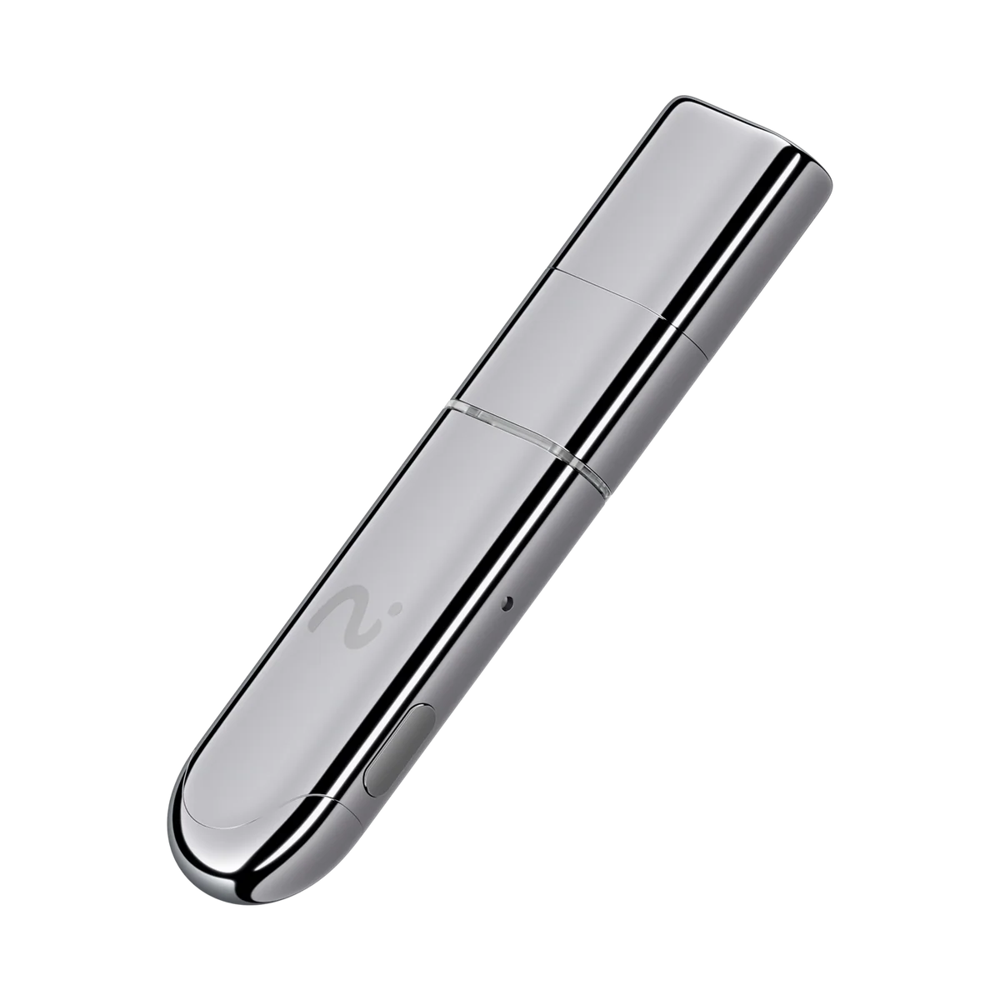
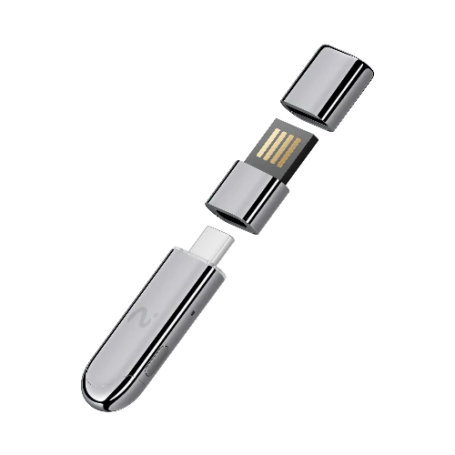
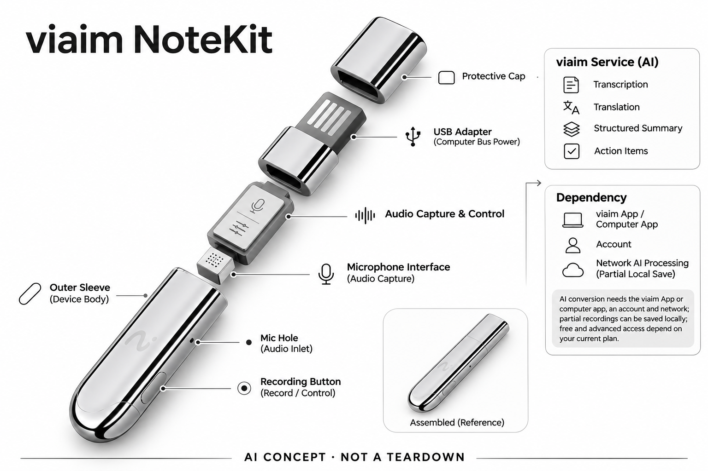

# viaim NoteKit

**viaim** · 录音与记忆 · 核查 2026-11-04

多场景音频记录与viaim AI摘要

消费渠道：个人零售。

## 产品图片与结构参考

### 产品图

viaim NoteKit官方产品外形图 · 来源：[viaim · 官方产品图片](<https://store.viaim.ai/products/viaim-notekit>) · [原始图片](<https://cdn.shopify.com/s/files/1/0722/7647/6150/files/viaim_NoteKit_00.png?v=1736769983&width=1200>)

### 官方结构参考

viaim NoteKit官方USB接口、转接件与保护盖拆分参考 · 来源：[viaim · 官方产品图片](<https://store.viaim.ai/products/viaim-notekit>) · [原始图片](<https://cdn.shopify.com/s/files/1/0722/7647/6150/files/viaim_NoteKit_07.png?v=1759412683&width=1200>)

### AI 生成爆炸示意

**AI 生成 · 非实物拆机。** 内部为概念推断，不能作为元件布局、BOM 或维修依据。[生成提示词](../../content/hardware/prompts/viaim-notekit.txt)

> 外形依据核验参考图；内部位置、模块形状与装配关系仅作AI概念展示。

> 已逐张查看并核对型号。源图未改色/裁切；场景、界面、附件、优惠及效果文案仅为厂商示意，不作为本目录性能或现价依据。

> 分析为基于公开资料的案头研究与 AI 辅助判断，未经用户访谈、销量审计或实物拆机。需求、画像、竞争冷门度、审美及商业机会均为研究假设，不是投资结论。

## 销售与购买

- 状态：在售。官方商品页提供Add to cart；已读取官方公开商品JSON，单机变体available=true，排除了页面隐藏的Sold Out模板与耳机+NoteKit套装重复计数。

- 地区：所列官方区域或授权零售渠道；配送地址与服务支持需结算确认

- 价格：US$79.99，单机。核查日所见单机或基本配置价；币种、促销、税费、镜片、附件及服务依地区结算，不把颜色或套装重复计数。

- 中国大陆：本次未核实该具体型号在中国大陆的官方销售和完整服务支持；海外在售不等于国内可直接启用全部功能。

- [官方产品 / 商店](<https://store.viaim.ai/products/viaim-notekit>)

## AI 的实际作用

viaim服务将录音转换为文本、翻译、结构化摘要与行动项；选择高级AI模型和额度的计划独立于硬件

服务与联网依赖：需要viaim App或电脑应用、账户与网络AI处理；部分硬件录音可先保存，AI转换不是全部离线运行，免费和高级权限依当前计划

## 是否冷门

新兴竞争（研究判断）：按任务与形态作案头分类，无访谈、销量或市场份额证据。

## 需求与市场

需求假设：电脑会议不想戴耳机，但仍希望同时留下系统音频和身边讲话。价值应由实际使用频率、任务完成与操作负担验证，不能把AI功能存在或演示流畅当作需求已得到满足。

### 官方｜电脑会议的 USB 记录入口 · 官方资料

本型号是插入电脑并配合应用工作的 USB 录音附件，提供启动控制、现场声音采集和后续转写整理，不能按同品牌耳机描述。需求集中在电脑会议与附近谈话进入可回查笔记，不要求用户为了记录另戴专用耳机；硬件入口与云端内容处理仍是不同环节。

依据：[viaim NoteKit官方商店](<https://store.viaim.ai/products/viaim-notekit>)

### 判断｜是否减少软件操作 · 研究判断

用户可能希望开会时更容易开始记录，并让电脑声音与现场发言进入统一流程，但插入附件并不会自动解决权限和音频路由。价值应看每次会议需要多少设置、是否少漏记，而不是只看插上就能使用的演示；如果仍要频繁排查应用，外设可能只是新增一个操作点。

依据：[viaim NoteKit官方商店](<https://store.viaim.ai/products/viaim-notekit>)

### 验证｜电脑任务的完整对照 · 待验证

可在同一电脑、会议平台和对话中比较 NoteKit、普通麦克风与软件记录，统计启动、声音完整和会后查找时间。还应加入耳机切换、主机休眠与现场插话，确认实际捕获范围；当前目录没有实机兼容数据，不能由支持主流系统的说明保证每种组合都稳定。

依据：[viaim NoteKit官方商店](<https://store.viaim.ai/products/viaim-notekit>)

## 用户画像

画像推断：愿意自行整理访谈、课程或工作对话的个人用户，能接受录音提示和云端处理流程。个人的语言、操作习惯、环境和预算会改变适配结果，本次只有案头研究，没有用户访谈或长期使用观察。

### 判断｜电脑为主的个人用户 · 研究判断

经常在电脑上参加会议、课程或访谈的人，可能更容易利用 USB 形态，尤其需要同时整理现场讲话的人。主要手机通话或户外移动用户则未必匹配，画像应以工作设备与声音来源建立；不能因为产品支持摘要就把所有需要笔记的人归为同一人群。

依据：[viaim NoteKit官方商店](<https://store.viaim.ai/products/viaim-notekit>)

### 判断｜不想更换听音设备的人 · 研究判断

用户可能希望继续使用现有耳机或电脑扬声器，把记录作为独立附件处理。但不同音频输出方式会改变设置和环境声音，不能默认不戴耳机就更方便；适配研究应记录既有装备、共享空间和权限习惯，而不只问是否愿意购买较便宜的小型外设。

依据：[viaim NoteKit官方商店](<https://store.viaim.ai/products/viaim-notekit>)

### 验证｜首次设置与恢复 · 待验证

测试应让用户从插入设备、打开应用到开始和结束会议独立完成，并安排一次没有声音或连接中断的情况。记录他们能否判断输入来源并恢复，避免只由熟悉系统音频的人演示；长期使用门槛包括应用与数据管理，不能仅用小尺寸和少量按键代表易用。

依据：[viaim NoteKit官方商店](<https://store.viaim.ai/products/viaim-notekit>)

## 竞争与替代

案头判断：与手机会议转录、其他录音耳机和桌面录音设备竞争，RecDot、OpenNote与USB NoteKit是不同音频采集形态。这只是用途与替代品比较，不是市场份额或销量结论；专业细分和较少曝光也不代表没有成熟竞争者。

### 判断｜与桌面音频设备比较 · 研究判断

多接口音频扩展坞和独立会议麦克风也可能进入同一电脑记录任务，NoteKit 的区别主要是小型附件和较少桌面占用。外观差异不自动形成新场景，比较应看用户是否需要额外接口、声音输出或移动携带；不能仅以件数或体积判断哪种方案更符合实际工位。

依据：[viaim NoteKit官方商店](<https://store.viaim.ai/products/viaim-notekit>)

### 判断｜与纯软件记录比较 · 研究判断

电脑会议软件已经能处理部分转写与摘要，硬件需要证明启动、采集或跨场景管理带来了额外收益。若声音来源完全由既有软件覆盖，小附件可能没有明显优势；竞争分析应明确用户真正缺失的环节，而不是把实体设备存在当作比软件更可靠或更有价值的证据。

依据：[viaim NoteKit官方商店](<https://store.viaim.ai/products/viaim-notekit>) · [viaim官方AI计划](<https://store.viaim.ai/collections/viaim-ai-subscription-plans>)

### 验证｜单机与服务同口径 · 待验证

本条按单独 NoteKit 配置记录，不把耳机套装当成另一款产品或用套装价格混算。官方说明基础使用与可选高级计划有区别，应按转写量和模型需求核对总成本；当前没有销量、留存或用户访谈，不能从低硬件价和无需强制订阅宣传推导市场优势。

依据：[viaim NoteKit官方商店](<https://store.viaim.ai/products/viaim-notekit>) · [viaim官方AI计划](<https://store.viaim.ai/collections/viaim-ai-subscription-plans>)

## 供应链

公开资料可核对小型USB电脑音频录制设备与近场麦克风，具体整机工厂、关键模块供应商与BOM本次未确认。制造重点可从形态推断，但不能把品牌所在地、外观相似或营销合作等同代工关系。

### 官方｜USB 设备与声音输入 · 官方资料

公开资料能确认小型电脑接口附件、麦克风和应用操作流程，具体主控、接口芯片、工厂与内部供电结构未完整披露。不能把它误写成耳机，也不应凭外形添加独立电池或其他未披露模块；目录的概念架构只表示采集、电脑协同和服务处理关系。

依据：[viaim NoteKit官方商店](<https://store.viaim.ai/products/viaim-notekit>)

### 判断｜接口位置影响声学 · 研究判断

插在电脑附近的麦克风会受到主机位置、桌面反射和可能的风扇或键盘声音影响，不能只按宣传范围判断现场输入。结构与接口固定也需要考虑携带和插拔，但具体寿命和材料未知；这些是可执行验证方向，不是对内部装配、成本或制造良率的已知结论。

依据：[viaim NoteKit官方商店](<https://store.viaim.ai/products/viaim-notekit>)

### 判断｜接口与麦克风候选 · 研究判断

沁恒可作为 USB 控制与传输路线候选，英飞凌可作为声音输入候选，二者均未被本型号资料点名采用。选择需确认主机设备类、音频时钟、驱动和声孔结构，不能直接替换现有器件；候选也不提供 viaim 的转写、翻译或摘要服务，平台能力需单独评估。

依据：[viaim NoteKit官方商店](<https://store.viaim.ai/products/viaim-notekit>)

## 技术路径

viaim服务将录音转换为文本、翻译、结构化摘要与行动项；选择高级AI模型和额度的计划独立于硬件。这是厂商披露的功能机制；模型版本、准确率及内部结构未完整公开。架构只表示输入、处理和输出关系，不作为真实拆机或性能实测。

### 官方｜电脑应用与生成服务 · 官方资料

本轮重新打开官方页面，流程明确要求连接电脑并打开 NoteKit 应用，服务提供转写、翻译、摘要和跨端管理。高级计划可能增加额度或模型选择，不能把基础可用理解为所有能力永久无限；详细端云部署未完整披露，也不能因附件插在电脑上就认定全部处理离线。

依据：[viaim NoteKit官方商店](<https://store.viaim.ai/products/viaim-notekit>) · [viaim官方AI计划](<https://store.viaim.ai/collections/viaim-ai-subscription-plans>)

### 判断｜系统声音和现场声音分层 · 研究判断

电脑中的音频与麦克风捕获的房间声音可能通过不同路径进入记录，用户听到的内容不一定全部被正确采集。系统应让输入状态清楚，并区分权限、路由和网络处理失败；技术评价先看完整音频，再看文字与摘要，避免生成结果流畅却遗漏了某一方发言。

依据：[viaim NoteKit官方商店](<https://store.viaim.ai/products/viaim-notekit>)

### 验证｜主机与会议平台组合 · 待验证

测试应覆盖目标 Windows 或 Mac 配置、常用会议应用、耳机与扬声器切换，并检查休眠和重连后的状态。随后用同一音频核对翻译与行动项，记录错误来自采集还是理解；官方兼容说明只支持初筛，当前目录没有独立验证每个版本和平台的具体表现。

依据：[viaim NoteKit官方商店](<https://store.viaim.ai/products/viaim-notekit>)

## 产品审美

图示观察：细长USB适配器作为电脑旁边的工具更容易理解，外观不需要模仿可穿戴设备。宣传图片只能帮助理解外观和摆放方式，不能证明每个人的舒适度、长时使用体验或实际材料触感。

### 判断｜小型附件的桌面角色 · 研究判断

紧凑 USB 外形可以减少桌面摆放，但也可能在接口旁被线缆遮挡或在移动时被忽略。审美研究应把它放进真实电脑与外设组合，观察是否便于插拔和确认状态，不能只看孤立渲染图；小巧不等于没有操作负担，也不能证明不同接口位置都适合录音。

依据：[viaim NoteKit官方商店](<https://store.viaim.ai/products/viaim-notekit>)

### 判断｜实体触发与应用反馈 · 研究判断

单次控制可以帮助快速开始或停止，但用户仍需要知道电脑应用是否正在接收以及服务是否完成。设计评价应检查硬件反馈与屏幕状态是否一致，避免按下后误以为内容已完整记录；简洁外观不能替代对多层状态的清楚表达，更不能借用同品牌耳机的交互体验描述本款。

依据：[viaim NoteKit官方商店](<https://store.viaim.ai/products/viaim-notekit>)

### 验证｜携带和接口实际使用 · 待验证

试用应包含从包中取出、连接、会议结束和收纳，记录遗失、插拔不便及附近外设干扰。不同电脑接口和摆放方向需要分别观察，现场采集距离也应按用户任务测试；产品图片只能确认外形和使用意图，不能代替长期携带、结构耐久和声音效果验证。

依据：[viaim NoteKit官方商店](<https://store.viaim.ai/products/viaim-notekit>)

## 关键风险

USB电脑附件可能同时涉及系统音频与附近谈话，需确认应用权限、实际采集范围和参与者知情。主机音频路由、转写错词、口音与多人重叠会影响结果，摘要中的责任人和条件仍需回听核对；基础与高级AI权益、地区服务和数据导出也应按当前计划确认。

### 判断｜电脑内容与共享权限 · 研究判断

记录可能涉及会议参与者、系统播放和附近谈话，用户需要明确采集范围与保存、分享权限。设备是 USB 附件，不应把耳机隐蔽性风险套过来，但状态不清仍可能造成意外记录；目录不把厂商安全或认证宣传当作所有内容处理都适合当前工作场景的保证。

依据：[viaim NoteKit官方商店](<https://store.viaim.ai/products/viaim-notekit>) · [viaim官方AI计划](<https://store.viaim.ai/collections/viaim-ai-subscription-plans>)

### 判断｜基础与高级权益误解 · 研究判断

无需强制订阅不等于所有模型、语言和转写额度都无限，购买应核对自己真正需要的功能。海外商店与单机库存也不证明大陆应用和服务完整开放，账户与网络仍影响体验；总成本应包含软件管理和可能的升级计划，不能只以附件标价判断长期使用负担。

依据：[viaim NoteKit官方商店](<https://store.viaim.ai/products/viaim-notekit>) · [viaim官方AI计划](<https://store.viaim.ai/collections/viaim-ai-subscription-plans>)

### 验证｜错误摘要的回查 · 待验证

应测试姓名、时间、否定和责任人在转写、翻译与摘要中的变化，并检查能否回到原始音频确认。重要行动项不能自动当作对方承诺，尤其翻译可能进一步改变含义；验证目标是内容可追溯和可修正，而不是假设实时文字出现就代表所有会议信息已经可靠理解。

依据：[viaim NoteKit官方商店](<https://store.viaim.ai/products/viaim-notekit>)

## 机会与验证

市场差异主要在于多场景音频记录与viaim AI摘要。值得进一步验证的购买理由是它能否减少既有任务中的具体步骤，以及硬件、服务与维护的总成本是否符合个人使用频率。

### 判断｜电脑记录入口的价值 · 研究判断

本型号的购买理由应围绕电脑会议中是否缺少容易启动、可统一整理的声音入口，而不是实体外设本身。若用户已有软件流程可靠，新增设备可能价值有限；若现场与系统声音经常分散，才值得具体测试整合收益，场景分组也不应因 USB 外观单独制造新需求。

依据：[viaim NoteKit官方商店](<https://store.viaim.ai/products/viaim-notekit>)

### 判断｜翻译与整理的实际使用 · 研究判断

字幕、翻译和摘要需要在用户真实任务中减少查找或理解负担，功能多不代表每项都被使用。研究应记录用户实际保存和复核哪些内容，以及多少笔记最终被忽略；只有后续工作量减少，采集入口才形成完整价值，不能停留在一次按键或演示结果。

依据：[viaim NoteKit官方商店](<https://store.viaim.ai/products/viaim-notekit>) · [viaim官方AI计划](<https://store.viaim.ai/collections/viaim-ai-subscription-plans>)

### 验证｜长期电脑使用记录 · 待验证

后续可跟踪会议中的路由错误、完整录音、字幕使用、摘要更正和服务费用，并记录何时仍改用纯软件或其他音频设备。结合携带与维护时间判断拥有成本，才能形成稳定购买理由；当前目录是案头研究，不以可购、低价或紧凑外形宣称需求和效率已验证。

依据：[viaim NoteKit官方商店](<https://store.viaim.ai/products/viaim-notekit>) · [viaim官方AI计划](<https://store.viaim.ai/collections/viaim-ai-subscription-plans>)

## 对应供应链公司

能力候选用于选型研究，不代表本产品实际采用；未公开的供货关系不作推断。

- [wch](../supply-chain/wch.md) — **能力候选 · 非已采用** / USB 电脑音频附件的接口控制候选：NoteKit 通过电脑接口与应用工作，沁恒的 USB 与互联微控制器可作为新设计候选。需核对音频设备类、时钟、缓存、驱动及不同主机行为，当前没有点名采用；接口能力不等于直接兼容 viaim 应用，也不能证明本附件的内部主控或供电结构。

- [infineon](../supply-chain/infineon.md) — **能力候选 · 非已采用** / 电脑附近现场声音的麦克风候选：NoteKit 包含现场声音输入，英飞凌麦克风可用于比较自噪和结构适配，但需在电脑接口位置、键盘声和房间回声中验证。现有来源未点名供货，主控接口和声孔仍需核对；器件质量不能直接保证系统音频捕获、实时翻译或生成摘要正确。

[浏览供应链目录](../supply-chain.md)

## 功能分层示意

这是功能关系，不是实物拆机、真实空间结构或已核实 BOM。

1. **实体输入**：小型USB电脑音频录制设备与近场麦克风；仅功能层示意，非拆机。（官方披露）

2. **采集与控制**：设备把输入转为可处理的信息并接收用户操作；具体内部布局未知。（分析推断）

3. **AI功能**：viaim服务将录音转换为文本、翻译、结构化摘要与行动项；选择高级AI模型和额度的计划独立于硬件（官方披露）

4. **服务依赖**：需要viaim App或电脑应用、账户与网络AI处理；部分硬件录音可先保存，AI转换不是全部离线运行，免费和高级权限依当前计划（官方披露）

5. **用户反馈**：用户通过声音、屏幕或配套应用接收结果，并对重要信息复核。（分析推断）

## 来源

1. [viaim NoteKit官方商店](<https://store.viaim.ai/products/viaim-notekit>) — 已打开商品页并核实公开product.js单机库存，页面售罄文案不代表所选可购变体。

2. [viaim官方AI计划](<https://store.viaim.ai/collections/viaim-ai-subscription-plans>) — 已打开一手页面；产品能力为厂商披露，未进行实机或效果验证。

3. [viaim官方销售与服务渠道](<https://store.viaim.ai/pages/shop>) — 已打开一手页面；产品能力为厂商披露，未进行实机或效果验证。

[返回目录](../hardware-market.md) · [网页分析](https://romanagent.github.io/Roman/#hardware/product/viaim-notekit)
