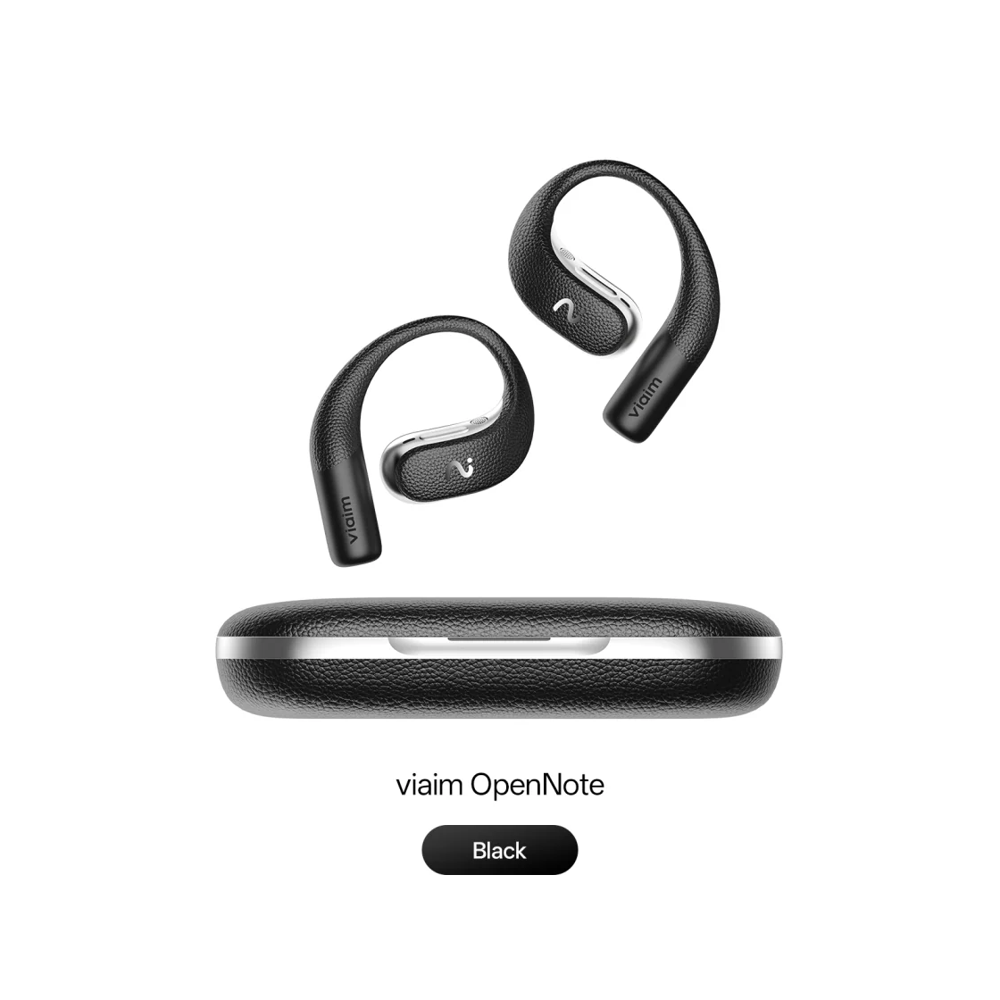
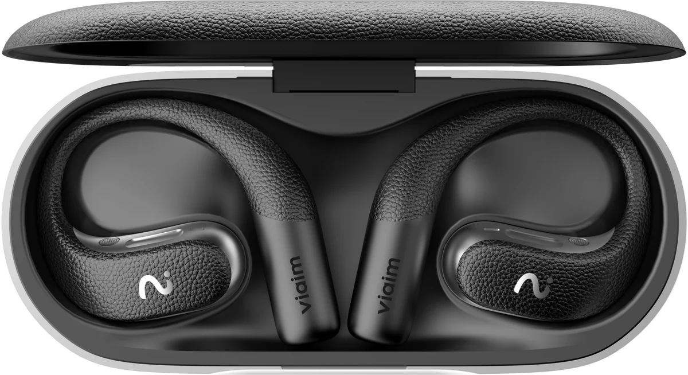
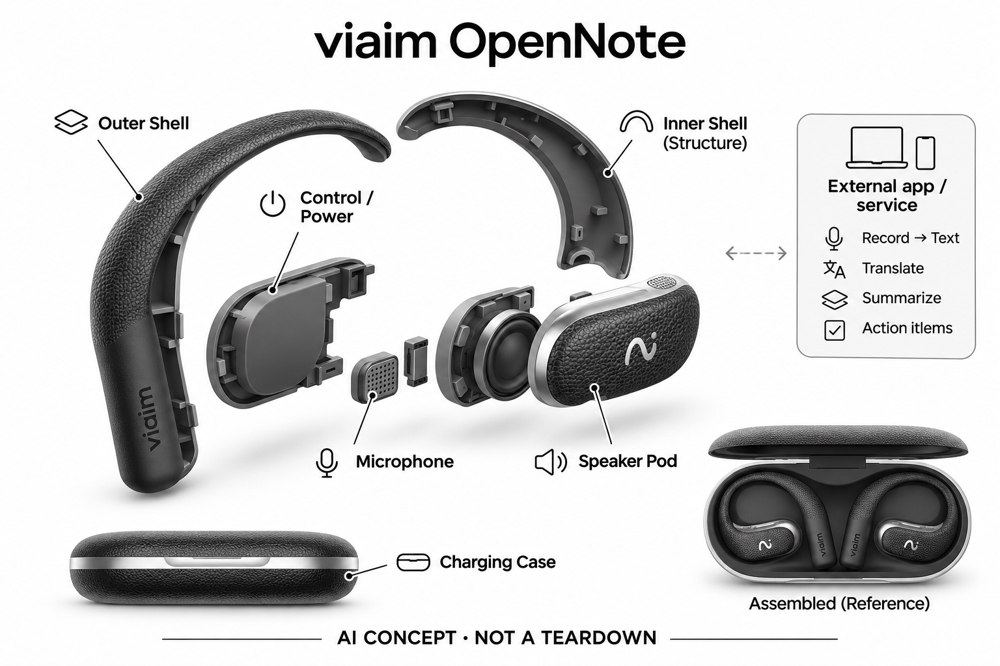

# viaim OpenNote

**viaim** · 翻译与音频 · 核查 2026-11-04

多场景音频记录与viaim AI摘要

消费渠道：个人零售。

## 产品图片与结构参考

### 产品图

viaim OpenNote官方产品外形图 · 来源：[viaim · 官方产品图片](<https://store.viaim.ai/products/viaim-opennote>) · [原始图片](<https://cdn.shopify.com/s/files/1/0722/7647/6150/files/OpenNote_6bfa69d3-d342-499e-9dc5-0ffdc13f9693.jpg?v=1770129054&width=1200>)

### 参考图

viaim OpenNote官方另一角度或使用场景参考 · 来源：[viaim · 官方产品图片](<https://store.viaim.ai/products/viaim-opennote>) · [原始图片](<https://cdn.shopify.com/s/files/1/0722/7647/6150/files/8ee163965c752b4df31d594396825cee.png?v=1770129054&width=1200>)

### AI 生成爆炸示意

**AI 生成 · 非实物拆机。** 内部为概念推断，不能作为元件布局、BOM 或维修依据。[生成提示词](../../content/hardware/prompts/viaim-opennote.txt)

> 外形依据核验参考图；内部位置、模块形状与装配关系仅作AI概念展示。

> 已逐张查看并核对型号。源图未改色/裁切；场景、界面、附件、优惠及效果文案仅为厂商示意，不作为本目录性能或现价依据。

> 分析为基于公开资料的案头研究与 AI 辅助判断，未经用户访谈、销量审计或实物拆机。需求、画像、竞争冷门度、审美及商业机会均为研究假设，不是投资结论。

## 销售与购买

- 状态：在售。官方商品页提供Add to cart；已读取官方公开商品JSON，单机变体available=true，排除了页面隐藏的Sold Out模板与耳机+NoteKit套装重复计数。

- 地区：所列官方区域或授权零售渠道；配送地址与服务支持需结算确认

- 价格：US$229，单机。核查日所见单机或基本配置价；币种、促销、税费、镜片、附件及服务依地区结算，不把颜色或套装重复计数。

- 中国大陆：本次未核实该具体型号在中国大陆的官方销售和完整服务支持；海外在售不等于国内可直接启用全部功能。

- [官方产品 / 商店](<https://store.viaim.ai/products/viaim-opennote>)

## AI 的实际作用

viaim服务将录音转换为文本、翻译、结构化摘要与行动项；选择高级AI模型和额度的计划独立于硬件

服务与联网依赖：需要viaim App或电脑应用、账户与网络AI处理；部分硬件录音可先保存，AI转换不是全部离线运行，免费和高级权限依当前计划

## 是否冷门

新兴竞争（研究判断）：按任务与形态作案头分类，无访谈、销量或市场份额证据。

## 需求与市场

需求假设：长时沟通和记录时保持对周围环境的听觉，不反复摘戴入耳耳机。价值应由实际使用频率、任务完成与操作负担验证，不能把AI功能存在或演示流畅当作需求已得到满足。

## 用户画像

画像推断：愿意自行整理访谈、课程或工作对话的个人用户，能接受录音提示和云端处理流程。个人的语言、操作习惯、环境和预算会改变适配结果，本次只有案头研究，没有用户访谈或长期使用观察。

## 竞争与替代

案头判断：与手机会议转录、其他录音耳机和桌面录音设备竞争，RecDot、OpenNote与USB NoteKit是不同音频采集形态。这只是用途与替代品比较，不是市场份额或销量结论；专业细分和较少曝光也不代表没有成熟竞争者。

## 供应链

公开资料可核对开放式挂耳耳机、录音控制、麦克风与充电盒，具体整机工厂、关键模块供应商与BOM本次未确认。制造重点可从形态推断，但不能把品牌所在地、外观相似或营销合作等同代工关系。

## 技术路径

viaim服务将录音转换为文本、翻译、结构化摘要与行动项；选择高级AI模型和额度的计划独立于硬件。这是厂商披露的功能机制；模型版本、准确率及内部结构未完整公开。架构只表示输入、处理和输出关系，不作为真实拆机或性能实测。

## 产品审美

图示观察：挂耳和开放声学结构更明显，强调全天沟通场景而非封闭聆听。宣传图片只能帮助理解外观和摆放方式，不能证明每个人的舒适度、长时使用体验或实际材料触感。

## 关键风险

耳机形态可能让对方难以意识到正在录音，用户需明确沟通；转录错词、口音、多人重叠和账号数据流均影响可信度。还需核对地区功能、软件更新与售后边界；本目录未进行实机、医学或可靠性测试，不把厂商演示当作结果保证。

## 机会与验证

市场差异主要在于多场景音频记录与viaim AI摘要。值得进一步验证的购买理由是它能否减少既有任务中的具体步骤，以及硬件、服务与维护的总成本是否符合个人使用频率。

## 功能分层示意

这是功能关系，不是实物拆机、真实空间结构或已核实 BOM。

1. **实体输入**：开放式挂耳耳机、录音控制、麦克风与充电盒；仅功能层示意，非拆机。（官方披露）

2. **采集与控制**：设备把输入转为可处理的信息并接收用户操作；具体内部布局未知。（分析推断）

3. **AI功能**：viaim服务将录音转换为文本、翻译、结构化摘要与行动项；选择高级AI模型和额度的计划独立于硬件（官方披露）

4. **服务依赖**：需要viaim App或电脑应用、账户与网络AI处理；部分硬件录音可先保存，AI转换不是全部离线运行，免费和高级权限依当前计划（官方披露）

5. **用户反馈**：用户通过声音、屏幕或配套应用接收结果，并对重要信息复核。（分析推断）

## 来源

1. [viaim OpenNote官方商店](<https://store.viaim.ai/products/viaim-opennote>) — 已打开商品页并核实公开product.js单机库存，页面售罄文案不代表所选可购变体。

2. [viaim官方AI计划](<https://store.viaim.ai/collections/viaim-ai-subscription-plans>) — 已打开一手页面；产品能力为厂商披露，未进行实机或效果验证。

3. [viaim官方销售与服务渠道](<https://store.viaim.ai/pages/shop>) — 已打开一手页面；产品能力为厂商披露，未进行实机或效果验证。

[返回目录](../hardware-market.md) · [网页分析](https://romanagent.github.io/Roman/#hardware/product/viaim-opennote)
