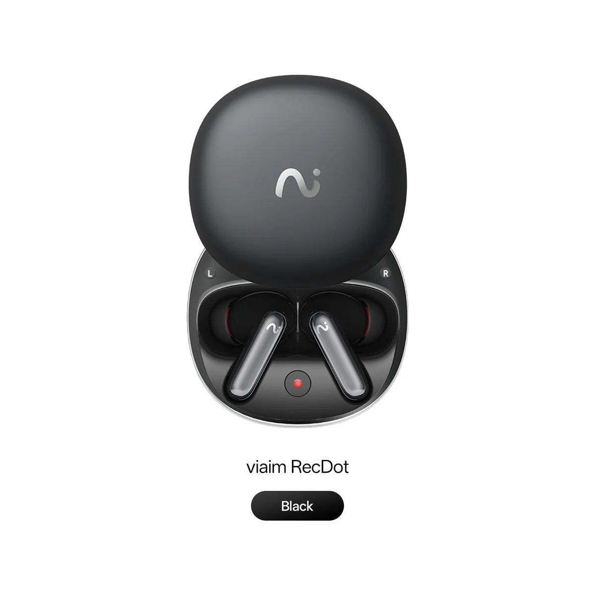
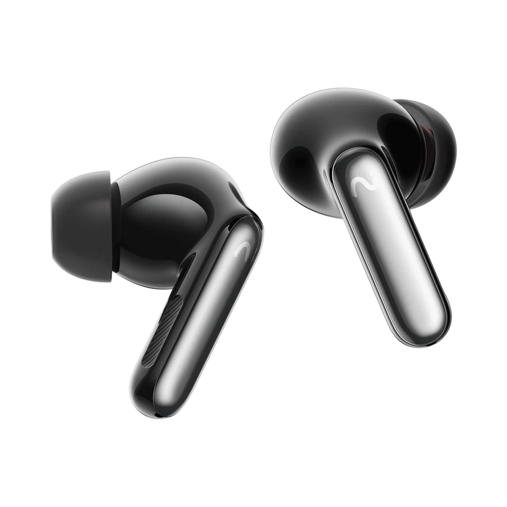
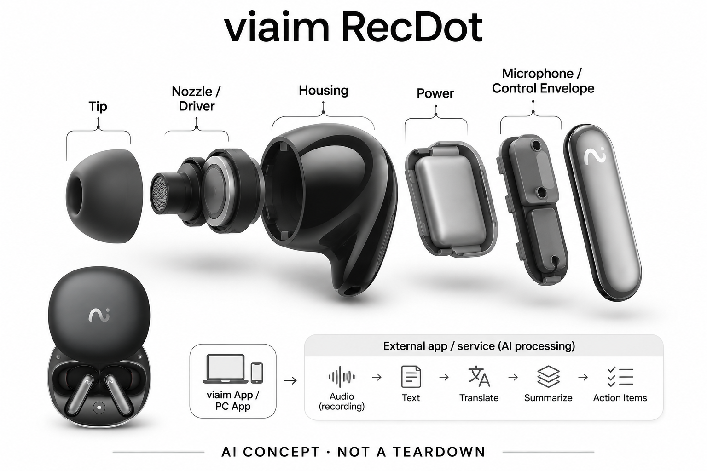

# viaim RecDot

**viaim** · 翻译与音频 · 核查 2026-11-04

多场景音频记录与viaim AI摘要

消费渠道：个人零售。

## 产品图片与结构参考

### 产品图

viaim RecDot官方产品外形图 · 来源：[viaim · 官方产品图片](<https://store.viaim.ai/products/viaim-recdot>) · [原始图片](<https://cdn.shopify.com/s/files/1/0722/7647/6150/files/recdot_black.png?v=1770359539&width=1200>)

### 参考图

viaim RecDot官方另一角度或使用场景参考 · 来源：[viaim · 官方产品图片](<https://store.viaim.ai/products/viaim-recdot>) · [原始图片](<https://cdn.shopify.com/s/files/1/0722/7647/6150/files/viaimRecDotBlack5.png?v=1770359539&width=1200>)

### AI 生成爆炸示意

**AI 生成 · 非实物拆机。** 内部为概念推断，不能作为元件布局、BOM 或维修依据。[生成提示词](../../content/hardware/prompts/viaim-recdot.txt)

> 外形依据核验参考图；内部位置、模块形状与装配关系仅作AI概念展示。

> 已逐张查看并核对型号。源图未改色/裁切；场景、界面、附件、优惠及效果文案仅为厂商示意，不作为本目录性能或现价依据。

> 分析为基于公开资料的案头研究与 AI 辅助判断，未经用户访谈、销量审计或实物拆机。需求、画像、竞争冷门度、审美及商业机会均为研究假设，不是投资结论。

## 销售与购买

- 状态：在售。官方商品页提供Add to cart；已读取官方公开商品JSON，单机变体available=true，排除了页面隐藏的Sold Out模板与耳机+NoteKit套装重复计数。

- 地区：所列官方区域或授权零售渠道；配送地址与服务支持需结算确认

- 价格：US$229，单机。核查日所见单机或基本配置价；币种、促销、税费、镜片、附件及服务依地区结算，不把颜色或套装重复计数。

- 中国大陆：本次未核实该具体型号在中国大陆的官方销售和完整服务支持；海外在售不等于国内可直接启用全部功能。

- [官方产品 / 商店](<https://store.viaim.ai/products/viaim-recdot>)

## AI 的实际作用

viaim服务将录音转换为文本、翻译、结构化摘要与行动项；选择高级AI模型和额度的计划独立于硬件

服务与联网依赖：需要viaim App或电脑应用、账户与网络AI处理；部分硬件录音可先保存，AI转换不是全部离线运行，免费和高级权限依当前计划

## 是否冷门

新兴竞争（研究判断）：按任务与形态作案头分类，无访谈、销量或市场份额证据。

## 需求与市场

需求假设：在电话、视频内容与面对面交流中复用一副耳机来记录，减少额外设备。价值应由实际使用频率、任务完成与操作负担验证，不能把AI功能存在或演示流畅当作需求已得到满足。

### 官方｜把记录加入入耳式耳机 · 官方资料

本型号以入耳式耳机、耳柄控制、麦克风和充电盒提供声音使用与记录入口，配套服务再转写、翻译和整理。需求是在通话、媒体或现场交流中复用已有耳机位置，减少独立录音工具；真正的人工智能来自内容处理，不能把普通播放或连接本身当作模型能力。

依据：[viaim RecDot官方商店](<https://store.viaim.ai/products/viaim-recdot>) · [viaim官方AI计划](<https://store.viaim.ai/collections/viaim-ai-subscription-plans>)

### 判断｜听音习惯能否带动记录 · 研究判断

用户如果本来长时间戴耳机，随手开始记录可能比寻找另一台设备更方便。但入耳佩戴也可能让面对面交流需要摘戴，控制动作与录音状态会随之变化；价值应看是否减少实际遗漏和切换，而不是把耳机每天使用的频率直接当作人工智能记录的需求频率。

依据：[viaim RecDot官方商店](<https://store.viaim.ai/products/viaim-recdot>)

### 验证｜听音到记录的切换 · 待验证

可在相同通话、视频学习和现场交流中比较 RecDot 与普通耳机加手机记录，统计触发、内容完整和回查时间。加入摘下一侧、调整耳塞和切换应用，观察用户是否知道当前记录状态；当前目录没有实机数据，不能由耳柄可控制就推断全部场景都更省步骤。

依据：[viaim RecDot官方商店](<https://store.viaim.ai/products/viaim-recdot>)

## 用户画像

画像推断：愿意自行整理访谈、课程或工作对话的个人用户，能接受录音提示和云端处理流程。个人的语言、操作习惯、环境和预算会改变适配结果，本次只有案头研究，没有用户访谈或长期使用观察。

### 判断｜接受入耳佩戴的用户 · 研究判断

已经习惯入耳耳机并需要反复整理通话或学习内容的人，可能更容易将记录功能融入日常。对耳塞不适、主要面对面交流或只偶尔录音的人，形态可能增加负担；画像应包含佩戴时长和输入任务，而不是笼统把所有听音乐的人都视为笔记设备用户。

依据：[viaim RecDot官方商店](<https://store.viaim.ai/products/viaim-recdot>)

### 判断｜愿意复核内容的个人工作者 · 研究判断

摘要与翻译需要用户检查关键细节，适配人群应愿意回查原音、管理账户和选择服务计划。希望耳机完全自动替代理解的人可能产生过高期待，技术熟练者又可能低估普通用户的设置成本；画像研究应同时看记录习惯与数据管理能力，而不只看职业或会议数量。

依据：[viaim官方AI计划](<https://store.viaim.ai/collections/viaim-ai-subscription-plans>)

### 验证｜对方和现场环境 · 待验证

面对面使用时，应观察对方是否理解耳机用途、是否需要用户摘戴，以及录音状态如何说明。不同噪声、说话距离与耳型也需要分别测试，不能只由佩戴者评价自己的声音；完整体验包含双方交流与内容保存，当前产品图片不能证明社交接受度或长期舒适。

依据：[viaim RecDot官方商店](<https://store.viaim.ai/products/viaim-recdot>)

## 竞争与替代

案头判断：与手机会议转录、其他录音耳机和桌面录音设备竞争，RecDot、OpenNote与USB NoteKit是不同音频采集形态。这只是用途与替代品比较，不是市场份额或销量结论；专业细分和较少曝光也不代表没有成熟竞争者。

### 判断｜与开放式记录耳机同任务 · 研究判断

同品牌 OpenNote 与本型号共享部分整理服务，主要差异在佩戴和声音环境，不能因入耳或挂耳外形直接增加独立需求数量。比较应看用户何时需要专注听音、何时频繁接触周围人，以及记录状态是否容易管理；同价或同应用也不意味着两种形态完全可替代。

依据：[viaim RecDot官方商店](<https://store.viaim.ai/products/viaim-recdot>)

### 判断｜与原有耳机和软件比较 · 研究判断

普通耳机配合手机或会议软件可以完成部分记录，专用耳机需要证明触发、采集或统一笔记带来额外收益。若用户仍需大量切应用和重听，硬件集成未必减负；竞争评价应覆盖整段任务，而不是只列转写语言、摘要模板或宣传中的时间节省。

依据：[viaim RecDot官方商店](<https://store.viaim.ai/products/viaim-recdot>) · [viaim官方AI计划](<https://store.viaim.ai/collections/viaim-ai-subscription-plans>)

### 验证｜单机与高级计划分开 · 待验证

本条按 RecDot 单机记录，不把 NoteKit 套装当作另一独立型号或用组合价混算。基础使用和可选高级模型、额度应按实际录音频率核对，海外可购也不证明大陆服务完整；当前没有销量、留存或价格弹性研究，目录不由硬件标价和订阅选择判断商业优势。

依据：[viaim RecDot官方商店](<https://store.viaim.ai/products/viaim-recdot>) · [viaim官方AI计划](<https://store.viaim.ai/collections/viaim-ai-subscription-plans>)

## 供应链

公开资料可核对入耳式耳机、耳柄触控录音、麦克风与充电盒，具体整机工厂、关键模块供应商与BOM本次未确认。制造重点可从形态推断，但不能把品牌所在地、外观相似或营销合作等同代工关系。

### 官方｜耳机、控制与服务层 · 官方资料

已知形态包括入耳结构、耳柄录音控制、声音输入和充电盒，应用与网络服务参与后续处理。具体芯片、麦克风、整机工厂和内部电源分工未完整披露，不能从耳机外形或同品牌产品猜测沿用；目录的功能架构不等同真实电路或已核实物料清单。

依据：[viaim RecDot官方商店](<https://store.viaim.ai/products/viaim-recdot>)

### 判断｜耳塞与声音链路耦合 · 研究判断

入耳贴合影响听音体验，控制位置又可能在调整耳塞时被触碰，佩戴与交互需要共同验证。采集声音还受到口部距离、风和自身播放影响，不能只看硬件规格；这些是由形态提出的工程约束，当前没有制造公差、校准和工厂资料，不据售价估算良率或成本。

依据：[viaim RecDot官方商店](<https://store.viaim.ai/products/viaim-recdot>)

### 判断｜音频平台与输入候选 · 研究判断

恒玄的音频与无线平台可作为新设计主控候选，英飞凌可作为麦克风输入候选，均未被本型号资料点名采用。需核对双耳同步、触控、声音采集和功耗，不能直接替换；这些能力也不提供 viaim 的转写模型、账户和高级服务，硬件与软件关系应分别核实。

依据：[viaim RecDot官方商店](<https://store.viaim.ai/products/viaim-recdot>)

## 技术路径

viaim服务将录音转换为文本、翻译、结构化摘要与行动项；选择高级AI模型和额度的计划独立于硬件。这是厂商披露的功能机制；模型版本、准确率及内部结构未完整公开。架构只表示输入、处理和输出关系，不作为真实拆机或性能实测。

### 官方｜录音到文本的处理范围 · 官方资料

配套服务将记录转成文本、翻译、摘要和行动项，部分录音可先保存，后续智能处理依赖应用、账号与网络。基础设备可用不等于所有高级模型和额度永久无限，详细端云部署未完全公开；目录不把耳机里有处理芯片推断成全部转写和生成在本机离线完成。

依据：[viaim RecDot官方商店](<https://store.viaim.ai/products/viaim-recdot>) · [viaim官方AI计划](<https://store.viaim.ai/collections/viaim-ai-subscription-plans>)

### 判断｜摘戴会改变交互上下文 · 研究判断

用户可能在通话、听视频和面对面交流间摘戴耳机，系统需要清楚表达声音来源与记录状态。听到的内容和保存的内容未必完全相同，尤其应用路由或权限变化时；技术评价应先检查采集完整，再看摘要，避免流畅的生成文字掩盖某段声音没有被记录。

依据：[viaim RecDot官方商店](<https://store.viaim.ai/products/viaim-recdot>)

### 验证｜多种来源逐项核对 · 待验证

测试应覆盖目标通话应用、媒体播放与现场声音，记录触发、双方内容、摘戴和重连后的变化。再用同一原音检查说话人、翻译和行动项，区分错误发生在哪一层；当前没有独立兼容或准确率结果，不能从一个成功模式推断所有手机与平台都同样有效。

依据：[viaim RecDot官方商店](<https://store.viaim.ai/products/viaim-recdot>)

## 产品审美

图示观察：带短柄的入耳式形态接近日常无线耳机，录音操作隐藏于熟悉佩戴方式。宣传图片只能帮助理解外观和摆放方式，不能证明每个人的舒适度、长时使用体验或实际材料触感。

### 判断｜日常耳机外观的双面性 · 研究判断

外形接近普通耳机可以降低携带负担，也可能让对方无法意识到正在记录。审美研究应把佩戴搭配与状态可解释性分开，不能把不显眼直接当作优势；官方图像只能说明入耳与耳柄形式，不能证明材料触感、长时舒适或不同耳型都稳定适配。

依据：[viaim RecDot官方商店](<https://store.viaim.ai/products/viaim-recdot>)

### 判断｜耳柄控制的可达与误触 · 研究判断

录音控制靠近耳部可能便于快速操作，但调整佩戴、戴帽或摘下时也可能产生意外动作。设计评价应检查反馈是否足以确认开始和停止，以及误操作能否撤销；实体或触控入口不必然比手机更直观，需要在真实交流中观察，而不只看演示者熟练操作。

依据：[viaim RecDot官方商店](<https://store.viaim.ai/products/viaim-recdot>)

### 验证｜长时佩戴与收纳 · 待验证

试用应覆盖通勤、连续通话和短时面谈，记录耳部不适、摘戴频率与控制错误，并完成收纳充电流程。不同耳塞选择和手机组合要分别观察，不能以一位用户体验代表全部；长期便利需要佩戴、连接和记录共同稳定，产品照片与标称参数不能替代实机反馈。

依据：[viaim RecDot官方商店](<https://store.viaim.ai/products/viaim-recdot>)

## 关键风险

耳机形态可能让对方难以意识到正在录音，用户需明确沟通；转录错词、口音、多人重叠和账号数据流均影响可信度。还需核对地区功能、软件更新与售后边界；本目录未进行实机、医学或可靠性测试，不把厂商演示当作结果保证。

### 判断｜记录状态对他人不明显 · 研究判断

普通耳机形态可能让对方以为用户仅在听音，录音时需要明确沟通并管理敏感内容。应用上传和跨端查看还涉及访问与分享，不能只依赖硬件外观判断边界；目录不把易启动视为所有谈话都适合记录，也不把厂商安全声明当作实际数据流程已独立验证。

依据：[viaim RecDot官方商店](<https://store.viaim.ai/products/viaim-recdot>)

### 判断｜转写与翻译的叠加错误 · 研究判断

口音、多人重叠和误识别可能进入翻译与摘要，生成结果又可能省略条件或错误归属。重要姓名、日期与承诺需要回查原文和原音，不能直接执行行动项；服务计划和模型变化也可能影响体验，硬件仍能播放不代表全部智能功能始终保持相同权益。

依据：[viaim官方AI计划](<https://store.viaim.ai/collections/viaim-ai-subscription-plans>)

### 验证｜失败与权限变化 · 待验证

应测试应用权限撤回、网络中断和记录未上传时的反馈，确认用户知道哪些内容已保存。更正或删除后也需检查检索是否更新，避免旧错误持续影响回答；验证目标是可追溯与可恢复，而不是假设耳机与云服务整合后就不再需要人工理解和复核。

依据：[viaim RecDot官方商店](<https://store.viaim.ai/products/viaim-recdot>) · [viaim官方AI计划](<https://store.viaim.ai/collections/viaim-ai-subscription-plans>)

## 机会与验证

市场差异主要在于多场景音频记录与viaim AI摘要。值得进一步验证的购买理由是它能否减少既有任务中的具体步骤，以及硬件、服务与维护的总成本是否符合个人使用频率。

### 判断｜记录融入听音习惯 · 研究判断

本型号值得研究的是用户能否在原有耳机使用中自然保留有用内容，减少额外设备与启动步骤。若主要场景需要频繁摘戴或不愿入耳，形态就可能不匹配；核心需求仍是谈话回顾，外观和耳塞变化应作为差异条件，不单独计算为新的独立场景。

依据：[viaim RecDot官方商店](<https://store.viaim.ai/products/viaim-recdot>)

### 判断｜笔记是否被真正使用 · 研究判断

自动整理只有在帮助查找、确认和后续工作时才有价值，不能以生成更多文字为目标。研究应记录哪些摘要被打开、多少需要修订以及用户何时仍回到原音，判断服务是否减负；耳机每日佩戴并不等于记录功能每日有用，两者需要分别衡量。

依据：[viaim官方AI计划](<https://store.viaim.ai/collections/viaim-ai-subscription-plans>)

### 验证｜长期联用与总成本 · 待验证

后续可跟踪听音、通话和记录联用频率、误操作、完整内容及更正量，并核算服务与维护时间。还应记录用户何时选择普通耳机或手机软件，理解替代边界；当前目录是案头研究，不以单机在售、同品牌生态或日常耳机形态宣称需求和效率已经验证。

依据：[viaim RecDot官方商店](<https://store.viaim.ai/products/viaim-recdot>) · [viaim官方AI计划](<https://store.viaim.ai/collections/viaim-ai-subscription-plans>)

## 对应供应链公司

能力候选用于选型研究，不代表本产品实际采用；未公开的供货关系不作推断。

- [bestechnic](../supply-chain/bestechnic.md) — **能力候选 · 非已采用** / 入耳式记录耳机的音频与无线平台候选：RecDot 结合听音、通话、控制和采集，恒玄音频平台可作为新设计候选。需核对双耳同步、触控、缓存、功耗与应用接口，当前没有采用点名；通用音频 SoC 不能直接复制 viaim 的转写翻译服务，也不能由同品牌其他产品推断本款主控来源。

- [infineon](../supply-chain/infineon.md) — **能力候选 · 非已采用** / 入耳式记录设备的声音输入候选：RecDot 需要采集用户与环境声音，英飞凌麦克风可用于比较自噪与匹配，但须在风、口部距离和播放回声中验证。当前未点名供货，声孔和主控接口仍需核对；器件性能不等于完整通话捕获、转写准确或生成摘要可靠，也不证明具体阵列配置。

[浏览供应链目录](../supply-chain.md)

## 功能分层示意

这是功能关系，不是实物拆机、真实空间结构或已核实 BOM。

1. **实体输入**：入耳式耳机、耳柄触控录音、麦克风与充电盒；仅功能层示意，非拆机。（官方披露）

2. **采集与控制**：设备把输入转为可处理的信息并接收用户操作；具体内部布局未知。（分析推断）

3. **AI功能**：viaim服务将录音转换为文本、翻译、结构化摘要与行动项；选择高级AI模型和额度的计划独立于硬件（官方披露）

4. **服务依赖**：需要viaim App或电脑应用、账户与网络AI处理；部分硬件录音可先保存，AI转换不是全部离线运行，免费和高级权限依当前计划（官方披露）

5. **用户反馈**：用户通过声音、屏幕或配套应用接收结果，并对重要信息复核。（分析推断）

## 来源

1. [viaim RecDot官方商店](<https://store.viaim.ai/products/viaim-recdot>) — 已打开商品页并核实公开product.js单机库存，页面售罄文案不代表所选可购变体。

2. [viaim官方AI计划](<https://store.viaim.ai/collections/viaim-ai-subscription-plans>) — 已打开一手页面；产品能力为厂商披露，未进行实机或效果验证。

3. [viaim官方销售与服务渠道](<https://store.viaim.ai/pages/shop>) — 已打开一手页面；产品能力为厂商披露，未进行实机或效果验证。

[返回目录](../hardware-market.md) · [网页分析](https://romanagent.github.io/Roman/#hardware/product/viaim-recdot)
