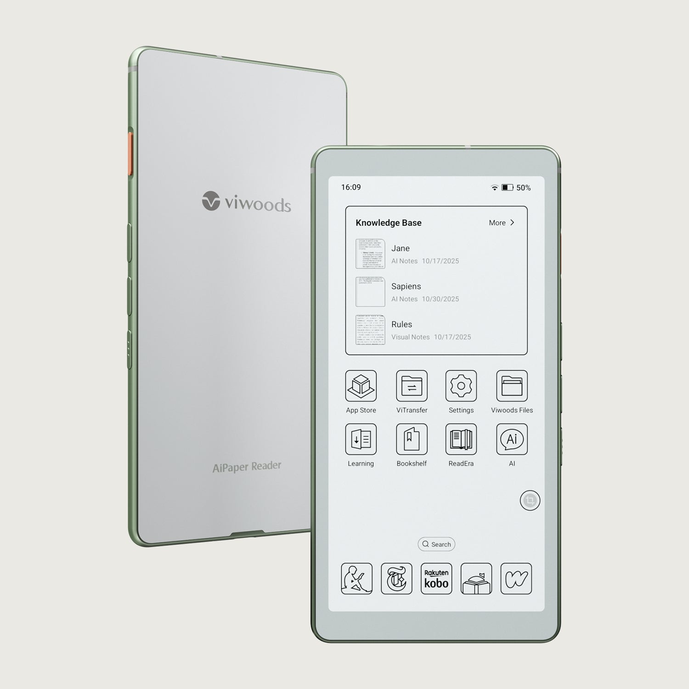
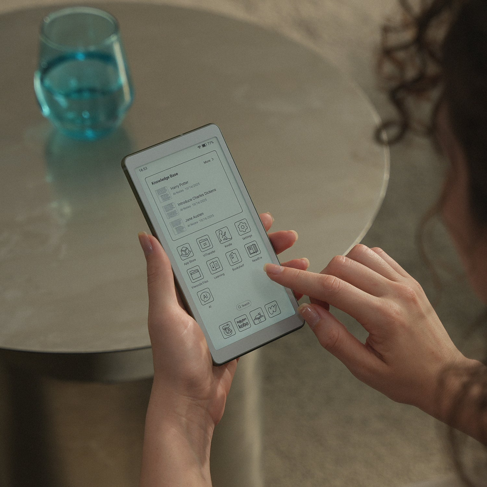
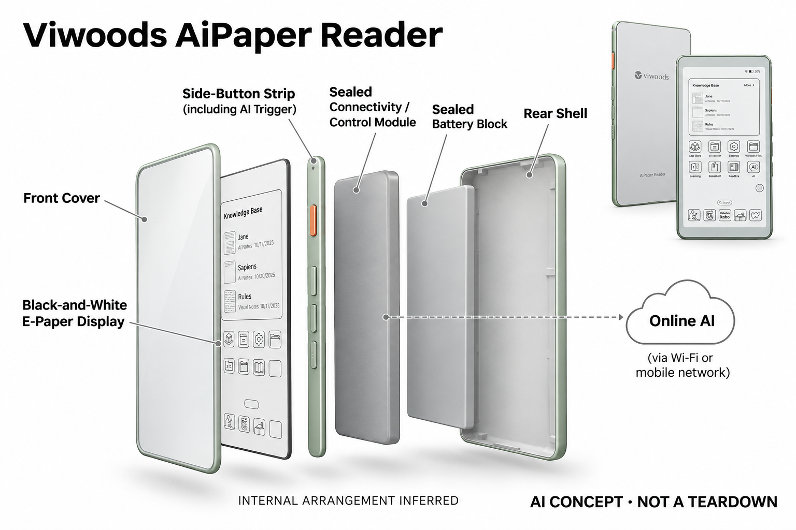

# Viwoods AiPaper Reader

**Viwoods** · 手机与 AI PC · 核查 2026-11-04

通过实体AI键调用阅读解释

消费渠道：个人零售。

## 产品图片与结构参考

### 产品图

Viwoods AiPaper Reader · 官方产品图 · 来源：[Viwoods · 官方图片](<https://viwoods.com/products/viwoods-aipaper-reader>) · [原始图片](<https://cdn.shopify.com/s/files/1/0729/7368/0674/files/viwoods_aipaper_reader_hero.webp?v=1782810107>)

### 参考图

Viwoods AiPaper Reader · 官方参考图 · 来源：[Viwoods · 官方图片](<https://viwoods.com/products/viwoods-aipaper-reader>) · [原始图片](<https://cdn.shopify.com/s/files/1/0729/7368/0674/files/viwoods_aipaper_reader_hero_aimage_4.webp?v=1782956456>)

### AI 生成爆炸示意

**AI 生成 · 非实物拆机。** 内部为概念推断，不能作为元件布局、BOM 或维修依据。[生成提示词](../../content/hardware/prompts/viwoods-aipaper-reader.txt)

> 已目视核对外形、标签与非拆机声明；不代表内部结构经实测验证。

> 分析为基于公开资料的案头研究与 AI 辅助判断，未经用户访谈、销量审计或实物拆机。需求、画像、竞争冷门度、审美及商业机会均为研究假设，不是投资结论。

## 销售与购买

- 状态：在售。官方黑白Reader页面Add to cart，公开产品数据available=true；不把彩色屏变体或不同保护套再计为新产品。

- 地区：所列官方国际商店

- 价格：黑白Reader官网 US$279。核查日页面快照；运费、税费、会员和配送区域按官方结算确认，不视为中国到手价。

- 中国大陆：本轮核实所列区域官方商店；未确认中国大陆官方现货、账户及完整服务，不把境外可购等同大陆可用。

- [官方产品 / 商店](<https://viwoods.com/products/viwoods-aipaper-reader>)

## AI 的实际作用

专用AI按键可在阅读流程中解释段落、摘要和问答，并切换支持的在线模型；其定位是口袋阅读，不是AiPaper手写平板的容量变化。

服务与联网依赖：AI需Wi-Fi或可用移动网络；本地文档阅读可离线。SIM、频段、套餐和模型可达性受地区影响，不把有4G硬件等同全球服务可用。

## 是否冷门

新兴竞争（研究判断）：移动联网与离线阅读用途分开形成具体使用场景；本轮没有销量与市场份额证据。

## 需求与市场

需求假设：通勤阅读者可能希望遇到陌生概念时直接提问，而不是切回容易分心的手机。应记录提问是否帮助继续阅读，以及模型回应和联网等待是否反而打断了原有节奏。

### 官方｜口袋阅读中的 AI 按键 · 官方资料

本型号以小型电子纸阅读和专用人工智能按键，调用在线模型解释段落、摘要和问答。需求是在遇到陌生概念时少切回手机，同时保留离线文档阅读；它的主要任务不是大尺寸 AiPaper 的手写整理，也不能因为具备移动网络硬件就认定所有地区的模型和通信服务都可用。

依据：[AiPaper Reader官方商店](<https://viwoods.com/products/viwoods-aipaper-reader>) · [Viwoods官方联网与型号FAQ](<https://viwoods.com/pages/frequently-asked-questions-about-viwoods>)

### 判断｜提问是否帮助继续阅读 · 研究判断

读到难句时直接询问可能减少查找步骤，但等待、长回答和反复核验也可能打断原来的阅读节奏。价值应看用户是否更容易回到原文并理解上下文，而不是按键按下后一定有回应；无通知或电子纸形态不能直接证明更专注，额外设备也有携带与充电负担。

依据：[AiPaper Reader官方商店](<https://viwoods.com/products/viwoods-aipaper-reader>)

### 验证｜阅读中断的完整对照 · 待验证

可使用用户真实长文和外语资料，比较 Reader、手机和普通阅读器的提问、核对与继续阅读时间。记录答案是否对应选段、有没有错误扩展，以及网络等待造成多少中断；当前目录没有实机研究，不能由一键入口推断模型理解更可靠或用户阅读质量已经提高。

依据：[AiPaper Reader官方商店](<https://viwoods.com/products/viwoods-aipaper-reader>)

## 用户画像

画像推断：经常阅读长文章、外语资料并愿意多携带一台小设备的人较匹配。它不能完全替代手机，实际口袋空间和设备充电管理会影响接受度，不能只由轻量外形判断携带成本。

### 判断｜高频移动阅读者 · 研究判断

经常通勤阅读长文章、需要解释术语并愿意多带一台设备的人可能更匹配。只读短消息或主要在电脑学习的人，额外终端未必有足够价值；画像应看真实资料、地点和回查习惯，而不是因为产品像口袋设备就认为所有出行者都愿意持续携带。

依据：[AiPaper Reader官方商店](<https://viwoods.com/products/viwoods-aipaper-reader>)

### 判断｜不以手写为主的需求 · 研究判断

Reader 与 AiPaper 的核心流程不同，用户如果主要需要长篇手写或大幅文档批注，应重新确认形态而非只比较价格。小屏阅读和即时解释可能适合一类任务，却不能代表完整创作平台；画像研究需要区分内容输入、阅读和整理，不能把同品牌产品视为容量变体。

依据：[AiPaper Reader官方商店](<https://viwoods.com/products/viwoods-aipaper-reader>) · [Viwoods官方联网与型号FAQ](<https://viwoods.com/pages/frequently-asked-questions-about-viwoods>)

### 验证｜联网与设备管理习惯 · 待验证

首次试用应包括导入资料、选择文本、调用模型和离线继续阅读，记录用户如何处理网络或账户问题。若使用移动网络，还要核对自己的地区与套餐，不能只确认插卡成功；长期适配包含口袋空间、充电和服务管理，不应由轻量外观或一次提问体验直接判断。

依据：[Viwoods官方联网与型号FAQ](<https://viwoods.com/pages/frequently-asked-questions-about-viwoods>)

## 竞争与替代

竞争判断：手机阅读、普通阅读器加词典和其他安卓电子纸均是替代，实体AI键属于流程差异。口袋尺寸与大手写板用途不同，但低知名度和新形态都不意味着用户愿意为第二终端付费。

### 判断｜与手机阅读助手比较 · 研究判断

手机已经可以阅读和提问，Reader 需要证明专用入口减少了不相关操作或打扰，而不是只换了一块屏幕。用户仍可能需要手机完成复杂任务，因此应比较整个设备组合的负担；竞争分析不应把独立硬件自动视为更专注，也不能只按支持模型数量排名。

依据：[AiPaper Reader官方商店](<https://viwoods.com/products/viwoods-aipaper-reader>)

### 判断｜与其他电子纸解释设备比较 · 研究判断

较大电子纸设备也可能提供阅读助手，区别需要落到携带、资料呈现和任务时机，而不是单纯尺寸。核心阅读理解需求应在场景分组中复用，不因黑白或彩色变体增加数量；当前没有销量或访谈证据，不能由口袋形态或新品牌曝光判断需求空白。

依据：[AiPaper Reader官方商店](<https://viwoods.com/products/viwoods-aipaper-reader>) · [Viwoods官方联网与型号FAQ](<https://viwoods.com/pages/frequently-asked-questions-about-viwoods>)

### 验证｜型号与通信成本 · 待验证

比较应按当前黑白 Reader 配置，区分保护套、颜色和其他型号，移动数据与模型服务也需单独核算。海外商店可购不证明大陆频段、套餐和全部服务兼容，宣传无订阅也不能扩展为永久权益；当前目录不由低硬件价格推导全周期成本或市场接受度。

依据：[AiPaper Reader官方商店](<https://viwoods.com/products/viwoods-aipaper-reader>) · [Viwoods官方联网与型号FAQ](<https://viwoods.com/pages/frequently-asked-questions-about-viwoods>)

## 供应链

供应链推断：小型电子纸、按键与移动通信模块需兼顾握持、信号和续航，屏幕维修与保护套也重要。官方未公开完整工厂和物料表，地区频段及运营商适配可能带来额外售后负担。

### 官方｜显示、按键与移动连接 · 官方资料

公开资料支持小型电子纸、专用按键及移动联网方向，但完整主控、通信模组和工厂未披露。不能从手机般外形推断电话、相机或其他未核实硬件，也不借 AiPaper 的笔输入结构补齐；目录只建立阅读、选择与服务交互架构，不作为实际物料或拆机证据。

依据：[AiPaper Reader官方商店](<https://viwoods.com/products/viwoods-aipaper-reader>)

### 判断｜小体积与信号约束 · 研究判断

握持、按键、显示和通信需要在小机身中协调，天线、电源和屏幕保护会影响日常可用性。地区频段与运营商条件也可能增加支持成本，但当前没有制造良率和具体模组资料；研究应保留这些核对项，不能由品牌所在地或外观相似推断工厂、成本和全球交付能力。

依据：[AiPaper Reader官方商店](<https://viwoods.com/products/viwoods-aipaper-reader>) · [Viwoods官方联网与型号FAQ](<https://viwoods.com/pages/frequently-asked-questions-about-viwoods>)

### 判断｜应用处理候选的范围 · 研究判断

联发科技和瑞芯微可作为类似阅读终端的应用主控候选，当前没有本型号点名采用。选择需验证电子纸、按键、待机、文件与模型接口，移动通信还要另核模组；通用应用平台不自动带来地区频段、运营商认证或 Viwoods 服务，不能作为现有成品的直接替换方案。

依据：[AiPaper Reader官方商店](<https://viwoods.com/products/viwoods-aipaper-reader>)

## 技术路径

官方说明专用按键调用在线模型解释与摘要，移动网络只提供连接并不等于离线AI。技术判断应测试选取文本范围、跨应用权限和回答来源，不把一键操作简单等同模型理解可靠。

### 官方｜在线解释与离线阅读 · 官方资料

本地文档可以离线阅读，人工智能解释需要可用网络访问所选模型，移动通信只提供连接。专用按键减少的是调用入口，不证明模型全部在设备内执行或能读取任何应用内容；具体账户、模型和地区条件需按当前服务确认，目录不把有移动网络硬件解释为全球智能功能可用。

依据：[Viwoods官方联网与型号FAQ](<https://viwoods.com/pages/frequently-asked-questions-about-viwoods>)

### 判断｜选区与上下文的限制 · 研究判断

一个词或段落可能依赖前文、图表和作者定义，助手若只看到局部内容就可能给出不合文章的解释。系统需要让用户知道处理范围并回到原文，不能把通用知识回答当作资料本身结论；技术评价应关注错引与上下文，而不只是按键响应和文字是否流畅。

依据：[AiPaper Reader官方商店](<https://viwoods.com/products/viwoods-aipaper-reader>)

### 验证｜文件类型与网络退化 · 待验证

测试应覆盖用户实际文件、页面和应用，核对能否选择正确内容以及模型获得什么，再加入弱网与断网。打开文档成功不等于助手能理解整篇，服务失效时也应能继续基础阅读；当前没有独立准确率和兼容测试，不能由支持某种文件或网络推断所有任务可靠。

依据：[AiPaper Reader官方商店](<https://viwoods.com/products/viwoods-aipaper-reader>) · [Viwoods官方联网与型号FAQ](<https://viwoods.com/pages/frequently-asked-questions-about-viwoods>)

## 产品审美

审美判断：窄长比例和少量实体键适合单手翻页，电子纸呈现与手机不同的视觉节奏。握持边框、按键误触和户外反射需要实测，界面能安装大量应用也可能增加视觉复杂度。

### 判断｜口袋形态的携带价值 · 研究判断

小型电子纸可能更容易在短暂空闲中取出，也可能与手机同时占用口袋和注意。审美研究应观察真实携带、握持与阅读姿势，不只看轻薄宣传图；外观像手机不等于具有同样应用和通信能力，形态熟悉也不能替代对实际任务与设备管理的评估。

依据：[AiPaper Reader官方商店](<https://viwoods.com/products/viwoods-aipaper-reader>)

### 判断｜实体 AI 键的节奏作用 · 研究判断

专用按键可以让调用更明确，也可能诱使用户频繁打断阅读，设计需要让提问、核对和返回原文顺畅。评价应观察按键在单手握持时是否容易误触，以及用户真正使用的时机；物理入口不自动等于更少认知负担，答案长度和状态反馈同样影响体验。

依据：[AiPaper Reader官方商店](<https://viwoods.com/products/viwoods-aipaper-reader>)

### 验证｜移动阅读与连续使用 · 待验证

试用应包含短时取出、较长阅读、光线变化和收纳充电，记录显示可读、握持、误触与网络等待。不同资料密度与手机组合需要分别观察，不能用一页优化样例代表全部体验；长期价值取决于用户愿意持续带着并使用，而不是产品图看起来便携。

依据：[AiPaper Reader官方商店](<https://viwoods.com/products/viwoods-aipaper-reader>)

## 关键风险

风险判断：插卡不保证当地频段和数据套餐兼容，在线AI服务也可能有地区限制。阅读文件交给模型处理时需了解权限，重要概念应回查原文，不能仅凭无订阅宣传假定权益永不变化。

### 判断｜插卡与服务可用性误解 · 研究判断

具备移动网络硬件不保证当地频段、套餐和模型服务都可用，网络连接成功也不意味着所有在线功能开放。用户需要按最终地区与配置核对，不能把海外可购直接视为大陆完整支持；目录不以通用购买入口或中文演示代替实际通信和服务证据。

依据：[Viwoods官方联网与型号FAQ](<https://viwoods.com/pages/frequently-asked-questions-about-viwoods>)

### 判断｜文件隐私与解释失真 · 研究判断

阅读资料可能包含私人或敏感内容，调用在线模型前需要理解提交范围与账户权限。解释、摘要和翻译可能改变原意，重要概念应回查原文和可靠来源；目录不把一键操作、无订阅宣传或电子纸形式当作绝对隐私、正确性和永久服务保证。

依据：[AiPaper Reader官方商店](<https://viwoods.com/products/viwoods-aipaper-reader>) · [Viwoods官方联网与型号FAQ](<https://viwoods.com/pages/frequently-asked-questions-about-viwoods>)

### 验证｜结果与原文保持关联 · 待验证

应检查答案能否指向正确选段，更正或切换文件后是否仍引用旧上下文，并测试服务中断时状态是否清楚。不能只因文字看起来合理就接受，尤其复杂资料需要人工核验；验证目标是帮助继续阅读并保持内容控制，而不是让助手替代原文或所有判断。

依据：[AiPaper Reader官方商店](<https://viwoods.com/products/viwoods-aipaper-reader>)

## 机会与验证

市场观察：应观察双设备用户的真实通勤行为，记录读完篇数、主动提问和回到手机的原因。对照普通阅读器与手机方案，验证专用AI键是否形成持续阅读价值，而非仅提高首次上手的新奇感。

### 判断｜阅读解释的具体购买理由 · 研究判断

本型号值得研究的是用户是否经常在移动阅读中需要即时解释，并且专用入口确实减少了切换。若主要需求只是离线看书，普通阅读器可能足够；如果只是模型聊天，手机可能更方便，场景分组应围绕阅读理解任务，而不因口袋外观、颜色或通信配置重复计数。

依据：[AiPaper Reader官方商店](<https://viwoods.com/products/viwoods-aipaper-reader>)

### 判断｜少干扰需要行为证据 · 研究判断

独立设备可以限制某些手机干扰，也可能因为频繁提问增加新的中断，不能把专用形态自动等同更专注。研究应记录用户何时继续阅读、何时沉入问答和何时放弃解释，判断总任务是否改善；真正价值来自阅读过程，而不是按键、模型入口或生成内容数量。

依据：[AiPaper Reader官方商店](<https://viwoods.com/products/viwoods-aipaper-reader>)

### 验证｜长期携带与总成本 · 待验证

后续可跟踪实际阅读、提问、错引、更正和联网费用，并比较手机或更简单阅读器何时已经足够。地区、文件与服务版本需分别记录，不以短期尝鲜代表长期；当前目录是案头研究，不以官方可购、移动联网或专用 AI 键宣称需求、效率和注意力效果已验证。

依据：[AiPaper Reader官方商店](<https://viwoods.com/products/viwoods-aipaper-reader>) · [Viwoods官方联网与型号FAQ](<https://viwoods.com/pages/frequently-asked-questions-about-viwoods>)

## 对应供应链公司

能力候选用于选型研究，不代表本产品实际采用；未公开的供货关系不作推断。

- [mediatek](../supply-chain/mediatek.md) — **能力候选 · 非已采用** / 口袋电子纸阅读终端的应用平台候选：Reader 需要文档、显示、按键和在线模型交互，联发科技应用平台可作为同类新设计候选。需核对电子纸控制、待机和系统，移动通信模组及地区认证须另核，当前没有采用点名；平台能力不等于完整联网权益或 Viwoods 服务，也不能直接替换现有硬件。

- [rockchip](../supply-chain/rockchip.md) — **能力候选 · 非已采用** / 小型阅读与文本交互主控候选：瑞芯微应用路线可用于比较同类阅读终端，但应选择符合小机身功耗和显示需求的实际型号，不能只看多媒体算力。当前未确认 Reader 采用，文件、系统和网络接口需重验；候选不自动包含蜂窝模组、全球频段或模型授权，也不证明全部 AI 在本机离线完成。

[浏览供应链目录](../supply-chain.md)

## 功能分层示意

这是功能关系，不是实物拆机、真实空间结构或已核实 BOM。

1. **阅读入口**：电子纸显示与实体翻页操作。（官方披露）

2. **AI触发**：独立AI键选取阅读上下文。（官方披露）

3. **联网通道**：Wi-Fi或可用SIM网络访问模型。（官方披露）

4. **文本反馈**：解释、摘要和问答返回阅读界面。（官方披露）

## 来源

1. [AiPaper Reader官方商店](<https://viwoods.com/products/viwoods-aipaper-reader>) — 已实际打开官方页面；功能说明不等于独立性能测量。

2. [Viwoods官方联网与型号FAQ](<https://viwoods.com/pages/frequently-asked-questions-about-viwoods>) — 已实际打开官方页面；功能说明不等于独立性能测量。

[返回目录](../hardware-market.md) · [网页分析](https://romanagent.github.io/Roman/#hardware/product/viwoods-aipaper-reader)
