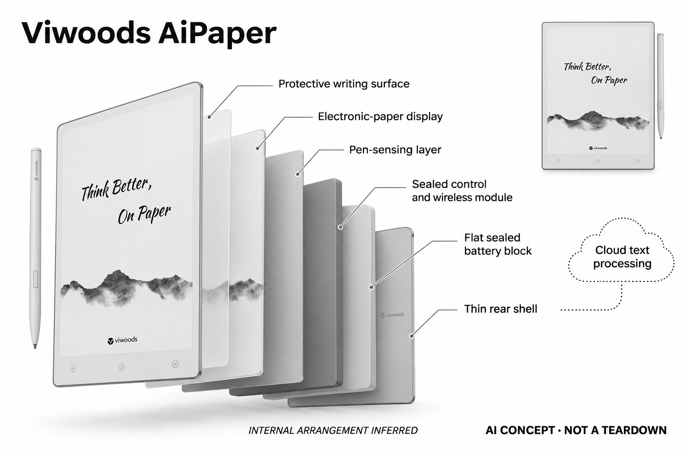

# Viwoods AiPaper

**Viwoods** · 手机与 AI PC · 核查 2026-11-04

从手写输入连接到AI文本整理

消费渠道：个人零售。

## 产品图片与结构参考

### 产品图

Viwoods AiPaper · 官方产品图 · 来源：[Viwoods · 官方图片](<https://viwoods.com/products/viwoods-aipaper>) · [原始图片](<https://cdn.shopify.com/s/files/1/0729/7368/0674/files/viwoods_aipaper_hero.webp?v=1782810034>)

### 参考图

Viwoods AiPaper · 官方参考图 · 来源：[Viwoods · 官方图片](<https://viwoods.com/products/viwoods-aipaper>) · [原始图片](<https://cdn.shopify.com/s/files/1/0729/7368/0674/files/viwoods_aipaper_paper_tablet_e-ink_tablet_5.webp?v=1782955594>)

### AI 生成爆炸示意

**AI 生成 · 非实物拆机。** 内部为概念推断，不能作为元件布局、BOM 或维修依据。[生成提示词](../../content/hardware/prompts/viwoods-aipaper.txt)

> 已目视核对外形、标签与非拆机声明；不代表内部结构经实测验证。

> 分析为基于公开资料的案头研究与 AI 辅助判断，未经用户访谈、销量审计或实物拆机。需求、画像、竞争冷门度、审美及商业机会均为研究假设，不是投资结论。

## 销售与购买

- 状态：在售。官方商品页有Add to cart；公开商品数据标准手写套装available=true。手写平板与口袋Reader用途不同，笔尖、保护套不另计产品。

- 地区：所列官方国际商店

- 价格：官网 US$549。核查日页面快照；运费、税费、会员和配送区域按官方结算确认，不视为中国到手价。

- 中国大陆：本轮核实所列区域官方商店；未确认中国大陆官方现货、账户及完整服务，不把境外可购等同大陆可用。

- [官方产品 / 商店](<https://viwoods.com/products/viwoods-aipaper>)

## AI 的实际作用

内置工作流可将手写转为文本，再用AI命令摘要、翻译、润色和整理选中内容；不是仅因支持安卓安装应用而被列入。

服务与联网依赖：AI功能需要联网访问所选模型；基本阅读、手写和本地笔记可离线。云同步可选，模型账户、区域与权限需按当前服务核对。

## 是否冷门

新兴竞争（研究判断）：本地笔记和联网AI分别工作形成具体使用场景；本轮没有销量与市场份额证据。

## 需求与市场

需求假设：习惯手写的人希望保留草稿过程，又能在事后快速整理和查找内容。应测试真实潦草笔记转写后的修改量，确认摘要节省的时间超过核对和修正成本，而非只看整洁演示样本。

### 官方｜从手写到文本整理 · 官方资料

本型号把电子纸手写与阅读批注连接到文本转换，再通过人工智能命令摘要、翻译、润色或整理选中内容。需求是保留草稿过程，同时减少事后重录与查找；收录依据是内置工作流，不只是安卓可安装应用，也不能把基本离线书写与需要联网的模型处理混为同一能力。

依据：[AiPaper官方商店](<https://viwoods.com/products/viwoods-aipaper>) · [Viwoods官方工作流支持](<https://viwoods.com/pages/support-center>)

### 判断｜整理节省是否超过核对 · 研究判断

习惯手写的人可能希望直接把草稿变成可分享文本，但潦草字、布局和缩写会增加识别与修订。模型润色又可能改变语气和条件，真正价值要看总修改时间是否下降；不能只比较整洁演示前后的外观，或把生成更多文字当作笔记已经更有用。

依据：[Viwoods官方工作流支持](<https://viwoods.com/pages/support-center>)

### 验证｜自己的真实笔记 · 待验证

可让用户用日常草稿完成转写、摘要和分享，与纸笔后手工输入或其他平板对照，记录错字、错义和回查。需要包含箭头、删除、跨页和临时想法，而不只用标准字样；当前目录没有实机测试，不能由内置命令或电子纸形态推断所有书写习惯都能提高效率。

依据：[Viwoods官方工作流支持](<https://viwoods.com/pages/support-center>)

## 用户画像

画像推断：经常阅读文档、写日记或做个人项目笔记，且偏好电子纸的人较匹配。需要高速视频、复杂排版或完整桌面软件的人可能仍需其他终端，不能将安卓系统等同普通平板体验。

### 判断｜偏好手写的个人工作者 · 研究判断

经常阅读文档、写日记或做项目笔记，愿意先手写再整理的人可能更匹配。主要需要高速动态内容、完整桌面软件或复杂排版的人有不同任务，不能将安卓系统等同通用平板体验；画像应看原稿和最终成果之间的流程，而不只看是否喜欢纸感或附带手写笔。

依据：[AiPaper官方商店](<https://viwoods.com/products/viwoods-aipaper>)

### 判断｜愿意选择在线处理范围的人 · 研究判断

用户需要理解哪些笔记保留本地、哪些内容会交给所选模型，并愿意管理账户与网络条件。只希望所有私人记录完全离线的人可能不使用智能整理，画像应保留这种差异；对技术设置熟悉也不等于会持续回顾笔记，研究应同时看数据边界与实际整理习惯。

依据：[Viwoods官方联网与隐私FAQ](<https://viwoods.com/pages/frequently-asked-questions-about-viwoods>)

### 验证｜输入、导出与模型选择 · 待验证

首次使用应覆盖导入文档、书写、转换、选取内容和导出原稿，记录需要切回电脑或求助的步骤。还要核对模型和地区可达性，不能只测试预配置账户；长期适配需要完整内容生命周期顺畅，而不只是一次成功调用摘要或短时书写手感满意。

依据：[Viwoods官方工作流支持](<https://viwoods.com/pages/support-center>) · [Viwoods官方联网与隐私FAQ](<https://viwoods.com/pages/frequently-asked-questions-about-viwoods>)

## 竞争与替代

竞争判断：纸笔加扫描、普通平板和其他手写电子纸都有替代能力，内置AI命令主要改善内容迁移流程。低品牌知名度不意味着竞争较少，应具体比较手写手感、导出质量与服务依赖。

### 判断｜与其他手写电子纸同任务 · 研究判断

其他电子纸笔记本也可能提供识别、搜索和生成整理，差异应落到工作流、内容范围和服务条件，不应按品牌或屏幕尺寸重复增加独立需求。比较要看用户能否保留原稿并更快得到可用成果，而不是只列命令数量；当前没有销量或访谈证据判断竞争空白。

依据：[AiPaper官方商店](<https://viwoods.com/products/viwoods-aipaper>) · [Viwoods官方工作流支持](<https://viwoods.com/pages/support-center>)

### 判断｜与电脑和平板的替代边界 · 研究判断

电脑和通用平板可以完成更多编辑与分享，专用电子纸可能更符合手写过程，但最终排版仍可能需要其他设备。竞争分析应把这段转移计入，而不是把手写与人工智能合并就认定闭环；无通知或电子纸也不能直接作为注意力改善证据，需要真实任务对照。

依据：[Viwoods官方工作流支持](<https://viwoods.com/pages/support-center>)

### 验证｜套装与服务成本 · 待验证

比较应按当前标准手写套装核对笔、保护与耗材，不把配件或其他型号重复计数。在线模型、同步和保障可能有不同条件，海外可购不能证明大陆全部服务开放；当前没有价格弹性或留存研究，目录不依据标价、开放系统或人工智能命令数量推断商业价值。

依据：[AiPaper官方商店](<https://viwoods.com/products/viwoods-aipaper>) · [Viwoods官方联网与隐私FAQ](<https://viwoods.com/pages/frequently-asked-questions-about-viwoods>)

## 供应链

供应链推断：大尺寸电子纸、笔输入层与轻薄结构需要控制装配和运输损伤，笔尖耗材也影响长期体验。官方未披露完整工厂和物料表，屏幕维修、配件供货与系统更新需纳入成本。

### 官方｜书写硬件与模型服务 · 官方资料

公开形态包含大尺寸电子纸、笔输入和轻薄机身，在线模型与同步是另一交付层，具体主控、工厂和完整物料表未披露。不能从安卓或电子纸类别推断芯片供应，也不借其他代际补写内部结构；目录只描述功能分工，不把概念示意作为真实拆机与成本证据。

依据：[AiPaper官方商店](<https://viwoods.com/products/viwoods-aipaper>)

### 判断｜屏幕、笔与维护协同 · 研究判断

大面积屏幕、笔输入和运输保护需要共同考虑，笔尖耗材与维修也会影响长期使用。软件更新可能改变识别和工作流，因此维护不只是硬件保修；当前没有工厂良率、装配公差或地区服务详证，研究应保留核对问题，不能据轻薄外观或售价估算制造优势。

依据：[AiPaper官方商店](<https://viwoods.com/products/viwoods-aipaper>)

### 判断｜应用主控的候选路线 · 研究判断

联发科技和瑞芯微可作为同类书写终端应用平台候选，但没有 AiPaper 点名采用。需要验证电子纸控制、笔输入、待机、存储与系统，不应只看神经网络算力；候选也不提供 Viwoods 的命令工作流或所选云模型，无法直接替换现有主板并保留全部服务。

依据：[AiPaper官方商店](<https://viwoods.com/products/viwoods-aipaper>) · [Viwoods官方工作流支持](<https://viwoods.com/pages/support-center>)

## 技术路径

官方支持手写转文字和对选中文本执行AI命令。技术判断应拆分识别错误与模型改写错误，并保留原笔迹供核对，不能把润色后的流畅文字当作忠实记录，也不声称所有推理都在本机。

### 官方｜本地笔记与联网 AI · 官方资料

官方支持将手写转成文本，再对选中内容执行人工智能命令，基础阅读和笔记可离线，模型功能需要联网。云同步可选与模型请求是不同数据流程，关闭同步不代表选中内容不会进入在线处理；具体模型账户、地区和权限仍需按当前服务核对，不能概括为全部离线。

依据：[Viwoods官方工作流支持](<https://viwoods.com/pages/support-center>) · [Viwoods官方联网与隐私FAQ](<https://viwoods.com/pages/frequently-asked-questions-about-viwoods>)

### 判断｜识别错误与改写错误不同 · 研究判断

一个手写词被识别错，和模型在润色时改变意图，是两个不同问题，需要分别定位。系统应保留原笔迹、转换文本和处理结果的对应关系，让用户知道错误在哪一步；流畅成文可能掩盖原稿中的不确定和条件，技术评价不能只看最终文字是否更整齐或正式。

依据：[Viwoods官方工作流支持](<https://viwoods.com/pages/support-center>)

### 验证｜选择范围与原稿保留 · 待验证

测试应包含混合布局、数字、否定和修订，检查实际提交给模型的范围及结果能否回到原稿。再测试断网、模型不可用和导出，区分基础笔记与智能处理状态；当前目录没有独立准确率或可靠性结果，不能用一个整洁样本说明所有手写内容都能忠实转换。

依据：[Viwoods官方工作流支持](<https://viwoods.com/pages/support-center>)

## 产品审美

审美判断：浅色窄边和纸页式界面让产品接近数字笔记本，手写笔与保护套构成完整随身物件。屏幕反射、笔触摩擦及单手持握比渲染中的轻薄更重要，需实际连续书写体验。

### 判断｜电子纸工作本的外观 · 研究判断

设备可能更接近个人笔记本而非娱乐屏，但尺寸、持握和笔触会影响是否愿意每天携带。审美研究应在真实阅读与书写中进行，不能只看桌面宣传图；轻薄外形也不证明长时间手持舒适或屏幕耐用，用户的资料、姿势和收纳习惯都需要观察。

依据：[AiPaper官方商店](<https://viwoods.com/products/viwoods-aipaper>)

### 判断｜命令入口与思考节奏 · 研究判断

人工智能命令应在用户需要整理时出现，过早改写可能打断草稿思考，过多选项也可能增加选择负担。设计评价应看书写、选择、核对和返回原稿是否顺畅，而不是入口是否丰富；原始想法和模型补充需要清楚区分，不能让整洁输出取代用户自己的表达过程。

依据：[Viwoods官方工作流支持](<https://viwoods.com/pages/support-center>)

### 验证｜连续书写与资料管理 · 待验证

试用应覆盖较长笔记、文档批注、查找和导出，记录笔尖、持握、翻页及跨设备整理的负担。不同光线和资料格式需要分别观察，不能由短时写字演示评价全天；长期便利依赖输入、显示和文件管理共同适配，电子纸标签不能代替个人体验或注意力验证。

依据：[AiPaper官方商店](<https://viwoods.com/products/viwoods-aipaper>) · [Viwoods官方工作流支持](<https://viwoods.com/pages/support-center>)

## 关键风险

风险判断：个人笔记送入在线模型前需要理解内容范围与账户设置，摘要可能遗漏限定条件。显示屏维修和地区服务也影响长期可用性，重要原稿应独立备份，不仅保留AI整理结果。

### 判断｜私人内容进入在线模型 · 研究判断

日记、项目笔记和文档可能包含敏感信息，用户需要理解选中内容、模型账户、保存与同步的区别。可选云同步并不等于所有人工智能请求留在本地，厂商说明也不是本研究独立审计；目录不把内置入口或离线书写能力扩展为绝对隐私保证。

依据：[Viwoods官方联网与隐私FAQ](<https://viwoods.com/pages/frequently-asked-questions-about-viwoods>)

### 判断｜摘要与润色改变原意 · 研究判断

模型可能省略限制条件、把暂定想法写成结论，翻译也可能改变术语，重要记录需要保留原稿。屏幕维修、配件与服务变化还会影响长期可访问性，不能只保存生成结果；当前目录不以回答流畅或文档专业外观证明忠实性，也不承诺所有地区权益永久一致。

依据：[Viwoods官方工作流支持](<https://viwoods.com/pages/support-center>)

### 验证｜失败与数据退出 · 待验证

应检查网络中断、模型更换和同步失败时原稿是否仍可访问，并确认原笔迹、文本和结果分别导出的能力。用户更正后也需知道哪些版本被保留，避免后续误用旧摘要；验证目标是减少整理负担同时保持内容控制，而不是让在线服务成为个人原稿的唯一入口。

依据：[Viwoods官方工作流支持](<https://viwoods.com/pages/support-center>) · [Viwoods官方联网与隐私FAQ](<https://viwoods.com/pages/frequently-asked-questions-about-viwoods>)

## 机会与验证

市场观察：可跟踪一周真实笔记从书写到再次使用的全过程，记录转写纠错、导出和检索成功率。需求来自信息复用而非单纯增加AI入口，不能由电子纸偏好推算大规模购买意愿。

### 判断｜手写转成果的具体价值 · 研究判断

本型号值得研究的是习惯手写的人能否更少重录并更容易回顾，而不是单独拥有电子纸和人工智能。若用户主要键盘输入或很少整理草稿，功能组合可能没有明显收益；场景分组应与同类手写内容整理复用核心任务，不因品牌、配件或屏幕尺寸增加独立需求。

依据：[Viwoods官方工作流支持](<https://viwoods.com/pages/support-center>)

### 判断｜自动整理是否真正被采用 · 研究判断

研究应记录哪些命令被重复使用、哪些输出被重写或丢弃，以及用户是否保留自己的表达。生成更多文字不等于形成更有用笔记，尤其修正成本高时可能没有减负；持续价值需要完整成果流程的收益，而不只是一次从潦草到整洁的展示效果。

依据：[Viwoods官方工作流支持](<https://viwoods.com/pages/support-center>)

### 验证｜长期笔记与拥有成本 · 待验证

后续可跟踪原稿回查、识别更正、模型改写、导出和耗材维护，并比较纸笔、电脑和其他电子纸的替代情况。地区、模型与服务版本需分别记录，不用短期尝鲜代表长期；当前目录是案头研究，不以官方可购、内置命令或电子纸外观宣称需求和效率已验证。

依据：[AiPaper官方商店](<https://viwoods.com/products/viwoods-aipaper>) · [Viwoods官方联网与隐私FAQ](<https://viwoods.com/pages/frequently-asked-questions-about-viwoods>)

## 对应供应链公司

能力候选用于选型研究，不代表本产品实际采用；未公开的供货关系不作推断。

- [mediatek](../supply-chain/mediatek.md) — **能力候选 · 非已采用** / 手写与文档终端的应用处理平台候选：AiPaper 需要文档、笔输入、显示和在线服务协同，联发科技应用平台可作为同类新设计候选。需验证电子纸控制、笔延迟、待机和系统接口，当前没有点名采用；通用处理器不提供 Viwoods 的工作流或云模型授权，也不能直接替换现有设备并保证全部体验。

- [rockchip](../supply-chain/rockchip.md) — **能力候选 · 非已采用** / 电子纸书写与文本处理主控候选：瑞芯微可用于比较同类书写终端的应用主控路线，但需选择适合显示、输入和功耗的实际型号，不能只看多媒体或 NPU 参数。当前未确认 AiPaper 采用，系统与模型接口需要重做验证；候选能力不证明手写整理准确，也不意味着在线 AI 可在本机离线运行。

[浏览供应链目录](../supply-chain.md)

## 功能分层示意

这是功能关系，不是实物拆机、真实空间结构或已核实 BOM。

1. **手写输入**：电子笔与触控层记录笔迹。（官方披露）

2. **本地文档**：阅读、批注与笔记组织。（官方披露）

3. **识别整理**：手写转文字进入AI命令流程。（官方披露）

4. **联网模型**：在线摘要、翻译和文本处理。（官方披露）

## 来源

1. [AiPaper官方商店](<https://viwoods.com/products/viwoods-aipaper>) — 已实际打开官方页面；功能说明不等于独立性能测量。

2. [Viwoods官方工作流支持](<https://viwoods.com/pages/support-center>) — 已实际打开官方页面；功能说明不等于独立性能测量。

3. [Viwoods官方联网与隐私FAQ](<https://viwoods.com/pages/frequently-asked-questions-about-viwoods>) — 已实际打开官方页面；功能说明不等于独立性能测量。

[返回目录](../hardware-market.md) · [网页分析](https://romanagent.github.io/Roman/#hardware/product/viwoods-aipaper)
