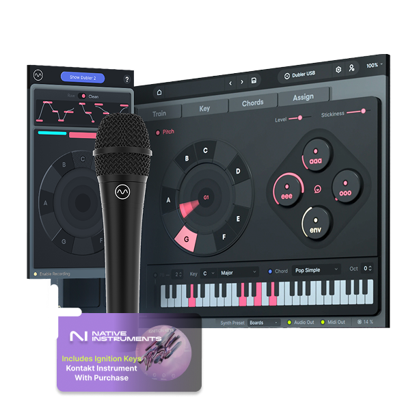
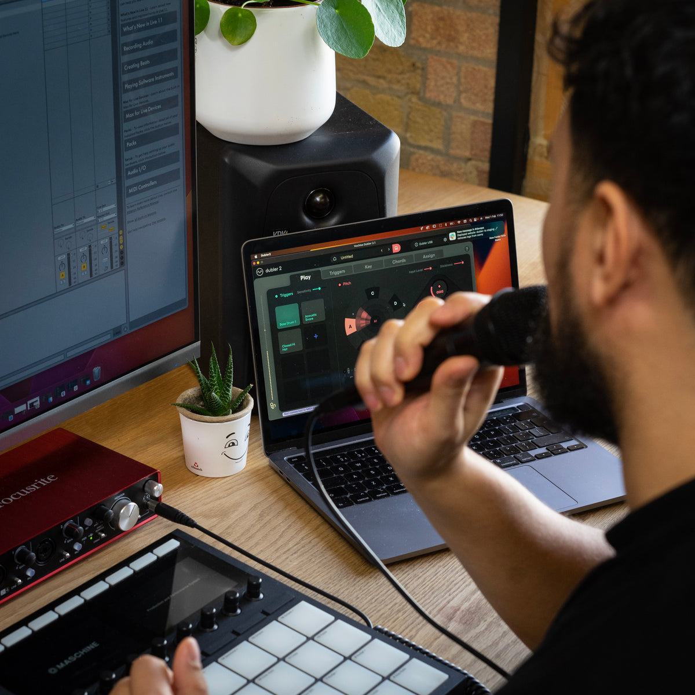
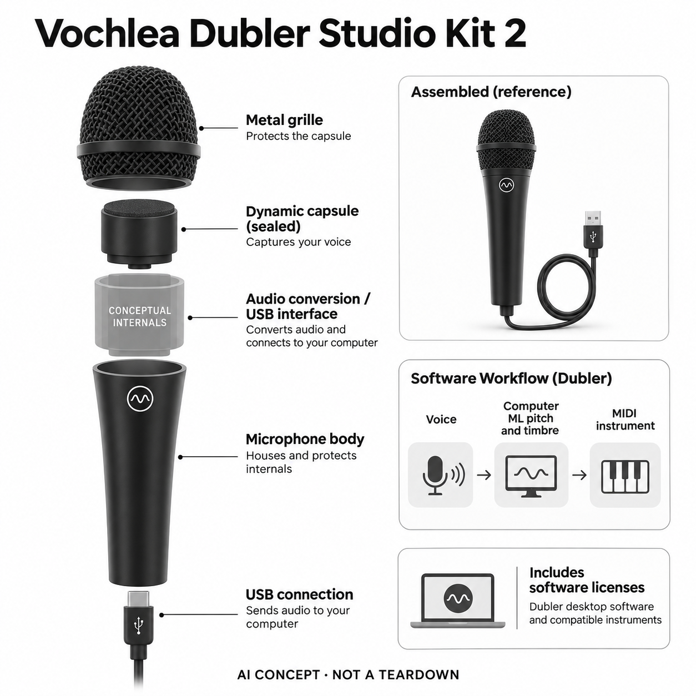

# Vochlea Dubler Studio Kit 2

**Vochlea** · 音乐与乐器 · 核查 2026-11-05

用人声音高和音色实时控制MIDI乐器的软硬件套装

消费渠道：个人零售。

## 产品图片与结构参考

### 产品图

Dubler Studio Kit 2 官方麦克风与软件示意（界面不是物理屏幕） · 来源：[Vochlea · 官方资料](<https://vochlea.com/products/dubler-studio-kit-2>) · [原始图片](<https://cdn.shopify.com/s/files/1/0088/2504/5073/files/english_dsk1.png?v=1780977023&width=1200>)

### 参考图

Dubler 官方音乐输入使用场景（电脑和其它音乐器材另备） · 来源：[Vochlea · 官方资料](<https://vochlea.com/products/dubler-studio-kit-2>) · [原始图片](<https://cdn.shopify.com/s/files/1/0088/2504/5073/files/updated_3_dsk_photoshoot_reu7on.jpg?v=1780977030&width=1200>)

### AI 生成爆炸示意

**AI 生成 · 非实物拆机。** 内部为概念推断，不能作为元件布局、BOM 或维修依据。[生成提示词](../../content/hardware/prompts/vochlea-dubler-studio-kit-2.txt)

> 以已目视核对的官方图片独立生成并完成目视QA；未知内部只作功能概念，不是实际PCB、拆机或供应商BOM。

> 保留官方图片原貌；其中宣传效果或数据不代表本站独立测量。

> 分析为基于公开资料的案头研究与 AI 辅助判断，未经用户访谈、销量审计或实物拆机。需求、画像、竞争冷门度、审美及商业机会均为研究假设，不是投资结论。

## 销售与购买

- 状态：在售。核查日实际浏览器官方Studio Kit页显示US$219及可用Add to cart；包含专用USB动态麦克风与Dubler软件等许可。文本抓取有地区不可售旧表述，以已观察的实际商品界面记录并提示配送另核。

- 地区：官方美元商店支持地区（按地址确认）

- 价格：实际官方页面Studio Kit US$219。麦克风与软件套装，不是纯软件下载价；税费、配送和附赠软件按地区订单核对，不重复计单卖麦克风。

- 中国大陆：未核大陆官方零售和配送；软件需电脑与初次登录，不能由海外网页可加购推断大陆支付、下载和服务一定可用。

- [官方产品 / 商店](<https://vochlea.com/products/dubler-studio-kit-2>)

## AI 的实际作用

Dubler 2官方说明使用机器学习将人声音高、节奏与音色实时转为MIDI控制；可训练自己的敲击发声触发样本，元音等控制效果参数。

服务与联网依赖：AI运行在Mac或Windows桌面软件中，麦克风负责音频采集与USB输入；也支持经校准的其它麦克风。不是自动生成整首作品，也不是麦克风内部运行模型。

## 是否冷门

细分专业（研究判断）：声音作为MIDI控制器的输入差异明确，仍依赖音乐软件与个人发声能力；专业小众不等于没有替代方案。

## 需求与市场

案头需求是把脑中旋律或口技节奏快速变为可编辑的乐器输入，减少先学键盘映射的阻力。套装保持表演者主动控制，和输入一句话生成歌曲不同；是否节约时间需把误音修正一起计算。

### 事实：任务边界 · 官方资料

官方Studio Kit把动态USB麦克风和Dubler软件组成完整输入套装，使用者通过哼唱、发元音或口技控制MIDI乐器。官方明确算法使用机器学习，同时强调它不是代替人作曲的生成系统；本轮核到实际商品界面可加购，纯软件下载不作为实体产品另计。

依据：[Dubler Studio Kit 2官方商店](<https://vochlea.com/products/dubler-studio-kit-2>) · [Vochlea官方机器学习说明](<https://vochlea.com/education>)

### 判断：真实需求 · 研究判断

需求假设是有清楚音乐想法的人不一定熟悉键盘或鼓垫操作，声音输入可能让旋律和节奏更快进入编曲工程。软件输出的是可编辑控制信息，仍需要音色选择和音乐判断；如果唱出的音高本就不稳，纠错成本也可能抵消输入方式的便利。

依据：[Dubler Studio Kit 2官方商店](<https://vochlea.com/products/dubler-studio-kit-2>) · [Vochlea官方机器学习说明](<https://vochlea.com/education>)

### 验证：任务完成 · 待验证

验证可让音乐人把同一段旋律和鼓节奏分别用键盘、口技套装及录音后转写输入工程，比较可用音符、漏触发和后期修改。询问哪一种让他们更容易表达最初想法，不把一次精彩即兴表演或更多MIDI事件直接当作创作效率提高的证据。

依据：[Dubler Studio Kit 2官方商店](<https://vochlea.com/products/dubler-studio-kit-2>) · [Vochlea官方机器学习说明](<https://vochlea.com/education>)

## 用户画像

适合能通过哼唱或口技表达想法、且愿意学习基础音乐软件的人。不会键盘并不意味着不需理解节拍和编曲；环境噪声、发声控制和电脑音频设置比宣传的零门槛更影响适配。

### 事实：使用条件 · 官方资料

套装需要Mac或Windows电脑运行软件，麦克风只提供采集与USB音频入口；官方还支持校准其它合适麦克风。因而购买完整套装与单买软件属于不同已有设备条件，不能把所有对声音控制感兴趣的人都当成需要新硬件的消费者，也不把电脑算标配。

依据：[Dubler Studio Kit 2官方商店](<https://vochlea.com/products/dubler-studio-kit-2>) · [Vochlea官方机器学习说明](<https://vochlea.com/education>)

### 判断：人群筛选 · 研究判断

潜在人群是愿意发声表达、已有音乐软件基础或愿意学习的人，尤其是旋律想象较强而键盘输入不熟练的创作者。对追求完全静音、在嘈杂共享空间工作或不愿练习口技的人，这种输入可能增加负担；能力与环境比职业身份更关键。

依据：[Dubler Studio Kit 2官方商店](<https://vochlea.com/products/dubler-studio-kit-2>) · [Vochlea官方机器学习说明](<https://vochlea.com/education>)

### 验证：参与者差异 · 待验证

访谈可先问用户如何记录突然想到的旋律、过去为何放弃一段草稿以及现在使用何种控制器。试用时观察能否理解监听、音轨和MIDI路由，记录技术支持所需时间；不能因为不需要按键盘，就宣传成没有任何音乐或电脑操作门槛。

依据：[Dubler Studio Kit 2官方商店](<https://vochlea.com/products/dubler-studio-kit-2>) · [Vochlea官方机器学习说明](<https://vochlea.com/education>)

## 竞争与替代

替代包括MIDI键盘、鼓垫和录音后音高转换。差异是实时声音驱动多种控制与自定义打击触发；专用麦克风不是唯一入口，已有合适麦克风的用户可能只需软件，不必重复购硬件。

### 事实：方案范围 · 官方资料

官方说明Dubler不仅做音高到音符的转换，还能学习打击发声并把元音、动态等用于实时控制，与录完音后再转换的流程不同。它可以连接多种DAW和MIDI设备，专用麦克风并不是唯一采集入口；本目录收一个当前套装代表，不拆成软件和麦克风两款。

依据：[Dubler Studio Kit 2官方商店](<https://vochlea.com/products/dubler-studio-kit-2>) · [Vochlea官方机器学习说明](<https://vochlea.com/education>)

### 判断：替代关系 · 研究判断

竞争判断应看输入时的控制范围与修正负担。MIDI键盘定位确定、鼓垫便于重复节奏，声音输入则更接近唱出想法的自然动作；不同人可能各有优势。实时不必然比后期处理更好，若噪声或音高抖动造成大量清理，传统控制器可能仍更高效。

依据：[Dubler Studio Kit 2官方商店](<https://vochlea.com/products/dubler-studio-kit-2>) · [Vochlea官方机器学习说明](<https://vochlea.com/education>)

### 验证：比较方法 · 待验证

比较时固定目标作品、音色和节拍，让参与者自行选择熟悉的键盘或麦克风完成，然后统计真正保留到作品中的内容。也要比较已有麦克风校准与专用套装的差异，避免把软件收益误算为必须购买新硬件的理由，更不依据品牌演示排名。

依据：[Dubler Studio Kit 2官方商店](<https://vochlea.com/products/dubler-studio-kit-2>) · [Vochlea官方机器学习说明](<https://vochlea.com/education>)

## 供应链

硬件主要是动态拾音、音频转换、USB连接和机身，模型与MIDI路由在电脑端。麦克风工厂及元件未披露；不能把软件许可或电脑显卡画进麦克风BOM，接口兼容和声音校准同样重要。

### 事实：功能组成 · 官方资料

硬件可确认动态拾音、音频转换和USB连接，具体胶囊、转换芯片及制造工厂未公开。机器学习处理发生在电脑软件，声学器件与许可服务属于不同交付层；目录供应关联因此只匹配麦克风声学、外壳和音频电路能力，不虚构内部AI芯片或专用算力板。

依据：[Dubler Studio Kit 2官方商店](<https://vochlea.com/products/dubler-studio-kit-2>) · [Vochlea官方机器学习说明](<https://vochlea.com/education>)

### 判断：交付约束 · 研究判断

工程判断，麦克风的近讲响应、握持噪声、爆破音和驱动兼容会影响模型输入，模型再强也无法忽略差的音频条件。专用硬件的价值可能在减少校准与设置的不确定性，但这需要和用户已有动态麦克风比较，不能从“tuned”宣传推导绝对优势。

依据：[Dubler Studio Kit 2官方商店](<https://vochlea.com/products/dubler-studio-kit-2>) · [Vochlea官方机器学习说明](<https://vochlea.com/education>)

### 验证：选型缺口 · 待验证

原型验证应记录不同距离、角度、声压与房间噪声下的输入和触发，确认USB重连及系统音频切换行为。候选厂商按明确的声学与接口要求提供方案，未拿到品牌披露前不填真实元件；同时检查软件授权、下载和技术支持能否持续交付。

依据：[Dubler Studio Kit 2官方商店](<https://vochlea.com/products/dubler-studio-kit-2>) · [Vochlea官方机器学习说明](<https://vochlea.com/education>)

## 技术路径

官方明确机器学习转换人声到MIDI，并区别于作曲型AI。使用者训练的打击音与实时音高是不同通道，连音、爆破音和环境声可能引起错误触发，实际表现需用自己的声线与作品测试。

### 事实：AI机制 · 官方资料

官方教育页面明确机器学习把人声实时转为MIDI，商品页具体列出音高跟踪、可训练的打击发声与元音控制。输出是乐器控制而非人的最终歌声，也不是自动生成旋律的作曲AI；麦克风里没有被披露的模型，不能把整条能力简单叫作智能拾音。

依据：[Dubler Studio Kit 2官方商店](<https://vochlea.com/products/dubler-studio-kit-2>) · [Vochlea官方机器学习说明](<https://vochlea.com/education>)

### 判断：系统边界 · 研究判断

分析上，音高、音色分类和节奏触发的错误来源不同，需要分别观察。连音可能产生多余音符，口技相似音可能混淆，响度变化又可能影响动态控制；自动清理可以减少部分修改，却不保证准确保留音乐意图，用户仍应能检查和编辑结果。

依据：[Dubler Studio Kit 2官方商店](<https://vochlea.com/products/dubler-studio-kit-2>) · [Vochlea官方机器学习说明](<https://vochlea.com/education>)

### 验证：算法与体验 · 待验证

技术验证可使用短音、滑音、连续元音和一组自定义打击音，保存声音、原始MIDI与清理后版本进行对照。测量完整监听链路的延迟并区分接口、软件和DAW设置，不凭软件宣称低延迟推断任何电脑都可直接用于现场演出。

依据：[Dubler Studio Kit 2官方商店](<https://vochlea.com/products/dubler-studio-kit-2>) · [Vochlea官方机器学习说明](<https://vochlea.com/education>)

## 产品审美

黑色手持麦克风保留熟悉的演唱动作，新增复杂性主要位于电脑界面和音频路由。分析上，监听延迟、握持和USB线缆影响表演流畅；整齐的套装图不能证明能直接替代所有传统控制器。

### 事实：外观与交互 · 官方资料

实物是黑色手持麦克风，圆形金属网罩和细长握柄保留传统演唱工具的外观，更多参数显示在电脑界面上。官方套装图中的插件窗口只是软件示意，电脑、音箱与控制键盘不是随附物品；生成图只分离麦克风功能块，不将虚拟窗口变成物理屏幕。

依据：[Dubler Studio Kit 2官方商店](<https://vochlea.com/products/dubler-studio-kit-2>) · [Vochlea官方机器学习说明](<https://vochlea.com/education>)

### 判断：使用中的形态 · 研究判断

审美与交互判断涉及人声表达是否比按控制器更自在，也涉及握持、线缆和监控屏幕之间的注意力切换。外观看似简单，音乐路由和触发设置却可能复杂；如果使用者不断盯着识别界面调整，所谓直觉式输入就需要重新审视。

依据：[Dubler Studio Kit 2官方商店](<https://vochlea.com/products/dubler-studio-kit-2>) · [Vochlea官方机器学习说明](<https://vochlea.com/education>)

### 验证：日常接受度 · 待验证

观察创作者从取麦、打开工程到录下第一段可用音乐的全过程，记录卡在握持、监听还是软件设置。让他们在真实工作台里决定麦克风是否常驻，再区分外形喜好和持续使用；不能因为手持动作熟悉就推断所有人都比键盘更轻松。

依据：[Dubler Studio Kit 2官方商店](<https://vochlea.com/products/dubler-studio-kit-2>) · [Vochlea官方机器学习说明](<https://vochlea.com/education>)

## 关键风险

风险包括音频驱动冲突、识别误触发、监听延迟与把软件预设当作创作能力保证。地区库存与抓取信息有差异，购买须确认完整实体套装；没有电脑或兼容音频流程时硬件本身不能完成AI任务。

### 事实：已知限制 · 官方资料

文本抓取曾显示地区不可售，而核查日实际浏览器商品界面展示套装价格和可用购买按钮，因此本条保留地区配送待确认。软件与音频接口还受电脑条件影响，现有麦克风可校准并不代表任何录音设备都合适；大陆支付、下载与服务可达性没有本轮证据。

依据：[Dubler Studio Kit 2官方商店](<https://vochlea.com/products/dubler-studio-kit-2>) · [Vochlea官方机器学习说明](<https://vochlea.com/education>)

### 判断：失效影响 · 研究判断

风险判断包括错误触发影响演奏、监听延迟打断节奏、多个音频应用抢占设备，以及用户误把演示者能力当成购买后的自动结果。机器学习可能降低输入障碍，但仍需要学习如何稳定发声和管理工程；不能承诺替代练习、音乐知识或专业判断。

依据：[Dubler Studio Kit 2官方商店](<https://vochlea.com/products/dubler-studio-kit-2>) · [Vochlea官方机器学习说明](<https://vochlea.com/education>)

### 验证：风险处理 · 待验证

购买前应核对实体套装地区与软件要求，试用时保留一段自己声线的对照录制，确认能恢复到原始MIDI而非只接受清理结果。再测试离线与账户重新登录的边界，了解退货和授权规则；这些是验证建议，不表示本站已执行全部兼容性测试。

依据：[Dubler Studio Kit 2官方商店](<https://vochlea.com/products/dubler-studio-kit-2>) · [Vochlea官方机器学习说明](<https://vochlea.com/education>)

## 机会与验证

机会假设是帮助有旋律想法但键盘输入不熟练的人快速做草稿。用同一段旋律与节奏比较键盘、录音转写和套装实时输入，记录修正量、可编辑性与再次选择，避免把即兴演示当普遍效率。

### 判断：可尝试切口 · 研究判断

机会假设在把短暂的旋律和节奏想法留成可继续编辑的草稿，尤其是键盘输入阻碍大于发声困难的创作者。它不必取代全部制作流程；如果能够稳定完成某个输入步骤，并与用户现有DAW衔接，就比宣称人人一开口就能作曲更具体。

依据：[Dubler Studio Kit 2官方商店](<https://vochlea.com/products/dubler-studio-kit-2>) · [Vochlea官方机器学习说明](<https://vochlea.com/education>)

### 判断：商业边界 · 研究判断

商业分析应区分需要一套省心硬件的人与已有合适麦克风、只需要软件的人。专用套装的价格必须由设置便利和输入可靠性支持，而不是把通用AI标签当溢价依据；本轮没有独立留存或销量证据，也不推断使用者会因此获得更多音乐收入。

依据：[Dubler Studio Kit 2官方商店](<https://vochlea.com/products/dubler-studio-kit-2>) · [Vochlea官方机器学习说明](<https://vochlea.com/education>)

### 验证：下一步调研 · 待验证

建议跟踪实际歌曲草稿中的输入方式，记录哪些片段最终保留、修改了多少和何时转回键盘。结束访谈时让用户选择继续用套装、保留软件或回到原工具，并解释原因；以作品工作流和真实选择形成判断，不用模型分数预测产品成功。

依据：[Dubler Studio Kit 2官方商店](<https://vochlea.com/products/dubler-studio-kit-2>) · [Vochlea官方机器学习说明](<https://vochlea.com/education>)

## 对应供应链公司

能力候选用于选型研究，不代表本产品实际采用；未公开的供货关系不作推断。

- [merry-electronics](../supply-chain/merry-electronics.md) — **能力候选 · 非已采用** / 动态麦克风声学工程候选：Merry具备消费音频工程及拾音相关能力，可用于评估近讲发声、握持噪声和声学一致性对模型输入的影响。Vochlea没有披露实际胶囊或工厂，本关联不意味着Merry提供此麦克风，更不将其样件效果当成Dubler识别效果。

- [jlcpcb](../supply-chain/jlcpcb.md) — **能力候选 · 非已采用** / USB音频转换电路原型候选：JLCPCB提供电路板制造与装配，可配合设计方验证音频转换和USB接口原型；芯片与驱动选择仍需另外确定。Dubler麦克风内部电路没有公开，本链接仅作为开发服务候选，不推断真实量产板或工厂。

- [protolabs](../supply-chain/protolabs.md) — **能力候选 · 非已采用** / 麦克风壳体与握持打样候选：Protolabs的机械加工和快速样件能力可用于验证网罩支撑、握柄外壳及线缆出口结构，声学响应仍需与拾音模块一起测试。没有公开证据表明其参与Vochlea制造，本项不构成实际供应或材料确认。

[浏览供应链目录](../supply-chain.md)

## 功能分层示意

这是功能关系，不是实物拆机、真实空间结构或已核实 BOM。

1. **声音采集**：专用动态USB麦克风采集人声，不内置扬声器或生成模型。（官方披露）

2. **音频接口**：音频转换与USB传输进入电脑，内部器件和工厂未披露。（官方披露）

3. **电脑机器学习**：Dubler实时处理音高、节奏和音色，并学习自定义打击发声。（官方披露）

4. **MIDI输出**：控制软件乐器、样本与效果参数，外部DAW负责后续创作。（官方披露）

5. **硬件边界**：套装中的软件不是物理模块；图只拆分麦克风的概念功能结构。（分析推断）

## 来源

1. [Dubler Studio Kit 2官方商店](<https://vochlea.com/products/dubler-studio-kit-2>) — 实际浏览器打开并看到219美元与Add to cart；麦克风和软件组成，地区购买另核。

2. [Vochlea官方机器学习说明](<https://vochlea.com/education>) — 实际打开；明确ML人声转MIDI与不是作曲型AI，教育说明不冒充效果验证。

3. [Dubler麦克风与工作流](<https://vochlea.com/products/microphone>) — 实际打开；动态USB麦克风、软件可校准其它麦克风、音高和音色控制路径。

[返回目录](../hardware-market.md) · [网页分析](https://romanagent.github.io/Roman/#hardware/product/vochlea-dubler-studio-kit-2)
