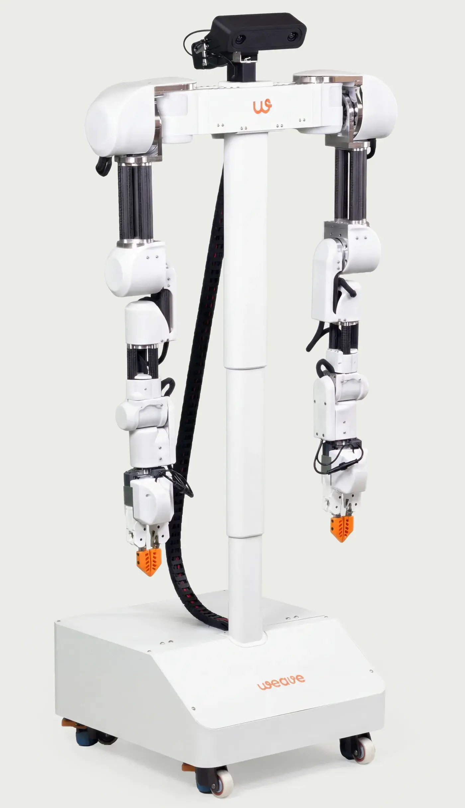
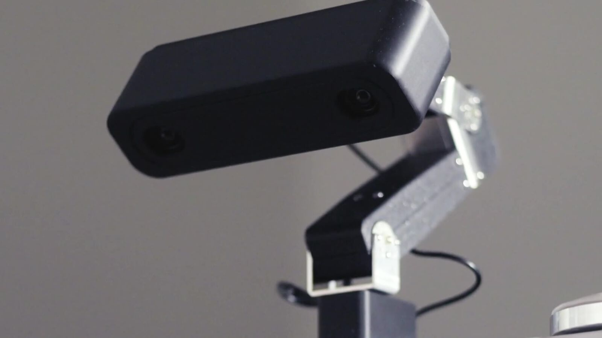
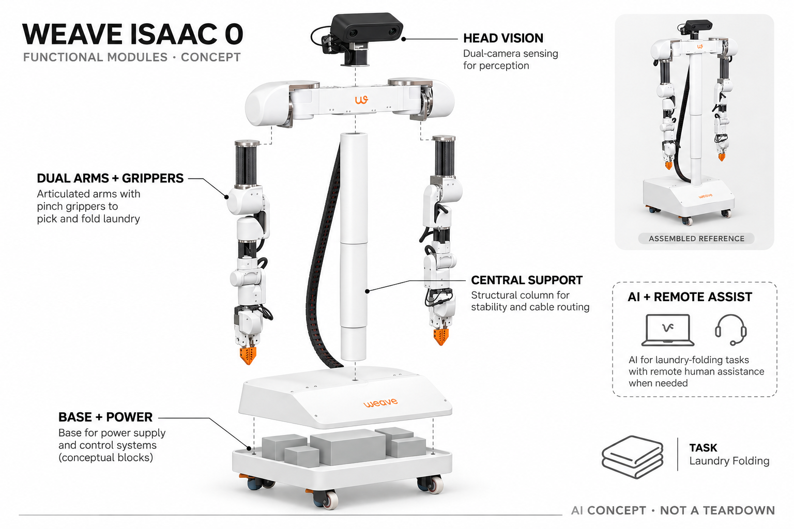

# Weave Isaac 0

**Weave Robotics** · 衣物与鞋履护理 · 核查 2026-11-04

固定在折衣工作区的学习型双臂机器人

消费渠道：付费预约 · 非正式订单。

## 产品图片与结构参考

### 产品图

官方Isaac 0整机 · 来源：[Weave Robotics · 官方图片](<https://www.weaverobotics.com/isaac-0>) · [原始图片](<https://www.weaverobotics.com/_next/image?url=%2Fimages%2Fproducts%2Fspecs.webp&w=1920&q=75>)

### 参考图

官方产品页视频封面中的头部细节 · 来源：[Weave Robotics · 官方图片](<https://www.weaverobotics.com/isaac-0>) · [原始图片](<https://www.weaverobotics.com/videos/posters/landing-hero.jpg>)

### AI 生成爆炸示意

**AI 生成 · 非实物拆机。** 内部为概念推断，不能作为元件布局、BOM 或维修依据。[生成提示词](../../content/hardware/prompts/weave-isaac-0.txt)

> 依据已核验官方外形与公开功能生成；未知内部仅为概念功能块，不代表原机电路板、芯片或实际布局。

> 实际查看并核对对应型号，官方原图未改色或语义编辑；营销文字不代表本研究独立验证。

> 分析为基于公开资料的案头研究与 AI 辅助判断，未经用户访谈、销量审计或实物拆机。需求、画像、竞争冷门度、审美及商业机会均为研究假设，不是投资结论。

## 销售与购买

- 状态：付费预约 · 非正式订单。官方订单页收US$250可退预订金、列加州4–6周估期；品牌说明已在当地家庭部署，但法律条款仍为未来订单机会，属于付费预约·非正式订单，不计可购/预售数量。

- 地区：美国加州（当前）

- 价格：US$250可退预约金；US$3,999买断后US$49/月。另有US$249/月方案；采用当前订单页，不沿用旧发布价格。预订不是交付保证。

- 中国大陆：官方当前家庭交付首先面向加州，未确认中国大陆订购、安装、远程协助及维修。其他地区计划不计当前可用。

- [官方产品 / 商店](<https://www.weaverobotics.com/isaac-0/order>)

## AI 的实际作用

动作AI模型学习折叠衣物，遇到难处理衣物可由Weave人员远程短时纠正再交回自主流程；固定折衣与人工协助共同构成当前能力，不是移动收衣或洗烘机。

服务与联网依赖：需要工作桌、适配电源网络、安装及持续服务；用户放入衣物和处理最终收纳，模型更新不等于任意布料都可靠。

## 是否冷门

新兴竞争（研究判断）：面向家庭的柔性衣物操作仍早期，固定折衣与普通洗烘任务明显不同，但部署地区与人类协助限制规模。

## 需求与市场

需求假设：高频洗衣家庭希望减少洗烘后重复折叠，而不是购买更多洗衣程序。应记录搬运、摆放、失败与收纳的总时间，不能把机器折叠时无需站旁边直接等同全部衣物流程完成，远程协助也要单列。

### 产品任务与边界 · 研究判断

需求假设：高频洗衣家庭希望减少洗烘后重复折叠，而不是购买更多洗衣程序。应记录搬运、摆放、失败与收纳的总时间，不能把机器折叠时无需站旁边直接等同全部衣物流程完成，远程协助也要单列。

依据：[Isaac 0官方家用订单](<https://www.weaverobotics.com/isaac-0/order>) · [Isaac 0官方产品能力](<https://www.weaverobotics.com/isaac-0>)

### 需求判断 · 研究判断

折衣位于洗烘和收纳之间，重复但不完全同质：一条毛巾与带抽绳衣物需要不同处理。固定位置能够收窄操作空间，却不会自动解决把衣物送到桌面和放进柜子的工作，需求应以整个家务链条节省的人工判断，而不只看机械臂折叠时间。

依据：[Isaac 0官方家用订单](<https://www.weaverobotics.com/isaac-0/order>) · [Isaac 0官方产品能力](<https://www.weaverobotics.com/isaac-0>)

### 需求验证 · 待验证

可先记录家庭一周衣物构成、折叠方式和现有时间，再在实机试用时追踪准备、返工与收纳，独立统计远程协助。当前预约不能替代交付验证，官方已部署个案也不能代表所有用户，因此本目录只提出测试方案，不伪称完成家庭访谈或对照。

依据：[Isaac 0官方家用订单](<https://www.weaverobotics.com/isaac-0/order>) · [Isaac 0官方产品能力](<https://www.weaverobotics.com/isaac-0>)

## 用户画像

画像推断：加州有固定折衣桌和设备空间、衣物较多并愿接受早期服务的家庭更匹配。实际负责折衣的人需认可整理方式与隐私，预算或对机器人兴趣不能代替真实任务频次，也不能默认所有家庭都有合适工作区。

### 适用行为与条件 · 研究判断

画像推断：加州有固定折衣桌和设备空间、衣物较多并愿接受早期服务的家庭更匹配。实际负责折衣的人需认可整理方式与隐私，预算或对机器人兴趣不能代替真实任务频次，也不能默认所有家庭都有合适工作区。

依据：[Isaac 0官方家用订单](<https://www.weaverobotics.com/isaac-0/order>) · [Isaac 0官方产品能力](<https://www.weaverobotics.com/isaac-0>)

### 人群取舍 · 研究判断

固定工作区和较多衣物可能让用户愿意尝试，但住处狭小、经常搬家或偏好挂衣的人价值不同。家庭成员还需接受衣物被观察及远程纠正的过程，画像应包括整理标准和隐私边界，不能从购买得起机器人直接推定可以接受整套服务。

依据：[Isaac 0官方家用订单](<https://www.weaverobotics.com/isaac-0/order>) · [Isaac 0官方产品能力](<https://www.weaverobotics.com/isaac-0>)

### 画像验证 · 待验证

画像验证应让实际折衣者说明哪些衣物会主动交给机器、哪些坚持自己处理，并检查推荐桌面和设备空间是否现实。待可试用时观察数周后是否仍愿维持工作区，不能用首次看机械臂演示的兴趣替代对长期整理流程和服务费用的接受。

依据：[Isaac 0官方家用订单](<https://www.weaverobotics.com/isaac-0/order>) · [Isaac 0官方产品能力](<https://www.weaverobotics.com/isaac-0>)

## 竞争与替代

竞争判断：与手工折衣、洗衣服务和完整移动家务机器人竞争，固定位置降低任务范围是明确差异。不会再加Isaac 1同品牌扩展充数；应比较总劳动、支持与收纳，而非把双臂或学习模型视作普遍优势。

### 比较对象与差异 · 研究判断

竞争判断：与手工折衣、洗衣服务和完整移动家务机器人竞争，固定位置降低任务范围是明确差异。不会再加Isaac 1同品牌扩展充数；应比较总劳动、支持与收纳，而非把双臂或学习模型视作普遍优势。

依据：[Isaac 0官方家用订单](<https://www.weaverobotics.com/isaac-0/order>) · [Isaac 0官方产品能力](<https://www.weaverobotics.com/isaac-0>)

### 竞争判断 · 研究判断

以固定折衣切入减少了移动导航与全屋取物任务，但也要求用户把物品带到机器人面前。与手工、送洗折叠服务及通用家务平台比较时，应对齐交付物和人工边界；低复杂度并不自动代表便宜，远程支持和安装同样进入完整成本。

依据：[Isaac 0官方家用订单](<https://www.weaverobotics.com/isaac-0/order>) · [Isaac 0官方产品能力](<https://www.weaverobotics.com/isaac-0>)

### 竞争验证 · 待验证

竞争验证可按毛巾、普通上衣和复杂衣物分别比较总人工与最终可接受程度，明确机器没有承担洗涤、烘干或入柜。不要将未来Isaac 1的能力合并到当前型号，也不以双臂数量或官方处理衣物总量推断每个家庭都能获得相同效率。

依据：[Isaac 0官方家用订单](<https://www.weaverobotics.com/isaac-0/order>) · [Isaac 0官方产品能力](<https://www.weaverobotics.com/isaac-0>)

## 供应链

供应链分析：固定结构、双臂、夹持、观察和控制需要处理柔性衣物，完整工厂和BOM未披露。布料缠绕、长期关节、工作桌适配与远程服务影响交付，不能只用机械臂价格推算家庭可用性或维护成本。

### 功能模块拆分 · 研究判断

系统由双目观察头、双臂与夹爪、中央支撑和底座、电源连接、动作模型与远程纠正组成。脚轮支持设备布置不等于自主移动，柔性布料又使夹持与缠绕处理成为核心约束；公开照片不支持还原内部电路、传动或精确零部件清单。

依据：[Isaac 0官方家用订单](<https://www.weaverobotics.com/isaac-0/order>) · [Isaac 0官方产品能力](<https://www.weaverobotics.com/isaac-0>)

### 制造与供应约束 · 研究判断

供应链分析：固定结构、双臂、夹持、观察和控制需要处理柔性衣物，完整工厂和BOM未披露。布料缠绕、长期关节、工作桌适配与远程服务影响交付，不能只用机械臂价格推算家庭可用性或维护成本。

依据：[Isaac 0官方家用订单](<https://www.weaverobotics.com/isaac-0/order>) · [Isaac 0官方产品能力](<https://www.weaverobotics.com/isaac-0>)

### 候选与证据缺口 · 研究判断

PCH可作为硬件工程和制造导入候选，HLH可支持机械结构与工作区原型，两者都没有Isaac 0点名合作证据。家庭折衣需要夹持、视觉与安全流程专项验证，通用工程能力不能替代模型训练、远程服务组织或实际交付可靠性。

依据：[Isaac 0官方家用订单](<https://www.weaverobotics.com/isaac-0/order>) · [Isaac 0官方产品能力](<https://www.weaverobotics.com/isaac-0>)

## 技术路径

技术判断：官方明确AI动作模型及远程纠正，机器学习与人工介入不是同一能力。不同衣料、尺寸和叠放会影响操作，发布样例和周更新不代表所有衣物已可靠处理，也不应混入Isaac 1移动取放能力。

### 已披露技术边界 · 研究判断

技术判断：官方明确AI动作模型及远程纠正，机器学习与人工介入不是同一能力。不同衣料、尺寸和叠放会影响操作，发布样例和周更新不代表所有衣物已可靠处理，也不应混入Isaac 1移动取放能力。

依据：[Isaac 0官方家用订单](<https://www.weaverobotics.com/isaac-0/order>) · [Isaac 0官方产品能力](<https://www.weaverobotics.com/isaac-0>) · [Weave官方折衣AI说明](<https://www.weaverobotics.com/stories/isaac-0-announcement>) · [Weave官方预订协议](<https://www.weaverobotics.com/pre-order-agreement>)

### 系统难点判断 · 研究判断

柔性衣物的状态在每次抓取后都会变化，识别边角、选择夹点和判断完成需要与动作反馈连贯衔接。官方承认自主与远程纠正混合，分析应记录两者各自贡献；周更新和从纠正中学习是研发路径，不等于某个失败下一次必然消失。

依据：[Isaac 0官方家用订单](<https://www.weaverobotics.com/isaac-0/order>) · [Isaac 0官方产品能力](<https://www.weaverobotics.com/isaac-0>) · [Weave官方折衣AI说明](<https://www.weaverobotics.com/stories/isaac-0-announcement>) · [Weave官方预订协议](<https://www.weaverobotics.com/pre-order-agreement>)

### 技术验证 · 待验证

技术验证应在允许衣物范围内记录抓取失败、重新摆放、远程介入及最终叠放质量，并按版本保存条件。测试需由厂商说明指导，不主动制造危险缠绕或夹碰；不能以一段连续视频判断整批任务无需协助，也不把远程动作算为完全自主成功。

依据：[Isaac 0官方家用订单](<https://www.weaverobotics.com/isaac-0/order>) · [Isaac 0官方产品能力](<https://www.weaverobotics.com/isaac-0>) · [Weave官方折衣AI说明](<https://www.weaverobotics.com/stories/isaac-0-announcement>) · [Weave官方预订协议](<https://www.weaverobotics.com/pre-order-agreement>)

## 产品审美

审美判断：固定柱体与双臂是明显工具形态，工作桌和安全空间决定能否留在家中。线材、夹持动作与停机状态应清楚，设备照片的空旷工作区不能代表普通洗衣房，也不必用拟人外形掩盖实际维护。

### 外观与交互语言 · 研究判断

审美判断：固定柱体与双臂是明显工具形态，工作桌和安全空间决定能否留在家中。线材、夹持动作与停机状态应清楚，设备照片的空旷工作区不能代表普通洗衣房，也不必用拟人外形掩盖实际维护。

依据：[Isaac 0官方家用订单](<https://www.weaverobotics.com/isaac-0/order>) · [Isaac 0官方产品能力](<https://www.weaverobotics.com/isaac-0>)

### 使用中审美判断 · 研究判断

白色关节外罩、深色连杆和橙色夹爪形成明确工具语言，避免靠仿人面孔解释工作，但机器人和工作桌会长期占据空间。相机朝向、可动区域与停止状态应一目了然，展示图应帮助用户理解布置，而不是用空房间掩盖普通住宅的限制。

依据：[Isaac 0官方家用订单](<https://www.weaverobotics.com/isaac-0/order>) · [Isaac 0官方产品能力](<https://www.weaverobotics.com/isaac-0>)

### 设计验证 · 待验证

设计验证可在不同桌边观察上料、取衣和靠近设备的动作，确认线缆、脚轮和夹爪不会造成难以理解的操作边界。对长期停机和清洁也应评估，不能只看机械臂在工作时是否流畅，更不以整洁外壳替代对镜头采集和远程权限的说明。

依据：[Isaac 0官方家用订单](<https://www.weaverobotics.com/isaac-0/order>) · [Isaac 0官方产品能力](<https://www.weaverobotics.com/isaac-0>)

## 关键风险

风险判断：当前收取预订金但不保证交付，远程纠正涉及家庭衣物与画面权限。机械操作和布料限制需明确，用户仍需准备与收纳，不能将AI或已部署个案当作完全无人、所有衣物无损和全球服务保证。

### 主要失效与依赖 · 研究判断

风险判断：当前收取预订金但不保证交付，远程纠正涉及家庭衣物与画面权限。机械操作和布料限制需明确，用户仍需准备与收纳，不能将AI或已部署个案当作完全无人、所有衣物无损和全球服务保证。

依据：[Isaac 0官方家用订单](<https://www.weaverobotics.com/isaac-0/order>) · [Isaac 0官方产品能力](<https://www.weaverobotics.com/isaac-0>) · [Weave官方折衣AI说明](<https://www.weaverobotics.com/stories/isaac-0-announcement>) · [Weave官方预订协议](<https://www.weaverobotics.com/pre-order-agreement>)

### 风险传播判断 · 研究判断

预约法律条款与“已经在部分家庭发货”的页面文案表达不同范围：前者仍不保证当前付款者获得交付。使用时衣物损伤、布料限制及远程观看权限也需明确，机器人不能代替全部洗衣劳动，用户仍要准备、分类和安排最后收纳。

依据：[Isaac 0官方家用订单](<https://www.weaverobotics.com/isaac-0/order>) · [Isaac 0官方产品能力](<https://www.weaverobotics.com/isaac-0>) · [Weave官方折衣AI说明](<https://www.weaverobotics.com/stories/isaac-0-announcement>) · [Weave官方预订协议](<https://www.weaverobotics.com/pre-order-agreement>)

### 风险验证 · 待验证

风险验证应核对预约退款、加州服务限制、后续合同和安装支持，明确是否需要持续网络及远程介入。衣物测试遵循说明并保留人工退出路径，不能用部署数量或推荐桌面推定所有家庭可安全使用，更不以外观图承诺所有面料无损。

依据：[Isaac 0官方家用订单](<https://www.weaverobotics.com/isaac-0/order>) · [Isaac 0官方产品能力](<https://www.weaverobotics.com/isaac-0>) · [Weave官方折衣AI说明](<https://www.weaverobotics.com/stories/isaac-0-announcement>) · [Weave官方预订协议](<https://www.weaverobotics.com/pre-order-agreement>)

## 机会与验证

机会假设：折衣是可衡量的家务切入点，先比较多周人工准备、纠错和结果接受再考虑移动扩展。若多数工作仍由远程人员完成，应透明说明成本与模式，不从人形机器人话题推定固定家务平台一定划算。

### 可能的机会入口 · 研究判断

机会假设：折衣是可衡量的家务切入点，先比较多周人工准备、纠错和结果接受再考虑移动扩展。若多数工作仍由远程人员完成，应透明说明成本与模式，不从人形机器人话题推定固定家务平台一定划算。

依据：[Isaac 0官方家用订单](<https://www.weaverobotics.com/isaac-0/order>) · [Isaac 0官方产品能力](<https://www.weaverobotics.com/isaac-0>) · [Weave官方折衣AI说明](<https://www.weaverobotics.com/stories/isaac-0-announcement>) · [Weave官方预订协议](<https://www.weaverobotics.com/pre-order-agreement>)

### 机会成立条件 · 研究判断

创业机会在于把折衣任务边界缩小到可靠可交付的范围，例如先验证用户最重复且愿意交出的衣物。远程协助可以成为明确服务组成，但应透明统计成本和权限；不应为了通用机器人叙事过早扩展移动、洗涤和收纳而使基础任务不可控。

依据：[Isaac 0官方家用订单](<https://www.weaverobotics.com/isaac-0/order>) · [Isaac 0官方产品能力](<https://www.weaverobotics.com/isaac-0>) · [Weave官方折衣AI说明](<https://www.weaverobotics.com/stories/isaac-0-announcement>) · [Weave官方预订协议](<https://www.weaverobotics.com/pre-order-agreement>)

### 下一步验证 · 待验证

下一步可用多周衣物日记建立基线，再在实际交付后衡量准备、纠错和结果接受度，分别评价模型与服务。若用户仍承担大部分整理，应重新收窄价值主张，不从机械臂动作数量或行业关注度推断家庭折衣已经形成普遍付费需求。

依据：[Isaac 0官方家用订单](<https://www.weaverobotics.com/isaac-0/order>) · [Isaac 0官方产品能力](<https://www.weaverobotics.com/isaac-0>) · [Weave官方折衣AI说明](<https://www.weaverobotics.com/stories/isaac-0-announcement>) · [Weave官方预订协议](<https://www.weaverobotics.com/pre-order-agreement>)

## 对应供应链公司

能力候选用于选型研究，不代表本产品实际采用；未公开的供货关系不作推断。

- [pch-international](../supply-chain/pch-international.md) — **能力候选 · 非已采用** / 家庭折衣设备工程及制造导入：PCH公开硬件开发与制造导入服务可对应双臂设备结构、电子整合和供应准备，但柔性衣物控制、家庭安全及远程服务需另行验证；没有Weave Isaac 0点名合作证据，候选不代表已采用。

- [hlh-prototypes](../supply-chain/hlh-prototypes.md) — **能力候选 · 非已采用** / 支撑结构与操作空间原型评估：HLH公开机械加工、原型及小批量服务可支持支撑结构、外罩和装配验证，但不能推定掌握Isaac 0关节或夹爪专有设计；未见Weave实际供货披露，只作为机械工程潜在能力链接。

[浏览供应链目录](../supply-chain.md)

## 功能分层示意

这是功能关系，不是实物拆机、真实空间结构或已核实 BOM。

1. **工作区输入**：用户将清洁衣物放到合适桌面工作区。（官方披露）

2. **观察与模型**：模型根据衣物状态驱动折叠，未披露完整传感BOM。（官方披露）

3. **双臂执行**：固定基座、双臂与夹持工具完成布料操作。（官方披露）

4. **远程纠正**：困难情境由远程人员协助后继续。（官方披露）

5. **安装服务**：联网、安装、模型更新和维修支持。（官方披露）

## 来源

1. [Isaac 0官方家用订单](<https://www.weaverobotics.com/isaac-0/order>) — 已打开，US$250预订金、当前费用与加州交付估期明确。

2. [Isaac 0官方产品能力](<https://www.weaverobotics.com/isaac-0>) — 已打开，固定折衣、家庭部署、自动与远程协助边界。

3. [Weave官方折衣AI说明](<https://www.weaverobotics.com/stories/isaac-0-announcement>) — 已打开，动作AI模型与远程纠正，不把宣称任何衣物视为独立实测。

4. [Weave官方预订协议](<https://www.weaverobotics.com/pre-order-agreement>) — 已打开，预订仅为未来订单机会、可取消，不保证交付。

[返回目录](../hardware-market.md) · [网页分析](https://romanagent.github.io/Roman/#hardware/product/weave-isaac-0)
