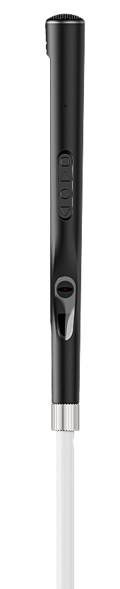
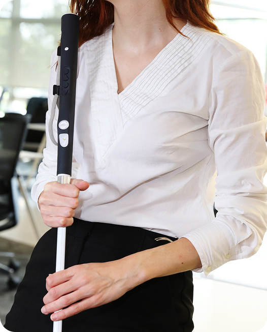
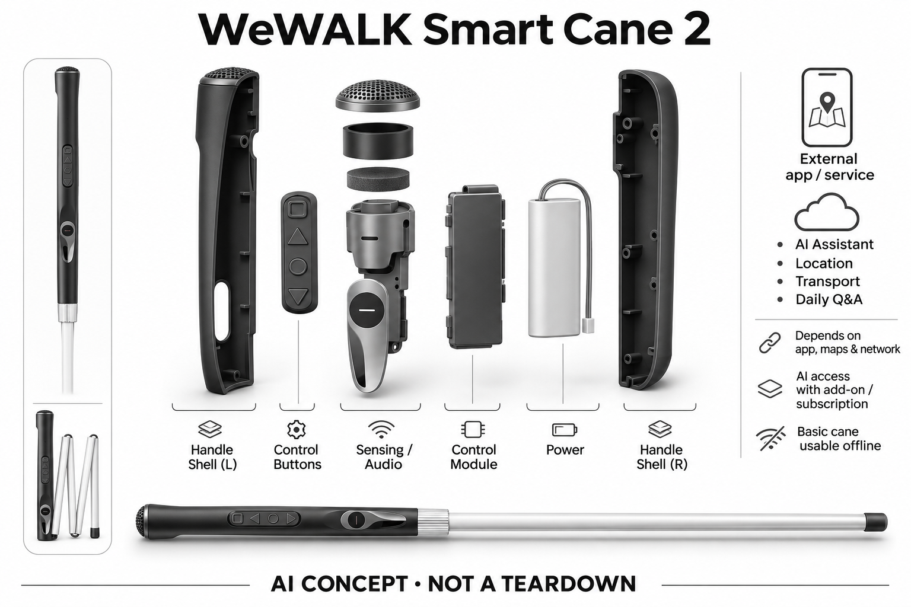

# WeWALK Smart Cane 2

**WeWALK** · 无障碍与辅助沟通 · 核查 2026-11-04

传统白杖手柄中的AI语音与导航入口

消费渠道：个人零售。

## 产品图片与结构参考

### 产品图

WeWALK Smart Cane 2官方产品外形图 · 来源：[WeWALK · 官方产品图片](<https://wewalk.io/en/>) · [原始图片](<https://wewalk.io/wp-content/uploads/2026/03/WeWak-SmartCane-Box-Render-tranwsparent-1.png>)

### 参考图

WeWALK Smart Cane 2官方另一角度或使用场景参考 · 来源：[WeWALK · 官方产品图片](<https://wewalk.io/en/>) · [原始图片](<https://wewalk.io/wp-content/uploads/2026/03/a_woman_holding_wewalk_in_the_office-1.jpg>)

### AI 生成爆炸示意

**AI 生成 · 非实物拆机。** 内部为概念推断，不能作为元件布局、BOM 或维修依据。[生成提示词](../../content/hardware/prompts/wewalk-smart-cane-2.txt)

> 外形依据核验参考图；内部位置、模块形状与装配关系仅作AI概念展示。

> 已逐张查看并核对型号。源图未改色/裁切；场景、界面、附件、优惠及效果文案仅为厂商示意，不作为本目录性能或现价依据。

> 分析为基于公开资料的案头研究与 AI 辅助判断，未经用户访谈、销量审计或实物拆机。需求、画像、竞争冷门度、审美及商业机会均为研究假设，不是投资结论。

## 销售与购买

- 状态：在售。官方订购页可选择国家、杖长及附加服务并继续至Checkout；这是具体实物订单流程，不是仅填写邮箱的候补名单。

- 地区：所列官方区域或授权零售渠道；配送地址与服务支持需结算确认

- 价格：按国家与AI附加服务动态报价；未读取到统一总价。核查日所见单机或基本配置价；币种、促销、税费、镜片、附件及服务依地区结算，不把颜色或套装重复计数。

- 中国大陆：本次未核实该具体型号在中国大陆的官方销售和完整服务支持；海外在售不等于国内可直接启用全部功能。

- [官方产品 / 商店](<https://wewalk.io/en/>)

## AI 的实际作用

AI Assistant通过自然语言提供地点、交通及日常问答，白杖另有上半身障碍探测；不把普通探障传感器单独算作AI

服务与联网依赖：智能功能依配套手机App、地区地图与网络；AI权限取决于购买附加包或订阅，基础白杖仍可脱网使用

## 是否冷门

细分专业（研究判断）：按任务与形态作案头分类，无访谈、销量或市场份额证据。

## 需求与市场

需求假设：白杖使用者希望在持杖时查路线与周边信息，减少同时掏手机的步骤。价值应由实际使用频率、任务完成与操作负担验证，不能把AI功能存在或演示流畅当作需求已得到满足。

### 官方｜白杖手柄中的信息入口 · 官方资料

Smart Cane 2保留传统白杖使用方式，同时加入上半身障碍提示、手机应用控制和AI语音问答。官方把这些能力分为不同模式，断开连接时仍可作为普通白杖使用；自然语言助手处理地点、交通与日常问题，不能把所有导航、测距和机械探路功能统称为同一种人工智能。

依据：[WeWALK当前产品与AI说明](<https://wewalk.io/en/>) · [WeWALK AI Assistant指令说明](<https://support.wewalk.io/en/article/what-skills-does-the-voice-assistant-have-2/>)

### 判断｜持杖时减少操作冲突 · 研究判断

核心需求假设是用户在持杖行走时，希望更方便地获取路线和周边信息，减少取出、解锁及操作手机的步骤。额外信息只有在时机合适、听得清且不淹没环境线索时才有价值；功能更多也可能增加注意负担，因此需要比较完整出行过程而不是单次问答速度。

依据：[WeWALK当前产品与AI说明](<https://wewalk.io/en/>) · [WeWALK AI Assistant指令说明](<https://support.wewalk.io/en/article/what-skills-does-the-voice-assistant-have-2/>)

### 验证｜从熟悉路线逐步观察 · 待验证

可由具备相关支持条件的用户在熟悉环境中记录何时调用语音、是否需要停下操作、提示是否重复以及是否仍需拿出手机。不要为了测试去依赖设备完成危险通行；重点是原有出行流程中少了哪些动作、多了哪些困扰，并记录无网络时能继续完成的基础任务。

依据：[WeWALK当前产品与AI说明](<https://wewalk.io/en/>) · [WeWALK AI Assistant指令说明](<https://support.wewalk.io/en/article/what-skills-does-the-voice-assistant-have-2/>)

## 用户画像

画像推断：已掌握基本白杖使用方法，愿意配置手机与语音功能的视障或低视力个人更匹配。个人的语言、操作习惯、环境和预算会改变适配结果，本次只有案头研究，没有用户访谈或长期使用观察。

### 官方｜传统技能仍在系统内 · 官方资料

产品沿用可选择长度的白杖与智能手柄，官方订购流程要求按地区和配置选择，应用承担部分导航与服务连接。传统白杖操作没有被自动驾驶替代，使用者仍需理解触觉和声音提示；订单入口也没有证明任何身体条件或手机经验的人都适合相同长度和设置。

依据：[WeWALK当前产品与AI说明](<https://wewalk.io/en/>) · [WeWALK官方订购页](<https://wewalk.io/en/checkout/>)

### 判断｜本人技能与技术支持并看 · 研究判断

已掌握白杖基本使用、愿意学习手柄操作并能获得手机设置帮助的个人，可能更容易评估其增量价值。对主要困难在于基础定向行走的人，新增智能信息未必优先；家庭或专业人员的支持应帮助用户建立可理解的流程，而不能用代为操作的演示替代本人体验。

依据：[WeWALK当前产品与AI说明](<https://wewalk.io/en/>) · [WeWALK AI权限与订阅边界](<https://support.wewalk.io/en/article/if-i-own-a-wewalk-smart-cane-do-i-also-need-to-purchase-a-wewalk-subscription-2/>)

### 验证｜记录学习与日常维护 · 待验证

试用需要本人完成模式识别、音量或反馈设置、设备充电和手机重新连接，并说明失去智能提示时如何继续既有活动。把首次教学和熟悉后的独立操作分开记录，确认谁负责软件更新与售后联系；这些信息比按年龄或障碍类别简单建立用户画像更有用。

依据：[WeWALK当前产品与AI说明](<https://wewalk.io/en/>) · [WeWALK官方订购页](<https://wewalk.io/en/checkout/>) · [WeWALK AI权限与订阅边界](<https://support.wewalk.io/en/article/if-i-own-a-wewalk-smart-cane-do-i-also-need-to-purchase-a-wewalk-subscription-2/>)

## 竞争与替代

案头判断：与普通白杖、手机无障碍导航和专业出行训练形成替代与互补关系。这只是用途与替代品比较，不是市场份额或销量结论；专业细分和较少曝光也不代表没有成熟竞争者。

### 官方｜实物配置与AI权益分开 · 官方资料

官方订购页提供国家、杖长和附加服务选择，可继续进入实物订单流程；AI权限另有购买附加包或订阅说明。核查未取得适用于所有地区的统一总价，因此硬件、可选服务与配送应分项确认，不能把主页分期金额当作完整售价，也不能默认买杖后永久包含全部在线能力。

依据：[WeWALK官方订购页](<https://wewalk.io/en/checkout/>) · [WeWALK AI权限与订阅边界](<https://support.wewalk.io/en/article/if-i-own-a-wewalk-smart-cane-do-i-also-need-to-purchase-a-wewalk-subscription-2/>)

### 判断｜与白杖加手机比较 · 研究判断

直接替代方案是原有白杖配合手机无障碍导航，智能手柄的差异在于控制位置和上半身障碍补充提示。它仍与地图服务、专业训练及必要的人工协助互补；不能因外形特殊就认定竞争稀少，也不能把已有手机服务的全部价值都归于这根白杖的电子硬件。

依据：[WeWALK当前产品与AI说明](<https://wewalk.io/en/>) · [WeWALK AI Assistant指令说明](<https://support.wewalk.io/en/article/what-skills-does-the-voice-assistant-have-2/>)

### 验证｜相同信息任务下比较 · 待验证

比较时可选择查询附近地点、确认路线和获得一条交通信息，记录手机单独操作与手柄入口的步骤、等待和重复提问。另行评价障碍提示，避免把不同功能混成一个总体满意分数；成本表还应包括订阅、维修和手机条件，才有助于本人判断新增设备是否值得保留。

依据：[WeWALK当前产品与AI说明](<https://wewalk.io/en/>) · [WeWALK AI权限与订阅边界](<https://support.wewalk.io/en/article/if-i-own-a-wewalk-smart-cane-do-i-also-need-to-purchase-a-wewalk-subscription-2/>) · [WeWALK AI Assistant指令说明](<https://support.wewalk.io/en/article/what-skills-does-the-voice-assistant-have-2/>)

## 供应链

TDK官方案例明确披露SmartMotion惯性、SmartSound麦克风与SmartSonic超声ToF等传感方案参与Smart Cane 2；具体料号、整机工厂与完整BOM未公开。合作证据不代表所有AI在这些传感器上运行，也不证明实测探障效果。

### 官方｜TDK合作已有点名证据 · 官方资料

TDK官方案例明确点名Smart Cane 2采用SmartMotion惯性、SmartSound麦克风及SmartSonic超声飞行时间等方案，并提及相关连接和电源器件。这支持特定产品与传感模块系列的合作关系，但未公开完整料号、整机工厂或物料清单，也不证明所有导航和AI处理都在这些器件上完成。

依据：[TDK and WeWALK Smart Cane 2 disclosed sensor collaboration](<https://www.tdk.com/en/featured_stories/entry_084-WeWALK-Smart-Cane-2.html>)

### 判断｜机械功能必须独立可靠 · 研究判断

从使用方式推断，电子手柄的重量、握持、跌落和连接结构会影响原有白杖动作，因此不能只在桌面验证传感器输出。模块化或可升级的宣传还需要具体接口和维修政策支撑；传感器工作正常不等于整根白杖在长期折叠、碰触和携带后仍维持相同手感与可靠性。

依据：[WeWALK当前产品与AI说明](<https://wewalk.io/en/>) · [TDK and WeWALK Smart Cane 2 disclosed sensor collaboration](<https://www.tdk.com/en/featured_stories/entry_084-WeWALK-Smart-Cane-2.html>)

### 验证｜模块证据与整机测试分开 · 待验证

供应链核验应先确认已披露模块对应的具体型号和版本，再测试安装方向、声音入口和障碍反馈时序。TDK合作可标为已披露，其他低功耗连接主控只能作为同类新设计候选；供应商器件最大测距不能直接写成白杖在任何材质、角度和天气下的有效探测范围。

依据：[WeWALK当前产品与AI说明](<https://wewalk.io/en/>) · [TDK and WeWALK Smart Cane 2 disclosed sensor collaboration](<https://www.tdk.com/en/featured_stories/entry_084-WeWALK-Smart-Cane-2.html>)

## 技术路径

AI Assistant通过自然语言提供地点、交通及日常问答，白杖另有上半身障碍探测；不把普通探障传感器单独算作AI。这是厂商披露的功能机制；模型版本、准确率及内部结构未完整公开。架构只表示输入、处理和输出关系，不作为真实拆机或性能实测。

### 官方｜输入与服务分层工作 · 官方资料

公开说明能够区分超声障碍感知、运动信息、麦克风语音入口和连接手机后的助手及导航服务。AI助手通过自然语言提供信息，普通测距本身并不是生成式智能；本目录据功能描述展示这些关系，不把传感器、地图或问答服务的供应身份混成同一家公司。

依据：[WeWALK当前产品与AI说明](<https://wewalk.io/en/>) · [WeWALK AI权限与订阅边界](<https://support.wewalk.io/en/article/if-i-own-a-wewalk-smart-cane-do-i-also-need-to-purchase-a-wewalk-subscription-2/>) · [WeWALK AI Assistant指令说明](<https://support.wewalk.io/en/article/what-skills-does-the-voice-assistant-have-2/>) · [TDK and WeWALK Smart Cane 2 disclosed sensor collaboration](<https://www.tdk.com/en/featured_stories/entry_084-WeWALK-Smart-Cane-2.html>)

### 判断｜不同提示需要明确优先级 · 研究判断

障碍提醒、路线指令和一般问题回答可能在相近时间出现，系统价值取决于能否让用户清楚区分紧迫程度。过多或模糊提示可能增加停顿和忽略，尤其语音会与环境声音竞争；这一点属于架构与交互分析，不代表已发现本产品存在特定时序缺陷。

依据：[WeWALK当前产品与AI说明](<https://wewalk.io/en/>) · [WeWALK AI Assistant指令说明](<https://support.wewalk.io/en/article/what-skills-does-the-voice-assistant-have-2/>) · [TDK and WeWALK Smart Cane 2 disclosed sensor collaboration](<https://www.tdk.com/en/featured_stories/entry_084-WeWALK-Smart-Cane-2.html>)

### 验证｜失联与信息冲突要可理解 · 待验证

可在安全的固定环境中断开手机或网络，检查设备如何说明哪些功能不可用，以及用户是否还能辨认普通白杖模式。对地图信息过期、问答没有结果和障碍反复提示分别记录，确认系统没有把缺失信息伪装成肯定结论；这些检查比只验证一次连网演示更接近日常需求。

依据：[WeWALK当前产品与AI说明](<https://wewalk.io/en/>) · [WeWALK AI权限与订阅边界](<https://support.wewalk.io/en/article/if-i-own-a-wewalk-smart-cane-do-i-also-need-to-purchase-a-wewalk-subscription-2/>) · [WeWALK AI Assistant指令说明](<https://support.wewalk.io/en/article/what-skills-does-the-voice-assistant-have-2/>)

## 产品审美

图示观察：手柄保留握持和触觉按键，杖身延续熟悉的白杖形态而不是改成机器人。宣传图片只能帮助理解外观和摆放方式，不能证明每个人的舒适度、长时使用体验或实际材料触感。

### 官方｜熟悉杖身与按键手柄 · 官方资料

官方图示和订购配置显示产品延续白杖形态，并在手柄上布置可触摸的物理控制与反馈入口。杖长需要按个人情况选择，电子部分承担智能操作；外观资料能够说明设计方向，但不能证明所有握持方式、手掌尺寸或长期行走中的舒适度，实际适配需要本人确认。

依据：[WeWALK当前产品与AI说明](<https://wewalk.io/en/>) · [WeWALK官方订购页](<https://wewalk.io/en/checkout/>)

### 判断｜触觉可辨识是设计核心 · 研究判断

对白杖用户而言，按键能否用触觉区分、握持时会不会误触、提示是否容易理解，比外观是否像先进设备更重要。传统形态有利于保留已建立的操作习惯，但更粗或更重的手柄也可能改变感受；设计评价应尊重用户选择简单工具或关闭部分智能功能的偏好。

依据：[WeWALK当前产品与AI说明](<https://wewalk.io/en/>)

### 验证｜覆盖收纳与日常接触 · 待验证

可以观察开门、拿包、坐下和折叠收纳时手柄如何被握持，记录误触、反馈遮挡和重新找回控制位置的困难。试用也应包含不同衣物与携带方式，确认设备是否增加额外动作；这些是外观与操作关系的观察，不应从产品照片推断具体重量感或材料耐久性。

依据：[WeWALK当前产品与AI说明](<https://wewalk.io/en/>) · [WeWALK官方订购页](<https://wewalk.io/en/checkout/>)

## 关键风险

语音回答、地图和障碍探测各有盲点，不能承担道路通行决策或替代定向行走技能。还需核对地区功能、软件更新与售后边界；本目录未进行实机、医学或可靠性测试，不把厂商演示当作结果保证。

### 官方｜在线权限与当地信息范围 · 官方资料

助手与部分导航依赖配套应用、网络和相应权益，具体地点或交通信息也受地区数据覆盖影响。基础白杖仍保留离线机械用途，但这不能推导所有电子功能均可离线；本轮也没有确认中国大陆的完整销售和服务，海外订单入口不能替代当地可用性核实。

依据：[WeWALK当前产品与AI说明](<https://wewalk.io/en/>) · [WeWALK AI权限与订阅边界](<https://support.wewalk.io/en/article/if-i-own-a-wewalk-smart-cane-do-i-also-need-to-purchase-a-wewalk-subscription-2/>) · [WeWALK AI Assistant指令说明](<https://support.wewalk.io/en/article/what-skills-does-the-voice-assistant-have-2/>)

### 判断｜辅助信息不能代替通行判断 · 研究判断

超声感知、地图与语言模型各有不同盲点，返回一个合理答案也不代表现场道路状态已经核实。设备不能替代定向行走技能或承担道路通行决策；对重要位置和路线，应明确数据是否实时、提示是否有不确定性，同时避免把厂商合作和奖项当作独立安全效果证据。

依据：[WeWALK当前产品与AI说明](<https://wewalk.io/en/>) · [WeWALK AI Assistant指令说明](<https://support.wewalk.io/en/article/what-skills-does-the-voice-assistant-have-2/>) · [TDK and WeWALK Smart Cane 2 disclosed sensor collaboration](<https://www.tdk.com/en/featured_stories/entry_084-WeWALK-Smart-Cane-2.html>)

### 验证｜事先说明失效时的动作 · 待验证

用户应能辨认连接中断、权限不足与无结果提示，并通过既有方法继续活动或寻求适当帮助。服务核验还需确认退换、维修和订阅停止后的功能保留范围；测试不应以危险场景证明系统极限，而应在可控条件下确认信息缺失能被发现并被正确理解。

依据：[WeWALK当前产品与AI说明](<https://wewalk.io/en/>) · [WeWALK AI权限与订阅边界](<https://support.wewalk.io/en/article/if-i-own-a-wewalk-smart-cane-do-i-also-need-to-purchase-a-wewalk-subscription-2/>) · [WeWALK AI Assistant指令说明](<https://support.wewalk.io/en/article/what-skills-does-the-voice-assistant-have-2/>)

## 机会与验证

市场差异主要在于传统白杖手柄中的AI语音与导航入口。值得进一步验证的购买理由是它能否减少既有任务中的具体步骤，以及硬件、服务与维护的总成本是否符合个人使用频率。

### 官方｜多模式围绕同一出行任务 · 官方资料

传统白杖、增强提示、导航与语音助手共同服务于个人出行，并非四种可以重复计数的独立硬件需求。已披露传感合作使功能架构更具体，但产品仍依靠机械技能、手机和服务组成完整体验；官方计划的升级方向也不能作为目前已经交付的额外能力计算。

依据：[WeWALK当前产品与AI说明](<https://wewalk.io/en/>) · [WeWALK AI Assistant指令说明](<https://support.wewalk.io/en/article/what-skills-does-the-voice-assistant-have-2/>) · [TDK and WeWALK Smart Cane 2 disclosed sensor collaboration](<https://www.tdk.com/en/featured_stories/entry_084-WeWALK-Smart-Cane-2.html>)

### 判断｜有价值的是少一次停顿 · 研究判断

最值得继续研究的是用户在熟悉出行流程里能否少一次拿手机、少一次重复询问，同时不增加对提示的困惑。若主要收益来自方便的控制入口，应如实描述这一细小但具体的改善；不需要把设备包装成完全理解环境或替用户规划所有行动的智能体。

依据：[WeWALK当前产品与AI说明](<https://wewalk.io/en/>) · [WeWALK AI Assistant指令说明](<https://support.wewalk.io/en/article/what-skills-does-the-voice-assistant-have-2/>)

### 验证｜以个人路线记录长期变化 · 待验证

后续观察可由本人选择常走路线，记录主动使用功能、停顿原因、无效提示与手机操作次数，并单独统计维护和学习时间。保留关闭智能功能的比较条件，确认变化不是短期熟悉效应；本目录没有独立用户研究，不能据公开合作案例推定长期出行效果或商业需求规模。

依据：[WeWALK当前产品与AI说明](<https://wewalk.io/en/>) · [WeWALK AI权限与订阅边界](<https://support.wewalk.io/en/article/if-i-own-a-wewalk-smart-cane-do-i-also-need-to-purchase-a-wewalk-subscription-2/>) · [WeWALK AI Assistant指令说明](<https://support.wewalk.io/en/article/what-skills-does-the-voice-assistant-have-2/>)

## 对应供应链公司

能力候选用于选型研究，不代表本产品实际采用；未公开的供货关系不作推断。

- [tdk-invensense](../supply-chain/tdk-invensense.md) — **公开披露关系** / 已披露SmartMotion、SmartSound与SmartSonic传感方案：TDK官方合作案例明确把Smart Cane 2与其惯性、声音和超声飞行时间模块系列联系起来，因此可记录已披露的传感合作。证据没有公开完整料号、工厂和所有控制芯片，也不能将器件极限参数等同白杖整机有效范围；导航与生成式问答的执行位置仍需分别说明。

- [nordic-semiconductor](../supply-chain/nordic-semiconductor.md) — **能力候选 · 非已采用** / 同类智能手柄的低功耗连接与控制候选：Nordic的低功耗无线及多核控制能力可用于研究手柄按键、传感状态和手机应用之间的通信与唤醒流程。需要验证协议、失联反馈和整机续航，不要求连接芯片承担地图或生成式问答；没有资料点名Smart Cane 2采用Nordic，此候选只适用于重新设计相近功能的架构比较。

[浏览供应链目录](../supply-chain.md)

## 功能分层示意

这是功能关系，不是实物拆机、真实空间结构或已核实 BOM。

1. **实体输入**：带物理按键的智能手柄、可折叠白杖与声音/振动反馈；仅功能层示意，非拆机。（官方披露）

2. **采集与控制**：设备把输入转为可处理的信息并接收用户操作；具体内部布局未知。（分析推断）

3. **AI功能**：AI Assistant通过自然语言提供地点、交通及日常问答，白杖另有上半身障碍探测；不把普通探障传感器单独算作AI（官方披露）

4. **服务依赖**：智能功能依配套手机App、地区地图与网络；AI权限取决于购买附加包或订阅，基础白杖仍可脱网使用（官方披露）

5. **用户反馈**：用户通过声音、屏幕或配套应用接收结果，并对重要信息复核。（分析推断）

## 来源

1. [WeWALK当前产品与AI说明](<https://wewalk.io/en/>) — 已打开一手页面；产品能力为厂商披露，未进行实机或效果验证。

2. [WeWALK官方订购页](<https://wewalk.io/en/checkout/>) — 已打开国家、杖长及Continue to Checkout流程；没有提交订单。

3. [WeWALK AI权限与订阅边界](<https://support.wewalk.io/en/article/if-i-own-a-wewalk-smart-cane-do-i-also-need-to-purchase-a-wewalk-subscription-2/>) — 已打开一手页面；产品能力为厂商披露，未进行实机或效果验证。

4. [WeWALK AI Assistant指令说明](<https://support.wewalk.io/en/article/what-skills-does-the-voice-assistant-have-2/>) — 已打开一手页面；产品能力为厂商披露，未进行实机或效果验证。

5. [TDK与WeWALK Smart Cane 2公开合作案例](<https://www.tdk.com/en/featured_stories/entry_084-WeWALK-Smart-Cane-2.html>) — 点名Smart Cane 2与传感方案关系；未披露具体料号、整机工厂或完整BOM。

[返回目录](../hardware-market.md) · [网页分析](https://romanagent.github.io/Roman/#hardware/product/wewalk-smart-cane-2)
