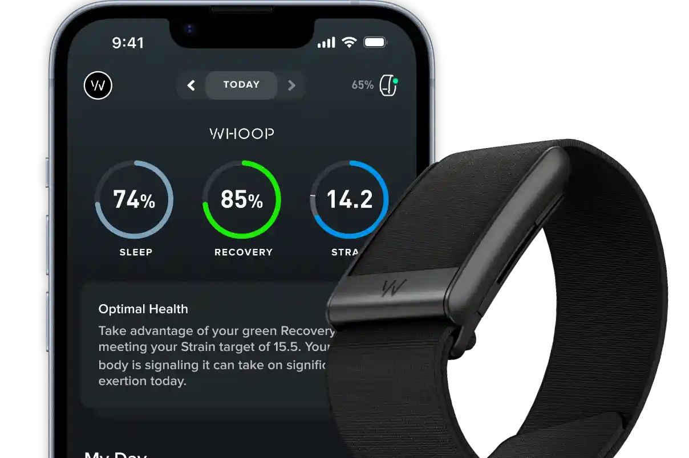
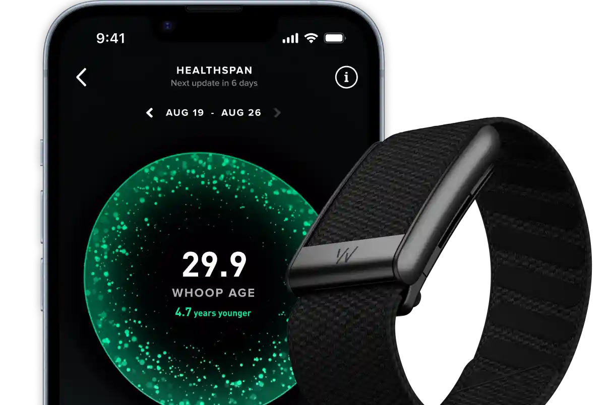
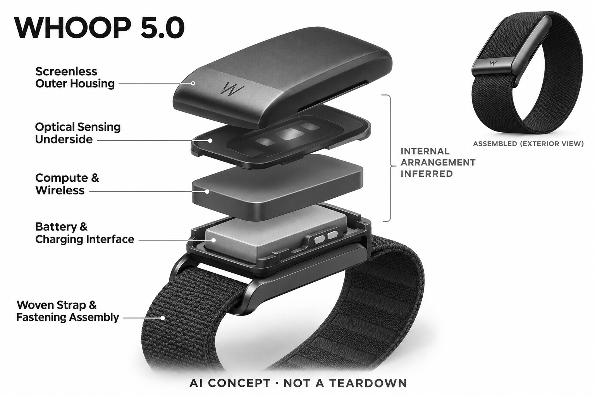

# WHOOP 5.0

**WHOOP** · 健康与穿戴 · 核查 2026-11-04

以连续记录和会员制AI教练服务训练人群

## 产品图片与结构参考

### 产品图

WHOOP 5.0 One 官方设备与应用展示 · 来源：[WHOOP · 官方图片](<https://www.whoop.com/ch/en/membership/>) · [原始图片](<https://images.ctfassets.net/rbzqg6pelgqa/3waVHtJ6R9HOTAreGiUP5a/e9a8df7e641adb0cbf3adc005d31a278/One_card__1_.png?fm=webp&q=25&w=3840>)

### 参考图

WHOOP 5.0 Peak 官方表带与应用参考 · 来源：[WHOOP · 官方图片](<https://www.whoop.com/ch/en/membership/>) · [原始图片](<https://images.ctfassets.net/rbzqg6pelgqa/2L5W622UNiYxlnHE3hHGAL/d3443637b907fe3541f32a8d9fe58cbc/Peak_card__1_.png?fm=webp&q=25&w=3840>)

### AI 生成爆炸示意

**AI 生成 · 非实物拆机。** 内部为概念推断，不能作为元件布局、BOM 或维修依据。[生成提示词](../../content/hardware/prompts/whoop-5.txt)

> 已目视核对产品外形与AI标识；verified不代表内部布局经实物拆机验证。

> One与Peak图片均来自官网对应WHOOP 5.0栏目，非MG；应用中的数值是官方展示画面，不是本项目实测。

> 分析为基于公开资料的案头研究与 AI 辅助判断，未经用户访谈、销量审计或实物拆机。需求、画像、竞争冷门度、审美及商业机会均为研究假设，不是投资结论。

## 销售与购买

- 状态：在售。官方会员购买页提供加入入口，One和Peak均明确包含WHOOP 5.0；Life搭配MG，不能将MG专属能力写到本条5.0上。

- 地区：美国官网

- 价格：会员制；当前地区套餐价为准。不同地区、首年优惠、续订和硬件组合存在差异；本条不把旧会员报价或MG套餐当作5.0统一价格。

- 中国大陆：本次未核实中国大陆官方销售和会员开通条件；硬件流通不能证明云端会员及全部功能在当地可用。

- [官方产品 / 商店](<https://www.whoop.com/us/en/membership/>)

## AI 的实际作用

连续生理与训练记录结合WHOOP应用中的AI指导，围绕恢复、负荷与习惯解释个人数据，属于感知算法加语言服务。

服务与联网依赖：硬件与WHOOP会员服务绑定，AI指导在手机应用中使用；所含功能随One、Peak等套餐变化。

## 是否冷门

竞争密集（研究判断）：运动恢复监测竞争密集，无屏幕与会员服务是定位而非无人竞争。

## 需求与市场

需求假设：有固定训练安排的人希望将睡眠、负荷和恢复放在一起查看，减少只凭感觉安排训练的困惑。应测试建议是否帮助用户理解状态，而不把恢复分数视为绝对训练指令。

## 用户画像

用户画像推断：愿意持续佩戴、记录生活习惯并理解会员制的运动人群较适合。仅需要计步、消息或偶尔看时间的用户，可能无法从无屏幕形态和长期订阅中获得同等价值。

## 竞争与替代

竞争判断：训练恢复服务与运动手表、无屏幕手环和指环交叉竞争，属于拥挤赛道。WHOOP的差异是会员服务与长期行为数据结合；新旧硬件和套餐也使比较不能只看购入价格。

## 供应链

供应链推断：长时佩戴要求表带透气、传感接触稳定且充电便利，配件更替会影响复购与兼容。官方未披露本型号制造工厂；会员支持和设备保障是持续运营成本，不能忽略。

## 技术路径

官网把连续数据、训练指标与AI指导结合。推断技术挑战在于不同运动的信号误差、个人基线变化和建议解释一致性；5.0与MG应分开，不能把后者的专属健康功能混入本条。

## 产品审美

审美判断：取消屏幕降低通知和视觉负担，织物表带更接近日常配饰。代价是查看结果仍需手机；汗后清洁、睡觉压迫感与配色选择，对长期佩戴可能比硬件正面造型更重要。

## 关键风险

风险判断：会员持续收费和套餐变化影响长期成本，单一分数也可能诱发过度解读。个人训练建议不等于医学诊断；未经当地授权的健康功能、跨境会员及数据使用条款需单独确认。

## 机会与验证

市场观察：应将WHOOP视为持续数据服务附带硬件，与一次性买断手表分别比较。目录重点记录套餐、5.0与MG边界及地区服务，避免用更高级套餐的功能美化基础产品。

## 功能分层示意

这是功能关系，不是实物拆机、真实空间结构或已核实 BOM。

1. **连续记录**：5.0持续采集与睡眠、训练和恢复相关的数据。（官方披露）

2. **指标整理**：应用组织负荷、恢复和个人趋势。（官方披露）

3. **上下文积累**：生活记录与长期历史为指导提供背景的功能示意。（分析推断）

4. **AI指导**：官方2026说明应用中的个性化AI教练体验。（官方披露）

5. **会员交付**：One与Peak的5.0硬件及服务权限按套餐交付。（官方披露）

## 来源

1. [WHOOP会员与硬件购买页](<https://www.whoop.com/us/en/membership/>) — 可加入会员，明确5.0与MG套餐区分。

2. [WHOOP AI指导官方说明](<https://www.whoop.com/us/en/thelocker/new-ai-guidance-from-whoop/>) — 2026官方说明AI指导在应用中的定位。

[返回目录](../hardware-market.md) · [网页分析](https://romanagent.github.io/Roman/#hardware/product/whoop-5)
