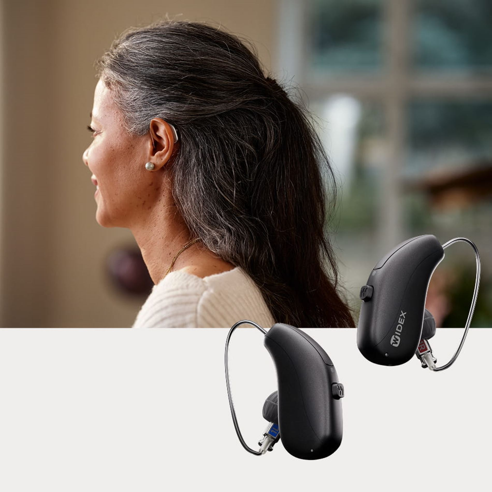
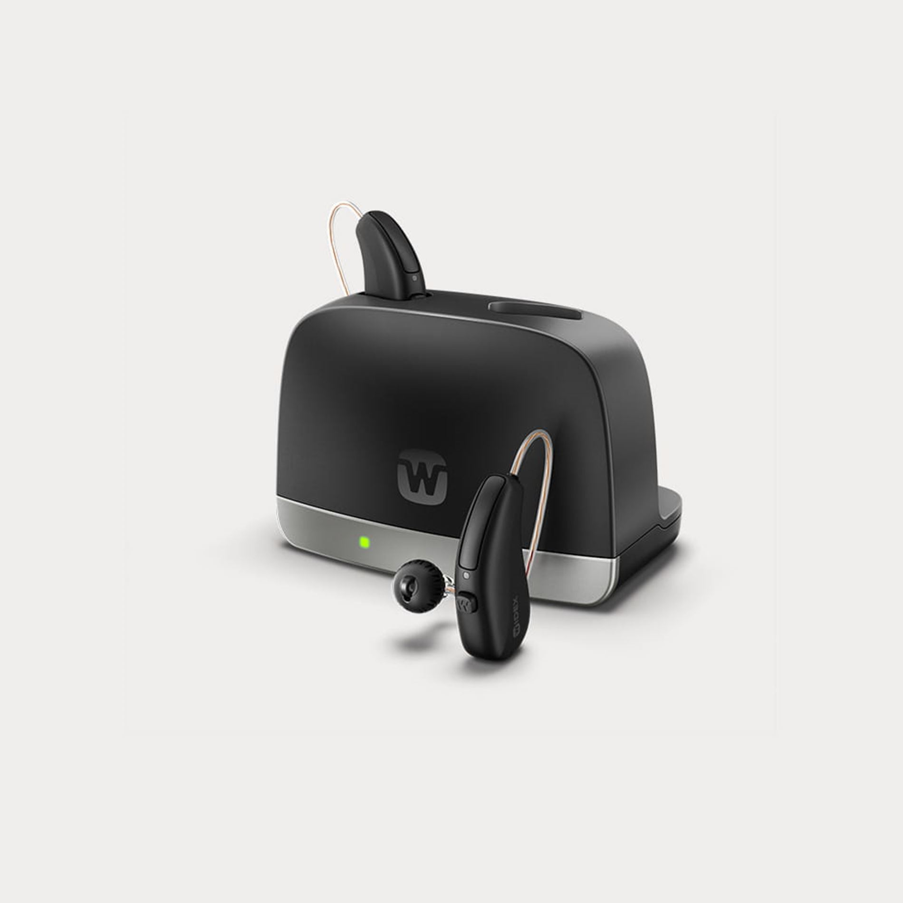
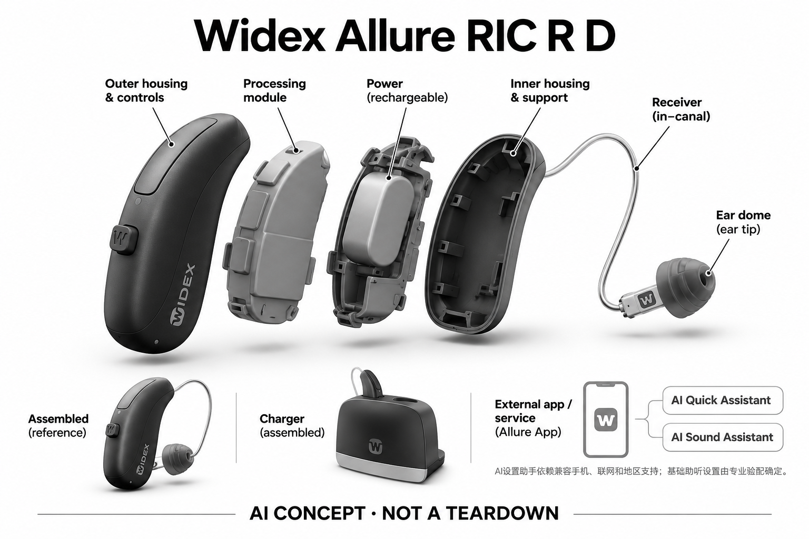

# Widex Allure RIC R D

**Widex** · 助听与听力 · 核查 2026-11-04

AI偏好建议通过App作用于实际助听器设置，区别于只有手动均衡器

消费渠道：个人验配渠道。

## 产品图片与结构参考

### 产品图

Widex Allure RIC R D官方产品外形图 · 来源：[Widex · 官方产品图片](<https://www.widex.com/en-us/hearing-aids/allure/>) · [原始图片](<https://azurecdn.widex.com/-/media/widex/global/images/campaigns/allure/platform/allure-ric-rd.jpg?w=1900&rev=067119bd26f4486e9b4719c70fa8d23b&hash=B99CA7A5030388122A9CDD8E579B4DF6>)

### 参考图

Widex Allure RIC R D官方另一角度或使用场景参考 · 来源：[Widex · 官方产品图片](<https://www.widex.com/en-us/hearing-aids/allure/>) · [原始图片](<https://azurecdn.widex.com/-/media/widex/global/images/campaigns/allure/accessories/widex_allure-standard_charger-ric-r-d_1000x1000.jpg?w=1900&rev=23b3cbc8be7b4ca0a9347bc8d37a92d0&hash=3D1A16EBECEF8B7634F8081ECD37303F>)

### AI 生成爆炸示意

**AI 生成 · 非实物拆机。** 内部为概念推断，不能作为元件布局、BOM 或维修依据。[生成提示词](../../content/hardware/prompts/widex-allure-ric.txt)

> 外形依据核验参考图；内部位置、模块形状与装配关系仅作AI概念展示。

> 已逐张查看并核对型号。源图未改色/裁切；场景、界面、附件、优惠及效果文案仅为厂商示意，不作为本目录性能或现价依据。

> 分析为基于公开资料的案头研究与 AI 辅助判断，未经用户访谈、销量审计或实物拆机。需求、画像、竞争冷门度、审美及商业机会均为研究假设，不是投资结论。

## 销售与购买

- 状态：在售。官方当前消费者产品页持续展示该型号，并提供试用/验配或官方门店渠道。属于个人经专业验配获得的消费设备，saleMode为consumer-fitting；不声明具体门店库存。

- 地区：美国及所列官方区域验配网络（具体型号当地确认）

- 价格：未公布统一零售价；按个人验配方案报价。报价通常受单/双耳、技术档位、定制、服务和地区影响；不以历史媒体价格或其他型号拼凑。

- 中国大陆：品牌可能具有中国渠道，但本次未核实该具体型号、技术档位与AI软件在大陆的上市和支持范围；需由国内授权验配渠道确认。

- [官方产品 / 商店](<https://www.widex.com/en-us/hearing-aids/allure/>)

## AI 的实际作用

配套Allure App的AI Quick Assistant和AI Sound Assistant依据偏好提供声音设置建议，并应用到兼容Allure设备。

服务与联网依赖：AI设置助手依赖兼容手机、联网和地区支持；基础助听设置由专业验配确定。

## 是否冷门

细分专业（研究判断）：听觉辅助属于专业消费用途，已有成熟供应商；此分类不表示蓝海或疗效优越。

## 需求与市场

需求假设：同一环境下不同人对声音有不同偏好，希望在验配后继续做可撤回的个性化调整。真正的使用价值需要在个人真实交流场景中验证，不能从AI名称或厂商演示推定每个人都获得同样改善。

### 官方｜个人偏好参与声音设置 · 官方资料

Allure RIC R D通过配套应用中的AI Quick Assistant和AI Sound Assistant，依据用户偏好提供并应用声音设置建议。需求是在已经专业验配的基础上，继续让实际听音更贴合个人，而不是让助听器回答通用问题；已确认的AI位置在应用辅助流程，不能把更新Allure AI RIC的专属处理能力自动计入本款。

依据：[Widex Widex Allure RIC R D官方产品页](<https://www.widex.com/en-us/hearing-aids/allure/>) · [Widex官方技术或应用说明](<https://www.widex.com/en-us/hearing-aids/apps/allure-app/>)

### 判断｜相同环境不等于相同偏好 · 研究判断

两个人处于相同餐桌环境，可能对声音清晰、柔和或周边信息有不同期待，固定预设不一定表达这些差异。偏好式助手有机会减少用户自己猜参数的负担，但前提是其能理解变化并作选择；本型号价值应看更符合日常使用的设置能否稳定保留，而不是建议多或界面看起来更智能。

依据：[Widex官方技术或应用说明](<https://www.widex.com/en-us/hearing-aids/apps/allure-app/>)

### 验证｜偏好选择是否解决问题 · 待验证

可在用户熟悉且重复发生的场景中记录原始困难、助手建议与调整后的感受，再观察一段时间后是否仍接受同样结果。需要将暂时的新声音偏好和持续交流收益区分开，不能只用第一次选择结束评估；当前目录没有独立用户试验，AI建议是否减轻实际调节负担仍是待验证判断。

依据：[Widex官方消费者验配渠道](<https://www.widex.com/en-us/shop-finder/>) · [Widex官方技术或应用说明](<https://www.widex.com/en-us/hearing-aids/apps/allure-app/>)

## 用户画像

画像推断：经专业评估、愿意借助手机交互表达声音偏好的个人更值得评估。具体是否适配应由听力需求、耳形和操作能力共同决定，本目录不根据年龄、职业或自述症状替人选择医疗产品。

### 判断｜愿意比较声音而不想学参数 · 研究判断

有些用户能说明自己喜欢哪种声音，却不想理解复杂调音参数，可能重视应用辅助的偏好表达。这样的人群并不等同技术爱好者，也不能按年龄推定；若用户难以比较或不愿在交流中看手机，需要不同的支持方式，不能把AI助手作为人人都应高频使用的必需功能。

依据：[Widex官方技术或应用说明](<https://www.widex.com/en-us/hearing-aids/apps/allure-app/>)

### 判断｜希望验配后继续细化的人 · 研究判断

本款适合研究已有基础适配、仍想在特定场景中细化体验的需求，个人声音偏好应与专业参数边界一起考虑。它不能替代对新问题的专业评估，也不能把持续困难简单归为偏好没选好；用户是否愿意记录使用情境和反馈，会影响助手与后续服务能否连贯发挥作用。

依据：[Widex Widex Allure RIC R D官方产品页](<https://www.widex.com/en-us/hearing-aids/allure/>) · [Widex官方消费者验配渠道](<https://www.widex.com/en-us/shop-finder/>) · [Widex官方技术或应用说明](<https://www.widex.com/en-us/hearing-aids/apps/allure-app/>)

### 验证｜本人能够理解和执行 · 待验证

试用可让用户自行连接应用、表达问题、比较建议并说明接受原因，观察是否需要他人代选。兼容手机、网络、地区版本和当地支持应明确记录，不由海外页面推定中国服务；个人交付的设备型号也应核对为基础Allure RIC R D，避免助手体验与更新型号硬件宣传混在一起。

依据：[Widex Widex Allure RIC R D官方产品页](<https://www.widex.com/en-us/hearing-aids/allure/>) · [Widex官方消费者验配渠道](<https://www.widex.com/en-us/shop-finder/>) · [Widex官方技术或应用说明](<https://www.widex.com/en-us/hearing-aids/apps/allure-app/>)

## 竞争与替代

案头判断：AI偏好建议通过App作用于实际助听器设置，区别于只有手动均衡器形成可比较特征，但消费助听已有多个成熟品牌和验配渠道。没有销量审计、用户访谈或疗效对照，专业细分不意味着竞争稀少。

### 判断｜与手动均衡和固定程序比较 · 研究判断

手动均衡器和固定程序要求用户理解哪个操作可能改善当前听感，偏好助手则试图把这种判断转换为更容易表达的选择。它们仍服务同一复杂声场听清任务，比较应看最终设置是否更合适、试错是否更少；不能仅因建议由AI给出就认为必然优于熟悉的手动方案，个人控制感也需要保留。

依据：[Widex官方技术或应用说明](<https://www.widex.com/en-us/hearing-aids/apps/allure-app/>)

### 判断｜与其他App助手同任务比较 · 研究判断

Signia等方案也通过手机辅助调整，真正差异需要放在用户怎样表达偏好、应用建议和获得支持的过程，而不是比较助手名称。不同品牌设备、基础验配与可调范围不应被忽略；若某用户更愿意由专业人员直接调整，应用功能再丰富也未必有额外价值，竞争分析要保留这种替代选择。

依据：[Widex官方消费者验配渠道](<https://www.widex.com/en-us/shop-finder/>) · [Widex官方技术或应用说明](<https://www.widex.com/en-us/hearing-aids/apps/allure-app/>)

### 验证｜基础RIC与新AI型号分开 · 待验证

本条只讨论Allure RIC R D，不能把更新Allure AI RIC专属芯片或Clarity Boost并入竞争功能表。报价、软件和技术配置应对应实际交付版本，再在相同个人场景中比较；当前没有统一零售价、销量及独立效果资料，不能从新旧命名或App能力推导市场地位和个人购买优先级。

依据：[Widex Widex Allure RIC R D官方产品页](<https://www.widex.com/en-us/hearing-aids/allure/>) · [Widex官方消费者验配渠道](<https://www.widex.com/en-us/shop-finder/>) · [Widex官方技术或应用说明](<https://www.widex.com/en-us/hearing-aids/apps/allure-app/>)

## 供应链

官方可核对可充电RIC耳背主体与耳道受话器及相应声音功能；具体麦克风、受话器、电池供应商与整机工厂本次未确认。品牌或法定制造商名称不等于实际装配工厂，也不据此估计BOM与良率。

### 官方｜RIC声音链与应用偏好层 · 官方资料

已知结构为可充电RIC耳背主体及耳道受话器，应用助手将用户偏好转为兼容设备的声音设置建议。声音硬件和联网偏好服务应分别划分，不应把后者视为某颗本机AI芯片的直接证据；本次未确认核心DSP、麦克风、受话器或工厂供应关系，功能示意不能成为本款真实物料结论。

依据：[Widex Widex Allure RIC R D官方产品页](<https://www.widex.com/en-us/hearing-aids/allure/>) · [Widex官方技术或应用说明](<https://www.widex.com/en-us/hearing-aids/apps/allure-app/>)

### 判断｜更换硬件会改变偏好基线 · 研究判断

用户选择的声音依赖现有声学输出和验配参数，若更换处理器、输入或输出器件，原来的偏好建议未必仍有相同意义。供应研究需要把算法、参数、接口和校准一并验证，不能只购买带神经网络能力的芯片；当前没有原厂软件授权或开放接口证据，不推定第三方平台可以延续同样应用体验。

依据：[Widex Widex Allure RIC R D官方产品页](<https://www.widex.com/en-us/hearing-aids/allure/>) · [Widex官方技术或应用说明](<https://www.widex.com/en-us/hearing-aids/apps/allure-app/>)

### 判断｜能力候选不含品牌助手 · 研究判断

onsemi可提供听觉处理平台方向，英飞凌可提供声音输入器件方向，适用于相近RIC产品的重新设计讨论。它们不等于Allure应用的推荐服务，也不是本款已披露供应商；实际选型需验证低延迟、声学、功耗和参数控制，并确认品牌专有部分的边界，不能据公司能力拼成已经可交付的替代整机。

依据：[Widex Widex Allure RIC R D官方产品页](<https://www.widex.com/en-us/hearing-aids/allure/>) · [Widex官方技术或应用说明](<https://www.widex.com/en-us/hearing-aids/apps/allure-app/>)

## 技术路径

配套Allure App的AI Quick Assistant和AI Sound Assistant依据偏好提供声音设置建议，并应用到兼容Allure设备。这是已披露机制；精确模型、内部电路与个体表现未完全公开。普通放大、蓝牙和自动模式本身不单独作为AI收录理由。

### 官方｜以已确认的两种AI助手为限 · 官方资料

本款的收录依据是Allure App中AI Quick Assistant与AI Sound Assistant依据偏好建议设置，并应用于兼容设备。应用能力受手机、网络与地区条件影响，基础声音设置仍需专业验配；目录不补充未公开的模型结构和准确率，也不将新Allure AI RIC的芯片或Clarity Boost名称当作基础RIC R D的技术配置。

依据：[Widex Widex Allure RIC R D官方产品页](<https://www.widex.com/en-us/hearing-aids/allure/>) · [Widex官方技术或应用说明](<https://www.widex.com/en-us/hearing-aids/apps/allure-app/>)

### 判断｜选择过程影响推荐价值 · 研究判断

偏好不是固定不变的答案，用户可能在短时对比中偏好某种声音，却在长时间交流中改变看法。推荐机制的价值需要看是否帮助形成稳定可接受的设置，而不是单次选项被点击；技术研究应记录场景、比较方式和后续使用，避免把模型的推荐信心与个人真实听音收益混为一谈。

依据：[Widex官方技术或应用说明](<https://www.widex.com/en-us/hearing-aids/apps/allure-app/>)

### 验证｜重复场景与不接受建议 · 待验证

可观察同一类环境多次使用助手时，用户是否得到可理解且愿意继续使用的结果，并核对不接受建议后的操作。网络变化、手机更换与应用版本需按实际条件测试，不能从兼容二字推定所有组合稳定；本目录没有进行这些测试，因此只确认功能机制，不对个体调节成功率作保证。

依据：[Widex Widex Allure RIC R D官方产品页](<https://www.widex.com/en-us/hearing-aids/allure/>) · [Widex官方技术或应用说明](<https://www.widex.com/en-us/hearing-aids/apps/allure-app/>)

## 产品审美

图示观察：小型RIC主体和简洁充电器偏重低调家用，App字体和可操作性与外观一样影响接受度。实际耳内尺寸、舒适感和维护便利仍需验配或试戴确认；宣传图不能证明隐形、无负担或适合所有耳形。

### 判断｜耳背形态之外还有偏好界面 · 研究判断

RIC外形和耳道受话器影响日常穿戴，应用界面则承担用户表达声音偏好的任务，两者都属于体验的一部分。用户可能接受耳部设备却不喜欢频繁拿出手机，也可能愿意主动调整；审美评价不应只看外壳轮廓，产品图不能证明佩戴舒适，界面截图也无法说明实际选择是否容易理解。

依据：[Widex Widex Allure RIC R D官方产品页](<https://www.widex.com/en-us/hearing-aids/allure/>) · [Widex官方技术或应用说明](<https://www.widex.com/en-us/hearing-aids/apps/allure-app/>)

### 判断｜建议应让变化可以理解 · 研究判断

对于不愿学习参数的人，界面需要让用户清楚表达偏好并理解设置已经发生什么变化，而非给出过多抽象技术词。设计研究应观察选择时的犹豫、后悔与重复尝试，不能只比较按钮数量；若用户依赖旁人代选，外观简洁也未必形成自主使用，这需要在个人实际操作中检查。

依据：[Widex官方技术或应用说明](<https://www.widex.com/en-us/hearing-aids/apps/allure-app/>)

### 验证｜把调节放回交流时刻 · 待验证

可让用户在日常活动中遇到真实声音困难时再打开助手，记录是否打断对话以及能否在结束后记住所做选择。耳部戴取、充电和手机操作也应由本人演示，分别观察身体与数字负担；桌面演示的流畅不能代表长期体验，设计结论需与具体个人和实际交付版本相对应。

依据：[Widex Widex Allure RIC R D官方产品页](<https://www.widex.com/en-us/hearing-aids/allure/>) · [Widex官方消费者验配渠道](<https://www.widex.com/en-us/shop-finder/>) · [Widex官方技术或应用说明](<https://www.widex.com/en-us/hearing-aids/apps/allure-app/>)

## 关键风险

不能把仅适用于更新Allure AI RIC的Clarity Boost自动归给基础Allure RIC R D；本条仅计已确认AI助手功能。AI设置辅助与噪声处理不能替代专业适配、随访或对异常听力变化的评估，本研究没有诊断、独立实测或疗效结论。

### 判断｜Allure名称导致代际混用 · 研究判断

基础Allure RIC R D和更新Allure AI RIC名字相近，容易把后者专属芯片与Clarity Boost误加到本款。资料和报价必须精确到交付型号，AI助手存在只说明应用层能力，不为未确认硬件作证；如果用户按新型号宣传理解基础款，可能形成无法通过后续设置弥补的功能预期差异。

依据：[Widex Widex Allure RIC R D官方产品页](<https://www.widex.com/en-us/hearing-aids/allure/>) · [Widex官方技术或应用说明](<https://www.widex.com/en-us/hearing-aids/apps/allure-app/>)

### 判断｜个人偏好不等于医学判断 · 研究判断

用户选择更喜欢的声音，不代表所有交流能力已经改善，也不能据助手建议解释听力变化或替代专业评估。反复调整仍不满意时，应把具体问题带入适配服务，不能把责任推给用户不会选择；本目录不提供诊断或疗效结论，只分析公开的设置机制与需要验证的任务价值。

依据：[Widex官方消费者验配渠道](<https://www.widex.com/en-us/shop-finder/>) · [Widex官方技术或应用说明](<https://www.widex.com/en-us/hearing-aids/apps/allure-app/>)

### 验证｜可用性与数据边界 · 待验证

应按具体手机和地区确认助手能否使用，并阅读实际应用对反馈、账户和联网处理的说明，不自行推断完整数据流。软件变化后原有操作是否仍可理解也需要观察，海外介绍不能等同本地长期支持；当前没有隐私审计、实机兼容或长期服务证据，不能将App功能列表写成持续可用保证。

依据：[Widex官方技术或应用说明](<https://www.widex.com/en-us/hearing-aids/apps/allure-app/>)

## 机会与验证

市场差异在于AI偏好建议通过App作用于实际助听器设置，区别于只有手动均衡器。尚待验证的购买理由是其在个人场景中的可感知帮助、操作便利和售后支持，而不是追求更多AI术语或用统一分数替代实际试戴。

### 判断｜把个人听感转为可用反馈 · 研究判断

本款值得研究的是用户能否不学习复杂参数，也把真实听感转为可执行、可评价的调整，减少无目的试错。核心需求仍然是复杂声场中的听清和使用接受，不能把两个AI助手拆成两种新场景；只有实际交流和控制感同时改善，才支持持续使用，而非选择界面被频繁打开就算成功。

依据：[Widex官方技术或应用说明](<https://www.widex.com/en-us/hearing-aids/apps/allure-app/>)

### 判断｜帮助形成清楚的随访问题 · 研究判断

偏好选择若能帮助用户说清哪些环境更合适、哪些仍困难，可能减少复查时只说听不好却难以定位的问题。研究应观察这种反馈是否便于专业人员理解，而不是假定软件已经替代随访；这是现有工具与服务配合的机会，仍需确认实际可提供的信息和用户愿不愿意参与。

依据：[Widex官方消费者验配渠道](<https://www.widex.com/en-us/shop-finder/>) · [Widex官方技术或应用说明](<https://www.widex.com/en-us/hearing-aids/apps/allure-app/>)

### 验证｜持续偏好与维护投入 · 待验证

后续可跟踪用户何时启动助手、何种建议长期保留、何时放弃和转向专业支持，并核算维护、手机及服务投入。还应区分暂时新鲜感与稳定采用，不把改动次数当作价值；本目录没有独立长期研究，不以应用AI、可充电外形或官方在售认定需求、效果和商业优势已被验证。

依据：[Widex Widex Allure RIC R D官方产品页](<https://www.widex.com/en-us/hearing-aids/allure/>) · [Widex官方消费者验配渠道](<https://www.widex.com/en-us/shop-finder/>) · [Widex官方技术或应用说明](<https://www.widex.com/en-us/hearing-aids/apps/allure-app/>)

## 对应供应链公司

能力候选用于选型研究，不代表本产品实际采用；未公开的供货关系不作推断。

- [onsemi](../supply-chain/onsemi.md) — **能力候选 · 非已采用** / RIC基础声音与偏好参数接口重设计候选：本款具有可调声音链路与App偏好建议，onsemi听觉DSP可用于新架构的基础处理比较。平台不提供Allure两种AI助手、原厂验配工具或新Allure AI RIC功能，必须重新建立参数控制、算法及低延迟输出；无本款采用证据，不能直接替换现有品牌平台或借用新代芯片信息。

- [infineon](../supply-chain/infineon.md) — **能力候选 · 非已采用** / 可充电RIC的声音输入麦克风候选：英飞凌MEMS产品可对照RIC声音输入需求，但器件更换会影响声孔、噪声和既有偏好设置的声学基线。需验证灵敏度匹配、接口与实际佩戴，消费声学资料不自动证明助听适用；没有Allure RIC R D点名采用依据，候选也不包含App算法及品牌服务能力。

[浏览供应链目录](../supply-chain.md)

## 功能分层示意

这是功能关系，不是实物拆机、真实空间结构或已核实 BOM。

1. **声音输入**：麦克风采集外界声音；为功能架构，非实际拆机。（分析推断）

2. **个体配置**：专业验配确定与个人听音需求相适应的参数。（官方披露）

3. **AI声音处理**：配套Allure App的AI Quick Assistant和AI Sound Assistant依据偏好提供声音设置建议，并应用到兼容Allure设备。（官方披露）

4. **声音输出**：受话器向耳道输出经处理声音；具体物理布局不公开。（分析推断）

5. **管理与随访**：按具体型号使用兼容应用或专业渠道调整和维护。（官方披露）

## 来源

1. [Widex Widex Allure RIC R D官方产品页](<https://www.widex.com/en-us/hearing-aids/allure/>) — 已打开当前面向消费者的产品介绍及验配/试用入口；没有把医院诊断仪器或B2B订货设备计入。

2. [Widex官方消费者验配渠道](<https://www.widex.com/en-us/shop-finder/>) — 已打开官方验配/门店定位渠道，消费者经专业验配购买；不代表每家门店现货或统一价格。

3. [Widex官方技术或应用说明](<https://www.widex.com/en-us/hearing-aids/apps/allure-app/>) — 已打开，用于确认AI机制和兼容边界；厂商性能宣传不作为独立疗效证据。

[返回目录](../hardware-market.md) · [网页分析](https://romanagent.github.io/Roman/#hardware/product/widex-allure-ric)
