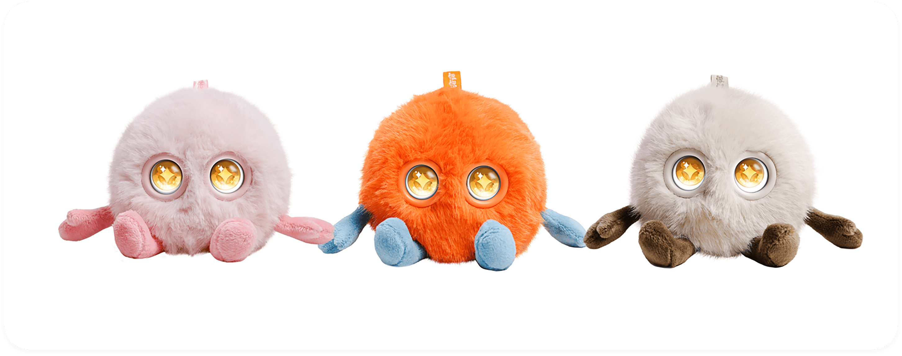
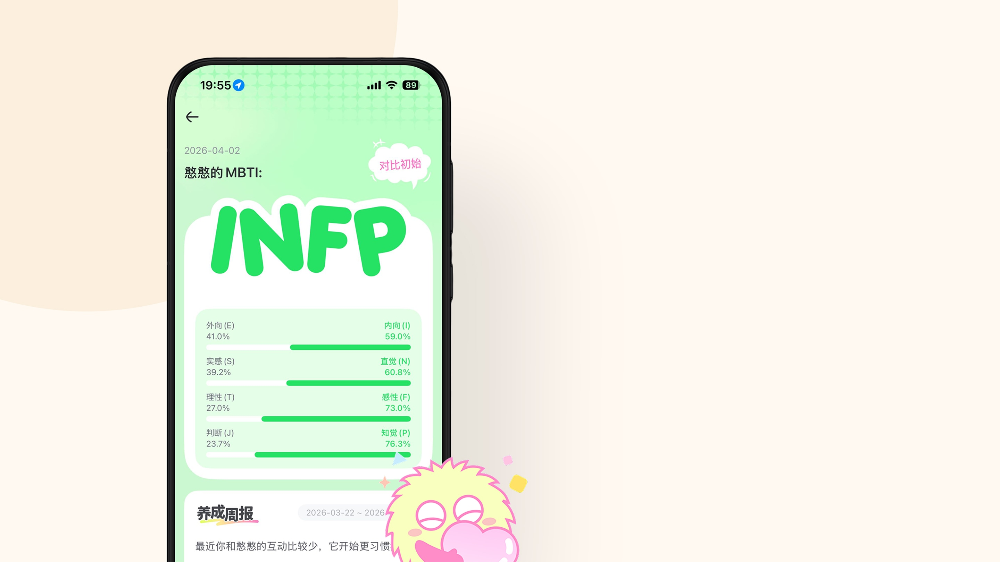
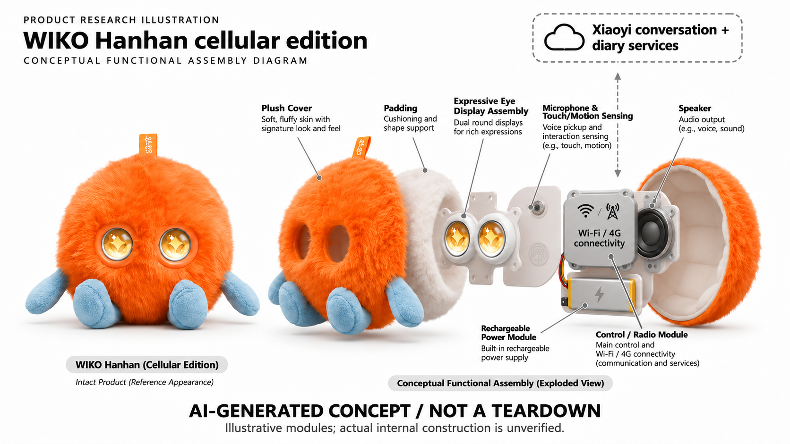

# WIKO 智能憨憨蜂窝版 FZ1012

**WIKO / Fuzozo** · AI玩具 · 核查 2026-11-06

以小艺对话和4G联网，让毛绒电子宠物随身回应。

消费渠道：个人零售。

## 产品图片与结构参考

### 产品图

WIKO智能憨憨蜂窝版官方同系列配色展示（不分开计数） · 来源：[WIKO · 官方图片](<https://www.wiko.com/ai_toys/hanhan>) · [原始图片](<https://www.wiko.com/template/cn/zipFile/hanhan/img/sec3/s3-color.png>)

### 参考图

WIKO智能憨憨蜂窝版官方交互或应用参考图 · 来源：[WIKO · 官方图片](<https://www.wiko.com/ai_toys/hanhan>) · [原始图片](<https://www.wiko.com/template/cn/zipFile/hanhan/img/sec3/s3-3.jpg>)

### AI 生成爆炸示意

**AI 生成 · 非实物拆机。** 内部为概念推断，不能作为元件布局、BOM 或维修依据。[生成提示词](../../content/hardware/prompts/wiko-hanhan-cellular.txt)

> 逐款生成并核验后针对指示线或磁吸说明修正；初稿仅作编辑输入留存，不进入展示图库。

> 官方原图保留原始内容，配色与配饰不另计型号；应用截图不代表独立实测。

> 分析为基于公开资料的案头研究与 AI 辅助判断，未经用户访谈、销量审计或实物拆机。需求、画像、竞争冷门度、审美及商业机会均为研究假设，不是投资结论。

## 销售与购买

- 状态：在售。WIKO官网指向的官方旗舰店橙色蜂窝版可加购、立即购买及配送；另一自营旧链接已下架，未用旧页面证明在售。

- 地区：中国大陆

- 价格：人民币499元参考。核查时橙色有促销价469元，优惠与库存因时间和收货地区变化；赠送权益及后续4G费用以官方订单说明为准。

- 中国大陆：WIKO中国官网直接链接京东官方旗舰店，Chrome确认橙色蜂窝版可购买；其他配色当时缺货，不保证所有地区实时库存。

- [官方产品 / 商店](<https://www.wiko.com/ai_toys/hanhan>)

## AI 的实际作用

华为小艺大模型支持自然语音对话，产品结合触摸、摇晃反馈、表情和互动记录呈现角色性格与日记。MBTI是角色养成表达，不当成对用户人格的科学测量或心理疗效。

服务与联网依赖：需互联网，支持Wi-Fi及4G，官网提示移动网络可能收费；适配鸿蒙、Android10以上和iOS15以上，购机赠5个月SVIP，后续服务按实际权益确认。

## 是否冷门

新兴竞争（研究判断）：国内生态整合有差异，但对话毛绒竞争增加，需验证蜂窝场景与续费价值。

## 需求与市场

憨憨蜂窝版把小艺语音对话、触摸反馈和角色日记放入可随身携带的毛绒电子宠物，需求更接近日常娱乐陪伴。相较仅在家联网的设备，移动网络可能让公园和通勤间隙也能交谈，但真实价值仍取决于这些时刻是否有主动使用，而不是把能联网直接等同长期需要。

### 核心任务 · 研究判断

憨憨蜂窝版把小艺语音对话、触摸反馈和角色日记放入可随身携带的毛绒电子宠物，需求更接近日常娱乐陪伴。相较仅在家联网的设备，移动网络可能让公园和通勤间隙也能交谈，但真实价值仍取决于这些时刻是否有主动使用，而不是把能联网直接等同长期需要。

依据：[WIKO智能憨憨蜂窝版官方介绍](<https://www.wiko.com/ai_toys/hanhan>) · [WIKO官方旗舰店憨憨蜂窝版](<https://item.jd.com/10217586998181.html>)

### 场景限制 · 研究判断

户外使用会遇到噪声、隐私和他人围观，用户未必愿意随时公开自己的问题。固定角色的回应可能让短对话更有趣，也可能只是把手机助手换了外壳；需求研究应区分装饰、触摸安抚和真正的语音交流，不能把被挂在包上的时间当成有效使用时长。

依据：[WIKO智能憨憨蜂窝版官方介绍](<https://www.wiko.com/ai_toys/hanhan>) · [WIKO官方旗舰店憨憨蜂窝版](<https://item.jd.com/10217586998181.html>)

### 需求验证 · 待验证

可比较同一使用者在室内无线网络与户外蜂窝网络下的主动对话，记录是否因为无需手机热点而增加了具体用途。同步记录中断、误唤醒和公共场合的静音选择，区分携带习惯与对话需求；这些是后续建议的验证方式，本轮没有用户访谈或样机测试。

依据：[WIKO智能憨憨蜂窝版官方介绍](<https://www.wiko.com/ai_toys/hanhan>) · [WIKO官方旗舰店憨憨蜂窝版](<https://item.jd.com/10217586998181.html>)

## 用户画像

适用者可能喜欢毛绒潮玩、愿意通过中文短对话维持角色互动，并有兼容手机完成账户与联网设置。官网列鸿蒙、安卓和苹果系统支持，因此不能把蜂窝版简单描述成只能由某一华为手机使用；实际应用版本、账号与服务资格仍需在购买前按官方要求确认。

### 画像判断 · 研究判断

适用者可能喜欢毛绒潮玩、愿意通过中文短对话维持角色互动，并有兼容手机完成账户与联网设置。官网列鸿蒙、安卓和苹果系统支持，因此不能把蜂窝版简单描述成只能由某一华为手机使用；实际应用版本、账号与服务资格仍需在购买前按官方要求确认。

依据：[WIKO智能憨憨蜂窝版官方介绍](<https://www.wiko.com/ai_toys/hanhan>) · [WIKO官方旗舰店憨憨蜂窝版](<https://item.jd.com/10217586998181.html>)

### 照护与付款 · 研究判断

为孩子或亲友购买时，送礼者往往关注角色外观，接收者却要承担充电、清洁和赠送权益到期后的管理。用户画像应包含谁负责付费和处理网络故障，而不只按喜欢可爱动物的人划分；需要成人协助的使用者也不应独自承担对话内容与数据设置的判断。

依据：[WIKO智能憨憨蜂窝版官方介绍](<https://www.wiko.com/ai_toys/hanhan>) · [WIKO官方旗舰店憨憨蜂窝版](<https://item.jd.com/10217586998181.html>)

### 画像验证 · 待验证

建议分别观察成人自用、家庭共同使用和赠礼后的设置过程，记录能否找到移动网络费用与日记权限说明。让使用者解释它能记住什么、什么时候需要真人帮助，如果这些边界难以理解，就应调整目标人群和交互，而不是只凭品牌熟悉度扩大推荐范围。

依据：[WIKO智能憨憨蜂窝版官方介绍](<https://www.wiko.com/ai_toys/hanhan>) · [WIKO官方旗舰店憨憨蜂窝版](<https://item.jd.com/10217586998181.html>)

## 竞争与替代

憨憨与Fuzozo英语版、普通毛绒和手机小艺都有部分重叠，差异集中于国内生态、独立移动网络和具体权益。不能把海外Fuzozo的十五岁门槛、免费每日额度或英文能力直接套到憨憨，也不能因为外形相近就假定账号互通；这是一组需要按版本比较的陪伴方案。

### 比较对象 · 研究判断

憨憨与Fuzozo英语版、普通毛绒和手机小艺都有部分重叠，差异集中于国内生态、独立移动网络和具体权益。不能把海外Fuzozo的十五岁门槛、免费每日额度或英文能力直接套到憨憨，也不能因为外形相近就假定账号互通；这是一组需要按版本比较的陪伴方案。

依据：[WIKO智能憨憨蜂窝版官方介绍](<https://www.wiko.com/ai_toys/hanhan>) · [WIKO官方旗舰店憨憨蜂窝版](<https://item.jd.com/10217586998181.html>)

### 相邻产品 · 研究判断

WIKO星仔增加循声转头和磁吸挂包，憨憨则以小圆毛球和软肢体为主，不应为它添加没有证据的机械运动。原有Wi-Fi版和不同配色也不是新的核心需求，目录优先保留当前可购蜂窝版，并在分析中明确不同网络与交互机制，避免型号数量冒充品类数量。

依据：[WIKO智能憨憨蜂窝版官方介绍](<https://www.wiko.com/ai_toys/hanhan>) · [WIKO官方旗舰店憨憨蜂窝版](<https://item.jd.com/10217586998181.html>)

### 对比验证 · 待验证

可以用同一组中文闲聊和跨天回忆任务比较憨憨、手机助手和其他毛绒，记录携带、网络、等待和信息纠正成本。若用户主要需要通用问答，手机可能已经足够；若仅需要装饰，普通玩偶也可能更合适，不以小艺品牌或赠送会员期限替代真实体验。

依据：[WIKO智能憨憨蜂窝版官方介绍](<https://www.wiko.com/ai_toys/hanhan>) · [WIKO官方旗舰店憨憨蜂窝版](<https://item.jd.com/10217586998181.html>)

## 供应链

公开信息可以拆为毛绒外形、眼睛显示、语音与触摸摇晃输入、无线联网和充电供电，以及机外的角色服务。FZ1012没有公开主板、传感器型号和电池安装图，不能根据海外相似毛球拆机推断内部完全相同；概念图中的位置和连接仅表示功能关系。

### 功能拆分 · 研究判断

公开信息可以拆为毛绒外形、眼睛显示、语音与触摸摇晃输入、无线联网和充电供电，以及机外的角色服务。FZ1012没有公开主板、传感器型号和电池安装图，不能根据海外相似毛球拆机推断内部完全相同；概念图中的位置和连接仅表示功能关系。

依据：[WIKO智能憨憨蜂窝版官方介绍](<https://www.wiko.com/ai_toys/hanhan>) · [WIKO官方旗舰店憨憨蜂窝版](<https://item.jd.com/10217586998181.html>)

### 制造约束 · 研究判断

软肢体与毛绒会被拉扯，眼睛窗口容易与包内物件摩擦，蜂窝与无线天线又需要避开不利遮挡。清洁说明明确不能水洗，因此外壳耐污、接口防护和售后处理都影响交付；目前没有完整采购价格和工厂信息，不应用零件零售价反推本机成本或利润。

依据：[WIKO智能憨憨蜂窝版官方介绍](<https://www.wiko.com/ai_toys/hanhan>) · [WIKO官方旗舰店憨憨蜂窝版](<https://item.jd.com/10217586998181.html>)

### 能力候选 · 研究判断

歌尔的声学与精密结构整合可作为重新开发同类产品的工程候选，Seeed可支持早期交互和联网原型。两家公司均没有FZ1012采用证据，毛绒工艺、眼睛窗口与移动服务还需分别确认；供应链链接用于提出验证问题，不代表品牌已选择它们生产这款玩具。

依据：[WIKO智能憨憨蜂窝版官方介绍](<https://www.wiko.com/ai_toys/hanhan>) · [WIKO官方旗舰店憨憨蜂窝版](<https://item.jd.com/10217586998181.html>)

## 技术路径

官网明确小艺大模型支持自然对话，互动记录用于角色性格与日记，摸头和摇晃则通过输入与反馈增强参与感。大模型参与语言不等于所有动作都由模型决策，MBTI标签也只是角色表达；本轮不推断模型规模、端侧算力或情绪识别准确率，避免把营销拟人化当作实证。

### AI边界 · 研究判断

官网明确小艺大模型支持自然对话，互动记录用于角色性格与日记，摸头和摇晃则通过输入与反馈增强参与感。大模型参与语言不等于所有动作都由模型决策，MBTI标签也只是角色表达；本轮不推断模型规模、端侧算力或情绪识别准确率，避免把营销拟人化当作实证。

依据：[WIKO智能憨憨蜂窝版官方介绍](<https://www.wiko.com/ai_toys/hanhan>) · [WIKO官方旗舰店憨憨蜂窝版](<https://item.jd.com/10217586998181.html>)

### 系统难点 · 研究判断

随身毛绒会在口袋、包边和手掌中改变拾音方向，蜂窝网络又带来等待和续费状态，需要让用户知道是没听清、网络断开还是无法回答。日记记忆若把误识别保存下来，会影响以后互动，因此纠错与遗忘流程比单次回答是否流畅更值得检查。

依据：[WIKO智能憨憨蜂窝版官方介绍](<https://www.wiko.com/ai_toys/hanhan>) · [WIKO官方旗舰店憨憨蜂窝版](<https://item.jd.com/10217586998181.html>)

### 技术验证 · 待验证

可以用方言、低声、背景音乐和切换网络测试唤醒与回答，并核对官网提醒的墙角和高低位置影响。再用虚构日常信息测试日记与更正，不提交真实敏感内容；对话成功和触摸反应需要分别记录，不能把眼睛亮起就认为模型已经理解用户意图。

依据：[WIKO智能憨憨蜂窝版官方介绍](<https://www.wiko.com/ai_toys/hanhan>) · [WIKO官方旗舰店憨憨蜂窝版](<https://item.jd.com/10217586998181.html>)

## 产品审美

橙色毛球搭配蓝色软手脚形成鲜明的卡通形象，两只表情眼睛比普通毛绒更容易引发回应期待。它既可以放在桌面，也可作为随身配饰，但实际毛绒清洁和充电会打断装饰状态；评价应同时考虑携带舒适和操作清晰，不能只看官方三配色合影。

### 审美判断 · 研究判断

橙色毛球搭配蓝色软手脚形成鲜明的卡通形象，两只表情眼睛比普通毛绒更容易引发回应期待。它既可以放在桌面，也可作为随身配饰，但实际毛绒清洁和充电会打断装饰状态；评价应同时考虑携带舒适和操作清晰，不能只看官方三配色合影。

依据：[WIKO智能憨憨蜂窝版官方介绍](<https://www.wiko.com/ai_toys/hanhan>) · [WIKO官方旗舰店憨憨蜂窝版](<https://item.jd.com/10217586998181.html>)

### 反馈可读性 · 研究判断

角色的眼睛和震动需要承担唤醒、思考和失败状态表达，否则用户容易把所有反应都理解为听懂。配饰虽能改变造型，也可能遮挡拾音与触摸区域，官网又明确部分配饰另购，因此视觉表现必须与真实包装内容和硬件可操作性一起解释。

依据：[WIKO智能憨憨蜂窝版官方介绍](<https://www.wiko.com/ai_toys/hanhan>) · [WIKO官方旗舰店憨憨蜂窝版](<https://item.jd.com/10217586998181.html>)

### 外观验证 · 待验证

建议让使用者连续携带并记录毛绒打结、软肢体拉扯和眼睛窗口磨损，检查充电时是否需要拆掉常用配饰。按照官方湿布轻擦方式观察清洁后的触感和外观，避免为了图上好看采用不被允许的水洗方式，也不把短期拍照热度当成持久满意。

依据：[WIKO智能憨憨蜂窝版官方介绍](<https://www.wiko.com/ai_toys/hanhan>) · [WIKO官方旗舰店憨憨蜂窝版](<https://item.jd.com/10217586998181.html>)

## 关键风险

赠送五个月SVIP不意味着长期免费聊天，官网对移动网络收费也保留具体咨询要求。消费者应区分硬件所有权、网络流量和模型服务权益，不把一条促销标题当作永久承诺；不同颜色库存可能不同，本轮只确认橙色商品可购，没有保证所有配色和所有地区都能立即交付。

### 服务风险 · 研究判断

赠送五个月SVIP不意味着长期免费聊天，官网对移动网络收费也保留具体咨询要求。消费者应区分硬件所有权、网络流量和模型服务权益，不把一条促销标题当作永久承诺；不同颜色库存可能不同，本轮只确认橙色商品可购，没有保证所有配色和所有地区都能立即交付。

依据：[WIKO智能憨憨蜂窝版官方介绍](<https://www.wiko.com/ai_toys/hanhan>) · [WIKO官方旗舰店憨憨蜂窝版](<https://item.jd.com/10217586998181.html>)

### 内容与维护 · 研究判断

对话和日记会涉及用户的个人表达，角色记住内容并不等于可以准确理解所有情绪。毛绒外观也容易让人忽略电子部件不能水洗，因此账户管理、内容监督与清洁都需要明确责任；本目录只列公开功能与风险假设，不提供心理疗效或隐私合规保证。

依据：[WIKO智能憨憨蜂窝版官方介绍](<https://www.wiko.com/ai_toys/hanhan>) · [WIKO官方旗舰店憨憨蜂窝版](<https://item.jd.com/10217586998181.html>)

### 风险验证 · 待验证

建议确认赠送权益结束后的行为、移动网络续费提示、账户解绑和日记删除流程，并由成人先检查含糊或不适合的问题。观察网络失败时是否产生误导性表情，以及设备是否容易彻底停止工作；本轮没有进行实物安全测试，不能把这些步骤写成已验证能力。

依据：[WIKO智能憨憨蜂窝版官方介绍](<https://www.wiko.com/ai_toys/hanhan>) · [WIKO官方旗舰店憨憨蜂窝版](<https://item.jd.com/10217586998181.html>)

## 机会与验证

国内语言、常用手机生态与蜂窝网络结合，可能减少用户把普通AI玩具带出门的配置负担。机会应落在可重复的短互动和易管理的服务，而不是仅凭大模型品牌与可爱外形；如果用户只在固定桌面使用，蜂窝带来的长期费用未必能形成额外价值。

### 机会判断 · 研究判断

国内语言、常用手机生态与蜂窝网络结合，可能减少用户把普通AI玩具带出门的配置负担。机会应落在可重复的短互动和易管理的服务，而不是仅凭大模型品牌与可爱外形；如果用户只在固定桌面使用，蜂窝带来的长期费用未必能形成额外价值。

依据：[WIKO智能憨憨蜂窝版官方介绍](<https://www.wiko.com/ai_toys/hanhan>) · [WIKO官方旗舰店憨憨蜂窝版](<https://item.jd.com/10217586998181.html>)

### 改进方向 · 研究判断

更清楚的网络与会员剩余状态、可纠正的日记以及容易解绑转赠的流程，可能比增加更多外壳更有意义。这里是基于当前公开边界提出的产品假设，不代表憨憨已经实现全部设计，也不能从品牌联名推导高留存、订阅利润或未经披露的销售规模。

依据：[WIKO智能憨憨蜂窝版官方介绍](<https://www.wiko.com/ai_toys/hanhan>) · [WIKO官方旗舰店憨憨蜂窝版](<https://item.jd.com/10217586998181.html>)

### 商业验证 · 待验证

可通过不同使用频率的付费试用比较硬件支出、移动流量与模型服务的整体接受度，特别记录赠送权益结束后的继续使用意愿。将闲置、返修和不愿在公共场合说话也纳入评估，确认真实需求后再扩展角色，而不是把每种颜色当作新的市场机会。

依据：[WIKO智能憨憨蜂窝版官方介绍](<https://www.wiko.com/ai_toys/hanhan>) · [WIKO官方旗舰店憨憨蜂窝版](<https://item.jd.com/10217586998181.html>)

## 对应供应链公司

能力候选用于选型研究，不代表本产品实际采用；未公开的供货关系不作推断。

- [goertek](../supply-chain/goertek.md) — **能力候选 · 非已采用** / 随身毛绒电子宠物整机整合：公开声学、结构和智能硬件整合能力可作为憨憨同类方案的工程候选，但没有本型号采用证据；需另核毛绒固定、触摸识别、无线遮挡与量产检测，不能据公司规模推定其已供货。

- [seeed-studio](../supply-chain/seeed-studio.md) — **能力候选 · 非已采用** / 语音触摸与联网原型：Seeed公开原型工程与感知模组能力有助于验证语音触摸交互，但憨憨现有硬件来源未公开；移动网络服务、显示窗口及量产质量责任需要专项确认，此关联仅是重新开发的候选入口。

[浏览供应链目录](../supply-chain.md)

## 功能分层示意

这是功能关系，不是实物拆机、真实空间结构或已核实 BOM。

1. **毛绒角色**：小圆毛绒、静态软肢体与双眼表情，配饰另购。（官方披露）

2. **交互输入**：语音、摸头和摇晃可触发互动，传感器位置未知。（官方披露）

3. **反馈呈现**：眼睛表情、语音与震动反馈构成角色回应。（官方披露）

4. **无线与供电**：Wi-Fi/4G联网和内置充电供电，硬件布局不公开。（官方披露）

5. **外部小艺服务**：对话与角色日记通过联网生态提供，不代表模型在机内。（分析推断）

## 来源

1. [WIKO智能憨憨蜂窝版官方介绍](<https://www.wiko.com/ai_toys/hanhan>) — 实际打开FZ1012参数、Wi-Fi/4G、小艺、触摸、性格和日记功能及官方购买跳转。

2. [WIKO官方旗舰店憨憨蜂窝版](<https://item.jd.com/10217586998181.html>) — Chrome实际读取精确商品标题、WIKO官方旗舰店、橙色可加入购物车和立即购买；其他配色缺货，未购买。

3. [WIKO官网指向的另一自营入口](<https://item.jd.com/100258611861.html>) — Chrome实际显示商品已下架，仅用于说明官网购买链接状态不一致，不作为现售证据。

[返回目录](../hardware-market.md) · [网页分析](https://romanagent.github.io/Roman/#hardware/product/wiko-hanhan-cellular)
