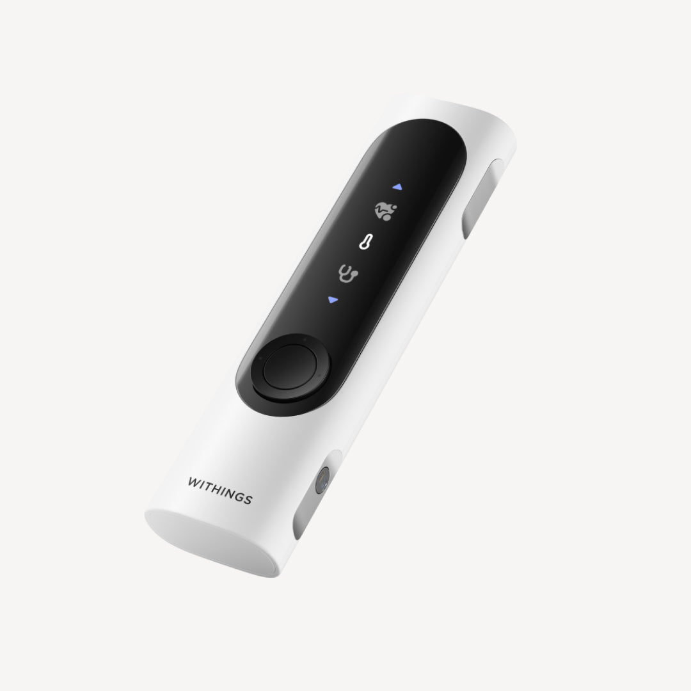
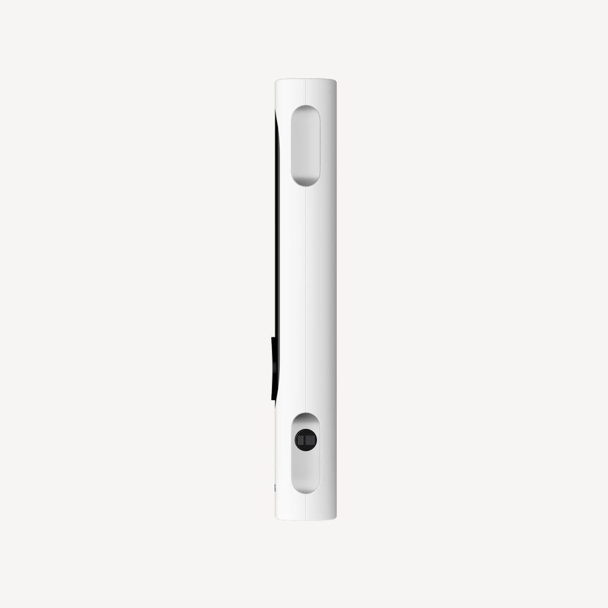
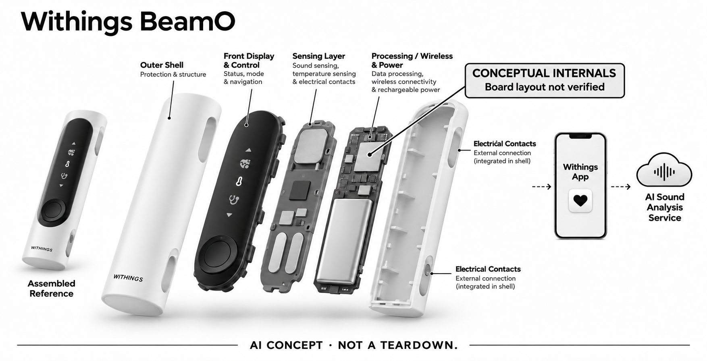

# Withings BeamO（StethO Sense方案）

**Withings** · 居家健康 · 核查 2026-11-05

把家中采集的心肺声音交给配套AI服务分析

消费渠道：个人零售。

## 产品图片与结构参考

### 产品图

BeamO官方三分之四角度外形与前面板 · 来源：[Withings · 官方产品图片](<https://www.withings.com/en-us/products/beam-o>) · [原始图片](<https://cdn.shopify.com/s/files/1/0978/0169/9702/files/PACKSHOT_beam-o__71020931_INT_three-quarter-close-up_01.jpg?v=1781094532&width=1200>)

### 参考图

BeamO官方侧面接触区域参考 · 来源：[Withings · 官方产品图片](<https://www.withings.com/en-us/products/beam-o>) · [原始图片](<https://cdn.shopify.com/s/files/1/0978/0169/9702/files/PACKSHOT_beam-o__71020931_INT_side-close-up_01.jpg?v=1781094532&width=1200>)

### AI 生成爆炸示意

**AI 生成 · 非实物拆机。** 内部为概念推断，不能作为元件布局、BOM 或维修依据。[生成提示词](../../content/hardware/prompts/withings-beamo.txt)

> 已检查外形、标签与灰阶；分离模块是概念功能架构，非真实内部布局、完整BOM或性能证明。

> 初稿少量蓝色显示/接口已用内置ImageGen改为中性灰阶；初稿与完整修订提示词保留。

> 独立复查后以ImageGen强化局部概念标识，未知控制板或执行层明确为示意；复查前图保留在referencePaths，实际追加提示词记录于主prompt。

> 逐张实际查看确认型号与代次，保留官方源图；图片与界面中的营销内容不作为独立实测或效果保证。

> 分析为基于公开资料的案头研究与 AI 辅助判断，未经用户访谈、销量审计或实物拆机。需求、画像、竞争冷门度、审美及商业机会均为研究假设，不是投资结论。

## 销售与购买

- 状态：在售。当前美国官方BeamO商品可售，公开product.js available=true、US$249.95；官方支持页已说明2026年10月推出的StethO Sense与具体设备、订阅及区域条件。

- 地区：美国：本条价格和主要功能口径、欧盟及欧洲经济区：另有不同AI功能范围

- 价格：US$249.95（美国官网硬件）。StethO Sense需要有效Withings+订阅，地区服务和版本要求另核；不借欧洲血氧/房颤功能描述美国版。

- 中国大陆：未核到中国大陆正式销售及StethO Sense可用性；当前AI资格清单不含大陆，不把进口硬件等同全部服务可用。

- [官方产品 / 商店](<https://www.withings.com/en-us/products/beam-o>)

## AI 的实际作用

StethO Sense通过eMurmur和StethoMe分析上传的心肺声音；美国肺部输出为一般健康Breathing Index，欧洲有不同范围。

服务与联网依赖：需要BeamO、Withings+、兼容App/固件及支持地区；分析把录音送往第三方处理，并需授权，非设备离线诊断。

## 是否冷门

细分专业（研究判断）：将家庭身体声音记录与算法解释连接，区别于心电片段和呼气代谢信息；本条为案头研究，没有临床复核、访谈或销量结论。

## 需求与市场

需求假设是家庭成员希望在日常时点保留身体声音信息，随后更有条理地与合适的专业人员讨论。它与仅描述某次感受不同，但录到声音不等于录得可分析，分析结果也不等于病因；研究价值在信息采集和交流过程，不应转化为自行判断疾病的承诺。

### 官方｜声音记录与AI解释接在一起 · 官方资料

BeamO是一款面向家用的多功能电子设备，所收录的AI依据是Withings App内的StethO Sense声音分析服务。用户先采集心肺录音，服务再通过专门平台处理；不是所有测量都由同一个模型完成，也不是因为设备能联网就自动具有诊断能力，基本硬件与订阅功能必须分开理解。

依据：[BeamO美国当前官方商品](<https://www.withings.com/en-us/products/beam-o>) · [StethO Sense美国功能与条件](<https://support.withings.com/hc/en-us/articles/50669655217169-BeamO-StethO-Sense-AI-US-Only>)

### 判断｜记录实际声音补充回忆描述 · 研究判断

需求假设是家庭成员希望在日常时点保留身体声音信息，随后更有条理地与合适的专业人员讨论。它与仅描述某次感受不同，但录到声音不等于录得可分析，分析结果也不等于病因；研究价值在信息采集和交流过程，不应转化为自行判断疾病的承诺。

依据：[BeamO美国当前官方商品](<https://www.withings.com/en-us/products/beam-o>) · [StethO Sense美国功能与条件](<https://support.withings.com/hc/en-us/articles/50669655217169-BeamO-StethO-Sense-AI-US-Only>)

### 验证｜先观察采集质量与结果理解 · 待验证

可在遵循设备说明的前提下核对使用者能否选择正确档案、完成录音并理解质量不足提示，记录需要帮助的步骤。应把采集失败、同步失败和解释困难分开，而非只展示一个结果页面；本目录没有临床复核或效果试验，不能据输出文字评价个人健康状态。

依据：[StethO Sense美国功能与条件](<https://support.withings.com/hc/en-us/articles/50669655217169-BeamO-StethO-Sense-AI-US-Only>) · [BeamO官方非美国版产品指南](<https://support.withings.com/hc/article_attachments/36113546494865>)

## 用户画像

这类工具要求用户理解一次记录的限制，并愿意在质量不足时重新获取合适数据，而不只是寻找快速结论。家庭成员共用时，档案选择和协助关系也影响可用性；是否适合本人需要结合实际条件，不应由健康焦虑或厂家的便利性宣传代替理性评估。

### 官方｜家用定位与地区条件并存 · 官方资料

当前商品面向家庭个人购买，AI分析还要求有效订阅、相应App和固件版本，以及支持地区。不同测量的人群条件也不完全一致，不能把体温可由成人帮助儿童测量的范围推广到全部功能；目录没有采用专业版或医疗机构工作流来替代本款家用设备的可用证据。

依据：[BeamO美国当前官方商品](<https://www.withings.com/en-us/products/beam-o>) · [StethO Sense美国功能与条件](<https://support.withings.com/hc/en-us/articles/50669655217169-BeamO-StethO-Sense-AI-US-Only>) · [StethO Sense欧洲及其他地区资格](<https://support.withings.com/hc/en-us/articles/50400733585041-BeamO-StethO-Sense-AI-EU-and-RoW>)

### 判断｜愿意完成规范采集的人更有研究价值 · 研究判断

这类工具要求用户理解一次记录的限制，并愿意在质量不足时重新获取合适数据，而不只是寻找快速结论。家庭成员共用时，档案选择和协助关系也影响可用性；是否适合本人需要结合实际条件，不应由健康焦虑或厂家的便利性宣传代替理性评估。

依据：[StethO Sense美国功能与条件](<https://support.withings.com/hc/en-us/articles/50669655217169-BeamO-StethO-Sense-AI-US-Only>) · [BeamO官方非美国版产品指南](<https://support.withings.com/hc/article_attachments/36113546494865>)

### 验证｜按家庭成员确认功能和支持 · 待验证

可以在购买前逐项核实计划使用的测量、地区、年龄及软件条件，并确认谁负责档案管理、清洁和服务更新。把设备费用与订阅权益分开列出，避免购买后才发现目标功能未开放；本研究没有个人医疗建议，也没有把支持页面的一般说明转成对特定人的适用保证。

依据：[StethO Sense美国功能与条件](<https://support.withings.com/hc/en-us/articles/50669655217169-BeamO-StethO-Sense-AI-US-Only>) · [StethO Sense欧洲及其他地区资格](<https://support.withings.com/hc/en-us/articles/50400733585041-BeamO-StethO-Sense-AI-EU-and-RoW>) · [BeamO官方非美国版产品指南](<https://support.withings.com/hc/article_attachments/36113546494865>)

## 竞争与替代

与Kardia心电片段相比，BeamO在这里关注身体声音；与仅保存录音的电子听诊器相比，它增加选配算法分析和历史查看。多种测量合在一机并不意味着每一种都更适合用户，比较应围绕具体信息任务、质量提示和地区服务，而不是以功能数量推定更完整健康保障。

### 官方｜美国版不能借用欧洲完整功能 · 官方资料

当前地区表显示美国BeamO尚未开放血氧和房颤检测，欧洲及英国有不同口径。声音服务也有差异：美国肺部输出定位为一般健康追踪，欧洲说明列出不同的异常声音分析范围；本条保留这些区别，不把海外报道或同一外壳照片拼成全球统一的功能列表。

依据：[StethO Sense美国功能与条件](<https://support.withings.com/hc/en-us/articles/50669655217169-BeamO-StethO-Sense-AI-US-Only>) · [StethO Sense欧洲及其他地区资格](<https://support.withings.com/hc/en-us/articles/50400733585041-BeamO-StethO-Sense-AI-EU-and-RoW>) · [BeamO官方地区功能表](<https://support.withings.com/hc/en-us/articles/28094120714129-BeamO-Feature-Availability>)

### 判断｜与心电和普通听诊录音工具分工不同 · 研究判断

与Kardia心电片段相比，BeamO在这里关注身体声音；与仅保存录音的电子听诊器相比，它增加选配算法分析和历史查看。多种测量合在一机并不意味着每一种都更适合用户，比较应围绕具体信息任务、质量提示和地区服务，而不是以功能数量推定更完整健康保障。

依据：[BeamO美国当前官方商品](<https://www.withings.com/en-us/products/beam-o>) · [StethO Sense美国功能与条件](<https://support.withings.com/hc/en-us/articles/50669655217169-BeamO-StethO-Sense-AI-US-Only>)

### 验证｜比较包含解释服务的总流程 · 待验证

可用相同的信息记录需求比较原有工具与BeamO，核对采集、同步、查看、导出及讨论所需步骤。费用应包含订阅和必要手机，不能用一次硬件价格暗示永久拥有全部服务；本目录没有访谈、销量或市场份额，不能判断家庭对声音分析的真实采用规模。

依据：[BeamO美国当前官方商品](<https://www.withings.com/en-us/products/beam-o>) · [StethO Sense美国功能与条件](<https://support.withings.com/hc/en-us/articles/50669655217169-BeamO-StethO-Sense-AI-US-Only>) · [BeamO官方地区功能表](<https://support.withings.com/hc/en-us/articles/28094120714129-BeamO-Feature-Availability>)

## 供应链

同类新设计要处理身体接触、环境声音、手持移动与不同传感功能之间的干扰，同时兼顾清洁和界面提示。单独采购某一模拟前端不会得到可用听诊系统，显示模组也不能解决测量质量；供应研究应把传感、机械耦合、处理和远端服务分别验证。

### 官方｜多传感结构未公开完整供货链 · 官方资料

官方指南披露压电听诊、热电堆温度和电接触等硬件功能，商品图片显示狭长机身、前置界面与侧面接触区域。主控、具体传感器和工厂未完整点名，不能据外观猜测BOM；非美国版指南只作为结构事实来源，不能用其中的软件功能绕过当前地区限制。

依据：[BeamO美国当前官方商品](<https://www.withings.com/en-us/products/beam-o>) · [BeamO官方非美国版产品指南](<https://support.withings.com/hc/article_attachments/36113546494865>)

### 判断｜结构接触和信号链共同决定记录 · 研究判断

同类新设计要处理身体接触、环境声音、手持移动与不同传感功能之间的干扰，同时兼顾清洁和界面提示。单独采购某一模拟前端不会得到可用听诊系统，显示模组也不能解决测量质量；供应研究应把传感、机械耦合、处理和远端服务分别验证。

依据：[StethO Sense美国功能与条件](<https://support.withings.com/hc/en-us/articles/50669655217169-BeamO-StethO-Sense-AI-US-Only>) · [BeamO官方非美国版产品指南](<https://support.withings.com/hc/article_attachments/36113546494865>)

### 验证｜候选只支持公开的局部模块 · 待验证

电信号前端可以研究电接触与采集接口，显示候选则核对尺寸、亮度、图标和功耗，但二者都不包含完整声音分析服务。所列公司没有本款点名采用证据，不能当作现机换件清单；尤其不能把一般麦克风能力直接等同压电身体声音传感或医疗适配完成。

依据：[BeamO美国当前官方商品](<https://www.withings.com/en-us/products/beam-o>) · [BeamO官方非美国版产品指南](<https://support.withings.com/hc/article_attachments/36113546494865>)

## 技术路径

同一个结果标签可能受录音位置、动作或环境干扰影响，用户需要知道系统分析了什么、无法判断什么。技术价值不只是给出分数，还包括不充分数据能否被拒绝，以及如何回到原录音核对；语气肯定的结果界面也不能替代对模型适用范围的理解。

### 官方｜AI录音会送往第三方处理 · 官方资料

StethO Sense通过eMurmur和StethoMe处理相应声音，官方明确运行分析时会发送录音到第三方，并在首次使用收集相关同意。基础手持设备与服务端分析因此属于不同层；本条不把它描绘为完全离线AI，也不因用户可在App查看历史就推定所有数据只存在手机上。

依据：[StethO Sense美国功能与条件](<https://support.withings.com/hc/en-us/articles/50669655217169-BeamO-StethO-Sense-AI-US-Only>) · [StethO Sense欧洲及其他地区资格](<https://support.withings.com/hc/en-us/articles/50400733585041-BeamO-StethO-Sense-AI-EU-and-RoW>)

### 判断｜识别结果必须伴随质量与范围 · 研究判断

同一个结果标签可能受录音位置、动作或环境干扰影响，用户需要知道系统分析了什么、无法判断什么。技术价值不只是给出分数，还包括不充分数据能否被拒绝，以及如何回到原录音核对；语气肯定的结果界面也不能替代对模型适用范围的理解。

依据：[StethO Sense美国功能与条件](<https://support.withings.com/hc/en-us/articles/50669655217169-BeamO-StethO-Sense-AI-US-Only>) · [StethO Sense欧洲及其他地区资格](<https://support.withings.com/hc/en-us/articles/50400733585041-BeamO-StethO-Sense-AI-EU-and-RoW>)

### 验证｜按版本确认服务真正开放 · 待验证

购买或更新后应根据实际地区检查功能入口、订阅状态和软件版本，而不是只依据上市新闻。可核对录音不足、上传失败和第三方服务不可达时的提示，确认没有把旧结果误当新测量；本研究未运行真实健康录音，未对准确率、速度或疾病识别能力作独立验证。

依据：[StethO Sense美国功能与条件](<https://support.withings.com/hc/en-us/articles/50669655217169-BeamO-StethO-Sense-AI-US-Only>) · [StethO Sense欧洲及其他地区资格](<https://support.withings.com/hc/en-us/articles/50400733585041-BeamO-StethO-Sense-AI-EU-and-RoW>)

## 产品审美

机身简洁可能降低拿取负担，但不同测量共用控制界面时，用户仍要知道当前档案和模式。放置、充电和清洁方式也影响它是否留在日常可用的位置；审美不只是像不像医疗仪器，还包括家庭成员是否愿意操作，以及能否看清状态而不产生混淆。

### 官方｜手持仪器保留简单前面板 · 官方资料

官方照片显示白色狭长机身、黑色前置显示区域和圆形控制部件，侧面有接触与光学感知相关位置。它没有传统听诊器长管，也不是可连续佩戴的手环；示意图按可见外形组织功能层，内部板卡与电池尺寸仅为概念，不作为实际拆机或维修指引。

依据：[BeamO美国当前官方商品](<https://www.withings.com/en-us/products/beam-o>) · [BeamO官方非美国版产品指南](<https://support.withings.com/hc/article_attachments/36113546494865>)

### 判断｜家庭共享更需要可识别的操作 · 研究判断

机身简洁可能降低拿取负担，但不同测量共用控制界面时，用户仍要知道当前档案和模式。放置、充电和清洁方式也影响它是否留在日常可用的位置；审美不只是像不像医疗仪器，还包括家庭成员是否愿意操作，以及能否看清状态而不产生混淆。

依据：[BeamO美国当前官方商品](<https://www.withings.com/en-us/products/beam-o>) · [BeamO官方非美国版产品指南](<https://support.withings.com/hc/article_attachments/36113546494865>)

### 验证｜观察握持与模式切换过程 · 待验证

可以在不采集敏感数据的演示条件下核对拿取、选模式、查看提示和充电的步骤，记录屏幕可读性及手持姿态。把外观喜好、接触舒适和操作错误分别观察；本轮只有官方图片与说明，未进行真实触感、消毒耐久或长期家庭共用测试。

依据：[BeamO美国当前官方商品](<https://www.withings.com/en-us/products/beam-o>) · [BeamO官方非美国版产品指南](<https://support.withings.com/hc/article_attachments/36113546494865>)

## 关键风险

当采集和分析变得容易，用户可能更频繁查看结果，但也可能把波动或标签理解为确定病因。订阅、地区和第三方处理让信息链更长，隐私与服务连续性同样需要考虑；产品研究应解释这些实际条件，而不是只强调减少就诊或节省医疗费用等未经本研究验证的收益。

### 官方｜正常提示不能排除健康问题 · 官方资料

StethO Sense官方明确它不用于诊断或替代治疗判断，也不能检测所有状况，令人安心的结果不能排除其他问题。美国肺部功能还限定一般健康用途，不适用于所列已诊断呼吸状况；目录保留这一产品边界，不把厂家临床相关措辞转成自诊或急救能力承诺。

依据：[StethO Sense美国功能与条件](<https://support.withings.com/hc/en-us/articles/50669655217169-BeamO-StethO-Sense-AI-US-Only>) · [StethO Sense欧洲及其他地区资格](<https://support.withings.com/hc/en-us/articles/50400733585041-BeamO-StethO-Sense-AI-EU-and-RoW>)

### 判断｜便利与误解可能同时增加 · 研究判断

当采集和分析变得容易，用户可能更频繁查看结果，但也可能把波动或标签理解为确定病因。订阅、地区和第三方处理让信息链更长，隐私与服务连续性同样需要考虑；产品研究应解释这些实际条件，而不是只强调减少就诊或节省医疗费用等未经本研究验证的收益。

依据：[BeamO美国当前官方商品](<https://www.withings.com/en-us/products/beam-o>) · [StethO Sense美国功能与条件](<https://support.withings.com/hc/en-us/articles/50669655217169-BeamO-StethO-Sense-AI-US-Only>)

### 验证｜确认分享和撤回的实际路径 · 待验证

可在正式使用前核对录音分享、第三方授权、账户访问和删除设置，并理解哪些结果适合交由专业人员讨论。设备不可用或结果与身体感受不一致时，应遵循相关专业照护安排；这里的验证是产品流程核查，不提供疾病判断，也不建议依据算法自行改变治疗。

依据：[StethO Sense美国功能与条件](<https://support.withings.com/hc/en-us/articles/50669655217169-BeamO-StethO-Sense-AI-US-Only>) · [StethO Sense欧洲及其他地区资格](<https://support.withings.com/hc/en-us/articles/50400733585041-BeamO-StethO-Sense-AI-EU-and-RoW>)

## 机会与验证

后续研究可重点观察记录是否足够清楚、时间与档案是否正确，以及用户和专业人员能否理解算法结果的边界。若输出只有一个难以解释的分数，家庭采集可能增加疑问而非减少；是否形成可持续需求，需要看完整信息交流，而不是设备被使用了多少次。

### 官方｜身体声音分析作为独立信息任务 · 官方资料

本条保留家中采集心肺声音并通过明确服务分析这一任务，不把每种测量、地区版本或订阅档位拆成多个硬件创新。它与已有呼气代谢、尿液趋势和心电片段目录提供不同输入信息；但这些信息之间不能自动拼接成完整健康诊断，来源与适用条件仍须各自保留。

依据：[BeamO美国当前官方商品](<https://www.withings.com/en-us/products/beam-o>) · [StethO Sense美国功能与条件](<https://support.withings.com/hc/en-us/articles/50669655217169-BeamO-StethO-Sense-AI-US-Only>)

### 判断｜关注信息能否被可靠复核 · 研究判断

后续研究可重点观察记录是否足够清楚、时间与档案是否正确，以及用户和专业人员能否理解算法结果的边界。若输出只有一个难以解释的分数，家庭采集可能增加疑问而非减少；是否形成可持续需求，需要看完整信息交流，而不是设备被使用了多少次。

依据：[StethO Sense美国功能与条件](<https://support.withings.com/hc/en-us/articles/50669655217169-BeamO-StethO-Sense-AI-US-Only>) · [StethO Sense欧洲及其他地区资格](<https://support.withings.com/hc/en-us/articles/50400733585041-BeamO-StethO-Sense-AI-EU-and-RoW>)

### 验证｜记录失败与服务依赖的长期影响 · 待验证

可以在合适同意下跟踪有效记录、重录、未开放功能和服务中断的情况，并把订阅及支持投入计入。当前缺少本研究的用户访谈、独立测试和商业数据，不能预判采用率或疗效；允许出现只使用部分基础功能、停止订阅或选择其他工具的结果。

依据：[BeamO美国当前官方商品](<https://www.withings.com/en-us/products/beam-o>) · [StethO Sense美国功能与条件](<https://support.withings.com/hc/en-us/articles/50669655217169-BeamO-StethO-Sense-AI-US-Only>) · [StethO Sense欧洲及其他地区资格](<https://support.withings.com/hc/en-us/articles/50400733585041-BeamO-StethO-Sense-AI-EU-and-RoW>) · [BeamO官方地区功能表](<https://support.withings.com/hc/en-us/articles/28094120714129-BeamO-Feature-Availability>)

## 对应供应链公司

能力候选用于选型研究，不代表本产品实际采用；未公开的供货关系不作推断。

- [texas-instruments](../supply-chain/texas-instruments.md) — **能力候选 · 非已采用** / 同类手持健康设备的电接触采集前端候选：TI AFE4950公开光学与电信号前端能力，可供研究同类手持设备的电极采集与同步条件，但不能替代BeamO的压电听诊链或StethO Sense服务。未见本产品采用证据，也不能用候选芯片支持范围绕过美国当前功能限制；整机接口、接触和适用性需独立验证。

- [wisechip](../supply-chain/wisechip.md) — **能力候选 · 非已采用** / 同类小型手持测量仪的显示模块候选：WiseChip公开OLED及定制图标显示能力，可研究狭长前面板的状态提示、可读性和功耗，但要核对实际尺寸、接口及环境条件。没有Withings点名采用来源，候选不代表现机屏幕型号，也不包含测量算法或健康解释；可见外形相近不能作为直接替换证据。

[浏览供应链目录](../supply-chain.md)

## 功能分层示意

这是功能关系，不是实物拆机、真实空间结构或已核实 BOM。

1. **身体声音及其他输入**：压电听诊、温度与电接触等采集功能；区域功能并不一致。（官方披露）

2. **本机记录与交互**：屏幕和控制键选择测量并保存结果，本机不等于运行全部声音AI。（官方披露）

3. **连接与同步**：通过支持的连接方式同步Withings App，需账户和适用版本。（官方披露）

4. **选配分析服务**：Withings+内StethO Sense将录音交eMurmur或StethoMe处理。（官方披露）

5. **结果与核对**：用户查看结果及质量提示；输出不能排除疾病或替代医生判断。（官方披露）

## 来源

1. [BeamO美国当前官方商品](<https://www.withings.com/en-us/products/beam-o>) — 已打开商品页及公开商品JSON，US$249.95且available=true；本条不是面向临床的BeamO PrO。

2. [StethO Sense美国功能与条件](<https://support.withings.com/hc/en-us/articles/50669655217169-BeamO-StethO-Sense-AI-US-Only>) — 已打开：有效Withings+、App26.40及以上、固件771及以上，十月区域推出；肺部Breathing Index为wellness，录音送第三方，不作诊断。

3. [StethO Sense欧洲及其他地区资格](<https://support.withings.com/hc/en-us/articles/50400733585041-BeamO-StethO-Sense-AI-EU-and-RoW>) — 已打开：实际列出欧盟/欧洲经济区，固件781及以上；不能仅据RoW标题推定全球包含中国。

4. [BeamO官方地区功能表](<https://support.withings.com/hc/en-us/articles/28094120714129-BeamO-Feature-Availability>) — 已打开当前美国未开放SpO2和AFib；欧洲及英国口径不同，不能跨区合并功能。

5. [BeamO官方非美国版产品指南](<https://support.withings.com/hc/article_attachments/36113546494865>) — 已打开官方PDF：压电声音、热电堆和电极等硬件结构；只借功能结构，不把非美国功能或旧说明覆盖最新美国服务条件。

[返回目录](../hardware-market.md) · [网页分析](https://romanagent.github.io/Roman/#hardware/product/withings-beamo)
