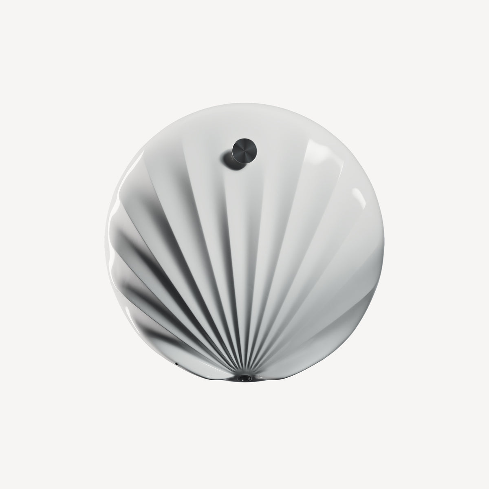
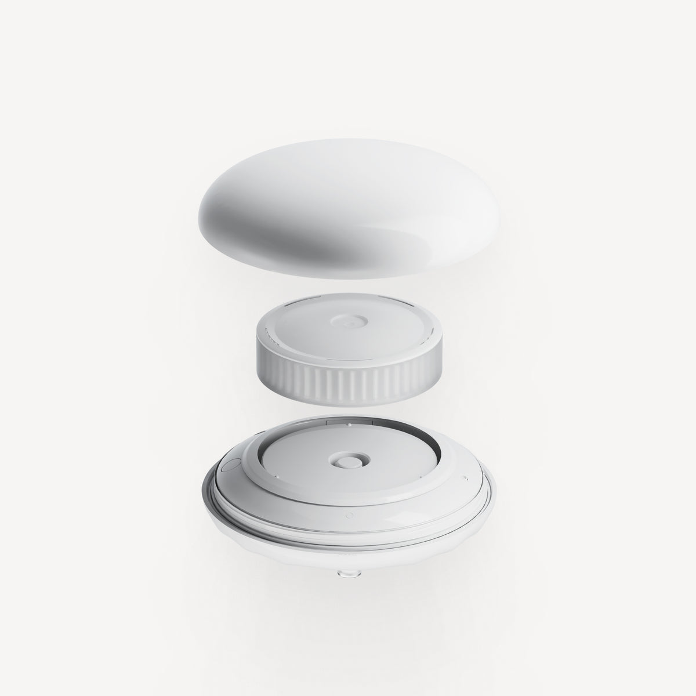
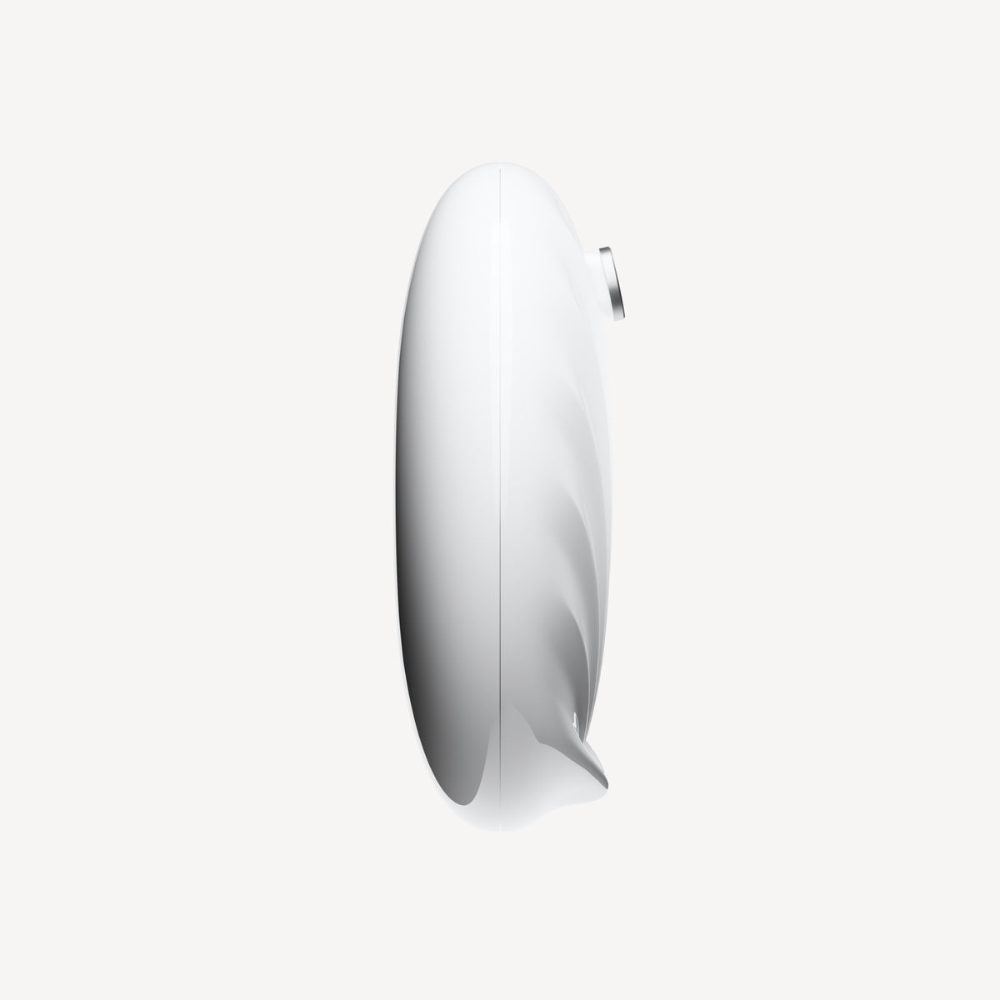
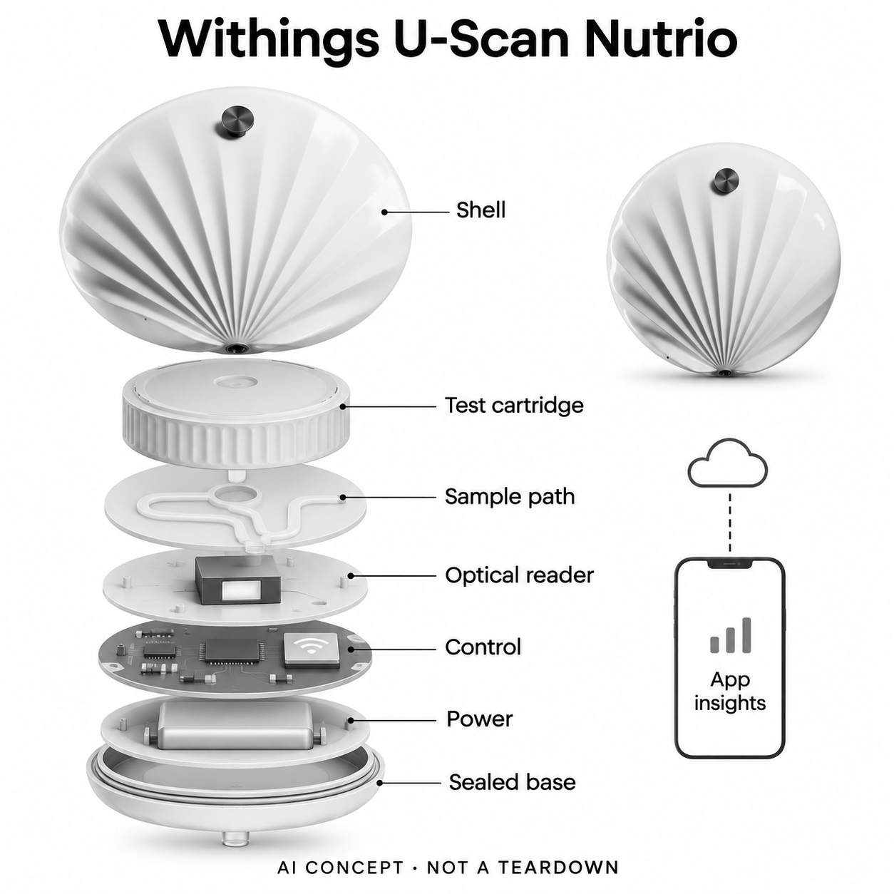

# Withings U-Scan Nutrio

**Withings** · 居家健康 · 核查 2026-11-04

马桶内取样与电子光学读取连接AI健康信息服务

消费渠道：个人零售。

## 产品图片与结构参考

### 产品图

U-Scan Nutrio官方贝壳形电子读取器 · 来源：[Withings · 官方产品图片](<https://www.withings.com/en-us/products/u-scan-nutrio>) · [原始图片](<https://cdn.shopify.com/s/files/1/0978/0169/9702/files/u-scan-nutrio.jpg?v=1782308141&width=1200>)

### 官方结构参考

U-Scan官方外壳与可更换卡匣结构示意，不代表全部内部电路 · 来源：[Withings · 官方产品图片](<https://www.withings.com/en-us/products/u-scan-nutrio>) · [原始图片](<https://cdn.shopify.com/s/files/1/0978/0169/9702/files/u-scan-exploded-view.jpg?v=1782308142&width=1200>)

### 参考图

U-Scan Nutrio官方侧面外形参考 · 来源：[Withings · 官方产品图片](<https://www.withings.com/en-us/products/u-scan-nutrio>) · [原始图片](<https://cdn.shopify.com/s/files/1/0978/0169/9702/files/u-scan-side.jpg?v=1782308488&width=1200>)

### AI 生成爆炸示意

**AI 生成 · 非实物拆机。** 内部为概念推断，不能作为元件布局、BOM 或维修依据。[生成提示词](../../content/hardware/prompts/withings-u-scan-nutrio.txt)

> 已视觉检查外形、灰阶、文字及无虚构参数；内部模块形状、板卡和布置仅为概念，不代表完整BOM。

> 源图逐张实际查看，按当前具体型号核对；未改色或裁切，宣传界面与效果文案不作为实测。

> 分析为基于公开资料的案头研究与 AI 辅助判断，未经用户访谈、销量审计或实物拆机。需求、画像、竞争冷门度、审美及商业机会均为研究假设，不是投资结论。

## 销售与购买

- 状态：在售。美国官网具体Proactive/2MPW配置显示US$379.95、In stock及Add to cart，公开产品数据available=true。较低标价的其他频率配置不可售，未混用其价格。

- 地区：美国官网当前可购配置、其他地区需按当地具体商品确认

- 价格：US$379.95（Proactive / 2MPW starter kit）。包含电子Reader、站座及对应耗材配置；后续卡匣与服务条件需结算确认。页面泛用会员弹窗与本款赠送文案并存，不推断永久免费。

- 中国大陆：未核实U-Scan具体型号在中国大陆的官方购买、耗材续供与Withings+功能；海外品牌渠道不等同该型号已在大陆上市。

- [官方产品 / 商店](<https://www.withings.com/en-us/products/u-scan-nutrio>)

## AI 的实际作用

U-Scan测量数据进入Withings+，其Health Assistant提供明确AI回答和个性化趋势解释；热检测、泵和光学比色本身不单独算AI。

服务与联网依赖：需兼容马桶安装、耗材卡匣、Withings应用及联网服务；AI依Withings+，不能描述为Reader在离线状态自行诊断。

## 是否冷门

细分专业（研究判断）：把样本采集融入家庭卫生间是具体流程差异，但耗材、安装与解释负担仍需验证；非销量或临床效果结论。

## 需求与市场

需求假设是用户希望重复记录某些尿液趋势，却不愿每次拿取容器、试纸和读数工具。把采集移入日常卫生间可以减少一些动作，同时引入固定位置、清洁和补充耗材的要求；价值应看完整流程是否更容易持续，而不是把马桶中的传感器本身当作健康改善。

### 官方｜把家庭取样接到电子读取 · 官方资料

U-Scan Nutrio将电子Reader固定在马桶内，配合卡匣、泵与光学读取获得尿液相关指标，再连接应用和健康信息服务。安装后仍需按具体应用流程启动和安排测量，不能把宣传中的无接触理解为无需设置、维护或确认；耗材卡匣不是单独的电子智能硬件。

依据：[U-Scan Nutrio官方当前商品与配置](<https://www.withings.com/en-us/products/u-scan-nutrio>) · [Withings官方U-Scan采样与读取机制](<https://support.withings.com/hc/en-us/articles/41993638237073-U-Scan-How-Does-U-Scan-Work>)

### 判断｜减少准备样本的步骤 · 研究判断

需求假设是用户希望重复记录某些尿液趋势，却不愿每次拿取容器、试纸和读数工具。把采集移入日常卫生间可以减少一些动作，同时引入固定位置、清洁和补充耗材的要求；价值应看完整流程是否更容易持续，而不是把马桶中的传感器本身当作健康改善。

依据：[U-Scan Nutrio官方当前商品与配置](<https://www.withings.com/en-us/products/u-scan-nutrio>) · [Withings官方U-Scan采样与读取机制](<https://support.withings.com/hc/en-us/articles/41993638237073-U-Scan-How-Does-U-Scan-Work>)

### 验证｜先确认采集成功与缺测原因 · 待验证

可记录不同马桶夹臂配置下，样本是否实际到达收集位置、测量是否启动及结果能否在应用中对应。将没有采到、试纸读取问题和联网失败分开，避免把缺失结果理解为健康状态正常；本目录没有实机取样测试，也不对个人检测安排或健康指标作判断。

依据：[Withings官方U-Scan采样与读取机制](<https://support.withings.com/hc/en-us/articles/41993638237073-U-Scan-How-Does-U-Scan-Work>)

## 用户画像

比起是否喜欢健康科技，更重要的画像是能否定期检查设备、处理耗材和理解结果来源。家庭共用卫生间还涉及测量归属与隐私，不能默认系统已解决每一种多用户情况；如果维护主要由另一位家人承担，应将其时间和接受程度纳入评估，而不只询问购买者意愿。

### 官方｜家庭平台仍有使用前提 · 官方资料

Reader需要合适的安装夹臂和对应卡匣，站座承担清洁与充电，应用管理测量和结果。不同马桶形状与安装位置会影响样本收集，这些是官方明确的条件；产品面向个人家庭使用不意味着任意卫生间、任意用户或任意测量目的都能采用同一个配置。

依据：[U-Scan Nutrio官方当前商品与配置](<https://www.withings.com/en-us/products/u-scan-nutrio>) · [Withings官方U-Scan采样与读取机制](<https://support.withings.com/hc/en-us/articles/41993638237073-U-Scan-How-Does-U-Scan-Work>)

### 判断｜愿意承担维护才可能持续 · 研究判断

比起是否喜欢健康科技，更重要的画像是能否定期检查设备、处理耗材和理解结果来源。家庭共用卫生间还涉及测量归属与隐私，不能默认系统已解决每一种多用户情况；如果维护主要由另一位家人承担，应将其时间和接受程度纳入评估，而不只询问购买者意愿。

依据：[Withings官方U-Scan采样与读取机制](<https://support.withings.com/hc/en-us/articles/41993638237073-U-Scan-How-Does-U-Scan-Work>)

### 验证｜本人完成一次维护闭环 · 待验证

试用可观察安装、发起测量、回看结果、取下清洁及装回的全过程，并记录错误位置或耗材状态如何被提示。另行确认共用环境中谁的记录进入哪个账号，避免仅凭系统自动化宣传推断身份识别；这些操作证据比界面上丰富的健康图表更能说明家庭适配。

依据：[U-Scan Nutrio官方当前商品与配置](<https://www.withings.com/en-us/products/u-scan-nutrio>) · [Withings官方U-Scan采样与读取机制](<https://support.withings.com/hc/en-us/articles/41993638237073-U-Scan-How-Does-U-Scan-Work>)

## 竞争与替代

手动试纸的维护和取样方式不同，专业实验室又提供不同的检测范围、解释和质量流程。U-Scan的差异是家庭固定采集与数字记录，不能直接替代专业检测，也不能因与AI助手连接就扩展成全面尿液诊断；比较应先明确想持续记录什么信息，而不是统计检测名称。

### 官方｜卡匣种类不等于多件硬件 · 官方资料

U-Scan平台可配Nutrio或Calci卡匣，目录选择当前Nutrio可售配置展示电子Reader，不将不同分析目标和频率套餐重复计数。美国商品页的低价配置并非全部可下单，当前所选价格对应具体启动套装；后续耗材与服务费用应按实际订单确认，不能只引用系列起售价。

依据：[U-Scan Nutrio官方当前商品与配置](<https://www.withings.com/en-us/products/u-scan-nutrio>) · [U-Scan官方平台与耗材比较](<https://www.withings.com/en-us/collections/u-scan>)

### 判断｜与手动试纸和专业检测分层比较 · 研究判断

手动试纸的维护和取样方式不同，专业实验室又提供不同的检测范围、解释和质量流程。U-Scan的差异是家庭固定采集与数字记录，不能直接替代专业检测，也不能因与AI助手连接就扩展成全面尿液诊断；比较应先明确想持续记录什么信息，而不是统计检测名称。

依据：[U-Scan Nutrio官方当前商品与配置](<https://www.withings.com/en-us/products/u-scan-nutrio>) · [Withings官方U-Scan采样与读取机制](<https://support.withings.com/hc/en-us/articles/41993638237073-U-Scan-How-Does-U-Scan-Work>)

### 验证｜核算每次有效记录成本 · 待验证

可以把Reader、卡匣、未成功采集、维护和服务费用列入完整成本，再记录一段时间里真正回看或用于沟通的结果。这样能发现更自动的流程是否只是增加耗材消耗；本研究没有销量、复购或用户访谈，不据新颖安装位置认定存在稳定溢价或需求空白。

依据：[U-Scan Nutrio官方当前商品与配置](<https://www.withings.com/en-us/products/u-scan-nutrio>) · [Withings官方U-Scan采样与读取机制](<https://support.withings.com/hc/en-us/articles/41993638237073-U-Scan-How-Does-U-Scan-Work>) · [U-Scan官方平台与耗材比较](<https://www.withings.com/en-us/collections/u-scan>)

## 供应链

同类新设计需要同时考虑残留样本、清洁液、冲水和反应耗材的影响，单独选择一颗更精密传感器并不能完成可靠系统。温度触发、流量和比色校准必须在实际安装结构下验证，尤其不能把普通环境温度芯片直接接触样本；供应链评估应把材料与维护流程一起纳入。

### 官方｜流路与电子光学机制已披露 · 官方资料

官方说明热检测触发样本处理，泵经微流路将其送到卡匣内比色试纸，LED和内部传感器读取反应颜色，处理器进一步计算结果。具体泵、温度器件、光学元件和装配工厂未公开，不能由外壳或品牌名称补齐料号；概念图表达功能层，并非真实电路与内部布置。

依据：[Withings官方U-Scan采样与读取机制](<https://support.withings.com/hc/en-us/articles/41993638237073-U-Scan-How-Does-U-Scan-Work>)

### 判断｜污染隔离与校准同样关键 · 研究判断

同类新设计需要同时考虑残留样本、清洁液、冲水和反应耗材的影响，单独选择一颗更精密传感器并不能完成可靠系统。温度触发、流量和比色校准必须在实际安装结构下验证，尤其不能把普通环境温度芯片直接接触样本；供应链评估应把材料与维护流程一起纳入。

依据：[Withings官方U-Scan采样与读取机制](<https://support.withings.com/hc/en-us/articles/41993638237073-U-Scan-How-Does-U-Scan-Work>)

### 验证｜候选先验证接口和边界 · 待验证

无线控制平台可以研究数据同步，温度器件可以研究样本到达的感知入口，但均需要重新确认封装隔离、响应和清洁条件。候选公司不提供Withings试剂、算法或健康服务，也没有被证明实际供货；验收应覆盖取样、读取和传输整条链路，而非只确认开发板输出数值。

依据：[Withings官方U-Scan采样与读取机制](<https://support.withings.com/hc/en-us/articles/41993638237073-U-Scan-How-Does-U-Scan-Work>)

## 技术路径

应用可能把尿液结果与其他设备数据联系，提供更易理解的叙述，但更多关联并不意味着确定了身体变化的原因。Nutrio的有限指标不能代表尿液所有成分，AI也可能忽略取样失败或缺测背景；技术评价应关注解释能否回到具体测量、日期和不确定性，而非语言是否流畅。

### 官方｜比色算法与AI助手分开 · 官方资料

Reader依据比色信号计算结果，公开资料没有将这一测量算法明确称为机器学习，本目录因此以Withings+已披露的AI回答和趋势解释作为智能服务依据。原始指标、AI内容与专业人员提供的服务是不同层次，不能混为一个端侧自动诊断功能，也不能默认无会员拥有全部服务。

依据：[Withings官方U-Scan采样与读取机制](<https://support.withings.com/hc/en-us/articles/41993638237073-U-Scan-How-Does-U-Scan-Work>) · [Withings+官方AI服务边界](<https://www.withings.com/en-us/pages/withings-plus>)

### 判断｜解释不应超出有限输入 · 研究判断

应用可能把尿液结果与其他设备数据联系，提供更易理解的叙述，但更多关联并不意味着确定了身体变化的原因。Nutrio的有限指标不能代表尿液所有成分，AI也可能忽略取样失败或缺测背景；技术评价应关注解释能否回到具体测量、日期和不确定性，而非语言是否流畅。

依据：[U-Scan Nutrio官方当前商品与配置](<https://www.withings.com/en-us/products/u-scan-nutrio>) · [Withings+官方AI服务边界](<https://www.withings.com/en-us/pages/withings-plus>)

### 验证｜把测量和解释并排核对 · 待验证

可检查每条助手回答是否对应当前设备实际提供的数据，是否标明时间和缺口，并允许用户回看原始记录。若其他Withings设备或外部数据参与，应能分清来源；本目录不复现临床试验或推定个体准确率，也不把健康评分、年度报告或统计关联当作诊断结论。

依据：[Withings官方U-Scan采样与读取机制](<https://support.withings.com/hc/en-us/articles/41993638237073-U-Scan-How-Does-U-Scan-Work>) · [Withings+官方AI服务边界](<https://www.withings.com/en-us/pages/withings-plus>)

## 产品审美

设备融入卫生间可以减少每次拿取工具的心理负担，但过于不显眼也可能让用户忽略耗材、充电和清洁状态。设计应让维护提醒清楚且易于执行，而不是只让外壳看起来干净；家庭成员如何理解设备用途和数据归属，也会影响是否愿意长期保留。

### 官方｜贝壳外形服务样本流向 · 官方资料

官方说明Reader采用特定曲面帮助液体到达收集点，当前产品图显示带放射状纹理的白色壳体和可更换卡匣结构。它的外观与流体路径相关，不能只按浴室装饰评价；图片也无法证明所有马桶、安装角度和清洁习惯都合适，需要结合实际夹臂选择与取样情况确认。

依据：[Withings官方U-Scan采样与读取机制](<https://support.withings.com/hc/en-us/articles/41993638237073-U-Scan-How-Does-U-Scan-Work>)

### 判断｜不显眼与可检查之间的取舍 · 研究判断

设备融入卫生间可以减少每次拿取工具的心理负担，但过于不显眼也可能让用户忽略耗材、充电和清洁状态。设计应让维护提醒清楚且易于执行，而不是只让外壳看起来干净；家庭成员如何理解设备用途和数据归属，也会影响是否愿意长期保留。

依据：[U-Scan Nutrio官方当前商品与配置](<https://www.withings.com/en-us/products/u-scan-nutrio>) · [Withings官方U-Scan采样与读取机制](<https://support.withings.com/hc/en-us/articles/41993638237073-U-Scan-How-Does-U-Scan-Work>)

### 验证｜观察清洁与装回的动作 · 待验证

可以记录用户取下Reader、放入Station及重新安装时是否需要额外工具或帮助，检查原位置能否稳定恢复。再观察提示是否让人理解是耗材、样本还是连接问题，避免将所有异常统一为失败；材料触感和长期卫生维护无法由渲染图证明，本轮没有对应实机观察。

依据：[Withings官方U-Scan采样与读取机制](<https://support.withings.com/hc/en-us/articles/41993638237073-U-Scan-How-Does-U-Scan-Work>)

## 关键风险

共用卫生间、安装偏差或维护不足可能影响记录归属和输入质量，AI解释也可能被误读为比原始测量更确定。涉及健康的疑问不能仅依赖消费助手自行处理，敏感数据分享同样需要本人理解；本目录分析产品流程，不对个人疾病、营养需求或治疗选择作推定。

### 官方｜服务权益与交付配置要核对 · 官方资料

本款商品文案列有Withings+赠送服务，但页面也存在适用于其他商品的泛用订阅说明，购买前应以具体订单确认权益和期限。基础测量与部分导出可使用免费应用，不代表全部AI功能免费永久开放；本轮未核实中国大陆该型号、耗材续供及完整软件服务。

依据：[U-Scan Nutrio官方当前商品与配置](<https://www.withings.com/en-us/products/u-scan-nutrio>) · [Withings+官方AI服务边界](<https://www.withings.com/en-us/pages/withings-plus>)

### 判断｜自动采集不消除数据与判断风险 · 研究判断

共用卫生间、安装偏差或维护不足可能影响记录归属和输入质量，AI解释也可能被误读为比原始测量更确定。涉及健康的疑问不能仅依赖消费助手自行处理，敏感数据分享同样需要本人理解；本目录分析产品流程，不对个人疾病、营养需求或治疗选择作推定。

依据：[Withings官方U-Scan采样与读取机制](<https://support.withings.com/hc/en-us/articles/41993638237073-U-Scan-How-Does-U-Scan-Work>) · [Withings+官方AI服务边界](<https://www.withings.com/en-us/pages/withings-plus>)

### 验证｜提前确认退出后的可用范围 · 待验证

应核对停止耗材计划或会员后还能查看、导出哪些结果，以及账号与数据如何处理。试用中记录失败测量、未理解的解释和维护遗漏，保留原始记录供合适专业讨论；这些检查用于了解系统边界，不构成针对个人的检测频率建议或健康效果承诺。

依据：[U-Scan Nutrio官方当前商品与配置](<https://www.withings.com/en-us/products/u-scan-nutrio>) · [Withings+官方AI服务边界](<https://www.withings.com/en-us/pages/withings-plus>)

## 机会与验证

值得研究的是少做取样动作后，用户是否真正获得更有用且能解释的趋势，而不是只是多了一组定期数字。如果结果没有用于回看或沟通，自动化不一定带来长期价值；反过来，清楚标明缺测和范围的小量信息，也可能比复杂但难理解的报告更易持续使用。

### 官方｜同一平台连接取样与解释 · 官方资料

U-Scan将家庭固定取样、可更换反应耗材和电子读取连成一个系统，再接入AI健康信息服务。它与手持激素读取器或单纯饮食日志具有不同操作流程，但卡匣变体仍属于同一平台；目录记录这一具体实现，不把每种营养目标或订阅频率拆成新的智能硬件。

依据：[U-Scan Nutrio官方当前商品与配置](<https://www.withings.com/en-us/products/u-scan-nutrio>) · [Withings官方U-Scan采样与读取机制](<https://support.withings.com/hc/en-us/articles/41993638237073-U-Scan-How-Does-U-Scan-Work>) · [U-Scan官方平台与耗材比较](<https://www.withings.com/en-us/collections/u-scan>)

### 判断｜降低采样负担后还要验证理解价值 · 研究判断

值得研究的是少做取样动作后，用户是否真正获得更有用且能解释的趋势，而不是只是多了一组定期数字。如果结果没有用于回看或沟通，自动化不一定带来长期价值；反过来，清楚标明缺测和范围的小量信息，也可能比复杂但难理解的报告更易持续使用。

依据：[Withings官方U-Scan采样与读取机制](<https://support.withings.com/hc/en-us/articles/41993638237073-U-Scan-How-Does-U-Scan-Work>) · [Withings+官方AI服务边界](<https://www.withings.com/en-us/pages/withings-plus>)

### 验证｜用完整家庭周期观察 · 待验证

后续可记录数个耗材与维护周期中的有效测量、回看、分享、清洁和停止使用原因，分别评价操作与信息理解。把家庭空间和持续费用纳入，与原有方式保持同一任务比较；当前仅为公开资料研究，没有独立实测、长期用户访谈或市场规模依据。

依据：[U-Scan Nutrio官方当前商品与配置](<https://www.withings.com/en-us/products/u-scan-nutrio>) · [Withings官方U-Scan采样与读取机制](<https://support.withings.com/hc/en-us/articles/41993638237073-U-Scan-How-Does-U-Scan-Work>) · [Withings+官方AI服务边界](<https://www.withings.com/en-us/pages/withings-plus>)

## 对应供应链公司

能力候选用于选型研究，不代表本产品实际采用；未公开的供货关系不作推断。

- [espressif](../supply-chain/espressif.md) — **能力候选 · 非已采用** / 同类联网光学读取器的Wi-Fi控制候选：ESP32-C6公开无线微控制与软件框架，可用于研究U-Scan这类读取器的数据同步、状态和远程更新流程。它不提供样本化学分析、比色校准或Withings+服务，需另验安全、休眠和传感接口；未发现本款点名采用证据，因此仅记录相近新设计候选。

- [sensirion](../supply-chain/sensirion.md) — **能力候选 · 非已采用** / 同类取样入口的温度感知研究候选：Sensirion STS40数字温度感知可作为样本到达检测的研究入口，但真实器件必须验证响应、封装隔离和清洁污染条件，不能直接让普通环境芯片接触尿液。此候选不提供完整流体或化学分析，也未确认U-Scan采用；具体热传感实现和材料仍是待核查项目。

[浏览供应链目录](../supply-chain.md)

## 功能分层示意

这是功能关系，不是实物拆机、真实空间结构或已核实 BOM。

1. **安装与取样**：夹臂使Reader位于合适位置，热传感检测样本到达，实际启动依应用流程。（官方披露）

2. **流体与耗材**：泵和微流路把样本引入卡匣内比色试纸，耗材本身不计独立智能设备。（官方披露）

3. **电子光学读取**：LED和内部传感器读取反应颜色，处理器按专有算法形成结果；不将普通比色算法自动称AI。（官方披露）

4. **联网与AI服务**：数据同步到Withings应用，Withings+提供AI回答和趋势解释，端云模型细节未知。（官方披露）

5. **维护与复核**：Station用于清洁和充电；用户回看测量与解释，健康决策需适当专业复核。（官方披露）

## 来源

1. [U-Scan Nutrio官方当前商品与配置](<https://www.withings.com/en-us/products/u-scan-nutrio>) — 本轮已打开US$379.95、Proactive/2MPW、In stock和Add to cart；product.js确认该配置可售，未采用不可售的US$349.95变体。

2. [Withings官方U-Scan采样与读取机制](<https://support.withings.com/hc/en-us/articles/41993638237073-U-Scan-How-Does-U-Scan-Work>) — 本轮已打开：夹臂定位、手动启动流程、热检测、泵、微流路、比色试纸、LED光学及站座维护。

3. [Withings+官方AI服务边界](<https://www.withings.com/en-us/pages/withings-plus>) — 本轮已打开AI-powered answers、Health Assistant及设备数据整合，基础指标与部分导出仍属于免费App；不把专业人员服务等同AI诊断。

4. [U-Scan官方平台与耗材比较](<https://www.withings.com/en-us/collections/u-scan>) — 本轮已打开Reader平台、Nutrio与Calci卡匣。只计同一电子平台一次，卡匣或频率套餐不增加硬件数量。

[返回目录](../hardware-market.md) · [网页分析](https://romanagent.github.io/Roman/#hardware/product/withings-u-scan-nutrio)
