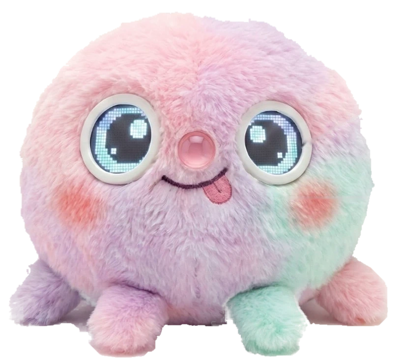
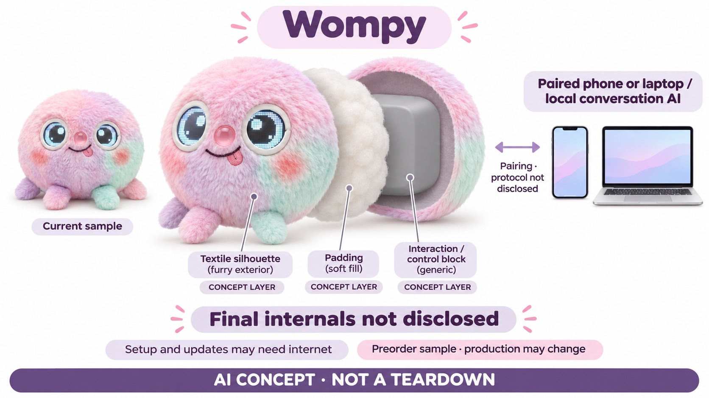

# Wompy AI Plush

**Wompy / JC Industries** · AI玩具 · 核查 2026-11-06

把对话AI放在配对手机或电脑上的好奇角色毛绒预售

消费渠道：消费预订。

## 产品图片与结构参考

### 产品图

官方当前实物样品，非最终量产承诺 · 来源：[产品品牌官网](<https://wompy.world/wompy/>) · [原始图片](<https://wompy.world/assets/wompy-sample.webp>)

### 参考图

官方样品眼部与毛绒细节，非摄像头说明 · 来源：[产品品牌官网](<https://wompy.world/wompy/>) · [原始图片](<https://wompy.world/assets/wompy-detail.webp>)

### AI 生成爆炸示意

**AI 生成 · 非实物拆机。** 内部为概念推断，不能作为元件布局、BOM 或维修依据。[生成提示词](../../content/hardware/prompts/wompy.txt)

> 内置ImageGen按本产品官方参考独立生成；未知内部为概念层，不是BOM或维修依据。

> 图片保留官方原貌；效果、安全与性能宣传不代表本目录独立验证。

> 分析为基于公开资料的案头研究与 AI 辅助判断，未经用户访谈、销量审计或实物拆机。需求、画像、竞争冷门度、审美及商业机会均为研究假设，不是投资结论。

## 销售与购买

- 状态：预售 / 接受延期订单。官方预售页明确US$129为一只Wompy的全款而非定金，提供Stripe付款链接和购买条款；预计2026年圣诞节前发出，非到货保证。当前展示实物样品，最终外观与规格可能改变。

- 地区：计划全球配送，目的地及运费发出前单独确认

- 价格：US$129（全款预售）。运费另报价并经买家同意后支付，250美元是计划常规价而非已发生售价；上线时不计划订阅，不承诺永久无服务费用。

- 中国大陆：官方全球配送计划仍需逐地址报价确认，未核实大陆兼容设备、应用分发与售后；不能将计划全球寄送写成大陆正式现货渠道。

- [官方产品 / 商店](<https://wompy.world/preorder/>)

## AI 的实际作用

厂商明确对话AI运行在配对的手机或笔记本电脑，不需要云端处理对话，角色通过好奇提问邀请孩子解释和编故事；模型与设备兼容清单未公开。

服务与联网依赖：仍需兼容手机/电脑及配套应用，初次下载、更新、账号和其他功能不等于永远离线；应用获取、连接方式与玩具资料控制说明需向供应方确认。

## 是否冷门

新兴竞争（研究判断）：配对设备本地运行与常见云对话毛绒的依赖不同，但仍属于儿童共玩任务；无真实销量、交付或性能证据支持首创和领先结论。

## 需求与市场

让孩子向角色解释，可能比不断获得答案更容易形成主动表达，但也可能只是成人设计好的问答形式。需求需要观察孩子是否愿意贡献自己的想法以及玩具如何跟随，而不是用好奇人设预设教育收益；它仍服务儿童共玩，与其他对话毛绒有共同替代关系。

### 事实｜孩子被邀请成为解释者 · 官方资料

Wompy把角色设定为好奇的新手，鼓励孩子解释知识、发明玩法和讲故事，厂商称对话体验与配套应用已经完成。网站展示的插图和互动则是预写示例，不是实时硬件演示；目录据此描述玩法意图，不把网页效果当成实物已经具备同等响应的证据。

依据：[Wompy当前产品事实与本地对话架构](<https://wompy.world/wompy/>)

### 判断｜反向提问可能改变共玩节奏 · 研究判断

让孩子向角色解释，可能比不断获得答案更容易形成主动表达，但也可能只是成人设计好的问答形式。需求需要观察孩子是否愿意贡献自己的想法以及玩具如何跟随，而不是用好奇人设预设教育收益；它仍服务儿童共玩，与其他对话毛绒有共同替代关系。

依据：[Wompy当前产品事实与本地对话架构](<https://wompy.world/wompy/>)

### 验证｜先分开验证软件与实物体验 · 待验证

后续应在真实配对设备与玩具一起运行时观察语音、表情和等待，再比较网站脚本是否准确表达了最终玩法。不能用演示故事数量或应用已完成的文字当作量产验收；本轮没有收货、安装应用或访谈家庭，需求和效果都未获得独立验证。

依据：[Wompy官方全款预售页面](<https://wompy.world/preorder/>) · [Wompy当前产品事实与本地对话架构](<https://wompy.world/wompy/>)

## 用户画像

即使对话无需云端，配对手机或电脑仍可能被家庭成员共用，应用后台、充电和连接距离会影响日常安排。用户画像应考虑谁提供和维护这台设备，而不是只看是否喜欢柔软角色；本地推理的技术取舍必须体现在真实使用条件里才能判断价值。

### 事实｜官方年龄与配对条件已经说明 · 官方资料

当前资料建议五岁以上，需要兼容手机或笔记本电脑运行对话AI；具体系统和设备支持表仍要向供应方索取。它不是孩子拿到毛绒便可无其他设备使用的方案，目录也不会把本地处理直接理解为所有旧手机和电脑都可以顺畅运行。

依据：[Wompy当前产品事实与本地对话架构](<https://wompy.world/wompy/>)

### 判断｜家庭需能接受占用另一台设备 · 研究判断

即使对话无需云端，配对手机或电脑仍可能被家庭成员共用，应用后台、充电和连接距离会影响日常安排。用户画像应考虑谁提供和维护这台设备，而不是只看是否喜欢柔软角色；本地推理的技术取舍必须体现在真实使用条件里才能判断价值。

依据：[Wompy当前产品事实与本地对话架构](<https://wompy.world/wompy/>)

### 验证｜检查成人能否解释设备分工 · 待验证

试用可让家长说明AI在哪里运行、手机离开后会怎样，以及哪些操作仍要下载或更新，再观察孩子如何启动和结束玩法。采用公开或虚构话题即可完成这些检查，无需收集私密经历；如果兼容信息还未明确，应先取得对应版本资料再安排长期使用。

依据：[Wompy当前产品事实与本地对话架构](<https://wompy.world/wompy/>) · [Wompy预售与购买政策](<https://wompy.world/policies/>)

## 竞争与替代

与云对话玩具相比，本地配对计算可能改变网络和资料路径，但预售成熟度也会影响家庭能否立即获得体验。不能只比较一项隐私或价格宣传就得出优劣；现货固定故事机、手机软件和普通共玩方式都可能在不同约束下成为合理替代。

### 事实｜当前产品属于正式全款预售 · 官方资料

预售页面明确支付一百二十九美元订购一只Wompy，不是只缴押金换取购买资格，并提供单独运费和取消安排。预计发出时间仍在未来，样品外观与量产规格可改变；目录将它列为预售，不把已存在付款页面和实物样品写成当前现货交付。

依据：[Wompy官方全款预售页面](<https://wompy.world/preorder/>) · [Wompy预售与购买政策](<https://wompy.world/policies/>)

### 判断｜比较需要同时看计算位置与成熟度 · 研究判断

与云对话玩具相比，本地配对计算可能改变网络和资料路径，但预售成熟度也会影响家庭能否立即获得体验。不能只比较一项隐私或价格宣传就得出优劣；现货固定故事机、手机软件和普通共玩方式都可能在不同约束下成为合理替代。

依据：[Wompy当前产品事实与本地对话架构](<https://wompy.world/wompy/>)

### 验证｜把配对设备和运费算进完整方案 · 待验证

比较成本时应考虑是否已有兼容设备、单独运费以及未来维护，而不是只取预售价。厂商没有计划首发订阅，不等于永久不收任何服务费用；本研究没有实际订单、账单或设备性能，不能据全款价格推算生产成本或长期经营能力。

依据：[Wompy官方全款预售页面](<https://wompy.world/preorder/>) · [Wompy预售与购买政策](<https://wompy.world/policies/>)

## 供应链

把AI放到另一台设备可能减轻毛绒的计算负担，同时增加连接、同步和应用运行条件。类似设计需要保证声音与表情对应、异常能够提示，不能只解决手机模型运行；外皮包覆、显示可见性和控制稳定性仍属于实体产品工程，而非软件完成后自然解决。

### 事实｜样品电子显示可见而内部规格未知 · 官方资料

官方实物样品图可见圆形毛绒、像素眼和小脚，产品资料尚未完整公开主控、传输协议、输入器件和供电方案。显示眼不证明存在摄像头或视觉理解，样品照片也不是拆机；目录的结构图将明确概念层，不补造芯片、电池数量或传感器配置。

依据：[Wompy当前产品事实与本地对话架构](<https://wompy.world/wompy/>)

### 判断｜外围交互与配对计算需协同 · 研究判断

把AI放到另一台设备可能减轻毛绒的计算负担，同时增加连接、同步和应用运行条件。类似设计需要保证声音与表情对应、异常能够提示，不能只解决手机模型运行；外皮包覆、显示可见性和控制稳定性仍属于实体产品工程，而非软件完成后自然解决。

依据：[Wompy当前产品事实与本地对话架构](<https://wompy.world/wompy/>)

### 验证｜供应能力按未确定部分条件化关联 · 待验证

可考察嵌入式图形音频控制和声音前端候选，但应先确认哪些功能留在玩具、哪些由配对设备处理。当前没有Wompy点名供应商或工厂证据，因此链接只用于同类新设计研究；不能根据候选平台具有AI加速器就反推本产品在毛绒内部运行模型。

依据：[Wompy当前产品事实与本地对话架构](<https://wompy.world/wompy/>)

## 技术路径

本地运行可能受到设备性能、内存、后台限制和模型加载影响，儿童语音与多轮故事也会增加输入差异。技术评价应看一整轮游戏是否顺利，而不只认定离线就更快或更准确；具体模型未公开时，也不能把其他端侧模型的性能结果套给Wompy。

### 事实｜不使用云仅指对话计算 · 官方资料

官方明确对话AI在配对手机或笔记本电脑运行，无需云端对话服务，同时说明设置、下载、更新及网站购物是另外的活动。这个边界很重要：本地对话不等于无应用、无设备或任何时候都不联网，也不能自动回答备份、诊断和资料留存的问题。

依据：[Wompy当前产品事实与本地对话架构](<https://wompy.world/wompy/>)

### 判断｜本地模型仍需要任务与设备验证 · 研究判断

本地运行可能受到设备性能、内存、后台限制和模型加载影响，儿童语音与多轮故事也会增加输入差异。技术评价应看一整轮游戏是否顺利，而不只认定离线就更快或更准确；具体模型未公开时，也不能把其他端侧模型的性能结果套给Wompy。

依据：[Wompy当前产品事实与本地对话架构](<https://wompy.world/wompy/>)

### 验证｜检查设备离开与应用中断 · 待验证

获得实物后可测试应用切后台、配对设备休眠和重新连接时的提示与恢复，确认孩子是否知道当前不可交谈。还应使用非敏感内容检查历史与设置变化；本轮没有运行应用或模型，因此不对厂商本地处理声明作独立性能和隐私验证。

依据：[Wompy当前产品事实与本地对话架构](<https://wompy.world/wompy/>)

## 产品审美

圆形身体和亮眼睛可以使角色反应更显眼，但表情是否帮助孩子理解状态仍需实测。若眼睛动画只增加吸引力却没有表达等待、停止和误解，可能产生更强的拟人期待；审美研究应结合实际对话节奏，而不是把电子眼自动当作更有情感的证据。

### 事实｜官网区分样品与概念插图 · 官方资料

官网将产品主图和细节标为实物样品，家庭与云端世界画面标为概念插画，包装也不是最终量产承诺。图像档案只使用对应样品外观，保留原始来源；概念爆炸图同样需要显示生产细节未验证，不能把想象场景转成真实用户使用证明。

依据：[Wompy官方全款预售页面](<https://wompy.world/preorder/>) · [Wompy当前产品事实与本地对话架构](<https://wompy.world/wompy/>)

### 判断｜像素表情可能形成不同角色语言 · 研究判断

圆形身体和亮眼睛可以使角色反应更显眼，但表情是否帮助孩子理解状态仍需实测。若眼睛动画只增加吸引力却没有表达等待、停止和误解，可能产生更强的拟人期待；审美研究应结合实际对话节奏，而不是把电子眼自动当作更有情感的证据。

依据：[Wompy当前产品事实与本地对话架构](<https://wompy.world/wompy/>)

### 验证｜观察表情与交互的对应关系 · 待验证

可检查声音、眼睛和应用状态是否同步，以及在普通房间光线中是否容易辨认。再根据最终说明确认清洁、供电和维护，不能由样品猜测可机洗或可维修；本研究未触摸实物，无法判断毛绒质感、耐用或最终生产一致性。

依据：[Wompy当前产品事实与本地对话架构](<https://wompy.world/wompy/>)

## 关键风险

产品既尚未量产交付，又依赖兼容设备和应用，这些条件会影响到货后能否实际使用。样品照片可以减少外观不确定性，却不能解决软件支持和服务寿命；用户期待应围绕当前明确交付范围，而不是把未来愿景理解为已经成熟的消费体验。

### 事实｜玩具资料文档仍需另行获取 · 官方资料

官方称玩具隐私和家长控制已完成，但要求联系支持取得具体语音处理、保留和删除说明，公开购买政策主要描述网站与结算。目录不会把网站低收集或本地对话宣传推广为整个玩具零留存，也不假定应用所有功能都已公开可验证。

依据：[Wompy当前产品事实与本地对话架构](<https://wompy.world/wompy/>) · [Wompy预售与购买政策](<https://wompy.world/policies/>)

### 判断｜预售与依赖资料缺口需要共同看待 · 研究判断

产品既尚未量产交付，又依赖兼容设备和应用，这些条件会影响到货后能否实际使用。样品照片可以减少外观不确定性，却不能解决软件支持和服务寿命；用户期待应围绕当前明确交付范围，而不是把未来愿景理解为已经成熟的消费体验。

依据：[Wompy官方全款预售页面](<https://wompy.world/preorder/>) · [Wompy当前产品事实与本地对话架构](<https://wompy.world/wompy/>)

### 验证｜核对版本交付与取消路径 · 待验证

采用前应保存订单所对应的外观、兼容清单、预计时间和运费安排，再确认规格变化时怎样选择继续或取消。不要为了完成测试而提前提供儿童资料；本目录没有实际付款或履约证据，不对商家的退款执行、量产时间或服务持续性作保证。

依据：[Wompy官方全款预售页面](<https://wompy.world/preorder/>) · [Wompy预售与购买政策](<https://wompy.world/policies/>)

## 机会与验证

如果配对设备本地运行能够稳定支持孩子解释和编故事，并让家长理解资料和维护边界，可能形成与云聊天不同的选择。真正差异需要来自可重复体验和明确交付，而不是不使用云四个字；是否有持续需求仍需家庭实际采用与付费验证。

### 事实｜运费须在发出前单独同意 · 官方资料

当前政策说明商品全款不含运费，发出前按目的地报价并单独获买家批准，拒绝报价时可在发出前取消。计划全球配送仍需要确认具体限制，不能写成每个国家都已有渠道；一百二十九美元也不是把商品送到任意家庭的最终总费用。

依据：[Wompy预售与购买政策](<https://wompy.world/policies/>)

### 判断｜市场空间在明确的本地共玩流程 · 研究判断

如果配对设备本地运行能够稳定支持孩子解释和编故事，并让家长理解资料和维护边界，可能形成与云聊天不同的选择。真正差异需要来自可重复体验和明确交付，而不是不使用云四个字；是否有持续需求仍需家庭实际采用与付费验证。

依据：[Wompy当前产品事实与本地对话架构](<https://wompy.world/wompy/>)

### 验证｜等量产后评价持续使用与兼容负担 · 待验证

研究可记录不同支持设备上完成游戏的情况、需要成人干预的次数以及孩子是否在新鲜感后继续使用。预售付款数量或网页插画都不能代替这些证据；本轮仅为案头研究，没有用户留存、实物性能或教育效果数据，结论保留验证空间。

依据：[Wompy官方全款预售页面](<https://wompy.world/preorder/>) · [Wompy当前产品事实与本地对话架构](<https://wompy.world/wompy/>)

## 对应供应链公司

能力候选用于选型研究，不代表本产品实际采用；未公开的供货关系不作推断。

- [nxp](../supply-chain/nxp.md) — **能力候选 · 非已采用** / 同类毛绒交互及显示控制候选：NXP公开多核、图形与音频处理的嵌入式平台可供研究类似像素眼毛绒的外设控制，但Wompy对话AI官方明确在配对设备上，不能据候选加入机内大模型。需验证显示接口、能耗和连接协议；未见点名采用，实际主控、供电与工厂仍未披露。

- [infineon](../supply-chain/infineon.md) — **能力候选 · 非已采用** / 同类产品语音输入方案候选：若同类设计将采音集成到毛绒，Infineon MEMS麦克风可作为声音前端候选，但当前Wompy资料未完整说明输入器件位置与协议。需要先确认配对设备和玩具分工，再测试毛绒遮挡与回声，不能把这一条件性研究关联当作Wompy已采用或确定的内部模块。

[浏览供应链目录](../supply-chain.md)

## 功能分层示意

这是功能关系，不是实物拆机、真实空间结构或已核实 BOM。

1. **样品载体**：圆形彩色毛绒与像素显示眼，图示为当前实物样品，最终生产可变化。（官方披露）

2. **交互与状态**：角色与配对设备之间承载对话和表情，具体输入器件、传输协议与板件未披露。（分析推断）

3. **配对设备AI**：官方确认对话AI在手机或笔记本电脑运行，不能画成毛绒内置大模型。（官方披露）

4. **应用与资料**：应用用于对话和设置，需确认设备支持与下载；具体语音留存和家长控制文档需索取。（官方披露）

5. **电源与维护**：样品含电子显示，量产供电、清洁和维修细节未充分公开，仅以概念功能层描述。（分析推断）

## 来源

1. [Wompy官方全款预售页面](<https://wompy.world/preorder/>) — 已打开全款129美元、Stripe链接、圣诞前预计发出及单独运费条件，未付款。

2. [Wompy当前产品事实与本地对话架构](<https://wompy.world/wompy/>) — 已打开2026-10-22更新说明：对话运行于配对手机/电脑；样品与网页脚本演示分开，兼容列表需联系。

3. [Wompy预售与购买政策](<https://wompy.world/policies/>) — 已打开卖方JC Industries Limited、全款非定金、运费另付、延误退款与网站/玩具隐私分开的条款。

[返回目录](../hardware-market.md) · [网页分析](https://romanagent.github.io/Roman/#hardware/product/wompy)
