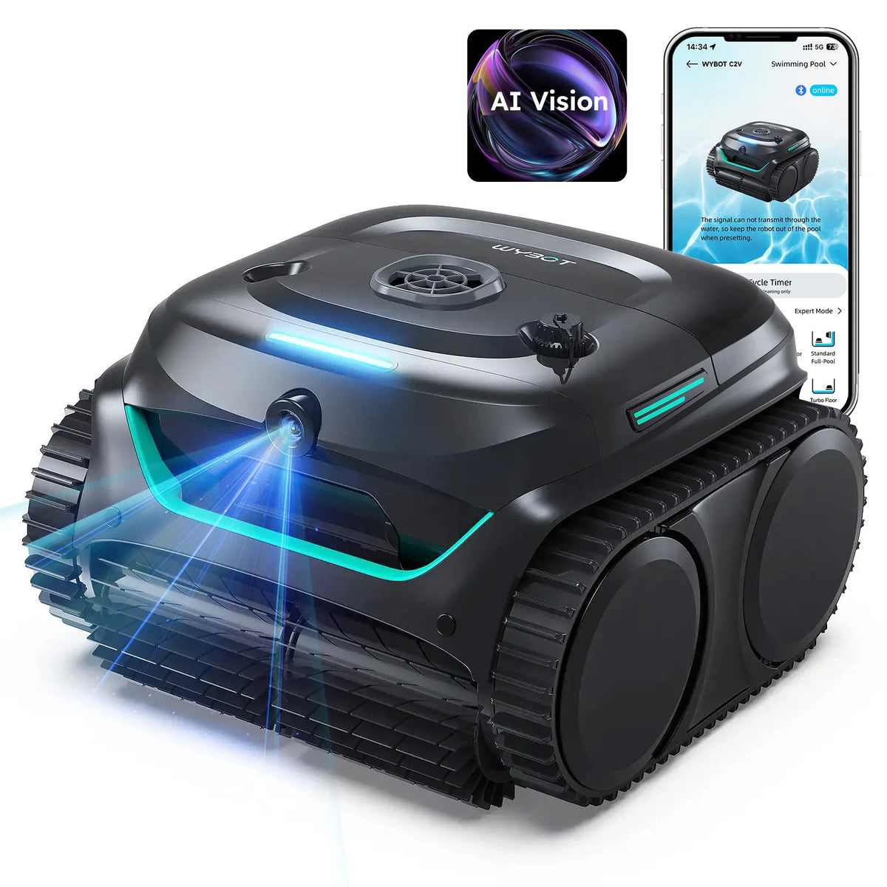
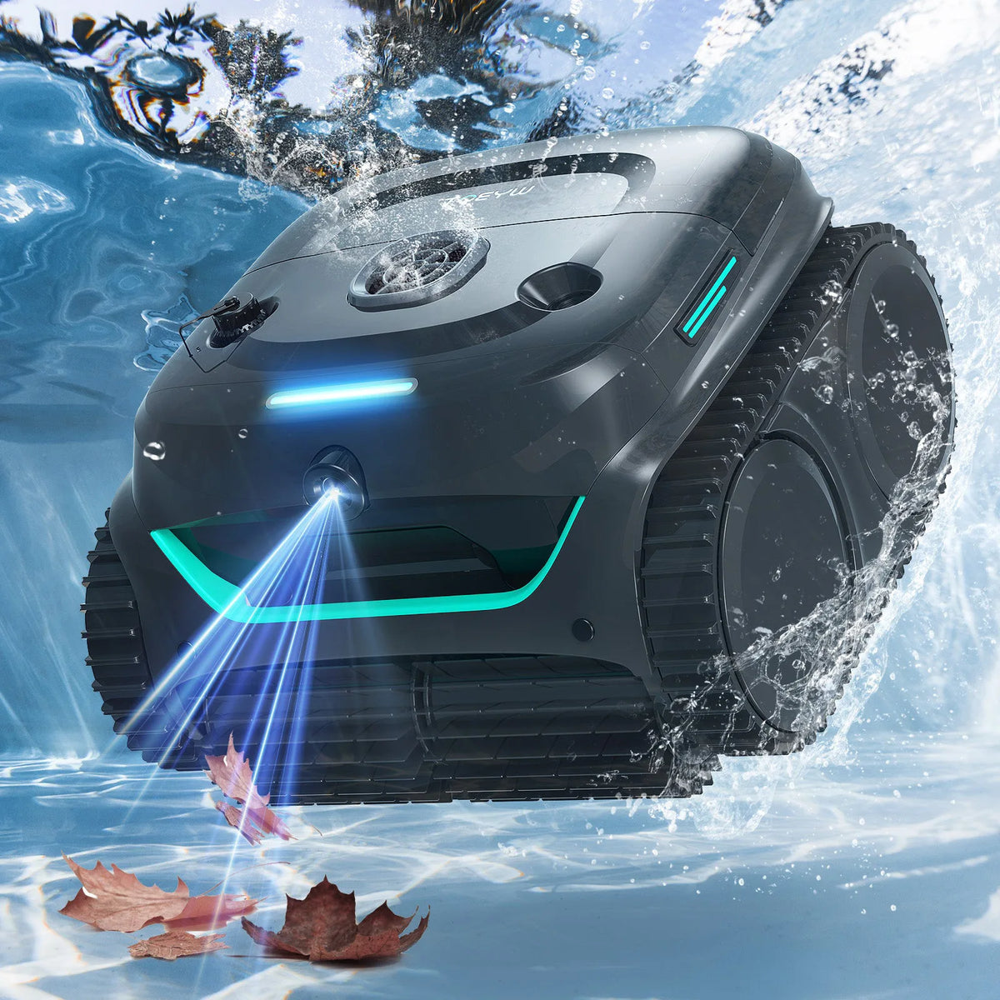
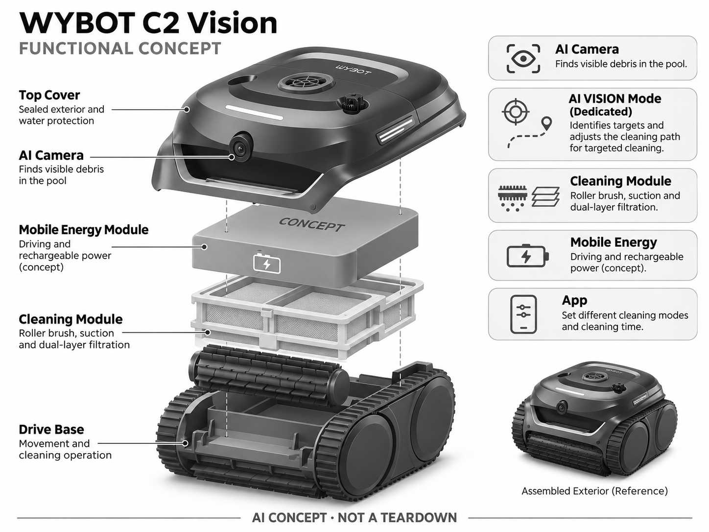

# WYBOT C2 Vision

**WYBOT** · 清洁机器人 · 核查 2026-11-04

以摄像头寻找池底杂物的家庭无绳泳池机

消费渠道：个人零售。

## 产品图片与结构参考

### 产品图

WYBOT C2 Vision 官方产品图 · 来源：[WYBOT · 官方图片](<https://www.wybotpool.com/products/wybot-c2-vision-cordless-robotic-pool-cleaner>) · [原始图片](<https://cdn.shopify.com/s/files/1/0714/0750/1589/files/74b96dbb2d19db9758ba306fc55ad040.webp?v=1767063890&width=1200>)

### 参考图

WYBOT C2 Vision 官方外观、结构或使用参考 · 来源：[WYBOT · 官方图片](<https://www.wybotpool.com/products/wybot-c2-vision-cordless-robotic-pool-cleaner>) · [原始图片](<https://cdn.shopify.com/s/files/1/0714/0750/1589/files/4_240612cc-8296-4058-9a68-f68ef94a7d3b.webp?v=1767063938&width=1200>)

### AI 生成爆炸示意

**AI 生成 · 非实物拆机。** 内部为概念推断，不能作为元件布局、BOM 或维修依据。[生成提示词](../../content/hardware/prompts/wybot-c2-vision.txt)

> 依据官方外观参考与公开功能生成；未披露的内部布局只作概念模块，不构成BOM或真实结构证据。

> 保留官方图片原始内容和出处；画面宣传参数不是本轮独立实测。

> 分析为基于公开资料的案头研究与 AI 辅助判断，未经用户访谈、销量审计或实物拆机。需求、画像、竞争冷门度、审美及商业机会均为研究假设，不是投资结论。

## 销售与购买

- 状态：在售。美国官方商品页有Buy Now；公开商品JSON三个颜色均available=true，本条只计一个C2 Vision型号。

- 地区：美国官方商店

- 价格：US$629.99。核查时官方地区参考价，保留原币种；订阅、税运、附件及优惠以结账为准，预订定金不等于整机价格。

- 中国大陆：本轮核实所列海外官方渠道；中国大陆同型号现货、保修及服务可用性未确认。进口前需核对供电、网络、配件和地区条款。

- [官方产品 / 商店](<https://www.wybotpool.com/products/wybot-c2-vision-cordless-robotic-pool-cleaner>)

## AI 的实际作用

前置AI视觉在专用AI VISION模式寻找杂物并优化目标清洁；普通C2与C2 Vision不同，不把App计时或全部模式统称AI。

服务与联网依赖：AI模式与普通池壁、水线模式需分别选择；App连接、滤网清洗、充电和取放仍需用户完成。

## 是否冷门

细分专业（研究判断）：视觉泳池清洁是细分消费市场中的中价路线，有多品牌和普通自动机竞争，不能以AI命名认定冷门。

## 需求与市场

需求假设：用户想以较低投入改善随机清扫的遗漏，特别是池底集中落叶或可见碎屑。应与同价基础机比较清洁时间和漏检，而不是仅比较导航图或宣称的理论清扫效率。

## 用户画像

画像推断：有小中型私人泳池、愿意亲自取放和洗滤网的房主，可能首次购买带视觉的机型。相较带大型基站的产品，这类家庭更关注价格、提取重量与维修配件可得性。

## 竞争与替代

竞争判断：它既面对其他视觉泳池机，也面对没有AI但价格更低的普通C2等产品。视觉功能需要带来可见清洁改善才能形成溢价，颜色和年度包装变化不应再拆为独立产品充数。

## 供应链

供应链分析：相机防水窗、驱动、滚刷、电池和双层过滤构成主要功能模块，实际芯片和BOM未知。水下图像清晰度、镜窗划伤、密封老化及可替换滤网供应决定长期可用性。

## 技术路径

官方列出独立AI VISION清洁模式及视觉目标识别。技术判断：应明确该模式覆盖边界，不能把普通池壁路线也说成视觉自主；不同池底颜色、颗粒大小与浑水条件可能显著改变结果。

## 产品审美

审美判断：紧凑一体底盘利于收纳，提手、滤盖和状态灯应让日常维护容易理解。水下机器的真实观感包括水渍和磨损，评价重点是抓握安全与易清洗，不是装饰性科技线条。

## 关键风险

风险判断：AI模式并非任意区域或任意杂物都能识别，官网清洁模式需要分开理解。用户仍承担滤网、充电与取放，跨境保修和电池运输会增加成本，不应将低首付等同低全寿命成本。

## 机会与验证

机会假设：针对落叶密集的小池验证视觉的增量价值，记录每次遗漏与人工补扫。若摄像头收益有限，优化滤网清洗和轻量提取可能更能提高复购推荐，值得作为对照研究。

## 功能分层示意

这是功能关系，不是实物拆机、真实空间结构或已核实 BOM。

1. **AI摄像**：寻找池内可见杂物。（官方披露）

2. **专用视觉模式**：目标识别与路径调整。（官方披露）

3. **清洁模块**：滚刷、吸入与双层过滤。（官方披露）

4. **移动能源**：驱动和可充电电源，概念分层。（分析推断）

5. **App**：不同清洁模式与时间设置。（官方披露）

## 来源

1. [WYBOT C2 Vision 官方购买页](<https://www.wybotpool.com/products/wybot-c2-vision-cordless-robotic-pool-cleaner>) — 实际打开核查当前购买或预订入口，未实际下单；价格与交付按具体地区。

2. [WYBOT C2 Vision 官方技术](<https://www.wybotpool.com/pages/wybot-c2-vision>) — 实际打开的官方技术与使用资料，宣传效果并非本轮独立实测。

3. [官方公开商品库存数据](<https://www.wybotpool.com/products/wybot-c2-vision-cordless-robotic-pool-cleaner.js>) — 实际读取商店公开商品JSON，available为true；不是只凭页面存在判断在售。

[返回目录](../hardware-market.md) · [网页分析](https://romanagent.github.io/Roman/#hardware/product/wybot-c2-vision)
