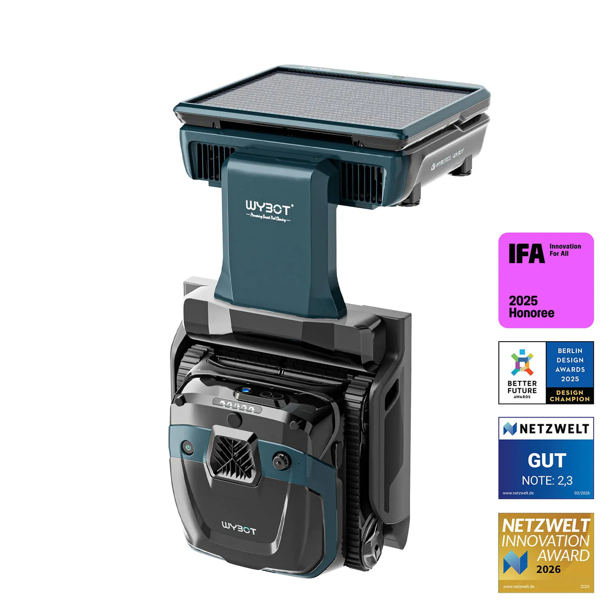
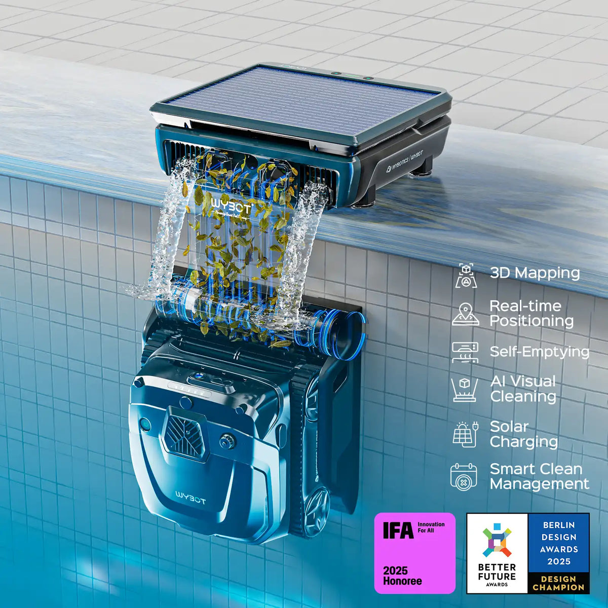
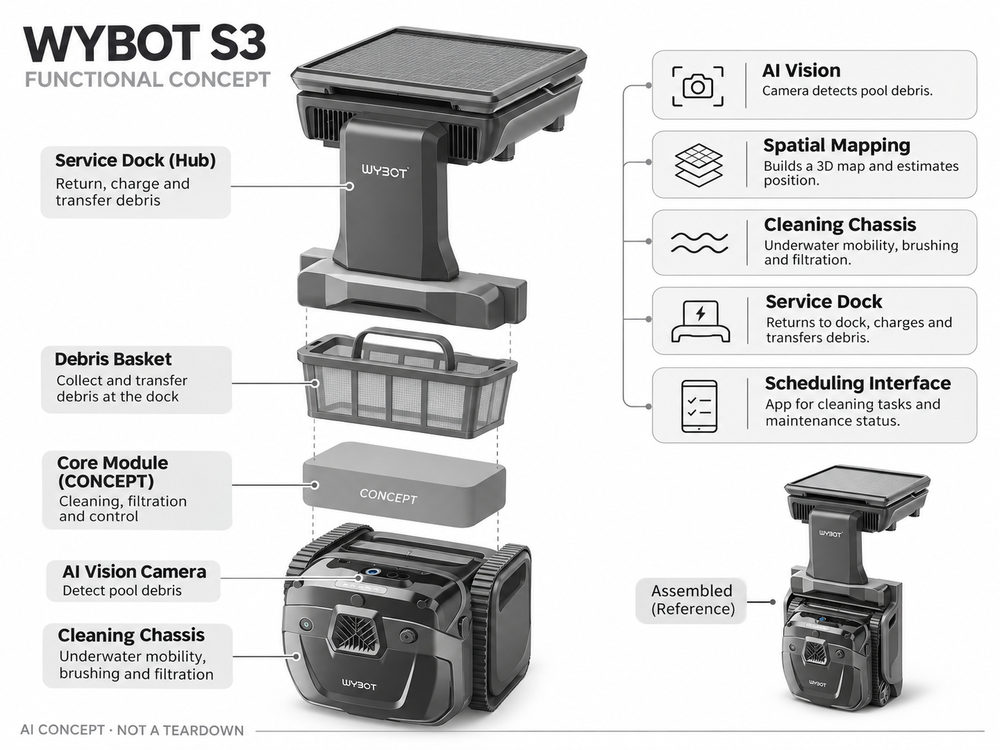

# WYBOT S3

**WYBOT** · 清洁机器人 · 核查 2026-11-04

带基站集污的家庭泳池视觉清洁系统

消费渠道：个人零售。

## 产品图片与结构参考

### 产品图

WYBOT S3 官方产品图 · 来源：[WYBOT · 官方图片](<https://www.eu.wybotpool.com/products/wybot-s3-self-emptying-robotic-pool-cleaner-3d-mapping-ai-vision>) · [原始图片](<https://cdn.shopify.com/s/files/1/0867/3702/7352/files/S3-_1.webp?v=1776394500&width=1200>)

### 参考图

WYBOT S3 官方外观、结构或使用参考 · 来源：[WYBOT · 官方图片](<https://www.eu.wybotpool.com/products/wybot-s3-self-emptying-robotic-pool-cleaner-3d-mapping-ai-vision>) · [原始图片](<https://cdn.shopify.com/s/files/1/0867/3702/7352/files/2_27d7d4e8-9463-463b-83db-f40743dff80b.webp?v=1776394500&width=1200>)

### AI 生成爆炸示意

**AI 生成 · 非实物拆机。** 内部为概念推断，不能作为元件布局、BOM 或维修依据。[生成提示词](../../content/hardware/prompts/wybot-s3.txt)

> 依据官方外观参考与公开功能生成；未披露的内部布局只作概念模块，不构成BOM或真实结构证据。

> 保留官方图片原始内容和出处；画面宣传参数不是本轮独立实测。

> 分析为基于公开资料的案头研究与 AI 辅助判断，未经用户访谈、销量审计或实物拆机。需求、画像、竞争冷门度、审美及商业机会均为研究假设，不是投资结论。

## 销售与购买

- 状态：在售。欧洲商品页提供Buy Now，公开商品JSON标注available=true与当前价格；未使用返回404的旧美国链接。

- 地区：欧洲官方商店

- 价格：€2,499.99。核查时官方地区参考价，保留原币种；订阅、税运、附件及优惠以结账为准，预订定金不等于整机价格。

- 中国大陆：本轮核实所列海外官方渠道；中国大陆同型号现货、保修及服务可用性未确认。进口前需核对供电、网络、配件和地区条款。

- [官方产品 / 商店](<https://www.eu.wybotpool.com/products/wybot-s3-self-emptying-robotic-pool-cleaner-3d-mapping-ai-vision>)

## AI 的实际作用

AI视觉辨识杂物并结合三维映射与位置估计优化清洁，设备返回池边基站转移垃圾和补能。

服务与联网依赖：基站安装、泳池环境和App设置是使用前提；自动排污不能免除基站垃圾收集和定期维护。

## 是否冷门

细分专业（研究判断）：私人泳池自集污系统属于较窄消费品类，竞争者少于普通清洁机但机械交付门槛更高。

## 需求与市场

需求假设：泳池主希望少捞起机器人清理垃圾，并在多天周期内维持水底整洁。应记录实际自主返回成功率和基站维护频次，自动排污宣传不能直接换算成长期完全无需照看的承诺。

## 用户画像

画像推断：具备固定私人泳池和基站安装位置的家庭，尤其在意长期维护便利。租房、季节性充气池或经常改变布局的用户安装收益较低，不能把所有泳池拥有者看成同一市场。

## 竞争与替代

竞争判断：自集污基站使其与普通无绳池底机拉开形态差异，也与Beatbot洗滤底座竞争。两者的搬运、返回与滤网维护链路不同，需用实际流程比较，不能只根据基站存在判断优劣。

## 供应链

供应链分析：水下机器人、定位感知、充电和垃圾转移基站构成系统；实际工厂及BOM未公开。水密接口、软管堵塞、池边固定可靠性和跨季节保养是供应链与售后共同承担的成本。

## 技术路径

官方说明三维映射、位置估计与AI视觉清洁。技术判断：定位漂移和基站对接会影响整体任务完成，检测杂物只是其中一步；透明水体中的反光及相似池壁纹理都需要实地验证。

## 产品审美

审美判断：水池旁新增基站带来固定设备感，位置安排和线缆管理会影响景观。结构应便于清理集污容器、辨认状态和离水检修，较大的设备体量不宜只用宣传渲染图判断接受度。

## 关键风险

风险判断：复杂系统可能把人工捞取问题变成对接故障与基站维护问题。购买前需确认池形兼容、安装条件和当地服务；自动排污不代表水质消毒，设备运行也不能替代家庭泳池安全管理。

## 机会与验证

机会假设：围绕真实家庭的维护链路建立试用，比较人工取放次数、返航失败和容器处理时间。若核心问题在安装，可先提供选型与安装服务，再决定是否开发更复杂的自主基站。

## 功能分层示意

这是功能关系，不是实物拆机、真实空间结构或已核实 BOM。

1. **AI视觉**：相机检测杂物。（官方披露）

2. **空间映射**：三维地图与位置估计。（官方披露）

3. **清洁底盘**：水下移动、刷洗和过滤。（官方披露）

4. **服务基站**：返回、充电和垃圾转移。（官方披露）

5. **调度界面**：App任务与维护状态。（官方披露）

## 来源

1. [WYBOT S3 官方购买页](<https://www.eu.wybotpool.com/products/wybot-s3-self-emptying-robotic-pool-cleaner-3d-mapping-ai-vision>) — 实际打开核查当前购买或预订入口，未实际下单；价格与交付按具体地区。

2. [WYBOT S3 官方技术页](<https://www.eu.wybotpool.com/pages/wybot-s3>) — 实际打开的官方技术与使用资料，宣传效果并非本轮独立实测。

3. [官方公开商品库存数据](<https://www.eu.wybotpool.com/products/wybot-s3-self-emptying-robotic-pool-cleaner-3d-mapping-ai-vision.js>) — 实际读取商店公开商品JSON，available为true；不是只凭页面存在判断在售。

[返回目录](../hardware-market.md) · [网页分析](https://romanagent.github.io/Roman/#hardware/product/wybot-s3)
